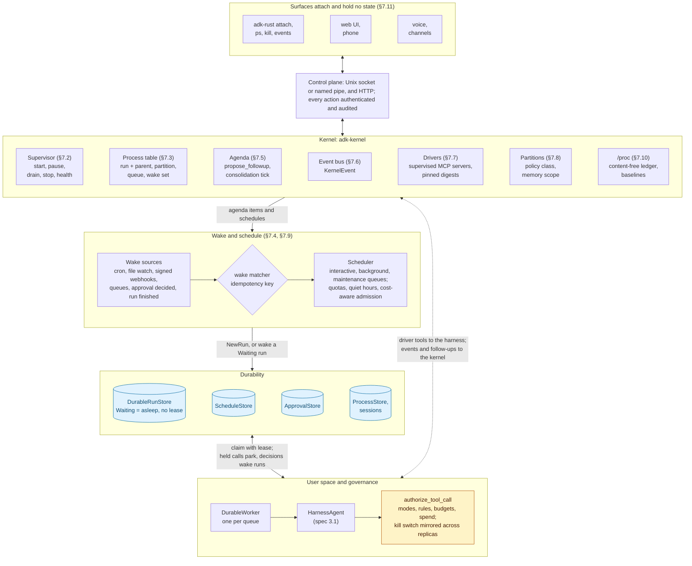

# Spec 3.2: Agent Kernel — the always-on form of the HarnessAgent

| | |
|---|---|
| **Status** | Draft / RFC |
| **Builds on** | [`spec-3.1-harness-agent.md`](spec-3.1-harness-agent.md): the kernel is the harness's resident form. `kernel` is an opt-in feature of `adk-harness` that adk-cli's `harness` feature and the umbrella's `full` turn on (owner, 2026-10-22, [§13](#13-open-questions) Q6; the dependency direction is fixed in [§7.1](#71-crate-layout-and-features)) |
| **Target** | `adk-rust` 3.2.0 (supervisor, process model, wake sources, event bus, control plane, CLI); 3.2.x for drivers with manifests, partitions, `/proc` baselines, service installation, the Windows deliverables and the managed form. Design labels: work from specs 3.1–3.4 ships in the unreleased 3.0.0 (owner, 2026-10-21) |
| **Grounding commit** | `origin/main` @ `f9422254` for every `file:line` reference (re-verified 2026-10-22 after #985; regrounded the same day at `e346405d`; first grounded at `a24ebd8d`, before spec 3.1 was built) |
| **Regrounded** | 2026-10-22, after spec 3.1's implementation (#929–#980): every citation re-verified by script against `e346405d`, which adds #977 (shared mode and rule stores, `adk-rust serve --store`, the checkpointer of the store in use), then against `f9422254`, which adds #985 (S1: worker hooks and the suspend path); [§10](#10-changes-outside-the-new-crate) and [§12](#12-phased-delivery) phase 0 carry their status on `main`; [§7](#7-component-specifications) reuses what spec 3.1 built instead of specifying it again; [Implementation status](#implementation-status) lists every item |
| **Decided** | 2026-10-22 (owner): the fourteen questions of [§13](#13-open-questions) — the thirteen the regrounding left open and the park-on-freeze question #985 raised — are decided; rows 1, 5, 9 and 14 record a changed recommendation. The consequences are folded into [§7](#7-component-specifications), [§9](#9-security-invariants-and-audit-records), [§10](#10-changes-outside-the-new-crate) (new rows S3, S4, A2, T2, E1, HK3, AX1, AX2) and [§12](#12-phased-delivery) |
| **Affected crates** | NEW `adk-kernel`; `adk-harness` (feature `kernel`: `Harness::kernel`, `propose_followup`, the mode and effect-class mappings, a public distillation entry); `adk-cli` (`adk-rust up`, `attach`, `ps`, …); additive changes in `adk-server` (worker hooks and suspend path, #985; park-on-freeze and the freeze delegate), `adk-tool` (MCP lifecycle events, stdio launcher, re-issue of a parked call), `adk-eval` (ledger statistics), `adk-devtools` (Windows process trees and no-follow opens), `adk-sandbox` (Windows enforcer); `adk-managed` (managed form) |
| **Stability** | `adk-kernel` enters at **Beta** |
| **Surfaces** | [`spec-3.3-harness-ui.md`](spec-3.3-harness-ui.md): the per-session surface feed that `/kernel/events` generalises, the decision contract every surface renders, pairing tokens the control plane honours |
| **Self-improvement** | [`spec-3.4-self-improving-harness.md`](spec-3.4-self-improving-harness.md): the consolidation tick's defect-mining and proposal tools, the `self-improver` `Maintenance` process, and the supervisor's pinned patch upgrade with snapshot and rollback |

---

## Implementation status

On `origin/main` @ `f9422254`. A done item names the pull request that delivered it; "exists" names the parts an item composes. `adk-kernel` does not exist yet, so every kernel item is Not started.

| Phase | Item | Status | On `main`, or what is missing |
|---|---|---|---|
| 0 | A1 ambient adapters public | Done | Exported from `adk_agent::ambient` already at `a24ebd8d`; the idempotency field is dropped ([§10](#10-changes-outside-the-new-crate) A1) |
| 0 | S1 background machinery outside the server, worker hooks, suspend path | Done | Constructible and composed outside the HTTP server by adk-cli (#935, #953); `WorkerHooks`, `ParkReason`, `DurableWorker::suspend` and the `SuspendGate` (#985). Park-on-freeze is S3 (phase 1) |
| 0 | S2 control-plane mount and `/runs` owner checks | Done | Owner checks (#932); authenticated durable runs and `/api/cron` owners (#965); `add_api_routes` exists |
| 0 | `/runs` owner checks (3.1 §8.2) | Done | #932; runs and cron jobs execute as their authenticated submitter (#965) |
| 0 | T1 MCP lifecycle events and stdio launcher | Not started | Statuses are polled; the server command is spawned as configured |
| 0 | 3.1 D1 `CommandLauncher` | Done | #931; drivers use 3.1 §10 S1's `sandboxed_command` (#933) instead |
| 1 | `Kernel` supervisor, lifecycle, `freeze` that parks | Not started | Exists: `DurableWorker` and `WorkerHandle` with the suspend path (#985), `DurableScheduler`, `StoreApprovalService::with_run_store`, `GovernanceControl::mirrored` with `freeze_recorded`, and `adk-rust serve`'s composition of them (#943, #953), with one shared backend under `--store` (#977) |
| 1 | S3 park-on-freeze (`on_governance_refusal`, `ParkReason::Frozen`), S4 freeze delegate on `GovernanceController` | Not started | Exists: the worker parks a refused run only after `suspend` was requested (#985); `POST /api/admin/freeze` cancels and reports `cancelledRuns` only |
| 1 | Process model, `ProcessStore` on in-memory, SQLite, PostgreSQL, Redis | Not started | Exists: `RunRecord` with principal and `authenticated` (#965); no metadata field, so the side table is needed; no file backend ([§13](#13-open-questions) Q8) |
| 1 | HK3 goals on `Graph` with checkpoint retention, the stall, the process view | Not started | Exists: `GoalEngine::Graph` through `checkpointer_from_url` (#977); no retention policy on goal threads |
| 1 | Wake sources and the wake matcher | Not started | Exists: cron and file triggers, `WebhookIngress`, `QueueIngress`, keyed schedule firings; `Harness::ambient_goal` (#944) is the kernel-less form |
| 1 | Event bus and SSE sink | Not started | Needs S1 hooks and T1 events |
| 1 | Control plane over a socket and loopback HTTP | Not started | Exists: loopback and bearer extractors and the `operator` scope (#943) |
| 1 | HK1 harness glue | Not started | — |
| 1 | `up`, `attach`, `ps`, `kill`, `suspend`, `resume`, `freeze`, `events` | Not started | Exists: `serve`, `goal`, `approvals`, `rules` (#943, #953) |
| 2 | Agenda, `propose_followup`, `ProactivityPolicy` | Not started | Exists: the inbox's `ApprovalRequest` with `allowed_actions`, as 3.1 §7.21 uses it (#956) |
| 2 | Consolidation tick (HK2): admission gates, the two consolidation passes, `memory undo` | Partly done | The distiller exists with quote promotion (#951) and is crate-private; no tick, no public entry, no consolidation pass |
| 2 | Priority queues, preemption, quotas, quiet hours, cost-aware admission | Not started | Exists: per-queue workers, as the goal queue runs (#953, #955); preemption needs the S1 suspend path |
| 2 | `agenda`, `nice`, `wake` commands | Not started | — |
| 3 | Drivers: manifests, mount approval, digest pinning, `NeedsReapproval` | Not started | Exists: digest-bound standing rules and `harness.rule.stale` (#934); per-server elicitation and sampling handlers (#956); needs T1 |
| 3 | T2 re-issue of a parked MCP call across a restart | Not started | Exists: `McpToolset::call_tool_with_retry` runs the retry loop in memory; `McpTaskConfig::enable_tasks` is off |
| 3 | Partition crossings as fingerprints within one run | Not started | Exists: `ToolConfirmationRequest::fingerprint` and `RunConfig::tool_approvals` |
| 3 | Partitions with memory scoping and crossings | Not started | Exists: `AgentPrincipal` class and tenant, `PolicyRule::for_class`, project-scoped memory, `FactScope.project` (#951) |
| 3 | `drivers`, `partitions` commands | Not started | — |
| 4 | `/proc` ledger, live aggregates, OTel histograms | Not started | Exists: `harness.spend`, spans and the loop guard (#942) as ledger inputs; `adk-telemetry`'s GenAI semconv module |
| 4 | E1 ledger statistics in `adk-eval`, `cargo adk eval --ledger`, baselines behind `proc-baselines` | Not started | Exists: `BaselineStore`, `TraceAnalyzer` |
| 4 | Kernel stores on MongoDB, Firestore, Neo4j (Alpha) | Not started | Exists: the run, schedule and governance stores on each |
| 4 | Service installation (launchd, systemd, Windows) | Not started | — |
| 4 | W1–W4, W6 | Not started | Unix-only process groups, no-follow opens and `0600` modes |
| 5 | `KernelDef` (M1) | Not started | Exists: `HarnessDef` in `ManagedAgentDef::metadata` and `HarnessResolver` (#970) |
| 5 | Channel wake sources | Not started | No channel crate on `main` |
| 5 | Voice decisions on parked processes | Not started | Exists: the voice surface (#976), whose decisions stay in its own realtime session |
| 5 | W5 restricted-token enforcer | Not started | The Windows enforcer is a stub |
| 1–2 | Agentrix OS adopts `adk-kernel` ([§13](#13-open-questions) Q5) | Not started | Starts when the phase-1 public API freezes; Agentrix pins adk-rust by commit |
| — | Dependencies outside this spec | Partly done | #977 merged (shared mode and rule stores, `adk-rust serve --store`, the checkpointer of the store in use); the REST routes for standing rules (3.1 §7.5) are not on `main` yet |

## 1. Summary

In 2026 the agent products people want are no longer sessions: they keep memory, permissions and task state between runs and keep working while the user is away. The reported Codex "persistent mode" sleeps and re-samples, and its "proactivity" generates follow-up tasks across sessions, with changes outside the user's system still needing approval; OpenClaw's gateway is a daemon that owns sessions, channel routing, tool dispatch, a heartbeat and scheduled tasks, with every client attaching to it; Cloudflare Computer gives each agent its own computer whose file and shell actions are gated and audited; the AIOS and AgentOS papers call the layer that owns scheduling, context, memory, storage and access control an *agent kernel*. None of these is governed, durable and portable at once: the daemon has weak defaults, the hosted computers run only on the vendor's cloud, and the kernel papers are research ([sources](#references)).

ADK-Rust already holds most of a kernel: durable runs that park and resume under fenced leases ([`adk-core/src/run_store.rs`](../../adk-core/src/run_store.rs), [`adk-server/src/background/worker.rs`](../../adk-server/src/background/worker.rs)), a scheduler and schedule store, ambient triggers for cron, file changes and webhooks, signed webhook ingress, queue ingress, a replicated kill switch, supervised MCP child processes with restart policies, identity with tenants and classes, budgets, a spend ledger and a signed audit log. Since spec 3.1 it also holds the user space the kernel hosts: the `HarnessAgent` with modes and standing rules as a policy, goals on durable runs, long-term facts, and `adk-rust serve`, which already composes the approvals inbox, background runs and the goal target in one process ([`harness_cli.rs:1665-1766`](../../adk-cli/src/harness_cli.rs)). What is missing is the one thing that turns those parts into an always-on system: a **resident supervisor with a process model, wake semantics and an event bus**. That is the Agent Kernel.

The kernel is a core capability of the harness, not a separate product. `adk-rust up` starts it; the spec 3.1 harness is the user-space it hosts; Agentrix OS ([§4](#4-relationship-to-spec-31-and-agentrix-os)) becomes a thin application on it.

Three rules shape the design:

| Rule | Consequence |
|---|---|
| **Always resumable, not always running.** An agent that is asleep costs nothing: no model calls, no lease, no CPU. "Always on" means a wake set and durable state, not a hot loop. | Sleep is the `Waiting` state of a durable run with a recorded wake set; the kernel wakes it on time, event, message, approval or completion ([§7.4](#74-sleep-and-wake)). |
| **Every wake is a governed run.** Whatever wakes an agent, the work it does passes the same path as an interactive turn: policy, guardrails, confirmation, ledger, audit. Proactive work is a queue a human can see, bound by budget and quiet hours. | Wake sources produce `NewRun`s, never direct tool calls ([§7.4](#74-sleep-and-wake), [§7.5](#75-proactivity)). |
| **The kernel owns state, surfaces attach.** CLI, web, phone and voice are terminals on one running system; closing a laptop changes nothing. | A control plane over a local socket and HTTP, with the same API for every surface ([§7.11](#711-control-plane-and-surfaces)). |

## 2. Goals

- **G1.** `adk-rust up` keeps a user's agents alive across laptop sleep, process restarts and host reboots, on macOS, Linux and Windows, and on servers, containers and the managed runtime.
- **G2.** An agent that is asleep makes no model calls and holds no lease; wake latency on a local event is under two seconds and on a scheduled time within one scheduler tick.
- **G3.** Every piece of background work is a durable run under the harness's modes, standing rules, budgets and audit; nothing bypasses `authorize_tool_call`.
- **G4.** Proactive work (follow-ups the agent proposes for itself) is visible, approvable, budgeted and bounded by quiet hours before it runs.
- **G5.** Any surface attaches to the running kernel and sees the same process table, agenda, inbox and event stream; an approval from a phone resumes a run started in a terminal.
- **G6.** Integrations are supervised processes with declared capability manifests; a driver that crashes restarts with backoff, and a driver that changes its tool declarations needs re-approval.
- **G7.** Partitions keep areas of a user's life or an organisation's teams isolated by default, with cross-partition work only through the coordinator and under approval.
- **G8.** The kill switch stops every process on every replica within one second and resumes them later without re-executing anything.
- **G9.** The kernel observes itself: a content-free activity ledger, per-user baselines and drift observations phrased in neutral language, with the model phrasing only.

## 3. Non-goals

- **N1.** Not a new runtime, scheduler algorithm or orchestration model. The durable worker, schedule store, ambient triggers, teams and graphs are reused as they are.
- **N2.** Not a hosted service. The kernel runs where the user puts it; the managed runtime remains the multi-tenant hosted form ([§7.13](#713-managed-form)).
- **N3.** Not a chat UI or a mobile app. Surfaces attach through the control plane; the embedded web UI and chat channels are their own roadmap items.
- **N4.** Not an operating system in the hardware sense: no device drivers below MCP and HTTP, no process isolation beyond what `adk-sandbox` and containers provide.
- **N5.** Not information-flow labels. Untrusted content stays confined to the delimited blocks of spec 3.1 §7.7 and §7.20.

## 4. Relationship to spec 3.1 and Agentrix OS

Spec 3.1 defines the agent (`HarnessAgent`), its policy (`HarnessMode` as a `ToolPolicy`), standing approvals, the shell, the team, the plan graph and the goal engine. Spec 3.2 defines the process the agent lives in. Everything that happens inside a run is 3.1; everything about when a run exists, what wakes it, how it is scheduled and how the user reaches it is 3.2. The `kernel` feature of `adk-harness` carries the glue between the two ([§7.1](#71-crate-layout-and-features)), and adk-cli enables it, so `cargo install adk-cli` gives both.

Agentrix OS ([`zavora-ai/agentrix-os`](https://github.com/zavora-ai/agentrix-os), `docs/PERSONAL_AI_OS.md`) worked out the operating-system framing for a single person's digital life. Its concepts transfer as follows:

| Agentrix concept | Kernel equivalent | Note |
|---|---|---|
| Mother Agent as kernel and scheduler | The kernel supervisor plus a harness coordinator (3.1 §7.10) | The Mother has no outside-reaching tools; the coordinator inherits that as a partition rule |
| Specialised agents, one per life area | Harness members and partitions' default agents | Members are 3.1 `MemberSpec`s |
| Work World / Home World | Partitions ([§7.8](#78-partitions)) | Isolated memory scopes and policy classes, reconciled only by the coordinator |
| Observe / Suggest / Automate per agent, per tool effect (§10) | `HarnessMode` ReadOnly / Ask / Auto per partition and agent; effect classes are 3.1 `ToolKind` plus driver manifests | Plan mode has no Agentrix counterpart |
| Agent contract `agents/<world>/<agent>.toml` with `[tools]` effect classes (§6.1) | Driver manifest ([§7.7](#77-drivers)) | The declarative half of an integration |
| Activity ledger, content-free (§7.1) and personal baseline (§8) | `/proc` self-observation ([§7.10](#710-proc-self-observation)) | Median/MAD, 14-day warm-up, cooldowns, neutral language |
| Recipes ("when X, do Y") (§2.5) | Standing rules (3.1 §7.5) plus plan graphs (3.1 §7.11) on a wake set | A recipe is an approved automation bound to a trigger |
| Memory items `known` / `assumed` / `recommended` with provenance (§11) | Long-term facts in the harness `FactStore` (3.1 §7.15.2): `Known` / `Assumed` status, source, verified quote, supersession | Proactive consolidation writes only `Assumed` facts |
| Pending actions, approvals inbox, audit, undo | 3.1 approvals, the approvals inbox, the signed audit log | Undo is a 3.2.x item |
| Ten design principles (§1.3) | Carried into [§9](#9-security-invariants-and-audit-records): least privilege, human in control, honest data, memory is the user's, health and money stay conservative | |

What does not transfer: the Mother Agent as a special class of agent (it is a harness in a coordinator role), and the spatial UI (a surface).

## 5. Headline capabilities and demonstration scenarios

Each scenario is a test in `examples/harness_kernel` ([§11](#11-testing-and-live-verification)); the pass condition is asserted on stores, processes, timings and audit records.

| # | Capability | Scenario | Pass condition | Machinery |
|---|---|---|---|---|
| K1 | **Leave it running.** The kernel survives sleep, restarts and reboots and keeps its promises | `adk-rust up --install`; schedule a nightly goal; reboot the host; next morning | The goal ran once at its time; the process table shows it `Completed`; the audit log has one iteration chain | service install ([§7.12](#712-service-installation)), `DurableScheduler`, `ScheduleStore`, `DurableWorker` |
| K2 | **Sleep is free.** Asleep means no model calls, no lease, no CPU | Put ten agents to sleep on wake sets; wait an hour | Zero model calls, zero spend, zero claimed leases; `ps` shows ten `Waiting` with their wake sets | `RunState::Waiting`, `WakeSet` ([§7.4](#74-sleep-and-wake)) |
| K3 | **It wakes on what matters.** Time, a file change, a signed webhook, a channel message, an approval, a finished run | Save `Cargo.lock`; a run wakes within 2 s and audits the repo; a webhook wakes another | Each wake creates one governed run with the wake reason in its record; duplicate deliveries wake nothing | `EventSource`, `FileWatchTrigger`, `WebhookIngress`, idempotency keys |
| K4 | **It proposes its own work, under control.** Follow-ups the agent proposes queue for approval, bounded by budget and quiet hours | The agent proposes "re-run the tests after the dependency bump lands" | The proposal appears in the agenda as `Proposed`; in Ask mode nothing runs until approved; in Auto it runs after quiet hours within the daily budget | agenda, `ProactivityPolicy` ([§7.5](#75-proactivity)) |
| K5 | **One job, many windows.** Every surface attaches to the same running state | Start a goal in the terminal; close the laptop lid; approve the held call from a phone over the control plane | The run resumes without the terminal; `attach` from a new shell shows the same process and transcript | control plane ([§7.11](#711-control-plane-and-surfaces)), parked approvals |
| K6 | **Drivers you can trust.** Integrations are supervised processes with manifests | Mount an MCP driver; kill it; redeclare one of its tools | It restarts with backoff; the changed tool is marked stale and its standing rules stop matching until re-approved | `McpServerManager`, driver manifests ([§7.7](#77-drivers)), 3.1 digest binding |
| K7 | **Partitions.** Work and home never see each other's data | A work agent asks for a home calendar | Denied at the policy; the coordinator can ask, under approval, and the audit shows the crossing | partitions ([§7.8](#78-partitions)) |
| K8 | **Attention.** A human message preempts background work; quotas hold | Start three background runs at the per-partition quota; type a message | The message's run starts within one tick; one background run is parked and requeued; the quota is never exceeded | priority queues, preemption ([§7.9](#79-scheduling-attention-and-resources)), the worker's suspend path ([§10](#10-changes-outside-the-new-crate) S1) |
| K9 | **One switch stops everything.** Freeze across replicas | Two kernel replicas, six running processes; `freeze` | Every process stops within 1 s on both replicas; `unfreeze` resumes them; the ledger shows no tool executed twice | `GovernanceControl::mirrored`, `freeze_recorded`, the worker's suspend path and park-on-freeze ([§10](#10-changes-outside-the-new-crate) S3), action ledger |
| K10 | **It notices drift without judging.** Content-free ledger and baselines | Two weeks of late finishes | One observation in neutral language, offered as a question, after the warm-up and cooldown rules | `/proc` ([§7.10](#710-proc-self-observation)) |

K1, K2, K8 and K9 together — durable, free when asleep, preemptible, freezable everywhere — have no equivalent in any shipping agent product.

## 6. Architecture



Cylinders are stores; the amber node is the governed path. A sleeping process is a `Waiting` run with no lease, so asleep costs nothing until a wake source or a decision moves it back to the queue.

**Decisions**

| | Decision | Grounding |
|---|---|---|
| **D-1** | The kernel is the harness's resident form: one `adk-kernel` crate for the runtime pieces, a `kernel` feature in `adk-harness` for the glue, `adk-rust up` as the command. `adk-kernel` never depends on `adk-harness`. | A separate crate because the kernel composes `adk-server`'s background machinery, `adk-agent`'s ambient triggers and `adk-tool`'s MCP manager, which `adk-harness` should not depend on wholesale. The direction avoids a cycle: the harness glue uses kernel types, and the kernel hosts any `Arc<Runner>` target as `DurableWorker::with_agent` does ([`worker.rs:433`](../../adk-server/src/background/worker.rs)) |
| **D-2** | A process is a durable run. The process table is a view over `DurableRunStore` plus a kernel-owned side table. | `RunRecord` has no metadata field ([`run_store.rs:388-460`](../../adk-core/src/run_store.rs)); a side table avoids a schema change across six backends |
| **D-3** | Every wake produces a `NewRun` (or wakes a parked run); no wake source calls a tool directly. | `WebhookIngress`, `QueueIngress` and the scheduler already enqueue keyed `NewRun`s ([`ingress.rs:216`](../../adk-server/src/webhooks/ingress.rs), [`queue_source.rs:440`](../../adk-core/src/queue_source.rs), [`schedule.rs:176`](../../adk-core/src/schedule.rs), [`scheduler.rs:152`](../../adk-server/src/background/scheduler.rs)) |
| **D-4** | Asleep is `Waiting` with a recorded wake set and no lease. | `RunState::Waiting` and `DurableRunStore::wait`/`wake` ([`run_store.rs:88, 704, 712`](../../adk-core/src/run_store.rs)) |
| **D-5** | Priority is a queue. Workers are configured per queue; `nice` moves a run between queues. | `NewRun.queue` and `DurableWorkerConfig.queue` exist ([`run_store.rs:189`](../../adk-core/src/run_store.rs), [`worker.rs:170`](../../adk-server/src/background/worker.rs)); `claim` takes a queue and no priority ([`run_store.rs:676`](../../adk-core/src/run_store.rs)); the harness already runs goals on their own queue ([`goal.rs:63`](../../adk-harness/src/goal.rs)) |
| **D-6** | Drivers are MCP child processes supervised by `McpServerManager`, described by a manifest that extends `McpServerConfig`. | [`adk-tool/src/mcp/manager/manager.rs:61-1305`](../../adk-tool/src/mcp/manager/manager.rs), [`config.rs:63-143`](../../adk-tool/src/mcp/manager/config.rs) |
| **D-7** | Surfaces attach over a control plane and hold no state; the same API serves the CLI, the web UI and phones. | OpenClaw's gateway shape, with authentication and audit; `adk-rust serve` already serves the approvals inbox and runs to authenticated callers (#943, #965) |
| **D-8** | Cross-platform by construction, with Windows gaps named as deliverables, not caveats. | [§7.12](#712-service-installation), [§10](#10-changes-outside-the-new-crate) W1–W6 |
| **D-9** | The kernel extends the composition `adk-rust serve` builds and does not build a second one. | `serve` wires the approval service with `operator` routing and run-store wake-ups, background runs with the `adk-rust` and `harness.goal` targets, the loopback or bearer extractor, and with `--store` one shared backend for sessions, approvals, runs, modes, rules and plan checkpoints ([`harness_cli.rs:1665-1766`](../../adk-cli/src/harness_cli.rs), #977) |

## 7. Component specifications

### 7.1 Crate layout and features

```text
adk-kernel/src/
  lib.rs            re-exports, feature gates
  kernel.rs         Kernel, KernelBuilder, KernelConfig, lifecycle (start/stop/pause/drain), health
  process.rs        Process, ProcessTable (view over DurableRunStore + ProcessStore), ps/kill/nice/suspend/resume
  wake.rs           WakeSet, WakeSource trait, adapters: cron, file, webhook, queue, approval, run-finished, channel
  agenda.rs         Agenda, AgendaItem, ProactivityPolicy, the consolidation tick
  bus.rs            KernelEvent, EventBus, EventSink (SSE, channels, webhooks out, audit)
  drivers.rs        DriverManifest, EffectClass, DriverStore, DriverSupervisor over McpServerManager
  partition.rs      Partition, PartitionMode, PartitionStore, quotas
  sched.rs          priority queues, preemption, quotas, quiet hours, cost-aware admission
  proc.rs           activity ledger, baselines, observations
  control/          control plane: API types, local-socket transport, HTTP router, auth
  service/          launchd · systemd · Windows service installation            [service]
  stores/           in-memory · sqlite · postgres · redis backends for the kernel-owned stores   [sqlite, postgres, redis]

adk-harness/src/kernel.rs   Harness::kernel, propose_followup, mode and effect-class mappings   [kernel]
```

| Feature | Default | Pulls in |
|---|---|---|
| `sqlite` | on | SQLite backends for `ProcessStore`, `AgendaStore`, `DriverStore`, `PartitionStore`, `LedgerStore`; in the CLI they live in `harness.db` beside the harness stores, on its one pool with distinct migration tables (`HarnessDb`, `open_harness_db`, [`sessions.rs:69, 110`](../../adk-cli/src/sessions.rs)) |
| `postgres`, `redis` | off | Shared kernel stores for replicas (phase 1), opened from the same URL as `adk-rust serve --store`, which keeps sessions, approvals, runs, modes, rules and plan checkpoints in one PostgreSQL or Redis backend (#977, `SharedStores`, [`shared_store.rs:14, 31`](../../adk-cli/src/shared_store.rs)). There is no file backend: no durable store on `main` is file-backed and the CLI persists in `harness.db` ([§13](#13-open-questions) Q8) |
| `mongodb`, `firestore`, `neo4j` | off | The remaining backends that hold the run, schedule and governance stores (phase 4), labelled Alpha until their conformance suites pass in CI ([§11](#11-testing-and-live-verification)); Vertex AI holds sessions only and is excluded |
| `webhooks` | on | `adk-server/webhook-ingress` |
| `queues` | off | queue adapters beyond the in-memory source |
| `channels` | off | channel wake sources (Telegram, Slack) once the channel work lands |
| `drivers` | on | `adk-tool` MCP manager; `adk-sandbox` for the stdio launcher ([§10](#10-changes-outside-the-new-crate) T1) |
| `service` | on | service installation per platform (`windows-service` on Windows) |
| `proc` | on | the content-free ledger, the live `ps`/`top` aggregates and the OTel GenAI histograms ([§7.10](#710-proc-self-observation)) |
| `proc-baselines` | off; on in adk-cli and `full` | `adk-eval`'s ledger statistics for the 28-day baselines and observations, called by the `Maintenance` tick (implies `proc`; [§13](#13-open-questions) Q4) |
| `managed` | off | `adk-managed` bridge ([§7.13](#713-managed-form)) |

Dependencies: `adk-core`, `adk-runner`, `adk-session`, `adk-agent` (ambient), `adk-server` (background, webhooks, approvals), `adk-tool` (MCP manager), `adk-auth` (signed audit), `adk-sandbox` (driver launcher), `adk-telemetry` (the GenAI histograms), and `adk-eval` behind `proc-baselines` only; `notify` 8 already used by the file-watch trigger ([`adk-agent/Cargo.toml:41`](../../adk-agent/Cargo.toml)). `adk-kernel` depends on no harness type: it hosts `Arc<Runner>` targets, and the types the harness reads — `PartitionMode`, `EffectClass` — are its own.

`adk-harness` gets `kernel = ["dep:adk-kernel"]` with the glue ([§10](#10-changes-outside-the-new-crate) HK1): `Harness::kernel(..)` returns a `KernelBuilder` with the harness runner registered as the `adk-rust` and `harness.goal` targets, the `propose_followup` tool is registered as class `Todo`, and `PartitionMode` and `EffectClass` map onto `HarnessMode` and `ToolKind`. `kernel` is opt-in in the library ([§13](#13-open-questions) Q6): `adk-harness`'s `default` is unchanged ([`adk-harness/Cargo.toml:18`](../../adk-harness/Cargo.toml)); adk-cli's `harness` feature adds `adk-harness?/kernel` beside the `web`, `mcp` and `hooks` it already turns on ([`adk-cli/Cargo.toml:131`](../../adk-cli/Cargo.toml)), so `cargo install adk-cli` gives `adk-rust up`; the umbrella gains `harness-kernel` in `full` ([§8.2](#82-adk-server-template-umbrella)); `adk-kernel`'s own defaults stay as the table above. adk-cli provides `adk-rust up`, and its `HarnessLauncher` ([`launcher.rs:109`](../../adk-cli/src/harness/launcher.rs)) gains the resident mode.

### 7.2 Supervisor

```rust
pub struct Kernel { /* private */ }

pub struct KernelConfig {
    pub app_name: String,                 // "adk-rust"
    pub home: PathBuf,                    // dirs::config_dir()/adk-rust (stores, socket, logs)
    pub queues: Vec<QueueClass>,          // see §7.9; default: interactive, background, maintenance
    pub worker: DurableWorkerConfig,      // adk-server/src/background/worker.rs:166 (per queue); on_governance_refusal: Park (§10 S3)
    pub scheduler_tick: Duration,         // 1 s
    pub proactivity: ProactivityPolicy,   // §7.5
    pub quiet_hours: Option<QuietHours>,  // local time window, per partition override
    pub governance: GovernanceControl,    // GovernanceControl::mirrored(..) on multi-replica; poll ≤ 250 ms (K-I8)
    pub control: ControlPlaneConfig,      // socket path / named pipe, HTTP bind, the caller's RequestContextExtractor
    pub fail_if_sandbox_unavailable: bool,
}

impl Kernel {
    pub fn builder() -> KernelBuilder;
    pub async fn start(&self) -> Result<()>;          // workers, scheduler, wake sources, drivers, control plane
    pub async fn pause(&self) -> Result<()>;          // stop claiming; running processes run their attempt to its end
    pub async fn resume(&self) -> Result<()>;
    pub async fn drain(&self, timeout: Duration) -> Result<()>;   // suspend running processes at their next checkpoint, then stop claiming
    pub async fn stop(&self) -> Result<()>;           // drain, stop drivers, close the control plane
    pub async fn freeze(&self, reason: &str, by: AuditActor) -> Result<()>;   // freeze_recorded, then suspend running processes
    pub async fn unfreeze(&self, by: AuditActor) -> Result<()>;               // unfreeze_recorded, then wake what freeze suspended
    pub fn processes(&self) -> &ProcessTable;
    pub fn agenda(&self) -> &Agenda;
    pub fn events(&self) -> EventSubscriber;
    pub fn health(&self) -> KernelHealth;             // per worker, scheduler lag, driver states, store latency
}
```

Composition, all existing APIs except where a [§10](#10-changes-outside-the-new-crate) row is named:

| Kernel part | Built from |
|---|---|
| Workers | One `DurableWorker` per queue class: `DurableWorker::new(runs).with_agent(target, runner).with_governance(..).with_audit(..).with_config(..).with_hooks(..)` ([`worker.rs:418-469`](../../adk-server/src/background/worker.rs)) with `DurableWorkerConfig { queue, lease_ttl, poll_interval, max_concurrent_runs, run_timeout, approval_timeout, allowed_principals }` (166-189) plus `on_governance_refusal` ([§10](#10-changes-outside-the-new-crate) S3), driven through `WorkerHandle::{wake, heartbeat_now, suspend, shutdown, abort}` (1274-1316); `poll_interval` is the 500 ms default (198) for `interactive` and 2–5 s for `background` and `maintenance` ([§7.9](#79-scheduling-attention-and-resources)); the targets are the ones `adk-rust serve` registers, the harness runner as `adk-rust` and as `harness.goal` ([`harness_cli.rs:1740-1744`](../../adk-cli/src/harness_cli.rs)), plus `WorkflowExecutor` targets for graph workflows ([`background/mod.rs:280, 562`](../../adk-server/src/background/mod.rs)); the lifecycle hooks `WorkerHooks::{on_claim, on_park, on_finish}` ([`worker.rs:321-331`](../../adk-server/src/background/worker.rs)) and the suspend path (`DurableWorker::suspend`, 495; `SuspendGate`, 1389) are S1 (#985) |
| Scheduler | `DurableScheduler::new(schedules, runs)`, `with_governance`, `tick`, `spawn` ([`scheduler.rs:99-220`](../../adk-server/src/background/scheduler.rs)) over a `ScheduleStore` ([`adk-core/src/schedule.rs:450`](../../adk-core/src/schedule.rs): `upsert`, `get`, `list`, `delete`, `set_paused`, `due`, `advance`); `Schedule { id, spec, run: NewRun, missed: MissedFirePolicy, paused, next_fire_at, revision }` (132), whose `run_for` keys each firing `schedule:<id>:<time>` and acts as a `Service` subject (176); `ConcurrencyPolicy { Skip, Allow, Queue }` ([`cron.rs:55`](../../adk-server/src/background/cron.rs)) and the owner-scoped `/api/cron` jobs (#965) |
| Wake sources | [§7.4](#74-sleep-and-wake) |
| Drivers | `McpServerManager::new(configs)`, `start_all`, `start_monitoring`, `restart_server`, `shutdown` ([`manager.rs:306-1305`](../../adk-tool/src/mcp/manager/manager.rs)); lifecycle events and the stdio launcher are T1 |
| Approvals | `StoreApprovalService::with_run_store` ([`adk-core/src/approval.rs:1470, 1522`](../../adk-core/src/approval.rs)), so a decision wakes the parked run, with the `operator` routing `adk-rust serve` uses ([`harness_cli.rs:1715-1721`](../../adk-cli/src/harness_cli.rs)); `spawn_approval_ticker` for expiries ([`adk-server/src/approvals.rs:163`](../../adk-server/src/approvals.rs)) |
| Kill switch | `GovernanceControl::mirrored(store, GovernanceMirrorConfig { poll_interval, max_staleness, fail_open, scopes, watch })` ([`governance.rs:185-197, 330`](../../adk-core/src/governance.rs)); `freeze_recorded` and `unfreeze_recorded` (412, 437) write the shared store and the `governance.freeze` and `governance.unfreeze` audit records; the default poll interval is 2 s (226) and no backend implements `GovernanceWatch`, so the kernel sets the interval to 250 ms to meet K-I8 |
| Control plane | [§7.11](#711-control-plane-and-surfaces) |

Lifecycle semantics: `pause` shuts down each worker's claim loop (`WorkerHandle::shutdown`) and lets running processes finish their attempt; `drain` suspends running processes at their next checkpoint (a model-call boundary or a parked approval) through S1's suspend path, then shuts the loops down, and on timeout aborts them so their leases lapse; `stop` additionally stops drivers and closes the socket. A `SIGTERM` is `drain(30 s)` then `stop`. Nothing is lost on a hard kill: leases expire and another claim resumes from the checkpoint ([`worker.rs:996-1224`](../../adk-server/src/background/worker.rs)).

`Kernel::freeze` calls `freeze_recorded` and parks running processes. Parking is the worker's, not the kernel's ([§13](#13-open-questions) Q14): with `DurableWorkerConfig::on_governance_refusal = Park` — the default; `Fail` is the opt-in ([§10](#10-changes-outside-the-new-crate) S3) — a `governance.frozen` or `governance.stale` refusal after the run produced events parks the run `Waiting` on its `Session` checkpoint with `ParkReason::Frozen`, so every replica's worker parks its own runs as its mirrored control observes the freeze, whether or not that replica's kernel called `suspend` first. On `main` the worker parks only when `suspend` was requested before the refusal ([`worker.rs:1151-1171`](../../adk-server/src/background/worker.rs)) and otherwise ends the attempt with the non-retryable error (1142-1146), so one freeze yields `Waiting` on one replica and `Failed` on another by poll timing; S3 closes that. A refusal from `authorize_tool_call` lands mid-turn with the batch unanswered: the worker answers the batch `not run`, lets the agent reach the next model-call boundary and parks there, and the action ledger keeps completed calls from running twice (K-I4). `unfreeze` calls `unfreeze_recorded` and wakes exactly the runs parked with `ParkReason::Frozen` — never a manual or preempted suspension (K-I21); `request_cancel` still finishes a parked run `Cancelled`; a freeze-parked run has no expiry — `ps` shows its age, and the maintenance process reports a freeze older than the partition's review period. A run the freeze stopped before its first model call is handed back to its queue as today (`ParkReason::HandedBack`, 745). `POST /api/admin/freeze` ([`controllers/governance.rs:107-140`](../../adk-server/src/rest/controllers/governance.rs)) delegates to `Kernel::freeze` when a kernel registered its freeze delegate on `GovernanceController` ([§10](#10-changes-outside-the-new-crate) S4), reports `parkedRuns` and `cancelledRuns` separately, and keeps today's `request_cancel` on a server without a kernel, which the docs state is a terminate, not a pause ([§13](#13-open-questions) Q10).

### 7.3 Process model

```rust
pub struct Process {
    pub run: RunRecord,                    // adk-core/src/run_store.rs:388-460
    pub meta: ProcessMeta,                 // kernel-owned side table, keyed by run id
    pub view: ProcessView,                 // live aggregates, served by the kernel without adk-eval (§7.10)
}
pub struct ProcessView {
    pub age: Duration,                     // since the last state change: a Waiting run's time asleep, a parked run's wait
    pub spend_today: u64, pub spend_7d: u64,   // SpendLedger::spent(key, SpendPeriod::Day) and the ledger
    pub burn_rate: Option<f64>, pub projection: Option<u64>,   // a Running process: spend per minute and at the current rate
    pub model_calls: u64, pub tool_calls: u64,
    pub loop_guard: Option<String>,        // the loop guard's last verdict
    pub goal: Option<GoalProgress>,        // iteration of max, spend, duration, last check exit and tail (3.1 §7.11)
}
pub struct ProcessMeta {
    pub pid: String,                       // = run id
    pub parent: Option<String>,            // run id that caused it (proposal, run-finished wake, trigger)
    pub partition: PartitionId,
    pub queue: QueueClass,                 // priority class (§7.9)
    pub kind: ProcessKind,                 // Interactive | Goal | Scheduled | Triggered { source } | Proposed | Maintenance
    pub wake: Option<WakeSet>,             // while Waiting
    pub suspended_by: Option<Suspension>,  // Manual | Preempted { by } | Freeze (from ParkReason::Frozen) | Drain
    pub agenda_item: Option<String>,
    pub labels: BTreeMap<String, String>,
}
#[async_trait]
pub trait ProcessStore: Send + Sync {      // in-memory, SQLite, PostgreSQL, Redis (phase 1); MongoDB, Firestore, Neo4j (phase 4, Alpha)
    async fn put(&self, meta: ProcessMeta) -> Result<()>;
    async fn get(&self, pid: &str) -> Result<Option<ProcessMeta>>;
    async fn list(&self, filter: &ProcessFilter) -> Result<Vec<ProcessMeta>>;
    async fn set_wake(&self, pid: &str, wake: Option<WakeSet>) -> Result<()>;
    async fn set_queue(&self, pid: &str, queue: QueueClass) -> Result<()>;
}
impl ProcessTable {
    pub async fn ps(&self, filter: ProcessFilter) -> Result<Vec<Process>>;
    pub async fn kill(&self, pid: &str, reason: &str) -> Result<()>;        // DurableRunStore::request_cancel
    pub async fn nice(&self, pid: &str, queue: QueueClass) -> Result<()>;   // requeue a Queued/Waiting run
    pub async fn suspend(&self, pid: &str) -> Result<()>;                   // S1 suspend path, then Waiting { Manual }
    pub async fn resume(&self, pid: &str) -> Result<()>;                    // DurableRunStore::wake
}
```

| OS notion | Kernel mapping |
|---|---|
| Process states | `RunState::{Queued, Running, Waiting, Completed, Failed, Cancelled}` ([`run_store.rs:88`](../../adk-core/src/run_store.rs)); `Waiting` is sleep |
| Process tree | `parent` in `ProcessMeta`; children are the runs a process causes: its proposed follow-ups and the runs a `RunFinished` wake on it starts. A goal's iterations and a plan graph's steps run inside their process and show as its progress (`GoalState.iteration`, the graph checkpoint; 3.1 §7.11), not as children |
| Time slice | The lease; a process yields at every model-call boundary, where the worker heartbeats and checks for cancel and freeze |
| `kill -TERM` / `kill -KILL` | `request_cancel` (cooperative, at the next checkpoint) / lease revocation plus `Runner::interrupt_identity`, as the worker's cancel path does ([`worker.rs:1109`](../../adk-server/src/background/worker.rs)) |
| Zombie | A `Running` run whose lease expired; the next claim resumes it from its checkpoint |

Suspending a running process uses S1's suspend path (#985): the worker interrupts the in-flight turn at its next model-call boundary through a `SuspendGate` first in the run's `invocation_hooks` ([`worker.rs:1028, 1389`](../../adk-server/src/background/worker.rs)), records a `Session` checkpoint and parks the run `Waiting` with `ParkReason::Suspended` where `request_cancel` would finish it `Cancelled`; the resumed run continues from the session, held calls resume as 3.1 §7.4 describes, and the action ledger guarantees no completed tool call runs twice (3.1 §7.12, I37). `RunRecord` already carries the run's principal and whether its user was authenticated (#965); the side table holds only what the run store does not. `ps` shows every `Waiting` process's age; a suspended or freeze-parked run has no expiry of its own ([§7.4](#74-sleep-and-wake)).

**Goals.** A goal the kernel hosts runs on `GoalEngine::Graph` ([`goal.rs:222-226`](../../adk-harness/src/goal.rs)), checkpointed in the store in use through `checkpointer_from_url` ([§13](#13-open-questions) Q13; [§10](#10-changes-outside-the-new-crate) HK3). The goal thread sets `with_checkpoint_retention(RetentionPolicy::keep_last(2 * window))` ([`graph.rs:537`](../../adk-graph/src/graph.rs), [`checkpoint.rs:62`](../../adk-graph/src/checkpoint.rs)), and `Durability::Async` (143) is acceptable because the session is the source of truth and the checkpoint is positional; today no retention is set, so two rows per iteration accumulate for the goal's life ([`goal.rs:784-807`](../../adk-harness/src/goal.rs)). A no-progress stall — the same check digest for N iterations, or an iteration with no tool call — parks the goal `Waiting { Manual }` with a `harness.goal.stalled` record instead of spending the cap, beside the loop guard's identical-call rule. The process view carries what a goal's progress is: iteration of max, spend so far from the `SpendLedger`, duration, the last check's exit code and output tail. `Loop` stays the kernel-less CLI default ([`harness_cli.rs:284-287`](../../adk-cli/src/harness_cli.rs)); both engines share `UntilCheckAgent` and the `GoalStore`, so semantics are identical. K5 verifies under `Graph` that a hold inside `iterate` resumes without `agent.resume_ended_turn` and without a duplicate prompt in the transcript.

### 7.4 Sleep and wake

```rust
pub enum Wake {
    At(DateTime<Utc>),                          // not_before on the run
    Cron { expr: String, missed: MissedFirePolicy },   // adk-core/src/schedule.rs:97
    FileChange { root: PathBuf, glob: String, debounce: Duration },
    Webhook { hook: String },                   // adk-server/src/webhooks/ingress.rs:94 WebhookHook
    Queue { source: String },                   // adk-core/src/queue_source.rs:112
    Channel { channel: String, thread: Option<String> },   // [channels]
    Approval { fingerprint: String },           // RunCheckpointRef::AwaitingApproval
    RunFinished { pid: String },
    BudgetReplenished { partition: PartitionId },
    Manual,
}
pub struct WakeSet { pub any_of: Vec<Wake>, pub expires_at: Option<DateTime<Utc>>, pub on_expiry: ExpiryAction /* Cancel | Run */ }

#[async_trait]
pub trait WakeSource: Send + Sync {   // adapter over adk_agent::ambient::EventSource where one exists
    fn name(&self) -> &str;
    async fn subscribe(&self) -> Result<BoxStream<'static, WakeEvent>>;
}
pub struct WakeEvent { pub source: String, pub key: String /* idempotency; set by the WakeSource */, pub payload: Value, pub principal: Option<String>, pub at: DateTime<Utc> }
```

Every `WakeSource` sets `WakeEvent.key` ([§13](#13-open-questions) Q7): the kernel's adapters derive it from what the payloads and ingresses already carry, and a third-party source with a natural delivery id — a provider's event or delivery id — implements `WakeSource` and sets it directly. `TriggerEvent` carries none ([§10](#10-changes-outside-the-new-crate) A1): the key belongs to the run (`NewRun::idempotency_key`, [`run_store.rs:205`](../../adk-core/src/run_store.rs)) and to `WakeEvent`, never to an in-process event struct, and the ambient `WebhookTrigger` discards the verified `webhook-id` after its replay guard ([`webhook_trigger.rs:46, 317`](../../adk-agent/src/ambient/webhook_trigger.rs)), so the kernel's webhook source is `WebhookIngress`, which keys the run by it:

| Source | Built on | Key |
|---|---|---|
| Cron | `CronTrigger` ([`cron_trigger.rs:73-127`](../../adk-agent/src/ambient/cron_trigger.rs)) | `cron:<source>:<scheduled_for>`; every tick's payload carries `scheduled_for`, catch-up ticks included (231, 258, 298) |
| File change | `FileWatchTrigger` ([`file_watch_trigger.rs:22-36`](../../adk-agent/src/ambient/file_watch_trigger.rs)) | `file:<root>:<path>:<modification time>`, read by the adapter when the event arrives (the payload carries `event` and `path`, 156-157), so the several notifications one save produces wake once and a later save, even back to earlier contents, wakes again |
| Webhook | `WebhookIngress` ([`ingress.rs:344-379`](../../adk-server/src/webhooks/ingress.rs)) | `hook:<name>:<webhook-id>`, set by the ingress (216) |
| Queue | `QueueIngress` ([`queue_source.rs:385`](../../adk-core/src/queue_source.rs)) | `queue:<source>:<message id>`, set by the ingress (440) |
| Schedule | `DurableScheduler` | `schedule:<id>:<time>` (`Schedule::run_for`, [`schedule.rs:176`](../../adk-core/src/schedule.rs)) |
| Approval decided | `StoreApprovalService` | the approval request id |
| Run finished | the S1 `on_finish` hook | `run:<pid>:<final state>` |

How a wake becomes work:

1. A `WakeEvent` arrives from a source. Cron and file changes come from `adk-agent`'s ambient triggers: `CronTrigger::new(expr).with_missed_tick_policy(..).with_watermark(..).with_max_catch_up(..)` ([`cron_trigger.rs:73-127`](../../adk-agent/src/ambient/cron_trigger.rs)) and `FileWatchTrigger::new(path, pattern)` ([`file_watch_trigger.rs:22-36`](../../adk-agent/src/ambient/file_watch_trigger.rs)), both `EventSource`s (`name`, `subscribe() -> BoxStream<TriggerEvent { source, payload, principal }>`, [`event_source.rs:11-36`](../../adk-agent/src/ambient/event_source.rs)). Webhooks come through `WebhookIngress::new(store).with_hook(..).with_governance(..)` ([`ingress.rs:344-379`](../../adk-server/src/webhooks/ingress.rs)) and queues through `QueueIngress::new(source, store, mapper)` ([`queue_source.rs:385`](../../adk-core/src/queue_source.rs)) over `QueueSource::{pull, ack, nack}` (112), so their signature checks, keys and back-pressure hold unchanged: a hook's mapper (`WebhookHook::with_mapper`, [`ingress.rs:201`](../../adk-server/src/webhooks/ingress.rs)) or the queue's mapper returns either the trigger's run or a `kernel.wake` run that the kernel's maintenance worker turns into a wake of the matched process.
2. The kernel matches the event against the wake sets of `Waiting` processes and against standing schedules and triggers.
3. For a `Waiting` process it calls `DurableRunStore::wake(run_id)` and records the wake reason; for a trigger with no sleeping process it enqueues a `NewRun` with `idempotency_key` from the table above, `concurrency_key = <session or partition>`, the partition's `queue`, and the principal as a `Service` subject (`NewRun::with_service_subject`, [`run_store.rs:319`](../../adk-core/src/run_store.rs); 3.1 §7.5, §7.14). `NewRun::authenticated` is set only when the wake carries an authenticated subject — a control-plane caller, or a hook whose verifier names one — and stays false otherwise, so standing rules and Auto stay inert for the run (3.1 I6). A duplicate delivery hits the idempotency key and wakes nothing; the key lives until `DurableRunStore::prune` frees it ([`run_store.rs:740`](../../adk-core/src/run_store.rs)), so the prune policy is the dedup window.
4. The run executes under the harness's `configure_run`, so modes, standing rules, budgets and audit apply exactly as for an interactive turn.

Sleep costs nothing: a `Waiting` process holds no lease, no worker polls it, and no model call is made until a wake. Missed wakes while the kernel was down follow `MissedFirePolicy` for schedules and `MissedTickPolicy` with watermarks for cron triggers ([`cron_trigger.rs:24`](../../adk-agent/src/ambient/cron_trigger.rs), [`watermark.rs:62`](../../adk-agent/src/ambient/watermark.rs)); file changes missed while down are reconciled by a scan on start when the wake set asks for it. Latency targets: local event to `Running` under 2 s; scheduled time within one scheduler tick (1 s default).

Parked work has no expiry of its own: a `Waiting` process sleeps until its wake set fires or `on_expiry` acts, and a run parked by a freeze or a suspension has no expiry at all ([§7.2](#72-supervisor)). `ps` shows every `Waiting` process's age, and the maintenance process reports sleepers and freezes older than the partition's review period.

`Harness::ambient_goal` (3.1 §7.11, feature `ambient`, [`harness.rs:943`](../../adk-harness/src/harness.rs)) stays the kernel-less form: an in-process `AmbientAgent` that starts a goal per trigger event. Under a kernel the wake path replaces it with a durable, deduplicated run acting as a `Service` subject.

### 7.5 Proactivity

The agenda is the kernel-scope todo list: items that outlive a session and may become processes.

```rust
pub struct AgendaItem {
    pub id: String, pub partition: PartitionId, pub subject: SubjectRef,
    pub title: String, pub rationale: String,
    pub origin: AgendaOrigin,             // User | Agent { pid, confidence } | Consolidation | Observation { id }
    pub state: AgendaState,               // Proposed | Approved | Scheduled { wake: WakeSet } | Running { pid } | Done | Rejected | Expired
    pub plan: Option<PlanRef>,            // a 3.1 plan graph when the agent produced steps
    pub budget: Option<RunBudget>,        // adk-core/src/budget.rs:105
    pub created_at: DateTime<Utc>, pub expires_at: Option<DateTime<Utc>>,
}
pub struct ProactivityPolicy {
    pub max_proposed_open: usize,         // 10 per partition
    pub daily_budget: RunBudget,          // model calls, tokens, cost for proactive runs per partition
    pub quiet_hours: Option<QuietHours>,  // proactive runs never start inside them
    pub approval: ProactiveApproval,      // FollowMode (default) | AlwaysAsk | Never
    pub consolidation: Option<ConsolidationTick>,   // the model and effort come from the harness
}
pub struct ConsolidationTick {            // §13 Q1, Q12; defaults are the CLI's
    pub min_new_sessions: usize,          // 3 distilled sessions since the last tick, or
    pub min_new_facts: usize,             // 25 new facts: new material admits a tick
    pub min_interval: Duration,           // 6 h since the last tick
    pub debounce: Duration,               // 30 min idle in the partition
    pub schedule: Option<String>,         // a bare schedule only as an explicit setting
    pub budget_share: f32,                // 0.10 of the partition's daily proactive budget
    pub max_tokens_per_tick: u64,         // hard cap
    pub dedup_score: f32,                 // 0.92: pass 1 collapses Assumed near-duplicates at or above it
    pub expire_confidence: f32,           // 0.5
    pub assumed_ttl: Duration,            // 90 days
    pub max_clusters_per_tick: usize,     // 20: pass 2's bounded model pass
    pub max_loss_fraction: f32,           // 0.25 of a scope's live facts per tick
}
```

- The harness gains one tool, `propose_followup { title, rationale, when?: Wake, steps?: [PlanStep] }`, registered by the `kernel` feature as class `Todo` (3.1 §7.4; allowed in every mode), whose only effect is an `AgendaItem` in state `Proposed`. Proposing is free; running is governed.
- `ProactiveApproval::FollowMode` maps to the partition's `HarnessMode`: in ReadOnly and Plan a proposal stays `Proposed`; in Ask it needs an approval from the inbox, submitted to the same `ApprovalService` as an `ApprovalRequest` with `tool_name = "kernel:agenda"`, the item as `args_redacted` and `allowed_actions = [Approve, Edit, Reject]` ([`approval.rs:102-111, 496`](../../adk-core/src/approval.rs)), as 3.1 §7.21 submits a parked elicitation; in Auto the kernel schedules it. Agentrix's Observe / Suggest / Automate is this mapping.
- A scheduled item becomes a process when its wake fires, under the daily budget (the kernel admits it only if the partition's proactive `SpendLedger` total leaves room) and outside quiet hours; it carries `ProcessKind::Proposed` and its parent is the proposing run.
- **Consolidation tick** ([§13](#13-open-questions) Q1, Q12; Letta's sleep-time agents, [sources](#references)): a `Maintenance` process on the distiller's model (`LongTermMemoryConfig::distill_model`, [`types.rs:496`](../../adk-harness/src/facts/types.rs)) at the `distiller` effort of the harness's `EffortPolicy` (3.1 §7.23, [`posture.rs:54`](../../adk-harness/src/posture.rs)), with no tools other than memory and agenda, so it cannot act in the world. **Admission:** the kernel admits a tick only when the partition has new material since the last tick (`min_new_sessions` distilled sessions or `min_new_facts` new facts) **and** `min_interval` has passed **and** the partition has been idle for `debounce`, outside quiet hours and under the daily budget; a bare `schedule` is an explicit setting, never the default. **Default:** on in the CLI's Ask and Auto partitions, off in the library and on servers — the defaults 3.1 §7.15.2 gives long-term memory ([`harness_cli.rs:269-270`](../../adk-cli/src/harness_cli.rs)); `--no-consolidation` sits beside `--no-memory` (496), and the CLI's one-time memory notice gains one line about the tick. **Spend:** the 3.1 distiller already runs at idle, on close and every 20 turns, so the tick keeps a cursor and distils only the sessions that never reached it — kernel-run background sessions, sessions cut off before idle — through a public entry ([§10](#10-changes-outside-the-new-crate) HK2; today `distill_session` is crate-private, [`distill.rs:268`](../../adk-harness/src/facts/distill.rs)) with verified-quote promotion off, so it writes only `Assumed` facts into the partition's `memory_scope` (K-I12); its model budget goes to consolidation and `propose_followup`, at most `budget_share` of the partition's daily proactive budget and `max_tokens_per_tick`. **Autonomy:** an `AgendaItem` with `origin: Consolidation` stays `Proposed` until a person approves it, in every mode, Auto included (K-I23); agent-proposed items keep `FollowMode`. **Fact consolidation**, in the same tick, as two passes over one scope and kind: *pass 1, deterministic, every tick, no model call* — `Assumed` facts whose `LocalFactIndex` cosine is at or above `dedup_score` are collapsed by marking the older one `Superseded { by: newer }` ([`types.rs:172-183`](../../adk-harness/src/facts/types.rs)); `Assumed` facts with `uses == 0`, no `last_recalled`, `confidence` under `expire_confidence` and age over `assumed_ttl` become `Forgotten` with reason `expired`, `valid_to` set, history kept (322-335); *pass 2, bounded model pass* — clusters pass 1 found similar but not equivalent (0.80 up to `dedup_score`, same kind), at most `max_clusters_per_tick` and inside the tick's budget share, go to the distiller model with structured output `{ merged_text, source_ids, supersedes }`; the merged fact is `Assumed` with source `AgentInferred` (214-220) and provenance listing `source_ids`, and the sources become `Superseded { by }` — never a deletion. `Known` facts are never superseded, merged or expired by the tick, and an `Assumed` fact never supersedes a `Known` one: it is recorded beside it and surfaced for the user to confirm (K-I22); similarity alone never supersedes — only a distiller candidate naming `supersedes` or a `Correction` fact does (104). The tick refuses a result that would change the status of more than `max_loss_fraction` of a scope's live facts. **Visibility:** one `harness.memory.consolidated` audit record per tick, ids and counts without text ([§9.3](#93-audit-records)); `adk-rust memory` lists facts by `--source consolidation`; `adk-rust memory undo <tick-id>` reverts the tick's status changes, which the kept history makes a status flip rather than a restore. An optional `key` on `MemoryFact` (`preference.meetings.earliest_start`) gives deterministic contradiction detection later without a threshold to tune. The ROADMAP's fact consolidation (spec 3.1 §12 phase 6) is this tick.
- Everything proactive is visible: `adk-rust agenda` lists items; the inbox shows those awaiting approval; the event bus carries every state change; the audit records the proposer.

### 7.6 Event bus

```rust
pub enum KernelEvent {
    Process { pid: String, from: RunState, to: RunState, reason: Option<String> },
    Wake { pid: Option<String>, source: String, key: String },
    Held { pid: String, request: ToolConfirmationRequest },
    Decided { pid: String, fingerprint: String, decision: ToolConfirmationDecision, by: SubjectRef },
    RuleHit { pid: String, rule_id: String },
    Spend { partition: PartitionId, key: SpendKey, delta: SpendDelta },
    Driver { id: String, state: DriverState, reason: Option<String> },   // DriverState: a ServerStatus or NeedsReapproval
    Agenda { item: String, from: AgendaState, to: AgendaState },
    Observation { id: String, partition: PartitionId },
    Governance { frozen: bool, reason: Option<String> },
    Health(KernelHealth),
}
#[async_trait]
pub trait EventSink: Send + Sync { async fn emit(&self, event: &KernelEvent) -> Result<()>; }
```

Sinks: the control plane's SSE stream (every surface), channel notifiers (`ApprovalNotifier` generalised, [`approval.rs:1199`](../../adk-core/src/approval.rs)), outbound webhooks (Standard Webhooks signatures, mirroring the ingress), and the signed audit log for the events that are audit records ([§9.3](#93-audit-records)). The bus is bounded per sink; a slow sink drops `Health` first and never blocks a process. Events are replayable from the run store and the kernel stores, so a reconnecting surface catches up by cursor rather than by holding a subscription open. `Process` transitions come from S1's worker hooks and `Driver` transitions from T1's status channel; neither is polled. Spec 3.3's per-session surface feed (3.3 §7.3, not on `main`) is the per-session view of this stream.

### 7.7 Drivers

A driver is an MCP server run as a supervised child process with a declared manifest. The manifest is Agentrix's agent contract and tool allowlist moved into the kernel:

```toml
# ~/.adk/drivers/email.toml  (or .adk/drivers/ in a workspace; project scope can only restrict)
id          = "email"
command     = "mcp-email"
args        = ["--imap"]
env         = { EMAIL_TOKEN = "secret://email/token" }   # resolved through the credential broker, never inline
partitions  = ["work"]
lifecycle   = "lazy"                       # McpLifecycleMode: lazy | eager
sandbox     = "os"                         # os | container | unsandboxed (recorded)
restart     = { max_attempts = 5, initial_delay_ms = 500, max_delay_ms = 30000, backoff_multiplier = 2.0 }

[tools]                                    # effect class per tool; unknown tools are `other`
list_inbox   = "read"
get_email    = "read"
create_draft = "write_local"
send_draft   = "send_external"
```

```rust
pub struct DriverManifest { pub id: String, pub server: McpServerConfig /* adk-tool/src/mcp/manager/config.rs:63 */,
    pub partitions: Vec<PartitionId>, pub sandbox: DriverSandbox, pub tools: BTreeMap<String, EffectClass>,
    pub data_classes: Vec<String>, pub declaration_digests: BTreeMap<String, String> /* pinned at approval */ }
pub enum EffectClass { Read, WriteLocal, ScheduleWithOthers, SendExternal, PublishPublic, Financial, Delete, Other }
```

- Supervision is `McpServerManager` ([`manager.rs:306-1305`](../../adk-tool/src/mcp/manager/manager.rs)): `add_server`, `start_server`, `restart_server` with `RestartPolicy { initial_delay_ms, max_delay_ms, backoff_multiplier, max_restart_attempts }` ([`config.rs:128-143`](../../adk-tool/src/mcp/manager/config.rs)), `start_monitoring`, `shutdown`. The kernel subscribes to the manager's `ServerStatus` transitions ([`status.rs:24`](../../adk-tool/src/mcp/manager/status.rs); the channel is [§10](#10-changes-outside-the-new-crate) T1) and emits `KernelEvent::Driver`.
- Mounting a driver is an approval: the user sees the command line, the partitions and the effect classes; the kernel pins each tool's declaration digest (3.1 `ToolOrigin`, [`context.rs:1116-1146`](../../adk-core/src/context.rs)). A tool whose declaration later differs is marked `stale`: its standing rules stop matching (3.1 I8, which the harness already enforces and records as `harness.rule.stale`) and the driver's `KernelEvent::Driver { state: NeedsReapproval }` goes out.
- Effect classes feed the harness policy: the `kernel` feature of `adk-harness` maps `EffectClass` onto 3.1 `ToolKind::External { effect, trusted_origin }` with the manifest's class as the source of truth, so a driver's self-declared `readOnlyHint` never grants anything (3.1 I12). `PublishPublic` and `Financial` are never auto-allowed (Agentrix §10.2; 3.1 I38).
- Drivers start through T1's stdio launcher, which the kernel builds on `adk_sandbox::sandbox::sandboxed_command` ([`command.rs:69`](../../adk-sandbox/src/sandbox/command.rs); 3.1 §10 S1): sandboxed where an enforcer exists, `Unsandboxed { reason }` recorded otherwise. Spec 3.1's `CommandLauncher` (3.1 §10 D1) is not the primitive: it builds a shell script's command for a tool call and takes a `ToolContext`, which a server process has neither of. Drivers inherit the partition's secrets through the credential broker (3.1 §7.14), never through the environment.
- A driver's elicitations and sampling requests go through the harness's MCP bridges (3.1 §7.21), set per driver with `with_server_elicitation_handler` and `with_server_sampling_handler` ([`manager.rs:434-469`](../../adk-tool/src/mcp/manager/manager.rs), #956), so one driver may sample while another cannot.
- **A parked call survives a restart by re-issue** ([§13](#13-open-questions) Q9; phase 3, [§10](#10-changes-outside-the-new-crate) T2). Under the current protocol revision an elicitation ends the server's request: the server answers `input_required` with its `inputRequests` and an opaque `requestState`, and the client retries the original call with the answers and that state as an independent request. `McpToolset::call_tool_with_retry` already runs that loop in memory, holding `request_state` in a local ([`toolset.rs:2011, 2070`](../../adk-tool/src/mcp/toolset.rs)) for up to `McpTaskConfig::max_input_rounds` ([`task.rs:25`](../../adk-tool/src/mcp/task.rs)); the harness's park submits the approval row and polls the inbox in-process while the call stays in flight ([`mcp.rs:613, 690`](../../adk-harness/src/mcp.rs)) — the row is durable, the loop and the state are not. The kernel persists the park beside the approval row as the run's checkpoint payload: server id, tool name, arguments, call id, fingerprint, the `requestState`, a digest of `inputRequests`, and `kind` ∈ {`mrtr`, `task { task_id }`, `legacy`}. On wake — a decision or a restart — `mrtr` sends a new `tools/call` with `inputResponses` and the stored `requestState` (the server ended the first request at `input_required`, so the retry is the first execution and K-I4 holds; a lapsed server TTL returns a fresh `input_required` that parks again under `max_input_rounds`); `task` resumes `tasks/get` and answers through `tasks/update` (`poll_task`, [`toolset.rs:2184`](../../adk-tool/src/mcp/toolset.rs)), which the tasks extension keeps idempotent on re-answer; `legacy` — a pre-2026-07-28 server whose call was mid-execution on a dead stream — is answered "not run" unless `mcp_tool_effect(annotations).is_retry_safe()` ([`toolset.rs:2016`](../../adk-tool/src/mcp/toolset.rs)), in which case the original call is re-issued and its new elicitation parks. Driver manifests set `McpTaskConfig::enable_tasks` ([`task.rs:17`](../../adk-tool/src/mcp/task.rs); off by default, and no harness code sets it today) so a server that needs a long wait hands back a durable task handle; once the checkpoint exists the harness park stops polling the inbox in-process, and today's loop stays the single-process fast path. The kernel assumes no MCP session: the 2026-07-28 revision removed protocol sessions and stream resumability, so a broken stream loses the in-flight request and the kernel re-issues it as above.

### 7.8 Partitions

```rust
pub struct Partition {
    pub id: PartitionId,                    // "work", "home", "<team>", …
    pub class: String,                      // AgentPrincipal.class for every agent in it
    pub tenant: Option<String>,             // AgentPrincipal.tenant on multi-tenant hosts
    pub default_mode: PartitionMode,        // ReadOnly | Plan | Ask | Auto; the harness maps it onto HarnessMode (3.1 §7.4)
    pub memory_scope: String,               // the project of the partition's long-term facts (3.1 §7.15.2) and project-scoped memory
    pub drivers: Vec<String>,
    pub quotas: Quotas,                     // §7.9
    pub quiet_hours: Option<QuietHours>,
    pub cross_partition: CrossPartition,    // Deny (default) | CoordinatorWithApproval
}
```

A partition is a policy class plus a memory scope plus a driver set, run by its own `HarnessAgent` built with the partition's mode (3.1 §7.2, `mode(..)`). Agents in a partition get its `class` on their `AgentPrincipal` ([`principal.rs:245`](../../adk-core/src/principal.rs)) through the runner's identity source (3.1 §7.14), so `PolicyRule::for_class` rules apply ([`policy.rs:660`](../../adk-core/src/policy.rs)); memory uses project scoping (`MemoryService::{supports_project_scoping, add_session_to_project, add_entry_to_project, delete_project}`, [`adk-memory/src/service.rs:115-175`](../../adk-memory/src/service.rs); read side `adk_core::Memory::search_in_project`, [`context.rs:782`](../../adk-core/src/context.rs)), and long-term facts use the partition's `memory_scope` as `FactScope.project` (3.1 §7.15.2); drivers are mounted per partition. A request that crosses partitions is denied at the policy unless the coordinator makes it, and then it is `RequireApproval` and non-waivable, with the crossing in the audit record. The approval's unit is the **crossing fingerprint within one run** ([§13](#13-open-questions) Q3): `ToolConfirmationRequest::fingerprint()` ([`context.rs:1183, 1316`](../../adk-core/src/context.rs)) binds the acting `AgentId`, the tool's origin and the canonical arguments; a crossing adds the target `PartitionId` and the resource class (`memory` | `driver` | `session`), and the approval, carried as `RunConfig::tool_approvals`, authorises the coordinator's identical reads for the rest of that run — so a plan touching two partitions is asked once per distinct crossing, not once per call, and nothing outlives the run. Writes and `Financial`/`PublishPublic` crossings stay one-shot (K-I9). No standing rule and no `expires_at` rule exists for a crossing (K-I15). The prompt names the crossing and offers "allow this read of *Work › calendar* for this run", "deny", and "deny and block crossings to *Work* from this partition"; the maintenance process reports partitions whose crossings recur, with the remedy being `partitions` membership — move the resource or merge the partitions — never a waiver. Agentrix's Work and Home worlds are two partitions with `cross_partition: CoordinatorWithApproval`.

### 7.9 Scheduling, attention and resources

| Mechanism | Design | Grounding |
|---|---|---|
| Priority classes | Three queues by default, `interactive`, `background`, `maintenance`, each with its own `DurableWorker` and `max_concurrent_runs`; a human turn is always `interactive`; goals go on the partition's `background` queue through `Harness::with_goal_queue`. Separate queues reserve capacity for the human turn, which no ordered-claim design does, and a single worker would save no store load because the cost is per claim query ([§13](#13-open-questions) Q2). The fallback `poll_interval` is 500 ms for `interactive` ([`worker.rs:198`](../../adk-server/src/background/worker.rs)) and 2–5 s for `background` and `maintenance`: `enqueue` and `wake` notify the worker, so the poll serves deadlines and runs another process enqueued | `NewRun.queue`, `DurableWorkerConfig { queue, poll_interval, max_concurrent_runs }`; [`harness.rs:266`](../../adk-harness/src/harness.rs) |
| Preemption | When an `interactive` run cannot start because the partition is at quota, the kernel suspends the youngest `background` run at its next checkpoint through S1's suspend path (`Waiting { RunFinished(interactive pid) }`) and requeues it | `Runner::interrupt_identity` ([`runner.rs:2386`](../../adk-runner/src/runner.rs)), `wake`; the suspend path is [§10](#10-changes-outside-the-new-crate) S1 |
| Quotas | Per partition: max running, max queued, max proposed, daily `RunBudget` for proactive work, spend cap per day; enforced at admission | `RunBudget`, `SpendLedger` ([`spend.rs:376`](../../adk-core/src/spend.rs)), `concurrency_key` |
| Quiet hours | Proactive and maintenance processes never start inside the window; interactive and approval-woken runs always may | `not_before` on the run ([`run_store.rs:214`](../../adk-core/src/run_store.rs)); a worker sleeps until the earliest `not_before` or `wait(until)` deadline in its queue (704) instead of relying on the poll, since only `enqueue` and `wake` notify it — no store change |
| Cost-aware admission | A background run is admitted only if the partition's remaining daily spend covers its budget's cost cap; otherwise it waits for `BudgetReplenished` | `SpendLedger::spent(key, SpendPeriod::Day)` ([`spend.rs:40, 376`](../../adk-core/src/spend.rs)) |
| Fairness | Per-partition quotas (max running, max queued) bound each partition within a queue, so none starves another; 3.2 orders nothing across partitions, because `claim` returns one run, oldest first, with no key and no batch. The 3.3 store change is one `ClaimOrder` option carrying priority **and** a fairness key, with time-offset priority rather than strict levels, so no class starves ([§13](#13-open-questions) Q2) | the quotas row; `DurableRunStore::claim` ([`run_store.rs:676`](../../adk-core/src/run_store.rs)) |

### 7.10 `/proc`: self-observation

The kernel keeps a content-free activity ledger and learns a per-user baseline (Agentrix §7–8), in three tiers ([§13](#13-open-questions) Q4): the kernel owns the ledger and the live aggregates; `adk-eval` owns the statistics as pure functions; the kernel's `Maintenance` tick calls them for the baselines behind `proc-baselines`.

| Element | Design |
|---|---|
| Ledger | One append-only table: `ts, partition, agent, kind (intent, tool_call, approval, rejection, observation, wake, proposal, …), effect, duration_ms, subject_hash (HMAC, no content), meta (small, schema-checked), trace_id`. Written by the kernel from `KernelEvent`s and by the harness from tool events. Never a payload, never a secret. `LedgerStore` on every backend `ProcessStore` has |
| Live aggregates (kernel, feature `proc`) | Per process and per partition, by sum and count over the ledger and `SpendLedger::spent(key, SpendPeriod::Day)` ([`spend.rs:40, 414`](../../adk-core/src/spend.rs)): cost today and over 7 days, model calls, tool calls, iteration, burn rate and projection for a running process, the loop guard's verdict — the `ProcessView` of [§7.3](#73-process-model), shown by `ps` and `top`, with no `adk-eval` dependency. The same counters are emitted as the OTel GenAI histograms (`gen_ai.invoke_agent.inference_calls`, `gen_ai.invoke_agent.tool_calls`, `gen_ai.execute_tool.duration`) through `adk-telemetry`'s semconv module ([`adk-telemetry/src/lib.rs:46`](../../adk-telemetry/src/lib.rs)), so an attached backend computes its own baselines |
| Statistics (`adk-eval`, pure functions) | A `ledger` module beside `BaselineStore` and `TraceAnalyzer` ([`baseline.rs:62`](../../adk-eval/src/baseline.rs), [`trace_analyzer.rs:91`](../../adk-eval/src/trace_analyzer.rs)), with no I/O and no `adk-model` use: rolling 28-day median and MAD per dimension and day class (weekday/weekend); 14-day warm-up; the windowed deviation test over the last 7 and 14 days, `\|recent − baseline\| > max(k·MAD, floor)` with k = 2.5 and per-dimension floors. `cargo adk eval --ledger <export.jsonl>` runs them over an exported ledger as a CI regression gate ([§10](#10-changes-outside-the-new-crate) E1) |
| Baseline (kernel `Maintenance` tick, feature `proc-baselines`) | Calls the statistics on the maintenance tick under the daily budget; "meaningful" means two dimensions or one for ten days; a 7-day cooldown per dimension; the kernel→`adk-eval` edge is behind the feature because `adk-eval` pulls `adk-runner`, `adk-session` and `adk-model` into every build ([`adk-eval/Cargo.toml:20-23`](../../adk-eval/Cargo.toml)) |
| Observations | Offered as questions in neutral language ("Your routine has changed over the last two weeks… would you like to review what changed?"); never a diagnosis; confirmed values become `known` memory, others stay `assumed` |
| API | `GET /proc/ledger`, `/proc/baselines`, `/proc/observations`; `adk-rust proc`, `adk-rust top` |
| Relation to 3.1 §7.13 | The harness's spans, `harness.spend` records, loop guard and audit records (3.1 §9.3) feed the ledger; the eval suite consumes it |

The model is used only to phrase an observation already detected deterministically. The ledger never leaves the host unless the user exports it.

### 7.11 Control plane and surfaces

One API, three transports: a Unix domain socket (macOS, Linux) or a named pipe (Windows) at the kernel home, and the HTTP server on loopback or, with authentication, on the network. Surfaces hold no state.

| Endpoint | Purpose |
|---|---|
| `GET /kernel/health`, `/kernel/processes`, `POST /kernel/processes/{pid}/{kill,nice,suspend,resume}` | the process table, each process with its `ProcessView` (age, spend, burn rate, goal progress; [§7.3](#73-process-model)) |
| `GET /kernel/agenda`, `POST /kernel/agenda/{id}/{approve,reject,schedule}` | proactivity |
| `GET /kernel/events` (SSE, cursor) | the event bus |
| `GET /kernel/drivers`, `POST /kernel/drivers/{id}/{mount,unmount,restart,reapprove}` | drivers |
| `GET /kernel/partitions`, `GET /kernel/proc/*` | partitions, self-observation |
| `POST /kernel/freeze`, `POST /kernel/unfreeze` | `Kernel::freeze` and `unfreeze` ([§7.2](#72-supervisor)); `POST /api/admin/freeze` delegates here when the kernel registered its freeze delegate and reports `parkedRuns` and `cancelledRuns`; `GET /api/admin/governance` reports `runningRuns: "park" \| "cancel"` ([§10](#10-changes-outside-the-new-crate) S4) |
| `POST /api/run/…`, `/api/approvals`, `/api/runs`, `/api/cron`, `/api/admin/freeze`, `/hooks/{name}` | the existing server routes, unchanged ([`adk-server/src/rest/mod.rs`](../../adk-server/src/rest/mod.rs), the approvals inbox [`approvals.rs:138-143`](../../adk-server/src/approvals.rs), [`background/mod.rs`](../../adk-server/src/background/mod.rs), [`webhooks/ingress.rs:554`](../../adk-server/src/webhooks/ingress.rs)); `/runs` and `/cron` scoped to their authenticated owner (#932, #965) |
| `POST /kernel/attach/{session}` | a surface attaches to a session: transcript cursor, pending holds, process |

Authentication follows 3.1 §8.2: the local socket trusts the OS user; HTTP takes the `RequestContextExtractor` the caller passes in `ControlPlaneConfig` — adk-cli passes `LoopbackOperatorExtractor` on loopback and `BearerTokenExtractor` otherwise ([`serve.rs:64, 154`](../../adk-cli/src/harness/serve.rs)), with the `operator` scope (20) the approvals inbox routes to, as `adk-rust serve` does — and SSO extractors from `adk-auth` for teams; every control action is audited with the subject. Standing rules are created through the routes 3.1 §7.5 names; the REST routes for them are not on `main` at `f9422254`, and the control plane adds none of its own.

`adk-rust attach [--session <id>]` opens the REPL against a running kernel instead of an in-process `Runner`; `adk-rust` with no subcommand uses the kernel when one is running and starts an ephemeral in-process one otherwise, so the 3.1 experience is unchanged.

The voice surface (3.1 §7.17, #976) holds and resumes calls inside its own realtime session. To answer a parked process by voice, it decides through the `ApprovalService`, whose `with_run_store` wakes the run (phase 5).

### 7.12 Service installation

`adk-rust up --install` writes a launchd agent plist (macOS), a systemd user unit (Linux) or registers a Windows Service, each running `adk-rust up` with the kernel home, logging to the home, and restarting on failure; `--uninstall` reverses it. The kernel is a plain foreground process otherwise, which is what containers and the managed runtime use. Each form runs as the user, so a store key held in the OS keychain (3.1 §7.12, `--store-key keychain:<entry>`) stays reachable: a launchd agent rather than a daemon, a systemd user unit, a Windows service under the user's account.

### 7.13 Managed form

`adk-managed` already has a supervised session loop that claims, heartbeats, parks and resumes runs across instances over shared stores — `ManagedStores { state, runs, decisions, approval_service }` ([`durable.rs:57`](../../adk-managed/src/durable.rs)), `resume_parked` ([`session_loop.rs:613, 661`](../../adk-managed/src/session_loop.rs)) — a declarative `ManagedAgentDef { name, model, system, description, tools, mcp_servers, skills, permission_policy, metadata }` ([`agent_def.rs:37-62`](../../adk-managed/src/types/agent_def.rs)), and, since #970, the harness's managed form: a `HarnessDef` travels under the metadata key `adk.harness` ([`packs/managed.rs:82`](../../adk-harness/src/packs/managed.rs)) and a `HarnessResolver` installed with `DefaultManagedAgentRuntime::with_agent_resolver` ([`default_runtime.rs:282`](../../adk-managed/src/default_runtime.rs)) builds the harness from it. The rule between the two: the **kernel hosts a user's or a team's agents on their own infrastructure**; the **managed runtime hosts tenants**. They share the durable stores and the harness. A `KernelDef` — partitions, drivers, proactivity policy, wake sets — travels the same way, as a block under a second metadata key beside `adk.harness`, so the managed runtime runs a kernel per tenant over that tenant's `ManagedStores` ([§10](#10-changes-outside-the-new-crate) M1). `adk-managed` is Experimental, so this follows that tier.

## 8. Surfaces

### 8.1 adk-cli

| Command | Behaviour |
|---|---|
| `adk-rust up [--install\|--uninstall] [--home DIR] [--bind HOST:PORT] [--auth-token] [--store URL] [--no-consolidation]` | Start the kernel (foreground) or install it as a service; `--no-consolidation` turns the tick off as `--no-memory` turns memory off ([§7.5](#75-proactivity)) |
| `adk-rust attach [--session ID]` | REPL on the running kernel; falls back to an ephemeral in-process kernel when none runs |
| `adk-rust ps [--partition P] [--state S]`, `kill PID`, `nice PID QUEUE`, `suspend PID`, `resume PID` | Process table, with each process's age, spend and goal progress |
| `adk-rust top [--partition P]` | `ps` ordered by burn rate with the live aggregates refreshing ([§7.10](#710-proc-self-observation)) |
| `adk-rust memory [list --source consolidation\|undo TICK]` | Facts the consolidation tick wrote; `undo` reverts a tick's status changes ([§7.5](#75-proactivity)) |
| `adk-rust agenda [list\|approve ID\|reject ID\|schedule ID --at\|--cron]` | Proactivity |
| `adk-rust wake --file GLOB\|--cron EXPR\|--webhook NAME -- "task"` | Create a sleeping process with a wake set |
| `adk-rust drivers [list\|mount FILE\|unmount ID\|restart ID\|reapprove ID]` | Drivers |
| `adk-rust partitions [list\|add\|set-mode P MODE]` | Partitions |
| `adk-rust proc [ledger\|baselines\|observations]` | Self-observation |
| `adk-rust freeze [--reason]` / `unfreeze` | Kill switch across replicas, through `Kernel::freeze` |
| `adk-rust events [--follow]` | The event bus |

`adk-rust up` builds what `adk-rust serve` builds ([`harness_cli.rs:1665-1766`](../../adk-cli/src/harness_cli.rs): the approval service, background runs with the harness targets, the extractor and its non-loopback refusal, the `--store` backend) and adds the kernel's workers, scheduler, wake sources, process store and control plane; `serve` keeps its behaviour. `goal` and `serve` from spec 3.1 run on the kernel when one is present: a goal is a scheduled or triggered process enqueued on the kernel's background queue instead of on a worker the command spawns for itself ([`goal.rs:281`](../../adk-cli/src/harness/goal.rs)), and `serve` is the kernel's HTTP control plane with the harness mounted.

### 8.2 adk-server, template, umbrella

The control plane is an Axum router merged into `ServerBuilder` with `add_api_routes` ([`rest/mod.rs:527`](../../adk-server/src/rest/mod.rs)) so the existing auth middleware applies. The kernel's configuration — partitions, the drivers directory, the proactivity policy, quiet hours — is a `[kernel]` table in the user config; a workspace's `.adk/harness.toml` may only restrict it (lower quotas, wider quiet hours, proactivity off), as 3.1 I3 requires of workspace files and as the CLI already ignores a workspace `[store]` table ([`args.rs:669-671`](../../adk-cli/src/harness/args.rs)). The `harness` template gains `cargo run -- up`. adk-cli's `harness` feature gains `adk-harness?/kernel` ([`adk-cli/Cargo.toml:131`](../../adk-cli/Cargo.toml)); the umbrella gets `harness-kernel = ["harness", "adk-harness/kernel"]` beside `harness-mcp` ([`adk-rust/Cargo.toml:163`](../../adk-rust/Cargo.toml)) and lists it in `full` (61) — it links a new crate, so `scripts/check-feature-growth.sh` is satisfied — with the module `adk_rust::kernel`. `adk-harness`'s own `default` is unchanged ([`adk-harness/Cargo.toml:18`](../../adk-harness/Cargo.toml); [§13](#13-open-questions) Q6).

## 9. Security invariants and audit records

### 9.1 Threats specific to always-on

| Threat | Mechanism in the design |
|---|---|
| A bounded session's risks become permanent: an injection in one run poisons every later run through memory or agenda | Facts written by proactive runs are `Assumed` and become `Known` only by a verified user quote or a human promotion (3.1 I41); agenda proposals are `Proposed` until a human or the mode admits them; the consolidation tick has no world-reaching tools and runs the distiller with quote promotion off |
| Runaway proactivity: the agent keeps generating work for itself | `max_proposed_open`, daily proactive `RunBudget`, spend cap, quiet hours; a proposal that would exceed any of them is rejected with a reason in the event bus |
| Permission drift: standing rules granted months ago still fire | Rules carry `expires_at` (3.1 §7.5); the kernel's maintenance process lists rules older than the partition's review period and asks for renewal; stale digests already stop a rule |
| Replay: a webhook, queue message or wake delivered twice runs twice | Idempotency keys on every wake (`hook:<name>:<id>` and `queue:<source>:<id>` already set by the ingresses; [§7.4](#74-sleep-and-wake) for the rest); the action ledger prevents a second execution of a completed tool call |
| Sleep/wake confusion: a run resumes under permissions that changed while it slept | Mode and rules are read at evaluation time, never cached on the run (3.1 I4, I36); a mode loosening cancels held calls (3.1 I14) |
| The daemon as a new attack surface (OpenClaw's default-configuration findings) | Local socket trusts the OS user only; HTTP is loopback unless a token or SSO is configured, as `adk-rust serve` already refuses; no plaintext credentials in manifests (`secret://` references through the broker); every control action is audited |
| A driver changes its tools after approval | Declaration digests pinned at mount; `NeedsReapproval` on change; standing rules stop matching |
| Cross-partition leakage | Policy class per partition; memory project scoping; `CoordinatorWithApproval` crossings audited |
| Freeze that does not reach a replica | `GovernanceControl::mirrored` with `max_staleness` and `fail_open: false` by default: a replica that cannot read the mirror treats itself as frozen; a 250 ms poll interval while no backend implements `GovernanceWatch` |
| The ledger becomes surveillance | Content-free by construction: kinds, effects, durations and subject hashes only; never leaves the host without an export the user performs |

### 9.2 Invariants

**Process and wake.** K-I1 Every process is a durable run; no kernel code executes a tool outside a run. K-I2 A `Waiting` process holds no lease and causes no model call. K-I3 Every wake produces at most one run per idempotency key. K-I4 A resumed process never re-executes a completed non-idempotent call (3.1 I37). K-I5 `kill` is cooperative at the next checkpoint and never leaves a lease held; a hard kill is recovered by lease expiry.

**Governance.** K-I6 Every process runs under the harness `configure_run` layer; the kernel's own policy composes with it through `StrictestPolicy` and never loosens it. K-I7 Proactive and maintenance processes run with the partition's mode at most Ask unless the partition is explicitly Auto, and never above the proposing run's mode. K-I8 A freeze observed by any replica stops every process on that replica within one second and no process starts until unfreeze; a process the freeze stopped resumes on unfreeze. K-I9 `PublishPublic` and `Financial` effect classes are never auto-allowed on any wake path. K-I21 A run a freeze parked (`ParkReason::Frozen`) wakes only on `unfreeze`, which wakes no manual or preempted suspension; `request_cancel` finishes a freeze-parked run `Cancelled`; a freeze-parked run has no expiry.

**Proactivity.** K-I10 A proposal cannot run before it is `Approved` or admitted by an Auto partition's policy. K-I11 No proactive process starts inside quiet hours or beyond the daily budget. K-I12 The consolidation tick writes only `Assumed` facts and `Proposed` agenda items. K-I22 The consolidation tick never merges, supersedes or expires a `Known` fact, and an `Assumed` fact never supersedes a `Known` one. K-I23 An agenda item with `origin: Consolidation` never starts without a person's approval, in every mode, Auto included.

**Drivers and partitions.** K-I13 A driver runs only with a manifest the user approved, under the recorded sandbox policy, with secrets resolved through the broker. K-I14 A tool whose declaration digest differs from the pinned one is `stale`: its standing rules do not match and it is `RequireApproval` until re-approved. K-I15 No agent reaches a partition's memory, drivers or sessions other than its own, except the coordinator under non-waivable approval.

**Control plane and surfaces.** K-I16 Every control action carries an authenticated subject and is audited. K-I17 Surfaces hold no state: disconnecting a surface changes nothing in the process table. K-I18 On a non-loopback bind, the control plane refuses to start without a bearer token or SSO extractor.

**Observation.** K-I19 The ledger contains no payloads, prompts, file contents or secrets. K-I20 An observation is emitted only after the warm-up, meets the "meaningful" rule, respects the cooldown, and is phrased as a question.

### 9.3 Audit records

Written through the signed audit log (3.1 §9.3), kind `Other` with `kernel.*` actions, actor from the control-plane subject or the process's acting context:

| Event | Action | Fields |
|---|---|---|
| Kernel lifecycle | `kernel.started` / `.paused` / `.resumed` / `.drained` / `.stopped` | kernelId, home, replicas, reason |
| Process | `kernel.process.{spawned,woken,suspended,resumed,killed,requeued}` | pid, parent, partition, queue, kind, wake, reason, by |
| Wake | `kernel.wake` | source, key, matchedPid or newPid, deduplicated |
| Agenda | `kernel.agenda.{proposed,approved,rejected,scheduled,expired}` | item, partition, origin, by, budget |
| Driver | `kernel.driver.{mounted,unmounted,started,crashed,restarted,stale,reapproved}` | driverId, commandDigest, partitions, effectClasses, digests, attempt |
| Partition | `kernel.partition.{created,changed,crossing}` | partition, fields, from, to, by |
| Governance | `governance.freeze` / `governance.unfreeze`, written by `freeze_recorded` and `unfreeze_recorded` ([`governance.rs:412, 437`](../../adk-core/src/governance.rs)); one `kernel.process.suspended` per process the freeze parks, with `suspendedBy: freeze` | reason, by, replicated; pid, suspendedBy |
| Memory | `harness.memory.consolidated` (a harness record, 3.1 §9.3), one per tick | tickId, partition, scope, superseded, forgotten, merged — ids and counts, no text |
| Goal | `harness.goal.stalled` (a harness record) | pid, goal, iteration, reason (`same_check` or `no_tool_call`) |
| Control plane | `kernel.control` | subject, transport, action, target |
| Observation | `kernel.observation` | id, dimensions, windows (no values that identify content) |

## 10. Changes outside the new crate

Status is on `origin/main` @ `f9422254`; a done row names the pull request that delivered it. Rows S3, S4, A2, T2, E1, HK3, AX1 and AX2 come from the decisions of 2026-10-22 ([§13](#13-open-questions)).

| # | Crate | Change | Why | Status on `main` |
|---|---|---|---|---|
| A1 | adk-agent | `CronTrigger`, `FileWatchTrigger`, `WebhookTrigger`, the watermark types and `TriggerEvent` are public from `adk_agent::ambient` behind the existing feature. No idempotency field on `TriggerEvent`: the kernel's adapters derive each wake's key and `WakeEvent.key` is the explicit slot ([§7.4](#74-sleep-and-wake)); `TriggerEvent` is a struct with public fields built by literal ([`event_source.rs:11-36`](../../adk-agent/src/ambient/event_source.rs)), so a new field changes every literal, and the key belongs to the run and to `WakeEvent` ([§13](#13-open-questions) Q7) | Wake sources reuse them | **Done**: exported already at `a24ebd8d` ([`ambient/mod.rs:35-43`](../../adk-agent/src/ambient/mod.rs)); the `key` field of the first draft is dropped |
| S1 (required) | adk-server | `DurableWorker`, `DurableScheduler`, `BackgroundState`, `WebhookIngress` and `spawn_approval_ticker` are constructible outside the HTTP server, and `DurableWorker` gains lifecycle hooks (`on_claim`, `on_park`, `on_finish`) the kernel turns into `KernelEvent`s, plus a suspend path: a run the kernel asks to suspend is interrupted at its next model-call boundary and parked `Waiting` on its `Session` checkpoint, where `request_cancel` finishes it `Cancelled` | [§7.2](#72-supervisor), [§7.3](#73-process-model), [§7.6](#76-event-bus), [§7.9](#79-scheduling-attention-and-resources), K9 | **Done** (#985): `WorkerHooks::{on_claim, on_park, on_finish}` and `DurableWorker::with_hooks` ([`worker.rs:321-331, 469`](../../adk-server/src/background/worker.rs)), `ParkReason::{AwaitingApproval, Suspended, HandedBack}` (`#[non_exhaustive]`, 277-286), `DurableWorker::suspend` and `WorkerHandle::suspend` (495, 1299) through a `SuspendGate` first in the run's `invocation_hooks` (1028, 1389), and the conformance case `parked_run_keeps_its_checkpoint` ([`conformance/run_store.rs:470`](../../adk-core/src/conformance/run_store.rs)); constructible and composed outside the server by adk-cli — `DurableWorker` (#953, [`goal.rs:281`](../../adk-cli/src/harness/goal.rs)), `spawn_approval_ticker` (#935, [`launcher.rs:801`](../../adk-cli/src/launcher.rs)), `BackgroundState` with the harness targets (#953, [`harness_cli.rs:1740-1744`](../../adk-cli/src/harness_cli.rs)). Agent runs only: workflow targets are not suspendable through this path |
| S3 (required) | adk-server | `DurableWorkerConfig::on_governance_refusal = Park \| Fail`, `Park` the default, and `ParkReason::Frozen`: a `governance.frozen` or `governance.stale` refusal ([`governance.rs:520`](../../adk-core/src/governance.rs)) after the run produced events parks the run `Waiting` on its `Session` checkpoint instead of ending the attempt with the non-retryable error; a mid-turn refusal from `authorize_tool_call` answers the batch `not run` and parks at the next model-call boundary; `request_cancel` still finishes it `Cancelled`; no expiry. A conformance case extends `parked_run_keeps_its_checkpoint` | [§7.2](#72-supervisor), K9, K-I8, K-I21 | **Not started**: the worker parks a refused run only when `suspend` was requested first ([`worker.rs:1151-1171`](../../adk-server/src/background/worker.rs)) and otherwise returns the refusal (1142-1146) ([§13](#13-open-questions) Q14) |
| S4 (required) | adk-server | `GovernanceController` ([`controllers/governance.rs:33`](../../adk-server/src/rest/controllers/governance.rs)) gains an optional freeze delegate the kernel registers; `POST /api/admin/freeze` calls it, and `GovernanceStatus` (76-88) reports `parkedRuns` and `cancelledRuns` separately and `runningRuns: "park" \| "cancel"` on `GET /api/admin/governance` (173); a server without a kernel keeps the cancel, documented as a terminate, not a pause | [§7.2](#72-supervisor), [§7.11](#711-control-plane-and-surfaces) | **Not started**: the endpoint lists `Running` runs and calls `request_cancel` on each (107-140), reporting `cancelledRuns` only ([§13](#13-open-questions) Q10) |
| A2 (optional, before 3.0.0 is published) | adk-agent | `#[non_exhaustive]` on `TriggerEvent` ([`event_source.rs:10-22`](../../adk-agent/src/ambient/event_source.rs)) with `TriggerEvent::new(source, payload)` and `with_principal(..)`, so the next field is a minor change; one line in the 3.0.0 breaking table and three test literals change | [§7.4](#74-sleep-and-wake) | **Not started** ([§13](#13-open-questions) Q7) |
| S2 (required) | adk-server | Control-plane router added to `ServerBuilder` via `add_api_routes` ([`rest/mod.rs:527`](../../adk-server/src/rest/mod.rs)); `/runs` owner checks (spec 3.1 §8.2) are a prerequisite | [§7.11](#711-control-plane-and-surfaces) | **Done** for the prerequisites: `/runs` owner checks (#932), durable runs that execute as their authenticated submitter and `/api/cron` owners (#965); `add_api_routes` exists. The router is the kernel's own (phase 1) |
| T2 (phase 3) | adk-tool | A resumable round on `McpToolset`: re-issue a parked call from a stored `requestState` and `inputResponses` (`mrtr`), resume `tasks/get` and `tasks/update` from a stored task id (`task`), or re-issue a retry-safe `legacy` call; driver manifests set `McpTaskConfig::enable_tasks` | [§7.7](#77-drivers), K-I4 | **Not started**: `call_tool_with_retry` holds `request_state` in a local ([`toolset.rs:2011, 2070`](../../adk-tool/src/mcp/toolset.rs)); `enable_tasks` is off ([`task.rs:17`](../../adk-tool/src/mcp/task.rs)) ([§13](#13-open-questions) Q9) |
| T1 (required) | adk-tool | `McpServerManager` publishes every `ServerStatus` transition ([`status.rs:24`](../../adk-tool/src/mcp/manager/status.rs)) as `(id, from, to)` on a subscribable channel — `FailedToStart` after the restart policy's attempts is the exhausted state — and takes a stdio launcher, `Fn(&McpServerConfig) -> Result<tokio::process::Command>`, which the kernel builds on `adk_sandbox::sandbox::sandboxed_command` ([`command.rs:69`](../../adk-sandbox/src/sandbox/command.rs); spec 3.1 §10 S1, #933) | [§7.7](#77-drivers): a stdio server otherwise runs unsandboxed | **Not started**: statuses are polled (`server_status`, `all_statuses`, [`manager.rs:732, 828`](../../adk-tool/src/mcp/manager/manager.rs)) and the command is spawned as configured (220) |
| HK1 (required) | adk-harness | Feature `kernel`: `Harness::kernel(..)` returns a `KernelBuilder` with the harness runner registered as the `adk-rust` and `harness.goal` targets, as `adk-rust serve` registers them; the `propose_followup` tool registered as class `Todo`; the `PartitionMode` → `HarnessMode` and `EffectClass` → `ToolKind` mappings | [§7.1](#71-crate-layout-and-features), [§7.5](#75-proactivity), [§7.7](#77-drivers), [§7.8](#78-partitions) | **Not started** |
| HK2 (required for the tick) | adk-harness | A public distillation entry over the crate-private distiller ([`distill.rs:268`](../../adk-harness/src/facts/distill.rs)) for a partition's recent sessions, with verified-quote promotion off and a cursor of the sessions it handled; the two consolidation passes over `FactStatus` ([`types.rs:172-183`](../../adk-harness/src/facts/types.rs)) with the loss cap, the `harness.memory.consolidated` record and `memory undo` | [§7.5](#75-proactivity), K-I12, K-I22 | **Not started**; the distiller exists (#951) and keeps no watermark of the sessions it processed |
| HK3 (phase 1) | adk-harness | Goal threads set `with_checkpoint_retention(RetentionPolicy::keep_last(2 * window))` ([`graph.rs:537`](../../adk-graph/src/graph.rs), [`checkpoint.rs:62`](../../adk-graph/src/checkpoint.rs); none set today, [`goal.rs:784-807`](../../adk-harness/src/goal.rs)); a no-progress stall parks the goal `Waiting { Manual }` with `harness.goal.stalled`; the goal exposes the progress the process view shows | [§7.3](#73-process-model) | **Not started** ([§13](#13-open-questions) Q13) |
| E1 (phase 4) | adk-eval, cargo-adk | A `ledger` module of pure statistics (rolling median and MAD per dimension and day class, warm-up, the windowed deviation test) beside `BaselineStore` and `TraceAnalyzer` ([`baseline.rs:62`](../../adk-eval/src/baseline.rs), [`trace_analyzer.rs:91`](../../adk-eval/src/trace_analyzer.rs)), and `cargo adk eval --ledger <export.jsonl>` as a CI gate | [§7.10](#710-proc-self-observation), K10 | **Not started** ([§13](#13-open-questions) Q4) |
| W1 (required, Windows) | adk-devtools, adk-tool | Process-tree kill through Job Objects for the shell and for drivers (unix: `setsid` and `killpg`, [`bash.rs:137, 222`](../../adk-devtools/src/tools/bash.rs); off Unix the group guard does nothing, 225-226) | K-I5, 3.1 I23 on Windows | **Not started** |
| W2 (required, Windows) | adk-kernel | Named-pipe transport for the control plane | [§7.11](#711-control-plane-and-surfaces) | **Not started** |
| W3 (required, Windows) | adk-kernel | Windows Service installation (`windows-service`) | [§7.12](#712-service-installation) | **Not started** |
| W4 (required, Windows) | adk-kernel, adk-harness, adk-cli | Owner-only ACLs on kernel and harness stores (unix: `0600`, [`fsutil.rs:60, 234`](../../adk-harness/src/fsutil.rs), [`sessions.rs:40`](../../adk-cli/src/sessions.rs)) | K-I16 | **Not started** |
| W5 (3.2.x, Windows) | adk-sandbox | A restricted-token-plus-ACLs shell enforcer as the first Windows tier, following Codex's ladder; AppContainer stays out ([`windows.rs:77-95`](../../adk-sandbox/src/sandbox/windows.rs) is a stub) | 3.1 §7.9 degraded mode on Windows | **Not started** |
| W6 (3.2.x, Windows) | adk-devtools | No-follow opens off Unix: the file tools open by descriptor without following links on Unix ([`workspace.rs:434, 490, 652-727`](../../adk-devtools/src/workspace.rs)) and fall back to plain `tokio::fs` elsewhere (468, 505). Built as a **handle-verified open** in `beneath.rs` under `#[cfg(windows)]` ([`beneath.rs:20`](../../adk-devtools/src/beneath.rs) is Unix-only today): open with `FILE_FLAG_OPEN_REPARSE_POINT` and, for a write, without truncation; on the opened handle refuse a reparse point only when its tag is a name surrogate (symlink, junction — in-place tags such as cloud placeholders and WOF pass); require `GetFinalPathNameByHandleW` to start with the root's final path; refuse `nNumberOfLinks > 1`; truncate only after the checks pass. Not `OBJ_DONT_REPARSE` on a drive-letter path and not `FILE_FLAG_DISALLOW_PATH_REDIRECTS` (Windows 11 24H2 only). About 150 lines; `windows-sys` is already in the lock; the six race tests port to the PR tier's Windows job | 3.1 I28 for a kernel that runs file tools unattended on Windows | **Not started** ([§13](#13-open-questions) Q11) |
| AX1 (3.2.x) | adk-core | Run lineage (parent/child) on `NewRun`/`RunRecord`, asked by Agentrix OS; 3.2 holds lineage in `ProcessMeta.parent` ([§7.3](#73-process-model)), and the store field is weighed when Agentrix OS2 adopts the kernel | [§4](#4-relationship-to-spec-31-and-agentrix-os), [§13](#13-open-questions) Q5 | **Not started** |
| AX2 (3.2.x) | adk-server | A2A `input-required` continuity and cancellation for a parked run, asked by Agentrix OS | [§4](#4-relationship-to-spec-31-and-agentrix-os), [§7.13](#713-managed-form) | **Not started** |
| M1 (3.2.x) | adk-kernel (`managed`) | `KernelDef`: a block under a `ManagedAgentDef::metadata` key beside the harness's `adk.harness` ([`packs/managed.rs:82`](../../adk-harness/src/packs/managed.rs)), resolved through an `AgentResolver` ([`agent_builder.rs:292`](../../adk-managed/src/agent_builder.rs)) | [§7.13](#713-managed-form) | **Not started**; `HarnessDef` and `HarnessResolver` (#970) are the pattern |

No change to `DurableRunStore`, `RunRecord` or `NewRun` in 3.2.0: the process side table avoids a schema change across six backends; AX1 is the one candidate, weighed at Agentrix OS2. `NewRun::authenticated` (#965, [`run_store.rs:224`](../../adk-core/src/run_store.rs)) already carries whether the submitter was authenticated, and the kernel sets it as [§7.4](#74-sleep-and-wake) says.

## 11. Testing and live verification

| Layer | Cases |
|---|---|
| Unit | Wake matching (every `Wake` variant, expiry actions); idempotency key derivation; admission (quota, budget, quiet hours) table; tick admission (new material, interval, debounce, budget share); pass 1 dedup and expiry and the loss cap; the crossing fingerprint; the goal stall; priority queue selection; preemption choice (youngest background); baseline statistics against fixtures (median/MAD, warm-up, cooldown, "meaningful"); manifest parsing and effect-class mapping; control-plane auth matrix |
| Property (`proptest`) | A wake never produces two runs for one key; admission never exceeds quota or budget under random event sequences; a `Waiting` process never has a lease; ledger rows never contain a payload string from the inputs; freeze is monotone (no process state goes to `Running` while frozen) |
| Conformance | One `adk_core::conformance` harness and macro per kernel store — `process_store_conformance_tests!`, `agenda_store_conformance_tests!`, `driver_store_conformance_tests!`, `partition_store_conformance_tests!`, `ledger_store_conformance_tests!` — over in-memory and SQLite on the PR tier, PostgreSQL in the `postgres` job, Redis and the phase-4 backends (MongoDB, Firestore, Neo4j) as `#[ignore]`d live suites; the SQLite suite includes a sustained-write test; a backend is Alpha until its suites pass in CI ([§13](#13-open-questions) Q8) |
| Integration (scripted model) | Every K scenario on `ScriptedLlm` with a real `DurableWorker`, `DurableScheduler`, `FileWatchTrigger`, `WebhookIngress`, `QueueIngress`, `McpServerManager` and SQLite stores; chaos: `kill -9` the kernel mid-run and restart; two kernel replicas over one SQLite/Postgres store for K9, with the suspended processes resumed on unfreeze; clock control for quiet hours and baselines |
| Live | K1–K5 and K8 on `gpt-5.6-terra`, `claude-sonnet-5-5` and `gemini-3.5-flash-lite`, as spec 3.1 §11 runs its live scenarios; K6 with a real MCP server; K9 on two replicas; latency assertions (wake under 2 s, scheduled within a tick); a 24-hour soak on this machine with the model-call counter asserted zero while asleep |
| Cross-platform | The scripted scenarios run on macOS and Linux CI; Windows runs K1–K5 with the shell in degraded mode until W5, on the PR tier's Windows job ([`ci.yml`](../../.github/workflows/ci.yml)); service installation tested on each platform in a VM |

`examples/harness_kernel` holds the scenarios with a main-vs-branch table, in the form of `examples/harness_agent`; `examples/harness_openai` and `examples/harness_anthropic` (#950) gain a `--kernel` mode that runs K2, K4 and K5 end to end on each provider.

## 12. Phased delivery

| Phase | Release | Contents | Size (engineer-weeks) | Demonstrates |
|---|---|---|---|---|
| 0 Prerequisites | 3.1.x | T1. Done on `main`: S1 lifecycle hooks and suspend path (#985), A1 (exports predate the spec), S2 and the `/runs` owner checks (#932, #965), 3.1 D1 `CommandLauncher` (#931; drivers use 3.1 §10 S1, #933) | 1–2 | wake sources and supervision composable outside the server |
| 1 Kernel core | 3.2.0 | `Kernel` supervisor over `adk-rust serve`'s composition; S3 park-on-freeze and S4 freeze delegate; process model and the process view; kernel stores on in-memory, SQLite, PostgreSQL and Redis (no file backend); wake sources (cron, file, webhook, queue, approval, run-finished), each setting `WakeEvent.key`; the three queue workers with per-queue poll intervals and deadline sleep; event bus with SSE sink; control plane over Unix socket and loopback HTTP; `freeze` that parks; HK1; HK3 goals on `Graph` with retention and the stall; the live `ps`/`top` aggregates; A2 optional; `kernel` opt-in in `adk-harness`, on through adk-cli's `harness` and the umbrella's `harness-kernel`; `adk-rust up`, `attach`, `ps`, `top`, `kill`, `suspend`, `resume`, `freeze`, `events`. The phase-1 public API freezes at merge, because Agentrix OS2 builds on it | 6–7 | K1 (without service install), K2, K3, K5, K9 |
| 2 Proactivity and attention | 3.2.0 | Agenda, `propose_followup`, `ProactivityPolicy`; the consolidation tick over the harness distiller (HK2) gated on new material, interval and debounce, with the two consolidation passes, the loss cap, `harness.memory.consolidated` and `memory undo`; priority queues, preemption, per-partition quotas as fairness, quiet hours, cost-aware admission; `agenda`, `nice`, `wake`, `memory` commands | 3–4 | K4, K8 |
| 3 Drivers and partitions | 3.2.x | Manifests, mount approval, digest pinning, `NeedsReapproval`; T2 re-issue of parked MCP calls across a restart, `enable_tasks` on drivers; partitions with memory scoping and crossings as fingerprints within one run; `drivers`, `partitions` commands | 3–4 | K6, K7 |
| 4 `/proc`, service, Windows | 3.2.x | Ledger and observations; E1 statistics in `adk-eval` and the baselines behind `proc-baselines`; launchd/systemd/Windows service; W1–W4; W6 as a handle-verified open; kernel stores on MongoDB, Firestore and Neo4j, labelled Alpha until their suites pass | 4–5 | K1 (reboot), K10 |
| 5 Managed form and channels | 3.2.x / 3.3 | `KernelDef` (M1); channel wake sources once channels land (Agentrix's channel sources included); voice decisions on parked processes; W5 | 3–4 | tenants; message-driven wakes |

Total about 20–26 engineer-weeks; estimates for one engineer. The release column holds design labels: work from specs 3.1–3.4 ships in the unreleased 3.0.0 (owner, 2026-10-21).

**Agentrix OS migration** ([§13](#13-open-questions) Q5): on phases 1–2, in 3.2.0, as the second consumer of `adk-kernel` after adk-cli. Step 1: Agentrix OS2 adopts `adk-kernel` instead of building it — its attention manager becomes the agenda and `ProactivityPolicy`; its cron, app-event and condition triggers become `WakeSource`s (an app-event source is a `Queue` or in-process source); its missions become goals on durable runs; its nightly consolidation becomes the tick; work and home become two partitions with `cross_partition: CoordinatorWithApproval`. Step 2: its Agent Manager's supervision (spawn, health, back-off, idle stop) moves onto the kernel's process model and driver supervision once T1 lands; Agentrix keeps what is product (its shell gateway, syscall server, companion apps). Its upstream asks are §10 AX1 and AX2. Agentrix pins adk-rust by commit, so the phase-1 public API freezes before Agentrix OS2 or the migration slips to 3.2.x.

## 13. Open questions

Each question was the owner's to decide; questions 6–13 came from the regrounding on `e346405d`, and question 14 from #985. All fourteen were decided on 2026-10-22. Rows 1, 5, 9 and 14 record a changed recommendation and say in one clause why; the rest record the spec's recommendation with its refinements. Evidence: the decisions follow a research pass of 2026-10-22 over the competing runtimes and the repositories involved, held outside this repository as six cluster reports and one decisions memo; the spec records the decisions, not the survey.

| # | Question | Decision |
|---|---|---|
| 1 | ~~Should the consolidation tick be on by default in Ask partitions (it only proposes), or opt-in?~~ | **Decided 2026-10-22 (owner):** on in the CLI's Ask and Auto partitions, off in the library and on servers, gated on **new material, a 6 h minimum interval and a 30 min idle debounce**, never a bare interval; it distils only the sessions the 3.1 distiller missed and spends at most 10 % of the partition's daily proactive budget under a hard per-tick token cap; an agenda item of origin `Consolidation` stays `Proposed` until a person approves it, in every mode, Auto included; one `harness.memory.consolidated` record per tick; `--no-consolidation` beside `--no-memory` ([§7.5](#75-proactivity), K-I23). The evidence changed the recommendation: every default-on bare timer was retired or capped after its cost, and review-before-apply is what the default-on products share |
| 2 | ~~Priority classes as queues means three workers per kernel; is a single worker with ordered claiming (a `DurableRunStore::claim` priority argument, a core change across six backends) worth it for 3.3?~~ | **Decided 2026-10-22 (owner):** one worker per queue, as recommended. The fallback poll for `background` and `maintenance` rises to 2–5 s and `interactive` stays at 500 ms; the §7.9 fairness row becomes per-partition quotas, since `claim` has no batch or key; the 3.3 store change is one `ClaimOrder` option carrying priority **and** a fairness key, with time-offset priority rather than strict levels. Separate queues reserve capacity for the human turn, and a single worker saves no store load because the cost is per claim query ([§7.9](#79-scheduling-attention-and-resources)) |
| 3 | ~~Partition crossing by the coordinator: approval per request, or a standing rule with an expiry?~~ | **Decided 2026-10-22 (owner):** per request, non-waivable, no standing rule and no expiring rule (K-I15), as recommended, with the unit refined to the **crossing fingerprint within one run**: the fingerprint gains the target `PartitionId` and resource class, so the coordinator's identical reads are asked once per run; writes and `Financial`/`PublishPublic` crossings stay one-shot; the prompt offers "deny and block crossings to X"; the maintenance process reports recurring crossings, with partition membership as the remedy, never a waiver ([§7.8](#78-partitions)) |
| 4 | ~~Should `/proc` baselines live in the kernel or in `adk-eval` as an analyzer over the ledger?~~ | **Decided 2026-10-22 (owner):** the split as recommended, in three tiers. **Kernel:** the ledger plus live `ps`/`top` aggregates (cost today and 7 d, burn rate, projection, loop-guard verdict) by sum and count, emitted as OTel GenAI histograms through adk-telemetry. **adk-eval:** pure statistics (median/MAD, warm-up, deviation) beside `BaselineStore`/`TraceAnalyzer`, plus `cargo adk eval --ledger <export>` as a CI gate. **Kernel `Maintenance` tick** behind `proc-baselines` (on in adk-cli and `full`) calls them for the 28-day baselines and phrased observations ([§7.10](#710-proc-self-observation), [§10](#10-changes-outside-the-new-crate) E1) |
| 5 | ~~Does Agentrix OS migrate onto the kernel in 3.2.x, or wait for channels in 3.3?~~ | **Decided 2026-10-22 (owner):** **migrate in 3.2.0 on phases 1–2**, not after channels. Step 1: Agentrix OS2 adopts `adk-kernel` (attention manager → agenda and `ProactivityPolicy`; triggers → `WakeSource`s; missions → goals; nightly consolidation → the tick; work/home → partitions). Step 2: its Agent Manager supervision moves onto the kernel's process model. The evidence changed the recommendation: Agentrix's 1.0 design has no chat channel — its surfaces are a desktop shell, voice and camera, its wakes are cron, app events and conditions, it commits missions to adk durable workers, and its OS0/OS2 milestones are the kernel core. Risk: Agentrix pins adk-rust by commit, so the phase-1 API freezes before Agentrix OS2 or the migration slips to 3.2.x. Channel wake sources stay phase 5 ([§12](#12-phased-delivery), [§10](#10-changes-outside-the-new-crate) AX1, AX2) |
| 6 | ~~`kernel` is a default feature of `adk-harness` (owner, 2026-10-20). Keep it default-on in the library, or default-on only in adk-cli and the umbrella's `full`?~~ | **Decided 2026-10-22 (owner):** opt-in in `adk-harness` (`kernel = ["dep:adk-kernel"]`), as recommended; adk-cli's `harness` feature adds `adk-harness?/kernel` so `cargo install adk-cli` gives `adk-rust up`; the umbrella gains `harness-kernel` in `full`; `adk-kernel`'s own defaults stay as §7.1 ([§7.1](#71-crate-layout-and-features), [§8.2](#82-adk-server-template-umbrella)) |
| 7 | ~~Confirm dropping the idempotency field A1 added to `TriggerEvent`~~ | **Decided 2026-10-22 (owner):** drop it, as recommended; adapters derive keys and `WakeEvent.key` is the explicit slot at the kernel layer, set by every `WakeSource`. The rationale is corrected: 3.0.0 is unpublished (crates.io `adk-agent` is 2.3.0; `semver.yml` runs as `major`), so design decides it now and semver keeps it decided later. Optional while the window is open: `#[non_exhaustive]` on `TriggerEvent` with `TriggerEvent::new(source, payload)` and `with_principal(..)` ([§7.4](#74-sleep-and-wake), [§10](#10-changes-outside-the-new-crate) A2) |
| 8 | ~~Which backends hold the kernel's own stores (`ProcessStore`, `AgendaStore`, `DriverStore`, `PartitionStore`, `LedgerStore`)?~~ | **Decided 2026-10-22 (owner):** every backend holding the run, schedule and governance stores, one `adk_core::conformance` suite per store, as recommended. **Phase 1: in-memory, SQLite, PostgreSQL, Redis** (the last two from `--store`). **Phase 4: MongoDB, Firestore, Neo4j**, labelled Alpha until their suites pass. **"File" is dropped** (no durable store on `main` is file-backed; the CLI persists in `harness.db`) **and Vertex is dropped** (sessions only, so the rule excludes it). The SQLite suite includes a sustained-write test ([§7.1](#71-crate-layout-and-features), [§11](#11-testing-and-live-verification)) |
| 9 | ~~Resumable MCP calls, so a driver's parked elicitation survives a restart (the ROADMAP assigns them to the kernel): phase 3 or a later spec?~~ | **Decided 2026-10-22 (owner):** phase 3, but **re-issue instead of decline**. Persist the park beside the approval row — server, tool, args, call id, `requestState`, a digest of `inputRequests`, `kind` ∈ {`mrtr`, `task`, `legacy`}. On wake: `mrtr` → a new `tools/call` with `inputResponses` and the state (the independent retry the protocol defines, so K-I4 holds); `task` → `tasks/get` / `tasks/update`; `legacy` → "not run" unless `is_retry_safe()`. Drivers set `McpTaskConfig::enable_tasks`. The evidence changed the recommendation: the current protocol revision ends the server's request at `input_required` and makes the retry independent, and `adk-tool` already runs that loop in memory ([§7.7](#77-drivers), [§10](#10-changes-outside-the-new-crate) T2) |
| 10 | ~~`POST /api/admin/freeze` cancels every running durable run; the kernel's freeze parks them. Should the endpoint park when a kernel serves?~~ | **Decided 2026-10-22 (owner):** yes, as recommended. `GovernanceController` gains an optional freeze delegate the kernel registers; the response reports `parkedRuns` and `cancelledRuns` separately; `GET /api/admin/governance` reports `runningRuns: "park" \| "cancel"`. Servers without a kernel keep today's cancel, documented as a terminate, not a pause ([§7.2](#72-supervisor), [§10](#10-changes-outside-the-new-crate) S4) |
| 11 | ~~W6 (no-follow opens on Windows) in phase 4?~~ | **Decided 2026-10-22 (owner):** phase 4, as recommended, as a **handle-verified open** in `beneath.rs`: open with `FILE_FLAG_OPEN_REPARSE_POINT`, refuse name-surrogate reparse tags only (symlink, junction — not cloud placeholders or WOF), `GetFinalPathNameByHandleW` must start with the root's final path, `nNumberOfLinks > 1` refused, truncate only after the checks; about 150 lines; `windows-sys` already locked. Not `OBJ_DONT_REPARSE` on a drive-letter path, not `FILE_FLAG_DISALLOW_PATH_REDIRECTS` (Windows 11 24H2 only) ([§10](#10-changes-outside-the-new-crate) W6) |
| 12 | ~~The ROADMAP's fact consolidation (merge duplicates, expire stale `Assumed` facts): in the consolidation tick?~~ | **Decided 2026-10-22 (owner):** yes, as recommended, as two passes. **Pass 1, deterministic, every tick:** `Assumed` near-duplicates (cosine ≥ 0.92) → `Superseded { by }`; `Assumed` facts with zero uses, confidence < 0.5 and age > 90 d → `Forgotten { expired }`, history kept. **Pass 2, bounded model pass:** 0.80–0.92 clusters (≤ 20 per tick) merged with provenance to source ids, never deleted. `Known` facts never merged or expired; an `Assumed` fact never supersedes a `Known` one; a 25 % loss cap per scope; `adk-rust memory undo <tick-id>`. Optional `key` on `MemoryFact` for deterministic contradictions later ([§7.5](#75-proactivity), K-I22) |
| 13 | ~~Goal engine for goals the kernel hosts: `Loop` or `Graph`?~~ | **Decided 2026-10-22 (owner):** `Graph`, checkpointed in the store in use through `checkpointer_from_url` ([`checkpoint.rs:110`](../../adk-harness/src/checkpoint.rs)), as recommended; since #977 served goals already run on it, and the CLI pins `Loop` only for its own commands ([`harness_cli.rs:284-287`](../../adk-cli/src/harness_cli.rs)). Additions: `with_checkpoint_retention(keep_last(2 × window))` on goal threads (none set today — two rows per iteration for life); a **no-progress stall** (same check digest for N iterations, or no tool call in an iteration) parks the goal `Waiting { Manual }` with `harness.goal.stalled`; the process view carries iteration of max, spend, duration, last check exit and tail. `Loop` stays the kernel-less CLI default. K5 verifies that a hold inside `iterate` resumes without `agent.resume_ended_turn` or a duplicate prompt ([§7.3](#73-process-model), [§10](#10-changes-outside-the-new-crate) HK3) |
| 14 | ~~Park-on-freeze (raised by #985): should a governance refusal mid-run park the run only under a kernel, as an opt-in worker setting?~~ | **Decided 2026-10-22 (owner):** **default-on for every `DurableWorker` with a governance control**: `DurableWorkerConfig::on_governance_refusal = Park \| Fail`, `Park` the default; `ParkReason::Frozen`, so `unfreeze` wakes exactly the freeze-parked runs (never manual or preempted suspensions); `request_cancel` still finishes them `Cancelled`; no expiry on freeze-parked runs (`ps` shows age; maintenance reports a freeze older than the review period). A mid-turn refusal answers the batch `not run` and parks at the next model-call boundary; the action ledger keeps completed calls from running twice. The evidence changed the proposal from opt-in to default: on `main` the worker parks only when `suspend` was requested first ([`worker.rs:1151`](../../adk-server/src/background/worker.rs)), so one freeze yields `Waiting` on one replica and `Failed` on another by poll timing, and a state-preserving stop is the primary verb wherever durable execution ships ([§7.2](#72-supervisor), [§10](#10-changes-outside-the-new-crate) S3, K-I21) |

## 14. Appendix: grounding against current APIs (`origin/main` @ `f9422254`)

| Area | Items |
|---|---|
| Durable runs | `DurableRunStore { enqueue, claim, heartbeat, set_checkpoint, wait, wake, finish, request_cancel, get, list, prune }` [`run_store.rs:653`](../../adk-core/src/run_store.rs); `RunState` 88; `RunCheckpointRef::AwaitingApproval` 137-148; `NewRun { queue, app_name, user_id, session_id, target, input, idempotency_key, concurrency_key, on_conflict, not_before, max_attempts, principal, authenticated }` 189-225; `RunRecord` 388-460 |
| Worker | `DurableWorkerConfig { worker_id, queue, lease_ttl, poll_interval, max_concurrent_runs, run_timeout, retain_finished, approval_timeout, allowed_principals }` [`worker.rs:166-189`](../../adk-server/src/background/worker.rs); the 500 ms poll default (198); `with_queue` 216; `ParkReason::{AwaitingApproval, Suspended, HandedBack}` 277-286; `WorkerHooks::{on_claim, on_park, on_finish}` 321-331; `Attempt::{Parked, Suspended}` 396-401; `DurableWorker::{new, with_agent, with_workflows, with_governance, with_audit, with_config, with_hooks, suspend}` 418-495; the hand-back park (745); `run_agent` 996-1224; the `SuspendGate` first in `invocation_hooks` 1028; the cancel path's `interrupt_identity` 1109; the freeze refusal (1142-1146) and the suspend-then-refused park (1151-1171); `WorkerHandle` 1274-1316; `SuspendGate` 1389 |
| Scheduler | `Schedule`, `MissedFirePolicy`, `ScheduleStore` [`schedule.rs:97, 132, 450`](../../adk-core/src/schedule.rs); `Schedule::run_for` 176; `DurableScheduler::{new, tick, spawn}` [`scheduler.rs:99, 152, 220`](../../adk-server/src/background/scheduler.rs); `ConcurrencyPolicy`, `CronState` [`cron.rs:55, 179-200`](../../adk-server/src/background/cron.rs); `BackgroundState::{new, with_run_store, with_executor, with_agent}` [`background/mod.rs:540-569`](../../adk-server/src/background/mod.rs); `WorkflowExecutor` 280 |
| Ambient triggers | `AmbientAgent::{new, with_max_concurrent_triggers, take_output, with_trigger_handler, start, stop, pause, resume, status}` [`ambient/agent.rs:79-332`](../../adk-agent/src/ambient/agent.rs); `EventSource`, `TriggerEvent` [`event_source.rs:11-36`](../../adk-agent/src/ambient/event_source.rs); `CronTrigger` [`cron_trigger.rs:24, 73-127`](../../adk-agent/src/ambient/cron_trigger.rs); `FileWatchTrigger` [`file_watch_trigger.rs:22-36`](../../adk-agent/src/ambient/file_watch_trigger.rs); `WebhookTrigger` [`webhook_trigger.rs:143`](../../adk-agent/src/ambient/webhook_trigger.rs); `TriggerSessionPolicy { PerTrigger, Shared }` and the runner bridge [`runner_bridge.rs:21-146`](../../adk-agent/src/ambient/runner_bridge.rs); watermarks [`watermark.rs:62`](../../adk-agent/src/ambient/watermark.rs) |
| Ingress and queues | `WebhookIngress::{new, with_hook, with_governance, with_retry_after, with_body_limit}`, `WebhookHook::{with_mapper, idempotency_key}`, `HookAccepted`, `webhook_ingress_router` [`ingress.rs:72-554`](../../adk-server/src/webhooks/ingress.rs); `QueueSource { name, pull, ack, nack }`, the in-memory source and `QueueIngress` [`queue_source.rs:112-427`](../../adk-core/src/queue_source.rs), its key 440 |
| Governance | `GovernanceControl::{mirrored, freeze_recorded, unfreeze_recorded, is_frozen}`, `GovernanceMirrorConfig`, `GovernanceWatch` [`governance.rs:114-480`](../../adk-core/src/governance.rs); `check` 520; `freeze_replicated`, `unfreeze_replicated` 643, 684; `authorize_tool_call` 1557; `GovernanceController`, `with_run_store`, `GovernanceStatus { .., cancelled_runs }`, `freeze`, `unfreeze`, `status` [`controllers/governance.rs:33, 45, 76-88, 107, 154, 173`](../../adk-server/src/rest/controllers/governance.rs), the cancel loop (118-126) and its count (140); `parked_run_keeps_its_checkpoint` [`conformance/run_store.rs:470`](../../adk-core/src/conformance/run_store.rs) |
| Drivers | `McpServerManager::{new, start_server, stop_server, restart_server, server_status, all_statuses, start_monitoring, stop_monitoring, add_server, start_all, shutdown}` [`manager.rs:61-1305`](../../adk-tool/src/mcp/manager/manager.rs); per-server handlers 434-469; `ServerStatus` [`status.rs:24`](../../adk-tool/src/mcp/manager/status.rs); `McpServerConfig`, `McpLifecycleMode`, `RestartPolicy` [`config.rs:14-143`](../../adk-tool/src/mcp/manager/config.rs); `sandboxed_command` [`command.rs:69`](../../adk-sandbox/src/sandbox/command.rs) |
| MCP calls | `McpToolset::call_tool_with_retry` with `is_retry_safe` and the `request_state` round [`toolset.rs:2011, 2016, 2070`](../../adk-tool/src/mcp/toolset.rs); `fulfill_input` 2132; `poll_task` 2184; `McpTaskConfig { enable_tasks, timeout_ms, max_input_rounds }` [`task.rs:15-25`](../../adk-tool/src/mcp/task.rs); the harness park and its inbox poll [`mcp.rs:613, 690`](../../adk-harness/src/mcp.rs) |
| Graph checkpoints | `RetentionPolicy::keep_last`, `Durability` [`adk-graph/src/checkpoint.rs:62, 143`](../../adk-graph/src/checkpoint.rs); `with_checkpoint_retention` [`graph.rs:537`](../../adk-graph/src/graph.rs); the goal graph's schema and recursion limit [`goal.rs:784, 807`](../../adk-harness/src/goal.rs) |
| Eval | `BaselineStore`, `check_regressions` [`baseline.rs:62, 128`](../../adk-eval/src/baseline.rs); `TraceAnalyzer` [`trace_analyzer.rs:91`](../../adk-eval/src/trace_analyzer.rs); its dependencies [`adk-eval/Cargo.toml:20-23`](../../adk-eval/Cargo.toml); the GenAI semconv module [`adk-telemetry/src/lib.rs:46`](../../adk-telemetry/src/lib.rs) |
| Identity, budgets, spend | `AgentPrincipal { id, tenant, class, .. }` [`principal.rs:245`](../../adk-core/src/principal.rs); `PolicyRule::for_class` [`policy.rs:660`](../../adk-core/src/policy.rs); `ToolConfirmationRequest`, `fingerprint` [`context.rs:1183, 1316`](../../adk-core/src/context.rs); `RunBudget` [`budget.rs:105`](../../adk-core/src/budget.rs); `SpendLedger`, `SpendKey`, `spent` [`spend.rs:105, 376, 414`](../../adk-core/src/spend.rs); project-scoped memory [`adk-memory/src/service.rs:51`](../../adk-memory/src/service.rs) |
| Managed | `ManagedAgentDef` [`agent_def.rs:37-62`](../../adk-managed/src/types/agent_def.rs); `ManagedAgentRuntime` [`runtime.rs:194`](../../adk-managed/src/runtime.rs); `resume_parked` [`session_loop.rs:613, 661`](../../adk-managed/src/session_loop.rs); `ManagedStores` [`durable.rs:57`](../../adk-managed/src/durable.rs); `with_agent_resolver` [`default_runtime.rs:282`](../../adk-managed/src/default_runtime.rs); `AgentResolver` [`agent_builder.rs:292`](../../adk-managed/src/agent_builder.rs) |
| Platform | `notify` 8 [`adk-agent/Cargo.toml:41`](../../adk-agent/Cargo.toml); keyring backends per platform [`adk-cli/Cargo.toml:76-82`](../../adk-cli/Cargo.toml); unix-only process group and file code [`bash.rs:137, 222`](../../adk-devtools/src/tools/bash.rs), [`workspace.rs:434, 490, 652-727`](../../adk-devtools/src/workspace.rs), the no-follow opens [`beneath.rs:20`](../../adk-devtools/src/beneath.rs), owner-only modes [`fsutil.rs:60, 234`](../../adk-harness/src/fsutil.rs); Windows enforcer stub [`windows.rs:77-95`](../../adk-sandbox/src/sandbox/windows.rs) |
| Features | `adk-harness` defaults [`adk-harness/Cargo.toml:18`](../../adk-harness/Cargo.toml); adk-cli `harness` [`adk-cli/Cargo.toml:131`](../../adk-cli/Cargo.toml); umbrella `full` and `harness-mcp` [`adk-rust/Cargo.toml:61, 163`](../../adk-rust/Cargo.toml) |
| Spec 3.1, as built | `HarnessAgent::configure_run`, `HarnessMode`, `ModeStore`, `StandingRuleStore`, `ToolKind`, the audit record set ([`spec-3.1-harness-agent.md`](spec-3.1-harness-agent.md) §7.3–§7.5, §7.11, §9); `Harness::{with_run_store, with_goal_queue, goal_target, ambient_goal}` [`harness.rs:246, 266, 923, 943`](../../adk-harness/src/harness.rs); `GOAL_TARGET`, `GOAL_QUEUE`, `GoalEngine` [`goal.rs:53, 63, 222-226`](../../adk-harness/src/goal.rs); the distiller [`distill.rs:268`](../../adk-harness/src/facts/distill.rs); `FactKind::Correction`, `FactStatus`, `FactSource::AgentInferred`, `MemoryFact`, `LongTermMemoryConfig` and its defaults [`types.rs:104, 172-183, 214-220, 307-335, 486-509`](../../adk-harness/src/facts/types.rs); `EffortPolicy` [`posture.rs:54`](../../adk-harness/src/posture.rs); `HarnessDef` [`packs/managed.rs:82, 132, 475`](../../adk-harness/src/packs/managed.rs) |
| adk-cli, as built | `serve` [`harness_cli.rs:1665-1766`](../../adk-cli/src/harness_cli.rs); long-term memory on by default (269-270) and the `--no-memory` notice (496); goals on an in-process worker [`goal.rs:281`](../../adk-cli/src/harness/goal.rs); `HarnessLauncher` [`launcher.rs:109`](../../adk-cli/src/harness/launcher.rs); `LoopbackOperatorExtractor`, `BearerTokenExtractor`, `OPERATOR_SCOPE` [`serve.rs:20, 64, 154`](../../adk-cli/src/harness/serve.rs); `harness.db` [`sessions.rs:69, 110`](../../adk-cli/src/sessions.rs) |

**Net new code:** the `adk-kernel` crate (supervisor, process table and stores, wake sources, agenda and proactivity, event bus, drivers, partitions, scheduling, `/proc`, control plane, service installation), the harness glue, the CLI commands, and the additive changes in [§10](#10-changes-outside-the-new-crate). Everything else is composition of APIs that exist at `f9422254`.

## References

- Codex persistent mode and proactivity: [Techstrong report](https://techstrong.ai/agentic-ai/openai-testing-persistent-mode-to-give-codex-always-on-autonomous-coding-capabilities-report/), [Codex Cloud on web and phone](https://pasqualepillitteri.it/en/news/19386/codex-cloud-web-mobile-devday-2026)
- Persistent agents as a 2026 direction: [Business Standard](https://www.business-standard.com/technology/artificial-intelligence/rise-of-persistent-ai-agents-openai-meta-google-126100200565_1.html), [ByteByteGo](https://blog.bytebytego.com/p/whats-next-in-ai-five-trends-to-watch)
- OpenClaw gateway architecture and security: [2026 guide](https://vallettasoftware.com/blog/post/openclaw-2026-guide), [architecture](https://ramnode.com/guides/series/openclaw/introduction-architecture), [deep dive](https://medium.com/@dingzhanjun/deep-dive-into-openclaw-architecture-code-ecosystem-e6180f34bd07)
- Cloudflare Computer: [changelog, 2026-08-03](https://developers.cloudflare.com/changelog/post/2026-08-03-cloudflare-computer/), [InfoQ](https://infoq.com/news/2026/08/cloudflare-computer-agents)
- Agent kernels in research: [AIOS](https://arxiv.org/abs/2403.16971), [AgentOS](https://arxiv.org/pdf/2603.08938)
- Sleep-time agents: [Letta blog](https://letta.com/blog/sleep-time-compute), [Letta docs](https://docs.letta.com/guides/agents/architectures/sleeptime)
- Always-on risk: [OWASP Top 10 for Agentic Applications summaries](https://securew2.com/blog/owasp-top-10-agentic-ai), [Group-IB](https://www.group-ib.com/resources/knowledge-hub/agentic-ai-security-risks/)
- Agentrix OS: [repository](https://github.com/zavora-ai/agentrix-os), `docs/PERSONAL_AI_OS.md` §1.3, §2.5, §6.1, §7, §8, §10
