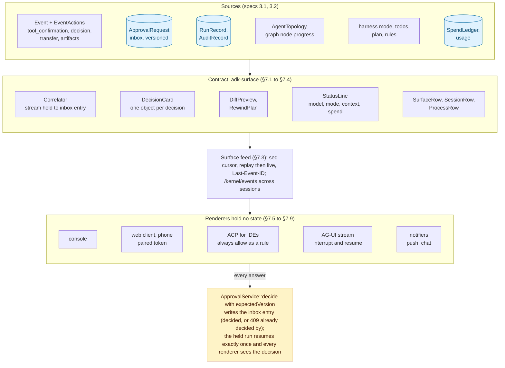

# Spec 3.3: Harness UI — one decision contract, five renderers

| | |
|---|---|
| **Status** | Draft / RFC |
| **Builds on** | [`spec-3.1-harness-agent.md`](spec-3.1-harness-agent.md) (the harness, its prompter and `Harness` façade) and [`spec-3.2-agent-kernel.md`](spec-3.2-agent-kernel.md) (the control plane and event bus); both defer the user interface to this spec (3.1 N2, 3.2 N3) |
| **Target** | `adk-rust` 3.3.0 for the contract, the five renderers and the P0 rows of [§5](#5-headline-capabilities-and-demonstration-scenarios); 3.3.x for pairing, the chat adapter, time travel in the web UI and MCP Apps rendering |
| **Grounding commit** | `origin/main` @ `68cf17af` (the `adk-harness` crate, the devtools, sandbox, platform and CLI prerequisites of spec 3.1 are merged) for every `file:line` reference |
| **Evidence** | The research report `reports/Harness UI expectations 2026.md` and its notes (113 GitHub issues read through the GitHub CLI on 2026-10-20, product documentation and changelogs dated 2026); every demand figure below is a 👍 count from that census |
| **Affected crates** | NEW `adk-surface`; `adk-cli` (one renderer, status, headless contract, pairing); `adk-server` (surface routes, inbox wiring for interactive runs, AG-UI mapping, bundled web client, `/debug` routes); `adk-acp` (always-rules, diff and terminal blocks, session list); `adk-core` (two additive methods); `adk-harness` (diff preview, rewind ledger view); `adk-graph` (node progress in the runner stream) |
| **Stability** | `adk-surface` enters at **Beta**; the bundled web client and the console renderer follow `adk-cli`'s tier |
| **Self-improvement** | [`spec-3.4-self-improving-harness.md`](spec-3.4-self-improving-harness.md): a held `open_pull_request` is a decision card, and the web client gains Defects and Proposals tabs |

---

## 1. Summary

Users of agent harnesses in 2026 judge the interface by one thing before any other: a **pending decision** that shows exactly what will run, can be answered from whatever surface they happen to be on, never proceeds on its own, and stays consistent when two surfaces see it at once. The demand is measured, not assumed: the two most-reacted permission issues on Claude Code are about *which* command a prompt attributes (#28240, 209 👍) and about a prompt that "continued without an answer" after 60 seconds (#73125, 388 👍); Codex users ask the same of questions that auto-resolve (#28969, 216 👍); and once a session can be reached from two devices the complaints become "already has an active writer" (Codex #37403) and prompts that do not render on the phone (Claude #35637). Around that core sit a small set of table stakes with large, dated demand: a constant readout of model, context and spend (Codex #17827, 205 👍; #23794, 176 👍), rewind of files and transcript (Codex #9203 and #11626, 715 👍 together, both open), queued and steering input (Claude #50246, 214 👍), named sessions, and rendering that survives tmux, SSH and copy-paste (Claude #18170, 300 👍).

adk-rust already owns the hardest part and no surveyed harness documents an equal: a versioned, fingerprint-bound approval inbox with quorum, delegation, escalation and expiry ([`adk-core/src/approval.rs:102-549`](../../adk-core/src/approval.rs)), durable parked runs that resume exactly once, a hash-chained audit log ([`audit_log.rs:309`](../../adk-core/src/audit_log.rs)) and live team topology. Spec 3.1's harness adds the prompter (`ApprovalPrompter`, `RenderedCall`, `PromptAnswer`, [`adk-harness/src/approvals/prompt.rs:43-107`](../../adk-harness/src/approvals/prompt.rs)) and the `Harness` façade with `pending_approvals` and `decide` ([`harness.rs:371-397`](../../adk-harness/src/harness.rs)); spec 3.1's CLI prerequisites add the console handler and held-call rendering ([`adk-cli/src/console/confirm.rs:65`](../../adk-cli/src/console/confirm.rs), [`launcher.rs:1054`](../../adk-cli/src/launcher.rs)). Yet on main the loop still closes on the terminal only: the interactive SSE runner attaches no approval service ([`runtime.rs:1525`](../../adk-server/src/rest/controllers/runtime.rs)), so a held call from a browser run never reaches the inbox; the bundled web UI shows it as a read-only block ([`App.tsx:114`](../../adk-server/webui/src/App.tsx)) and sends no `Authorization` header ([`api.ts:101`](../../adk-server/webui/src/api.ts)); the AG-UI translator drops it ([`runtime.rs:790-986`](../../adk-server/src/rest/controllers/runtime.rs)); ACP offers allow-once and reject-once only ([`permission.rs:61-62`](../../adk-acp/src/server/permission.rs)); the realtime event enum has no variant for it ([`events.rs:197`](../../adk-realtime/src/events.rs)); nothing pushes. adk-rust has the inbox and no doorbell.

Spec 3.3 therefore defines a **contract, not a set of screens**: one mapping from the objects adk-rust already has (`Event`, `ToolConfirmationRequest`, `ApprovalRequest`, `RunRecord`, `AuditRecord`, `AgentTopology`, the harness's mode, todos, plan and spend) to a small set of user-facing rows and states, carried by a cursor-replayable feed, and drawn by **five renderers**: the console, the embedded web client, the ACP server, the AG-UI stream and the notifiers (push and chat). What makes the result better than any shipping harness is not a screen but four properties the contract guarantees everywhere: a decision is one versioned object answerable from any surface with conflicts shown rather than hidden; an unanswered prompt parks rather than denies or continues; a held edit is shown as a diff *before* the file is written, with the option to edit the call; and a rewind lists, from the action ledger, the external effects it cannot undo. Two transitions carry the risk and get release gates: the three terminal renderers merge into one behind a parity matrix (the regressions of 2026 at Kilo, Copilot, Cline and Cursor all came from rebuilding on a shared core), and the bundled web client leaves the `adk_ui` protocol profile before its sunset on 2026-12-31 ([`ui_protocol.rs:64-69`](../../adk-server/src/ui_protocol.rs)).

## 2. Goals

- **G1.** Every surface renders the same pending decision from the same object and can answer it; an answer from one surface is visible on every other within one event, and a conflicting answer is shown as "already decided by …", never silently lost.
- **G2.** No decision is ever taken by silence: an unanswered prompt parks the call in the inbox when a store exists, expiry is visible, and typed-ahead or queued input never counts as an answer.
- **G3.** A surface can attach to a session from another device with the process staying where it is, catch up by cursor without gaps or duplicates, and be authenticated with a scoped, revocable token.
- **G4.** Status is always visible: model, mode, isolation, context used, tokens, spend (per member and in total), pending decisions, and the run state, in the terminal, the web client and the IDE.
- **G5.** A held `edit_file` or `write_file` is reviewed as a diff before anything is written, on every surface that can show text, with the option to edit the call.
- **G6.** A rewind is honest: it restores files and transcript at a chosen step, keeps untracked files, and lists the non-idempotent actions since that step that it cannot undo.
- **G7.** The developer surfaces tell the truth: every route the web client calls exists and agrees with the CLI and CI (no 501 stubs, eval results identical to `adk-eval`, traces that survive a restart, an audit view that verifies the chain).
- **G8.** One terminal renderer, with a parity matrix of every existing output as a release gate, and a headless contract (terminal detection, JSON event stream, documented exit codes) for CI and scripts.
- **G9.** Nothing in this spec loosens a security default: the server still refuses non-loopback binds without a token or SSO, control characters are still escaped on every surface, and no surface holds state.

## 3. Non-goals

| Non-goal | Why | Where it belongs |
|---|---|---|
| **N1.** Native iOS, Android or desktop applications | The demand measured is for vendors' own apps (Codex Linux app, 954 👍); vendors' phone clients are thin layers over decisions held durably on the host, which the web client and push already give | The embedded web client on a phone; third-party clients over the spec 3.2 control plane |
| **N2.** A VS Code or JetBrains extension | ACP reaches Zed, JetBrains, Neovim, Emacs and Visual Studio; VS Code core declined ACP and reaches it through third-party clients | `adk-acp` ([§7.7](#77-the-acp-renderer)) |
| **N3.** A full-screen terminal UI that takes over the screen | tmux and SSH flicker and lost-scrollback complaints; the inline-viewport bug class in ratatui | Inline rendering in scrollback ([§7.5](#75-the-console-renderer)); revisit after the parity gate holds for a release |
| **N4.** A visual agent builder or canvas | Authoring is Studio's job and it still builds on 1.x crates | The `adk-studio` repository |
| **N5.** A generative-UI component library or an A2UI renderer | A2UI names no native hosts; adk-ui already owns the components | The `adk-ui` repository; MCP Apps rendering is a 3.3.x row |
| **N6.** A classifier-based auto mode | It is policy, not interface; the one shipped has a disclosed 17% miss rate | Spec 3.1 modes and `ToolPolicy`; 3.3 displays verdicts |
| **N7.** A gateway for many chat platforms | The chat-channel demand is single-digit and the one shipped gateway accumulated critical CVEs in 2026 | One reference adapter behind `ApprovalNotifier` ([§7.9](#79-notifiers-push-chat-and-attention)) |
| **N8.** Hosted cloud sessions, pull-request and CI loops, multi-account management | Vendor-product features | `adk-managed`, `adk-enterprise`, Git-host toolsets |
| **N9.** Sounds, animations, pets | Users asked for them to be removed (Codex #44561, #34349) | Nowhere |

## 4. Relationship to specs 3.1 and 3.2 and to the research

| Spec | Owns | 3.3 consumes | 3.3 adds |
|---|---|---|---|
| 3.1 HarnessAgent | The decision mechanics: `HarnessPolicy`, `ApprovalPrompter` and `PromptAnswer`, `RenderedCall`, standing rules, modes, todos, plan, the `Harness` façade, the CLI commands and flags, the console handler and `ConsoleIo` | `Harness::{pending_approvals, decide, mode, set_mode, todos, resume}`, `ApprovalPrompt`, `RenderedCall`, `RuleSuggestion`, `TodoList`, `PlanStep`, `MODE_STATE_KEY`, the §9.3 audit record set | What each surface shows and how it answers; the correlation between the in-stream hold and the inbox entry; the diff preview; the parity gate; the web client; push |
| 3.2 Agent Kernel | The resident process: process table, agenda, wake sets, the control plane and the event bus (`KernelEvent`, `EventSink`, `/kernel/events` with cursor) | `RunState` as the four user-facing states; `/kernel/processes` and `attach` when a kernel runs | The per-session surface feed with cursor that `/kernel/events` later generalises; the process view when a kernel is present; pairing tokens the control plane honours |
| Research report | Demand evidence, table stakes versus differentiators, the twenty-two-row scope | The P0/P1/P2 priorities and the non-goals | The design that satisfies them |

Where 3.1 and 3.3 touch, 3.3 changes two 3.1 statements, recorded in [§10](#10-changes-outside-the-new-crate): a confirmation that times out **parks** the call when an approval store exists instead of denying it (3.1 §7.5 says deny), and the bundled web UI is **authenticated and answers approvals** (3.1 §8.2 says loopback-only with approvals through the CLI). Both are additive to the code and tighten, not loosen, the user's control.

## 5. Headline capabilities and demonstration scenarios

Each scenario is a test in `examples/harness_surfaces` ([§11](#11-testing-and-live-verification)); the pass condition is asserted on stores, streams, audit records and pseudo-terminal transcripts.

| # | Capability | Scenario | Pass condition | Machinery |
|---|---|---|---|---|
| U1 | **One decision, every window.** The same held call is answerable from the terminal, the browser, the phone and the IDE | `adk-rust code` holds a `bash` call; the user opens the web client on a phone and approves; a second answer arrives from ACP | The terminal run resumes within one event of the phone's answer; the ACP client receives "already decided by <subject>" (the inbox's 409) and its run continues; one `tool.call` audit record, one execution | `DecisionCard`, inbox version, `/api/surface/.../decide`, ACP bridge ([§7.2](#72-the-decision-contract)) |
| U2 | **Nothing by silence.** An unanswered prompt parks; expiry is visible; typed-ahead never answers | A prompt is left for its timeout; the user typed two lines meanwhile | The call is `Pending` in the inbox with its expiry shown; the two lines are queued as messages, not answers; the next empty turn resumes the call and it executes once | parking on timeout, `ConsoleIo` queue ([§7.2](#72-the-decision-contract), [§7.5](#75-the-console-renderer)) |
| U3 | **Attach from anywhere.** Reconnect by cursor, authenticated by a scoped token | The laptop sleeps mid-run; the user scans the pairing code on a phone | The phone shows the transcript from the cursor it last had, the pending decision and the status line; the token is scoped to that user and revocable; events arrive with no gap or duplicate (`seq` asserted) | the surface feed with cursor, pairing ([§7.3](#73-the-surface-feed), [§7.6](#76-the-web-client)) |
| U4 | **Always know the cost.** Status and spend on every surface, per member | A team of three works a task | The terminal status shows mode, model, context %, tokens and spend; the web client shows spend per member summing to the session total; `/cost` and `GET /api/surface/.../status` agree with the `SpendLedger` to the micro-dollar | `StatusLine`, `SpendLedger::spent` ([§7.4](#74-status-and-spend)) |
| U5 | **Review before writing.** A held edit is a diff, editable | The model holds `edit_file` on `src/lib.rs` | The web client and ACP show a unified diff of the pending change; the reviewer edits one hunk; the written file equals the edited diff; the audit record carries the `edit` decision and both digests | `DiffPreview`, `ApprovalAction::Edit` ([§7.10](#710-diff-before-write-and-honest-rewind)) |
| U6 | **Honest rewind.** Files and transcript restore; effects that cannot be undone are listed | After five steps, one of which ran `cargo publish --dry-run` and one `git push` | `/rewind 3` restores the tree and transcript at step 3, keeps untracked files, and lists `git push` as not undone (from the action ledger); the transcript shows the rewind as a fork | checkpoints, action ledger ([§7.10](#710-diff-before-write-and-honest-rewind)) |
| U7 | **One renderer, no regressions.** The three terminal renderers become one | `chat`, `code`, `goal`, `ultracode` on the scripted model in a pseudo-terminal | Every row of the parity matrix (thinking modes, transfer labels, plan marks, iteration banners, Ctrl-C) matches the recorded baseline byte for byte, or the release gate fails | `SurfaceRenderer`, the parity matrix ([§7.5](#75-the-console-renderer), [§11](#11-testing-and-live-verification)) |
| U8 | **IDE parity with real "always".** ACP clients get diff and terminal blocks and an "always allow" with meaning | In Zed, the user picks "Allow always" for `cargo test` | A standing rule bound to the tool's declaration digest is created and shown in `/rules`; the next `cargo test` runs with no prompt; `cargo publish` still prompts; the diff block follows the edit as it happens | `allow_always` → `RuleSuggestion` ([§7.7](#77-the-acp-renderer)) |
| U9 | **Truthful developer surfaces.** Every route exists and agrees with the CLI | The web client opens the plan graph, traces and the audit tab after a run | `/api/debug/graph` returns the compiled graph (no 501); the active node highlights as it runs; traces come from the SQLite reader after a restart; the audit tab verifies the hash chain and shows the same result as `adk-rust audit verify` | [§7.11](#711-truthful-developer-surfaces) |
| U10 | **Headless, scriptable.** CI runs the harness without a terminal | `adk-rust code --output json "fix the test"` in CI with a held call | No prompt blocks; the JSON event stream carries the hold; exit code 3; `adk-rust approvals approve <id>` from another job resumes it | the headless contract ([§7.5](#75-the-console-renderer)) |

U1, U2, U5 and U6 together, decided once, parked rather than lost, reviewed before written and honest about what rewind cannot undo, are the properties no shipping harness offers at once.

## 6. Architecture



Every renderer reads the same feed and answers through the same versioned call; cylinders are stores, the amber node is the only write path for a decision.

**Decisions**

| | Decision | Grounding |
|---|---|---|
| **D-1** | The contract lives in a new crate `adk-surface` with no UI dependency, consumed by every renderer; the web client's TypeScript types are generated from its JSON Schema | Five renderers in four crates must agree on one shape; the web client today mirrors a subset of `EventActions` by hand ([`types.ts:45-62`](../../adk-server/webui/src/types.ts)) |
| **D-2** | A pending decision is one object, the inbox's `ApprovalRequest`, correlated to the in-stream `ToolConfirmationRequest` by `functionCallId` or `runId`; every surface answers through `ApprovalService::decide` with `expectedVersion`, and a conflict (409) is rendered, never retried silently | The inbox already has versions, quorum, delegation, escalation and expiry ([`approval.rs:102-549`](../../adk-core/src/approval.rs), [`approvals.rs:136-163`](../../adk-server/src/approvals.rs)); the stream carries the full arguments, the inbox redacted ones, and no helper joins them today |
| **D-3** | Interactive runs on the server attach the approval service through the harness's `configure_run` layer, so a held call from `/api/run_sse` reaches the inbox with no new request field | [`HarnessLayer::apply`](../../adk-harness/src/agent.rs) installs `approval_service` ([`agent.rs:217-245`](../../adk-harness/src/agent.rs)); the per-request runner sets only `streaming_mode` today ([`runtime.rs:1525`](../../adk-server/src/rest/controllers/runtime.rs)) |
| **D-4** | The feed is replayable by cursor from the session service, not from a subscription held open; a reconnecting surface sends its last `seq` | The pattern exists in `adk-managed` ([`replay.rs:1-12`](../../adk-managed/src/replay.rs)); `DurableRunStore` has no subscribe method and should not grow one for this |
| **D-5** | One console renderer replaces `StreamPrinter`'s chat output, `stream_turn` and `ultracode`'s banners, gated by a byte-for-byte parity matrix recorded before the merge | Three renderers exist ([`launcher.rs:1057-1127`](../../adk-cli/src/launcher.rs), [`main.rs:168`](../../adk-cli/src/main.rs), [`ultra.rs:58-90`](../../adk-cli/src/ultra.rs)); the 2026 regressions elsewhere came from exactly this move |
| **D-6** | The terminal stays line-oriented in scrollback; status goes into the prompt line and the terminal title first, a persistent footer only behind a flag | tmux, SSH and copy-paste complaints; `terminal_safe` and rustyline already give injection safety ([`launcher.rs:1032`](../../adk-cli/src/launcher.rs)) |
| **D-7** | A held edit is previewed as a diff computed from the pending arguments against the current file; no edit-tracking subsystem | In adk-rust a held call has not run by construction; `ApprovalAction::Edit` with `editedArgs` already exists ([`approval.rs:102`](../../adk-core/src/approval.rs)) |
| **D-8** | Rewind restores from session checkpoints and reports non-undoable effects from the action ledger; it never claims to reverse what it did not | The ledger records begin and complete for every `NonIdempotent` call (3.1 §7.12) |
| **D-9** | The bundled web client speaks raw `Event` frames (the default profile after the sunset) and, for third-party front ends, the AG-UI profile; the `adk_ui` profile is removed from the client before 2026-12-31 | [`ui_protocol.rs:64-69`](../../adk-server/src/ui_protocol.rs) |

## 7. Component specifications

### 7.1 Crate layout and features

```text
adk-surface/src/
  lib.rs            re-exports, feature gates
  event.rs          SurfaceEvent, SurfaceCursor, from_event (Event → rows), from_graph (StreamEvent → rows)
  decision.rs       DecisionCard, DecisionState, DecisionAnswer, Correlator (stream ↔ inbox)
  status.rs         StatusLine, SpendSummary (per member and total)
  session.rs        SessionRow, ProcessRow (four states), AttachInfo
  diff.rs           DiffPreview (unified diff from pending args), RewindPlan (steps, effects not undone)
  render.rs         trait Renderer, RenderSink, conformance macro
  schema.rs         JSON Schema export (schemars) for the TypeScript client
  headless.rs       the JSON line protocol and exit codes
```

| Feature | Default | Pulls in |
|---|---|---|
| `harness` | on | `adk-harness` (mode, todos, plan, rules, `Harness` façade) |
| `approvals` | on | `adk-core` approval types (always present; the feature gates the inbox correlation helpers) |
| `graph` | off | `adk-graph` (`StreamEvent::NodeStart/NodeEnd` mapping, `TimeTravelHandle` steps) |
| `schema` | off | `schemars` for the TypeScript generation (build-time only) |

Dependencies: `adk-core`, `adk-harness`; optional `adk-graph`, `schemars`, `similar` (diffs). No HTTP, no terminal, no React: the crate is the contract and its tests.

### 7.2 The decision contract

```rust
pub struct DecisionCard {
    pub id: String,                       // ApprovalRequest.id when parked; function_call_id otherwise
    pub function_call_id: Option<String>,
    pub run_id: Option<String>,
    pub session: SessionRef,              // app, user, session
    pub tool: ToolRef,                    // name, origin source, declaration digest (ToolOrigin, context.rs:1116)
    pub kind: ToolKindView,               // Read | Edit | Shell { isolation } | ShellEscalation | Delegate | MemoryWrite | External | PlanExit
    pub rendered: RenderedCallView,       // escaped, truncation marked, expandable (RenderedCall, prompt.rs:175)
    pub args_full: Option<Value>,         // present only on the surface that received the stream
    pub args_redacted: Value,             // from the inbox entry
    pub preview: Option<DiffPreview>,     // §7.10, for Edit kinds
    pub reason: Option<String>,           // why it is held: policy reason, rule miss, non-waivable
    pub mode: HarnessMode, pub isolation: IsolationStatus,
    pub suggestions: Vec<RuleSuggestionView>,   // from StandingRule::suggestions (rule.rs:587)
    pub allowed: Vec<DecisionAnswer>,     // what this surface may do: Once, Remember(scope), Edit, Deny, DenyAll
    pub policy: ApprovalPolicyView,       // approvers, quorum, escalation, expiresAt (approval.rs:220)
    pub state: DecisionState,             // Pending | Decided { by, kind, at } | Expired | Cancelled | Conflict { current_version }
    pub version: u64,                     // ApprovalRequest.version
    pub expires_at: Option<DateTime<Utc>>,
}
pub enum DecisionAnswer { ApproveOnce, ApproveWithArgs(Value), ApproveAndRemember(RuleSuggestionView), Deny { message: Option<String> }, DenyAndRemember(RuleSuggestionView), DenyAllRemaining }
pub struct Correlator { /* joins actions.tool_confirmation to the inbox by functionCallId, then runId; keeps the stream copy's full args */ }
```

Rules:

1. **One object.** A surface never invents a decision from the stream alone. When the stream carries `actions.tool_confirmation` ([`event.rs:93`](../../adk-core/src/event.rs)) the renderer shows the card immediately from the stream copy and attaches the inbox entry as soon as the correlator finds it (same `functionCallId`, [`context.rs:1183`](../../adk-core/src/context.rs)); when a surface attaches late it builds the card from the inbox entry alone.
2. **One answer path.** Every surface answers through `ApprovalService::decide` with `expectedVersion` ([`approval.rs:1349`](../../adk-core/src/approval.rs)). The console, which holds a live `ToolConfirmationHandler`, answers the handler *and* records the decision to the store so other surfaces see it (3.1's `decide_approval`, [`confirm.rs:179`](../../adk-cli/src/console/confirm.rs)). A 409 ([`approval.rs:2136`](../../adk-core/src/approval.rs)) becomes `DecisionState::Conflict` on the answering surface, rendered as "already decided by <subject> at <time>".
3. **Parking on timeout.** When the confirmation timeout expires and the run carries an `approval_store` or `approval_service`, the call is recorded to the inbox and the run ends with the held call pending (the hold-and-end path at [`governance.rs:1712`](../../adk-core/src/governance.rs)); only without a store is the call denied, as 3.1 §7.5 says today. Expiry on the inbox entry follows `ApprovalPolicy.expiresAfter`; the card shows it.
4. **Never by typing.** Input entered while a card is open is queued as the next message, never read as an answer ([§7.5](#75-the-console-renderer)); the web client disables the message box's submit while a card is focused and never binds Enter to a decision.
5. **Truncated is not approvable.** `RenderedCall::can_approve` ([`prompt.rs:256`](../../adk-harness/src/approvals/prompt.rs)) applies on every surface: a card whose rendering was cut must be expanded before `ApproveOnce` or `ApproveAndRemember` is offered.
6. **Non-waivable is non-waivable.** `exit_plan_mode`, unsandboxed retries and `memory_write` never offer `ApproveAndRemember` (3.1 I7, I18); the card's `allowed` list omits it.
7. **What the stream shows the inbox records.** `tool_confirmation_decision` ([`event.rs:96`](../../adk-core/src/event.rs)) renders as a decided row with the subject from the audit record's actor; `harness.held.cancelled` renders as cancelled with its reason.

### 7.3 The surface feed

```rust
pub struct SurfaceEvent { pub seq: u64, pub at: DateTime<Utc>, pub session: SessionRef, pub row: SurfaceRow }
pub enum SurfaceRow {
    Text { author, text, partial, thinking: bool },
    ToolCall { call_id, name, args_view, origin },
    ToolProgress { call_id, stream: Stdout | Stderr | Custom(String), chunk },      // adk.tool_progress.* metadata
    ToolResult { call_id, name, result_view, outcome: Ok | Error | NotRun { reason } },
    Decision(DecisionCard),                   // held, decided, expired, cancelled, conflict
    Transfer { from, to }, Compaction { range }, Artifact { name, version }, StateDelta { keys },
    Node { node, step, phase: Start | End { duration_ms } },                      // graph progress
    Status(StatusLine),                       // on change only
    Todos(TodoList), Mode { from, to, set_by }, Plan { steps },                     // harness mirrors
    Run { pid, state: RunState, reason },      // process state
    Error { code, message },
}
```

- **Source.** `from_event(&Event)` maps `Event` parts and `EventActions` ([`event.rs:75-96`](../../adk-core/src/event.rs)) to rows; the harness's display mirrors (`harness:mode`, `harness:todos`, `harness:plan`; [`mode.rs:29`](../../adk-harness/src/mode.rs), [`todos.rs:26`](../../adk-harness/src/tools/todos.rs), [`plan.rs:23`](../../adk-harness/src/tools/plan.rs)) come from `state_delta` keys; graph node progress comes from `StreamEvent::NodeStart/NodeEnd` ([`stream.rs:44-47`](../../adk-graph/src/stream.rs)) once G1 in [§10](#10-changes-outside-the-new-crate) forwards them.
- **Cursor.** `seq` is the session's event ordinal; the server route `GET /api/surface/{app}/{user}/{session}/events?cursor=<seq>` (and the same as SSE with `Last-Event-ID`) replays from the session service and tails live, in the shape `adk-managed` already uses ([`replay.rs:8-12`](../../adk-managed/src/replay.rs)); no gaps, no duplicates (property-tested).
- **Kernel.** When spec 3.2's kernel runs, `/kernel/events` is this feed across sessions with the same `SurfaceRow` type; `POST /kernel/attach/{session}` returns the cursor and the pending cards.
- **Casing.** Wire JSON is camelCase ([AGENTS.md conventions](../../AGENTS.md)); the JSON Schema is exported from `adk-surface` and the TypeScript types in `adk-server/webui` are generated from it, replacing the hand-written subset ([`types.ts:45-62`](../../adk-server/webui/src/types.ts)).

### 7.4 Status and spend

```rust
pub struct StatusLine {
    pub model: String, pub mode: HarnessMode, pub isolation: IsolationStatus,
    pub context: ContextUsage { used_tokens, window_tokens, percent },
    pub turn: TokenUsage, pub session: TokenUsage,
    pub spend: SpendSummary { total_micro_usd, per_member: Vec<(AgentId, u64)>, budget_remaining: Option<u64> },
    pub pending_decisions: usize, pub run: Option<RunState>, pub members_active: Vec<AgentId>,
}
```

- **Sources.** `usage` on events ([`event.rs:15-58`](../../adk-core/src/event.rs)); `SpendLedger::spent(key, SpendPeriod)` per `SpendKey` whose agent field gives the per-member breakdown ([`spend.rs:376-414`](../../adk-core/src/spend.rs)); the harness's `harness.spend` audit record (3.1 §9.3) is the same numbers.
- **Routes.** `GET /api/surface/{app}/{user}/{session}/status` returns the `StatusLine`; `/cost` in the console prints it; ACP already emits `UsageUpdate` ([`streamer.rs:22-31`](../../adk-acp/src/server/streamer.rs)) and gains the spend fields.
- **Per-member correctness.** A team's spend is the sum of its members' `SpendKey` totals plus the coordinator's; the status line shows both, so subagent cost is never left out (the Kilo defect class).

### 7.5 The console renderer

One `SurfaceRenderer` in `adk-cli` draws every `SurfaceRow` for `chat`, `code`, `goal` and `ultracode`, replacing `StreamPrinter`'s part rendering, `stream_turn` and the `ultracode` banners.

| Concern | Design |
|---|---|
| Scrollback | Line-oriented output into the terminal's own scrollback through the single `ConsoleIo` reader ([`io.rs:54-137`](../../adk-cli/src/console/io.rs)); every model and tool string passes `terminal_safe` ([`launcher.rs:1032`](../../adk-cli/src/launcher.rs)); no full-screen mode (N3) |
| Decision card | `[approval needed] <tool> <rendered args> — <reason>` as today ([`launcher.rs:1054`](../../adk-cli/src/launcher.rs)), followed by the prompter's `[y] allow once  [a] always allow…  [n] deny (reason)  [e] edit args  [?] details` (3.1 §8.1); `[a]` lists `RuleSuggestion`s; `[?]` expands a truncated rendering and only then enables `[y]`/`[a]`; a human `[n]` ends the turn with the reason shown |
| Parked, not lost | When the console's timeout expires (one hour, [`launcher.rs:65`](../../adk-cli/src/launcher.rs)) with a store configured, the card shows `parked → adk-rust approvals <id>`; `adk-rust approvals` lists it; an empty turn resumes it |
| Typed-ahead | Lines read while a card is open are queued and echoed back as `queued: …`; Enter never answers a card; a queued line is sent as the next message after the turn ends |
| Status | In the prompt line as `[ask · gpt-5.6 · 23% · $0.41 · 1 pending] You >` and in the terminal title; `--status footer` draws a one-line persistent footer under rustyline for terminals that support it; `/cost` prints the full `StatusLine` |
| Verbosity | `--tool-mode auto|show|hide` beside the existing `--thinking-mode` ([`cli.rs`](../../adk-cli/src/cli.rs)): `auto` shows one line per call and collapses results over 20 lines |
| Attention | `--notify off|bell|osc|native`: a bell, an OSC 9/777 notification or a native one only when the terminal is not focused and a card is waiting or a run finishes; off by default (N9) |
| Diff | An `Edit` card prints the unified diff ([§7.10](#710-diff-before-write-and-honest-rewind)) with line numbers before the prompt; `[e]` opens the diff in `$VISUAL`/`$EDITOR` and the edited result is re-checked by policy |
| Rewind | `/rewind` lists steps with their decisions; `/rewind <n>` shows the `RewindPlan` (files restored, untracked kept, effects not undone) and asks once |
| Sessions | `/session`, `sessions list|show|rm` (3.1 §8.1) gain a picker with user labels (`sessions label <id> <text>`) and show the pending-decision count per session |
| Headless | Without a terminal: no prompts, `--output json` emits one `SurfaceEvent` per line, exit codes `0` done, `2` error, `3` held (prints the session id and decision ids), `4` budget exhausted; `--yes` approves cards that reach the handler and never a non-waivable one (3.1 §8.1) |
| Parity | The parity matrix in [§11](#11-testing-and-live-verification) is recorded against the current three renderers before the merge and run as a release gate afterwards |

### 7.6 The web client

The embedded React client ([`adk-server/webui`](../../adk-server/webui/README.md)) becomes the harness's browser and phone surface. It remains embedded through `RustEmbed` (no npm at runtime, [`web_ui.rs`](../../adk-server/src/web_ui.rs)).

| Concern | Design |
|---|---|
| Authentication | The client sends `Authorization: Bearer <token>` on every request; the token comes from `--auth-token` (3.1 §8.2), from the loopback operator extractor on `127.0.0.1`, or from pairing ([§7.6.1](#761-pairing)); the free-text user field is removed; without a valid token the client shows the pairing screen, nothing else |
| Transport | `/api/surface/.../events` with `Last-Event-ID` for reconnection; raw `Event` frames are no longer parsed by hand; the `x-adk-ui-protocol: adk_ui` header is gone ([`api.ts:101`](../../adk-server/webui/src/api.ts)) and the capability table it reads is the one `adk-ui` publishes (one table, [§10](#10-changes-outside-the-new-crate) S5) |
| Decision cards | Inline in the transcript and in an **Inbox** tab fed by `GET /api/approvals` ([`approvals.rs:136`](../../adk-server/src/approvals.rs)); buttons map to `DecisionAnswer`; `editedArgs` opens the diff editor for Edit kinds and a JSON editor otherwise; a 409 shows the deciding subject; quorum progress, delegation and escalation state are visible on the card (no other harness shows these) |
| Status | A header strip with the `StatusLine`; spend per member in the topology panel beside each node |
| Sessions and processes | A sessions list with labels, pending counts and the four states (`Queued`/`Running` → working, `Waiting` → waiting for you or sleeping, `Completed`/`Failed`/`Cancelled` → done) from `RunState` ([`run_store.rs:88`](../../adk-core/src/run_store.rs)); with a kernel present, the process view over `/kernel/processes` (spec 3.2 §7.11) |
| Phone layout | A single-column layout under 640 px with the inbox first; cards are answerable with one tap; push through the notifier when a card is created or a run finishes, suppressed while the client is focused |
| Developer tabs | Topology (live from node and transfer rows), timeline (the feed), state, artifacts, traces (stored, [§7.11](#711-truthful-developer-surfaces)), plan graph, audit (verified chain), eval |
| Security | The existing host and origin guards and CSP stay ([`rest/mod.rs:141`](../../adk-server/src/rest/mod.rs)); the client never stores the token in `localStorage` (session storage, cleared on close); the server refuses a non-loopback bind without a token or SSO (spec 3.2 K-I18) |

#### 7.6.1 Pairing

`adk-rust pair` (and the kernel's `attach`) prints a QR code and a one-time URL containing a short-lived pairing code; exchanging it at `POST /api/surface/pair` yields a bearer token scoped to the pairing user with `scopes: ["surface"]`, bound to the device name, listed by `adk-rust pair list` and revoked by `adk-rust pair revoke <device>`. Tokens are stored hashed; the audit log records `surface.pair.{issued,revoked}`. Pairing never widens the bind: a server on loopback pairs only through a tunnel the user runs, and the docs say so.

### 7.7 The ACP renderer

`adk-acp`'s server already streams messages, thoughts, tool calls, plans and usage over stdio and bridges held calls to `session/request_permission` with allow-once and reject-once ([`permission.rs:61-62`](../../adk-acp/src/server/permission.rs), [`streamer.rs:22-72`](../../adk-acp/src/server/streamer.rs)). 3.3 adds:

| Item | Design |
|---|---|
| `allow_always` / `reject_always` | Offered when the card's `allowed` list contains `ApproveAndRemember` or `DenyAndRemember`; the chosen option creates the first `RuleSuggestion` of the card through `Harness::decide(.., HarnessDecision::ApproveAndRemember(..))` ([`harness.rs:48-397`](../../adk-harness/src/harness.rs)), so the rule is digest-bound, scoped and expiring like every other rule (3.1 §7.5); the ACP spec leaves rule semantics to the agent, so this is adk-rust's meaning of "always" |
| Diff and terminal blocks | An `Edit` card and its decision emit ACP `diff` content on the tool call (path, old text, new text) so the editor follows the change; shell progress streams as a `terminal` block from the tool-progress rows |
| Sessions | `session/list` and `session/load` map to the harness session store (labels, pending counts); `session/fork` maps to a rewind fork ([§7.10](#710-diff-before-write-and-honest-rewind)) |
| Status | `UsageUpdate` carries the `StatusLine` spend fields; mode changes are `session/set_mode` as today ([`modes.rs`](../../adk-acp/src/server/modes.rs)) |

### 7.8 The AG-UI mapping

The AG-UI translation ([`runtime.rs:790-986`](../../adk-server/src/rest/controllers/runtime.rs)) maps text, reasoning, tool calls and state deltas and drops everything else in a catch-all arm. 3.3 maps:

| Row | AG-UI event |
|---|---|
| `Decision(Pending)` | `RUN_FINISHED` with `interrupt { id, reason: "tool_confirmation", payload: DecisionCard (redacted) }`; the client resumes by `POST …/decide` then a new run with `resume { interruptId, answer }`, which the server turns into the inbox decision before the run starts |
| `Decision(Decided | Conflict | Expired | Cancelled)` | `CUSTOM { name: "adk.decision", value }` |
| `Transfer`, `Artifact`, `Node`, `Status`, `Todos`, `Mode`, `Plan` | `CUSTOM` events named `adk.transfer`, `adk.artifact`, `adk.node`, `adk.status`, `adk.todos`, `adk.mode`, `adk.plan` |
| `ToolProgress` | `TOOL_CALL_ARGS`-adjacent `CUSTOM { name: "adk.tool_progress" }` (AG-UI has no streaming tool output event) |

The mapping is total: a `SurfaceRow` variant without an AG-UI event is a compile error (exhaustive match), which is how the catch-all arm is retired.

### 7.9 Notifiers: push, chat and attention

- **Trait.** `ApprovalNotifier` ([`approval.rs:1199`](../../adk-core/src/approval.rs)) carries submitted, escalated, decided, resolved, expired and cancelled; 3.3 adds `SurfaceNotifier` in `adk-surface` with `run_finished`, `card_created` and `attention(reason)` for renderers that are not inboxes, implemented by the push sender and the chat adapter.
- **Push.** The web client registers a Web Push subscription when paired; the server's `WebPushNotifier` sends `card_created` and `run_finished` with the session and card ids; suppressed while any client of that user is focused (the client reports focus on its feed connection), honouring quiet hours from spec 3.2's `ProactivityPolicy` when a kernel runs.
- **Chat (3.3.x).** One reference adapter behind the trait: a message with the card's rendered call and two buttons that call `decide` with the card's version, plus a link to the web client for anything longer; durable "allow for N hours" is a standing rule with `expires_at`, offered as a third button when the card allows it. The adapter ships for one platform with a documented interface for others (N7).
- **Terminal.** [§7.5](#75-the-console-renderer)'s `--notify`.

### 7.10 Diff before write and honest rewind

- **DiffPreview.** For a held `edit_file`, `write_file` or `memory_write`, `adk-surface` computes a unified diff between the current file (read through the harness's `Workspace`, with the same confinement and exclusion rules) and the result of applying the pending arguments; the preview carries both digests. `edit_file`'s `old_string`/`new_string` form becomes a hunk; `write_file` becomes a whole-file diff; a new file is an addition. The preview is part of the `DecisionCard`, so the console, the web client and ACP all show it; editing the diff produces `editedArgs` that the policy re-checks ([`governance.rs`](../../adk-core/src/governance.rs), 3.1 §7.5) and the audit record carries `beforeSha256` and `afterSha256`.
- **Rewind.** `/rewind` (console), the sessions tab (web) and `session/fork` (ACP) list the session's steps (one per model turn) with the decisions taken in each. A `RewindPlan` for step *n* lists the files the harness wrote after *n* (from `harness.bash.*` and the devtools audit records) and restores them from the per-step workspace snapshot the harness keeps for files it wrote (never touching untracked files it did not write), truncates the transcript to *n* as a fork (the original branch stays in the session service), and lists every `NonIdempotent` action recorded in the action ledger after *n* as **not undone** (`git push`, a payment, a webhook). The plan is shown and confirmed before anything moves. Rewinding the plan graph's state uses `TimeTravelHandle::fork_at` ([`time_travel.rs`](../../adk-graph/src/time_travel.rs)) as 3.1 H4 describes; the two rewinds are one command.

> **Note:** spec 3.1 [§7.26](spec-3.1-harness-agent.md#726-change-sets-one-review-per-batch-apply_patch-and-the-before-hash) and [§7.27](spec-3.1-harness-agent.md#727-snapshots-and-rewind-amends-spec-33-710) amend this section: the held edits of one model turn are reviewed as one card whose decision binds each file's before-hash, and the rewind restores from whole-tree snapshots taken before each turn and plan step, so files a command wrote are covered.

### 7.11 Truthful developer surfaces

| Promise | Today | 3.3 |
|---|---|---|
| Plan and team graph at `/debug/graph` (3.1 H4) | `501 not yet implemented` ([`debug.rs:127`](../../adk-server/src/rest/controllers/debug.rs)) | `GET /api/debug/graph/{app}/{agent}` returns the `AgentTopology` ([`apps.rs:127-174`](../../adk-server/src/rest/controllers/apps.rs)) plus, for a `GraphAgent`, the `WorkflowSchema`; the web client draws it and highlights the active node from `Node` rows |
| Live node highlighting | `NodeStart/NodeEnd` exist only in adk-graph's stream ([`stream.rs:44-47`](../../adk-graph/src/stream.rs)) | G1 in [§10](#10-changes-outside-the-new-crate) forwards them into the runner's event stream as metadata; `from_event` maps them to `Node` rows |
| Traces that survive a restart | In-memory exporter only | `GET /api/debug/trace/session/{id}` reads the SQLite trace reader when `init_with_sqlite` is configured ([`sqlite.rs`](../../adk-telemetry/src/sqlite.rs)); the web client's traces tab says which source it shows |
| Eval sets | `501` ([`debug.rs:139`](../../adk-server/src/rest/controllers/debug.rs)) | Either implemented over `adk-eval`'s case format with results identical to `adk-rust eval` (same evaluator, same baseline store), or the route is removed and the tab hidden; a stub that lies is not an option |
| Audit | CLI `audit export|verify` only | `GET /api/audit/{app}?cursor=` streams `AuditRecord`s for the caller's app with the chain verified server-side; the web client's audit tab shows actor, action, decision and policy ref, and the verification result, which must equal `adk-rust audit verify` |
| Trace analysis | Library only | `GET /api/debug/trace/session/{id}/analysis` runs `TraceAnalyzer` ([`trace_analyzer.rs`](../../adk-eval/src/trace_analyzer.rs)) on the session's events and returns its diagnostics; the loop guard's `harness.loop.detected` records link to it |

### 7.12 The `adk_ui` sunset

The bundled client sends `x-adk-ui-protocol: adk_ui` on every run ([`api.ts:101`](../../adk-server/webui/src/api.ts)) and the profile is scheduled to sunset on 2026-12-31 ([`ui_protocol.rs:64-69`](../../adk-server/src/ui_protocol.rs)). Before 3.3.0: the client switches to the surface feed ([§7.3](#73-the-surface-feed)) for its own transcript and to the `ag_ui` profile for third-party embedding; the capability table in `adk-server` is replaced by the one `adk-ui` publishes (S5 in [§10](#10-changes-outside-the-new-crate)), so `GET /api/ui/capabilities` tells one story; the default profile after the sunset is raw `Event` frames under the name `events`, and `adk_ui` requests answer `410 Gone` with the migration note.

## 8. Surfaces and commands

### 8.1 adk-cli

| Command | Behaviour |
|---|---|
| `adk-rust`, `chat`, `code`, `goal`, `ultracode` | Rendered by the one renderer ([§7.5](#75-the-console-renderer)); `--output text|json`, `--status prompt|title|footer|off`, `--tool-mode`, `--notify` |
| `/cost`, `/status` | Print the `StatusLine` |
| `/rewind [n]` | List steps, show and confirm a `RewindPlan` |
| `/approvals`, `approvals list|approve|deny|edit <id> [--server URL --token T]` | The inbox from the terminal; `edit` opens the diff or JSON in `$EDITOR` |
| `sessions list|show|rm|label` | With labels and pending counts |
| `pair [list|revoke <device>]` | Pairing for the web client ([§7.6.1](#761-pairing)) |
| `serve` | Mounts the surface routes, the approvals inbox and the web client; refuses a non-loopback bind without `--auth-token` or SSO |
| `surface schema` | Prints the JSON Schema of the contract (for client generators) |

### 8.2 adk-server routes

| Route | Purpose |
|---|---|
| `GET /api/surface/{app}/{user}/{session}/events?cursor=` (JSON lines or SSE with `Last-Event-ID`) | The feed |
| `GET /api/surface/{app}/{user}/{session}/status` | The `StatusLine` |
| `GET /api/surface/{app}/{user}/{session}/decisions`, `POST …/decisions/{id}` | Cards and answers for a session (a view over `/api/approvals` filtered by session, which `InboxQuery` gains) |
| `POST /api/surface/pair`, `GET/DELETE /api/surface/devices[/{name}]` | Pairing |
| `GET /api/debug/graph/{app}/{agent}`, `GET /api/debug/trace/session/{id}[/analysis]`, `GET /api/audit/{app}` | Developer surfaces ([§7.11](#711-truthful-developer-surfaces)) |
| `/api/approvals/*`, `/api/runs/*`, `/api/cron/*`, `/kernel/*` | Unchanged; the client uses them |

All routes go through `ServerBuilder::add_api_routes` so the auth middleware applies ([`rest/mod.rs:503`](../../adk-server/src/rest/mod.rs)); `/api/surface/.../events` requires the session's owner, as `/runs` does since the platform prerequisites ([`background/mod.rs:747`](../../adk-server/src/background/mod.rs)).

### 8.3 cargo-adk template and umbrella

The `harness` template (3.1 §8.3) serves the surface routes and the web client from `cargo run -- serve`; the umbrella `adk-rust` gains `surface = ["harness", "dep:adk-surface"]` in `full` with the module `adk_rust::surface`.

## 9. Security invariants and audit records

### 9.1 Threats specific to surfaces

| Threat | Mechanism |
|---|---|
| A surface approves what another surface already denied, or two surfaces approve twice | One versioned object; `expectedVersion` on every answer; a 409 is rendered, never retried; the action ledger prevents a second execution regardless |
| A prompt is answered by accident: typed-ahead, Enter on the wrong line, a notification tap | Queued input never answers; the web client never binds Enter to a decision; push taps open the card, they do not decide it |
| A truncated or control-character-laden argument hides `; curl …` | `RenderedCall` on every surface; `can_approve` false until expanded; `terminal_safe` in the console; HTML escaping in the client |
| A paired phone becomes a permanent key | Scoped tokens, hashed at rest, listed and revocable, bound to a device, expiring; pairing never widens the bind |
| The feed leaks another user's session | Owner check on every surface route; the feed is keyed by (app, user, session) and the caller must be the owner or an approver of a card in it |
| A chat adapter is driven by a forged callback | Buttons carry a signed, single-use token bound to the card id and version; the adapter verifies it like the webhook ingress verifies signatures |
| A stub route misleads a reviewer (the "eval tab shows green" class) | No 501 behind a tab: a tab is shown only when its route is implemented and its result equals the CLI's |
| The renderer merge changes behaviour silently | The parity matrix is a release gate |

### 9.2 Invariants

**Decisions.** S-I1 Every pending decision shown on any surface corresponds to one `ApprovalRequest` (or, before the correlator finds it, to the stream's `ToolConfirmationRequest` with the same `functionCallId`); no surface fabricates one. S-I2 Every answer goes through `ApprovalService::decide` with `expectedVersion`; a conflict is rendered as such. S-I3 An unanswered prompt parks when a store exists and never continues by itself; expiry is visible on the card. S-I4 Input typed, queued or tapped outside the card's own controls never answers it. S-I5 A truncated rendering is not approvable until expanded, on every surface. S-I6 Non-waivable kinds never offer "remember".

**Feed and attach.** S-I7 The feed is replayable by cursor with no gap and no duplicate (`seq` strictly increasing per session). S-I8 A surface holds no state a reconnect cannot rebuild from the feed, the inbox and the status route. S-I9 Every surface route checks the caller against the session's owner. S-I10 A paired token is scoped, hashed, revocable and expiring, and pairing never changes the server's bind or guards.

**Rendering.** S-I11 Every string from a model, a tool or a file passes `terminal_safe` in the console and HTML escaping in the client before display. S-I12 The three terminal renderers are replaced by one whose output on the parity matrix equals the recorded baseline. S-I13 Status and spend shown on any surface equal the `SpendLedger` and the harness's `harness.spend` record for the same key and period.

**Diff and rewind.** S-I14 A diff preview is computed from the pending arguments and the current file, never from a file the tool has already written. S-I15 An edited diff becomes `editedArgs` that the policy re-checks before execution. S-I16 A rewind restores only files the harness wrote after the chosen step, keeps everything else, forks the transcript, and lists every ledgered non-idempotent action after the step as not undone.

**Developer surfaces.** S-I17 No tab or route returns 501; a developer surface shows the same result as the corresponding CLI command. S-I18 The audit tab's verification equals `adk-rust audit verify`.

### 9.3 Audit records

Written through the signed audit log (3.1 §9.3), kind `Other`, `surface.*` actions:

| Event | Action | Fields |
|---|---|---|
| Decision rendered to a surface | `surface.decision.shown` | cardId, functionCallId, surface (console, web, acp, agui, chat), subject, truncated |
| Decision answered | `surface.decision.answered` | cardId, version, answer, surface, subject, editedArgsDigest, conflict |
| Parked on timeout | `surface.decision.parked` | cardId, functionCallId, timeoutSecs, expiresAt |
| Attach | `surface.attach` | session, cursor, device, transport |
| Pairing | `surface.pair.issued` / `.revoked` | device, scopes, expiresAt, by |
| Rewind | `surface.rewind` | session, step, filesRestored (digests), effectsNotUndone (ledger ids) |
| Diff edited | `surface.diff.edited` | cardId, beforeSha256, afterSha256, hunks |
| Notification | `surface.notify` | kind, channel, cardId or runId, suppressed |

## 10. Changes outside the new crate

| # | Crate | Change | Why |
|---|---|---|---|
| C1 (required) | adk-core | `InboxQuery` gains `session_id` ([`approval.rs:1044`](../../adk-core/src/approval.rs)); `ApprovalRequest` already carries `runId`, add `sessionId` to `ApprovalScope` lookups where absent | Per-session decision views ([§8.2](#82-adk-server-routes)) |
| C2 (required) | adk-core | The confirmation timeout path records the held call to the store and ends the run instead of denying, when `approval_store` or `approval_service` is set ([`governance.rs:1712-2021`](../../adk-core/src/governance.rs)); a `changed.` fragment; 3.1 §7.5 and §9.1 updated | S-I3; U2 |
| S1 (required) | adk-server | Surface routes, pairing, device store, Web Push notifier, per-session decision view; the feed implemented over the session service with `seq` (the `adk-managed` replay shape) | [§7.3](#73-the-surface-feed), [§7.6](#76-the-web-client) |
| S2 (required) | adk-server | The AG-UI mapping made total over `SurfaceRow` ([§7.8](#78-the-ag-ui-mapping)); the catch-all arm removed | AG-UI hosts see decisions |
| S3 (required) | adk-server | `/api/debug/graph` and the trace analysis route implemented; eval sets implemented or removed; the audit route | [§7.11](#711-truthful-developer-surfaces) |
| S4 (required) | adk-server/webui | Authentication, generated types, inbox and cards, diff editor, sessions and process view, phone layout, push registration; `adk_ui` removed from the client | [§7.6](#76-the-web-client), [§7.12](#712-the-adk_ui-sunset) |
| S5 (required) | adk-server, adk-ui | One capability table: `adk-server` re-exports `adk-ui`'s constants (or `adk-ui` depends on `adk-server`'s, decided with the adk-ui maintainers) so `/api/ui/capabilities` matches | The two tables disagree today ([`ui_protocol.rs:72`](../../adk-server/src/ui_protocol.rs)) |
| L1 (required) | adk-cli | `SurfaceRenderer` replacing the three renderers behind the parity gate; status, `--output json`, exit codes, `--notify`, `/rewind`, `pair`, `surface schema` | [§7.5](#75-the-console-renderer) |
| A1 (required) | adk-acp | `allow_always`/`reject_always` through `Harness::decide`; `diff` and `terminal` blocks; `session/list`; spend in `UsageUpdate` | [§7.7](#77-the-acp-renderer) |
| G1 (required) | adk-graph, adk-agent | `GraphAgent::run` forwards `NodeStart`/`NodeEnd` as event metadata (`adk.graph.node`, `adk.graph.step`, `adk.graph.phase`) on a progress event, the way tool progress is forwarded today | Live node highlighting |
| H1 (required) | adk-harness | `DiffPreview` inputs (read-through of the pending edit), per-step file snapshots for files the harness writes, and `RewindPlan` over the action ledger; `Harness::rewind(step)` | [§7.10](#710-diff-before-write-and-honest-rewind) |
| H2 (should) | adk-harness | The I19 behaviour (a human denial ends the turn) made the harness's own, not each renderer's | One place |
| T1 (3.3.x) | adk-core | `SurfaceNotifier` chat adapter reference implementation under a feature | [§7.9](#79-notifiers-push-chat-and-attention) |
| R1 (3.3.x) | adk-realtime | A `ServerEvent` variant for a held call so the voice surface can render a card ([`events.rs:197`](../../adk-realtime/src/events.rs)); 3.1 §7.17 stays gated on the realtime hardening rows | Voice is Defer in the research; the variant is the only prerequisite that belongs here |

No change to `Event`, `EventActions`, `ToolConfirmationRequest` or `ApprovalRequest`'s wire shape: the contract is a view over them.

## 11. Testing and live verification

| Layer | Cases |
|---|---|
| Unit (`adk-surface`) | `from_event` over every `EventActions` field and part type (exhaustive); the correlator (stream first, inbox first, late attach, missing call id → run id); `DecisionCard.allowed` per kind and mode (non-waivable never remembers); `can_approve` gating; `StatusLine` arithmetic (per-member sums equal the total); `DiffPreview` for edit, write, new file, binary refusal; `RewindPlan` from a scripted ledger; the headless line protocol and exit codes |
| Property (`proptest`) | The feed has no gap and no duplicate under random reconnects and cursors; a conflicting second answer never changes the stored decision; rendered output never contains a control character other than newline and tab; applying an edited diff then re-diffing yields the same hunks; a rewind plan never lists a file the harness did not write |
| Conformance | `renderer_conformance_tests!` over every renderer with a scripted feed: each `SurfaceRow` variant is rendered or explicitly skipped, never dropped silently (the AG-UI mapping is exhaustive by type; the others by test) |
| Parity gate | A pseudo-terminal matrix (`libc::openpty`, as the CLI prerequisites use) of `chat`, `code`, `goal`, `ultracode` × `--thinking-mode {auto,show,hide}` × transfers, plan marks, iteration banners, Ctrl-C at prompt and mid-stream, held call, denial with reason, on the scripted model; recorded on `68cf17af` before the merge; byte-equal after, except rows the spec changes, which carry a new recorded baseline |
| Integration | `ScriptedLlm` + `Harness` on SQLite: U1 (console + web + ACP over one store, 409 rendered), U2 (park on timeout, typed-ahead queued, resume once), U4 (status equals ledger), U5 (diff edited, file equals edited diff), U6 (rewind keeps untracked, lists `git push`), U9 (graph route, trace analysis, audit verify equals CLI), U10 (exit 3, approve from a second process) |
| Web client | Component tests for the card, the inbox, the diff editor, the status strip, the phone layout; an end-to-end browser test (Playwright) against a scripted server: pair, attach by cursor, approve, see the conflict, rewind |
| Live | U1, U3, U4, U5 and U8 on `gpt-5.6-terra`, `claude-sonnet-4-6` and `gemini-3.5-flash-lite`; U8 with a real ACP client; U3 on a phone over a tunnel; push delivery observed; a transcript of every live run in the PR without keys |

`examples/harness_surfaces` holds the scenarios with a main-vs-branch table; `examples/harness_openai` and `examples/harness_anthropic` gain a `--web` mode that runs U1, U4 and U5 through the web client.

## 12. Phased delivery

| Phase | Release | Contents | Size (engineer-weeks) | Demonstrates |
|---|---|---|---|---|
| 0 Prerequisites | 3.1.x | C1, C2 (park on timeout), G1 (node progress), S5 (one capability table), the parity baseline recorded | 2 | nothing visible; the ground is level |
| 1 Contract and console | 3.3.0 | `adk-surface`; `SurfaceRenderer` behind the parity gate; status in prompt and title; `--output json`, exit codes; `/cost`, `/approvals`, parking in the console; `surface schema` | 4–5 | U2, U4 (console), U7, U10 |
| 2 Feed and web client | 3.3.0 | Surface routes with cursor; interactive runs wired to the inbox; authentication and pairing; inbox and cards; status strip; sessions with states; phone layout; push; `adk_ui` removed from the client | 5–6 | U1, U3, U4 (web) |
| 3 Diff and rewind | 3.3.0 | `DiffPreview` on console, web and ACP; `RewindPlan`, `/rewind`, snapshots, `Harness::rewind` | 3 | U5, U6 |
| 4 ACP and AG-UI | 3.3.0 | `allow_always` as rules, diff and terminal blocks, `session/list`; the total AG-UI mapping | 2–3 | U8, AG-UI interrupt and resume |
| 5 Developer surfaces | 3.3.0 | `/debug/graph`, stored traces, trace analysis, audit route and tab, eval sets implemented or removed | 3 | U9 |
| 6 Follow-ups | 3.3.x | Chat adapter, quiet hours for notifications, time travel in the web client, MCP Apps rendering with durable bridge state, the realtime held-call variant | 3–4 | the P2 rows |

Total for 3.3.0 (phases 0–5): roughly 19–22 engineer-weeks; with the follow-ups, 22–26. Estimates are for one engineer and carry the usual uncertainty.

## 13. Open questions

1. Should parking on timeout (C2) become the default in `adk-core` for every run with a store, or stay a harness-level behaviour switched on by `configure_run`?
2. Pairing tokens: issued by the server alone, or minted through `adk-auth`'s broker so SSO deployments can revoke them centrally?
3. Does the web client ship inside `adk-server` as today, or move to the `adk-ui` repository once the capability table is unified, with `adk-server` embedding a released bundle?
4. Should the chat adapter's first platform be the one with the largest measured demand (Telegram, single-digit) or the one most adk-rust deployments already run (Slack, through the existing toolset)?
5. Eval sets: implement over `adk-eval` in 3.3.0, or remove the route and tab until a later spec?

## 14. Appendix: grounding against current APIs (`origin/main` @ `68cf17af`)

| Area | Items |
|---|---|
| Approvals | `ApprovalAction` [`approval.rs:102`](../../adk-core/src/approval.rs); `ApprovalPolicy` 220; `ApprovalDecision` 385; `ApprovalRequest` 496; `InboxQuery` 1044; `ApprovalNotifier` 1199; `ApprovalService` 1349; version conflict 2136; REST router [`approvals.rs:136`](../../adk-server/src/approvals.rs), ticker 163, inbox query by approver or group 256-265 |
| Governed path | `authorize_tool_call` [`governance.rs:1530`](../../adk-core/src/governance.rs); `record_held_call` 1712; `resolve_confirmation` 2021 |
| Events | `EventActions` fields [`event.rs:75-96`](../../adk-core/src/event.rs) (`state_delta`, `transfer_to_agent`, `tool_confirmation`, `tool_confirmation_decision`); `ToolOrigin` [`context.rs:1116`](../../adk-core/src/context.rs); `ToolConfirmationRequest` 1183; `fingerprint` 1316; `RunConfig` approval fields 1491-1594 |
| Harness | `HarnessDecision` [`harness.rs:48`](../../adk-harness/src/harness.rs); `Harness` 76; `open_session` 159; `resume` 214; `set_mode` 248; `todos` 352; `pending_approvals` 371; `decide` 397; `trust_workspace` 496; `HarnessInfo` [`agent.rs:47`](../../adk-harness/src/agent.rs); `HarnessLayer` 217, `apply` 245; `ApprovalPrompter` [`prompt.rs:43`](../../adk-harness/src/approvals/prompt.rs); `ApprovalPrompt` 56; `PromptAnswer` 82; `RENDERED_CALL_MAX_BYTES` 107; `RenderedCall` 175; `can_approve` 256; `DEFAULT_PROMPTS_PER_TURN` 268; `PromptingConfirmationHandler` 295; `StandingRule` [`rule.rs:357`](../../adk-harness/src/approvals/rule.rs); `RuleSuggestion` 432; `suggestions` 587; `MODE_STATE_KEY` [`mode.rs:29`](../../adk-harness/src/mode.rs); `HarnessMode` 49; `ModeStore` 299; `TODOS_STATE_KEY` [`todos.rs:26`](../../adk-harness/src/tools/todos.rs); `TodoList` 110; `PLAN_STATE_KEY` [`plan.rs:23`](../../adk-harness/src/tools/plan.rs); `PlanGate` 34; `PlanStep` 59 |
| CLI | `ConsoleIo` [`io.rs:54`](../../adk-cli/src/console/io.rs), `read_line` 137; `ConsoleConfirmationHandler` [`confirm.rs:65`](../../adk-cli/src/console/confirm.rs), handler impl 179; `ConsoleCommand` [`command.rs:45`](../../adk-cli/src/console/command.rs); `CONSOLE_CONFIRMATION_TIMEOUT` [`launcher.rs:65`](../../adk-cli/src/launcher.rs); `Launcher::{with_run_config 345, with_tool_policy 371, with_confirmation_handler 397, with_user_id 403, with_session_id 433, with_console_command 441, with_approval_service 467, with_background_runs 489}`; `build_app` 836; `terminal_safe` 1032; `StreamPrinter` 1057, `handle_event` 1127; `stream_turn` [`main.rs:168`](../../adk-cli/src/main.rs); ultracode banners [`ultra.rs:58-90`](../../adk-cli/src/ultra.rs) |
| Server | per-request run config [`runtime.rs:1525`](../../adk-server/src/rest/controllers/runtime.rs); AG-UI translation 790-986; `ServerBuilder` [`rest/mod.rs:447`](../../adk-server/src/rest/mod.rs), `add_api_routes` 503, `with_background_runs` 597, `with_approval_service` 720; `host_guard` 141; `run_owner` [`background/mod.rs:747`](../../adk-server/src/background/mod.rs); `RunStatusResponse` 209; `AgentDetails` [`apps.rs:12`](../../adk-server/src/rest/controllers/apps.rs), topology 127-174; 501 stubs [`debug.rs:127, 139`](../../adk-server/src/rest/controllers/debug.rs); `UI_DEFAULT_PROTOCOL`, `SUPPORTED_UI_PROTOCOLS` [`ui_protocol.rs:9-15`](../../adk-server/src/ui_protocol.rs), the sunset 64-69, the capability table 72; web client confirmation block [`App.tsx:104-114`](../../adk-server/webui/src/App.tsx); protocol header [`api.ts:101`](../../adk-server/webui/src/api.ts); hand-written event type [`types.ts:45-62`](../../adk-server/webui/src/types.ts) |
| ACP, realtime, managed | permission options [`permission.rs:61-62`](../../adk-acp/src/server/permission.rs); streamer updates [`streamer.rs:22-72`](../../adk-acp/src/server/streamer.rs); `ServerEvent` [`events.rs:197`](../../adk-realtime/src/events.rs); replay by `seq` [`replay.rs:1-12`](../../adk-managed/src/replay.rs) |
| Graph, spend, audit | `StreamEvent::{NodeStart, NodeEnd}` [`stream.rs:27-47`](../../adk-graph/src/stream.rs); `SpendPeriod` [`spend.rs:40`](../../adk-core/src/spend.rs), `SpendLedger` 376, `spent` 414; `AuditRecordKind` [`audit_log.rs:138`](../../adk-core/src/audit_log.rs), `AuditActor` 246, `AuditRecord` 309 |

**Net new code:** the `adk-surface` crate; the console renderer, status, headless contract, `/rewind` and `pair` in `adk-cli`; the surface routes, pairing, push, the total AG-UI mapping, the developer routes and the reworked web client in `adk-server`; the ACP additions; the diff preview, snapshots and rewind plan in `adk-harness`; node-progress forwarding in `adk-graph`. Everything else is a view over objects that exist at `68cf17af`.
