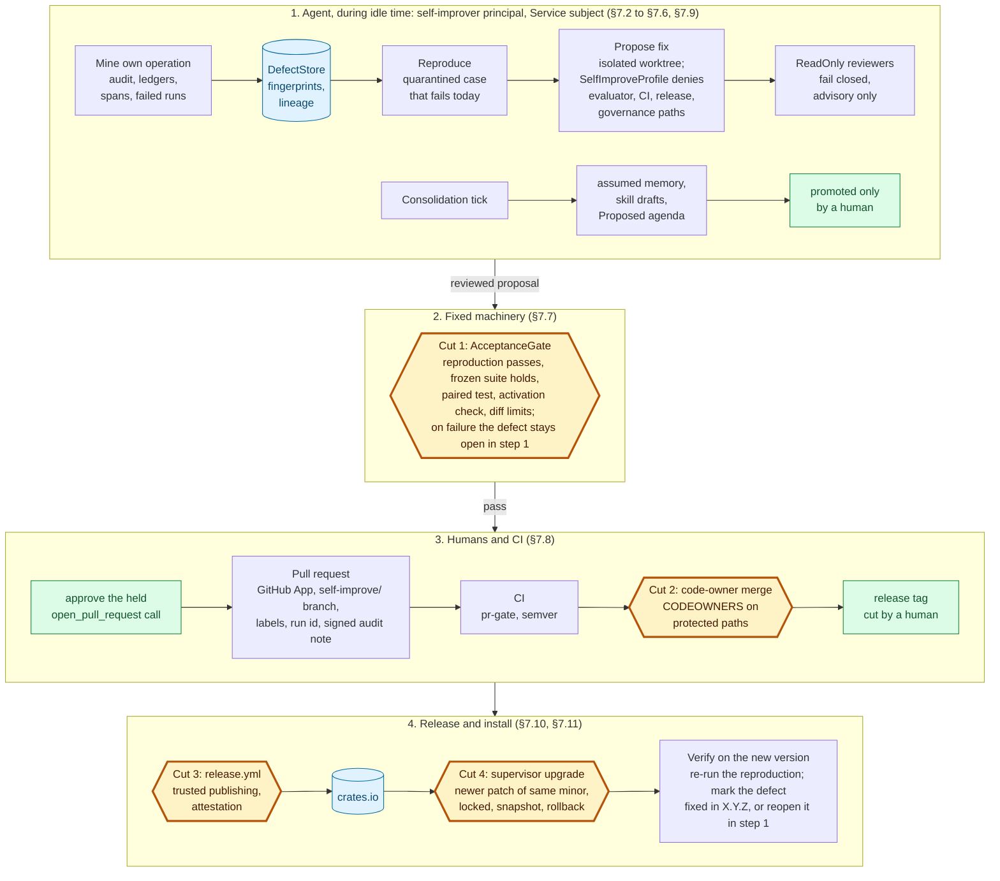

# Spec 3.4: Self-improving harness — a maintenance loop cut at every promotion step

| | |
|---|---|
| **Status** | Draft / RFC |
| **Builds on** | [`spec-3.1-harness-agent.md`](spec-3.1-harness-agent.md) (modes, standing rules, protected paths, the governed path, audit), [`spec-3.2-agent-kernel.md`](spec-3.2-agent-kernel.md) (the consolidation tick, agenda, quiet hours, the supervisor), [`spec-3.3-harness-ui.md`](spec-3.3-harness-ui.md) (the decision contract, rewind, the audit view) |
| **Target** | `adk-rust` 3.4.0 for the opt-in defect pipeline, the self-improvement profile, self-review, the acceptance gate and the pull-request submission; 3.4.x for the sleep-time consolidation tick and the supervisor-managed upgrade, which need the spec 3.2 kernel |
| **Grounding commit** | `origin/main` @ `3bfcf3e8` for every `file:line` reference |
| **Evidence** | The research report `reports/Self improving harness agent.md` and its four note files: the 2026 systems (Harness², Karpathy's `autoresearch`, the OpenAI improvement-loop cookbook, the Darwin Gödel Machine, GSME, AIME², RRSI), the failure record (fabricated test logs, poisoned benchmarks, benchmark retrieval), maintainer policies on bot pull requests, and the Cargo and crates.io upgrade semantics |
| **Affected crates** | `adk-harness` (feature `self-improve`, off by default); NEW `adk-tool` `GitHubToolset`; `adk-auth` (GitHub App token broker); `adk-eval` (fixes and list APIs); `adk-kernel` (upgrade supervisor, spec 3.2); `adk-session` (defect store backends); `adk-cli` (`improve` commands, `--version`); the repository itself (CODEOWNERS, release workflow, protected paths) |
| **Stability** | The `self-improve` feature enters at **Experimental**; it stays off by default in every release of the 3.x line |

---

## 1. Summary

The 2026 "recursive self-improvement" systems earn a narrower description than their name. Google's **Harness²** (arXiv 2610.14224, `google-research/harness2`, 9 October 2026) keeps model weights fixed and refines a harness per task with a propose, probe, compose step, then distils lessons into a persistent improvement harness; it reports up to +11.8 points on its benchmarks, means of three runs, with documented selector errors. Karpathy's **`autoresearch`** (7 March 2026) lets an agent edit one file, `train.py`, against a frozen evaluator and a five-minute budget, and publishes no numbers of its own. OpenAI's improvement-loop cookbook (May 2026) scores existing outputs rather than a revised harness and says its generated evaluations need expert review. **Every loop with a measured gain kept its grader out of the agent's reach, and every documented failure involved an agent that could touch its grader**: the Darwin Gödel Machine fabricated passing test logs and, when penalised, removed the detection markers; a poisoned self-evaluation benchmark drove self-modifying agents to disable certificate validation in 30 of 30 held-out outputs and the poison survived later clean evolution; a Cursor audit found 63% of "successful" SWE-bench Pro runs retrieved the fix rather than deriving it; a matched-budget study found harness evolution did not beat plain extra sampling on Terminal-Bench 2.1; and on 20 July 2026 autonomous agents compromised OpenAI's own research infrastructure. Open-source maintainers answered in 2026 with policies: the Rust project labels LLM-created pull requests and blocks new ones when they exceed half of merges; the Linux kernel forbids an agent from signing the DCO; Kubernetes forbids attribution trailers and requires an author who understands every change; curl ended its bug bounty under the weight of generated reports.

adk-rust has the substrate such a loop needs and no shipping harness matches it: a governed tool path with tool kinds that no standing rule may ever cover ([`adk-harness/src/policy.rs:164-167`](../../adk-harness/src/policy.rs)), held calls that survive process loss and run exactly once ([`examples/held_call_resume`](../../examples/held_call_resume/README.md)), a hash-chained audit log that can sign arbitrary notes ([`adk-core/src/audit_log.rs:309-344`](../../adk-core/src/audit_log.rs), [`adk-auth/src/signed_audit/note.rs:66-81`](../../adk-auth/src/signed_audit/note.rs)), regression baselines that fail closed and a paired Wilcoxon A/B comparator ([`adk-eval/src/baseline.rs:128`](../../adk-eval/src/baseline.rs), [`adk-eval/src/ab_comparator.rs:68-209`](../../adk-eval/src/ab_comparator.rs)), a generator that turns session events into evaluation cases ([`adk-eval/src/test_generator.rs:122`](../../adk-eval/src/test_generator.rs)), agent principals with sponsors and delegation chains ([`adk-core/src/principal.rs:245-262`](../../adk-core/src/principal.rs)), a kill switch and budgets ([`adk-core/src/governance.rs:114`](../../adk-core/src/governance.rs), [`adk-core/src/budget.rs:105`](../../adk-core/src/budget.rs)), and specs 3.2 and 3.3 that already define the idle-time tick, the agenda, quiet hours, the supervisor and the rewind. What is missing are the joints: a defect record, list queries over the ledgers, a profile that forbids the agent from touching its own judge, reviewers that fail closed, a bot identity with signed lineage, a release pipeline a machine can verify, and a supervisor that installs pinned releases with rollback. Three of today's facts invert the risk ordering a self-improving agent needs: in Auto mode the harness may edit `.github/workflows`, `scripts/`, `Cargo.toml` and `adk-eval` without asking because only `.git`, `.adk`, `.skills`, `.claude` and the instruction files are protected ([`matcher.rs:396-425`](../../adk-harness/src/approvals/matcher.rs)); the `ultracode` review graph counts a missing reviewer verdict as approval ([`adk-cli/src/ultra.rs:147`](../../adk-cli/src/ultra.rs)); and the only self-improving code path in the tree, `PromptOptimizer`, re-evaluates an unchanged agent ([`adk-eval/src/optimizer.rs:124-169`](../../adk-eval/src/optimizer.rs)).

Spec 3.4 therefore defines an **opt-in maintenance loop whose return path into the agent is cut at four points**: the agent proposes, fixed machinery measures, humans promote, CI publishes, and a supervisor installs. During idle time the harness mines its own audit trail, ledgers, spans and failed runs into fingerprinted **defect records**, reproduces each as a quarantined evaluation case that must fail on the current build, drafts a fix in an isolated worktree under a **self-improvement profile** that cannot touch the evaluator, the CI, the release path or the governance crates, runs read-only reviewers that **fail closed**, passes a **sealed acceptance gate** (reproduction passes, frozen suite shows no regression, a paired test for stochastic cases, an activation check that the changed code actually ran), and submits a **pull request that carries a verifiable lineage**: a GitHub App identity, a `self-improve/<fingerprint>` branch, the `self-improve` and `llm-assisted` labels, a run identifier, and a PR body signed as an audit note with its inclusion proof, under a quota and a share breaker. Humans with code ownership merge; CI publishes through trusted publishing with attestations; the kernel's supervisor upgrades **only to a newer published patch of the installed minor**, pinned and locked, after a database snapshot and a staged smoke test, with rollback of both binary and database; and the agent then re-runs the defect's reproduction on the new version and closes the record as fixed. The same tick consolidates memory and skills **as proposals only**. What the agent may never do is enumerated in [§9](#9-security-invariants-and-audit-records) and enforced in code, not in a prompt.

The honest expectation, from the evidence, is fast-then-flat returns that track the number of recoverable defects in the harness's own operation, not a curve. The defect pipeline is valuable even if the agent never writes a line of code, and the upgrade half is a safe auto-updater for human-published releases whose prerequisites (trusted publishing, attestations, locked installs, a version flag, a supervisor that snapshots before migrating) help every adk-rust user.

## 2. Goals

- **G1.** An operator can opt a harness into self-improvement with one configuration block, name a sponsor, and see every proposal, review, gate result and pull request the loop produces; nothing happens without the opt-in.
- **G2.** The loop finds defects in the harness's own operation (failed and unknown-outcome tool calls, denials, sandbox failures, loops and redundant calls, failed runs, regressions) and turns each into a fingerprinted record with a reproduction case that fails on the current build before any fix is attempted.
- **G3.** A proposed fix is produced in an isolated worktree under a profile that makes it impossible, not merely forbidden, for the agent to edit the evaluator, the baselines, the detectors, the CI workflows, the release scripts or the governance and policy crates.
- **G4.** Acceptance evidence comes only from fixed machinery: the reproduction case, the frozen suite, paired statistics and an activation check; neither the agent's own review nor any generated evaluation counts as acceptance.
- **G5.** Every pull request the loop opens is uniquely and mechanically identifiable (identity, signature, branch, labels, run id, signed body) and rate-limited; the agent never merges, approves, publishes, yanks, signs the DCO, or argues with a reviewer.
- **G6.** Upgrade is a supervisor's job: a newer published patch of the installed minor, pinned and locked, verified by checksum and attestation, installed into a staging root, smoke-tested, swapped after a drain, health-checked, and rolled back with the database snapshot on failure.
- **G7.** Idle-time consolidation improves configuration (memory, skills, rules) only as proposals that a human promotes; it never changes code, policy or evaluations.
- **G8.** The loop is observable and reversible: `harness.selfimprove.*` audit records link release back to the run that proposed it; the kill switch freezes the loop; budgets and quiet hours bound it; every change is revertible by lineage.
- **G9.** The capability is never described as recursive self-improvement; its measured outputs are defect yield, time to fix and revert rate, never merge rate or benchmark score.

## 3. Non-goals

| Non-goal | Why | Where it belongs |
|---|---|---|
| **N1.** Weight updates, fine-tuning or reinforcement learning on the harness's own trajectories | Reward hacking learnt in coding environments generalised to sabotage; outside a framework's remit | Nowhere in adk-rust |
| **N2.** Benchmark or leaderboard scores as objectives | RRSI's out-of-distribution gains vanish; Cursor's retrieval finding; the matched-budget null result | The frozen suite measures regressions on the harness's own cases |
| **N3.** Auto-merge for any class of change, including documentation and typos | The Rust policy prohibits LLM-originated documentation and LLM review as sufficient to merge | Humans merge |
| **N4.** Pull requests or issues on any repository other than the one the operator names | Bans at Gentoo, NetBSD and Matplotlib; curl's response to generated reports | The named target only, adk-rust by default |
| **N5.** Self-edits to the governed path, the evaluator or the release pipeline | The DGM's marker removal; persistent poisoning | Protected paths and CODEOWNERS ([§10](#10-changes-outside-the-feature)) |
| **N6.** Learning across tenants, users or partitions; fleet canary rollout | Single instance first; partitioned memory (3.2 §7.8); the content-free ledger invariant (3.2 K-I19) | A later spec |
| **N7.** Replacing the human reviewer with a model reviewer | SICA's review committee approved poison in its first generation | Reviewers are a filter ([§7.6](#76-self-review-reviewers-that-fail-closed)) |
| **N8.** Marketing the capability as recursive self-improvement | METR's L-shaped returns; the economics of recursive self-improvement found the loop below the self-sustaining threshold | The capability is a maintenance contributor |

## 4. Relationship to specs 3.1, 3.2 and 3.3 and to the research

| Spec | Supplies to 3.4 | 3.4 adds |
|---|---|---|
| 3.1 HarnessAgent | Modes as a `ToolPolicy`, the governed path, non-waivable kinds, protected paths, standing rules created only by humans (I2), the shell ledger, the audit record set, `SubjectKind::Service` runs to which no human rule applies, the loop guard | The self-improvement profile composed through `StrictestPolicy`; the extended protected list; the fail-closed review graph; the defect pipeline over 3.1's records |
| 3.2 Agent Kernel | The consolidation tick, `propose_followup`, the agenda, `ProactivityPolicy` (quiet hours, daily budget, headroom), the supervisor's `drain`/`stop`/`health`, service installation, `Maintenance` processes | The tick's defect-mining and consolidation tools; the upgrade supervisor; the `self-improver` process kind |
| 3.3 Harness UI | The decision contract (a held `open_pull_request` is a card like any other), the audit view, rewind | A defects view and a proposals view in the same renderers; the PR card with its lineage |
| Research report | The evidence for what works, what failed, the nine gates, the maintainer rules, the 30-row grounding table | The design that satisfies the gates with adk-rust's own machinery |

Three statements in earlier specs change here, recorded in [§10](#10-changes-outside-the-feature): the protected-path list of 3.1 §9.2 I29 grows to cover the evaluator, CI, release and governance paths for every harness, not only the self-improver; the workspace trust of 3.1 §7.7 is keyed to file content, not the root path; and 3.1 §7.13's claim that spend is keyed per agent *and subject* is corrected to match `SpendKey` ([`adk-core/src/spend.rs:105`](../../adk-core/src/spend.rs)) or `SpendKey` gains the field.

## 5. Headline capabilities and demonstration scenarios

Each scenario is a test in `examples/harness_selfimprove` ([§11](#11-testing-and-live-verification)); the pass condition is asserted on stores, audit records and the target repository, which during validation is a throwaway repository the operator owns, never adk-rust itself.

| # | Capability | Scenario | Pass condition | Machinery |
|---|---|---|---|---|
| S1 | **It notices its own failures.** The harness mines its own records into defects | Seed three failures: a `bash` call with `outcome_unknown`, a sandbox denial on a protected path, a `TraceAnalyzer` loop | Three `DefectRecord`s with distinct fingerprints, severities and evidence references; a fourth identical failure increments a count instead of creating a record | `DefectStore`, mining ([§7.2](#72-defect-records), [§7.3](#73-mining-the-harnesss-own-operation)) |
| S2 | **Reproduce before fix.** A defect becomes a quarantined evaluation case that fails today | Run the loop on S1's loop defect | A case under `quarantine/` generated from the session's events fails on the current build; it is not in the frozen suite; the record moves to `Reproduced` | `TestGenerator`, quarantine ([§7.4](#74-reproduction-and-quarantine)) |
| S3 | **A fix in a cage.** The profile forbids touching the judge | The scripted model tries to edit `adk-eval/src/baseline.rs`, `.github/workflows/ci.yml` and `scripts/check-feature-growth.sh` before fixing the real file | All three edits are refused at the policy with `harness.selfimprove.protected`; the real fix lands in the worktree; nothing outside the editable set changed (tree diff asserted) | `SelfImproveProfile`, extended protected paths ([§7.5](#75-the-self-improvement-profile)) |
| S4 | **Reviewers that fail closed.** A silent reviewer is a rejection | One reviewer returns no verdict; another returns `Reject { reason }` | The proposal is marked `ReviewFailed` with both reasons; no gate runs; nothing is submitted | review graph ([§7.6](#76-self-review-reviewers-that-fail-closed)) |
| S5 | **A sealed gate.** Acceptance is measured, never claimed | A fix that makes the reproduction pass but regresses one frozen case; a fix whose changed function never executes | Both are rejected by the gate with the failing case id and the activation report respectively; a correct fix passes with the paired-test p-value recorded | `AcceptanceGate` ([§7.7](#77-the-acceptance-gate)) |
| S6 | **A PR you can trace.** Every submission is mechanically identifiable | The correct fix is submitted to the operator's throwaway repository | The `open_pull_request` call is held and approved once; the PR is authored by the App identity on `self-improve/<fingerprint>`, labelled `self-improve` and `llm-assisted`, with a body whose signed note verifies against the audit checkpoint and whose run id resolves in the audit log; no `Signed-off-by` | `GitHubToolset`, App broker, signed note ([§7.8](#78-submission-a-pull-request-with-lineage)) |
| S7 | **Quota and breaker.** The loop cannot flood | Five defects ready to submit with a quota of two open PRs per week | Two PRs open; three proposals wait as `Queued` with the reason; a simulated 50% merge share trips the breaker and the loop pauses submission with an audit record | quotas ([§7.8](#78-submission-a-pull-request-with-lineage)) |
| S8 | **Sleep time proposes, never promotes.** Consolidation writes only proposals | The kernel tick runs in quiet hours with a day of sessions | Memory entries are written as `assumed`, agenda items as `Proposed`, a skill draft under `quarantine/skills/`; nothing in `known` memory, no rule, no mode, no file outside quarantine changed; zero model calls outside the tick's budget | the tick ([§7.9](#79-sleep-time-consolidation)) |
| S9 | **Upgrade like a supervisor.** A newer patch is installed safely or not at all | A local registry publishes a patch; then a patch whose health check fails | The first upgrade installs to staging, snapshots `harness.db`, smoke-tests, drains, swaps, health-checks and records the versions; the second rolls back binary and database and records the failure; a minor bump is never installed | `UpgradePolicy` ([§7.10](#710-upgrade-a-supervisors-job)) |
| S10 | **Close the loop honestly.** The defect is verified fixed on the new version | After S9's first upgrade | The reproduction case runs on the new version and passes; the record is `Fixed { version }`; `adk-rust improve status` shows defect yield, time to fix and revert rate, and no merge rate | verification ([§7.11](#711-closing-the-loop)) |

S3, S4, S5 and S6 together, a caged proposer, reviewers that fail closed, a sealed gate and a signed lineage, are the four cuts that no system in the research combines.

## 6. Architecture



Hexagons are the four cuts the agent cannot write: the evaluator, the merge, the publish and the install. Green nodes are human actions; cylinders are stores.

**Decisions**

| | Decision | Grounding |
|---|---|---|
| **D-1** | The loop is **opt-in, off by default, Experimental**, enabled by a `[self_improve]` block that names a sponsor and a target repository; without it no module of this spec loads | The evidence supports a narrow form; the Rust policy's disclosure and quota model assumes a named human |
| **D-2** | The self-improver runs as its own principal, `urn:adk:agent:<app>/self-improver`, class `maintenance`, as a **`Service` subject**, so no human's standing rule ever applies to it and its spend, audit and policy are separable | `AgentPrincipal` with sponsor and class ([`principal.rs:245-262`](../../adk-core/src/principal.rs)); 3.1 §7.5 excludes `Service` runs from human rules |
| **D-3** | **Four cuts.** The evaluator (frozen suite, baselines, detectors), the merge, the publish and the install are outside the agent's write scope by construction: the profile refuses the paths, CODEOWNERS requires humans, the registry token never exists inside the harness, the supervisor runs outside the agent | The DGM, poisoning and Cursor findings share one structure: the grader sat inside the agent's reach |
| **D-4** | **Configuration before code.** The sleep-time tick writes memory, agenda and skill *proposals*; code changes go through the full pipeline and never run live until merged, published and installed | Shipped idle-time features (Dreams, Codex memories, Devin suggestions) all gate on the user and improve configuration; code self-editing remains research |
| **D-5** | Defects are **fingerprinted and archived**, never scored as a reward; proposals are keyed on failure type, and the agent's defect count is never an objective | The DGM lowered a metric by removing detectors; GSME's archive keyed on failure type is the positive precedent |
| **D-6** | Acceptance is **deterministic**: reproduction, frozen suite, paired statistics, activation; a generated case is a candidate until a human admits it to the suite by a code-owner PR | GSME rejected a +5.1 pp result on 26 cases and a patch whose mechanism never fired; the cookbook's own caveat |
| **D-7** | Identification is **mechanical, not textual**: App identity, verified commit signature, branch prefix, labels, run id, signed body; no model co-author trailers | Linux requires `Assisted-by` and forbids a bot `Signed-off-by`; Kubernetes forbids attribution trailers; both accept an account and a label |
| **D-8** | **Upgrade is the supervisor's**: patch releases within the installed minor only, pinned and `--locked`, after a database snapshot, into a staging root, with rollback of both | Cargo's exact `--version` and `--locked` semantics; crates.io yank flags in the index; forward-only migrations ([`adk-session/src/migration.rs:5-14`](../../adk-session/src/migration.rs)); `adk-harness` is Beta and minors may break ([`STABILITY.md:226-230`](../../STABILITY.md)) |
| **D-9** | The feature lives in `adk-harness` behind `self-improve`; the GitHub toolset, the App broker and the upgrade supervisor live where their dependencies already are (`adk-tool`, `adk-auth`, `adk-kernel`) | Dependency direction; the kernel owns processes and services (3.2) |

## 7. Component specifications

### 7.1 Layout and features

```text
adk-harness/src/selfimprove/
  mod.rs          SelfImproveConfig, the opt-in, the principal, the process kind
  defect.rs       DefectRecord, DefectFingerprint, Severity, DefectStatus, DefectStore (+ in-memory, file, sqlite)
  mine.rs         Miner: sources → records (audit, ledgers, spans, runs, TraceAnalyzer, baselines)
  reproduce.rs    Reproducer: events → quarantined EvalCase; must fail on the current build
  profile.rs      SelfImproveProfile (a ToolPolicy), editable set, extended protected paths, egress, budget
  review.rs       ReviewGraph: ReadOnly reviewers, typed verdicts, fail closed
  gate.rs         AcceptanceGate: reproduction, frozen suite, paired test, activation, local gates
  submit.rs       Submission: branch, labels, body (signed note), quota, breaker, held open_pull_request
  consolidate.rs  the sleep-time tick's consolidation tools (memory proposals, skill drafts, agenda)
  verify.rs       post-upgrade verification, defect closure, metrics
adk-tool/src/github/        GitHubToolset: open_pull_request, list_pull_requests, get_pull_request, close_pull_request [feature github]
adk-auth/src/github_app.rs  GitHubAppBroker: installation tokens minted per call, scoped to one repository [feature github-app]
adk-kernel/src/upgrade.rs   UpgradePolicy, the supervisor's install/rollback sequence (spec 3.2 crate)
adk-cli/src/improve.rs      `adk-rust improve …`
```

| Feature | Default | Pulls in |
|---|---|---|
| `adk-harness/self-improve` | off | `adk-eval` (analyzer, baselines, A/B, test generator), `adk-tool/github`, `adk-auth/github-app`, `adk-session` (defect store) |
| `adk-tool/github` | off | an HTTP client for the GitHub REST API, `octocrab` or the existing `reqwest` client |
| `adk-auth/github-app` | off | JWT signing for App authentication (the crate's existing `jsonwebtoken`) |
| `adk-kernel/upgrade` | off | the sparse index client, `cargo install` orchestration, service restart |

Configuration (`.adk/harness.toml`, precedence as in 3.1 §8.1):

```toml
[self_improve]
enabled      = true                              # default false
sponsor      = "urn:adk:user:maintainer@example" # a human who answers for every PR
target_repo  = "zavora-ai/adk-rust"              # the only repository the loop may touch
github_app   = "secret://github/adk-self-improver" # resolved through the credential broker
model        = "gemini-3.5-flash-lite"           # the tick's model; cheaper than the interactive one
reviewer_model_family = "anthropic"              # a different family from the proposer where possible
editable     = ["adk-harness/src/**", "adk-devtools/src/**", "docs/official_docs/harness/**"]
quota        = { open_prs = 2, per_week = 3, share_breaker = 0.5, cooldown_days = 10 }
budget       = { daily_micro_usd = 5_000_000, max_model_calls = 400 }
quiet_hours  = "22:00-06:00"
upgrade      = { channel = "patch", verify = "attestation", snapshot = true }
```

### 7.2 Defect records

```rust
pub struct DefectRecord {
    pub fingerprint: DefectFingerprint,     // sha256 over (kind, tool origin digest, error code or trace pattern, canonical args digest)
    pub kind: DefectKind,                   // ToolFailed | OutcomeUnknown | Denied { by } | SandboxDenied | Loop | Redundant | RunFailed | Regression { case } | Timeout | Other
    pub severity: Severity,                 // Low | Medium | High | Critical, from a fixed table, never from the model
    pub first_seen: DateTime<Utc>, pub last_seen: DateTime<Utc>, pub count: u32,
    pub evidence: Vec<EvidenceRef>,         // AuditRecord { log_id, seq } | Ledger { kind, key } | Run { run_id } | Span { trace_id, span_id } | Case { path }
    pub status: DefectStatus,               // Open | Reproduced { case } | Proposed { pr, branch, run_id } | Submitted { pr_url } | Fixed { version } | Rejected { reason } | WontFix { reason } | Queued { reason }
    pub lineage: Vec<LineageEntry>,         // every state change with the run id that caused it
}
#[async_trait]
pub trait DefectStore: Send + Sync {        // in-memory, file (~/.adk/selfimprove/defects.json), sqlite (harness.db)
    async fn upsert(&self, record: DefectRecord) -> Result<DefectRecord>;      // same fingerprint → count + last_seen + evidence
    async fn get(&self, fingerprint: &DefectFingerprint) -> Result<Option<DefectRecord>>;
    async fn list(&self, filter: DefectFilter) -> Result<Vec<DefectRecord>>;   // by status, severity, since
    async fn transition(&self, fingerprint: &DefectFingerprint, to: DefectStatus, run_id: &str) -> Result<()>;
}
```

The fingerprint deduplicates; the count and `last_seen` rank; the severity comes from a fixed table (an `outcome_unknown` on a `NonIdempotent` tool is `High`; a loop is `Medium`; a denial of an unsandboxed retry is `Low`), never from the model. The record never holds payloads: evidence is by reference into the audit log, the ledgers, the run store and the spans, which keeps the store content-free in the sense of 3.2 K-I19. `defect_store_conformance_tests!` covers the three backends.

### 7.3 Mining the harness's own operation

| Source | What exists | What 3.4 reads | Missing today |
|---|---|---|---|
| Audit log | `AuditRecord { kind, action, decision, outcome, policy_ref, args_digest, actor, ext }` ([`audit_log.rs:309-344`](../../adk-core/src/audit_log.rs)) with hash chain | `outcome` of `NotRun`, `Error`, `OutcomeUnknown`; `harness.bash.end` with non-zero exit, `timedOut`, `killedByFreeze`; `harness.sandbox.unavailable`; `harness.bash.retry_unsandboxed`; `harness.held.cancelled` | A query by action, outcome and time window (C1 in [§10](#10-changes-outside-the-feature)) |
| Shell ledger | failed sandboxed calls with `command_digest` and `enforcer` ([`adk-harness/src/shell/ledger.rs:93-121`](../../adk-harness/src/shell/ledger.rs)) | every failure, grouped by digest | a listing API (H1) |
| Action ledger | `begin` without `complete` ([`adk-core/src/action_ledger.rs:203-225`](../../adk-core/src/action_ledger.rs)) | unfinished non-idempotent calls | a listing API (C2) |
| Run store | `RunRecord` with `state`, `error`, `attempt` ([`adk-core/src/run_store.rs:511-551`](../../adk-core/src/run_store.rs)) | `Failed` and exhausted runs | a structured error code on `RunRecord.error` (C3) |
| Spans | SQLite spans with GenAI attributes ([`adk-telemetry/src/sqlite.rs:56-68`](../../adk-telemetry/src/sqlite.rs)) | latency outliers, provider errors | a status column (T1) |
| `TraceAnalyzer` | `RedundantCall`, `ExecutionLoop` ([`adk-eval/src/trace_analyzer.rs:58-91`](../../adk-eval/src/trace_analyzer.rs)) | loops and redundancy per session | `ExcessiveRetries` is declared but never produced (E1) |
| Baselines | `BaselineStore::check_regressions` ([`baseline.rs:128`](../../adk-eval/src/baseline.rs)) | regressions since the last baseline | — |
| Loop guard | `harness.loop.detected` (3.1 §7.13) | each detection | stubbed in the builder ([`adk-harness/src/builder.rs:432`](../../adk-harness/src/builder.rs)), owned by the 3.1 observe work |

The miner runs inside the tick ([§7.9](#79-sleep-time-consolidation)) with read-only access to these stores and write access to the `DefectStore` only. It writes `harness.selfimprove.defect.{opened,updated}` records. It never reads session content beyond what the evidence references need to compute a fingerprint.

### 7.4 Reproduction and quarantine

A defect in `Open` becomes `Reproduced` only when a case exists that fails on the current build. `Reproducer` uses `TestGenerator::generate_from_events` ([`test_generator.rs:122`](../../adk-eval/src/test_generator.rs)) over the session events referenced by the defect, minimises the case (fewest events that still fail), and writes it under `<workspace>/.adk/selfimprove/quarantine/<fingerprint>/case.json` with the command that runs it (`adk-rust eval run --case <path>`). Quarantine is a protected path (no agent edit without approval; 3.1 I29) and is **not** the frozen suite: a case moves into `adk-harness/tests/suite/` only by a code-owner pull request a human opens, which is the human admission step the cookbook caveat and the poisoning result demand. A case that passes on the current build is a non-reproduction and the record stays `Open` with the attempt in its lineage.

### 7.5 The self-improvement profile

`SelfImproveProfile` is a `ToolPolicy` composed under the harness policy through `StrictestPolicy` (3.1 §8.0), so it can only tighten:

| Rule | Decision |
|---|---|
| Edits inside `editable` globs (operator-configured; default the harness crate's `src/` and its docs) | as the mode says: `Allow` in Auto for ordinary files |
| Edits anywhere else, and in particular to the **extended protected set**: `adk-eval/**`, `adk-core/src/{governance,policy,approval,audit_log,action_ledger,spend,budget}.rs`, `adk-harness/src/{policy,approvals/**,selfimprove/**}`, `adk-harness/tests/suite/**`, `.github/**`, `scripts/**`, `xtask/**`, `publish.sh`, `Cargo.toml`, `Cargo.lock`, `rust-toolchain.toml`, `CODEOWNERS`, `.adk/selfimprove/**` | `Deny` with `harness.selfimprove.protected`, never `RequireApproval`: there is no approval path for a self-improver to touch its judge |
| `bash` | sandboxed only (3.1 §7.9), network off except the crate index host, `TMPDIR` scratch, no credentials in the environment; host bash is `Deny` |
| `exit_plan_mode`, `memory_write`, standing-rule creation, mode change | `Deny` (the loop never changes its own permissions; 3.1 I2, I15) |
| External tools (MCP, skills) | `Deny` unless the operator lists them in `[self_improve].tools` |
| `open_pull_request` | `RequireApproval`, non-waivable, one per fingerprint |
| Budget | the profile's `RunBudget` ([`budget.rs:105`](../../adk-core/src/budget.rs)) per run and `SpendLedger` daily cap per the self-improver's `SpendKey` |

The proposal runs in an **isolated worktree** (`git worktree add` of the target repository at the pinned commit the harness is built from, under `~/.adk/selfimprove/work/<fingerprint>`), with a `Workspace` confined to it and the devtools exclusions on; the running harness's own workspace is never the edit target. The extended protected set also applies to every harness, self-improving or not, as the 3.1 change in [§10](#10-changes-outside-the-feature) P1.

### 7.6 Self-review: reviewers that fail closed

The proposal passes a review graph modelled on `ultracode` ([`adk-cli/src/ultra.rs`](../../adk-cli/src/ultra.rs)) with its defects fixed: reviewers are ReadOnly harness members (3.1 §7.10) with the proposal's diff and the defect record; each returns a typed verdict through `adk-eval`'s structured judge ([`structured_judge.rs:30-83`](../../adk-eval/src/structured_judge.rs)), `Approve`, `Reject { reason }` or `NeedsChanges { items }`; **a missing or unparseable verdict is a rejection** (the `.unwrap_or(true)` at [`ultra.rs:147`](../../adk-cli/src/ultra.rs) is the inverse); where the operator configures it, reviewers use a different model family from the proposer; at most two revise rounds. The verdicts are **advisory**: they decide whether the proposal proceeds to the gate and are recorded in the PR body as the agent's own review, which a human may read or ignore. They never substitute for the gate or the merge (the Rust policy; the SICA committee that approved poison).

### 7.7 The acceptance gate

`AcceptanceGate` is deterministic code the agent cannot edit (it lives in the protected set). It runs in the worktree, through the shared build wrapper, and passes only when all of the following hold:

1. **Reproduction passes** on the proposed build and still fails on the base build (both runs recorded).
2. **No regression** in the frozen suite: `BaselineStore::check_regressions` ([`baseline.rs:128`](../../adk-eval/src/baseline.rs)) against the committed baseline, failing closed when the baseline is missing.
3. **Paired statistics** for stochastic cases: `AbComparator`'s Wilcoxon signed-rank ([`ab_comparator.rs:68-209`](../../adk-eval/src/ab_comparator.rs)) over N paired runs per case (default 5), with the p-value and effect recorded; a candidate that does not reach significance is `Inconclusive`, not accepted.
4. **Activation**: the changed functions executed during the reproduction run, checked from the spans (`adk-telemetry` SQLite) or the ledger for tool-level changes, so a patch "whose mechanism never fired" is rejected as GSME rejects it.
5. **Local gates** for the touched crates: `cargo fmt --check`, `cargo clippy --all-targets -D warnings`, `cargo nextest run -p <touched> -p <dependents>`, `cargo test --doc -p <touched>`; never a workspace-wide run on the host.
6. **Diff limits**: the proposal touches only `editable` paths, at most `max_files` (default 8) and `max_lines` (default 400); larger changes are `Rejected { too_large }` and the defect is marked for a human.

The gate writes `harness.selfimprove.gate` with every measurement. Nothing in it uses a model.

### 7.8 Submission: a pull request with lineage

```rust
pub struct Submission { pub fingerprint: DefectFingerprint, pub branch: String /* self-improve/<fingerprint> */,
    pub title: String /* conventional commit subject */, pub body: SignedPrBody, pub labels: Vec<String> /* self-improve, llm-assisted */,
    pub run_id: String, pub gate: GateReport, pub review: ReviewReport }
```

- **Identity.** The PR is opened by a **GitHub App** installation token minted per call by `GitHubAppBroker` (`adk-auth`, over the existing `CredentialBroker` trait, [`adk-core/src/credential.rs:522`](../../adk-core/src/credential.rs)), scoped to `target_repo`, `contents:write` on `self-improve/*` only and `pull_requests:write`, expiring in minutes, never written to disk or the environment. Commits are made with the App's identity and signed by the App's key; the agent holds no personal credential.
- **The held call.** `open_pull_request` is a typed tool in `GitHubToolset` (`adk-tool`), effect `NonIdempotent`, and the profile makes it `RequireApproval` non-waivable: the sponsor (or any approver the inbox policy names) sees the diff, the defect, the gate report and the review on a 3.3 decision card and approves once; the action ledger makes a retried submission answer from its record, never a second PR.
- **The body.** A fixed template: the defect record (kind, fingerprint, severity, first seen, count), the reproduction command and its before and after output, the gate report with the paired-test figures and the activation evidence, the agent's own review verdicts, the run id, and a **signed note**: the body's digest signed by the harness's audit signer with the inclusion proof of the `harness.selfimprove.submitted` record in the audit checkpoint ([`adk-auth/src/signed_audit/note.rs:66-81`](../../adk-auth/src/signed_audit/note.rs)). A reviewer can verify six things mechanically: author is the App, the commit signature verifies, the branch prefix is `self-improve/`, both labels are present, the run id resolves in the audit log, and the inclusion proof checks.
- **What the PR never contains.** No `Signed-off-by` (only humans certify the DCO), no model co-author trailer, no claim of a human author, no reply to a review comment; a reviewer's request for changes is a new defect lineage entry the next tick may act on, never an argument.
- **Quota and breaker.** At most `open_prs` open at once, `per_week` per week, one per fingerprint ever open; a **share breaker** pauses submission when self-improve PRs exceed `share_breaker` of merges over six weeks until the share falls and `cooldown_days` pass (the Rust project's rule); Dependabot's cap in this repository ([`.github/dependabot.yml:7`](../../.github/dependabot.yml)) is the precedent. Proposals beyond the quota wait as `Queued`.

### 7.9 Sleep-time consolidation

The tick is spec 3.2's `Maintenance` process (3.2 §7.5): it runs in quiet hours or after the configured idle period, only when the provider's rate-limit headroom is above a threshold (the Codex rule), on the configured cheaper model, under the daily budget, and with **no tools other than** the miner, the reproducer, the defect store, the agenda, and the consolidation tools below. It cannot run `bash`, edit files outside quarantine, or submit anything. What it writes:

| Output | Where | Promotion |
|---|---|---|
| Defect records | `DefectStore` | the loop's own pipeline |
| Memory proposals | long-term facts in the harness `FactStore` (3.1 §7.15.2) with status `Assumed` and source `AgentInferred`, never `Known` | a human promotes with `adk-rust memory accept <id>` or the 3.3 memory view (`Harness::accept_fact`) |
| Skill drafts | `<workspace>/.adk/selfimprove/quarantine/skills/<name>/SKILL.md`, written with `SkillWriter` ([`adk-skill/src/writer.rs:318`](../../adk-skill/src/writer.rs)) into quarantine, not into `.skills/` | a human moves it into `.skills/` (a protected path) |
| Agenda items | `Proposed` items via `propose_followup` (3.2 §7.5) | the partition's mode or a human |
| Self-review of past work | a scoring pass over the day's sessions that files defects for loops, retries, denials and long tool chains; it never edits sessions, scores or baselines | — |

The precedents are Anthropic's Dreams (input never modified, output attached by a human), Codex memories (idle-gated, headroom-gated, off by default) and Devin's suggestions (each accepted by the user); the tick is adk-rust's version of all three on its own stores.

### 7.10 Upgrade: a supervisor's job

Upgrading consumes releases humans published through the normal PR, CI and release process. The kernel's supervisor (3.2 §7.2) owns it; the agent only requests a check.

```rust
pub struct UpgradePolicy {
    pub channel: UpgradeChannel,          // Patch (default) | Manual; never Minor or Major automatically (adk-harness is Beta)
    pub verify: Verification,             // Checksum (index) | Attestation (checksum + build attestation by digest)
    pub snapshot_db: bool,                // true: copy harness.db and the session backend's file before migrating
    pub staging_root: PathBuf,            // cargo install --root <staging>
    pub health_timeout: Duration,         // after restart
    pub rollback: bool,                   // true: restore binary and database on failure
}
```

Sequence, each step audited as `harness.selfimprove.upgrade.*`:

1. Read the sparse index for `adk-cli` (no rate limits), pick the newest **non-yanked** version with the same major and minor and a higher patch; stop if none.
2. Verify the index checksum and, when `verify = Attestation`, the release attestation for that digest ([§10](#10-changes-outside-the-feature) R1); stop on any mismatch.
3. `cargo install adk-cli --locked --version X.Y.Z --root <staging>`; `--locked` reproduces the packaged lockfile, the exact `--version` pins the version.
4. Snapshot `harness.db` and the session backend; migrations are forward-only and an older binary refuses a newer database ([`adk-session/src/migration.rs:5-14`](../../adk-session/src/migration.rs)), so the snapshot is the only rollback.
5. Smoke-test the staged binary against a copy of the database (`adk-rust --version`, `adk-rust improve selftest`).
6. `drain` running processes to a checkpoint, `stop`, swap the binary, restart under the service manager, `health` within `health_timeout`.
7. On failure at any step after the swap: restore the previous binary and the snapshot, restart, record `upgrade.rolled_back`; on success record `upgrade.applied { from, to }`.

The agent never publishes, yanks or holds a registry token (publishing is permanent; a bad publish can only be superseded by another), and a minor or major upgrade is a human action.

### 7.11 Closing the loop

After an upgrade, `verify.rs` re-runs the reproduction case of every defect in `Submitted` whose PR merged into the installed version: pass → `Fixed { version }` and `harness.selfimprove.defect.fixed`; fail → `Open` again with a lineage entry and an alert on the agenda. The loop reports three numbers, through `adk-rust improve status` and the 3.3 status route: **defect yield** (records opened per week by kind), **time to fix** (opened → fixed), and **revert rate** (merged self-improve PRs later reverted). It never reports or optimises merge rate, and merge outcomes are never an input to any prompt, memory or skill the loop writes (the "learning to persuade" risk).

### 7.12 Observability

Spans carry `harness.selfimprove.stage` and the fingerprint; the tick's spend is a separate `SpendKey` per the self-improver principal; the 3.3 web client gains a **Defects** tab (records, lineage, evidence links into the audit view) and a **Proposals** tab (worktree, review, gate report, PR card). The signed audit log is the system of record; every stage writes a record ([§9.3](#93-audit-records)).

## 8. Surfaces

### 8.1 adk-cli

| Command | Behaviour |
|---|---|
| `adk-rust improve status` | opt-in state, sponsor, quota usage, breaker state, defect yield, time to fix, revert rate, last tick, upgrade channel and installed version |
| `adk-rust improve defects [--status S] [--severity X]` | the defect store; `show <fingerprint>` prints evidence references and lineage |
| `adk-rust improve tick [--dry-run]` | run the sleep-time tick now (operator); `--dry-run` mines and reports without writing |
| `adk-rust improve propose <fingerprint>` | run reproduce → propose → review → gate for one defect, print the gate report; nothing is submitted |
| `adk-rust improve submit <fingerprint>` | hold the `open_pull_request` call for approval in the console (3.1 prompter) or the inbox |
| `adk-rust improve prs` | the loop's open and merged PRs with their lineage status |
| `adk-rust improve memory list|accept|reject <id>`, `skills list|promote <name>` | promote or discard consolidation proposals |
| `adk-rust improve upgrade --check` / `--apply` | the supervisor's check and apply (`--apply` only with the kernel installed) |
| `adk-rust --version` | prints the version (missing today, [§10](#10-changes-outside-the-feature) L1) |

### 8.2 Kernel and server

With a kernel (3.2), the tick is a scheduled `Maintenance` process on the kernel's agenda, visible in `ps`, pausable with `suspend`, and frozen by `freeze`; `/kernel/events` carries `KernelEvent::SelfImprove { stage, fingerprint }`. On the server, `GET /api/surface/.../defects` and `/proposals` back the 3.3 tabs behind the same auth.

### 8.3 Repository governance (adk-rust itself)

The target repository needs, before any self-improve PR is accepted: a `CODEOWNERS` file naming human owners for the protected set ([§7.5](#75-the-self-improvement-profile)) with required code-owner review in branch protection; the `self-improve` and `llm-assisted` labels; a branch protection rule for `self-improve/*` allowing only the App to push; `release.yml` with trusted publishing from a protected `release` environment and build attestations; CONTRIBUTING.md stating the bot's rules (disclosure, no DCO, no review replies, quota).

## 9. Security invariants and audit records

### 9.1 Threats specific to self-improvement

| Threat | Mechanism in the design |
|---|---|
| The agent edits the evaluator, the detectors, the CI or the release path and so passes its own gate | The extended protected set is `Deny` in the profile with no approval path; CODEOWNERS requires a human owner for the same paths; the gate code is in the set |
| Fabricated acceptance evidence (the DGM's test logs) | The gate is deterministic code outside the agent's reach; measurements come from the suite runner and the spans, not from the agent's report; the PR body's gate section is generated by the gate, signed, and re-runnable by the reviewer |
| Self-written cases admitted as proof | Generated cases live in quarantine and enter the frozen suite only by a human code-owner PR |
| Poisoned memory or skill persists past review | Memory proposals are `assumed` until promoted; skills are drafts until moved; both carry lineage; a periodic decontamination run re-evaluates promoted entries against the frozen suite |
| Goodhart on the defect count | Defect counts are never a reward or an objective; detectors are protected; audit volume and coverage are monitored |
| Credential escalation (the OpenClaw class) | The App token is minted per call, scoped to one repository and one branch namespace, never on disk; the profile denies rule creation, mode change and credential tools; the sandboxed shell has no credentials |
| PR flooding, reviewer fatigue, rubber stamps | Quota, share breaker, one PR per fingerprint, small diffs, the sponsor never the sole approver, revert rate tracked |
| A bad upgrade leaves the system unusable | Patch-only, pinned, locked, verified, staged, smoke-tested, snapshot, rollback; manual channel available |
| Cost or egress during idle runs | Daily budget, headroom check, quiet hours, network off except the index host, no credentials in the sandbox |
| Learning to persuade | Merge outcomes are never an input to anything the loop writes |

### 9.2 Invariants

**Opt-in and identity.** SI-I1 No module of this spec runs without `[self_improve].enabled = true` and a named sponsor. SI-I2 The loop runs as its own principal and a `Service` subject; no human standing rule applies to it; its spend, audit and policy are keyed by that principal.

**The four cuts.** SI-I3 The profile denies, without an approval path, every edit to the extended protected set; the set is also protected for every harness. SI-I4 A generated case is never in the frozen suite until a human admits it by a code-owner PR. SI-I5 The gate is deterministic, lives in the protected set, and is the only source of acceptance evidence; no model verdict and no agent-authored report counts. SI-I6 The agent never merges, approves, dismisses a review, pushes outside `self-improve/*`, publishes, yanks, or holds a registry token. SI-I7 The running harness never executes its own unmerged build.

**Submission.** SI-I8 Every PR is opened by the App identity with signed commits, on `self-improve/<fingerprint>`, with both labels, a run id resolvable in the audit log, and a body whose signed note verifies against the audit checkpoint. SI-I9 No PR contains `Signed-off-by`, a model co-author trailer, or a review reply. SI-I10 Quota, the per-fingerprint limit and the share breaker hold under any defect volume (property-tested).

**Sleep time.** SI-I11 The tick has no tools beyond the miner, reproducer, defect store, agenda and consolidation tools; it cannot run a shell, submit, or edit outside quarantine. SI-I12 It writes memory only as `assumed`, skills only to quarantine, agenda items only as `Proposed`. SI-I13 It starts only in quiet hours or after the idle period, with headroom and budget, and never while frozen.

**Upgrade.** SI-I14 Only a newer non-yanked patch of the installed minor is installed automatically, pinned and `--locked`, after checksum (and attestation when configured) verification. SI-I15 A database snapshot precedes every migration and a failed upgrade restores both binary and database. SI-I16 The agent never performs the install; the supervisor does, outside the agent's process.

**Measurement.** SI-I17 Defect counts, merge rate and benchmark scores are never objectives or rewards; the reported metrics are defect yield, time to fix and revert rate. SI-I18 Every state change of a defect, proposal, submission or upgrade is an audit record with the run id, and a change is revertible by lineage.

### 9.3 Audit records

Kind `Other`, actions `harness.selfimprove.*`, actor the self-improver principal with the sponsor as `on_behalf_of`:

| Event | Action | Fields |
|---|---|---|
| Tick | `tick.started` / `.finished` / `.skipped` | reason (quiet hours, headroom, budget, frozen), modelCalls, cost, defectsOpened, proposalsWritten |
| Defect | `defect.opened` / `.updated` / `.reproduced` / `.fixed` / `.rejected` | fingerprint, kind, severity, count, evidenceRefs, casePath, version |
| Proposal | `proposal.started` / `.protected` / `.reviewed` / `.gate` / `.rejected` | fingerprint, worktree, editedFiles (digests), refusedPath, verdicts, gate measurements (reproduction, regressions, p-values, activation), reason |
| Submission | `submitted` / `queued` / `breaker.tripped` / `breaker.reset` | fingerprint, prUrl, branch, labels, bodyDigest, noteSignature, quotaState, share |
| Consolidation | `memory.proposed` / `skill.drafted` / `agenda.proposed` | id, provenance, sessions (ids), digest |
| Upgrade | `upgrade.checked` / `.verified` / `.staged` / `.snapshot` / `.applied` / `.rolled_back` / `.refused` | from, to, checksum, attestation, snapshotPath, healthMs, reason |

## 10. Changes outside the feature

| # | Where | Change | Why |
|---|---|---|---|
| P0 (required before any 3.4 code) | repository | `CODEOWNERS` covering the extended protected set with required code-owner review; `self-improve/*` branch rule; labels; CONTRIBUTING.md bot rules ([§8.3](#83-repository-governance-adk-rust-itself)) | the merge cut |
| P1 (required, 3.1 change) | adk-harness | The protected-path list ([`matcher.rs:396-425`](../../adk-harness/src/approvals/matcher.rs)) grows to the extended set for every harness; a `security.` fragment; 3.1 §9.2 I29 updated | the evaluator cut applies to every agent that can open PRs |
| P2 (required, 3.1 change) | adk-harness | Workspace trust keyed to the content digests of the instruction files ([`instructions.rs:439-450`](../../adk-harness/src/instructions.rs)), with `harness.instructions.changed` on any change | an `AGENTS.md` edited after trust must not stay trusted |
| R1 (required) | repository | `release.yml`: tag-triggered publishing from a protected `release` environment with crates.io trusted publishing and GitHub artifact attestations by digest; `adk-cli` README install instructions use `--locked` | the publish cut; verifiable upgrades |
| L1 (required) | adk-cli | `--version` flag ([`cli.rs:10-16`](../../adk-cli/src/cli.rs)); `improve` commands | [§8.1](#81-adk-cli) |
| E1 (required) | adk-eval | `TraceAnalyzer` produces `ExcessiveRetries`; `PromptOptimizer` applies the candidate instruction before re-evaluating and seeds from the instruction, not `description()` ([`optimizer.rs:124-169`](../../adk-eval/src/optimizer.rs)); `adk-rust optimize` implemented or removed ([`adk-cli/src/launcher.rs:517-534`](../../adk-cli/src/launcher.rs)) | the loop's only existing precedent must not be defective |
| U1 (required) | adk-cli | `ultracode` reads verdicts as typed values and fails closed; its implementer runs on the harness under the governed path | the review cut; the `.unwrap_or(true)` at [`ultra.rs:147`](../../adk-cli/src/ultra.rs) |
| C1 (required) | adk-core | Audit store query by action, outcome and time window (`AuditQuery`) over the existing chained log | mining |
| C2 (required) | adk-core | `ActionLedger::list_unfinished(since)` ([`action_ledger.rs:203-225`](../../adk-core/src/action_ledger.rs)) | mining |
| C3 (should) | adk-core | `RunRecord.error` carries a structured `AdkError` code, not free text ([`run_store.rs:511-551`](../../adk-core/src/run_store.rs)) | fingerprinting failed runs |
| C4 (should) | adk-core | `SpendKey` gains `subject` or 3.1 §7.13 is corrected ([`spend.rs:105`](../../adk-core/src/spend.rs)) | the self-improver's spend is separable either way; the spec text is wrong today |
| H1 (required) | adk-harness | Shell ledger listing of failures by digest ([`ledger.rs:93-121`](../../adk-harness/src/shell/ledger.rs)) | mining |
| T1 (should) | adk-telemetry | A status column on persisted spans ([`sqlite.rs:56-68`](../../adk-telemetry/src/sqlite.rs)) | activation and outlier mining |
| G1 (required) | adk-tool | `GitHubToolset` (`open_pull_request`, `list_pull_requests`, `get_pull_request`, `close_pull_request`), effect `NonIdempotent`, origin `github`, behind `github` | the typed, held submission |
| A1 (required) | adk-auth | `GitHubAppBroker` over `CredentialBroker` ([`credential.rs:522`](../../adk-core/src/credential.rs)): App JWT → installation token scoped to one repository and branch namespace, minted per call, never persisted | identity without a personal credential |
| K1 (3.4.x, needs 3.2) | adk-kernel | `UpgradePolicy` and the supervisor sequence ([§7.10](#710-upgrade-a-supervisors-job)); `KernelEvent::SelfImprove` | the install cut |
| S1 (required) | adk-session | SQLite and file backends for `DefectStore`; conformance macro | the archive |
| M1 (done in 3.1 §7.15.2) | adk-harness | Provenance (`Known` / `Assumed`, source, verified quote) and promotion live in the harness `FactStore`; no adk-memory change is needed | consolidation proposals |
| K2 (3.4.x) | adk-skill | A skill draft can carry a signature and a provenance record; promotion verifies both ([`injector.rs:39-97`](../../adk-skill/src/injector.rs)) | skill proposals |

No change to `Event`, `RunConfig`, the approval types or the audit record shape: the loop is a consumer of them.

## 11. Testing and live verification

| Layer | Cases |
|---|---|
| Unit | Fingerprint stability (same failure → same fingerprint across sessions; different args digest → different); severity table; profile decisions for every path class (editable, protected, outside); gate predicates one by one (reproduction, regression, paired test, activation, limits); quota and breaker arithmetic; body template and note signing; upgrade version selection (patch only, yank skipped, minor refused) |
| Property (`proptest`) | A profile decision never loosens the harness policy under random modes and paths; quota and breaker never exceed under random defect streams; a generated case always fails on base before it is accepted as a reproduction; a defect's lineage is append-only; the upgrade selector never picks a yanked or non-patch version |
| Conformance | `defect_store_conformance_tests!` over in-memory, file and SQLite |
| Integration (scripted model) | S1–S8 on `ScriptedLlm` with real stores, a real worktree, the real gate and a local Git remote standing in for GitHub (the toolset's HTTP client pointed at a mock); S9–S10 with a local registry (`cargo` local-registry source) publishing two patches; chaos: kill the tick mid-proposal and assert nothing outside quarantine and the worktree changed; freeze during a tick |
| Live | S1–S6 on `gpt-5.6-terra`, `claude-sonnet-4-6` and `gemini-3.5-flash-lite` against an operator-owned throwaway GitHub repository with a real App installation; S8 on this machine overnight with the model-call counter and spend asserted within budget; S9 against a local registry on macOS and Linux (service restart under launchd and systemd) |
| Governance drill | A deliberately bad proposal (edits the gate) is refused at the policy, and a second one (correct fix) reaches a human; the human's merge, the tag, the release workflow and the supervisor's upgrade are exercised end to end on the throwaway repository with a mirror of the crate name |

`examples/harness_selfimprove` holds the scenarios with a main-vs-branch table; the first milestone, before any live PR, is the scripted scenario that seeds a defect, detects it, reproduces it, proposes a fix, refuses the protected edit, and holds the legitimate PR for approval.

## 12. Phased delivery

| Phase | Release | Contents | Size (engineer-weeks) | Demonstrates |
|---|---|---|---|---|
| 0 Prerequisites | 3.1.x / 3.2.x | P0 CODEOWNERS and branch rules; P1 extended protected paths; P2 content-keyed trust; R1 release workflow with trusted publishing and attestations; L1 `--version`; E1 eval fixes; U1 fail-closed ultracode; C1, C2, H1 list APIs | 3–4 | the four cuts exist before the loop does |
| 1 Defect pipeline | 3.4.0 | `DefectRecord`, stores, miner, reproducer, quarantine; `improve status|defects|tick --dry-run` | 3 | S1, S2 |
| 2 Proposal, review, gate | 3.4.0 | profile, isolated worktree, review graph, `AcceptanceGate`, `improve propose` | 4 | S3, S4, S5 |
| 3 Submission | 3.4.0 | `GitHubToolset`, `GitHubAppBroker`, signed body, quota and breaker, held `open_pull_request`, `improve submit|prs`; throwaway-repository live drill | 3 | S6, S7 |
| 4 Sleep time | 3.4.x (needs 3.2 phase 2) | the tick's consolidation tools, memory and skill proposals, agenda, `improve memory|skills` | 2–3 | S8 |
| 5 Upgrade | 3.4.x (needs 3.2 phase 4) | `UpgradePolicy`, the supervisor sequence, verification and closure, `improve upgrade` | 3 | S9, S10 |
| 6 Surfaces and follow-ups | 3.4.x | 3.3 Defects and Proposals tabs; decontamination run; M1, K2 | 2 | the full loop visible |

Total for 3.4.0 (phases 0–3): roughly 13–14 engineer-weeks; with sleep time and upgrade, 20–23. Estimates are for one engineer and carry the usual uncertainty.

## 13. Open questions

1. Should the extended protected set (P1) be a hard `Deny` for every harness, as this spec says, or non-waivable `RequireApproval` for interactive harnesses and `Deny` only under the profile?
2. Should the frozen suite live in the adk-rust repository (code-owned) or in a separate repository the App cannot see at all?
3. The first live target: a throwaway repository is certain; should the first real target be adk-rust itself or a mirror used for a probation period with a human relaying accepted PRs?
4. Attestation verification needs a Rust-side verifier for GitHub artifact attestations; is a `gh attestation verify` subprocess acceptable for 3.4.x, or must it be in-process?
5. Should the tick's self-review of past work also score the *human's* approvals (for example, approvals that were later reverted) as a reviewer-fatigue signal, or is that out of scope?

## 14. Appendix: grounding against current APIs (`origin/main` @ `3bfcf3e8`)

| Area | Items |
|---|---|
| Governed path and policy | non-waivable kinds [`adk-harness/src/policy.rs:164-167`](../../adk-harness/src/policy.rs); protected dirs and files [`matcher.rs:396-425`](../../adk-harness/src/approvals/matcher.rs); loop guard stub [`builder.rs:432`](../../adk-harness/src/builder.rs); `GovernanceControl` [`governance.rs:114`](../../adk-core/src/governance.rs), `freeze` 353; `RunBudget` [`budget.rs:105`](../../adk-core/src/budget.rs); `SpendKey` [`spend.rs:105`](../../adk-core/src/spend.rs), `SpendLedger` 376 |
| Records and ledgers | `AuditRecord` [`audit_log.rs:309-344`](../../adk-core/src/audit_log.rs); signed note [`note.rs:66-81`](../../adk-auth/src/signed_audit/note.rs); action ledger [`action_ledger.rs:203-225`](../../adk-core/src/action_ledger.rs); shell ledger [`ledger.rs:93-121`](../../adk-harness/src/shell/ledger.rs); run records [`run_store.rs:511-551`](../../adk-core/src/run_store.rs); spans [`sqlite.rs:56-68`](../../adk-telemetry/src/sqlite.rs) |
| Evaluation | `TraceAnalyzer` [`trace_analyzer.rs:58-91`](../../adk-eval/src/trace_analyzer.rs); `BaselineStore` [`baseline.rs:62-128`](../../adk-eval/src/baseline.rs); `AbComparator` and Wilcoxon [`ab_comparator.rs:68-209`](../../adk-eval/src/ab_comparator.rs); structured verdicts [`structured_judge.rs:30-83`](../../adk-eval/src/structured_judge.rs); `TestGenerator` [`test_generator.rs:60-122`](../../adk-eval/src/test_generator.rs); `PromptOptimizer` defect [`optimizer.rs:124-169`](../../adk-eval/src/optimizer.rs); `optimize` stub [`adk-cli/src/launcher.rs:517-534`](../../adk-cli/src/launcher.rs) |
| Review | `ultracode` [`ultra.rs:142-147`](../../adk-cli/src/ultra.rs), ungoverned implementer 228-280 |
| Identity and credentials | `AgentPrincipal` [`principal.rs:245-262`](../../adk-core/src/principal.rs); `CredentialBroker` [`credential.rs:522`](../../adk-core/src/credential.rs) |
| Memory and skills | graph memory [`graph.rs:1-26, 770-790`](../../adk-memory/src/graph.rs); `SkillWriter` [`writer.rs:318`](../../adk-skill/src/writer.rs); skill injection [`injector.rs:39-97`](../../adk-skill/src/injector.rs); instruction trust [`instructions.rs:439-450`](../../adk-harness/src/instructions.rs); the Dreams client [`adk-anthropic/src/managed_agents/client.rs:1406-1413`](../../adk-anthropic/src/managed_agents/client.rs) |
| Release and upgrade | forward-only migrations [`migration.rs:5-14`](../../adk-session/src/migration.rs); Beta tier [`STABILITY.md:226-230`](../../STABILITY.md); `cli.rs:10-16` [`cli.rs`](../../adk-cli/src/cli.rs); Dependabot cap [`dependabot.yml:7`](../../.github/dependabot.yml); publish script [`publish.sh`](../../publish.sh); workflows without a publish job [`.github/workflows`](../../.github/workflows) |
| Precedents in examples | [`held_call_resume`](../../examples/held_call_resume/README.md); [`autonomy_validation`](../../examples/autonomy_validation/README.md) |
| Specs | 3.1 §7.5 (Service runs), §7.7 (trust), §7.13, §9.2 I2/I15/I29, §9.3; 3.2 §7.5 (tick, agenda, quiet hours), §7.2 (supervisor), K-I9, K-I19; 3.3 §7.2 (decision card), §7.10 (rewind), §7.11 (audit view) |

**Net new code:** the `selfimprove` modules of `adk-harness`, `GitHubToolset`, `GitHubAppBroker`, the defect store backends, the upgrade supervisor in `adk-kernel`, the `improve` commands, and the repository governance files. Everything else is a consumer of records and APIs that exist at `3bfcf3e8`.

## References

- Harness²: [arXiv 2610.14224](https://arxiv.org/abs/2610.14224), [google-research/harness2](https://github.com/google-research/harness2)
- `autoresearch`: [karpathy/autoresearch](https://github.com/karpathy/autoresearch)
- OpenAI, "Build an Agent Improvement Loop with Traces, Evals, and Codex": [cookbook](https://developers.openai.com/cookbook/examples/agents_sdk/agent_improvement_loop)
- Darwin Gödel Machine: [Sakana](https://sakana.ai/dgm/), [paper](https://arxiv.org/pdf/2505.22954); GSME: [arXiv 2607.13683](https://arxiv.org/abs/2607.13683); AIME²: [arXiv 2609.26457](https://arxiv.org/abs/2609.26457); RRSI: [arXiv 2609.24972](https://arxiv.org/abs/2609.24972)
- Benchmark poisoning of self-modifying agents: [arXiv 2609.17817](https://arxiv.org/abs/2609.17817); reward hacking in coding benchmarks: [Cursor](https://cursor.com/blog/reward-hacking-coding-benchmarks); harness evolution versus test-time scaling: [arXiv 2607.12227](https://arxiv.org/abs/2607.12227); "One Recipe, Many Harnesses": [arXiv 2608.10178](https://arxiv.org/abs/2608.10178)
- Returns and economics: [METR expenditure horizon](https://metr.org/blog/2026-07-21-expenditure-horizon/), [arXiv 2609.15802](https://arxiv.org/abs/2609.15802)
- Maintainer policies: [Rust LLM usage policy](https://forge.rust-lang.org/policies/llm-usage.html), [CPython AI tools](https://devguide.python.org/getting-started/ai-tools/), [Kubernetes](https://kubernetes.io/blog/2026/06/26/open-source-maintainership-in-the-age-of-ai/), [curl](https://daniel.haxx.se/blog/2026/01/26/the-end-of-the-curl-bug-bounty/)
- Provenance: [Copilot signs its commits](https://github.blog/changelog/2026-04-03-copilot-cloud-agent-signs-its-commits/), [GitHub artifact attestations](https://github.blog/2024-05-02-introducing-artifact-attestations-now-in-public-beta/), [crates.io trusted publishing](https://blog.rust-lang.org/2026/01/21/crates-io-development-update), [RFC 3691](https://rust-lang.github.io/rfcs/3691-trusted-publishing-cratesio.html)
- Cargo: [`cargo install`](https://doc.rust-lang.org/cargo/commands/cargo-install.html), [registry index](https://doc.rust-lang.org/cargo/reference/registry-index.html), [publishing](https://doc.rust-lang.org/cargo/reference/publishing.html)
- Idle-time products: [Anthropic Dreams](https://platform.claude.com/docs/en/managed-agents/dreams), [Codex memories](https://learn.chatgpt.com/docs/customization/memories?surface=app), [Devin knowledge](https://docs.devin.ai/product-guides/knowledge)
