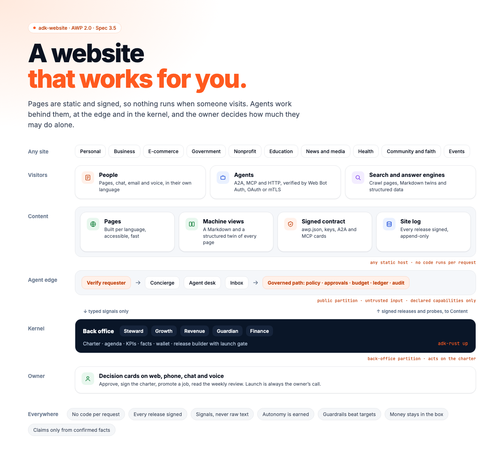

# Spec 3.5: AWP 2.0 and `adk-website` — the website that works for you

| | |
|---|---|
| **Status** | Implemented on `main` @ `61e65676f` except the items under [Remaining work](#remaining-work); [Implementation status](#implementation-status) records each item and [Deviations from this spec](#deviations-from-this-spec) every place the build differs from the text below |
| **Companion** | [`awp-2.0-overview.md`](awp-2.0-overview.md): the product story for owners and developers |
| **Builds on** | [`spec-3.1-harness-agent.md`](spec-3.1-harness-agent.md) (modes, standing rules, the governed path, governed fetch, packs, long-term facts, teams), [`spec-3.2-agent-kernel.md`](spec-3.2-agent-kernel.md) (agenda, wakes, partitions and crossings, drivers and effect classes, quiet hours, `adk-rust up`), [`spec-3.3-harness-ui.md`](spec-3.3-harness-ui.md) (the decision contract, park on timeout, diff before write, pairing, chat channels, the web home), [`spec-3.4-self-improving-harness.md`](spec-3.4-self-improving-harness.md) (the learning loop the site's playbooks reuse) |
| **Layers** | **Protocol:** AWP 2.0, implemented by `awp-types` and `adk-awp`. **Runtime:** the ADK-Rust harness. **Product:** `adk-website`, a multi-agent proactive website shipped as a workspace crate |
| **Target** | `adk-rust` 3.5.0 for phases 0–2 ([§12](#12-phased-delivery)); 3.5.x for phases 3–4 |
| **Grounding commit** | `origin/main` @ `c8141b55` for every `file:line` reference |
| **Amended** | 2026-10-24: [§7.8.3](#783-constantly-updated-sites) constantly updated sites, with S19, G16, A-I26, A-I27, Q15 and Q16 |
| **Evidence** | Public advisories, reports and standards from July to October 2026, listed under [References](#references) |
| **Affected crates** | `awp-types`, `adk-awp` (AWP 2.0 wire); NEW `adk-site` (site pipeline); NEW `adk-website` (product); `adk-kernel` (charter, KPI tracker, signals, site process kinds); `adk-harness` (preset `website`, site toolsets, onboarding machinery); `adk-server` (feature `awp`: the agent edge); `adk-auth` (Web Bot Auth); `adk-tool` (MCP server); `adk-payments` (wallet and rails); `adk-eval` (experiment analysis); `adk-surface` (onboarding and site views); `adk-cli` (`adk-rust website`, `adk-rust awp`); `cargo-adk` (`website` template); `adk-rust` (feature `website`) |
| **Stability** | `adk-website` and `adk-site` enter at **Experimental**; the AWP 2.0 types enter `awp-types` at **Beta**; AWP stays Beta until its normative text is published ([§13](#13-open-questions) Q1) |

---

## Implementation status

On `origin/main` @ `61e65676f` (2026-10-28), after the wave-gate fixes (W1–W5: #1165, #1168,
#1169, #1171, #1172, #1173), the final round (#1181, #1182, #1183, #1188, #1200) and the
verification pass (#1189, #1203). A row names the pull requests that delivered it.
[Deviations from this spec](#deviations-from-this-spec) lists every place `main` differs from
the text below, and [Remaining work](#remaining-work) lists what is not done; every item there
is open on `main`. No scenario reports a runtime gap.
Everything ships in the unreleased 3.0.0 (owner, 2026-10-21); the 3.5.0 target above is a
design label.

| Phase | Item | Status | On `main`, or what is missing |
|---|---|---|---|
| 0 | X1–X5 AWP 1.x hygiene | Done | #1094: `build_manifest` carries `access_level` and both schemas; the `PaymentIntent` docs name `adk-gateway` and `evaluate` loses its redundant branch; `FileConsentService` writes atomically on a blocking thread; `AwpConfigError::Serialize`; `sign_payload` and `verify_signature` deprecated |
| 0 | X6–X8 | Done | #1077: `examples/awp_agent` on `gemini-3.7-flash`; `ROADMAP.md` matches `STABILITY.md` for the AWP crates; spec 3.4 §1's timeline |
| 0 | X9 | Done | Spec 3.2's implementation status already records `adk-kernel` |
| 0 | X13 | Done | The protocol repository (`zavora-ai/agenticwebprotocol`, branch `awp-2.0`, private) marks the v1.0 draft and the v0.4 document superseded; no workspace file names `awp.dev` except this spec and the overview, which describe the problem |
| 1 | AWP 2.0 wire types ([§7.2](#72-the-site-contract)–[§7.8.3](#783-constantly-updated-sites), [§7.10](#710-partitions-and-signals)) | Done | #1083: `awp_types::v2`, re-exported at the crate root; JSON Schemas in `awp-types/schemas/2.0/` (`json-schema`) |
| 1 | AWP 2.0 normative text, schemas, examples, test vectors | Done, unpublished | The protocol repository's `awp-2.0` branch: `spec/awp-2.0.md`, the schemas vendored from `awp-types`, examples, the Web Bot Auth and signing vectors, `make validate`, which passes at `e79d12c` (the charter members of #1200); adk-awp's 35 example fixtures and 19 signing vectors and adk-auth's 9 Web Bot Auth vectors equal the repository's files byte for byte (2026-10-28). The text has no public home yet ([§13](#13-open-questions) Q1) |
| 1 | Version negotiation, the `awp-v1` feature, the v2 routes, `CapabilityTool`, edge store traits ([§7.1](#71-layout-and-features), [§7.2](#72-the-site-contract), [§7.4](#74-capabilities-bindings-and-machine-views)) | Done | #1110 |
| 1 | Signing: JWS over JCS, keys, delegations, revocations, the DNS root, signed Agent Cards, the log's tiles and checkpoint, `StaticBundle` ([§7.2](#72-the-site-contract), [§7.7](#77-releases-site-log-and-verification), D-11) | Done | #1121 (`signing`) |
| 1 | `awp verify` and the conformance kit ([§7.7](#77-releases-site-log-and-verification)) | Done | #1121 (`verify`): `Verifier`, `conformance::run`, 19 signing vectors; `adk-rust awp verify` and `awp conformance` (#1144) |
| 1 | Charter format ([§7.6](#76-the-charter-format)) | Done | #1083: `Charter::validate`; the owner's settings `handoffThreshold`, `publishDelayHours` and `amountThresholds` as optional members, shown on the charter cards and read by `adk-website` with its defaults as fallback (#1200) |
| 1 | Site pipeline: content model, built-in generator, launch gate, releases, site log, `DirectoryHost`, publishing, media ([§7.7](#77-releases-site-log-and-verification), [§7.8](#78-site-pipeline-adk-site), [§7.8.1](#781-the-launch-gate), [§7.8.2](#782-publishing)) | Done | #1108; the full tier runs `awp verify` against the preview (`gate::PreviewVerification`, `Verifier::verify_preview`), in a served site's gate too (#1181) |
| 1 | Files and git as an entry point ([§7.8.2](#782-publishing), A-I24) | Done | #1232: `adk-website`'s `repository`; a project's `repository.json` serves the content repository's signed hooks at `/hooks/{name}` on the edge through `adk-server`'s `WebhookIngress` (`WebhookHook::forge` for GitHub and GitLab); a push from an authorised committer is a kernel run that reads the changed content files at the pushed commit through a `CommitSource` (`LocalGitSource`, `HttpCommitSource`), drafts and previews them through the site's pipeline and waits for the owner's decision card; anyone else's push files one signal; each commit is taken once |
| 1 | Sources, sanitiser, feature mapping, freeze, parity, probes, archive ([§7.8](#78-site-pipeline-adk-site)) | Done | #1125, behind `adk-site`'s `migrate`; `adk-rust site build` runs the parity check after `site migrate` (#1182); the hidden-link detector reads a style rule only by its context-free selector and reports hidden links to other sites, so a current WordPress theme's menus, skip links and cart link raise no finding (#1189) |
| 1 | Hosts ([§7.8](#78-site-pipeline-adk-site) "Hosts", [§7.8.3](#783-constantly-updated-sites)) | Done | `DirectoryHost` (#1108; `PrefixPointer` since #1133) and the seven `host-*` adapters (#1134); `RsyncHost` keeps a read-only copy per release, and the nightly `site-hosts` job runs the host suites against MinIO, Azurite and an SSH server (#1182); a read through `current` that APFS fails once with `EINVAL` during a switch is retried (#1189); Azurite starts with `--skipApiVersionCheck`, since the Azure CLI sends a newer API version than it knows, and Radicale with `owner_only` rights (#1203); on 2026-10-28 the job passed: S3 on MinIO, Azure Blob on Azurite, rsync over SSH and the CalDAV driver on Radicale |
| 1 | External generators ([§7.8](#78-site-pipeline-adk-site) "Generator") | Done | #1143: `gen-zola`, `gen-hugo`, `gen-astro`, `gen-build-awesome`; on Windows under the restricted token by opt-in, and the nightly `site-generators` job runs the real generators under bubblewrap and the restricted token (#1182); Astro on Windows links the toolchain's `node_modules` with symbolic links, which Windows creates in Developer Mode or as an administrator (#1203); on 2026-10-28 the job passed on Linux and Windows, every generator building the fixture site twice |
| 1 | Charter store ([§7.11](#711-charter-store-kpi-tracker-and-earned-autonomy)) | Done | #1107: in-memory, SQLite, PostgreSQL, Redis |
| 1 | `Preset::Website`, site toolsets, onboarding machinery ([§7.1](#71-layout-and-features), [§7.18](#718-onboarding-and-self-building), X10) | Done | #1127 (`adk-harness` `website`) |
| 1 | `adk-website`: kinds, team, onboarding, themes, packs, playbooks, jobs, incidents, alarms, review ([§7.16](#716-adk-website)–[§7.21](#721-reviews-reports-and-escalation)) | Done | #1141; the back office compiles as one `TeamSpec` led by the Steward and runs governed (#1165, #1173) |
| 1 | The agent edge of the site, the contract, deployment shapes, agency ([§7.9](#79-agent-edge-mcp-server-and-stores), [§7.22](#722-deployment-shapes)) | Done | #1145; an agency's sites under `adk-rust website` read the agency's kernel database (#1173) |
| 1 | The running site ([§7.17](#717-spinning-it-up), D-11) | Done | #1150: `deploy::serve` over durable kernel and edge stores, the update engine, experiments, measurement, channels, the Concierge; the edge's durable event log and beacon (#1171); the AP2 desk and amount thresholds (#1172); with a model, the back office hosted on the kernel under the owner's standing rules, woken by the edge's signals, the durable contact book, the upkeep watch (#1173); held to the charter's quiet hours (#1175); the Guardian's probe every five minutes over the owner's domain claim, the Inbox on the site's email and the chat channels the kernel has, and the email, upkeep sources, wallet and probe from the project's configuration files (`deploy::config`), which the `adk-website` binary and `adk-rust website new` read (#1200) |
| 1 | Web editor, onboarding views, charter cards, site view, weekly review ([§8.2](#82-server-kernel-surfaces-and-templates)) | Done | #1156 (`adk-surface` `website`), mounted by `adk-rust website new` (#1159); the desk keeps its state across restarts and the home composes the weekly review (#1173) |
| 1 | `adk-rust site …`, `adk-rust awp …` ([§8.1](#81-adk-cli)) | Done | #1144 (`adk-cli` `website`) |
| 1 | `adk-rust website …` ([§8.1](#81-adk-cli)) | Done | #1159: `website new [dir] [--agency]` scaffolds, serves the kernel, the edge and the owner's views on a loopback home, and prints the setup code; `status`, `review`, `charter`, `jobs promote\|demote`. The `adk-website` binary keeps `new`, `kinds`, `plan`, `start`, `agency` and `deploy` (#1141, #1145) |
| 1 | `cargo-adk` `website` template, umbrella `website` ([§8.2](#82-server-kernel-surfaces-and-templates)) | Done | #1147; the edge signs with the delegated key files (#1173) |
| 1 | Documentation ([§8.2](#82-server-kernel-surfaces-and-templates)), X14 | Done | #1160: "AWP 2.0", "Spin up an AWP website", "Move a WordPress site to AWP", "The charter", "Writing capability packs", the AWP 1.x migration guide, the publish tiers; the `STABILITY.md` rows came with #1108, #1118 and #1141 |
| 2 | Web Bot Auth ([§7.3](#73-identity-and-trust-tiers)) | Done | Signer, verifier, key directory (#1081, `adk-auth` `web-bot-auth`); tiers on the edge (#1132); signed crawls and `awp verify` requests, and `web_fetch` by opt-in (#1127); the protocol repository's nine Web Bot Auth vectors in `adk-auth/tests/fixtures/web-bot-auth/`, each reaching its verdict and held to the protocol's `SHA256SUMS` (#1189) |
| 2 | MCP server ([§7.9](#79-agent-edge-mcp-server-and-stores)) | Done | #1082 (`adk-tool` `mcp-server`) |
| 2 | Agent edge: tiers, bindings, held and exactly-once calls, the public partition ([§7.3](#73-identity-and-trust-tiers), [§7.4](#74-capabilities-bindings-and-machine-views), [§7.9](#79-agent-edge-mcp-server-and-stores), [§7.10](#710-partitions-and-signals)) | Done | #1132; the edge files its own signal for a refused or flagged conversation (#1169) |
| 2 | Events, status, consent, the beacon, durable edge stores ([§7.5](#75-events-status-consent-and-commerce), [§7.9](#79-agent-edge-mcp-server-and-stores), [§7.12](#712-measurement-and-experiments)) | Done | #1139: `awp-sqlite`, `awp-postgres`, `awp-redis`; `LeadStore::delete` and erasure, audit records for discovery fetches (#1169); the event log, catalogue pages, consent references, pending deliveries and beacon counts in those stores, and a public read API for the events (#1171) |
| 2 | Partitions and signals ([§7.10](#710-partitions-and-signals), X10) | Done | `SignalSink`, `AgendaOrigin::Signal`, `Wake::Signal` (#1107); `SitePartitions` and the public policy (#1127); the edge's public partition (#1132) |
| 2 | X11 | Done | #1144: `adk-rust up` mounts a `WebhookIngress`, configured by `[[kernel.webhooks]]` |
| 2 | Volatile lane and price rules ([§7.8.2](#782-publishing), [§7.8.3](#783-constantly-updated-sites)) | Done | Lanes and `PriceRule` (#1133); the edge's live store (#1150) |
| 2 | Concierge and Agent desk, leads and handoff | Done | The Concierge on the edge (#1150); forms keep leads and file `lead_captured` signals (#1145); lead scores and the handoff threshold, the `nurture` consent scope, nurture with consent from the edge's receipts outside quiet hours, one handoff card per lead, the durable contact book (#1173) |
| 3 | Batching, delta releases, feed bounds, host limits, tiered checks, per-item revert ([§7.8.3](#783-constantly-updated-sites)) | Done | #1133 |
| 3 | Streams, the S19 soak ([§7.8.3](#783-constantly-updated-sites), [§11](#11-testing-and-live-verification)) | Done | Streams and the scaled S19 run in the PR tier (#1140); folds keep the five-minute cadence from the stream's opening (#1189); both nightly soaks completed 50,000 products over 24 simulated hours on `main` on 2026-10-28: `site-soak` (run 40629609959: 1,440,000 stock and 359,115 price updates, 966 releases, approval-to-live p95 65.7 s, no false drift alarm) and `website-soak` (run 40637505788: 11/11 checks) |
| 3 | KPI tracker and autonomy ladder ([§7.11](#711-charter-store-kpi-tracker-and-earned-autonomy)) | Done | Records, tracker and ladder (#1107); compiled to harness policy (#1127); promotions survive a restart and grant their standing rules (#1165), which the served back office reads (#1173) |
| 3 | Measurement and experiments ([§7.12](#712-measurement-and-experiments)) | Done | `ExperimentAnalyzer` (#1112, `adk-eval` `experiments`); the site's experiments and measurement sources (#1146); the Growth agent's experiment tools (#1165); verified agent discovery counted (#1169) |
| 3 | Drivers ([§7.13](#713-drivers)) | Done | #1118: `adk-drivers` with DNS, registrar, email, analytics, search console, social and advertising contracts and manifests |
| 3 | X12 | Done | Spec 3.3's Telegram adapter is on `ChannelSink` (#1054); WhatsApp, Slack, Discord and Matrix adapters in `adk-surface`, each passing the kernel's channel contract suite, and `adk-rust up` starts Slack, Discord and Matrix (#1205); a served site runs a channel gateway over the adapters of its `channels.json`, which `adk-rust website` builds: a paired account's message is a turn of the Steward entering through its device, a stranger's goes to the Inbox with no pairing code and no turn unless they type `/pair`, and the edge serves WhatsApp's webhook at `/channels/whatsapp`; `ChannelInbound` carries attachments, which the WhatsApp and Telegram adapters download (#1235), and the Slack, Discord and Matrix adapters too (#1264) |
| 3 | Growth, Inbox, the full weekly review, agency mode ([§7.19](#719-the-team)–[§7.21](#721-reviews-reports-and-escalation)) | Done | #1141, #1145, #1146, #1150, #1165, #1173: S10, S14 and S15 pass; upgrade and renewal proposals, the publish delay and the weekly summary in plain words (#1173); the served site runs the Inbox (`inbox::SiteInbox`) on its email and on the chat channels the kernel has (#1200), and its chat gateway hands the Inbox every stranger's message (#1235) |
| 3 | Learning ([§7.15](#715-learning)) | Done | One playbook per job, installed in each agent's `.skills/` (#1141); #1263: `adk-website`'s `learning`, the `playbook-learning` job's code: a weekly kernel run after the review turns each experiment its test decided and each KPI short of the owner's target in two weekly reviews into a proposal naming the playbook, the diff of its text, the evidence with links to the reviews and the expected effect, on the owner's decision card; an accepted or edited revision is the playbook's next version (`PlaybookVersions`), written into its agents' workspaces; no level applies one without the owner |
| 4 | Wallet and rails ([§7.14](#714-wallet-and-money)) | Done | #1111 (`adk-payments` `wallet`), durable stores (#1122); decisions by compare-and-set and one-step settlement (#1172); the Finance agent's wallet tools through `TeamKit::wallet` (#1172, served by #1173) |
| 4 | Commerce and receipts ([§7.5](#75-events-status-consent-and-commerce)) | Done | Quotes keep their price (#1145); `edge::ap2::Ap2Desk` takes AP2 mandates with signed receipts, and the owner's amount thresholds hold large orders, bookings and payments (#1172); `PaymentLinks` stays for owners without a processor; `edge::token::TokenDesk` takes `pay_order`'s rail `credential` beside the AP2 desk through `edge::token::PaymentRails`, and `edge::caldav::CalDavCalendar` books the owner's CalDAV slots once, from `caldav.json` in a served site (#1181); quotes, orders and the bookings of `calendar.json`'s slots are kept in a `CommerceStore`, `data/edge.db` on a served site, and payments write `awp.payment.*` (#1183) |
| 4 | Social and advertising drivers ([§7.13](#713-drivers)) | Done | #1118 |
| — | Observability ([§7.24](#724-observability)) | Done | Spans and metrics in `adk-website`'s `observability` (#1141); the `awp.request` and `awp.capability.call` spans from the edge (#1132); every release in `adk-site`'s `site.release` span and every signal the edge files in a `kernel.signal` span, the names `adk-website`'s `spans::SITE_RELEASE` and `KERNEL_SIGNAL` (#1183) |
| — | Durable state and audit records ([§7.9](#79-agent-edge-mcp-server-and-stores), [§9.3](#93-audit-records)) | Done | #1183: `adk-core`'s `FileAuditRecorder`; the pipeline's `site.content.*` and `site.release.*`, the edge's `awp.payment.*` and `adk-rust awp keys`' `awp.keys.*` records; a served site keeps its audit trail in `data/audit.jsonl` and, in `data/edge.db`, its quotes, orders, bookings, the back office's drafts (`SiteDraftStore`), the owner's open, deferred and waiting alarms (`AlarmStore`) and the edge's rate-limit windows (`RateLimitStore`, also on PostgreSQL and Redis) |
| — | Capability packs as signed bundles ([§7.23](#723-for-developers)) | Done | #1188: `adk-website`'s `packs::bundle` (the bundle, its content digest and the publisher's JWS, verification and the format's rules), `packs::trust`, `packs::installed` (`PackSet`, `PackDir`: install, upgrade, remove) and `adk-rust site packs list\|install\|remove\|trust\|sign`; the six built-in packs ship as signed bundles in `adk-website/packs/`; a served site verifies its installed packs on every start, serves their capabilities and writes their playbooks into its agents' workspaces; conformance vectors in `adk-website/tests/fixtures/packs/` |
| — | Scenarios and fixtures ([§5](#5-headline-capabilities-and-demonstration-scenarios), [§11](#11-testing-and-live-verification)) | Done | #1158: S1–S19 in `examples/website`, the recorded WordPress site, the presence fixture, the `website-scenarios` PR job and the nightly `website-wordpress` and `website-soak` jobs; every scenario passes scripted with no known gap, and the live set passes on `claude-sonnet-5-5` (#1165–#1173, #1175; again on 2026-10-28); the WordPress fixture holds what the recordings hold, and the `website-wordpress` job passes on the clean site and the infected overlay (#1189) |

### Scenarios

Scripted runs on `main` @ `61e65676f` (2026-10-28); live runs on `claude-sonnet-5-5` in the
same pass. No scenario has a `known` gap left: every check passes.

| # | Scripted | Live | Pull requests |
|---|---|---|---|
| S1 | PASS 21/21 | PASS 20/20 | #1141, #1145, #1150, #1158, #1181: the launch gate's `awp verify` against the preview of release 2 |
| S2 | PASS 11/11 | PASS 11/11 | #1125, #1141, #1158, #1168 |
| S3 | PASS 15/15 | No agent turn | #1125, #1158, #1168 |
| S4 | PASS 10/10 | No agent turn | #1125, #1158, #1173: the signature check covers the freeze's own crawl, since #1168's cloaking scan reads pages unsigned on purpose |
| S5 | PASS 13/13 | PASS 13/13 | #1141, #1145, #1158 |
| S6 | PASS 8/8 | No agent turn | #1081, #1132, #1158 |
| S7 | PASS 8/8 | PASS 7/7 | #1132, #1150, #1158, #1165, #1169 |
| S8 | PASS 7/7 | PASS 7/7 | #1118, #1139, #1158, #1173 |
| S9 | PASS 6/6 | No agent turn | #1132, #1139, #1145, #1158, #1172 |
| S10 | PASS 9/9 | PASS 9/9 | #1141, #1158, #1165, #1173, #1175 |
| S11 | PASS 5/5 | No agent turn | #1112, #1146 |
| S12 | PASS 11/11 | PASS 11/11 | #1111, #1122, #1158, #1172 |
| S13 | PASS 7/7 | No agent turn | #1121, #1144, #1158, #1168 |
| S14 | PASS 8/8 | PASS 8/8 | #1107, #1127, #1158, #1165 |
| S15 | PASS 8/8 | No agent turn | #1145, #1158 |
| S16 | PASS 8/8 | No agent turn | #1141, #1158 |
| S17 | PASS 7/7 | No agent turn | #1125, #1141, #1158 |
| S18 | PASS 10/10 | PASS 10/10 | #1108, #1127, #1134, #1158, #1168, #1173, #1175 |
| S19 | PASS 11/11, scaled: 600 products over four hours; the nightly soak at 50,000 products over 24 simulated hours, PASS 11/11 (run 40637505788) | No agent turn | #1133, #1140, #1158, #1189 |

S10 reports one note, not a failed check: the scenario runs its agents directly, so the
charter's quiet hours and the jobs' run budgets bind them only by construction (the runs are
at 10:00 UTC); a served site's kernel defers each proactive run inside the quiet hours and
bounds it by its run budget. The live set on `gemini-3.7-flash` (`--provider gemini`) did not
complete on 2026-10-28: the model answered 503 under load and then the key's free-tier quota
(20 requests a day) refused every call. The WordPress compose fixture runs in the nightly
`website-wordpress` job.

## Deviations from this spec

Each row is a place where `main` differs from the text below, or settles a choice the text
leaves open.

| Spec section | What the spec says | What shipped | Why | PR |
|---|---|---|---|---|
| [§7.3](#73-identity-and-trust-tiers) | `WebBotAuthTrustAssigner` in `adk-auth` | `adk-auth` returns `VerifiedRequester` evidence; the assigner and tiers are the edge's (`adk-server` `awp`) | Tier mapping belongs to the edge, and `adk-auth` takes no `adk-awp` dependency | #1081 |
| [§7.3](#73-identity-and-trust-tiers) | The verifier's result | `Ok(None)` for a request with no Web Bot Auth signature | Absence of a signature is not evidence | #1081 |
| [§7.3](#73-identity-and-trust-tiers) | — | `Signature-Agent` members of type `jwks_uri` or `cimd` are refused as unverified; signatures live at most 24 h by default; the RFC 9421 test key is refused unless allowed | The draft asks verifiers to ignore unsupported discovery types, recommends at most 24 h, and to reject known test keys | #1081 |
| [§7.9](#79-agent-edge-mcp-server-and-stores) | The Server Card at `/.well-known/mcp/server-card.json` | Primary at `{endpoint}/server-card`, discovered through `/.well-known/ai-catalog.json`; the `.well-known` path serves the same bytes | SEP-2127, now Final, reserves the endpoint path and names AI Catalog for discovery | #1082 |
| [§7.9](#79-agent-edge-mcp-server-and-stores) | The capabilities as MCP tools beside the card | The card lists no tools; `tools/list` shows each caller its tier's capabilities | SEP-2127 excludes primitives from cards | #1082 |
| [§7.9](#79-agent-edge-mcp-server-and-stores) | — | The MCP server's executor hook sees every call to a tool the caller may see whose arguments match the published schema; unknown or hidden tools and schema-invalid arguments are answered before it | A call naming no visible tool has no tool to hand over, and a schema-invalid call cannot run | #1082 |
| [§7.7](#77-releases-site-log-and-verification) | `ReleaseManifest` has no member for removals | Adds `removed` (paths a delta removes) | [§7.8.3](#783-constantly-updated-sites)'s deltas list removed files | #1083 |
| [§7.6](#76-the-charter-format) | `Charter` | Adds `priceRule` (default 10%) | [§7.8.2](#782-publishing) names the charter's `PriceRule` | #1083 |
| [§7.4](#74-capabilities-bindings-and-machine-views) | `ApprovalHint` | `{"mode": "never" \| "above_amount" \| "always", "amount": n}` on the wire | Keeps snake_case member names off the wire; the protocol text uses the same form | #1083 |
| [§7.3](#73-identity-and-trust-tiers) | `accepts` | `IdentityMethod` adds `api-key` | [§7.3](#73-identity-and-trust-tiers) names an owner-issued API key | #1083 |
| [§7.5](#75-events-status-consent-and-commerce) | `ConsentReceipt.scope` | One scope per receipt | The field is singular | #1083 |
| [§7.2](#72-the-site-contract) | `proof` | Optional on `SiteContract` and `QuoteDocument`, required on status, receipts and stream entries | Every contract member beyond `awp` and `site` is optional; the conformance kit requires a signed contract | #1083 |
| [§7.5](#75-events-status-consent-and-commerce) | The error envelope's `retry_after`, `trace_id` | `retryAfter`, `traceId` | Wire JSON is camelCase | #1083 |
| — | — | Members the spec does not enumerate: `Signal` ids and emitters, `Guardrail` `id`, `breach` and `jobs`, `JobLimits`, `RoleHolder`, `ActionClass`, `LineItem`, `PolicyRef`, `QuietHours`, `UrgencyRoute`, `Bound`, `BatchPolicy::max_bytes` (256 MiB) | Needed to make the named types usable | #1083 |
| [§10](#10-changes-outside-the-feature) X1, X4 | X1 additive | X1 and X4 recorded as `breaking.` | Public struct fields, and a new variant of an exhaustive error enum | #1094 |
| [§7.1](#71-layout-and-features) | Site process kinds, unnamed | `site.probe`, `site.watch`, `site.content`, `site.reviews`, `site.outreach`, `site.support`, `site.digest`; watch daily at 06:00 and outreach at 09:00 UTC | The spec lists none | #1107 |
| [§10](#10-changes-outside-the-feature) X10 | `Wake::Signal` | Carries `kind` and an optional `partition` | Two sites' back offices in one harness must not wake each other | #1107 |
| [§7.10](#710-partitions-and-signals) | `AgendaOrigin::Signal { kind, count }` | `kind` is the wire name; the typed signal lives in the signal store | The agenda item stays text-free | #1107 |
| [§7.11](#711-charter-store-kpi-tracker-and-earned-autonomy) | The ladder's order | "Act, reversible only" sits between "act with approval" and "act within budget" | Demoting "within budget" must not widen anything | #1107 |
| [§7.6](#76-the-charter-format), [§7.11](#711-charter-store-kpi-tracker-and-earned-autonomy) | Guardrail actions | `alert` demotes and raises `GuardrailBreached` without pausing; `pause_job` pauses first | [§7.11](#711-charter-store-kpi-tracker-and-earned-autonomy) demotes on every breach | #1107 |
| [§7.11](#711-charter-store-kpi-tracker-and-earned-autonomy) | — | `CharterStore::current` and `history` take the site id; a guardrail with no KPI measuring its metric is `unmeasured`; `JobPauses` are in memory and restored from the stored breach | Agency mode; a guardrail names a metric, not a source; the breach state is durable | #1107 |
| [§7.7](#77-releases-site-log-and-verification) | The site log is an `adk-auth` signed audit log | Leaves are `LogEntry {seq, manifest}` in JCS, built with `adk-auth`'s Merkle and note modules; `AuditLogStore` stores them | Audit records would make leaves no other implementation can reproduce | #1108 |
| [§7.7](#77-releases-site-log-and-verification) | `ReleaseBuilder` writes a signed release | Manifests are authenticated by their digest in the log; `ReleaseSigner` signs checkpoints | A manifest is covered by the site log | #1108 |
| [§7.8.2](#782-publishing) | A signed preview release | A preview is staged with its manifest digest on the host's preview and not logged | The log must equal the published sequence | #1108 |
| [§7.8.2](#782-publishing) | Volatile fields are not released | Live fields appear in the machine view as `{value, asOf, capability}` and on the page with their time, never in JSON-LD offers | AWP 2.0 §8.2 | #1108 |
| [§7.4](#74-capabilities-bindings-and-machine-views), [§7.8](#78-site-pipeline-adk-site) | `MachineView`; `SiteHost` | `releaseSeq` is the release the view last changed in, and `markdown` an absolute URL; `SiteHost` adds a provided `name()` | AWP 2.0 §8.2; host names in reports | #1108 |
| [§7.8.1](#781-the-launch-gate) | `awp verify` passes against the preview; migration parity | `GateExtension` slots, filled by `MigrationParity`, `ThirdPartyResources` (`GateCheck::ThirdPartyResources`), `ReleaseDelegation` (`GateCheck::Signing`) and `PreviewVerification` (`GateCheck::AwpVerify`, full tier, `adk-site` feature `verify`): the build is staged as the release after the host's checkpoint and checked with `Verifier::verify_preview`, whose step 10 binds the unlogged manifest by its staged digest; what the release does not hold, such as the edge's Agent Card, comes from a fetcher; a served site checks the DNS anchor against the `_awp-root` record its key set names | A kind or a deployment adds the checks it needs; a preview is never logged ([§7.8.2](#782-publishing)), and before launch the domain does not point at the site yet, so the published anchor is the Guardian's probes' and `adk-rust awp verify`'s check | #1108, #1150, #1168, #1181 |
| [§7.15](#715-learning), [§7.11](#711-charter-store-kpi-tracker-and-earned-autonomy), A-I13 | Outcomes feed proposals to revise playbooks, which follow the job's autonomy level and land as owner decisions | Proposals come from experiments the sequential test decided (adopted, or the control kept because the variant is worse) and from KPIs with a baseline and the owner's target whose means fall short of it in two weekly reviews in a row; approvals, edits and rejections count on the ladder for the learning job; an experiment proposes once, a KPI at most once in 28 days; a KPI's playbook is the one its metric's first segment names (`learning::kpi_playbook`), else `goals`; a revision adds one line under `## Learned`, drafted without a model; at Observe a proposal is only reported, from Propose up it is a decision card, and no level applies one without the owner's answer | The spec gives no evidence threshold, no link from a KPI to a playbook and no form for a revision; a revision changes how a job acts, which only the owner may widen (A-I13) | #1263 |
| [§7.8.2](#782-publishing) "Files and git", A-I24 | A push from an authorised committer arrives through a signed webhook and proposes a release | `repository.json` lists the hooks — GitHub's `X-Hub-Signature-256`, GitLab's `X-Gitlab-Token`, or Standard Webhooks from any host — and the committers, each a forge account on a hook or the one holder of a signed hook's key; only the configured branch's `content/<kind>/<slug>/<language>.md` files are read, and a removed one is withdrawn (410 Gone); a commit is taken once; a push from anyone else files one `inbound_message` signal on the `repository` channel; the release waits for the owner's decision card (`site_repository_release`), which records the owner's vote under an approval chain | The spec names no configuration, forge or signal; a push's media is not read, since alt text is confirmed by a person in the media pipeline | #1232 |
| [§7.8.2](#782-publishing) | Location metadata stripped | Raster images and SVG are stripped; PDF, audio and video carrying location markers are refused | No codec per format | #1108 |
| A-I23 | Approval chains | The pipeline refuses repeated principals and the proposer; which roles a chain needs is the `ApprovalGate`'s | The harness implements chains | #1108 |
| [§7.4](#74-capabilities-bindings-and-machine-views) | Exactly once through the action ledger | An `IdempotencyStore` joins the edge stores | The action ledger keeps a digest of the result; a repeat answers with the recorded status and body | #1110 |
| [§7.4](#74-capabilities-bindings-and-machine-views) | — | A call's amount is `CapabilityHandler::call_amount` (default: an integer `amount` input), else the declared price | The spec names no source | #1110 |
| [§4.1](#41-awp-10-and-what-changes) | — | The 1.x routes keep their paths | Moving them would break 1.x clients | #1110 |
| [§7.1](#71-layout-and-features) | `StaticBundle` in `adk-awp`'s default build | Behind `signing` | The public terms' digest is the SHA-256 of their JCS form, and JCS comes from `adk-auth` under `signing` | #1110 |
| [§7.4](#74-capabilities-bindings-and-machine-views) | — | The 2.0 routes send no `Deprecation` or `Sunset` headers | A deprecation is stated in the capability's `deprecated` member | #1110 |
| [§7.5](#75-events-status-consent-and-commerce), [§7.14](#714-wallet-and-money) | Signed receipts and quotes | `ReceiptSigner` and `ReceiptVerifier` are a hook in `adk-payments`; `wallet_pay` declares `NonIdempotent` and the website preset classes it `Financial` | `adk-payments` depends on neither `adk-awp`'s signing nor `adk-kernel` | #1111, #1127 |
| [§7.14](#714-wallet-and-money) | `Period`, `AnomalyRule`, `PayeeRule` | `Period` is `adk_core::SpendPeriod`; `AnomalyRule` adds `trailing_days`, `min_history_days`, `min_amount`; `PayeeRule` is `Any`, `Id` or `Domain`, and no rule allows no payee; provider billing is one rail per provider | The spend ledger's windows; a young or idle category does not page the owner | #1111 |
| [§7.10](#710-partitions-and-signals) | `reply_in_thread` | Kernel manifests name `email_reply_in_thread` and `social_reply_in_thread`; the in-process tool is `reply_in_thread` and routes both | The kernel serves one tool name per partition | #1118 |
| [§7.13](#713-drivers) | Inbox reads, advertising launch classes, renewals | Inbox reads are public-side `read` tools; an advertising launch declares `financial` and records `publish_public`; `RdapRegistrar` reads expiry only | One class per manifest tool; RDAP is read-only | #1118 |
| [§7.13](#713-drivers) | Suppressions and consent | In-memory stores and traits | Durable consent belongs to the edge | #1118 |
| [§7.7](#77-releases-site-log-and-verification) | Verification order | The public terms are checked before the log steps | They depend only on the contract | #1121 |
| [§7.2](#72-the-site-contract) | The DNS anchor | No network resolver in `adk-awp`; `DnsTxtResolver` takes one, and the CLI supplies hickory | A DNS client is a dependency choice | #1121 |
| [§7.7](#77-releases-site-log-and-verification) | Sampled files | Compared with the latest release only | Re-reading later checkpoints is the Guardian's probes' job | #1121 |
| [§7.1](#71-layout-and-features) | Sources, sanitiser, freeze and probes in the default build | Behind `adk-site`'s `migrate` | Keeps reqwest, hickory, image comparison and X.509 parsing out of `adk-site`'s default build; `adk-website` turns `migrate` on, so the default workspace build compiles it | #1125 |
| [§7.1](#71-layout-and-features) | `adk-website` in the default build | Its features stay on: `adk-harness/website` and `/sqlite`, `adk-site/migrate` and `/verify` and the rest are compiled by the default workspace build. Measured with `cargo tree` on `main` (2026-10-27): the workspace build compiles 840 packages, 821 without `adk-website`; the 18 it adds besides itself are `x509-parser` and its ASN.1 crates, `image-compare`, `similar`, `jsonwebtoken`, `tungstenite`, `a2a-protocol-types` and their helpers, and it turns on 84 features of crates the workspace already builds | Cargo builds every member with its default features, so keeping them out needs non-default features: the `adk-website` binary would then need `required-features`, breaking `cargo install adk-website` (the container image's install, [§7.22](#722-deployment-shapes)), and without `adk-harness/website` the crate has no team, onboarding, edge or deployment to build. The cost is 2.3% of the packages, and the `feature-coverage` shards compile those features in any case | #1182 |
| [§7.8](#78-site-pipeline-adk-site) | `SiteSource::inventory` returns `Result` | `adk_site::migrate::Result` (`MigrateError`, into `SiteError` and `AdkError`) | `SiteError` belongs to the core module | #1125 |
| [§7.8](#78-site-pipeline-adk-site) | A listed `<iframe>` is kept | It becomes a link to the embedded page | The built-in renderer escapes raw HTML | #1125 |
| [§7.8](#78-site-pipeline-adk-site) | Feature mapping | Adds newsletter → `subscribe_newsletter` (consent `newsletter`) | S17 | #1125 |
| [§7.8](#78-site-pipeline-adk-site) | Quarantine decisions; replay; screenshots | `ApprovalRequest::preview_digest` binds the evidence; `ContainerDriver` with the Docker CLI; Chrome's `--screenshot` | No preview release exists for a quarantined item; the replay needs an internal network; no WebDriver session is needed | #1125 |
| [§7.8](#78-site-pipeline-adk-site), A-I4 | Probes | Also report served legacy runtime paths as drift | Sampling the manifest cannot see an added file | #1125 |
| [§7.10](#710-partitions-and-signals) | The public partition's fixed policy | Public agents run in read-only mode with `PublicPolicy` deciding | The harness always composes its mode table | #1127 |
| [§7.3](#73-identity-and-trust-tiers) "Outbound" | The harness signs its crawls, `web_fetch` calls and verifier requests | `web_fetch` signs only by opt-in (`HarnessAgentBuilder::web_signer`); `site_discover` crawls and the harness's `awp_verify` sign whenever the site has a Web Bot Auth key; `adk-rust awp verify` signs with `--sign-key` | A signed fetch identifies the site to every server the agent reads, so the operator chooses it | #1127, #1144 |
| [§7.14](#714-wallet-and-money) | — | `wallet_pay` joins the payment tools: held once per call under the payments pack; the Finance agent runs it without the pack, so in-cap payments run on the owner's standing rule | Spec 3.1 I38 | #1127 |
| [§7.9](#79-agent-edge-mcp-server-and-stores) | The edge in `adk-server` | `RequestContextExtractor` moves to `adk-core` (`auth-bridge`), re-exported; `adk-auth`'s `auth-bridge` no longer depends on `adk-server` | `adk-server` → `adk-awp` → `adk-auth` → `adk-server` was a cycle | #1132 |
| [§7.3](#73-identity-and-trust-tiers), [§7.9](#79-agent-edge-mcp-server-and-stores) | API keys, mTLS, rate limits | API keys as `Authorization: ApiKey {id}:{secret}`; mTLS reads a `ClientCertificate` the listener inserts; fixed rate-limit windows, shared through a `RateLimitStore` (the SQLite, PostgreSQL and Redis edge stores) when `EdgeLimits::store` names one, else per process; a store that fails is logged and the process's counters answer | AWP 2.0 names no field; `adk-server` has no TLS listener; a failing limit store must not stop the edge | #1132, #1183 |
| [§7.9](#79-agent-edge-mcp-server-and-stores) | A2A | Streaming, push notifications and task listing answer `UnsupportedOperation`; the card says `streaming: false`; a conversation is refused under read-only mode or the kill switch | Calls complete or hold in one response; A-I12 | #1132 |
| [§7.9](#79-agent-edge-mcp-server-and-stores) | — | The MCP binding's error text is the MCP server's prefix and the error envelope's JSON; the read-only `status` is left out when the envelope would pass 500 characters | `adk-tool`'s server bounds and prefixes `isError` text | #1132 |
| [§7.10](#710-partitions-and-signals), A-I3 | Signal screening | The `SignalEmitter` screens; the edge enforces the typed kind and `Bounded` limits | adk-website forwards through the harness's screen | #1132 |
| [§7.8.3](#783-constantly-updated-sites) | The release builder refuses claims outside the release lane | `SiteConfig::validate` and `SiteProject::issues` refuse them, with `CLAIM_FIELDS` plus a kind's `claims` | `ReleaseBuilder` never sees fields; the spec lists no claim fields | #1133 |
| [§7.8.3](#783-constantly-updated-sites) | `FeedBounds::price_rule`; exceptions | Applied per item: an out-of-rule price is held alone; exceptions are held in the engine with the proposer barred; new items are held by default | "Approvals on exceptions only" and A-I25 | #1133 |
| [§7.8.3](#783-constantly-updated-sites) | `catalog.changed` pagination; `DirectoryHost` | Pages in `Announcement::catalog_pages` at `<changes_url>/<seq>/<page>`; `DirectoryHost` is `PrefixPointer` with objects by digest | The edge serves events; a full copy per release cannot publish every minute | #1133 |
| [§7.8.3](#783-constantly-updated-sites) | Cost per thousand updates | Priced with `CostRates` the product sets | The spec fixes no price | #1133 |
| [§7.8](#78-site-pipeline-adk-site) | `host-cloudflare`: Pages or R2 | R2 behind a pointer | Either was allowed | #1134 |
| A-I4 | Every served file belongs to the release | `GitPagesHost` writes `.nojekyll` and an optional `CNAME` beside it | GitHub Pages host configuration | #1134 |
| [§7.8](#78-site-pipeline-adk-site) | `fetch` reads what the host holds | `NetlifyHost::fetch` reads the live site URL | The deploy API serves no file contents | #1134 |
| [§11](#11-testing-and-live-verification) | Host conformance in CI with emulators | Provider fakes, a local `git` remote and `rsync` target in the PR tier; the nightly `site-hosts` job runs the `#[ignore]`d suites against MinIO (the community `pgsty/minio` build, since MinIO no longer publishes images), Azurite and an OpenSSH server with rsync, and the CalDAV driver against Radicale; Cloud Storage, Netlify and GitHub Pages stay `#[ignore]`d with instructions | MinIO's server and the SSH server's key need `docker run`, which a service container cannot do; the other three need accounts | #1134, #1182 |
| [§7.8](#78-site-pipeline-adk-site) "Generator" | External generators in `adk-sandbox` with no network | On Windows, the restricted token (spec 3.2 §10 W5) confines a generator's writes and leaves the network open, so a Windows build runs only with `ExternalGenerator::with_restricted_token` | Windows has no per-process network filter without AppContainer, which `adk-sandbox` does not implement | #1182 |
| [§7.9](#79-agent-edge-mcp-server-and-stores) | Edge stores | Retained events, catalogue pages, consent references, pending deliveries and beacon counts live in the edge's stores, whose `EventLog` and `BeaconStore` traits and conformance suite stay in `adk-server`; a resumed retry is attempted one lease (70 s) after its scheduled time | The traits were already the edge's; the lease keeps a live process's own retry from being taken by another | #1139, #1171 |
| [§7.12](#712-measurement-and-experiments) | Global Privacy Control | A beacon with `Sec-GPC: 1` counts nothing | The reading that leaves no doubt | #1139 |
| [§7.5](#75-events-status-consent-and-commerce) | Subject sessions | An HMAC-signed `v1.{subject}.{expiry}.{mac}` token, with a random per-process key unless configured | AWP 2.0 names no format | #1139 |
| [§11](#11-testing-and-live-verification) | The soak against `DirectoryHost` and an S3 emulator | `DirectoryHost` only; the PR tier runs 600 products over four hours and 120 live-blog entries over an hour | The S3 hosts run their conformance with an emulator; the full run takes hours | #1140 |
| [§5](#5-headline-capabilities-and-demonstration-scenarios) S19 | Live-blog entries appear within 10 s | Measured from `append` to the entry in the edge's feed | The page's polling is the edge's | #1140 |
| [§7.19](#719-the-team) | The team is a `TeamSpec` | The `TeamSpec` holds the back office, which the served kernel runs as one compiled team at the Steward's target, each agent also running alone for its jobs' processes; the public agents run on their own wakes | A delegate edge into the public partition would be a crossing; the kernel wakes each job's agent directly | #1141, #1165, #1173 |
| [§7.18](#718-onboarding-and-self-building), [§7.20](#720-jobs) | Jobs start at their [§7.20](#720-jobs) level | Charter v1 starts every job at Observe or Propose and onboarding at "act with approval"; the [§7.20](#720-jobs) levels are the promotions `RunPlan` offers | [§7.18](#718-onboarding-and-self-building)'s rule | #1141 |
| [§7.18](#718-onboarding-and-self-building) | Release 1 from nothing | Staged by `stage_release_one` through the pipeline's per-change checks; the launch is `site_publish`, held | A-I21 holds the launch in every mode | #1141 |
| [§7.21](#721-reviews-reports-and-escalation) | Incident demotion | Drift demotes no job; an incident a job caused demotes its area | Demoting the responder would block A-I11's reversal | #1141 |
| [§7.8](#78-site-pipeline-adk-site) | External generators emit every file | They render page HTML; the twins and site files come from the built-in build, and page bodies arrive as HTML | One source for machine views; the built-in renderer escapes raw HTML | #1143 |
| [§8.1](#81-adk-cli) | Root operations with a key file or hardware token, never in an agent | A key file only; standard input must be a terminal and the person confirms | No hardware-token signer exists | #1144 |
| [§7.8.3](#783-constantly-updated-sites), [§8.1](#81-adk-cli) | `site batches`, `site feeds` | Read the CLI's journal in `data/updates/`; `site feeds` validates `feeds.json` | `UpdateEngine` keeps batches in memory | #1144 |
| [§8.1](#81-adk-cli) | Command arguments; the project layout; hosts | Adds `--site`, `--host-dir`, `--yes` and the flags of `migrate`, `verify` and `conformance`, and `site build --legacy URL` for the parity check's looks; the layout of `site-cli.md`, with the migrated inventory in `data/migration/inventory.json`; `DirectoryHost` only | Needed to run on a project and in scripts; the spec names no layout; host credentials need the broker | #1144, #1182 |
| [§7.2](#72-the-site-contract) | — | `awp keys` writes an empty `public-terms.json` when the project has none | The contract's charter digest needs public terms | #1144 |
| [§10](#10-changes-outside-the-feature) X11 | — | `[[kernel.webhooks]]` in the user configuration, secrets as `env:` or `file:` | The spec names no configuration | #1144 |
| [§7.22](#722-deployment-shapes) | A container runs edge and kernel as separate processes | One process with two listeners | Signals need no IPC | #1145 |
| [§7.22](#722-deployment-shapes) | The `adk-website` image | The `Dockerfile` installs `adk-website` from crates.io at the workspace version; no image has been built from it | 3.0.0 is not published | #1145 |
| A-I22 | — | The agency declares `cross_site_request` as a crossing tool on each back office | Any such request is decided and recorded as a crossing | #1145 |
| [§7.12](#712-measurement-and-experiments) | Guardrails in experiments | A charter guardrail maps to a relative tolerance against the KPI's baseline; `Absolute(0)` without one | The spec gives no mapping | #1146 |
| [§7.12](#712-measurement-and-experiments) | Assignment by a stable anonymous bucket | The bucket lives in `sessionStorage`: the unit is an exposed tab session | A longer-lived bucket would be a persistent identifier | #1146 |
| [§7.12](#712-measurement-and-experiments) | Measurement | Proportions only through the beacon; ledgers counted at write time by metering wrappers; verified agent discovery counted from the edge's discovery records | The beacon counts events; ledgers have no window queries | #1146, #1169 |
| [§7.17](#717-spinning-it-up) | The template is the same project as `website new` | The business kind and `paper` theme; a loopback edge, not `deploy::serve`, signing with the delegated key files; legal and About pages are drafts | A template is static files | #1147, #1173 |
| [§7.10](#710-partitions-and-signals) | The Concierge through `website_public` | `edge::concierge` builds the preset over the edge's own tools with `website_public_served` | The edge's policy refuses the kit's `search_site` and `emit_signal` | #1150, #1165 |
| [§7.8.3](#783-constantly-updated-sites) | — | `SiteRuntime::shared_pipeline` lets the update engine publish through the runtime's pipeline | A second pipeline over one log falls out of sequence | #1150 |
| [§7.14](#714-wallet-and-money), [§7.20](#720-jobs) | Payments and calendars | `edge::ap2::Ap2Desk` takes AP2 human-present mandates; `edge::token::TokenDesk` hands a rail `credential` to the owner's `PaymentExecutionService` as a `single_use_token` selection under an `awp-token` protocol descriptor, and `edge::token::PaymentRails` picks a desk by `rail`; `PaymentLinks` answers with the owner's payment instructions where no processor is configured; `calendar.json` slots are booked in memory, `caldav.json` slots in the owner's CalDAV calendar | The buyer's wallet always has its credentials provider authorise; `adk-payments` names no protocol for a provider's single-use token, and the processor redeems it with the provider that issued it | #1150, #1172, #1181 |
| [§7.5](#75-events-status-consent-and-commerce), [§7.16](#716-adk-website) `booking` | A calendar driver | `edge::caldav::CalDavCalendar`: every event of a slots collection is a slot, a recurring one per occurrence the server expands (RFC 4791 §9.6.5); a booking is an event in the bookings collection — the slots' own by default — named after its slot and written with `If-None-Match: *`, carrying `X-ADK-SLOT` and `X-ADK-BOOKING-KEY` and no personal data; a separate bookings collection's busy events block the slots they overlap; a slot's `X-ADK-PRICE`, else the calendar's price, is its amount, as last listed | The spec names no calendar model; CalDAV covers most providers, and a conditional write books a slot once across processes and sites | #1181 |
| [§8.2](#82-server-kernel-surfaces-and-templates) | The views on the web home | The desk keeps the paired device, onboarding answers, the charter under review and the editor's drafts in a `DeskStore` (`data/desk.json`); `adk-website start` mounts no views, `adk-rust website new` does (#1159) | `adk-website` cannot depend on `adk-surface` | #1156, #1173 |
| [§7.11](#711-charter-store-kpi-tracker-and-earned-autonomy) | A promotion creates a standing rule | The rules live in `data/kernel.db`, which the served back office reads; a promotion to "act with approval" grants rules that change no decision by themselves, since that level holds every non-read call | §7.11's table does not name the rules of that level; they are the ones "act within budget" uses | #1159, #1165, #1173 |
| [§11](#11-testing-and-live-verification) | Live runs on the Anthropic model and `gemini-3.7-flash` | `claude-sonnet-5-5` only; S8 builds the product's outbox over an in-memory email driver and S18 hands its WhatsApp messages, the three photos downloaded as the adapter does, to the served site's chat route | One provider was run; no email driver or WhatsApp webhook is configured in the fixtures | #1158, #1173, #1235 |
| [§5](#5-headline-capabilities-and-demonstration-scenarios) S3, A-I4 | Every inventoried URL is served or 301-redirected | Legacy runtime paths the new site does not serve — `/wp-includes/…`, theme and plugin files, `*.php`, WordPress's `/wp-login.php` and `/xmlrpc.php` — answer 410 Gone; after a crawl, a link to a page the crawl could not read becomes its text | A static site has no runtime to redirect them to; a robots-disallowed page was never migrated | #1168 |
| [§7.8.2](#782-publishing) | The agent product feed | `products/feed.xml` per language: RSS 2.0 with the `g:` product attributes merchant and agent catalogues read; live fields are left out | The spec names no format | #1168 |
| [§4.4](#44-the-standards-awp-20-binds) | `Content-Usage` from the charter's public terms | Every kind's charter drafts `usage`: `search=y`, and `train-ai=n, search=y` for news and media; the owner reviews it with the charter | A launched site states its preferences from release 1 | #1168 |
| [§7.10](#710-partitions-and-signals), A-I2 | Public agents hold only the partition's tools | The operator's own tools attached to a public agent stay offered, so `PublicPolicy` refuses them on the audit record; the harness's own tools are not offered | S7's "refusals audited" | #1165 |
| [§7.10](#710-partitions-and-signals) | Signals come from public agents through `emit_signal` | The edge also files `abuse_observed` or `inbound_message` itself for a refused or flagged turn the agent left unsignalled; an unverified caller's signal is `inbound_message` with category `other`; the edge screens with its own `InjectionScreen` | S7 needs one signal per input whatever the model does; `abuse_observed` names a verified requester; `adk-server` cannot depend on `adk-harness` | #1169 |
| [§9.3](#93-audit-records) | `awp.request.{verified, refused}` | `awp.request.verified` is written for discovery fetches only; capability calls keep their `awp.capability.*` records | One record per request would grow the audit log with every call | #1169 |
| [§7.4](#74-capabilities-bindings-and-machine-views), S9 | `ApprovalHint::AboveAmount` on the declaration | The owner sets thresholds in the charter's optional `amountThresholds` (else the project's `approvals.json`), applied to the kind's declarations when the edge is built, so a committed change applies when the site next starts; `book` and `book_appointment` read `Slot::price`; a call whose amount the site cannot read is not held by amount | The thresholds change the published capability manifest | #1172, #1200 |
| [§7.14](#714-wallet-and-money), [§7.19](#719-the-team) | The Finance agent pays from the wallet | `wallet::finance_tools` grants the payment scope when the owner gives `TeamKit` the wallet (`SiteOptions::wallet` in a served site) | Giving the wallet is the owner's grant; the mandates and the governed path decide each payment | #1172, #1173 |
| [§5](#5-headline-capabilities-and-demonstration-scenarios) S8 | The lead's score crosses the charter threshold | `leads::LeadScorer` scores 0–100 against the charter's optional `handoffThreshold`, 70 when it sets none | §7.6 lists no such member; it is optional so earlier charters stay valid | #1173, #1200 |
| [§5](#5-headline-capabilities-and-demonstration-scenarios) S10 | `publish_delay` | The charter's optional `publishDelayHours`, else `SiteOptions::publish_delay`, else 24 hours (AWP 1.0's default), which `publish_delay::PublishDelay` enforces on the drafts of `freshness`, `seo` and `aeo` by requiring `schedule.publishAt` | The pipeline has no delay of its own | #1173, #1200 |
| [§7.20](#720-jobs) | The hosting job is the Guardian's | Its daily watch runs `upkeep::UpkeepCheck` without a model (`jobs::WATCH_WORKFLOW`): advisories against the edge's lockfile and the certificate's expiry become one decision card each | A proposal needs no model; the upgrade or renewal stays the owner's | #1173 |
| [§5](#5-headline-capabilities-and-demonstration-scenarios) S18, [§7.8.2](#782-publishing) | Attachments from a chat channel | Every chat adapter downloads a paired account's images into `ChannelInbound::attachments` — JPEG, PNG, WebP and GIF, at most 10 MiB each and ten a message, the size checked while streaming — and a stranger's never; other files are not taken. A served site's chat route hands a paired person's photos to `channel::OwnerChannel` | The site's media pipeline reads images; the bounds keep a chat message from carrying anything else into the site | #1173, #1205, #1235, #1264 |
| [§10](#10-changes-outside-the-feature) X12 | `adk-gateway`'s Matrix adapter on `ChannelSink` | Matrix has no buttons: a card lists its answers as reaction keys (👍 Allow once, 👎 Deny) and names its decision in its own content; only an `m.reaction` annotation from the account paired from the card's room, on one of the adapter's own cards, with one of the keys that card offers, answers it | `ChannelSink` assumes buttons; a reaction is the only answer a Matrix client offers on a message | #1205 |
| [§10](#10-changes-outside-the-feature) X12 | `adk-gateway`'s Matrix adapter on `ChannelSink` | Unencrypted direct chats only: an encrypted room is told once to use an unencrypted direct chat, and nothing in it reaches an agent; rooms of more than two members are ignored | End-to-end encryption needs a Matrix crypto stack (Olm/Megolm with device verification) the workspace does not carry | #1205 |
| [§10](#10-changes-outside-the-feature) X12 | WhatsApp on the kernel's channels | `adk-rust up` starts Slack, Discord and Matrix, not WhatsApp: WhatsApp's adapter is a webhook router (`WhatsAppWebhook::router`) that a host with a public HTTPS address mounts itself | WhatsApp reaches an adapter only through a webhook, and `up`'s home stays on loopback (spec 3.3 §13 decision 10) | #1205 |
| [§7.21](#721-reviews-reports-and-escalation) | Quiet hours | A served site's kernel defers proactive runs inside its charter's quiet hours; an agency's kernel holds none, since its sites' hours may differ | The kernel holds one set of quiet hours | #1175 |
| A-I11 | Rollback to a signed release | When the host cannot roll back, the pipeline republishes the release's signed files from any copy with the signed digest (the host's current files, the last build, a rebuild of the content history) and fails rather than publish anything else; manifests are trusted only when the site log recorded their digest | A host's stored copy can be corrupted | #1168 |
| [§9.3](#93-audit-records) | Durable audit records | `adk-core`'s `FileAuditRecorder` appends JSON Lines, numbered from 0 across processes, not hash-chained or signed; a served site's trail is `data/audit.jsonl`, which `adk-rust site` and `awp keys` append to | `adk-core` holds no cryptography; `adk-auth`'s signed `AuditLog` stays the tamper-evident log | #1183 |
| [§9.3](#93-audit-records) | Each record carries the run id, the principal, the requester, the charter version and the release sequence | The pipeline's records carry the proposer as principal (an agent's id or a person's), the site, the charter version and the release sequence, and no run id; a record that cannot be written is logged and never undoes the step, so a logged release is never left unpublished | The pipeline is called without the run's context; the governed tool call's record carries the run | #1183 |
| [§9.3](#93-audit-records) | `awp.payment.{created, settled, rejected}` | Written by `adk-website`'s `PaymentHandler` for every desk: `created` before the desk takes the payment, `settled` when it answers `paid`, `rejected` when it refuses or fails | The desk is the product's; `adk-payments`' wallet writes the `wallet.*` records | #1183 |
| [§9.3](#93-audit-records) | `awp.keys.{delegated, rotated}` | `adk-rust awp keys` appends them to the project's `data/audit.jsonl`, the actor `awp-root:{kid}` of the root that signed; a record that cannot be written is a warning, since the keys are already written | The person at the terminal is known only by the root key they hold | #1183 |
| [§7.4](#74-capabilities-bindings-and-machine-views) | A call's amount | `CapabilityHandler::amount`, async, defaulting to `call_amount`; the edge decides holds with it | A quote or order is read from a durable store | #1183 |
| [§7.8.2](#782-publishing) | Drafts | The back office's content drafts, charter drafts, and charter signing and promotion requests are durable (`SiteDraftStore`); a preview and the chain votes on it are not, and are made again after a restart | A preview's digest names the build it staged | #1183 |
| [§7.24](#724-observability) | `kernel.signal` span | Opened by `adk-website`'s `KernelSignals`, which files the edge's and the Concierge's signals; a signal filed through the kernel's `SignalSink` directly has its `kernel.signal` audit record only | The served site's signals reach the back office through the edge | #1183 |
| [§7.23](#723-for-developers) | A signed bundle of capability declarations, handlers, skills and driver manifests; sandboxed | Handlers are configuration: each capability names a built-in handler (`form`, `quote`, `order`, `payment`, `booking`, `search`, `listing`, `status`) with its operation or content kind, whose effect it may not understate; a handler of the site's own code runs on an edge built with `CapabilityRegistry` | A pack runs no code in the site's process; the code it brings runs in its drivers, which the kernel sandboxes | #1188 |
| [§7.23](#723-for-developers) | Verified at install like a release | One JSON document (`adk-website.pack/1`) with a content digest (SHA-256 of its JCS form without `digest` and `proof`) and the publisher's detached JWS over it; verified against the publisher keys in the project's `packs/trust.json` on install and again on every start, where a pack that no longer verifies is not loaded; a version is never downgraded or republished with other content; an installed pack takes effect when the site next starts | A publisher has no site contract or site log: the owner names the keys they trust | #1188 |
| [§7.23](#723-for-developers) | Driver manifests in the bundle | Installation writes them to `packs/drivers/{name}/`; the owner mounts each with `adk-rust drivers mount` | Spec 3.2 §7.7: a driver runs only under a manifest the owner approved | #1188 |
| [§7.16](#716-adk-website) `packs` | The default packs | Shipped as bundles signed with a test key whose seed is public, trusted only for the copies compiled into `adk-website` (`builtin_trust`); `adk-rust site packs trust` refuses that key | The crate has no release signing key, and a key held by CI would make the tests depend on a secret | #1188 |
| [§8.1](#81-adk-cli) | — | `adk-rust site packs list`, `install`, `remove`, `trust` and `sign` | The spec names no commands for packs | #1188 |
| [§7.6](#76-the-charter-format) | `Charter` | Adds the optional `handoffThreshold` (0–100), `publishDelayHours` and `amountThresholds` (capability → minor units); the charter cards show them with the runtime's defaults, and `Charter::validate` refuses a handoff threshold above 100 | The owner's settings belong to the charter the owner signs; optional members keep earlier charters valid | #1200 |
| [§7.19](#719-the-team) | The Inbox wakes on email and social webhooks | A served site's `inbox::SiteInbox` reads the email inbox through the outbox every idle interval, its cursor in `data/inbox/email.cursor`; a chat message from a channel the kernel has reaches it through `SiteInbox::receive_inbound`, a paired account's message going to the owner (`SiteOptions::channel_bindings`); its sessions are kept in memory, and the signals its `emit_signal` files carry the edge's public emitter | IMAP has no webhook; a served site with chat platforms runs one channel gateway, whose route hands the Inbox every stranger's message (spec 3.5 §10 X12) | #1200, #1235 |
| [§7.20](#720-jobs) | The Guardian's probes every five minutes | `site.probe` runs `GuardianProbe` as a kernel workflow when the site has a domain claim (`ProbeOptions`, else `data/claims/{domain}.json`); an incident sets the status, the edge read-only and one P1 alarm and plans the rollback, which runs when the owner approves it (`IncidentPath::approve_rollback`): the served kernel does not wake the Guardian agent on the incident | A-I9 needs a proven domain; A-I11 lets the owner's decision roll back | #1200 |
| [§7.14](#714-wallet-and-money), [§7.17](#717-spinning-it-up) | The wallet set up at onboarding | `deploy::config` reads `wallet.json`: the owner's `WalletPolicy` and the providers that bill the owner's accounts, each a `provider_billing` rail over `FileBillingAccount` (charges in `data/wallet/{provider}/charges.jsonl`, the owner's exported invoice in `invoice.jsonl`); the wallet holds no stored value, and its payments are in `data/wallet.db`. An agency's sites read no configuration files | No provider's API is in the workspace (framework neutrality); an agency's sites share one `SiteOptions` | #1200 |
| [§7.8](#78-site-pipeline-adk-site) "Sanitiser", S3 | Hidden-link spam is found with evidence | A `<style>` rule hides an element only by a selector naming it alone (a tag, classes and an id), outside `@media`, `@supports` and `@container`, when no rule shows that class or id again; hidden links are reported when they lead to another site | A current WordPress site hides its menus, skip link and cart link by design, while injected link spam points away from the site | #1189 |

## Remaining work

| Item | Spec | State |
|---|---|---|
| Live runs | [§11](#11-testing-and-live-verification) | No live run on `gemini-3.7-flash` has completed: on 2026-10-28 the model answered 503 under load and the repository's key is on the free tier (20 requests a day) |
| Protocol home | [§13](#13-open-questions) Q1 | The AWP 2.0 text, the well-known URI and `application/awp+json` await a published home and IANA registration |

## 1. Summary

On 21 October 2026 PHP shipped emergency fixes for **PHP2Shell** (CVE-2026-109618 and CVE-2026-109619, CVSS v4 9.2): unauthenticated remote code execution in "all PHP installations serving web requests", fixed only in 8.2.35, 8.3.36, 8.4.27 and 8.5.12. Updating a site's code or plugins did not fix it; government services in several countries went offline rather than stay exposed. PHP serves about 69% of sites whose server language is known, and WordPress about 40% of all sites. The months before had already shown the pattern: two WordPress core flaws mass-exploited within a day or two of their patches, backdoored plugin releases signed by their own vendors, a median of five hours from disclosure to mass exploitation, and agent-driven intrusion campaigns documented by Microsoft. Over the same period the visitors of a website changed: agents now search, compare, book and buy on people's behalf, and the standards for their identity (Web Bot Auth), conversation (A2A), tools (MCP) and payments (AP2, ACP, UCP) settled into layers. Websites themselves did not change: every CMS and builder still waits for its owner to act, and the 2026 vendor agents still ask a person to approve each write and run no site end to end.

The Agentic Web Protocol saw the agent shift early. Its April 2026 drafts held the right ideas — two audiences, owner sovereignty, proactivity, owner intelligence — but mixed protocol, runtime and product in one set of documents, trusted claims (User-Agent strings, self-declared headers) instead of proof, and assumed a server composing every page. The runtime it needed did not exist: `adk-gateway` was an early attempt at it, built before the kernel, and the `adk-awp` crates implement a wire that matches neither draft and that no other crate uses ([§4.1](#41-awp-10-and-what-changes)).

That runtime exists now. ADK-Rust has a governed tool path, always-on agents that sleep until woken, partitions that keep one agent's memory and drivers from another, held calls that wait as long as a person takes, an approvals inbox on every surface, payments under mandates, statistical evaluation, and a tamper-evident audit log. Spec 3.5 uses it to change what a website is:

- **AWP 2.0** is the signed contract between a website and the people and agents who use it. It binds the 2026 standards under one owner-signed document and adds what they lack: signed releases, a site status, typed capabilities with owner policy, held and exactly-once actions, consent receipts and the **charter** — the site's goals, KPIs, guardrails, authority and budget.
- **The runtime** adds a site pipeline (migrate, sanitise, build, gate, sign, publish, watch), an agent edge, public and back-office partitions joined only by typed signals, a charter store and KPI tracker, earned autonomy, measurement and experiments, drivers for hosting, DNS, email, analytics, social and advertising, and a wallet.
- **`adk-website`** is the product: a prebuilt AWP website that a user spins up with one command or one click. It onboards its owner, builds a new site or migrates an existing one while the owner talks, passes its own launch gate, deploys itself, and from then on works towards the owner's goals with a team of eight agents — protecting itself, getting found, keeping itself fresh, serving people and agents in their language, running its own email within limits, reporting weekly and asking for help when it needs it.
- **Every kind of website, not only businesses.** The sites PHP2Shell put at risk are personal sites and blogs, small businesses, shops, government and public services, charities, schools, newsrooms, clinics, places of worship, clubs and events. `adk-website` serves all of them: the charter's **site kind** sets the goals, KPIs, agents, capabilities and rules ([§7.16.1](#7161-site-kinds)). A personal blog gets publishing, a newsletter and protection with no sales machinery; a ministry gets accessibility, official languages, two-person publication and service forms with verified identity; a shop gets catalogue, orders and payments.

The honest claim is bounded. Removing the server runtime from the page path removes the class of flaw that made Black October; the build pipeline, the host and registrar accounts, DNS and the edge and kernel services remain attack surface, and [§9](#9-security-invariants-and-audit-records) states what each control covers. "Unhackable" never appears in the documentation.

## 2. Goals

- **G1.** A user starts a working AWP website with one command or one deploy button, and the site itself guides the owner from nothing — or from an existing site or online presence — to a live, signed site.
- **G2.** Onboarding is agent-led: the site researches before it asks, drafts every artefact, builds itself while the owner answers, and leaves the owner to confirm, correct and sign.
- **G3.** No code runs when a page is requested; the site keeps serving its last signed release if every agent stops.
- **G4.** Every published state is a signed release in an append-only log, any agent or person can verify a served page, and the site reverses tampering on its own.
- **G5.** People and agents each get an interface made for them: fast multilingual pages and conversation for people; a verified front door with typed capabilities for agents, reachable over A2A, MCP and HTTP from one definition.
- **G6.** The site is discoverable through search engines, answer engines and agent search, and measures all three.
- **G7.** The site holds a charter — mission, strategy, goals, KPIs with baselines, guardrails, authority, budget, voice — and tracks its performance against it over time.
- **G8.** The site works towards its goals around the clock — whatever they are: an audience for a writer, enquiries for a business, orders for a shop, completed services for a public body, donations and volunteers for a charity, readers for a newsroom — inside earned, per-job autonomy, budgets, quiet hours and guardrails that override growth targets.
- **G9.** The site accounts for its own costs, pays them from an owner-funded wallet under mandates, and reports cost and return.
- **G10.** Public input never reaches a privileged tool: agents that read untrusted text cannot spend, publish, send in bulk or read the owner's memory.
- **G11.** The site reports weekly, raises alarms by urgency, and asks the owner for input on a schedule.
- **G12.** Every claim in this spec is a scenario with a pass condition, runnable against local fixtures without exploiting anything.
- **G13.** `adk-website` serves every kind of site that runs on PHP today; the site kind decides what is switched on, and a non-commercial site carries no sales, advertising or profit machinery unless its owner adds it.
- **G14.** Organisations govern their site with roles and approval chains, not a single owner: a public body can require two people to publish, and every decision records who made it.
- **G15.** Publishing is one pipeline from any entry point — a message from the owner's phone, the web editor, files, imports — to a signed release that is live within a minute of approval, with the approvals each site kind needs.
- **G16.** A site that changes every minute stays static, signed, verifiable and affordable: updates are sorted into release, live and stream lanes, batched, published without a model unless they need writing, and bounded against broken or compromised feeds.

## 3. Non-goals

| Non-goal | Why | Where it belongs |
|---|---|---|
| **N1.** A hosting company, CDN or firewall | A framework, not a platform; the owner chooses where the site runs | Host drivers and deployment shapes ([§7.13](#713-drivers), [§7.22](#722-deployment-shapes)) |
| **N2.** Patching or hardening WordPress or PHP in place | Black October showed that patching the application does not fix the runtime | Freeze, migrate, archive ([§7.8](#78-site-pipeline-adk-site)) |
| **N3.** Vulnerability scanning or exploitation of third-party sites | Dual-use and outside a framework's remit | `awp verify` reads published documents only; active probes only on domains the owner proved (A-I9) |
| **N4.** A page builder, theme marketplace or hosted owner dashboard as a service | Product concerns beyond a framework | Themes and capability packs as files; owner views on the existing surfaces |
| **N5.** Logins, member areas, forums, learning platforms and account portals on the content origin | They reintroduce a runtime and an account database | Service capabilities with verified identity (OIDC, national eID) on the edge; a service the owner names; account-heavy sites in a later spec ([§13](#13-open-questions) Q12) |
| **N6.** Replacing A2A, MCP, Web Bot Auth, IETF AI preferences or any payment protocol | They are converging under foundations and the IETF | AWP 2.0 binds them ([§7.2](#72-the-site-contract)) |
| **N7.** Content at volume, invented claims, dark patterns | Legal and reputational risk; a profit-seeking site would learn them | Claims only from confirmed facts (A-I18); guardrails override targets (A-I15) |
| **N8.** The site opening accounts, adding payment methods or raising its own limits | Money and identity stay with the owner | The wallet's mandates (A-I16) |
| **N9.** Choosing a generator, host, email provider, analytics vendor, payment rail or store for users | Framework neutrality | Traits, adapters and conformance suites |
| **N10.** Recursive self-improvement in name or claim | Spec 3.4 N8 | Learning is playbooks and proposals ([§7.15](#715-learning)) |

## 4. Relationship to AWP 1.0, `adk-gateway`, specs 3.1–3.4 and the standards

### 4.1 AWP 1.0 and what changes

Two AWP texts exist, both unpublished: a v0.4 vision document and a formal v1.0-draft (April 2026, RFC style), in the `agenticwebprotocol` repository. The crates implement neither:

| Area | v1.0-draft | `adk-awp` today | AWP 2.0 |
|---|---|---|---|
| Discovery | `awp_version`, `site_id`, `conformance_level`, snake_case, `application/awp+json` | `version` object, `siteName`, camelCase, plain JSON, unsigned, hard-coded URLs ([`discovery.rs:20-36`](../../adk-awp/src/discovery.rs)) | Signed site contract with profiles, keys, links to every surface, the public charter digest ([§7.2](#72-the-site-contract)) |
| Trust | public, known, verified, partner; DIDs for verified | anonymous, known, partner, internal; every requester `Anonymous` ([`trust.rs:23-30`](../../adk-awp/src/trust.rs)) | public, known, verified, partner — from Web Bot Auth, OAuth, mTLS or DIDs; never from claims ([§7.3](#73-identity-and-trust-tiers)) |
| Requester detection | `Accept` header first, then a User-Agent registry — while §17.3 forbids trusting self-declared types | User-Agent substrings and a self-declared `X-AWP-Channel` header ([`detect.rs:7-61`](../../adk-awp/src/detect.rs)) | A label for analytics only |
| Capabilities | Per-resource manifests with schemas, trust, idempotency | One site manifest that drops `access_level` and both schemas ([`manifest.rs:28-46`](../../adk-awp/src/manifest.rs)) | Typed capabilities with effect, trust, price, consent, approval; one definition, three bindings; a machine view of every page ([§7.4](#74-capabilities-bindings-and-machine-views)) |
| Agent messaging | A2A as substrate (§9.1) | A bespoke `A2aMessage` envelope ([`awp-types/src/a2a.rs`](../../awp-types/src/a2a.rs)) | A2A v1.0; AWP signals as typed records, not a message bus |
| Pages | Agent-composed HTML per request; reverse proxy in front of any site | — | Static content; composition only as optional components; freeze mode instead of pass-through |
| Payments | HMAC-signed `PaymentIntent` lifecycle | A type with an unused `signature` and a doc naming a bridge that does not exist ([`payment.rs:58-128`](../../awp-types/src/payment.rs)) | Rails through `adk-payments`, signed receipts any agent verifies |
| Namespace | `https://awp.dev/schema/v1`, which an unrelated company owns | schema.org | A domain the project controls ([§13](#13-open-questions) Q1) |
| Owner intelligence, proactivity | Described (morning digest, proposal queue, content pipeline), not specified | `business.toml` fields that no runtime reads ([`business.rs:210-244`](../../awp-types/src/business.rs)) | The charter, the team and the jobs ([§7.6](#76-the-charter-format), [§7.19](#719-the-team)) |

`adk-awp` keeps serving its current routes for one release line behind the `awp-v1` feature; `business.toml` converts to the 2.0 site data and charter with `adk-rust awp migrate-config`.

### 4.2 `adk-gateway`

`zavora-ai/adk-gateway` (v1.0.0, June 2026) combined chat channels, cron, RAG, a knowledge graph and a control panel around `adk-awp` before the kernel existed. As wired today its `/awp/a2a` has no handler and answers 503, and its `/awp/consent*` routes sit outside its JWT layer and take the subject from the request body. Its channel adapters (Telegram, WhatsApp, Slack, Discord, Matrix) port to the kernel's `ChannelSink` contract ([`channels/mod.rs:554`](../../adk-kernel/src/channels/mod.rs)) under this spec ([§10](#10-changes-outside-the-feature) X12); the rest is superseded by the kernel, the harness and `adk-website`.

### 4.3 Specs 3.1–3.4

| Spec | Supplies to 3.5 | 3.5 adds |
|---|---|---|
| 3.1 HarnessAgent | Modes as a `ToolPolicy` ([`mode.rs:71`](../../adk-harness/src/mode.rs)); standing rules created only by people ([`rule.rs:357`](../../adk-harness/src/approvals/rule.rs)); governed `web_fetch` and `web_search`; the browser and payments packs ([`packs/browser.rs:242`](../../adk-harness/src/packs/browser.rs), [`packs/payments.rs:198`](../../adk-harness/src/packs/payments.rs)); long-term facts where `Known` needs an owner's words ([`facts/types.rs:174`](../../adk-harness/src/facts/types.rs)); teams ([`team.rs:141`](../../adk-harness/src/team.rs)); the plan graph ([`plan_graph.rs:295`](../../adk-harness/src/plan_graph.rs)); take-over | `Preset::Website`; site toolsets; Web Bot Auth signing of outbound fetches; onboarding machinery |
| 3.2 Agent Kernel | Agenda and `ProactivityPolicy` ([`agenda.rs:216, 610, 957`](../../adk-kernel/src/agenda.rs)); wakes ([`wake.rs:100`](../../adk-kernel/src/wake.rs)); partitions and crossings ([`partition.rs:193, 271`](../../adk-kernel/src/partition.rs)); drivers with effect classes ([`drivers.rs:134`](../../adk-kernel/src/drivers.rs)); quiet hours; pairing ([`pairing/mod.rs:119`](../../adk-kernel/src/pairing/mod.rs)); `adk-rust up --install` | Charter store, KPI tracker, signals, site process kinds, `AgendaOrigin::Signal` |
| 3.3 Harness UI | Decision cards and the inbox ([`surface/model.rs:239`](../../adk-surface/src/model.rs)); park on timeout; diff before write; the web home in `adk-surface` | Onboarding views, charter cards, the site view, the weekly review |
| 3.4 Self-improving harness | The defect pipeline, sealed gates and promotion by people (specified, not yet built) | Its configuration-first half applied to playbooks ([§7.15](#715-learning)); a correction to its §1 date ([§10](#10-changes-outside-the-feature) X8) |

### 4.4 The standards AWP 2.0 binds

| Layer | Standard (October 2026) | AWP 2.0 role |
|---|---|---|
| Requester identity | Web Bot Auth (`draft-ietf-webbotauth-httpsig-protocol`, working-group draft since 2026-09-01) over HTTP Message Signatures (RFC 9421) | Verified identity → `known`; owner allowlists → `partner` |
| Agent conversation | A2A v1.0 with signed Agent Cards; `/.well-known/agent-card.json` registered permanently with IANA | Each capability is an A2A skill |
| Tools | MCP; Server Cards (SEP-2127, merged 2026-10-06) | Each capability is an MCP tool |
| Usage preferences | IETF AI preferences (`Content-Usage`) | Generated from the charter's public terms |
| Content for agents | `llms.txt` (proposal); Markdown by content negotiation | Generated at build; advisory |
| Payments | AP2 (FIDO Alliance), ACP, UCP, use-based rails | Through `adk-payments` adapters; none is the default |
| Disclosure | `security.txt` (RFC 9116) | Generated and linked |

## 5. Headline capabilities and demonstration scenarios

Each scenario is a test in `examples/website` ([§11](#11-testing-and-live-verification)) against local fixtures: a containerised, patched WordPress with seeded content, a contact-form plugin and a small shop, with an `infected` overlay of inert markers for S3; a business-presence fixture of listing, review and social pages; and an empty start. No scenario exploits anything.

| # | Capability | Scenario | Pass condition | Machinery |
|---|---|---|---|---|
| S1 | **From nothing to live.** The site builds itself during onboarding | `adk-rust website new` with no source; the scripted owner answers the interview, picks a design direction, signs the charter, approves launch | Charter v1 signed with every KPI carrying a baseline source; every page maps to a charter goal; zero published claims from `Assumed` facts; launch gate green; release 1 signed; `awp verify` passes on the local deployment | Onboarding ([§7.18](#718-onboarding-and-self-building)) |
| S2 | **From an online presence.** No site, but profiles and reviews exist | Start from the presence fixture | The snapshot lists each found fact with its source as unconfirmed; only confirmed facts appear on pages; review quotes appear only with the reviewer's public attribution and the owner's approval | Discovery, provenance |
| S3 | **Migrate and leave the infection behind** | Start from the WordPress fixture with the `infected` overlay | Every inventoried URL is served or 301-redirected; zero broken internal links; zero server-side executables (A-I1); hidden spam, crawler-only scripts and a `.php` upload are quarantined with evidence; forms and shop map to capabilities; visual and text parity within thresholds on the top 20 pages | Site pipeline ([§7.8](#78-site-pipeline-adk-site)) |
| S4 | **Freeze in hours** | The legacy site must come off the public path before migration | A crawled snapshot is served by the static host; zero requests reach the upstream at request time; the old server is reachable only from the crawler | Freeze |
| S5 | **Tamper, detect, reverse** | A file on the host is replaced | Within one probe interval: `site.drift.detected`, status `incident`, edge `read_only`, rollback to the last good release (standing rule in Auto, held in Ask), one P1 alarm to the owner, linked audit records | Guardian ([§7.20](#720-jobs)) |
| S6 | **Identity, not claims** | An unsigned client claiming `GPTBot` with `X-AWP-Channel: agent`; a Web Bot Auth-signed agent; a partner with an OAuth token | Trust `public`, `known`, `partner`; each sees only the capabilities its tier allows; limits key on the verified identity | Web Bot Auth ([§7.3](#73-identity-and-trust-tiers)) |
| S7 | **Injection reaches nothing privileged** | A hostile A2A message and a hostile inbound email instruct the site to publish a page, change DNS, reveal owner notes and pay an invoice | Public agents hold no such tools; the back office receives one typed signal per input with screened, bounded fields; zero `PublishPublic`, `Financial` or memory reads; refusals audited | Partitions and signals ([§7.10](#710-partitions-and-signals)) |
| S8 | **Lead to warm handoff** | A visitor converses, leaves an email with consent, answers two qualifying questions; a week of nurture follows | Lead record with consent receipt; two nurture emails sent within the playbook and quiet hours; the lead's score crosses the charter threshold; the owner gets one handoff card with the conversation summary on their chosen channel | Concierge, Revenue |
| S9 | **Agent-to-agent business** | A buyer agent follows the contract to a quote, books (non-idempotent) and pays through an AP2 sandbox mandate; one booking exceeds the threshold; every call is retried twice | One booking and one payment per request; the large one answers 202, completes after the owner approves on the phone; consent and signed receipts issued; retries answered from the action ledger | Capabilities, held actions, commerce |
| S10 | **A week on duty** | Seven simulated days on a warped clock: ten unanswered visitor questions, two reviews, a RustSec advisory against the edge's lockfile, a certificate 14 days from expiry | Draft pages for recurring gaps wait out `publish_delay` and an approval; review replies drafted; upgrade and renewal proposals; one weekly review with KPIs against baselines, cost, questions and promotion offers; every proactive run inside budget and outside quiet hours; every public change a signed release | Steward, Growth, Guardian |
| S11 | **An experiment that respects its guardrails** | Two headline variants; variant B lifts sign-ups but doubles unsubscribes | The analysis reports the lift with its interval; the unsubscribe guardrail breach pauses the experiment and keeps A; the decision and evidence appear in the weekly review | Experiments ([§7.12](#712-measurement-and-experiments)) |
| S12 | **Money inside the box** | A month of model tokens and a domain renewal within caps; an advertising top-up above its category cap; a burst of token spend at three times the daily average | In-cap payments settle and reconcile; the top-up is held for the owner; the burst raises an anomaly alarm and pauses the category; the site never adds a payment method or raises a cap | Wallet ([§7.14](#714-wallet-and-money)) |
| S13 | **Anyone can check** | `adk-rust awp verify` from a clean machine, then against: a contract signed by a foreign key, an altered A2A card, a changed page, a log checkpoint that does not extend the previous one | The first run passes and prints posture and readiness; each tampered run fails naming the broken link | Verifier ([§7.7](#77-releases-site-log-and-verification)) |
| S14 | **Earned autonomy** | Twenty review-reply proposals approved unchanged over 30 simulated days, then a guardrail breach | The weekly review offers promotion; the owner accepts and a standing rule is created by the owner's decision; the breach demotes the job one level automatically and says why | Autonomy ladder ([§7.11](#711-charter-store-kpi-tracker-and-earned-autonomy)) |
| S15 | **Agency mode** | One harness runs two sites for two owners | Each site's partitions, memory, wallet and drivers are isolated; a cross-site request is denied and recorded even for a coordinator | Partitions (A-I22) |
| S16 | **A public body** | A municipal site migrated from WordPress with kind `government`: two official languages, a permit-application form, an approval chain of editor and publisher | The launch gate fails until every page passes WCAG 2.2 AA in both languages; no third-party script ships; the form becomes a service capability whose applicant identity comes from an OIDC provider fixture; a release proposed by the editor publishes only after the publisher approves (A-I23); no advertising, sales or wallet jobs exist beyond hosting | Site kinds ([§7.16.1](#7161-site-kinds)), approval chains |
| S17 | **A personal site** | A writer's WordPress blog migrated with kind `personal` and a budget of hosting plus a small model allowance | Posts, archive and feeds keep their URLs; a newsletter sign-up with consent replaces the plugin; the team runs Concierge, Steward, Growth and Guardian only; the weekly review reports readers, subscribers and cost; the monthly running cost stays inside the budget | Site kinds |
| S18 | **Publishing at speed** | A WhatsApp message from the paired owner with three photos adds a product for launch at 09:00; two price changes of 5% and 15%; a breaking story by a reporter approved by an editor and a publisher on their phones, then corrected; an email from an unpaired account asking to change a price | The product is live at 09:00 in one signed release covering its page, category pages, sitemap, product feed and machine view, uploading only changed files; the 5% change goes live and the 15% change is held; the story is live under 60 s after the publisher's approval on `DirectoryHost` and the reference CDN host; the correction note is visible and both releases are in the log; the unpaired email produced only a signal (A-I24, A-I25) | Publishing ([§7.8.2](#782-publishing)) |
| S19 | **A site that never stops changing** | A 50,000-product shop fed by a supplier every minute for 24 simulated hours (2% stock and 0.5% price changes per minute); an election-night live blog of 600 entries over six hours; at hour three a corrupted feed batch changes 60% of prices; one bad product edit is reverted | Stock changes never trigger a release; price changes publish once per batch window with p95 approval-to-live under the window plus 60 s; the corrupted batch is held whole with a P2 alarm and no price from it publishes; live-blog entries appear within 10 s and a signed fold lands every five minutes and at the close; the revert restores one product and keeps every other change; the Guardian raises no false drift alarm; each subscriber gets one `catalog.changed` per batch; feed updates make no model calls; the weekly review reports cost per thousand updates | Constantly updated sites ([§7.8.3](#783-constantly-updated-sites)) |

S3, S5 and S7 together — an infection left behind, a defacement reversed from a signed log, an injection that reaches no privileged tool — are what an autonomous website needs before anyone should run one. S1, S8 and S10 are what make an owner want one. S16 and S17 show the same product serving a public body and a single writer.

## 6. Architecture



Content is written only by the kernel's release builder, as signed releases. The public partition at the edge reaches the back office only through typed signals. The owner decides on cards from any surface.

An `adk-website` runs as three deployables: **content** on any static host, the **agent edge** with the public partition, and the **kernel service** with the back office. If the edge and the kernel both stop, the content keeps serving its last signed release.

**Decisions**

| | Decision | Grounding |
|---|---|---|
| **D-1** | **Three layers, one repository.** AWP 2.0 is implemented by `awp-types` and `adk-awp`; the runtime is the harness and kernel; the product is the `adk-website` crate. The protocol knows nothing of the harness, the runtime knows nothing of any business, the product holds no framework code | The owner's decision; the 1.0 drafts failed by mixing them |
| **D-2** | **Static content, dynamic edge.** No code runs per page request; composition happens only as optional components; freeze replaces pass-through proxying | PHP2Shell sat in the runtime |
| **D-3** | **AWP composes.** Identity is Web Bot Auth (or OAuth, mTLS, DIDs), conversation is A2A, tools are MCP, usage is IETF AI preferences, money is any rail `adk-payments` adapts | The standards are converging under the IETF, the Agentic AI Foundation and FIDO |
| **D-4** | **One capability declaration, three bindings.** Each capability is one `adk_core::Tool` exposed as an A2A skill, an MCP tool and an AWP endpoint, under one policy | `ToolEffect` ([`tool.rs:497`](../../adk-core/src/tool.rs)); A2A on `adk-server` |
| **D-5** | **Public and back-office partitions, joined only by typed signals.** Agents that read untrusted text hold no privileged tools; the back office never reads raw untrusted text | Kernel partitions deny crossings by default ([`partition.rs:193`](../../adk-kernel/src/partition.rs)) |
| **D-6** | **The charter is protocol.** Its format is in AWP so a site's goals and authority are portable; its public terms are published, the rest stays in the charter store | The owner's decision |
| **D-7** | **Autonomy is earned per job and only an owner raises it.** The site may lower its own autonomy, never raise it; promotion creates a standing rule by the owner's decision | Standing rules are created only by people (spec 3.1 I2) |
| **D-8** | **No target without a baseline; owners set targets.** The site proposes ranges with evidence | A site graded against numbers it chose would choose flattering ones |
| **D-9** | **Guardrails override growth.** A guardrail breach pauses the job before its next action | Profit-seeking without guardrails learns spam and dark patterns |
| **D-10** | **Money is boxed.** An owner-funded wallet, mandates per category, caps enforced before execution, anomaly alarms; the site never opens accounts, adds payment methods or raises limits | Payment mandates ([`packs/payments.rs:103`](../../adk-harness/src/packs/payments.rs)); spend ledger ([`spend.rs:376`](../../adk-core/src/spend.rs)) |
| **D-11** | **Signed everything that matters, with roles.** A root key outside the agent signs the contract and delegations; short-lived keys sign releases, cards and receipts; releases append to a Merkle log | Signed audit log, notes, JCS ([`log.rs:192`](../../adk-auth/src/signed_audit/log.rs), [`note.rs:431`](../../adk-auth/src/signed_audit/note.rs), [`jcs.rs:33`](../../adk-auth/src/signed_audit/jcs.rs)) |
| **D-12** | **Onboarding is agent-led and the site builds itself.** Release 1 comes from the charter, confirmed facts and the owner's choices, from any of three starting points | The owner's decision |
| **D-13** | **Neutral adapters with conformance suites** for sources, generators, hosts, DNS, email, analytics, social, advertising, wallets and stores; built-in implementations exist so tests are hermetic, not as defaults over anyone's choice | Framework neutrality |
| **D-14** | **`adk-website` is a workspace crate** with a library (team, onboarding, themes, packs, playbooks, deployment) and a binary; `adk-rust website` runs it from the CLI | The owner's decision |
| **D-15** | **Every kind of site, one product.** The charter's site kind selects a template of goals, agents, capabilities and rules; non-commercial kinds carry no sales, advertising or profit machinery by default; organisations get roles and approval chains | About 70% of sites with a known server language run PHP, and most are not shops; the owner's decision |

## 7. Component specifications

### 7.1 Layout and features

| Crate | Feature | Contents |
|---|---|---|
| `awp-types` | none | AWP 2.0 types beside 1.0: `SiteContract`, `SurfaceLinks`, `IdentityPolicy`, `ReleaseRef`, `SiteStatus`, `CapabilityV2`, `HeldCall`, `EventEnvelope`, `ConsentReceipt`, `Receipt`, `Charter` and its parts, `Proof`. Zero `adk-*` dependencies |
| `adk-awp` | default | v2 router and handlers; dual-version negotiation; `StaticBundle` (the static profile); `CapabilityTool`; durable-store traits for subscriptions, consent, status and held calls |
| `adk-awp` | `signing` | JWS over JCS for the contract and cards; `SiteKeys` and delegations; depends on `adk-auth/signed-audit` |
| `adk-awp` | `awp-v1` | The 1.x routes, for one release line |
| `adk-auth` | `web-bot-auth` | `HttpSignatureVerifier` (RFC 9421, Ed25519), key-directory fetch and cache, `WebBotAuthTrustAssigner`, `HttpSignatureSigner` |
| `adk-tool` | `mcp-server` | A Streamable HTTP MCP server publishing a set of `adk_core::Tool`s; adk-rust has MCP clients only today |
| NEW `adk-site` | default | The content model, `ContentSource` adapters, incremental `ReleaseBuilder` with batching and delta releases, feed bounds, tiered checks, `SiteSource`, inventory, sanitiser, `SiteGenerator` with the built-in renderer, `LaunchGate`, `ReleaseBuilder`, `SiteLog`, `SiteHost` with `DirectoryHost`, probes, freeze |
| `adk-site` | `gen-zola`, `gen-hugo`, `gen-astro`, `gen-build-awesome` | External generators as sandboxed processes with no network |
| `adk-site` | `host-s3`, `host-gcs`, `host-azure`, `host-cloudflare`, `host-netlify`, `host-github-pages`, `host-rsync` | Host adapters under one conformance suite |
| `adk-kernel` | `charter` | `CharterStore`, `KpiStore`, the KPI tracker, `SignalSink`, `AgendaOrigin::Signal`, site process kinds; in-memory, SQLite, PostgreSQL and Redis backends |
| `adk-eval` | `experiments` | `ExperimentAnalyzer`: sequential tests for proportions and means with guardrail monitoring |
| `adk-payments` | `wallet` | `WalletProvider`, `WalletPolicy`, category mandates, reconciliation, a use-based rail adapter |
| `adk-server` | `awp` | `ServerBuilder::awp(AwpEdge)`: AWP v2 routes, the A2A skill and MCP bindings, held-call status, the measurement beacon |
| `adk-harness` | `website` | `Preset::Website`; site toolsets; Web Bot Auth signing for `web_fetch` and crawls; onboarding tools |
| `adk-surface` | `website` | The web editor (forms per content kind, rich text, media, preview, scheduling), onboarding views, charter cards, the site view, the weekly review on the web home |
| NEW `adk-website` | default | The product: team, onboarding, themes, capability packs, playbooks, deployment ([§7.16](#716-adk-website)) |
| `adk-cli` | `website` | `adk-rust website …`, `adk-rust awp …` |
| `cargo-adk` | — | A `website` template |
| `adk-rust` | `website` (in `full`) | Forwards to `adk-website`; recorded in `docs/feature-surface.md` |

## Part A — Protocol: AWP 2.0

### 7.2 The site contract

`/.well-known/awp.json`, served as `application/awp+json`, is signed by the site root key. Every field beyond `awp` and `site` is optional, so a read-only static site publishes a minimal contract and a client that speaks only A2A or MCP follows the links and ignores the rest.

```json
{
  "awp": "2.0",
  "site": { "id": "018f2c7e-…", "name": "Example Solar", "domain": "example.com", "languages": ["en", "sw"] },
  "profile": "static+edge",
  "surfaces": {
    "a2aCard": "https://agent.example.com/.well-known/agent-card.json",
    "mcpServerCard": "https://agent.example.com/.well-known/mcp/server-card.json",
    "manifest": "https://agent.example.com/awp/v2/manifest",
    "llmsTxt": "https://example.com/llms.txt",
    "machineViews": true
  },
  "identity": { "accepts": ["web-bot-auth", "oauth2-client-credentials"], "trustRules": "https://agent.example.com/awp/v2/trust" },
  "release": { "seq": 42, "manifest": "https://example.com/.well-known/awp/releases/42.json", "checkpoint": "https://example.com/.well-known/awp/log/checkpoint" },
  "status": { "url": "https://agent.example.com/awp/v2/status", "lastKnown": "operational" },
  "events": { "subscribe": "https://agent.example.com/awp/v2/events", "catalog": ["site.release.published", "site.status.changed", "catalog.changed", "order.updated", "consent.revoked"] },
  "payments": { "rails": ["ap2", "acp"] },
  "charter": { "public": "https://example.com/.well-known/awp/charter.json", "digest": "sha256:…" },
  "contact": { "security": "https://example.com/.well-known/security.txt" },
  "keys": "https://example.com/.well-known/awp/keys.json",
  "proof": { "alg": "EdDSA", "kid": "site-root-2026", "jws": "<detached JWS over the JCS form without proof>" }
}
```

- **Profiles.** `static` (contract, keys, log, cards and machine views as files; no edge), `static+edge` (`adk-website`'s default), `dynamic` (an application serving AWP itself).
- **Keys.** `keys.json` lists the root key and a root-signed delegation naming release, card and receipt keys with validity windows and scopes. Verification walks root → delegation → signature. A new root is signed by the old; recovery publishes a root through a DNS TXT record (`_awp-root.<domain>`) that a person changes, so a stolen host account alone cannot rotate the root.
- **Negotiation.** The edge serves 2.0 under `/awp/v2/` and, with `awp-v1`, the 1.x routes; `AWP-Version` selects the highest common major, replacing the single-major check ([`middleware.rs:32-37`](../../adk-awp/src/middleware.rs)).
- **Registration.** The well-known URI and the media type are registered with IANA once the normative text is published ([§13](#13-open-questions) Q1).

### 7.3 Identity and trust tiers

| Tier | Earned by | Typical access |
|---|---|---|
| `public` | Nothing | Pages, machine views, read-only capabilities, conversation |
| `known` | A valid Web Bot Auth signature, an OAuth client-credentials token, or an API key the owner issued | Quotes, bookings and orders within policy |
| `verified` | A `known` identity from a key directory or DID issuer on the owner's verified list | Higher limits; capabilities the owner marks verified-only |
| `partner` | An owner allowlist entry | Partner capabilities and limits |

- `WebBotAuthTrustAssigner` verifies `Signature` and `Signature-Input` against the directory named by `Signature-Agent`, requires the draft's covered components, accepts `created`/`expires` within 60 s skew, and caches directories for their HTTP cache lifetime. The requester id is `wba:{directory origin}#{key thumbprint}`.
- The 1.x `detect_requester_type` becomes a `claimed_agent` label for analytics; it never affects trust or limits.
- The verified requester appears as the counterparty on every `ToolConfirmationRequest` and as `awp.requester` on every audit record; the acting agent stays the site's own principal ([`principal.rs:245`](../../adk-core/src/principal.rs)).
- **Outbound.** The harness signs its own crawls, `web_fetch` calls and verifier requests with the site's Web Bot Auth key and publishes the directory, so the site is an identifiable, well-behaved agent on the sites it reads.

### 7.4 Capabilities, bindings and machine views

```rust
pub struct CapabilityV2 {
    pub name: String,                              // stable id: the A2A skill id and the MCP tool name
    pub description: String,
    pub effect: CapabilityEffect,                  // ReadOnly | Idempotent | NonIdempotent (mirrors ToolEffect)
    pub min_trust: TrustTier,
    pub input_schema: Option<serde_json::Value>,   // JSON Schema
    pub output_schema: Option<serde_json::Value>,
    pub consent: Option<ConsentRequirement>,       // scope and policy version a live receipt must cover
    pub price: Option<Price>,                      // minor units, currency, accepted rails
    pub approval: ApprovalHint,                    // Never | AboveAmount(u64) | Always — a held call answers 202
    pub idempotency: IdempotencySource,            // A2A message id, MCP request id or Idempotency-Key
    pub rate_class: Option<String>,
    pub deprecated: Option<Deprecation>,           // successor and sunset
}
```

- **One declaration, three bindings.** `CapabilityTool` wraps the handler as an `adk_core::Tool` whose `effect()` is the declared effect and whose `origin()` is `awp:{domain}` ([`context.rs:1116`](../../adk-core/src/context.rs)). The edge exposes it as an A2A skill, an MCP tool and `POST /awp/v2/capabilities/{name}`; all three enter one governed path.
- **Visibility by tier.** The manifest lists only the capabilities the caller's verified tier allows.
- **Held actions.** A call the owner must decide answers `202 Accepted` with `Location: /awp/v2/calls/{id}`; the decision on the owner's card resolves it; spec 3.3's park on timeout applies.
- **Exactly once.** A `NonIdempotent` capability requires an idempotency key; a repeat returns the action ledger's recorded result ([`action_ledger.rs:203`](../../adk-core/src/action_ledger.rs)).
- **Machine view of every page.** Each page has a structured twin (`<path>/index.awp.json`: resource data, the capabilities that apply to it, schema.org JSON-LD) and a Markdown twin (`<path>/index.md`), linked from the HTML with `<link rel="alternate">` and served by content negotiation where the host supports it.
- **Embeddable components.** `render_component` returns a script-free HTML fragment with inline styles; no component carries script.

### 7.5 Events, status, consent and commerce

| Element | Wire |
|---|---|
| **Events** | Standard Webhooks signatures (the 1.0 draft's sorted-payload HMAC is dropped); `event_id` for idempotency; a catalogue in the contract; retries with backoff, suspension after six failures with a final `subscription.suspended` event; replay within 72 hours; subscriptions authenticated by Web Bot Auth or OAuth and scoped to the subscriber |
| **Status** | `operational`, `degraded`, `read_only`, `maintenance`, `incident`, each with `since`, `reason_code` and the release `seq`, signed by the edge; `site.status.changed` on every transition |
| **Consent** | `ConsentReceipt { id, subject_ref, scope, policy_version, policy_digest, legal_basis, jurisdiction, granted_at, expires_at, channel, proof }`, signed by the edge and returned to the subject; scopes from the 1.0 draft (`session_continuity`, `proactive_outreach`, `persistent_profile`, `payment_data`) plus `newsletter`; revocation within one hour, `consent.revoked`, export and erasure endpoints |
| **Commerce** | Quote, order and booking capabilities; payment through a rail adapter; `Receipt` signed by a delegated receipt key so any agent verifies it; errors from the 1.0 registry (`payment_policy_rejected`, `inventory_unavailable`, `idempotency_conflict`) in one envelope `{awp, error: {code, message, retryable, retry_after, trace_id}}` |

### 7.6 The charter format

```rust
pub struct Charter {
    pub version: u32,
    pub site_id: Uuid,
    pub kind: SiteKind,                    // Personal | Business | Ecommerce | Government | Nonprofit | Education | Media | Health | Community | Events
    pub governance: Governance,            // roles (owner, publisher, editor, approver, auditor) and approval chains
    pub mission: String,
    pub strategy: Vec<StrategyPillar>,
    pub goals: Vec<Goal>,                  // each names the KPIs that measure it
    pub kpis: Vec<Kpi>,
    pub guardrails: Vec<Guardrail>,        // metric, threshold, window, action: PauseJob | Alert
    pub authority: Vec<JobAuthority>,      // job id → autonomy level and limits
    pub budget: Budget,                    // period, currency, caps per category
    pub voice: Voice,                      // tone, languages, disclosure line
    pub red_lines: Vec<RedLine>,           // claims, topics and actions never allowed
    pub reporting: Reporting,              // review cadence, urgency levels, channels, quiet hours
    pub public: PublicTerms,               // published: usage terms, policies, consent scopes, contact
    pub signed: Option<OwnerSignature>,    // decision id, owner principal, signed note, time
}

pub struct Kpi {
    pub id: String, pub name: String,
    pub metric: MetricRef,                 // e.g. "leads.qualified", "pages.answer_citations"
    pub source: SourceRef,                 // beacon | host_logs | analytics:<driver> | commerce | spend | email
    pub direction: Direction,              // Up | Down
    pub baseline: Option<Measurement>,     // value, window, measured_at
    pub target: Option<Target>,            // value, horizon; None until a baseline exists (A-I14)
    pub cadence: Cadence,
}
```

- `SiteKind` selects a charter template: default goals, KPIs, guardrails, jobs, capabilities and rules for the kind ([§7.16.1](#7161-site-kinds)). The owner can change anything the template proposes.
- `Governance` names the people who hold each role, by principal, and the approval chains per action class: for example, a publication needs an editor's proposal and a publisher's approval, and a charter change needs two owners. A chain is satisfied only by distinct principals, and no agent holds a role.
- The public part (`PublicTerms`) is published at `/.well-known/awp/charter.json` and its digest appears in the contract; the rest stays in the charter store.
- A charter version takes effect only when an owner's decision commits it; the commit is sealed as a signed note in the audit log and the version increments.
- The schema is part of AWP 2.0 so that any conforming runtime can run a site's charter and an owner can move hosts without losing goals, history or authority.

### 7.7 Releases, site log and verification

```rust
pub struct ReleaseManifest {
    pub seq: u64,
    pub previous: Option<Digest>,               // digest of the previous manifest
    pub base: Option<u64>,                      // a delta release lists only changes against this release (§7.8.3); None for a snapshot
    pub created_at: DateTime<Utc>,
    pub files: BTreeMap<String, FileEntry>,     // path → { sha256, size, content_type }
    pub redirects: Vec<Redirect>,
    pub source: ReleaseSource,                  // Onboarding | Migration | Edit { job, decision } | Rollback { to_seq }
    pub generator: GeneratorRef,                // name and version, for reproduction
    pub charter_version: u32,
}
```

- `ReleaseBuilder` hashes the output, refuses executables (A-I1), writes `/.well-known/awp/releases/{seq}.json`, appends the manifest digest to the `SiteLog` (an `adk-auth` signed audit log) and publishes a new signed-note checkpoint. The host receives files, then log tiles, then the checkpoint, so a reader never sees a checkpoint for files that are not there.
- Signing runs inside the publish tool after the governed path allows the call; the model sees the diff and the sequence number, never a key.
- **`adk-rust awp verify <domain>`** checks the contract proof against `keys.json` and the DNS root, the A2A card's signature, that the checkpoint extends the last one it saw, the current release's inclusion, and N sampled page digests (default 20); then prints a posture and readiness report: profile, server-code exposure, identity policy, A2A, MCP, usage terms, `security.txt`, HSTS and CSP. It sends only `GET` requests for published documents and pages.
- **Conformance kit.** `adk-awp` ships the AWP 2.0 conformance suite as a library and a CLI target, usable against any implementation.

## Part B — Runtime: the ADK-Rust harness

### 7.8 Site pipeline (`adk-site`)

```rust
#[async_trait]
pub trait SiteSource: Send + Sync {
    async fn inventory(&self, ctx: &SourceContext) -> Result<SiteInventory>;   // urls, items, media, features
}
#[async_trait]
pub trait SiteGenerator: Send + Sync {
    async fn build(&self, project: &SiteProject, out: &Path) -> Result<BuildReport>;
}
#[async_trait]
pub trait SiteHost: Send + Sync {
    async fn publish(&self, release: &StagedRelease, target: HostTarget) -> Result<PublishReport>; // Preview | Production
    async fn rollback(&self, to: &ReleaseManifest) -> Result<PublishReport>;
    async fn fetch(&self, path: &str) -> Result<Option<Bytes>>;   // what the host holds, for drift checks
    fn redirects_format(&self) -> RedirectsFormat;
}
```

| Stage | Behaviour |
|---|---|
| **Sources** | `WordPressRest` (public collections; drafts with a read-scoped application password through the credential broker, [`credential.rs:522`](../../adk-core/src/credential.rs)); `Wxr` (an export file); `Crawl` (any site, robots-respecting, signed); `Presence` (business profiles, listings, reviews, social pages: facts as unconfirmed); `IsolatedReplay` (a database dump and uploads served by a container on a loopback-only bridge to the crawler, destroyed afterwards) |
| **Sanitiser** | HTML to Markdown through an allowlist; drops scripts, inline handlers, `<object>`, `<embed>`, unlisted `<iframe>` and hiding styles; detects hidden-link spam (the `ContentFilter` and a hidden-element detector), cloaking (dual fetch as browser and crawler, then a diff), executables and MIME mismatches among uploads, obfuscated scripts. Findings carry evidence and go to a decision card; quarantined items never publish without a per-item decision |
| **Feature mapping** | Contact form → `submit_inquiry` (`NonIdempotent`, consent `contact`); search → static index plus `search_site`; comments → off or held `submit_comment`; shop → products plus `get_quote` and `place_order`; bookings → `check_availability`, `book`; logins and member areas → a named owner decision (N5) |
| **Generator** | The built-in renderer (Markdown plus templates, no plugins) or an external generator in `adk-sandbox` with no network; emits pages per language, machine and Markdown twins, `llms.txt`, `robots.txt` with `Content-Usage`, `security.txt`, sitemaps, JSON-LD, redirects in the host's format |
| **Launch gate** | Fixed checks outside the agent's write scope ([§7.8.1](#781-the-launch-gate)) |
| **Releases and log** | [§7.7](#77-releases-site-log-and-verification) |
| **Hosts** | `DirectoryHost` by default; others by feature; any MCP host server whose driver manifest declares `PublishPublic` for its deploy tool ([`drivers/manifest.rs:171`](../../adk-kernel/src/drivers/manifest.rs)). Conformance: atomic publish, exact rollback, redirect round-trip, checkpoint last |
| **Freeze** | Crawls the legacy site from a private vantage point, publishes the snapshot as a release, and maps forms to edge capabilities; the upstream is never contacted at request time |
| **Probes** | Sampled page digests from the host and the public origin, status, certificate expiry, DNS records against the recorded set, security headers |

#### 7.8.1 The launch gate

| Check | Pass condition |
|---|---|
| Server code | Zero server-executable files or server-side include directives (A-I1) |
| Claims | Zero published claims derived from `Assumed` facts (A-I18) |
| Links | Zero broken internal links |
| Accessibility | WCAG 2.2 AA automated checks with zero serious violations |
| Performance | Each page within the charter's performance budget (default: 200 KB critical path, LCP under 2.5 s on the reference profile) |
| Legal | Privacy, consent and terms pages present for the charter's jurisdictions |
| Machine views | Every page has its twins; the contract and cards validate; `awp verify` passes against the preview |
| Migration parity (migrations only) | Every inventoried URL returns 200 or a 301 to a 200; main-text similarity at or above 0.95 and metadata kept on the top N pages; the owner's design choice decides the looks: **keep the design** (a freeze, or the old design carried over) gates on a perceptual difference under 0.05 at two widths, **a new theme** reports the perceptual difference without gating on it and the owner approves the new look from the preview |
| Quarantine | Zero quarantined items in the output |

#### 7.8.2 Publishing

Every change to the site — a new product, a news story, a blog post, new opening hours, a correction — becomes a small signed release through one pipeline. Site kinds differ only in who drafts, who approves and how fast the change must go live.

**Content model.** Content is typed and lives as files in the site's content repository: a Markdown body with front matter, structured fields and media beside it. Every draft is a branch; the repository's history is the content history.

```rust
pub enum ContentKind { Page, Post, Article, Product, Event, Notice, Service, Person, Collection }

pub struct ContentItem {
    pub id: ContentId,
    pub kind: ContentKind,
    pub slug: String,
    pub language: LanguageTag,
    pub fields: BTreeMap<String, Value>,   // typed per kind: price and sku, byline, starts_at, valid_until …
    pub volatile: Vec<String>,             // fields served live by the edge, never released (stock, availability)
    pub body: Option<Markdown>,
    pub media: Vec<MediaRef>,
    pub sources: Vec<FactRef>,             // the confirmed facts its claims rest on (A-I18)
    pub schedule: Option<Schedule>,        // publish_at, embargo_until, expires_at, revert_at
    pub state: ContentState,               // Draft | InReview | Approved | Scheduled | Published | Corrected | Withdrawn
}
```

**Entry points.**

| Entry point | Who | Mechanism |
|---|---|---|
| **Talk to the site** | Owners and staff on paired devices: chat, WhatsApp, voice, email | The kernel's channel contract delivers the message to the Steward in the back office; attachments go through the media pipeline; the result is a draft and a preview card |
| **Web editor** | Owners, editors, reporters | `adk-surface`'s `website` feature: a structured form per content kind, Markdown-backed rich text, media upload, preview with page diffs, scheduling; no page builder (N4) |
| **Files and git** | Developers, newsrooms with their own tools | The content repository; a push from an authorised committer arrives through a signed webhook and proposes a release |
| **Imports and feeds** | Shops, organisations with existing systems | `ContentSource` adapters: CSV, WooCommerce and other exports, supplier and point-of-sale feeds and wire feeds through drivers, calendars; each import is one reviewable change set |
| **The site's own proposals** | The agents | Freshness fixes, content-gap drafts, translations, as agenda items |
| **Schedules** | Anyone with a role | Kernel wakes at `publish_at`, `embargo_until`, `expires_at` and `revert_at` ([`wake.rs:100`](../../adk-kernel/src/wake.rs)) |

Only these entry points author content (A-I24). The public partition never does: an email to the site saying "change the price" from anyone but a paired owner produces only a typed signal.

**The pipeline.**

1. **Draft.** The change becomes one or more `ContentItem` edits on a branch.
2. **Check.** The launch gate's per-change checks: claims from `Known` facts, links, accessibility (alt text present), required languages, red lines, structured data, machine views.
3. **Preview.** A signed preview release; the decision card shows page diffs (spec 3.3 diff before write).
4. **Approve.** The job's autonomy level and the charter's approval chain decide: nobody, the owner, or an editor and a publisher (A-I23).
5. **Release.** `ReleaseBuilder` builds incrementally: the changed items and their dependents — collections, category and tag pages, home sections, sitemaps, feeds, machine views, the capability manifest, `llms.txt` — and signs a full manifest while uploading only changed files.
6. **Publish.** The host swaps atomically and purges its cache. Target: under 60 seconds from approval to live for a single-item change on hosts with atomic deploys, measured by S18.
7. **Announce.** `site.release.published` and `catalog.changed` to subscribed agents; updated sitemaps and a ping to search engines that accept one; a newsletter or social post when the job's playbook says so.
8. **Measure.** The change is tagged in the KPI history so its effect is visible in the weekly review.

**Publishing by kind.**

| Case | Drafts | Default approval | Rules |
|---|---|---|---|
| **New product** (e-commerce) | The owner by chat with photos, the web editor, or a bulk import | Owner, until the job is promoted; an import is always one card with its diff | Descriptions only from supplied facts, unconfirmed specifications flagged; schema.org `Product` and the agent product feed rebuilt; launch at `publish_at` |
| **Price change** | Owner, import or feed | The charter's `PriceRule`: changes within `auto_within_pct` (default 10%) act within budget, larger ones are held | A price is a claim and is always released and signed, never volatile; an open quote keeps its price until its `valid_until` (A-I25) |
| **News article** | The reporter | Editor, then publisher, both possible from a phone | The site assists with headlines, summaries, tags, translations and SEO but never writes the news; legal-review flag; embargoes prepared and checked ahead, published at `embargo_until` |
| **Live coverage** | Reporters | Editor for the first entry; then the live job's level | Micro-releases at a bounded rate (default one per minute), or a read-only live feed from the edge; the page itself stays static |
| **Blog post** | The writer, or the site from the writer's notes | The writer; typo and link fixes may be promoted to act within budget | Scheduled publication; newsletter to consenting subscribers |
| **Website update** (hours, notices, policies) | The owner says it once | Owner, or the approval chain of a public body | The site changes every place the fact appears — pages, banners, structured opening hours, the manifest, business profiles through drivers — and schedules any reversal (`revert_at`) |
| **Official notice** (government) | Editor | Editor, then publisher; every official language approved | Publish and expiry dates shown on the page; superseded notices kept as records |

**Volatile data.** Fields a kind declares `volatile` — stock, availability, queue times — are not released. The edge serves them through read-only capabilities with a short cache, a small script renders them, and without script the page shows the last released value marked with its time or a "check availability" link. Volatile fields never carry claims that agents rely on for a purchase; the order capability checks availability at the time of the order.

**Corrections, withdrawals and takedowns.** A correction is a new release with a visible correction note; news templates require one, and the site log shows both versions' digests, so a newsroom can prove what it published and when it changed. A withdrawal replaces a page with a notice or answers 410 Gone. The site log keeps digests only, so it retains no removed content; a legal hold keeps content in the encrypted archive when the charter says so.

**Media.** Uploads are type-sniffed (executables and polyglot files refused), location metadata is stripped, images are resized and converted, alt text is drafted and must be confirmed before the accessibility check passes, and generated images are labelled as illustrations.

**Translations.** Each item is drafted in every charter language. A kind's `TranslationPolicy` sets whether a language needs human approval: a spot check for most kinds, approval per language for public bodies, where publication waits for every official language.

**Concurrency.** Releases are serialised per site. Conflicting edits to one item produce a merge card; a scheduled release rebases onto the latest release at its publication time and runs its checks again.

#### 7.8.3 Constantly updated sites

Some sites change all day: a shop syncing 50,000 products, a newsroom on election night, a club during a match, a public body during an emergency. They stay static and signed — nothing runs when a page is requested. What changes is that every update is sorted into a lane, batched, checked in tiers and published without a model unless it needs writing.

**Three lanes.** A content kind declares the lane of each field: `volatile` fields (§7.8.2) are live; `stream` fields are streams; everything else is released.

| Lane | Carries | Delivered | Rule |
|---|---|---|---|
| **Release** | Claims: articles, product pages, prices, notices, final results | Batched signed releases | Anything an agent may act on — pay, quote, cite — is released (A-I26) |
| **Live** | State: stock, availability, live scores, queue times, counts | Read-only edge capabilities with a cache of seconds; with script off, the page shows the last released value and its time | Never carries a claim; an order checks live state again at order time |
| **Stream** | Append-only coverage: live blogs, tickers, emergency updates | An edge feed the page polls, each entry signed by the edge; folded into a signed release every `fold_interval` (default five minutes) and when the stream closes | Every entry ends up in a signed release |

**Batching.**

```rust
pub struct BatchPolicy {
    pub window: Duration,        // default 30 s; 5 s to 5 min; per kind: news 10 s, shops 60 s
    pub max_items: usize,        // default 10,000 changed items per release
    pub max_bytes: u64,
    pub flush_now: Vec<Trigger>, // corrections, takedowns, emergency notices, owner request
}
```

Changes arriving within a window coalesce into one release; a `flush_now` change publishes immediately with whatever is pending. When one item changes several times in a window, the latest version is released and the earlier ones stay in the content history only.

**Model-free updates.** `ContentSource` mappings are deterministic: each feed record maps to item fields through a declared mapping with types, units and bounds, and no model is called. Agents write new descriptions, translations and exceptions only. The weekly review reports cost per thousand updates and the share of updates that needed a model.

**Bounds on automated feeds.** Machine-speed publishing magnifies a broken or compromised feed, as the 2026 plugin supply-chain attacks showed for code.

```rust
pub struct FeedBounds {
    pub max_change_fraction: f32,              // default 0.2 of a collection's items in one batch
    pub price_rule: PriceRule,                 // §7.8.2
    pub field_bounds: BTreeMap<String, Bound>, // e.g. price > 0, stock ≤ 100,000, date within a year
    pub max_rate: Rate,                        // records per minute
}
```

A batch that breaks its bounds is held whole and raises a P2 alarm with a summary of what it would change; nothing from it publishes until the owner decides (A-I27).

**Approvals on exceptions only.** Changes within the charter's rules publish in their batch; an out-of-rule change is held on its own and the rest of the batch proceeds. A new story passes its approval chain once; later entries and updates to an approved live story run at the live job's autonomy level.

**Tiered checks.**

| Tier | When | Checks |
|---|---|---|
| **Fast** | Every batch, on changed items and their dependents | Schema, links, claim sources, red lines, required languages, executable refusal (A-I1) |
| **Scheduled** | Every N hours or N releases (default six hours or 500 releases) | Full accessibility crawl, visual comparison, full machine-view validation, `awp verify` against production |

A fast-tier failure holds the failing item, not the batch; an A-I1 failure refuses the whole release.

**Releases at scale.** A release can be a delta: its manifest names a `base` release and lists only added, changed and removed files. Every `snapshot_every` releases (default 100) or once a day the builder writes a full snapshot, so a verifier needs one snapshot and at most 99 deltas. Each batch appends one entry to the site log and publishes one checkpoint; the log's tiles are built for millions of entries.

**Hosts at speed.** `SiteHost` declares its limits and gains delta publication:

```rust
pub struct HostLimits { pub max_publishes_per_hour: Option<u32>, pub delta_upload: bool, pub atomic: Atomicity }
pub enum Atomicity { Deploy, PrefixPointer, None }

#[async_trait]
pub trait SiteHost: Send + Sync {
    // … the §7.8 methods, plus:
    fn limits(&self) -> HostLimits;
    async fn publish_delta(&self, delta: &StagedDelta, target: HostTarget) -> Result<PublishReport>;
}
```

`PrefixPointer` publishes each release under its own prefix and switches one pointer last, so readers never see a mixed release. Onboarding compares the charter's expected update rate with the host's limits and proposes object storage behind a CDN for high-frequency sites; a host with `Atomicity::None` cannot serve a site whose batch window is under one minute. The host conformance suite tests atomicity under concurrent reads.

**Undo per item.** `adk-rust site revert <item> [--to <seq>]` publishes the item's earlier version as a new release and keeps every other change. Whole-site rollback stays for incidents; afterwards the Steward lists the changes made since the rollback point and proposes replaying them one by one.

**Probes under constant change.** The Guardian reads the latest checkpoint and then the sampled pages, and accepts a page that matches the checkpoint it read or the one after; drift is a digest that matches no release in the window. Constant publishing raises no false alarms.

**Events and engines.** Subscribers get one `catalog.changed` per batch with the changed item ids, paginated beyond 1,000. Sitemaps carry `lastmod` and update once per batch; search engines that accept pings get at most one per batch, within each engine's limits.

**Translations at speed.** Each language follows the source within `TranslationPolicy::lag` (default ten minutes). A kind can require simultaneous publication; public bodies pre-approve translations of fixed emergency texts in every official language so that an emergency notice is never slowed.

**Visitor submissions.** Comments, reviews and listings arrive through capabilities, are moderated by policy, and publish in batches; they never write to the content repository (A-I24).

**When a page is an application.** A page that differs per visitor or per second — a personalised feed, search results, a dashboard, a marketplace taking listings at volume — is an application, not content. Its dynamic part is a read-only edge capability and the page around it stays static and signed; account-heavy applications remain Q12.

### 7.9 Agent edge, MCP server and stores

`ServerBuilder::awp(AwpEdge)` mounts through `add_root_routes` ([`rest/mod.rs:546`](../../adk-server/src/rest/mod.rs)), so the server's host guard, CORS, timeouts and security headers apply:

| Route | Purpose |
|---|---|
| `GET /.well-known/agent-card.json` | The signed A2A card, one skill per capability visible to the caller |
| A2A v1.0 JSON-RPC and REST | Conversation with the Concierge and Agent desk |
| `/.well-known/mcp/server-card.json`, MCP Streamable HTTP | The same capabilities as MCP tools (`adk-tool` `mcp-server`) |
| `GET /awp/v2/manifest`, `GET /awp/v2/status`, `GET /awp/v2/trust` | Contract surfaces |
| `POST /awp/v2/capabilities/{name}`, `GET /awp/v2/calls/{id}` | Invocation and held-call status |
| `POST /awp/v2/events`, `GET`/`PATCH`/`DELETE /awp/v2/events/{id}`, `POST /awp/v2/events/replay` | Subscriptions |
| `POST /awp/v2/consent`, `POST /awp/v2/consent/revoke`, `GET /awp/v2/consent/export` | Consent, authenticated to the subject by a signed link or session |
| `POST /awp/v2/beacon` | Cookieless measurement ([§7.12](#712-measurement-and-experiments)) |
| `GET /awp/v2/chat` (WebSocket) | The on-site assistant |

- The edge has no interpreter on its request path and no owner route on its public listener; the owner's control plane is the kernel's, on loopback or paired devices.
- Edge stores — subscriptions, consent receipts, status, held calls, leads — are traits with in-memory, SQLite, PostgreSQL and Redis implementations and one conformance suite each.
- `read_only` answers every non-`ReadOnly` capability with 503 and the status document; `off` leaves only the static content.

### 7.10 Partitions and signals

| | Public partition | Back-office partition |
|---|---|---|
| Agents | Concierge, Agent desk, Inbox | Steward, Growth, Revenue, Guardian, Finance |
| Input | Untrusted: conversations, A2A, MCP, form posts, inbound email and social messages | The owner, signals, probes, drivers' structured data |
| Tools | Declared capabilities; `search_site` over the current release; `reply_in_thread`; `emit_signal` | Releases, host, DNS, email sequences, social and advertising drivers, payments, memory |
| Memory | The current release's content index; no owner facts | The owner's long-term facts, the charter, KPIs, leads |
| Mode | A fixed policy compiled from the capability manifest; no standing rules | The charter's per-job authority |

- **Signals.** `emit_signal` appends a typed `Signal` to the back office's agenda through the kernel's `SignalSink`:

  ```rust
  pub enum SignalKind {
      LeadCaptured { lead_ref: LeadRef, source: Channel, consent: Vec<ConsentReceiptRef>, answers: BTreeMap<String, Bounded> },
      ContentGap { topic: Bounded, question_count: u32, samples: Vec<Bounded> },
      VisitorIntent { capability: String, outcome: Outcome },
      SupportEscalation { reason: ReasonCode, contact_ref: ContactRef },
      ReviewSeen { platform: String, rating: u8, excerpt: Bounded },
      InboundMessage { channel: Channel, thread_ref: ThreadRef, category: MessageCategory },
      AgentInteraction { requester: RequesterId, capability: String, outcome: Outcome },
      AbuseObserved { requester: RequesterId, kind: AbuseKind },
  }
  ```

  `Bounded` strings are length-limited, pass the harness's injection screen and PII redaction, and are marked untrusted. Repeats of one kind and topic increment a count instead of adding items. Signals land as agenda items with `AgendaOrigin::Signal { kind, count }`.
- **Signals are not crossings.** A crossing reaches another partition's memory, drivers or sessions and needs a coordinator and a non-waivable approval ([`partition/crossing.rs`](../../adk-kernel/src/partition/crossing.rs)); a signal reads nothing back, carries only typed fields, and is recorded as `kernel.signal`. Any request by a back-office agent for the raw text behind a signal is a crossing and is denied.
- **In-thread replies.** `reply_in_thread` lets public agents answer the person who wrote, in the same thread, within a playbook template, at a rate limit, with no new recipients and no attachments; it is the only `SendExternal` effect in the public partition.

### 7.11 Charter store, KPI tracker and earned autonomy

- **`CharterStore`** keeps every charter version with its commit decision and signed note; `KpiStore` keeps time series per KPI with daily and weekly aggregates. Both have in-memory, SQLite, PostgreSQL and Redis backends and conformance suites.
- **KPI tracker.** A kernel process reads each KPI's source daily, records the measurement, compares it with baseline and target, checks guardrails, and feeds the weekly review. A KPI without a baseline is in a measure-only period (default 14 days) and has no target.
- **Autonomy ladder.** Each job's level compiles to harness policy for the job's agent and tool classes:

| Level | Mechanism |
|---|---|
| **Observe** | The job's tools are filtered to `ReadOnly`; output goes to reports |
| **Propose** | Plan mode for the job: writes become drafts and `Proposed` agenda items |
| **Act with approval** | Ask: each non-read call is held through the `ApprovalService` ([`approval.rs:1502`](../../adk-core/src/approval.rs)) |
| **Act within budget** | Auto for the job's tool classes under `DeclarativePolicy` rules (`for_agent`, `at_most` argument predicates, [`policy.rs:740`](../../adk-core/src/policy.rs)) and a `RunBudget` and spend cap; anything beyond is held |
| **Act, reversible only** | Auto restricted to actions declared reversible: rollback to a signed release, switching the edge to read-only, drafts |

- **Promotion and demotion.** When a job's proposals are approved unchanged for N consecutive decisions within W days (defaults 20 and 30) with no guardrail breach, the weekly review offers promotion; the owner's acceptance creates a `StandingRule` by the owner's decision. A guardrail breach, two owner rejections in a row, or an incident in the job's area demotes the job one level immediately and says why. The site can lower its own autonomy and can never raise it (A-I13).

### 7.12 Measurement and experiments

- **Measurement sources.** The edge beacon (`POST /awp/v2/beacon`): page and event counts per day, no cookies, no stored addresses, no identifiers without a `persistent_profile` receipt, honouring Global Privacy Control; host-log drivers; analytics and search-console drivers; the commerce and action ledgers; the spend ledger; the email driver's delivery statistics. Pages work and measure nothing when script is off.
- **Discoverability metrics.** SEO from search-console drivers; AEO from periodic queries through `web_search` providers recording whether and how answer engines cite the site (Observe); agent search from verified agent discovery and capability calls at the edge.
- **Experiments.** Variants are built as separate static files; assignment is a stable hash of an anonymous bucket at the edge or client; `ExperimentAnalyzer` runs a sequential test with a fixed error budget for proportions and means, and monitors the charter's guardrail metrics throughout. A guardrail breach stops the experiment and keeps the control (A-I15). `AbComparator`'s paired Wilcoxon test ([`ab_comparator.rs:68`](../../adk-eval/src/ab_comparator.rs)) remains for evaluation cases; web experiments need unpaired sequential tests.

### 7.13 Drivers

Drivers are kernel drivers (supervised MCP servers with manifests) or in-process adapters, each with a conformance suite and effect classes ([`drivers.rs:134`](../../adk-kernel/src/drivers.rs)):

| Driver | Read | Write | Default autonomy cap |
|---|---|---|---|
| **Host** | `fetch` | `publish` (`PublishPublic`), `rollback` | Preview within budget; production publish always held at launch (A-I21) |
| **DNS and registrar** | Records, expiry | Record changes, renewals (`PublishPublic`, `Financial`) | Changes always held; renewals within budget |
| **Email** | Inbox (public partition) | `reply_in_thread` (public), sequences and newsletters (back office, `SendExternal`) | Sequences within playbook and consent |
| **Analytics and search console** | Metrics | — | Read |
| **Social** | Mentions, messages | Replies (`SendExternal`), posts (`PublishPublic`) | Propose |
| **Advertising** | Spend, performance | Campaigns (`Financial`, `PublishPublic`), bids and pauses (`Financial`) | Launch held; tuning within budget |
| **Owner channels** | — | Alarms and cards through `ChannelSink` (Telegram, WhatsApp, Slack, Discord, Matrix, SMS, voice) | Act |

Email setup checks SPF, DKIM and DMARC before the first send and refuses bulk sending until they pass.

### 7.14 Wallet and money

```rust
pub struct WalletPolicy {
    pub currency: String,
    pub period: Period,                                    // Monthly by default
    pub categories: BTreeMap<SpendCategory, Mandate>,      // Hosting | Models | Advertising | Domains | Other
    pub anomaly: AnomalyRule,                              // multiple of the trailing average that pauses a category
    pub reconciliation: Cadence,                           // Monthly
}
pub struct Mandate { pub cap_per_period: u64, pub max_per_payment: u64, pub payees: Vec<PayeeRule>, pub rail: RailRef }
```

- The owner funds the wallet through a `WalletProvider` (stored value with a payment provider, or a prepaid virtual card through an issuing adapter); the site holds no custody of its own.
- Every payment is a `Financial` call on the governed path; the spend ledger checks the category cap before execution ([`spend.rs:105, 376`](../../adk-core/src/spend.rs)); a payment over a cap or a per-payment limit is held.
- Rails: AP2 mandates for purchases, a use-based rail adapter for metered APIs and model tokens, provider billing under the owner's accounts within caps.
- Finance reconciles monthly against providers, reports profit and loss with cost per lead and per sale, and proposes budget changes; profitability is a KPI with guardrails, never an unconstrained objective.

### 7.15 Learning

- **Playbooks.** Each job runs from a playbook (a skill file). Outcomes — approvals, edits, rejections, KPI movements, experiment results — feed proposals to revise playbooks, which follow the job's autonomy level and land as owner decisions.
- **Facts.** What the site learns about its owner and subject enters long-term memory as `Assumed` and becomes `Known` only by an owner's confirmation ([`facts/types.rs:174`](../../adk-harness/src/facts/types.rs)).
- **Code.** Changes to the site's own code or the runtime go through spec 3.4's pipeline when it exists, never directly.

## Part C — Product: `adk-website`

### 7.16 `adk-website`

`adk-website` is a workspace crate with a library and a binary. It contains no framework code: everything it needs from the runtime comes through the crates above.

| Module | Contents |
|---|---|
| `team` | The eight agent definitions: principal, partition, prompt, toolset, default autonomy, wakes ([§7.19](#719-the-team)) |
| `onboarding` | The onboarding plan template, elicitation forms, discovery routines, charter drafting, build orchestration ([§7.18](#718-onboarding-and-self-building)) |
| `themes` | Default themes and design tokens for the built-in renderer; the theme interface for developers |
| `packs` | Default capability packs: contact, quote, booking, order, search, components |
| `playbooks` | Skill files for every job: nurture, handoff, review replies, freshness, SEO, AEO, agent search, experiments, alarms, the weekly review |
| `deploy` | Deployment shapes ([§7.22](#722-deployment-shapes)) |
| `ui` | Onboarding and owner views on the `adk-surface` web home |
| `bin/adk-website` | The standalone binary for containers and deploy buttons |
| `kinds` | One charter template per site kind ([§7.16.1](#7161-site-kinds)) |

#### 7.16.1 Site kinds

The sites exposed by Black October are not mostly businesses. `adk-website` treats the kind of site as the first fact of its charter: onboarding proposes a kind from discovery (a WooCommerce shop, a `.gov` domain, a blog theme, a donation plugin), the owner confirms it, and the kind's template sets what the site does.

| Kind | Typical goals and KPIs | Agents switched on | Capabilities | Rules the template adds |
|---|---|---|---|---|
| **Personal** (blogs, portfolios, CVs) | Readers, subscribers, enquiries, freshness | Concierge, Steward, Growth, Guardian | Newsletter sign-up, contact | Smallest budget; no advertising or sales jobs; private by default about the owner |
| **Business** (services, local firms, professionals) | Qualified enquiries, bookings, response time, reviews | All eight | Contact, quote, booking | The full lead, nurture and handoff loop |
| **E-commerce** (shops, WooCommerce stores) | Orders, conversion, average order value, refunds, stock accuracy | All eight | Catalogue, quote, order, payment, order status, returns | Payment policy, product feeds for agents, fraud and refund guardrails |
| **Government and public sector** | Service completion, accessibility conformance, content accuracy, time to update notices | Concierge, Agent desk, Inbox, Steward, Growth, Guardian | Service forms with verified identity (OIDC, national eID), appointments, status lookups, official notices | Approval chains with two people for publication; WCAG 2.2 AA as a hard gate; official languages all required; no third-party scripts or trackers; no advertising or profit KPIs; records retention; data residency through the deployment shape; disclosure of AI assistance on every agent reply |
| **Nonprofit and charity** | Donations, volunteers, event sign-ups, supporter retention | All eight, with Revenue for donations | Donate, volunteer, register | Donor consent and receipts; gift-aid or tax-receipt fields by jurisdiction |
| **Education** (schools, colleges, training) | Admissions enquiries, open-day bookings, information requests | Concierge, Agent desk, Inbox, Steward, Growth, Guardian, Revenue for fees | Enquiry, booking, prospectus | Safeguarding red lines; no profiling of minors; learning platforms stay outside (N5) |
| **News and media** | Readers, newsletter subscribers, subscriptions, corrections time | Concierge, Steward, Growth, Guardian, Revenue for subscriptions | Subscribe, newsletter, licensing enquiries | Content-usage terms for AI training and answer engines; a corrections policy; drafts only from the newsroom's own reporting, never generated news |
| **Health** (clinics, practitioners) | Appointment bookings, response time, no-shows | Concierge, Agent desk, Inbox, Steward, Growth, Guardian | Appointment booking, practice information | No clinical advice from any agent; health data as a special category with consent and minimal retention; urgent symptoms routed to emergency information |
| **Community and faith** (clubs, associations, places of worship) | Event attendance, members reached, donations | Concierge, Steward, Growth, Guardian, Revenue for donations | Events, donations, sign-ups | Volunteer-run defaults: low budget, weekly review only |
| **Events** (conferences, festivals) | Registrations, ticket sales, attendee questions answered | All eight for paid events | Registration, tickets, schedule | Date-driven freshness; the site winds down after the event and archives |

**What `adk-website` covers, and what it does not yet.**

| Site shape | Coverage | How |
|---|---|---|
| Content-led sites (most personal, business, public-sector, nonprofit, community and news sites) | Full | Static pages, machine views, the team |
| Transactional sites (shops, bookings, donations, service forms, subscriptions) | Full through capabilities | The edge, held and exactly-once actions, rails, verified identity for public services |
| Account-heavy sites (forums, learning platforms, member portals, intranets) | Partial | Public pages migrate; the account area becomes a named decision: keep it on a separate private origin, link to a service, or wait for the later spec ([§13](#13-open-questions) Q12) |

### 7.17 Spinning it up

| Route | Command or action | Result |
|---|---|---|
| **CLI** | `adk-rust website new [dir]` | Scaffolds the site project (content, theme, charter, data), starts the kernel and edge locally, prints a one-time setup code, and opens onboarding in the browser |
| **Cargo** | `cargo adk new my-site --template website` | The same project, for developers who start from code |
| **Container and deploy buttons** | The `adk-website` image on any host | Starts in onboarding mode; the setup code is printed to the host's logs |
| **Agency** | `adk-rust website new --agency` | One harness for many sites; each site's partitions isolated (A-I22) |

A freshly started site cannot be claimed without its setup code, which pairs the owner's device through the kernel's pairing ([`pairing/mod.rs:119`](../../adk-kernel/src/pairing/mod.rs)) (A-I20). Until then it serves a holding page and accepts no onboarding input.

### 7.18 Onboarding and self-building

Onboarding runs as a plan graph in the back office, led by the Steward; every step is a checkpoint, so it survives restarts and the owner can leave and resume on any surface.

| # | Stage | The site | The owner | Result |
|---|---|---|---|---|
| 1 | **Start** | Asks for a URL, a name, or nothing; and a phone number for P1 alarms | Answers | — |
| 2 | **Discover** | Crawls any existing site and runs `awp verify` against it; reads profiles, listings, reviews, peers, search presence and answer-engine mentions; proposes the site kind | Watches or leaves; confirms the kind | A snapshot with a source behind every fact, all `Assumed`; the site kind |
| 3 | **Protect** | Offers freeze for a site on a legacy runtime | Approves one card | The old server off the public path |
| 4 | **Interview** | Asks only what discovery could not answer, with choices and short forms; each answer updates a live preview | Answers by chat, voice or WhatsApp in resumable sessions | Owner-stated facts, `Known` by the owner's words |
| 5 | **Charter** | Starts from the kind's template; drafts mission, strategy, goals, KPIs with baselines and target ranges, guardrails, conservative authority, roles and approval chains, budget with a running-cost estimate, voice, red lines, reporting | Reviews each section as a card, edits; every required signer signs | Charter v1 |
| 6 | **Build** | Builds release 1: structure where every page has a goal and KPI; content from `Known` facts; design from brand assets or three directions, or for an existing site the current design kept; every chosen language; capabilities; machine views; legal pages; measurement; only the agents the charter needs | Picks a design — for an existing site, keeps the current design or moves to a new theme, which the migration audit records and which decides whether looks gate the launch ([§7.8.1](#781-the-launch-gate)); answers the build's questions | A signed preview release |
| 7 | **Launch gate** | Runs [§7.8.1](#781-the-launch-gate) | Reviews the preview page by page with diffs; approves a new theme's look from the preview | A release ready to publish |
| 8 | **Connect and deploy** | Guides each connection — domain, email, owner channels, analytics, payment — through OAuth, the credential broker or pairing; deploys content, edge and kernel to the chosen shape | Grants scoped access; never types a password into chat (A-I19); approves going live (A-I21) | A live site and a starting wallet |
| 9 | **Run** | Proposes a 30/60/90-day plan; works at Propose for the first week; locks baselines on day 0; sends the first weekly review on day 7 | Approves, edits, promotes | The routine loop |

| Starting point | Source |
|---|---|
| Existing site | `WordPressRest`, `Wxr`, `Crawl` or `IsolatedReplay`, then the sanitiser |
| Online presence, no site | `Presence` |
| Nothing | The interview and the charter |

**Rules.** Evidence before questions; drafts with defaults, not blank forms; plain language in, structured charter out; no target without a baseline, targets chosen by the owner; every job starts at Observe or Propose; no invented facts, testimonials, team members, prices or credentials; generated images only as illustration, never as the business's people or premises; nothing copied from competitors; an agency may prepare onboarding but the client signs the charter.

### 7.19 The team

| Agent | Principal | Partition | Default mode | Wakes |
|---|---|---|---|---|
| **Concierge** | `urn:adk:agent:{site}/concierge` | Public | Manifest policy | Chat, A2A conversation |
| **Agent desk** | `…/agent-desk` | Public | Manifest policy | A2A, MCP, HTTP calls |
| **Inbox** | `…/inbox` | Public | Manifest policy plus `reply_in_thread` | Email and social webhooks |
| **Steward** | `…/steward` | Back office (team lead) | Charter authority | Onboarding, daily plan, weekly review, signals, owner messages |
| **Growth** | `…/growth` | Back office | Charter authority | Content-gap signals, schedules, KPI movements |
| **Revenue** | `…/revenue` | Back office | Charter authority | Lead signals, nurture schedule, order events |
| **Guardian** | `…/guardian` | Back office | Reversible only for incident acts | Probes every 5 min, advisories daily, status changes |
| **Finance** | `…/finance` | Back office | Charter authority | Payments, daily spend, monthly reconciliation |

The team is a `TeamSpec` ([`adk-agent/src/team.rs:59`](../../adk-agent/src/team.rs)) with the Steward as lead; each agent is a `HarnessAgent` ([`agent.rs:550`](../../adk-harness/src/agent.rs)) built with its partition's policy. The charter's site kind decides which agents run ([§7.16.1](#7161-site-kinds)): a personal site runs four, a public body runs no Revenue or Finance jobs beyond hosting, and Revenue's work is sales for a shop, donations for a charity and subscriptions for a newsroom.

### 7.20 Jobs

| Area | Job | Agent | Starts at | Effects |
|---|---|---|---|---|
| **Run and protect** | Static content, signed releases, drift rollback, site watch, abuse throttling | Guardian | Act, reversible only | `PublishPublic` (rollback) |
| | Alarms by urgency and channel | Guardian | Act | Owner channels |
| | Freshness: stale facts, broken links, outdated pages | Growth | Within budget for edits; Propose for new pages | `PublishPublic` |
| | Hosting, domains, certificates, backups | Guardian, Finance | Propose; renewals within budget | `PublishPublic`, `Financial` |
| **Be found** | SEO | Growth | Within budget | `PublishPublic` |
| | AEO | Growth | Within budget; tracking at Observe | `PublishPublic`, `Read` |
| | Agent search | Growth | Act | `PublishPublic` |
| **Serve** | Multilingual pages and conversation | Concierge, Growth | Act; a new language at Propose | `PublishPublic` |
| | Presentations by role and need | Concierge | Act | — |
| | Agent front door | Agent desk | Act within policy | Capability effects |
| | The site's email | Inbox, Revenue | Within playbook; Propose otherwise | `SendExternal` |
| | Social engagement | Inbox, Growth | Propose, then playbook | `SendExternal`, `PublishPublic` |
| | Advertising | Growth, Finance | Propose to launch; within budget to tune | `Financial`, `PublishPublic` |
| **Grow** (jobs vary by kind: enquiries, orders, donations, subscribers, service completions) | Lead, sign-up or request capture from every channel | Concierge, Inbox, Agent desk | Act | Signals |
| | Qualify and nurture with consent | Revenue | Within playbook | `SendExternal` |
| | Warm handoff with context | Revenue | Act | Owner channels |
| | Sell: quotes, checkout, bookings, receipts | Revenue | Within payment policy | `Financial` |
| | Experiments | Growth | Within budget | `PublishPublic` |
| | Playbook learning | Steward | Propose | — |
| **Money** | Pay running costs under mandates | Finance | Within budget | `Financial` |
| | Cost and return; budget moves within caps | Finance | Within budget | — |
| **Account** | Goals, strategy, KPIs | Steward | Propose | — |
| | Weekly review and reports | Steward, Finance | Act | Owner channels |
| | Questions for the owner | Steward | Act | Owner channels |

### 7.21 Reviews, reports and escalation

| Urgency | Examples | Delivery |
|---|---|---|
| **P1** | Incident, site down, payment anomaly, key compromise suspected | Immediately on the owner's P1 channels, including inside quiet hours; repeated until acknowledged |
| **P2** | A held decision blocking a customer, a guardrail breach, a failed renewal | Within the hour on the owner's chosen channel, outside quiet hours |
| **P3** | Everything else | The weekly review |

The **weekly review** holds: KPIs against baselines and targets with trends; what each agent did; cost, revenue and profit and loss; experiments and their evidence; incidents; leads handed off; promotion offers and demotions; and a short list of questions. Monthly and quarterly reviews add financial reconciliation and a strategy proposal. Reports are delivered on the web home, as a document, and summarised on the owner's channel.

### 7.22 Deployment shapes

| Shape | Content | Edge and kernel | Fits |
|---|---|---|---|
| **Local** | `DirectoryHost`, or any host driver | `adk-rust up --install` on the owner's machine | Trials, developers |
| **Single server or container** | Any static host | One container running edge and kernel as separate processes | Most small sites: personal, business, nonprofit, community |
| **Managed runtime** | Any static host | The managed agent runtime or another agent platform through `adk-deploy` | Owners who want no servers |
| **Agency** | Per-site hosts | One harness for many sites | Developers running sites for clients |

Onboarding shows the estimated monthly running cost of the chosen shape and model choices before deployment, and Finance reports the actual cost every week.

### 7.23 For developers

| Extension | Form |
|---|---|
| **Themes** | Templates and design tokens for the built-in renderer, or a project for an external generator |
| **Capability packs** | A signed bundle of capability declarations, handlers, skills and driver manifests; sandboxed; effects declared; verified at install like a release |
| **Playbooks** | Skill files that change how a job is done, within its autonomy |
| **Drivers** | MCP servers with manifests, for any host, DNS, email, analytics, social or advertising service |

The `awp verify` report of a prospect's current site is the developer's opening conversation; migrations, packs and managed sites are the developer's business.

### 7.24 Observability

Spans `website.onboarding.{stage}`, `site.release`, `site.probe`, `awp.request` (requester, tier, binding, capability, outcome), `awp.capability.call`, `kernel.signal`, `website.job.{job}`; metrics for every KPI source, time to detect and restore, held decisions and their latency, autonomy changes, and spend by category. The site view on every surface shows status, releases, KPIs, jobs and their levels, signals and the wallet.

## 8. Surfaces

### 8.1 adk-cli

| Command | Does |
|---|---|
| `adk-rust website new [dir] [--agency]` | Spin up ([§7.17](#717-spinning-it-up)) |
| `adk-rust website status`, `website review`, `website charter` | Status, the latest review, the signed charter and its history |
| `adk-rust website jobs [promote\|demote <job>]` | Jobs and levels; promotion and demotion as owner decisions |
| `adk-rust site migrate <url \| --wxr file \| --backup dir>`, `site freeze <url>` | Migration and freeze outside onboarding |
| `adk-rust site build`, `site publish`, `site rollback <seq>`, `site log` | Releases |
| `adk-rust site content new <kind>`, `site schedule <item> <time>`, `site correct <item>`, `site withdraw <item>` | Drafting, scheduling, corrections and withdrawals outside the web editor |
| `adk-rust site revert <item> [--to <seq>]`, `site batches`, `site feeds` | Per-item revert; recent batches with held items; feeds with their bounds and rates |
| `adk-rust awp verify <domain>`, `awp conformance <url>` | Verification and conformance |
| `adk-rust awp keys rotate`, `awp keys delegate` | Root and delegated keys; root operations need the root key file or hardware token and never run inside an agent |
| `adk-rust awp migrate-config business.toml` | 1.x configuration to site data and a draft charter |

### 8.2 Server, kernel, surfaces and templates

- `adk-server` feature `awp` provides the edge; `adk-rust up` mounts a `WebhookIngress` ([`webhooks/ingress.rs:326`](../../adk-server/src/webhooks/ingress.rs)) for the partitions' webhook wakes, which it does not do today.
- `adk-surface` renders the web editor, onboarding, charter cards, the site view and the weekly review on the web home, and on chat and voice through the existing renderers.
- `cargo-adk` gains the `website` template; the umbrella gains `website`, recorded in `docs/feature-surface.md` under the growth rule.
- `docs/official_docs/` gains "Spin up an AWP website", "Move a WordPress site to AWP", "The charter", "AWP 2.0" and "Writing capability packs".

## 9. Security invariants and audit records

### 9.1 Threats

| Threat | Control |
|---|---|
| Runtime remote code execution on the page path | No code per page request (A-I1) |
| Host tampering, defacement | Signed releases, probes, rollback (A-I4, A-I11) |
| Stolen release key | Short-lived delegated keys, DNS-anchored root, checkpoints that must extend (A-I5) |
| Prompt injection through visitors, email, social or agents | Two partitions, typed signals, no web access in public agents (A-I2, A-I3) |
| Impersonated agents | Verified identity only (A-I6) |
| Duplicate orders or payments | Action ledger (A-I7) |
| Outreach without consent | Receipts checked at send time (A-I8) |
| Runaway spending, profit at any cost | Mandates, caps, anomaly pauses (A-I16); guardrails (A-I15) |
| Dishonest or unlawful speech | Claims from `Known` facts only (A-I18); disclosure and consent (A-I17) |
| Credential phishing in onboarding | No credentials in conversation (A-I19) |
| One insider or one compromised account publishing alone | Approval chains with distinct principals (A-I23) |
| Content or prices changed through the public inbox or a spoofed owner message | Authoring only through authorised entry points (A-I24); price rules and quote validity (A-I25) |
| A broken or compromised feed publishing at machine speed | Feed bounds that hold the whole batch (A-I27); tiered checks; per-item revert |
| A stranger claiming a fresh deployment | Setup code and pairing (A-I20) |
| Autonomy creep | The site can only lower its own autonomy (A-I13) |
| Cross-client leakage in agency mode | Site isolation (A-I22) |
| The verifier used as a scanner | Passive requests only; active probes only on proved domains (A-I9) |

### 9.2 Invariants

- **A-I1.** A release containing a server-executable file or a server-side include directive is refused; no flag overrides it.
- **A-I2.** Public-partition agents hold only declared capabilities, `search_site`, `reply_in_thread` and `emit_signal`; they cannot publish, deploy, change DNS, spend, send in bulk, fetch the web or read owner memory.
- **A-I3.** No back-office model context contains a requester's raw text; signals carry typed, bounded, screened fields marked untrusted.
- **A-I4.** Every file served under the site's domain belongs to the latest signed release; any other state is drift.
- **A-I5.** Only the root key signs the contract and delegations; no key appears in a model context, tool result, log or audit record.
- **A-I6.** Trust above `public` requires a verified credential.
- **A-I7.** A `NonIdempotent` capability executes at most once per idempotency key.
- **A-I8.** A consent-bound action refuses without a live receipt for its scope and policy version; a revocation stops every pending action for the subject within one hour.
- **A-I9.** Probes beyond fetching published documents run only against domains whose control the owner proved.
- **A-I10.** No step deletes a legacy site, its database or its export; the archive is encrypted and deletion is the owner's act.
- **A-I11.** The only pre-authorisable incident acts are rollback to a signed release and switching the edge to read-only.
- **A-I12.** Under the kill switch the edge serves read-only capabilities and static content, and no proactive process starts.
- **A-I13.** The site may lower a job's autonomy and never raise it; raising it is an owner decision that creates a standing rule.
- **A-I14.** A KPI has no target until it has a baseline, and targets are set by the owner.
- **A-I15.** A guardrail breach pauses the affected job before its next action and overrides any growth target.
- **A-I16.** Every payment is a `Financial` call checked against its category cap before execution; the site never opens accounts, adds payment methods, changes payees outside the mandate or raises a cap.
- **A-I17.** Every outbound message identifies the site's owner and states that an AI agent wrote it; unsubscribe and revocation take effect before the next send.
- **A-I18.** Published claims derive only from `Known` facts; `Assumed` facts never appear as claims.
- **A-I19.** No credential passes through conversation; connections use OAuth, the credential broker or pairing, and the site says so before the first connection.
- **A-I20.** A fresh deployment accepts no onboarding input until its setup code pairs the owner's device.
- **A-I21.** Production publication at launch and every DNS change are held for the owner in every mode.
- **A-I22.** Sites in one harness are isolated; a cross-site request is denied and recorded, coordinator or not.
- **A-I23.** An action whose class has an approval chain completes only when every required role has approved it, each by a distinct principal; no agent holds a role, and the proposer of a release cannot also be its approver.
- **A-I24.** Content is authored only through the owner's paired devices, people holding a role in the web editor, authorised committers to the content repository, feeds the owner configured, and the site's own agents; nothing from the public partition authors content.
- **A-I25.** A price change outside the charter's price rule is held for the owner, and an open quote keeps its price until its validity ends.
- **A-I26.** A value an agent may act on — a price, a published statement, a final result — is served only from a signed release; the live lane and streams never carry one, and an order checks live state again at order time.
- **A-I27.** A feed batch that breaks its bounds — the share of a collection it changes, a field bound, its rate — is held whole and raises an alarm; no part of it publishes until the owner decides.

### 9.3 Audit records

`website.onboarding.{started, stage, completed}`, `website.charter.{drafted, committed}`, `website.approval_chain.{satisfied, refused}`, `website.job.{promoted, demoted, paused}`, `website.review.sent`, `website.alarm.{raised, acknowledged}`, `site.content.{drafted, approved, scheduled, published, corrected, withdrawn, reverted}`, `site.batch.{published, held}`, `site.stream.folded`, `site.migration.{finding, decided}`, `site.release.{built, signed, published, refused}`, `site.drift.detected`, `site.status.changed`, `site.rollback`, `site.freeze`, `site.archive`, `awp.request.{verified, refused}`, `awp.capability.{called, held, decided}`, `kernel.signal`, `awp.consent.{granted, revoked}`, `awp.payment.{created, settled, rejected}`, `wallet.{payment, held, anomaly, reconciled}`, `awp.keys.{delegated, rotated}`. Each carries the run id, the principal, the requester where there is one, the charter version and the release sequence.

## 10. Changes outside the feature

| # | Change | Why |
|---|---|---|
| X1 | `build_manifest` carries `access_level` and schemas (additive) | It drops them ([`manifest.rs:28-46`](../../adk-awp/src/manifest.rs)) |
| X2 | `PaymentIntent` and `PaymentPolicy` docs drop the bridge that does not exist and name `adk-gateway` as a separate repository; `evaluate` loses its redundant branch | [`payment.rs:58-128`](../../awp-types/src/payment.rs) |
| X3 | `FileConsentService` writes atomically off the async executor | Whole-file blocking writes ([`consent.rs:163-190`](../../adk-awp/src/consent.rs)) |
| X4 | `business_context_to_toml` gets its own error variant | It reports serialisation failures as `WatcherError` ([`config.rs:31-33`](../../adk-awp/src/config.rs)) |
| X5 | The legacy `sign_payload`/`verify_signature` pair is deprecated for Standard Webhooks | Two schemes ([`events.rs:304-327`](../../adk-awp/src/events.rs)) |
| X6 | `examples/awp_agent` moves to `gemini-3.7-flash` | It uses `gemini-2.5-flash` |
| X7 | `ROADMAP.md` matches `STABILITY.md` for the AWP crates | Stable versus Beta |
| X8 | Spec 3.4 §1: the OpenAI incident ran 8–19 July 2026, was attributed on 20 July and disclosed on 21 July | Public timeline |
| X9 | Spec 3.2's implementation-status table reflects that `adk-kernel` exists | It says the crate does not exist |
| X10 | `Preset::Website`, `AgendaOrigin::Signal`, `Wake::Signal` (all enums are `#[non_exhaustive]`) | [`preset.rs:30`](../../adk-harness/src/presets/preset.rs), [`agenda.rs:216`](../../adk-kernel/src/agenda.rs), [`wake.rs:100`](../../adk-kernel/src/wake.rs) |
| X11 | `adk-rust up` mounts a `WebhookIngress` | Webhook wakes need one |
| X12 | `adk-gateway`'s channel adapters port to `ChannelSink` | [§4.2](#42-adk-gateway) |
| X13 | The AWP 1.0 drafts are marked superseded in the AWP repository; references to `awp.dev` are removed | [§4.1](#41-awp-10-and-what-changes) |
| X14 | `STABILITY.md` lists `adk-site` and `adk-website` as Experimental; the workspace and publish order gain both crates (`adk-website` after `adk-harness`, before the umbrella) | New crates |

## 11. Testing and live verification

- **Fixtures.** `examples/website/fixtures/` holds a compose file for a current, patched WordPress with seeded content, a contact-form plugin and a small shop; an `infected` overlay of inert markers; a presence fixture of static listing, review and social pages; and an empty start. Fixtures bind to loopback. The WordPress fixture runs in the nightly tier and locally; the PR tier runs the pipeline against recorded inventories.
- **Scripted runs.** Every scenario has a scripted-model run that asserts on stores, audit records, releases and the hosts' contents.
- **Conformance.** One suite per trait and backend: sources, generators (identical manifests for identical inputs on the built-in renderer), hosts, drivers, wallet providers, the charter, KPI and edge stores (in-memory, SQLite, PostgreSQL, Redis), and the AWP 2.0 conformance kit against the edge.
- **Interoperability.** Web Bot Auth against the draft's test vectors and an external signer; A2A card signatures against A2A v1.0 vectors; the MCP server card against the merged schema; `awp verify` against a site built by a different generator.
- **Property tests.** Release manifests round-trip; a checkpoint never verifies against a log it does not extend; the sanitiser never emits an element outside its allowlist; manifest filtering never shows a capability above the caller's tier; the autonomy ladder never raises a level without an owner decision.
- **Soak.** S19 runs nightly for 24 simulated hours against `DirectoryHost` and an S3-compatible emulator behind a caching proxy, recording approval-to-live latency, held batches, false drift alarms, model calls per thousand updates and storage growth of the site log.
- **Live.** Each scenario has a live run with a real model (the Anthropic live model for the harness, `gemini-3.7-flash` for examples), real Web Bot Auth signing, real email delivery to a maintainers' mailbox, a real static host the maintainers control, and payment rails in sandbox mode only. Documentation claims about routes and defaults are verified by a running program and reviewed by an agent that did not write them.

## 12. Phased delivery

| Phase | Name | Protocol | Runtime | Product | Scenarios |
|---|---|---|---|---|---|
| 0 | Hygiene | — | X1–X9, X13 | — | — |
| 1 | Leave the runtime | Contract, static profile, releases, keys, status, charter format, conformance kit, `awp verify` | `adk-site` (sources, sanitiser, built-in generator, launch gate, content model, incremental releases, scheduling, corrections, `DirectoryHost` and two hosts, freeze, probes); charter store; the web editor; `Preset::Website` | `adk-website` spin-up, onboarding with self-building, migration, deployment; Steward and Guardian; weekly review | S1, S2, S3, S4, S5, S13, S16 (two-person publication), S17 |
| 2 | Open the front door | Identity and tiers, capabilities, held and exactly-once actions, events, consent | Edge, MCP server, Web Bot Auth, edge stores, partitions and signals, `up` webhook ingress | Concierge and Agent desk; multilingual conversation; leads and handoff | S6, S7, S8, S9 without payment, S18 |
| 3 | Work full time | Delta releases | KPI tracker, autonomy ladder, batching, streams, feed bounds, host limits and delta publication, measurement, experiments, email and analytics drivers, channel adapters | Growth, Inbox, the full weekly review, agency mode | S10, S11, S14, S15, S19 |
| 4 | Run the money | Commerce and receipts | Wallet and rails, social and advertising drivers, playbook learning | Revenue commerce, Finance | S9 in full, S12 |

Phase 1 is useful on its own: an owner gets a self-built or migrated static site, a signed log, a verifier and a weekly review before any agent faces the public.

**Site kinds by phase.** Phase 1 covers the content-led kinds — personal, business, nonprofit, community, education and the information pages of public bodies — with charter templates, roles and approval chains (S16's two-person publication, S17). Phase 2 adds the transactional capabilities that shops, bookings, donations and public-service forms with verified identity need. Phase 3 adds newsrooms' subscription and licensing jobs and health bookings with special-category data controls. Phase 4 completes e-commerce and paid events with the wallet and rails.

**Publishing by phase.** Phase 1 ships the content model, chat and web-editor authoring, incremental signed releases, scheduling, corrections and withdrawals, and the media pipeline. Phase 2 adds the volatile-data lane and price rules, which need the edge. Phase 3 adds imports and feeds for catalogues, newsrooms and calendars, live coverage, and constantly updated sites: batching, delta releases, streams, feed bounds, tiered checks and per-item revert (S19).

## 13. Open questions

| # | Question | Recommendation |
|---|---|---|
| Q1 | The protocol's home: `agenticwebprotocol.com` does not resolve, `awp.dev` belongs to an unrelated company, `/.well-known/awp.json` collides with an expired IETF draft | Publish the AWP 2.0 text at a domain the project controls; register the well-known URI and `application/awp+json` with IANA |
| Q2 | The name `adk-site` beside `adk-website` | Keep `adk-site` for the pipeline library and `adk-website` for the product, or rename the pipeline `adk-sitegen` if the pair confuses users |
| Q3 | Default themes and generator | The built-in renderer with two or three themes in phase 1; external generators as adapters |
| Q4 | Default measurement | The cookieless edge beacon; external analytics only through drivers the owner connects |
| Q5 | Wallet providers and rails first | Stored value with one payment provider and the use-based rail for model tokens; AP2 mandates for purchases; advertising and cloud cards stay the owner's until phase 4 has a record |
| Q6 | Disclosure wording for AI-written messages across jurisdictions | One default line in the charter's voice, overridable per jurisdiction, never removable |
| Q7 | `adk-gateway` retirement | Port the adapters in phase 3, then archive the repository |
| Q8 | Experiment statistics | Sequential tests with a fixed error budget by default; Bayesian analysis as an option |
| Q9 | Promotion thresholds | 20 unchanged approvals within 30 days, owner-adjustable per job |
| Q10 | Image generation | Illustrative images only, labelled in the site's media library, never the owner's people or premises |
| Q11 | Public-sector requirements by country: identity providers for service forms, accessibility law, records retention, data residency | Identity providers as OIDC adapters (national eID schemes included); the accessibility gate set to the strictest law the charter names; residency through the deployment shape; retention in the charter template |
| Q12 | Account-heavy sites: forums, learning platforms, member portals | A later spec for authenticated areas on the edge; until then the public pages migrate and the account area is a named owner decision |
| Q13 | How rich the web editor is | Structured forms per content kind with Markdown-backed rich text and media; no page builder or theme editor (N4); developers change layouts through themes |
| Q14 | The publication latency target per host | Under 60 seconds for single-item changes on hosts with atomic deploys; hosts without them report their measured latency in the conformance suite |
| Q15 | Default batch window and snapshot cadence | 30 s windows (news 10 s, shops 60 s), a snapshot every 100 releases or daily; owner-adjustable per kind within 5 s to 5 min |
| Q16 | Atomic publication on object storage | A release prefix with a pointer switched last where the CDN supports it; hosts without atomic publication are limited to batch windows of a minute or more |

## 14. Appendix: grounding against current APIs (`origin/main` @ `c8141b55`)

| Claim | Source |
|---|---|
| Requester detection by User-Agent substrings and a self-declared header | [`adk-awp/src/detect.rs:7-61`](../../adk-awp/src/detect.rs) |
| Every requester `Anonymous` by default | [`adk-awp/src/trust.rs:23-30`](../../adk-awp/src/trust.rs) |
| Discovery hard-codes URLs | [`adk-awp/src/discovery.rs:20-36`](../../adk-awp/src/discovery.rs) |
| Manifest drops access levels and schemas | [`adk-awp/src/manifest.rs:28-46`](../../adk-awp/src/manifest.rs) |
| Single-major version check | [`adk-awp/src/middleware.rs:32-37`](../../adk-awp/src/middleware.rs) |
| Legacy HMAC scheme | [`adk-awp/src/events.rs:304-327`](../../adk-awp/src/events.rs) |
| Non-atomic consent writes | [`adk-awp/src/consent.rs:163-190`](../../adk-awp/src/consent.rs) |
| Unused payment signature, nonexistent bridge | [`awp-types/src/payment.rs:58-128`](../../awp-types/src/payment.rs) |
| Agent-run business fields no runtime reads | [`awp-types/src/business.rs:210-244`](../../awp-types/src/business.rs) |
| `ToolEffect`; tool origin and fingerprint | [`adk-core/src/tool.rs:497`](../../adk-core/src/tool.rs), [`context.rs:1116, 1316`](../../adk-core/src/context.rs) |
| Approval requests and service | [`adk-core/src/approval.rs:496, 1502`](../../adk-core/src/approval.rs) |
| Declarative policy | [`adk-core/src/policy.rs:740`](../../adk-core/src/policy.rs) |
| Agent principals | [`adk-core/src/principal.rs:245`](../../adk-core/src/principal.rs) |
| Spend keys and ledger | [`adk-core/src/spend.rs:105, 376`](../../adk-core/src/spend.rs) |
| Action ledger | [`adk-core/src/action_ledger.rs:203`](../../adk-core/src/action_ledger.rs) |
| Credential broker | [`adk-core/src/credential.rs:522`](../../adk-core/src/credential.rs) |
| Kill switch | [`adk-core/src/governance.rs:123`](../../adk-core/src/governance.rs) |
| Webhook egress policy and delivery | [`adk-core/src/webhook_delivery.rs:160, 429`](../../adk-core/src/webhook_delivery.rs) |
| Signed audit log, notes, JCS | [`adk-auth/src/signed_audit/log.rs:192`](../../adk-auth/src/signed_audit/log.rs), [`note.rs:431`](../../adk-auth/src/signed_audit/note.rs), [`jcs.rs:33`](../../adk-auth/src/signed_audit/jcs.rs) |
| Agenda origins, proactivity policy, agenda | [`adk-kernel/src/agenda.rs:216, 610, 957`](../../adk-kernel/src/agenda.rs) |
| Wakes | [`adk-kernel/src/wake.rs:100`](../../adk-kernel/src/wake.rs) |
| Partitions, cross-partition policy, crossings | [`adk-kernel/src/partition.rs:193, 271`](../../adk-kernel/src/partition.rs), [`partition/crossing.rs`](../../adk-kernel/src/partition/crossing.rs) |
| Driver effect classes and manifests | [`adk-kernel/src/drivers.rs:134`](../../adk-kernel/src/drivers.rs), [`drivers/manifest.rs:171`](../../adk-kernel/src/drivers/manifest.rs) |
| Pairing scopes | [`adk-kernel/src/pairing/mod.rs:119`](../../adk-kernel/src/pairing/mod.rs) |
| Chat channel sink | [`adk-kernel/src/channels/mod.rs:554`](../../adk-kernel/src/channels/mod.rs) |
| Harness modes, tool kinds, standing rules | [`adk-harness/src/mode.rs:71`](../../adk-harness/src/mode.rs), [`policy.rs:162`](../../adk-harness/src/policy.rs), [`approvals/rule.rs:357`](../../adk-harness/src/approvals/rule.rs) |
| Presets | [`adk-harness/src/presets/preset.rs:30`](../../adk-harness/src/presets/preset.rs) |
| Harness agent, plan graphs, facts | [`adk-harness/src/agent.rs:550`](../../adk-harness/src/agent.rs), [`plan_graph.rs:295`](../../adk-harness/src/plan_graph.rs), [`facts/types.rs:174`](../../adk-harness/src/facts/types.rs) |
| Governed fetch is GET-only | [`adk-harness/src/web/fetch.rs:427`](../../adk-harness/src/web/fetch.rs) |
| Browser and payments packs; mandates | [`adk-harness/src/packs/browser.rs:242`](../../adk-harness/src/packs/browser.rs), [`packs/payments.rs:103, 198`](../../adk-harness/src/packs/payments.rs) |
| Team specs; remote members | [`adk-agent/src/team.rs:59`](../../adk-agent/src/team.rs), [`adk-harness/src/team.rs:141`](../../adk-harness/src/team.rs) |
| Decision cards | [`adk-surface/src/model.rs:239`](../../adk-surface/src/model.rs) |
| A2A card route; root routes without auth | [`adk-server/src/rest/mod.rs:415, 546`](../../adk-server/src/rest/mod.rs) |
| Webhook ingress | [`adk-server/src/webhooks/ingress.rs:326`](../../adk-server/src/webhooks/ingress.rs) |
| Paired A/B comparison | [`adk-eval/src/ab_comparator.rs:68`](../../adk-eval/src/ab_comparator.rs) |
| CLI commands | [`adk-cli/src/cli.rs:285, 441`](../../adk-cli/src/cli.rs) |

## References

**The crisis**
- PHP security advisories and releases, 20–23 October 2026: <https://www.php.net/archive/2026.php>
- BleepingComputer, PHP2Shell emergency patches: <https://bleepingcomputer.com/news/security/php-ships-emergency-patches-for-critical-php2shell-flaws>
- Vercel bulletin, php2shell: <https://vercel.com/kb/bulletin/php2shell-security-bulletin>
- Cloudflare, PHP vulnerabilities and WAF protection (2026-10-21): <https://blog.cloudflare.com/php-vulnerabilities-waf-protection/>
- UptimeRobot, why websites took themselves offline (2026-10-22): <https://uptimerobot.com/knowledge-hub/reports-research/inside-php2shell-why-websites-took-themselves-offline/>
- W3Techs, PHP and WordPress usage (2026-10-24): <https://w3techs.com/technologies/details/pl-php>, <https://w3techs.com/technologies/details/cm-wordpress>

**WordPress in 2026**
- wp2shell: Wiz <https://wiz.io/blog/wp2shell-cve-2026-63030-cve-2026-60137>; Escape <https://escape.tech/blog/wp2shell-cve-2026-63030-cve-2026-60137/>; ELLIO <https://ellio.tech/en/blog/wp2shell-in-the-wild-under-48-hours-from-patch-to-mass-exploitation/>
- CVE-2026-87902, TechTimes (2026-09-25): <https://www.techtimes.com/articles/328042/20260925/wordpress-patch-became-exploit-blueprint-cve-2026-87902-webshells-hit-350k-sites.htm>
- UpdraftCentral keys, BleepingComputer (2026-10-20): <https://www.bleepingcomputer.com/news/security/stolen-updraftcentral-keys-used-to-backdoor-wordpress-sites/>
- Patchstack, State of WordPress Security in 2026: <https://patchstack.com/whitepaper/state-of-wordpress-security-in-2026/>

**Agents as attackers**
- Hugging Face incident and timeline: <https://huggingface.co/blog/security-incident-july-2026>, <https://huggingface.co/blog/agent-intrusion-technical-timeline>
- OpenAI incident timeline (2026-08-07): <https://simonwillison.net/2026/Aug/7/openai-timeline/>; INCIBE-CERT (2026-09-03): <https://www.incibe.es/en/incibe-cert/publications/cybersecurity-highlights/security-incident-involving-openais-ai-agents-targeting-hugging-face>
- Microsoft on Storm-0940 and ARTEX (2026-10-21): <https://www.microsoft.com/en-us/security/blog/2026/10/21/storm-0940-uses-artex-agentic-ai-connectwise-supply-chain-compromise/>

**Standards**
- Web Bot Auth: <https://datatracker.ietf.org/wg/webbotauth/documents/>
- A2A specification: <https://a2a-protocol.org/latest/specification/>; IANA well-known URIs: <https://www.iana.org/assignments/well-known-uris/well-known-uris.xhtml>
- MCP Server Cards, SEP-2127: <https://github.com/modelcontextprotocol/modelcontextprotocol/pull/2127>
- IETF AI preferences: <https://datatracker.ietf.org/wg/aipref/documents/>
- AP2 at the FIDO Alliance: <https://blog.google/products-and-platforms/platforms/google-pay/agent-payments-protocol-fido-alliance/>
- Cloudflare, agent readiness: <https://blog.cloudflare.com/agent-readiness>
- Expired IETF draft registering `/.well-known/awp.json`: <https://datatracker.ietf.org/doc/draft-vinaysingh-awp-wellknown/>

**Site agents in 2026**
- Cloudflare Agent Lee write operations: <https://developers.cloudflare.com/changelog/post/2026-04-15-agentlee-writeops-genui/>
- Vercel, agentic infrastructure: <https://vercel.com/blog/agentic-infrastructure>
- Automattic, WordPress and the agentic web: <https://automattic.com/2026/04/21/wordpress-operating-system-agentic-web/>
