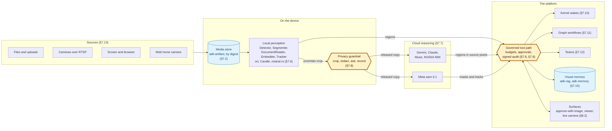

# Spec 3.7: `adk-vision` — local-first perception for multimodal agents

| | |
|---|---|
| **Status** | Draft / RFC |
| **Builds on** | [`spec-3.1-harness-agent.md`](spec-3.1-harness-agent.md) (the governed path, modes and standing rules, the browser and computer-use packs, teams, long-term facts), [`spec-3.2-agent-kernel.md`](spec-3.2-agent-kernel.md) (wake sources, the event bus, per-unit daily quotas, partitions), [`spec-3.3-harness-ui.md`](spec-3.3-harness-ui.md) (the decision contract, the camera and screen switches of §5.6, concept sign-off before UI), [`spec-3.5-agentic-web.md`](spec-3.5-agentic-web.md) (traits with conformance suites, built-in backends that are not defaults over anyone's choice) |
| **Target** | `adk-rust` 3.x: phase A in the first minor release after 3.0.0; phases B, C and D in the minor releases that follow ([§12](#12-phased-delivery)) |
| **Grounding commit** | `origin/main` @ `579adebf3` for every `file:line` reference |
| **Evidence** | The landscape report *Vision model landscape 2026* (November 2026: models, licences, Rust runtimes, the Meta `sam-3.1` API, NVIDIA NIM, workspace gaps) and its sources, listed under [References](#references). The sources this spec relies on were re-read on 2026-11-17; [§4.4](#44-what-re-reading-the-sources-changed) records what changed |
| **Affected crates** | NEW `adk-vision`; `adk-core` (approval evidence, per-unit run caps, a `Frames` usage unit, data locality); `adk-model` (`sam-3.1` video pricing, Gemini file parts); `adk-anthropic` (the current computer-use toolset); `adk-mistralrs` (0.8 → 0.9.x); `adk-audio` and `adk-rag` (one workspace `ort` pin); `adk-guardrail` (image parts); `adk-surface` (three new screens); `adk-kernel` (visual wake sources); `adk-eval` (vision evaluators); `adk-bench` (vision suites); `adk-computer-use` and `adk-browser` (set-of-marks grounding); `adk-realtime` (frame sources into live sessions); `adk-harness` (the vision pack); `adk-cli` (`adk-rust vision`); `cargo-adk` (a `vision` template); `adk-rust` (features `vision` and `vision-local`) |
| **Stability** | `adk-vision` enters at **Experimental**. Its `media`, `geometry` and `manifest` modules move to **Beta** when the phase A conformance suite passes on at least two backends for every trait |

---

## 1. Summary

A claims clerk drops forty scanned invoices and identity documents into a folder and asks for a spreadsheet. A line supervisor wants to know the moment a seal on the conveyor is torn, and how long the tear is. A support agent has to enter the same customer record in two desktop applications that have no API. Each is a vision problem, and each carries the constraint that decides its design: the documents hold personal data that must not leave the building, the conveyor runs all day so cost is counted per frame, and a click that lands twenty pixels off edits the wrong field.

ADK-Rust agents can already look at a picture, but only as a pass-through. `Part::InlineData` carries an image's bytes and MIME type ([`adk-core/src/types.rs:367`](../../adk-core/src/types.rs)), and the Gemini, OpenAI, OpenAI-compatible, Anthropic, Bedrock and Muse providers send it natively; Ollama turns it into text ([`adk-model/src/ollama/convert.rs:19`](../../adk-model/src/ollama/convert.rs)). Nothing else in the framework understands an image. No type says where an object is, what a mask is, or which coordinate frame a model answered in. An approval card cannot show the picture it approves ([`adk-surface/src/model.rs:316`](../../adk-surface/src/model.rs)). The PII guardrail passes image parts through untouched ([`adk-guardrail/src/pii.rs:214`](../../adk-guardrail/src/pii.rs)). Egress control decides by destination and never by content ([`adk-core/src/egress/mod.rs:687`](../../adk-core/src/egress/mod.rs)). Meta's `sam-3.1` is priced in the catalog with no client to call it ([`adk-model/src/pricing.rs:1553`](../../adk-model/src/pricing.rs)), and its video price is missing because "frames are not a usage unit" ([`pricing.rs:74`](../../adk-model/src/pricing.rs)).

Over the same year, perception became cheap and permissively licensed. Meta's hosted `sam-3.1` segments any named concept for **$2.50 per 1,000 images and $0.20 per 1,000 video frames** ([Meta pricing](https://dev.meta.ai/docs/pricing-rate-limits)). RF-DETR's Nano, Small and Medium detectors are Apache-2.0 and sit within about one COCO point of the AGPL-3.0 YOLO26 ([RF-DETR](https://rfdetr.roboflow.com/latest/), [Ultralytics](https://docs.ultralytics.com/models/yolo26/)). A 0.9B Apache-2.0 document model, PaddleOCR-VL-1.6, tops OmniDocBench v1.6 ahead of a 235B generalist ([Roboflow](https://roboflow.com/blog/best-open-source-ocr-models)). SigLIP 2 gives licence-clean image embeddings, and Qwen3-VL runs in mistral.rs. Every local default this spec names is Apache-2.0. When a cloud segmentation costs a quarter of a cent, running perception locally is justified by privacy, offline operation and latency, not by price.

Spec 3.7 adds **`adk-vision`**, one crate with backend features, and connects it to the rest of the platform:

- **Contracts first.** Artifact-backed `ImageRef`, `Frame` and `VideoRef`; `BBox`, `Polygon`, run-length `Mask`, `Keypoints` and `Track`; a `Region` that always knows the source image it belongs to and the resizes and crops between that image and the model; a model manifest that pins every weight file by revision and SHA-256 and names its licence. Seven traits — `Detector`, `Segmenter`, `DocumentReader`, `Embedder`, `Describer`, `Tracker` with `VideoAnalyzer`, and `Editor` — each with several backends and one conformance suite.
- **Local-first perception, cloud reasoning.** Detection, segmentation, embedding and OCR run on the device through `ort`, Candle and mistral.rs. Gemini, Claude, Muse, NVIDIA NIM and Meta `sam-3.1` reason and escalate through the same traits.
- **Governed sight.** Every vision operation is a governed tool call through `adk_core::authorize_tool_call` ([`adk-core/src/governance.rs:2232`](../../adk-core/src/governance.rs)). It is budgeted per image and per frame before it runs and lands in the spend ledger after. A privacy guardrail redacts faces and personal text before any image leaves the machine. The approval card shows the exact image that would be sent, and the signed audit log records its digest, never its pixels.
- **The whole platform.** The kernel wakes a process on a visual event. Graph workflows run document pipelines with checkpoints. Teams split into perceiver, reasoner and verifier. Visual memory lives in `adk-memory` and `adk-rag`. Computer use and the browser ground clicks with set-of-marks. `adk-eval` scores vision, and `adk-surface` gains an annotated viewer and a live camera surface.

Three products lead and each is a scenario in [§5](#5-headline-capabilities-and-demonstration-scenarios). The **Document desk** reads, extracts and redacts documents locally and sends only the uncertain crop to a cloud model. The **Inspector** watches a camera and measures defects. The **Screen copilot** operates applications by sight. Phase A builds the foundation and the Document desk, phase B video and streams with the Inspector, phase C multimodal teams with the Screen copilot, and phase D spatial perception.

The claim is bounded. No source gave a CPU or Apple Silicon latency for any proposed default, and every accuracy figure comes from COCO, LVIS or OmniDocBench, not from industrial inspection or identity documents. So the first things phase A builds are a benchmark harness and the region type, not a model integration, and every scenario's pass condition is measured on fixtures the project owns.

## 2. Goals

- **G1.** A developer gives an agent sight with one feature and one builder call. Local backends need no account, and need no network once their weights are fetched.
- **G2.** Every perception task has a trait with at least two backends in the phase that introduces it — one local and, where a cloud route is verified, one cloud — and every backend passes the same conformance suite. No backend is privileged in code, documentation or defaults beyond what a test needs.
- **G3.** Every region any backend returns is expressed in source-image pixels, with the transform chain that produced it recorded. Gemini, Claude, Meta and local regions for the same object agree within 2 px after normalisation.
- **G4.** No image leaves the machine except through the privacy guardrail. Faces and personal text are redacted before egress. Only the crop that needs a cloud model is sent, not the page. The approval card shows exactly what will be sent, and the audit log records its digest.
- **G5.** Vision is budgeted before it is spent. Per-image, per-frame and per-token prices come from the catalog. A call that would exceed a run, process or daily cap is refused before the request, and every call lands in the spend ledger.
- **G6.** Weights are data with provenance. Every model file is fetched by revision and checked against a SHA-256 in a manifest that names its licence. A use-restricted licence needs a recorded acceptance. Non-commercial and copyleft weights are never in the built-in manifest.
- **G7.** Video and streams are first-class (phase B). Frame sources cover RTSP, files, the screen, the browser and the camera, with sampling and per-frame budgets. Tracking keeps stable identifiers, and the kernel wakes on a visual event.
- **G8.** Teams are multimodal (phase C). Perceiver, reasoner and verifier are team templates, and visual memory answers questions by text or by image.
- **G9.** Screen copilot clicks land (phase C). Grounder coordinates are converted to screen space, device pixel ratio included. Every action is a governed call, and a verifier checks the result.
- **G10.** Every capability is measured. A vision benchmark harness reports latency on CPU, Apple Silicon and CUDA and accuracy on the project's fixtures. Vision evaluators in `adk-eval` fail a change that regresses.
- **G11.** Every claim in this spec is a scenario with a pass condition, runnable against local fixtures and recorded provider responses, with a live run for each cloud backend.
- **G12.** Spatial outputs share the same contracts (phase D). Depth, pose and 3D results use the region, artifact and audit types. Bridges to robotics stacks carry perception out, and anything that acts comes back in only through the governed path.

## 3. Non-goals

| Non-goal | Why | Where it belongs |
|---|---|---|
| **N1.** Training or fine-tuning models | Outside a framework's remit; RF-DETR fine-tunes in its own tooling ([RF-DETR export](https://rfdetr.roboflow.com/latest/learn/export/)) | `adk-vision` loads the exported ONNX graph and verifies it against a manifest the user writes ([§7.4](#74-model-manifest-and-fetcher)) |
| **N2.** Identifying people: face recognition, re-identification across cameras, biometric matching | High-risk processing of personal data; no lead use case needs it | Faces and people are detected only to redact them (V-I8); tracks are anonymous and reset with their source session |
| **N3.** Generative image and video models | Generation already lives in `adk-model` (`muse-image-1.0` at [`muse/images.rs:146`](../../adk-model/src/muse/images.rs), `gemini-nano-banana-2.1` in [`catalog.rs:252`](../../adk-model/src/catalog.rs)); spec 3.6 owns media production | The `Editor` trait wraps the existing edit endpoint; no new generator |
| **N4.** Bundling weights, or downloading restricted weights silently | Licences travel with weights; the SAM License forbids some uses and changes at Meta's discretion | The manifest, the fetcher and recorded acceptance ([§7.4](#74-model-manifest-and-fetcher)) |
| **N5.** AGPL or GPL components in the dependency graph: YOLO26, YOLOE, YOLO-World, FFmpeg built with `--enable-gpl` | Network copyleft would reach the user's whole service ([Ultralytics licence](https://www.ultralytics.com/license), [FFmpeg legal](https://ffmpeg.org/legal.html)) | At most a separately licensed crate outside the workspace; FFmpeg only as a binary the user installs |
| **N6.** Choosing a vendor for users | Framework neutrality | Traits, several backends each, one conformance suite ([§7.18](#718-conformance-suite)) |
| **N7.** A video editor, timeline or encoder | Spec 3.6 keeps FFmpeg work in an MCP server so the framework stays neutral | Frame sources decode and sample; they never encode |
| **N8.** Real-time control loops for robots | Latency and safety guarantees a framework cannot give | Phase D bridges publish perception; an actuation is a governed tool call like any other |
| **N9.** A video management system or camera product | A product concern | RTSP ingest through `retina` and the frame-source trait only |

## 4. Relationship to the existing crates and specs

### 4.1 What `adk-vision` builds on

| Subsystem | Today at `579adebf3` | `adk-vision` uses it for |
|---|---|---|
| Governed tool path | `authorize_tool_call` runs the kill switch, consent, resume binding, the egress policy, `ToolPolicy`, `ToolCallScreen` and confirmation in that order ([`governance.rs:2232`](../../adk-core/src/governance.rs)), and returns `Execute`, `Refuse` or `Pending` ([`ToolAuthorization`, `:2162`](../../adk-core/src/governance.rs)); a `GovernedCall` carries its effect and egress ([`:1377`](../../adk-core/src/governance.rs)) | Every vision tool goes through it; a remote backend declares its destinations through `Tool::egress` ([`tool.rs:347`](../../adk-core/src/tool.rs)) |
| Tool effects | `ToolEffect::{ReadOnly, Idempotent, NonIdempotent}` ([`tool.rs:558`](../../adk-core/src/tool.rs)) | Perception is `ReadOnly`; an edit that writes an artifact is `Idempotent`, keyed by input digest and operation; a screen action is `NonIdempotent` |
| Approvals | `ApprovalRequest` holds `args_redacted`, `summary`, `risk` and a fingerprint, and no attachment, media or preview field ([`approval.rs:553`](../../adk-core/src/approval.rs)) | Approve-with-image adds evidence to the request (X4) |
| Decision cards | `DecisionCard` is drawn from the inbox entry on every surface ([`model.rs:316`](../../adk-surface/src/model.rs)); its `CallView` is text only ([`:178`](../../adk-surface/src/model.rs)) | The card shows the evidence image with its regions (X11) |
| Spend | `SpendLedger` reserves, commits and releases integer micro-USD ([`spend.rs:14`, `:376`](../../adk-core/src/spend.rs)); `MeteredUsage` records each call ([`metering.rs:923`](../../adk-core/src/metering.rs)); `UsageUnit::Images` exists and `Frames` does not ([`usage.rs:52`](../../adk-core/src/usage.rs)) | Per-image and per-frame preflight and commit ([§7.9](#79-budgets-and-the-spend-ledger)) |
| Budgets | `RunBudget` caps model calls, tokens, cost, wall time and tool calls, not units ([`budget.rs:115`](../../adk-core/src/budget.rs)); the kernel caps units per day with `Quotas::with_daily_cap` ([`sched.rs:388`, `:432`](../../adk-kernel/src/sched.rs)) | Per-unit run caps (X2); daily frame caps for streams |
| Pricing | `sam-3.1` at $2.50 per 1,000 images ([`pricing.rs:1553`](../../adk-model/src/pricing.rs)) with a catalog entry ([`catalog.rs:302`](../../adk-model/src/catalog.rs)); its video price left out ([`pricing.rs:74`](../../adk-model/src/pricing.rs)); `muse-image-1.0` per image ([`:1544`](../../adk-model/src/pricing.rs)) | Cloud backend prices; `sam-3.1` video (X5) |
| Audit | `AuditRecord` references content only by `args_digest` and `payload_ref` ([`audit_log.rs:314`](../../adk-core/src/audit_log.rs)); signed checkpoints, Ed25519 notes and JCS ([`log.rs:192`](../../adk-auth/src/signed_audit/log.rs), [`note.rs:431`](../../adk-auth/src/signed_audit/note.rs), [`jcs.rs:33`](../../adk-auth/src/signed_audit/jcs.rs)) | `vision.*` records carry image digests, never pixels ([§9.3](#93-audit-records)) |
| Kill switch | `GovernanceControl` ([`governance.rs:148`](../../adk-core/src/governance.rs)) | Freezes streams and egress with everything else |
| Guardrails | `Guardrail::validate(&Content)` may return `Transform` with new content ([`traits.rs:16`, `:79`](../../adk-guardrail/src/traits.rs)); `PiiRedactor` redacts text parts only ([`pii.rs:205-214`](../../adk-guardrail/src/pii.rs)); `ToolGuardrail` screens calls and results ([`tool.rs:125`](../../adk-guardrail/src/tool.rs)) | The image privacy guardrail implements both traits ([§7.8](#78-governed-vision-tools-and-the-privacy-guardrail)) |
| Egress | `EgressPolicy` is a host, port and CIDR allowlist ([`egress/mod.rs:687`](../../adk-core/src/egress/mod.rs)); `ToolEgress::Destinations` ([`:969`](../../adk-core/src/egress/mod.rs)); the sandbox denies network by default ([`adk-sandbox/src/sandbox/mod.rs:136`](../../adk-sandbox/src/sandbox/mod.rs)) | The destination stays the first gate; content becomes the second |
| Model hook | `BeforeModelCallback` may change a request before it is sent ([`callbacks.rs:89`](../../adk-core/src/callbacks.rs)) | The privacy guardrail on an agent's own model calls |
| Content | `Part::InlineData { mime_type, data, uri, annotations }` ([`types.rs:367`](../../adk-core/src/types.rs)) and `Part::FileData` ([`:395`](../../adk-core/src/types.rs)) | An `ImageRef` becomes an `InlineData` part whose `annotations` carry its digest |
| Providers | Inline images go out natively from OpenAI ([`openai/convert.rs:164`](../../adk-model/src/openai/convert.rs)), OpenAI-compatible ([`openai_compatible.rs:690`](../../adk-model/src/openai_compatible.rs)), Gemini ([`gemini/client.rs:1531`](../../adk-model/src/gemini/client.rs)), Anthropic ([`anthropic/convert.rs:133`](../../adk-model/src/anthropic/convert.rs)), Bedrock ([`bedrock/convert.rs:297`](../../adk-model/src/bedrock/convert.rs)) and Muse ([`muse/convert.rs:420`](../../adk-model/src/muse/convert.rs)); Ollama converts them to text ([`ollama/convert.rs:19`](../../adk-model/src/ollama/convert.rs)); a Gemini user `FileData` part becomes a text placeholder ([`gemini/client.rs:1540`](../../adk-model/src/gemini/client.rs)) | The `Describer` over any `Llm` |
| Fallback | `FallbackLlm` with triggers and per-attempt metering ([`fallback.rs:235`](../../adk-model/src/fallback.rs)) | The pattern for escalation from a local to a cloud backend |
| Muse | Base URL `https://api.meta.ai/v1` ([`muse/config.rs:6`](../../adk-model/src/muse/config.rs)); `muse-image-1.0` edits ([`muse/images.rs:146`](../../adk-model/src/muse/images.rs)); Responses mode behind `muse-responses` | `sam-3.1` reuses the base URL and key resolution; the cloud `Editor` |
| Local VLM | `MistralRsVisionModel` on mistral.rs 0.8 with `MultimodalModelBuilder` ([`vision.rs:68`, `:104`](../../adk-mistralrs/src/vision.rs)); the README lists Qwen3VL among multimodal architectures ([`README.md:316`](../../adk-mistralrs/README.md)) | The local `Describer` and GUI grounder |
| ONNX | `ort = "=2.0.0-rc.11"` in [`adk-audio/Cargo.toml:61`](../../adk-audio/Cargo.toml) and [`adk-rag/Cargo.toml:49`](../../adk-rag/Cargo.toml); runtime execution-provider choice ([`execution_provider.rs:7`](../../adk-audio/src/onnx/execution_provider.rs)); model downloads through `hf_hub::api::sync` with no checksum or revision pin ([`registry.rs:113`](../../adk-audio/src/registry.rs), [`adk-rag/src/onnx.rs:364`](../../adk-rag/src/onnx.rs)) | The local runtime, after one workspace pin (X1) |
| Artifacts | `ArtifactService` stores versioned `Part`s ([`service.rs:239`](../../adk-artifact/src/service.rs)) in memory, on disk and on GCS | Every image, frame and video an operation keeps |
| Memory and RAG | `MemoryService` ([`service.rs:86`](../../adk-memory/src/service.rs)) drops non-text parts ([`text.rs:8`](../../adk-memory/src/text.rs)); both `EmbeddingProvider`s are text only ([`adk-memory/src/embedding.rs:36`](../../adk-memory/src/embedding.rs), [`adk-rag/src/embedding.rs:24`](../../adk-rag/src/embedding.rs)); `VectorStore::upsert` takes chunks with precomputed embeddings ([`vectorstore.rs:159`](../../adk-rag/src/vectorstore.rs), [`document.rs:108`](../../adk-rag/src/document.rs)); `GraphMemoryService` ([`graph.rs:136`](../../adk-memory/src/graph.rs)) | Visual memory ([§7.15](#715-visual-memory)) |
| Kernel | `Wake` has no visual variant ([`wake.rs:103`](../../adk-kernel/src/wake.rs)); `WakeSource` is the extension point ([`:263`](../../adk-kernel/src/wake.rs)); a wake payload reaches the turn as delimited text of at most 4 KiB ([`WAKE_PAYLOAD_LIMIT`, `:463`](../../adk-kernel/src/wake.rs); [`worker.rs:1627`](../../adk-server/src/background/worker.rs)); `ProcessKind::Triggered` ([`process.rs:330`](../../adk-kernel/src/process.rs)); `EffectClass` ([`drivers.rs:134`](../../adk-kernel/src/drivers.rs)) | A `VisionWakeSource` whose payload names a frame by reference ([§7.10](#710-kernel-visual-wake-sources)) |
| Graph | `StateGraph` ([`graph.rs:14`](../../adk-graph/src/graph.rs)), `Node` ([`node.rs:610`](../../adk-graph/src/node.rs)), interrupts with data ([`interrupt.rs:9`](../../adk-graph/src/interrupt.rs)), checkpointers ([`checkpoint.rs:222`](../../adk-graph/src/checkpoint.rs)), `GovernedNode` ([`governed.rs:100`](../../adk-graph/src/governed.rs)); no vision action node ([`adk-action/src/types.rs:1054`](../../adk-action/src/types.rs)) | The Document desk pipeline and vision nodes ([§7.11](#711-graph-workflows)) |
| Teams | `TeamSpec` ([`adk-agent/src/team.rs:59`](../../adk-agent/src/team.rs)); harness `MemberSpec` with `MemberTools::ReadOnly` ([`adk-harness/src/team.rs:86`, `:158`](../../adk-harness/src/team.rs)) | Perceiver, reasoner and verifier templates ([§7.12](#712-teams-perceiver-reasoner-verifier)) |
| Realtime | `RealtimeSession::send_video_frame` ([`session.rs:108`](../../adk-realtime/src/session.rs)); Gemini Live sends `realtimeInput.video` ([`gemini/session.rs:1514`](../../adk-realtime/src/gemini/session.rs)); OpenAI Realtime sends each frame as an `input_image` item ([`openai/protocol.rs:244`](../../adk-realtime/src/openai/protocol.rs)); LiveKit video ingest is absent | Frame sources feed live sessions ([§7.13](#713-video-streams-and-realtime)) |
| Surface camera | The web home captures camera and screen under feature `voice` ([`devices.ts:82-83`](../../adk-surface/web/src/voice/devices.ts)); `VisualInputs` and `FramePolicy` gate every frame and never store it ([`visual.rs:21`, `:77`](../../adk-surface/src/voice/visual.rs)); genui leaves out `Image` and `Video` ([`catalog.rs:24`](../../adk-surface/src/genui/catalog.rs)); chat channels accept inbound images ([`channels/media.rs:14`](../../adk-surface/src/channels/media.rs)) | The live camera surface extends the voice screen's capture |
| Computer use | No actuation in the crate ([`lib.rs:7`](../../adk-computer-use/src/lib.rs)); `observe_visual` returns opaque JSON ([`runtime/mod.rs:103`](../../adk-computer-use/src/runtime/mod.rs)); `TargetEvidence` holds a screenshot hash and `Bounds` in display coordinates ([`target.rs:14`, `:57`](../../adk-computer-use/src/contracts/target.rs)); no DPI or scale handling | Region-to-screen mapping and set-of-marks ([§7.14](#714-computer-use-and-the-browser-set-of-marks-grounding)) |
| Harness packs | `ComputerUsePack`: observe and preview read, execute is `ToolKind::ComputerUse` ([`computer_use.rs:115`](../../adk-harness/src/packs/computer_use.rs), [`policy.rs:198`](../../adk-harness/src/policy.rs)), which no standing rule covers ([`policy.rs:210`](../../adk-harness/src/policy.rs)); `BrowserPack` returns `browser_screenshot` as a binary result ([`browser.rs:242`, `:353`](../../adk-harness/src/packs/browser.rs)) | The vision pack composes with both |
| Browser | `ScreenshotTool` returns a base64 PNG ([`screenshot.rs:10`](../../adk-browser/src/tools/screenshot.rs)); `ClickTool` takes a CSS selector only ([`click.rs:10`](../../adk-browser/src/tools/click.rs)) | Marks map to selectors |
| Anthropic | Computer-use tool types `computer_20241022` and `computer_20250124` only ([`server_tool.rs:28`, `:30`](../../adk-anthropic/src/types/server_tool.rs)) | The current toolset with zoom (X7) |
| Eval | `Evaluator` ([`evaluator.rs:61`](../../adk-eval/src/evaluator.rs)), rubric and LLM judge, baselines ([`baseline.rs:35`](../../adk-eval/src/baseline.rs)), A/B comparison ([`ab_comparator.rs:68`](../../adk-eval/src/ab_comparator.rs)); an eval case `Part` has no image variant ([`schema.rs:179`](../../adk-eval/src/schema.rs)) | Vision evaluators and image-bearing cases (X13) |
| Bench | `BenchRunner` ([`runner.rs:85`](../../adk-bench/src/runner.rs)) and `TaskQualityAdapter` ([`adapters/mod.rs:41`](../../adk-bench/src/adapters/mod.rs)) | A vision adapter ([§7.17](#717-benchmark-harness)) |
| Sandbox | Network off is enforced on macOS and Linux and not on Windows ([`windows.rs:366`](../../adk-sandbox/src/sandbox/windows.rs)) | The offline profile (S19) |

### 4.2 Specs 3.1–3.6

| Spec | Supplies to 3.7 | 3.7 adds |
|---|---|---|
| 3.1 HarnessAgent | The governed path, modes, standing rules, `ToolKind`, the browser and computer-use packs, teams, change sets reviewed once per batch (§7.26) | The vision pack; perceiver, reasoner and verifier members; batch approval of a previewed screen plan ([§13](#13-open-questions) Q8) |
| 3.2 Agent Kernel | `WakeSource`, triggers, per-unit daily quotas, partitions, `ProcessKind::Triggered` | `VisionWakeSource`; stream processes under frame quotas |
| 3.3 Harness UI | The decision contract, park on timeout, the camera and screen switches of §5.6, concept sign-off before UI | Evidence on decision cards; the annotated viewer and the live camera surface ([§8.2](#82-new-screens-concept-sign-off-first)) |
| 3.5 Agentic web | Traits with conformance suites; built-in implementations that exist so tests are hermetic, not as defaults over a user's choice | The same rule for vision backends (D-8) |
| 3.6 Rust & Beyond Studio (in review) | A critic that scores rendered frames per shot and a media toolset that samples video | A consumer of `Describer` and `VideoAnalyzer` once phase B lands; neither spec depends on the other |

### 4.3 What the landscape report settles and leaves open

The report settles the defaults by three tests in order: weights under Apache-2.0 or MIT, a Rust execution path that exists today, then accuracy. After those tests three runtimes are enough — `ort`, Candle and mistral.rs — and one OpenAI-compatible client reaches local, self-hosted and hosted VLMs. It settles the licence boundaries: SAM 3.x under Meta's use-restricted SAM License; YOLO26 and YOLOE under AGPL-3.0; RF-DETR's XL, 2XL, Atto, Femto and Pico under PML 1.0; jina-clip-v2, Holo2 and KV-Ground non-commercial. It also settles the shape of the first work: a canonical region type, a manifest, a `sam-3.1` stream parser and a benchmark harness come before any model.

It leaves open, and this spec does not pretend otherwise:

- **Latency.** No CPU, Apple Silicon or ONNX Runtime CUDA latency for any proposed default.
- **Domain accuracy.** No industrial inspection (MVTec) or identity-document and invoice extraction benchmark.
- **Providers and models not researched.** OpenAI vision and computer-use request shapes and prices; Muse perception output and pricing; Mistral OCR, docling, Surya and GOT-OCR; Cohere, Nomic and Gemini multimodal embeddings; tract and burn.
- **Face detection.** No permissive face detector was researched; the privacy guardrail needs one ([§13](#13-open-questions) Q3).
- **Phase D models.** Depth and 3D models were not researched; pose appears only as RF-DETR's keypoint preview.

### 4.4 What re-reading the sources changed

The sources this spec relies on were re-read on 2026-11-17, and the workspace was searched at the grounding commit. These corrections and resolutions apply; the report's other figures are cited as it gives them, with its marks: † for a figure that rests on one secondary source or on arithmetic, ‡ for a fact on which sources disagree.

| # | Report | Now | Source |
|---|---|---|---|
| R1 | The `sam-3.1` rate limit is not published | 3,000 requests per minute per team, no token limit, because it is billed per image or frame | [Meta pricing](https://dev.meta.ai/docs/pricing-rate-limits) |
| R2 | Claude computer-use tool version conflicts: `computer_20251124` against `computer_toolset_20260801`‡ | Both exist. `computer_toolset_20260801` serves Claude Opus, Sonnet and Haiku 5.5 and Fable and Mythos 5.2 with no beta header; `computer_20251124` serves Opus 4.5–4.7 and Sonnet 4.6, and the 5.5 models reject it. `adk-anthropic` has neither ([`server_tool.rs:28-30`](../../adk-anthropic/src/types/server_tool.rs)) | [Claude computer use](https://platform.claude.com/docs/en/agents-and-tools/tool-use/computer-use-tool) |
| R3 | Gemini model IDs conflict: `gemini-4-hydrogen`, `gemini-3-flash-preview`, workspace `gemini-3.7-flash`‡ | `gemini-4-hydrogen` is an active catalog entry ([`catalog.rs:245`](../../adk-model/src/catalog.rs)); the workspace default is `gemini-3.8-flash` ([`catalog.rs:24`](../../adk-model/src/catalog.rs), `AGENTS.md`); `gemini-3.7-flash` and `gemini-3.1-flash-image` are deprecated; image output is `gemini-nano-banana-2.1` | Workspace |
| R4 | Gemini video spends about 300 tokens per second at default resolution, so an hour costs about $0.54† | The page now gives about 100 tokens per second at the default (low) media resolution and about 300 at high. The $0.54 figure holds for high resolution at the commonly cited $0.50 per million tokens, a price that remains disputed‡ | [Gemini video](https://aistudio.google.com/docs/video-understanding) |
| R5 | `oar-ocr`'s licence and `ort` pin were not captured | `oar-ocr` is Apache-2.0 and 0.10.2 pins `ort =2.0.0-rc.13` | [oar-ocr](https://github.com/GreatV/oar-ocr), [docs.rs](https://docs.rs/crate/oar-ocr/latest) |
| R6 | trackforge MSRV 1.88–1.89 | 0.5.1 is MIT, declares Rust 1.92, and takes `ort` optionally at `^2.0.0-rc.10`, which any exact workspace pin satisfies | [docs.rs](https://docs.rs/crate/trackforge/latest) |
| R7 | RF-DETR keypoint licence not stated | Apache-2.0, with Nano to Large detection and every Seg size; PML 1.0 covers Atto, Femto, Pico, XLarge, 2XLarge and NAS | [RF-DETR](https://rfdetr.roboflow.com/latest/) |
| R8 | Whether `adk-mistralrs` 0.8 runs Qwen3-VL was not verified; Qwen3-VL is "heavily tested" | `adk-mistralrs` already wraps mistral.rs multimodal models on 0.8 and lists Qwen3VL; the mistral.rs supported-models page lists Qwen3-VL, Qwen3-VL MoE, Idefics3/SmolVLM, Gemma 4 and Muse Glimmer and does not say "heavily tested". The 0.9.x upgrade is no longer a precondition for Qwen3-VL if a live probe on 0.8 passes ([§13](#13-open-questions) Q2) | [`vision.rs:68`](../../adk-mistralrs/src/vision.rs), [mistral.rs models](https://docs.mistralrs.dev/reference/supported-models/) |
| R9 | NVIDIA's asset-upload threshold is 180 KB‡ | The VILA reference says 180 KB in its prose and 200 KB in its schema‡ | [NVIDIA API reference](https://docs.api.nvidia.com/nim/reference/nvidia-vila-infer) |
| R10 | rc.13 moved the execution providers | The workspace's own comments disagree: `adk-audio` says rc.13 moved them ([`Cargo.toml:59-60`](../../adk-audio/Cargo.toml)), `adk-rag` says rc.12 renamed them ([`Cargo.toml:47-48`](../../adk-rag/Cargo.toml)) | Workspace |
| R11 | `hf-hub` offers an async `HFClient`; whether 0.5 has it was not verified | The workspace's `hf-hub` 0.5 is used through `hf_hub::api::sync::Api` and `ApiBuilder::from_env`; `adk-rag` honours `HF_HOME` through `from_env`, `adk-audio` checks its own cache first; neither pins a revision or checks a hash | [`registry.rs:113`](../../adk-audio/src/registry.rs), [`onnx.rs:364`](../../adk-rag/src/onnx.rs) |

## 5. Headline capabilities and demonstration scenarios

Each scenario is a test in a new standalone crate, `examples/vision` (`vision-scenarios`), in the pattern of `examples/harness_kernel` and `examples/website` ([§11](#11-testing-and-live-verification)). The fixtures are the project's own:

- **Documents.** Forty generated documents: invoices, receipts, a contract with tables, and identity cards whose personal data is invented and whose portraits are generated images, labelled as such.
- **Conveyor.** A recorded conveyor clip of 200 printed parts, twelve with seeded defects of known length and a fiducial of known size in view, served over RTSP from a local test server.
- **Screen.** A 3024×1964 screenshot of a 1512×982-point display at device pixel ratio 2, with twelve labelled targets, plus two fixture applications: a local web CRM and a desktop form app driven through `computer-use-mcp`.
- **Video.** An hour of recorded warehouse video with ten labelled events.
- **Recorded responses.** Gemini, Claude, Muse, NVIDIA and `sam-3.1` responses, so the PR tier runs without keys.

A pass condition stated against a baseline uses the value recorded when the scenario was first accepted.

| # | Phase | Capability | Scenario | Pass condition | Machinery |
|---|---|---|---|---|---|
| S1 | A | **Document desk, local first** | An agent with the vision pack turns the forty documents into one table per document kind | Each value carries page, region and backend; field accuracy per backend is at or above its recorded baseline; pages whose fields all clear the local confidence threshold send zero bytes off the machine (the egress recorder is empty for them); run spend equals the sum of its ledger entries | `DocumentReader`, `Describer` with a schema, the graph ([§7.11](#711-graph-workflows)) |
| S2 | A | **Escalate the crop, not the page** | Five fields stay below the threshold: handwriting, a stamp over text | Exactly five egress records; each sent image is its field's crop plus margin, never a page; the cloud answer replaces the local value with `escalatedFrom` provenance; each record names host, source and egress digests, redactions and cost | Escalation ([§7.5](#75-traits-and-backends)), the egress gate ([§7.8](#78-governed-vision-tools-and-the-privacy-guardrail)) |
| S3 | A | **Redact before it leaves** | An identity card goes to a cloud `Describer` with "what kind of document is this?" | The bytes the recording provider received hold no face (the local detector finds none in the egress copy) and none of the seeded personal strings (local OCR finds none); the egress copy is an artifact; the audit record links both digests | `ImagePrivacyGuardrail` |
| S4 | A | **Approve with the image** | In Ask mode the agent asks to send a crop to `claude-sonnet-5-5` | The call is held; the card carries the exact egress image with its regions and digest; approval releases that digest; an image swapped before execution changes the fingerprint and the call is held again; the audit record links decision and digest | Approval evidence (X4), the card (X11) |
| S5 | A | **One region, four frames** | Recorded answers for the twelve targets from Gemini (`box_2d`, 0–1000), Claude (pixels of the image it processed), `sam-3.1` (source pixels) and RF-DETR (model-input pixels with letterbox) | All 48 regions land within 2 px of ground truth in source pixels; mapped to screen points, every click point falls inside its target; property tests round-trip random transform chains within 0.5 px | `Region`, `CoordFrame`, `TransformChain` ([§7.3](#73-geometry-and-regions)) |
| S6 | A | **Weights you can trust** | Fetch, verify and load the built-in models; tamper with one file; request a model under a use-restricted test licence; go offline | With `HF_HUB_OFFLINE=1` and a warm cache, a fetch opens no socket; a file whose SHA-256 differs is refused before `ort` loads it; the restricted model fails with "licence acceptance required" naming the licence URL until acceptance is recorded; the built-in manifest lists no non-commercial or copyleft model | Manifest and fetcher ([§7.4](#74-model-manifest-and-fetcher)) |
| S7 | A | **A budget per image** | A run capped at 20 images makes 30 `sam-3.1` segmentation calls | 20 calls succeed; the 21st is refused before any request, naming the unit and the cap; the ledger shows 20 commits of 2,500 µUSD; local calls record units at zero cost | Per-unit caps (X2), pricing ([§7.9](#79-budgets-and-the-spend-ledger)) |
| S8 | A | **Same tool, any backend** | S1 runs with PP-OCRv6, PaddleOCR-VL-1.6 and Gemini as `DocumentReader`, and with RF-DETR and `sam-3.1` as `Detector` | Tool calls and output schema are identical; the benchmark harness reports accuracy, latency and cost per backend side by side; every backend passes the conformance suite | Conformance ([§7.18](#718-conformance-suite)), benchmarks ([§7.17](#717-benchmark-harness)) |
| S9 | B | **Inspector** | The conveyor stream; a user-supplied RF-DETR fine-tune in a manifest the user wrote; SAM 2.1 Tiny refines boxes to masks; the fiducial calibrates | Each of the twelve defects produces one track and one wake; measured lengths are within 5% of the seeded lengths; no wake on a defect-free part; only frames that produced a wake or a card are stored | `Detector`, `Segmenter`, `Tracker`, calibration ([§7.13](#713-video-streams-and-realtime)) |
| S10 | B | **Wake on what matters** | The Inspector process sleeps until a defect | The woken turn's payload names frame artifact, digest, track and regions within 4 KiB; the process loads the frame through the vision pack; its line-stop call is held with the frame on the card; one approval resumes it | `VisionWakeSource` ([§7.10](#710-kernel-visual-wake-sources)) |
| S11 | B | **A budget per frame** | Thirty minutes of stream: local detection at 5 fps, escalation of ambiguous tracks to `sam-3.1` video, a daily frame quota | Escalation stops when the quota is reached and resumes next period; every `sam-3.1` video request is billed at least 50 frames in the ledger; the governor lowers the local rate before it pauses a source and records each change | Frame budget ([§7.9](#79-budgets-and-the-spend-ledger)), X3, X5 |
| S12 | B | **Live camera surface** | An operator watches the Inspector's overlays in the web home and stops the line from a card | Overlays draw within one frame interval of their detection; switching the camera off drops frames on the server; no frame is stored unless it is evidence on a card | The live camera surface ([§8.2](#82-new-screens-concept-sign-off-first)) |
| S13 | B | **Native video, two ways** | "When does the forklift enter the aisle?" over a 20-minute clip: Gemini native video through the File API, and local Qwen3-VL over sampled frames | Both answers fall within ±5 s of the labelled time; tokens and cost are reported per path; the Gemini path uploads one file and sends a file part, not inline bytes | `VideoAnalyzer`, Gemini file parts (X8) |
| S14 | C | **Screen copilot** | Copy a customer record from the web CRM into the desktop form on the DPR-2 display | Every click lands inside its target; every action is a governed browser or `computer_use_execute` call; a seeded mis-grounding (two identical "Save" buttons) is caught by the verifier and grounded again; no action outside the two allowed windows; the record matches field for field | Set-of-marks ([§7.14](#714-computer-use-and-the-browser-set-of-marks-grounding)), `ScreenSpace` |
| S15 | C | **Perceiver, reasoner, verifier** | The Inspector as a team; one seeded defect is ambiguous | The verifier's disagreement raises one card with both opinions and the frame; the perceiver holds no tool that can send data off the machine; the reasoner receives only redacted crops | Team templates ([§7.12](#712-teams-perceiver-reasoner-verifier)) |
| S16 | C | **Visual memory** | A week of Inspector frames and document pages indexed with SigLIP 2; asked "torn seals from Tuesday" and by an example image | Recall@5 at or above its recorded baseline for both queries; each hit links to its artifact and the run that stored it | `Embedder`, `adk-rag` ([§7.15](#715-visual-memory)) |
| S17 | C | **Video analyst** | The hour of warehouse video is chunked, captioned locally and indexed in `adk-memory` and `adk-rag`; ten questions | At least eight of ten answers cite a chunk whose time range contains the labelled event; cost is reported per hour of video | `VideoAnalyzer` (chunk, caption, index) |
| S18 | C | **Blur faces on streams** | Faces pass the Inspector's camera | No stored frame contains a detectable face; blurring happens before the artifact write, and the unblurred frame is never persisted | `ImagePrivacyGuardrail` on frame sources |
| S19 | C | **Off the network** | S1 with the sandbox network denied and `HF_HUB_OFFLINE=1`, on macOS and Linux | The run completes on local backends; each escalation attempt is refused at the egress gate with its reason; the sandbox egress record is empty | The on-device profile |
| S20 | D | **Depth and pose** | A depth backend and RF-DETR keypoints on the conveyor and a calibration scene | Distance to the fiducial within 5% at 1–3 m; keypoints share the region contract and normalise like S5 | Spatial outputs ([§7.19](#719-spatial-phase-d)) |
| S21 | D | **Perception out, action in through the gate** | A ROS 2 bridge publishes detections; the robot side asks for an arm motion | Detections arrive as standard messages with source-frame metadata; the motion request reaches the agent as a governed tool call and is held; nothing moves without the governed path | ROS 2 bridge |

S1, S3 and S4 together — read locally, redact before egress, approve with the image — are what a privacy officer needs to see before an agent reads identity documents. S5 is the test the Screen copilot stands on. S9 and S11 make the Inspector affordable all day.

## 6. Architecture



Pixels enter once and are stored by digest. Local perception turns them into regions. Only the privacy guardrail can release an image to a remote backend, and only after cropping and redacting it, asking where policy says to, and recording what left. Everything an agent does with what it sees goes through the governed tool path.

**Decisions**

| | Decision | Grounding |
|---|---|---|
| **D-1** | **Contracts over models.** Media refs, regions, the manifest and the traits are the product; every model is a replaceable backend | No latency data exists for any default, so any model choice must be cheap to change |
| **D-2** | **Local-first perception, cloud reasoning.** Detection, segmentation, embedding and OCR run locally by default; cloud models reason and take escalations | Owner decision; cloud segmentation costs $0.0025 an image, so locality buys privacy, offline operation and latency, not savings |
| **D-3** | **Egress only through the guardrail.** A remote backend never receives an `ImageRef`, only a `ReleasedImage`, which only the egress gate can construct | The existing egress policy decides by destination ([`egress/mod.rs:687`](../../adk-core/src/egress/mod.rs)); content needs its own gate |
| **D-4** | **Every region knows its frame.** A region is stored in source pixels with the transform chain that produced it; each backend reports its own coordinate frame | Gemini, Claude and Meta use three frames ([§4.4](#44-what-re-reading-the-sources-changed)); computer use has no scale handling ([`target.rs:57`](../../adk-computer-use/src/contracts/target.rs)) |
| **D-5** | **Pixels live in artifacts, digests travel.** Events, wake payloads, ledgers and audit records carry `sha256:` digests and artifact references, never image bytes | Audit references content by digest ([`audit_log.rs:314`](../../adk-core/src/audit_log.rs)); a wake payload is 4 KiB of text ([`wake.rs:463`](../../adk-kernel/src/wake.rs)) |
| **D-6** | **Every vision operation is a governed tool call**, priced before it runs and metered after | The one governed path ([`governance.rs:2232`](../../adk-core/src/governance.rs)) |
| **D-7** | **Licence is data.** Every model has a manifest entry with revision, SHA-256 per file and an SPDX identifier or licence reference; restricted classes need recorded acceptance; non-commercial and copyleft weights are absent from the built-in manifest | The SAM License, PML 1.0, AGPL-3.0 and CC BY-NC findings |
| **D-8** | **Neutral backends under one conformance suite.** At least two backends per trait in its phase, one local and one cloud where a cloud route is verified; built-in backends exist so tests are hermetic, not as defaults over a user's choice | Framework neutrality; spec 3.5 D-13 |
| **D-9** | **One crate, backend features.** `adk-vision` holds types, traits, the runtime, the guardrail and the toolset; each runtime and provider is a feature | Owner decision |
| **D-10** | **`ort` directly, usls as reference only.** `adk-vision` takes the workspace `ort` pin and ports usls pre- and post-processing (MIT) with attribution; one coordinated `ort` bump moves `adk-audio`, `adk-rag` and `adk-vision` together | usls pins `=2.0.0-rc.10`, which cannot resolve beside the workspace pin |
| **D-11** | **No GPL in the graph.** RTSP through `retina` (MIT OR Apache-2.0); FFmpeg only as a binary the user installed, spawned as a subprocess; no FFmpeg is vendored or downloaded | [FFmpeg legal](https://ffmpeg.org/legal.html); spec 3.6 keeps FFmpeg work in an MCP server |
| **D-12** | **No identification of people.** Face and person detection exist only to redact; tracks are anonymous; no face-embedding or re-identification model is in any manifest | N2 |
| **D-13** | **Measure before choosing.** The benchmark harness and the region type are phase A's first deliverables; a default changes only on benchmark evidence | The report's largest gap is measured latency |

## 7. Component specifications

Type and trait sketches in this section show shape and responsibility; names may change in review, and none of them compiles today.

### 7.1 Crate layout and features

| Feature | Contents | New dependencies |
|---|---|---|
| (always) | `media`, `geometry`, `manifest`, the traits, `VisionRuntime`, the egress gate, the deterministic `Editor`, `VisionToolset` | `image` (default features off; PNG, JPEG, WebP), `sha2` (workspace) |
| `fetch` | The model fetcher ([§7.4](#74-model-manifest-and-fetcher)) | `hf-hub` 0.5 (as `adk-audio` and `adk-rag` use it) |
| `onnx` | `ort` backends: RF-DETR, RF-DETR-Seg, EfficientSAM-Ti, SAM 2.1 Tiny, SigLIP 2 | `ort` at the workspace pin (X1), `tls-rustls` |
| `onnx-dynamic` | `ort/load-dynamic` for offline and production builds | — |
| `ocr` | PP-OCRv6 through `oar-ocr` | `oar-ocr` 0.10.x, `auto-download` off |
| `ocr-vl` | PaddleOCR-VL-1.6 through `oar-ocr-vl` on Candle (CPU, CUDA, Metal) | `oar-ocr-vl` |
| `mistralrs` | The local `Describer` and grounder over `adk-mistralrs` | `adk-mistralrs` |
| `cloud` | `LlmDescriber` and the Gemini, Claude and Muse region adapters | `adk-model` |
| `sam` | The Meta `sam-3.1` client, stream parser and mask decoder | `adk-model` (feature `muse`, for its configuration) |
| `nim` | The NVIDIA NIM adapter | `adk-model` (feature `openai`) |
| `track` | `Tracker` over `trackforge` | `trackforge` 0.5 (MIT) |
| `rtsp` | `RtspSource` | `retina` 0.4 (MIT OR Apache-2.0) |
| `ffmpeg` | `FileSource` and H.264/H.265 decoding through a user-installed `ffmpeg` binary | `ffmpeg-sidecar` (licence to verify before adoption) |
| `guardrail` | `ImagePrivacyGuardrail` as an `adk_guardrail::Guardrail` and `ToolGuardrail` | `adk-guardrail` |
| `kernel` | `VisionWakeSource` and stream processes | `adk-kernel` |
| `eval` | Vision evaluators and scorers | `adk-eval` |

Dependencies point one way: `adk-vision` depends on `adk-core`, `adk-artifact` and, by feature, on `adk-model`, `adk-guardrail`, `adk-kernel` and `adk-eval`; none of them depends on `adk-vision`. `adk-surface` draws overlays from the published `RegionSet` JSON schema ([§7.3](#73-geometry-and-regions)) without a dependency on this crate. `adk-harness` gains feature `vision` for the vision pack. The umbrella gains `vision` and `vision-local` ([§8.3](#83-server-harness-template-umbrella-and-docs)).

### 7.2 Media: `ImageRef`, `Frame`, `VideoRef`

```rust
use std::time::Duration;

use chrono::{DateTime, Utc};
use serde::{Deserialize, Serialize};

/// An image the framework can reason about. The encoded bytes live in an artifact;
/// this reference is what travels through events, approvals, ledgers and audit records.
#[derive(Clone, Debug, PartialEq, Eq, Serialize, Deserialize)]
#[serde(rename_all = "camelCase")]
pub struct ImageRef {
    /// App, user, session, file name and version in the `ArtifactService`.
    pub artifact: ArtifactLocator,
    /// `sha256:<hex>` of the encoded bytes: the identity used by approvals, caches and audit.
    pub digest: Digest,
    /// `image/png`, `image/jpeg` or `image/webp`.
    pub mime_type: String,
    /// Source pixels after EXIF orientation is applied.
    pub width: u32,
    pub height: u32,
    pub provenance: Provenance,
}

#[non_exhaustive]
#[derive(Clone, Debug, PartialEq, Eq, Serialize, Deserialize)]
#[serde(rename_all = "camelCase", tag = "kind")]
pub enum Provenance {
    Upload,
    Screen { display: String, device_pixel_ratio_milli: u32 },
    Camera { source: FrameSourceId },
    Browser { url: String },
    DocumentPage { document: Digest, page: u32, dpi: u32 },
    /// Produced by an `Editor` operation from another image.
    Derived { from: Digest, operation: Digest },
}

/// One frame of a stream. Pixels stay in memory unless the frame becomes evidence.
pub struct Frame {
    pub source: FrameSourceId,
    pub index: u64,
    /// Presentation timestamp in the stream.
    pub pts: Duration,
    pub captured_at: DateTime<Utc>,
    pub pixels: FramePixels,
}

pub enum FramePixels {
    /// Decoded and never written anywhere.
    Ephemeral(std::sync::Arc<DecodedImage>),
    /// Kept as evidence, a wake payload or an approval.
    Stored(ImageRef),
}

#[derive(Clone, Debug, PartialEq, Eq, Serialize, Deserialize)]
#[serde(rename_all = "camelCase")]
pub struct VideoRef {
    pub artifact: ArtifactLocator,
    pub digest: Digest,
    /// `video/mp4` or `video/quicktime`.
    pub mime_type: String,
    pub duration_ms: u64,
    pub width: u32,
    pub height: u32,
}
```

- **Storage.** `MediaStore` wraps an `ArtifactService` ([`service.rs:239`](../../adk-artifact/src/service.rs)): `put_image` decodes once, checks limits, computes the digest, and saves a `Part::InlineData`; identical bytes are one artifact. Images are stored under the session's scope; retention is per source ([§7.13](#713-video-streams-and-realtime)).
- **Decoding limits.** Format allowlist (PNG, JPEG, WebP; GIF first frame only), a pixel cap and a byte cap checked from the header before allocation, and EXIF orientation applied once. A refusal is a `VisionError` with the limit and the actual value.
- **To a model.** `ImageRef::to_part` produces `Part::InlineData` with the artifact URI in `uri` and `{"adkVision": {"digest": …, "release": …}}` in `annotations` ([`types.rs:367`](../../adk-core/src/types.rs)), so the privacy guardrail can tell an image it already released from one it has not seen.

### 7.3 Geometry and regions

```rust
/// Source-image pixels: origin top-left, x right, y down; x1 and y1 exclusive.
#[derive(Clone, Copy, Debug, PartialEq, Serialize, Deserialize)]
pub struct BBox { pub x0: f32, pub y0: f32, pub x1: f32, pub y1: f32 }

#[derive(Clone, Debug, PartialEq, Serialize, Deserialize)]
pub struct Polygon { pub points: Vec<[f32; 2]> }

/// A binary mask at source resolution, run-length encoded in COCO's column-major order.
#[derive(Clone, Debug, PartialEq, Eq, Serialize, Deserialize)]
pub struct Mask { pub width: u32, pub height: u32, pub counts: Vec<u32> }

#[derive(Clone, Debug, PartialEq, Serialize, Deserialize)]
pub struct Keypoints { pub skeleton: String, pub points: Vec<Keypoint> }

#[derive(Clone, Copy, Debug, PartialEq, Serialize, Deserialize)]
pub struct Keypoint { pub x: f32, pub y: f32, pub visible: bool, pub score: Option<f32> }

#[non_exhaustive]
#[derive(Clone, Debug, PartialEq, Serialize, Deserialize)]
#[serde(rename_all = "camelCase")]
pub enum Shape { Point([f32; 2]), Box(BBox), Polygon(Polygon), Mask(Mask), Keypoints(Keypoints) }

/// Something found in one image, always in that image's pixels.
#[derive(Clone, Debug, PartialEq, Serialize, Deserialize)]
#[serde(rename_all = "camelCase")]
pub struct Region {
    /// The source image this region belongs to.
    pub image: Digest,
    pub shape: Shape,
    pub label: Option<String>,
    pub score: Option<f32>,
    pub track: Option<TrackId>,
    /// Backend, model manifest entry, the frame it answered in, and the transform chain.
    pub origin: RegionOrigin,
}

/// One object across frames. Identifiers are anonymous and reset with the source session.
pub struct Track { pub id: TrackId, pub label: Option<String>, pub observations: Vec<(u64, Region)> }
```

**The coordinate frame is part of every answer.** Each backend descriptor names the frame it answers in, and the runtime records every transform between the source image and what the backend saw:

```rust
#[non_exhaustive]
pub enum CoordFrame {
    /// Pixels of the image as sent: Meta `sam-3.1`, and every local backend once it has
    /// undone its own letterbox.
    SentPixels,
    /// Integers on a fixed scale with an axis order: Gemini's `box_2d` is
    /// `[ymin, xmin, ymax, xmax]` on 0–1000.
    Normalized { scale: u32, order: AxisOrder },
    /// Model-input tensor pixels with letterbox padding.
    ModelInput { width: u32, height: u32, letterbox: Letterbox },
}

/// What happened between the source image and what a backend saw, in order.
pub struct TransformChain(Vec<Transform>);

#[non_exhaustive]
pub enum Transform {
    Crop(BBox),
    Resize { width: u32, height: u32 },
    Pad { left: u32, top: u32, right: u32, bottom: u32 },
    Rotate { quarter_turns: u8 },
    /// Pixels changed, coordinates did not.
    Redact,
}

/// Logical screen points for actuation, from source pixels of a screenshot.
pub struct ScreenSpace { pub display: String, pub origin: [f32; 2], pub device_pixel_ratio: f32 }
```

- **No silent provider resize.** Claude answers in pixels of the image it processed after its own resize ([Claude vision](https://platform.claude.com/docs/en/build-with-claude/vision)). `adk-vision` therefore resizes before sending, to the model's documented limit (2,576 px long edge and 4,784 visual tokens on Claude 4.7 and later; 1,568 px and 1,568 tokens otherwise), and asks for an oversized image to be rejected rather than resized. A Claude answer is then in `SentPixels`, and the transform chain holds the resize.
- **Adapters.** `RegionAdapter` implementations parse each provider's raw output into `Region`s: `GeminiBox2d` (boxes, and masks in both documented forms, the base64 PNG probability map inside the box and the 0–1000 polygon‡, decided per model ID by a nightly probe); `ClaudePixels`; `SamStream` ([§7.7](#77-cloud-backends)); `RfDetr` and `Sam2` (model input, letterbox); `Qwen3Vl`, whose box format the model card does not document, so `adk-vision` fixes one in its prompt, versions the prompt, and parses defensively.
- **Screen space.** A screenshot of a 1512×982-point display at device pixel ratio 2 is 3024×1964 pixels; `ScreenSpace::to_points` halves the coordinates before a click. This is the conversion Claude's computer-use guidance asks callers to do and that `adk-computer-use` has no type for today ([`target.rs:57`](../../adk-computer-use/src/contracts/target.rs)).
- **Wire form.** `RegionSet` — the image's digest and dimensions plus its regions — is published as a JSON Schema in `adk-vision/schema/region-set.json`. Approval evidence, eval cases and surfaces use it; `adk-surface` draws it without depending on `adk-vision`.
- **Properties.** For random transform chains, mapping a point to the backend frame and back returns it within 0.5 px; a region never lies outside its image after normalisation; RLE encode and decode round-trip exactly.

### 7.4 Model manifest and fetcher

```rust
#[derive(Clone, Debug, Serialize, Deserialize)]
#[serde(rename_all = "camelCase")]
pub struct ModelManifest {
    /// Stable identifier, for example `rf-detr-m`.
    pub id: String,
    pub task: VisionTask,
    /// `HuggingFace { repo, revision }` (a commit hash, never a branch), `ModelScope`, `Url`, `Local`.
    pub source: ModelSource,
    /// Every file with its SHA-256 and size.
    pub files: Vec<ModelFile>,
    pub licence: LicenceInfo,
    /// `Ort { opset }`, `Candle`, `MistralRs { architecture }`.
    pub runtime: RuntimeSpec,
    /// Input size, normalisation, letterbox, labels.
    pub io: IoSpec,
}

#[derive(Clone, Debug, Serialize, Deserialize)]
#[serde(rename_all = "camelCase")]
pub struct LicenceInfo {
    /// An SPDX identifier, or `LicenseRef-<name>` for a custom licence such as Meta's SAM License.
    pub id: String,
    pub url: String,
    pub class: LicenceClass,
}

#[non_exhaustive]
#[derive(Clone, Copy, Debug, PartialEq, Eq, Serialize, Deserialize)]
#[serde(rename_all = "camelCase")]
pub enum LicenceClass {
    /// Apache-2.0, MIT, BSD: may be fetched by default.
    Permissive,
    /// Commercial use with restrictions (SAM License): fetched only after a person accepts.
    UseRestricted,
    /// Never in the built-in manifest; a user's own manifest must allow it by name.
    NonCommercial,
    Copyleft,
}
```

- **Built-in entries, phase A.** RF-DETR N, S and M and RF-DETR-Seg N, S and M; EfficientSAM-Ti; SAM 2.1 Tiny; SigLIP 2 base-patch16-256 (the onnx-community export); PP-OCRv6 tiny, small and medium; PaddleOCR-VL-1.6; Qwen3-VL-4B and -8B Instruct; SmolVLM2. Each is Apache-2.0 per the report's sources. Revisions and hashes are recorded by the benchmark run that accepts each model. Where a project-hosted export is needed — RF-DETR has an export step, not a published ONNX file the report confirmed — [§13](#13-open-questions) Q6 applies.
- **Allow-list by tier, not by family.** RF-DETR's XL, 2XL, Atto, Femto, Pico and NAS checkpoints are PML 1.0 and are not in the built-in manifest; YOLO26, YOLOE and YOLO-World are absent; jina-clip-v2, Holo2, Holo4, KV-Ground and Chandra OCR 2 are absent.
- **Fetching.** The fetcher always sets the cache directory from `HF_HUB_CACHE` or `HF_HOME` (Python's conventions; the `hf-hub` crate reads no environment variables), honours `HF_TOKEN`, and with `HF_HUB_OFFLINE=1` opens no socket and fails on a missing file. It downloads by revision only. It checks every file's SHA-256 after download and before each first load in a process, and refuses a mismatch with both digests in the error. A 401 or 403 becomes `VisionError::LicenceAcceptanceRequired { repo_url }`. `oar-ocr`'s `auto-download` (ModelScope into `$OAR_HOME`) stays off and its files go through the same manifest, so there is one cache.
- **Acceptance.** A use-restricted model is fetched only after a person runs `adk-rust vision models accept <id>`. The CLI shows the licence URL and records an audit record with the principal, the licence URL and the digest of the licence text. No agent tool can accept a licence (V-I11).
- **User manifests.** A user adds their own models, such as an RF-DETR fine-tune, as manifest files in the project. A non-commercial or copyleft class needs the user's configuration to name that model, and `adk-rust vision models list` marks it.

### 7.5 Traits and backends

Every trait method takes a `SentImage`, never an `ImageRef`. Only `VisionRuntime` constructs one. It pairs decoded pixels with the transform chain from the source image, and for a backend whose descriptor says `Locality::Remote` it carries the receipt of the egress gate ([§7.8](#78-governed-vision-tools-and-the-privacy-guardrail)).

```rust
use async_trait::async_trait;

pub struct BackendDescriptor {
    pub id: BackendId,
    /// `InProcess`, `Loopback`, or `Remote { hosts }`.
    pub locality: Locality,
    pub frame: CoordFrame,
    /// Catalog lookup for priced backends; `None` for local ones, which record units at zero cost.
    pub price: Option<PriceRef>,
    pub manifest: Option<String>,
    pub limits: InputLimits,
}

#[async_trait]
pub trait Detector: Send + Sync {
    fn descriptor(&self) -> &BackendDescriptor;
    async fn detect(&self, cx: &VisionCx, image: &SentImage, query: &DetectQuery)
        -> Result<Vec<Region>, VisionError>;
}

#[non_exhaustive]
pub enum DetectQuery {
    /// Closed-set classes the model was trained on.
    Classes(Vec<String>),
    /// Open-vocabulary noun phrases; `sam-3.1` takes one per request.
    Concepts(Vec<String>),
}

#[async_trait]
pub trait Segmenter: Send + Sync {
    fn descriptor(&self) -> &BackendDescriptor;
    async fn segment(&self, cx: &VisionCx, image: &SentImage, prompts: &[SegmentPrompt])
        -> Result<Vec<Region>, VisionError>;
}

#[non_exhaustive]
pub enum SegmentPrompt { Concept(String), Point { at: [f32; 2], positive: bool }, Box(BBox), Mask(Mask) }

#[async_trait]
pub trait DocumentReader: Send + Sync {
    fn descriptor(&self) -> &BackendDescriptor;
    async fn read(&self, cx: &VisionCx, page: &SentImage, options: &ReadOptions)
        -> Result<DocumentPage, VisionError>;
}

pub struct DocumentPage {
    /// Text, title, table, formula, figure, seal, checkbox and handwriting blocks, each with
    /// its region, words, confidence and, for tables, cells.
    pub blocks: Vec<Block>,
    pub reading_order: Vec<usize>,
    pub markdown: Option<String>,
}

#[async_trait]
pub trait Embedder: Send + Sync {
    fn descriptor(&self) -> &BackendDescriptor;
    /// Model, revision, dimensions and metric. An index belongs to one space.
    fn space(&self) -> &EmbeddingSpace;
    async fn embed_images(&self, cx: &VisionCx, images: &[SentImage]) -> Result<Vec<Vec<f32>>, VisionError>;
    async fn embed_texts(&self, cx: &VisionCx, texts: &[&str]) -> Result<Vec<Vec<f32>>, VisionError>;
}

#[async_trait]
pub trait Describer: Send + Sync {
    fn descriptor(&self) -> &BackendDescriptor;
    /// Free text, a value matching `request.output_schema`, and regions when asked for.
    async fn describe(&self, cx: &VisionCx, request: &DescribeRequest) -> Result<Description, VisionError>;
}

/// Associates detections across frames. Pure CPU, no model.
pub trait Tracker: Send {
    fn update(&mut self, frame: &FrameMeta, detections: Vec<Region>) -> Vec<Region>;
}

#[async_trait]
pub trait VideoAnalyzer: Send + Sync {
    fn descriptor(&self) -> &BackendDescriptor;
    /// `Track { prompts }`, `Caption { chunk }` or `Ask { question }` over a file or a frame stream,
    /// at an explicit sampling rate and resolution, because every provider prices by both.
    async fn analyze(&self, cx: &VisionCx, video: VideoInput, request: &VideoRequest)
        -> Result<VideoAnalysis, VisionError>;
}

#[async_trait]
pub trait Editor: Send + Sync {
    fn descriptor(&self) -> &BackendDescriptor;
    /// Crop, redact, annotate, resize, or a generative edit. Writes a new image with
    /// `Provenance::Derived`.
    async fn edit(&self, cx: &VisionCx, image: &SentImage, operation: &EditOp) -> Result<ImageRef, VisionError>;
}
```

`VisionCx` carries cancellation, the metering scope, the acting context and the tracing span. `VisionError` is a `thiserror` enum mapped to `AdkError` at the boundary: rate limits to `RateLimited` with the provider's retry hint, an unreleased image to `Forbidden`, a licence gate to `Unauthorized` with the acceptance command in the message.

**Backends by trait.** Every local default's weights are Apache-2.0.

| Trait | Local default | Local alternates | Cloud default | Cloud alternates | Phase |
|---|---|---|---|---|---|
| `Detector` | RF-DETR N/S/M on `ort` (opset 17; fine-tunable) | D-FINE and DEIM (Apache-2.0); Florence-2 (MIT) and Grounding DINO (Apache-2.0) for open vocabulary, ONNX maturity unverified | `sam-3.1` concept boxes | Gemini `box_2d` for multi-label and reasoning queries | A |
| `Segmenter` | EfficientSAM-Ti on `ort` (split encoder and decoder, about 40 MB; point and box prompts) | SAM 2.1 Tiny (mask refinement); RF-DETR-Seg N/S/M (fixed classes); SAM 3 ONNX after licence acceptance ([§13](#13-open-questions) Q4) | `sam-3.1` | Gemini masks‡, per model ID | A |
| `DocumentReader` | PP-OCRv6 through `oar-ocr`, with its layout, table and formula models | PaddleOCR-VL-1.6 through `oar-ocr-vl` for hard pages; Qwen3-VL for field extraction | Gemini with a JSON response schema | Claude (pixel coordinates, high-resolution tier); NVIDIA-hosted OCR for prototypes only | A |
| `Embedder` | SigLIP 2 base-patch16-256 on `ort` | SigLIP 2 so400m | None verified; jina-clip-v2 is commercial only through Jina's API | — | A (trait), C (memory) |
| `Describer` | Qwen3-VL-4B or -8B Instruct through `adk-mistralrs` | SmolVLM2 256M–2.2B; any OpenAI-compatible server, `mistralrs serve` included | Gemini (`gemini-3.8-flash`) | Claude 5.5 models; Muse through the existing provider; NVIDIA NIM | A |
| GUI grounding (a `Describer` role) | Qwen3-VL-8B | UI-Venus-1.5-8B once its licence and runtime path are confirmed | Claude `computer_toolset_20260801` with zoom | Gemini boxes; GPT-5.2† after evaluation | C |
| `Tracker` | `trackforge` ByteTrack (MIT) | BoT-SORT, OC-SORT and others in the same crate | — (`sam-3.1` video returns stable IDs as a `VideoAnalyzer`) | — | B |
| `VideoAnalyzer` | Sampled frames with Qwen3-VL; chunk, caption and index | Cosmos Reason 2 on self-hosted NIM (development only; licence fields conflict‡) | Gemini native video | `sam-3.1` video for tracks; Twelve Labs‡ | B (track, ask), C (index) |
| `Editor` | Deterministic crop, redact, blur and annotate on the `image` crate | — (no local generative editor was researched) | `muse-image-1.0` edits ([`muse/images.rs:146`](../../adk-model/src/muse/images.rs)) | `gemini-nano-banana-2.1` | A |

**Routing and escalation.** A route names a primary backend and an optional escalation: on low confidence, no result, or disagreement between two backends, the runtime crops the uncertain region and calls the escalation backend through the egress gate. Escalation follows `FallbackLlm`'s shape — explicit triggers, one metered attempt each ([`fallback.rs:235`](../../adk-model/src/fallback.rs)) — and never escalates a whole image when a region will do.

### 7.6 Local runtimes

| Runtime | Runs | How `adk-vision` uses it |
|---|---|---|
| `ort` 2.0.0 release candidates (ONNX Runtime) | RF-DETR, RF-DETR-Seg, EfficientSAM-Ti, SAM 2.1 Tiny, SigLIP 2; PP-OCRv6 through `oar-ocr` | Calls `ort` directly at the workspace pin (X1). `download-binaries` is the developer default, and `load-dynamic` (through `onnx-dynamic`) is the documented offline and production mode, resolving `ORT_DYLIB_PATH` relative to the executable. `tls-rustls` replaces `tls-native` to match the workspace's rustls preference. Execution providers are chosen at run time, as `adk-audio`'s `OnnxExecutionProvider` does ([`execution_provider.rs:7`](../../adk-audio/src/onnx/execution_provider.rs)). Vendor runtimes (CUDA, TensorRT, OpenVINO, DirectML) are separately licensed components the user installs. Pre- and post-processing is ported from usls (MIT) with attribution, not depended on. EfficientSAM's encoder runs once per image digest and its decoder once per prompt |
| Candle | PaddleOCR-VL-1.6 through `oar-ocr-vl` on CPU, CUDA or Metal | The community ONNX export of PaddleOCR-VL-1.6 is not used: three graphs of about 1.2 GB, 72–92 s per hard page on a laptop CPU†, and Cyrillic read as Latin lookalikes on whole pages. The Candle version is aligned with `adk-audio`'s `candle-core` 0.9 when the feature is added |
| mistral.rs | Qwen3-VL, SmolVLM2 and the other multimodal architectures `adk-mistralrs` lists | `LlmDescriber` wraps `MistralRsVisionModel` ([`vision.rs:68`](../../adk-mistralrs/src/vision.rs)) in process; `mistralrs serve` exposes OpenAI-compatible `/v1` routes, reached through `OpenAICompatibleConfig` ([`openai_compatible.rs:45`](../../adk-model/src/openai_compatible.rs)) as a loopback backend |

tract and burn were not researched; the claim that three runtimes are enough is untested against a pure-Rust ONNX runtime and stays open to benchmark evidence (D-13).

### 7.7 Cloud backends

**`LlmDescriber` over any `Llm`.** Every `adk-model` provider that sends images natively is a `Describer` without new client code. The describer builds an `LlmRequest` with the released images as `InlineData` parts and the caller's schema as `response_schema` ([`model.rs:514`](../../adk-core/src/model.rs)), and picks a `RegionAdapter` by provider and model ID. A provider with no adapter answers in text and values only; the describer refuses `want_regions` for it with an `Unsupported` error rather than guess a frame.

| Provider | Regions | Cost basis | Notes |
|---|---|---|---|
| Gemini | `box_2d` as `[ymin, xmin, ymax, xmax]` on 0–1000; masks in two documented forms‡ | 258 tokens for an image whose sides are at most 384 px, otherwise 258 per 768×768 tile; video about 100 tokens per second at the default (low) resolution and about 300 at high | The vision docs' examples use `gemini-4-hydrogen`, an active catalog entry ([`catalog.rs:245`](../../adk-model/src/catalog.rs)); the default stays `gemini-3.8-flash`. Inline requests are limited to 20 MB, so video goes through the File API (X8) |
| Claude | Pixels of the processed image; `adk-vision` pre-resizes so that is the sent image | `⌈w/28⌉ × ⌈h/28⌉` visual tokens; about $1.30 per 1,000 one-megapixel images on Haiku 4.5 and $5.18 on Opus 5.5 | `claude-sonnet-5-5`, `claude-opus-5-5`, `claude-haiku-5-5` ([`catalog.rs:268-272`](../../adk-model/src/catalog.rs)). Bedrock takes base64 only, up to 5 MB per image |
| Muse | Not researched; text and values only until a probe shows boxes | Muse token pricing in the catalog | Images already go out as `image_url` data URLs ([`muse/convert.rs:420`](../../adk-model/src/muse/convert.rs)) |
| OpenAI | Not researched | `adk-model`'s OpenAI pricing | Images go out with `detail: auto` ([`openai/convert.rs:164`](../../adk-model/src/openai/convert.rs)); request shapes, coordinates and prices for vision and computer use need research before a region adapter ([§13](#13-open-questions) Q12) |

**Meta `sam-3.1`.** The client sends `POST https://api.meta.ai/v1/responses` with `model: "sam-3.1"` and one user message: an `input_text` noun phrase naming one concept, plus one `input_image` or `input_video` part (MP4 or MOV in H.264, H.265 or MPEG-4). For an object already located, a box, point or mask prompt replaces the phrase; that request format is on Meta's prompts page and is read when the client is built. Video requests stream, with `stream: true`, through `response.completed` ([Meta SAM](https://dev.meta.ai/docs/sam/overview)). The answer is special-token text in the `output_text` stream, one line per image or per frame:

- **Line layout.** Each line holds a frame marker (for example `<0f>`), an object ordinal, a box token with `x1`, `y1`, `x2`, `y2`, `w` and `h` in source pixels, and a mask token with `x`, `y` and `data`. A `~` marks a lossless mask payload.
- **Identities.** Objects keep stable identities across frames.
- **No match.** An empty `output_text` means nothing matched.
- **Mask encoding.** `metadata: { mask_encoding: "one_bit" }` selects it.

Meta's only parser is the TypeScript `@meta-sam/parser` (`parseImageStream`, `recordsOfKind`, `decodeMaskToRaster`). `adk-vision` therefore ships its own:

- **Parser.** `SamStreamParser` is incremental over server-sent events, so a long video yields regions as frames arrive. `decode_mask` turns a mask token into a source-resolution `Mask`.
- **Fixtures.** Both are pinned against recorded responses. When the fixtures are recorded, the official parser's decoded rasters for the same streams are saved as the oracle, and the Rust decoder must match them bit for bit. Node runs only in the recording script, never in CI.
- **Configuration.** The client reuses the Muse base URL and key resolution ([`muse/config.rs:6`](../../adk-model/src/muse/config.rs)). Whether a Muse key authorises `sam-3.1` is unverified ([§13](#13-open-questions) Q5).
- **Limits and cost.** The limit is 3,000 requests per minute per team. On 429 the client backs off exponentially with jitter and honours `Retry-After`. One concept per request makes a five-class query five requests, priced at $0.0025 each.

**NVIDIA NIM.** A base-URL-only adapter over `OpenAICompatibleConfig`. The user supplies the hosted `integrate.api.nvidia.com/v1` or a self-hosted NIM URL; nothing ships a default URL, and the crate never pulls or bundles a container. Images go as `image_url` data URLs. Larger images go through NVCF's asset API (a presigned upload, then an `asset_id` reference), at a threshold the reference gives as both 180 KB and 200 KB‡. A client-side limiter defaults to 40 requests per minute, the free-tier figure forum users report†. The documentation states the terms plainly:

- **Hosted endpoint.** It is under NVIDIA's API Trial Terms and suits prototypes.
- **Self-hosted NIM.** It is free for development, testing and research on up to 16 GPUs across two nodes.
- **Production.** Serving end users needs NVIDIA AI Enterprise.

### 7.8 Governed vision tools and the privacy guardrail

**`VisionToolset`.** Each tool is an `adk_core::Tool` dispatched through `authorize_tool_call`. Each declares its effect and, for a remote backend, its destinations (`ToolEgress::Destinations`, [`egress/mod.rs:969`](../../adk-core/src/egress/mod.rs)), so the existing egress policy refuses an unlisted host before anything else runs.

| Tool | Does | Effect | Phase |
|---|---|---|---|
| `vision_detect`, `vision_segment`, `vision_read`, `vision_describe` | One trait call through a route | `ReadOnly` | A |
| `vision_crop`, `vision_redact`, `vision_annotate` | `Editor` operations; a new image with `Provenance::Derived` | `Idempotent`, keyed by input digest and operation | A |
| `vision_measure` | Lengths and areas from masks under a calibration | `ReadOnly` | B |
| `vision_watch` | Registers a watch condition on a frame source ([§7.10](#710-kernel-visual-wake-sources)) | `Idempotent` | B |
| `vision_ground` | Marks or a grounder to a selector or screen points | `ReadOnly` | C |
| `vision_search` | Visual memory by text or image | `ReadOnly` | C |

The harness's vision pack (X15) classifies local perception as `ToolKind::Read` and a remote call as `ToolKind::External` with its destination, so a person can make a standing rule per host and per data class. Nothing in the pack is `ComputerUse`; screen actions stay in the computer-use and browser packs.

**The egress gate.** A remote backend receives a `ReleasedImage` and nothing else, and only the gate constructs one. It runs six steps:

1. **Destination.** `EgressPolicy::decide` on the backend's host ([`egress/mod.rs:687`](../../adk-core/src/egress/mod.rs)). An unlisted host is refused here.
2. **Minimise.** The image is cropped to the regions the call needs (a field and its margin, not the page) and resized to the backend's documented limit; both are recorded in the transform chain.
3. **Redact.** Faces, personal text and marked regions are filled with solid colour, because blur and pixelation of text can be reversed. Personal text is found by local OCR, then `PiiRedactor`'s patterns (email, phone, SSN, credit card, IP address; [`pii.rs:15`](../../adk-guardrail/src/pii.rs)) over the recognised words, mapped back to word boxes, plus any field the document schema marks personal. Faces come from a face detector ([§13](#13-open-questions) Q3); until one is chosen, the whole box of every COCO `person` detection is redacted.
4. **Decide.** An `EgressRule` per destination and data class says `Deny`, `Ask` or `Allow`, always after redaction. In the harness, `Ask` holds the call with the egress image as evidence.
5. **Record.** The egress copy is saved as an artifact. A `vision.egress.released` audit record names both digests, the transform chain, the redaction counts by class, the destination, the decision and the estimated cost.
6. **Release.** The gate constructs the `ReleasedImage`.

```toml
# .adk/vision.toml — egress after redaction; there is no "allow before redaction"
[egress]
default = "ask"
redact = ["faces", "personal_text", "schema_personal_fields"]

[[egress.rule]]
host = "generativelanguage.googleapis.com"
classes = ["document_crop"]
action = "ask"
```

**The same guardrail on every path the framework controls.** `ImagePrivacyGuardrail` runs the gate wherever an image could leave:

- **Model calls.** As a `BeforeModelCallback` ([`callbacks.rs:89`](../../adk-core/src/callbacks.rs)) on an agent whose model is remote, it gates every image part in the request that carries no release receipt. A part it cannot release is replaced by a text placeholder that says why.
- **Tool results.** As a tool-result screen ([`tool.rs:125`](../../adk-guardrail/src/tool.rs)), it gates images such as `browser_screenshot` before they enter a remote model's context.
- **User input.** As an input `Guardrail` returning `Transform` ([`traits.rs:16`](../../adk-guardrail/src/traits.rs)), it gates what a person uploads.

Locality comes from a new `Llm::data_locality()`, which defaults to `Remote`; `adk-mistralrs` answers `InProcess`, and an OpenAI-compatible or Ollama client at a loopback address answers `Loopback` (X6). The vision pack installs the guardrail by default, and no agent tool removes it. User code that calls an `Llm` directly without the guardrail is outside this guarantee, and the documentation says so.

**Approve with the image.** `ApprovalRequest` gains `evidence: Vec<Evidence>` (X4). Each entry holds the image's digest, artifact locator, MIME type, dimensions, an optional `RegionSet` overlay and a caption. The image's digest is part of the call's canonical arguments, so the existing fingerprint already binds a decision to that exact image (tool-authorization.md, "Binding a Decision to Its Call"). If the image is swapped, the call is held again. Surfaces load the evidence through the artifact service with the viewer's own authorisation. A channel that cannot show an image shows the digest and a link to the web home.

### 7.9 Budgets and the spend ledger

- **Prices.** Per-image prices come from `UnitPrice` entries: `sam-3.1` at 2,500,000 µUSD per 1,000 images ([`pricing.rs:1553`](../../adk-model/src/pricing.rs)) and `muse-image-1.0` at 10,000 µUSD per image ([`:1544`](../../adk-model/src/pricing.rs)). Token-priced models use `adk-model`'s rates. `sam-3.1` video needs `UsageUnit::Frames` and a per-request minimum of 50 frames (X3, X5).
- **Preflight.** Before a priced call, the runtime estimates its cost: Claude visual tokens from the sent dimensions, Gemini tiles, `sam-3.1` images or frames with the 50-frame floor, and VLM output tokens from `max_tokens`. It opens a `UsageHold` capped at that estimate ([`metering.rs:951`](../../adk-core/src/metering.rs)) and commits the actual usage ([`:968`](../../adk-core/src/metering.rs)). A hold the run's budget cannot cover refuses the call before any request.
- **Units for local work.** Local backends record `Images` and `Frames` at zero cost, so unit caps, benchmark counts and the egress-free proof (S1, S19) all read the same ledger.
- **Caps.** `RunBudget` gains per-unit caps (X2), the kernel's daily caps per unit already exist ([`sched.rs:432`](../../adk-kernel/src/sched.rs)), and spend keys work as they do today ([`spend.rs:105`](../../adk-core/src/spend.rs)).
- **The frame governor.** A stream carries a `FrameBudget`: local sampling rate, escalations per minute and frames per day. Under pressure it steps down in a fixed order — lower the local rate, stop escalating, pause the source — and writes an audit record at each step. A paused source resumes when its quota replenishes; `Wake::BudgetReplenished` already exists.
- **Orders of magnitude** (arithmetic on published rates†). Thirty seconds of video at 30 fps through `sam-3.1` costs about $0.18. An hour at 1 fps costs about $0.72, and at 30 fps about $21.60. A five-class inspection of one image costs five requests, $0.0125.

### 7.10 Kernel visual wake sources

`VisionWakeSource` implements `WakeSource` ([`wake.rs:263`](../../adk-kernel/src/wake.rs)) and needs no new `Wake` variant:

- **Events.** It emits `WakeEvent`s keyed under `queue:`, which `Wake::Queue { source }` matches ([`wake.rs:732`](../../adk-kernel/src/wake.rs)).
- **Starting runs.** A sleeping process subscribes to its stream's source name. A `Trigger` ([`wake.rs:827`](../../adk-kernel/src/wake.rs)) starts a `ProcessKind::Triggered` run when no process sleeps on it.
- **Conditions.** A `WatchCondition` names labels, a minimum score, a minimum number of consecutive frames, an optional zone polygon and a cooldown. The stream pipeline evaluates it on the device; the kernel sees only the events that pass.
- **Payload.** It holds the event, label, score, track ID and frame reference (artifact, version, digest), plus the top regions with a count of the rest, within `WAKE_PAYLOAD_LIMIT` (4 KiB, [`wake.rs:463`](../../adk-kernel/src/wake.rs)). The worker delivers it as delimited data, not instructions ([`worker.rs:1627`](../../adk-server/src/background/worker.rs)), and the woken turn loads the frame through the vision pack, under the governed path.
- **Idempotency.** The event key is the source, track and event kind, so one torn seal seen for forty frames wakes one process once.

### 7.11 Graph workflows

The Document desk is a `StateGraph` ([`graph.rs:14`](../../adk-graph/src/graph.rs)) whose nodes are vision tools wrapped as `GovernedNode`s ([`governed.rs:100`](../../adk-graph/src/governed.rs)):

```
ingest → classify page → read (local) → extract (Describer + schema) → confidence check
       → [escalate crop → egress gate → cloud describer] → verify → [interrupt: unresolved field] → write table
```

- **Checkpoints.** A checkpointer ([`checkpoint.rs:222`](../../adk-graph/src/checkpoint.rs)) lets a 400-page batch resume at the last finished page after a crash.
- **People decide unresolved fields.** An unresolved field raises `Interrupt::Dynamic` with the `RegionSet` and the crop's digest in its data ([`interrupt.rs:9`](../../adk-graph/src/interrupt.rs)). The workflow observer in `adk-surface` shows it, and the person's value resumes the graph.
- **Bounded fan-out.** Pages fan out in parallel up to the run's unit cap.
- **Action nodes.** No vision node type is added to `adk-action` in this spec ([`types.rs:1054`](../../adk-action/src/types.rs)); one may follow once the toolset is stable.

### 7.12 Teams: perceiver, reasoner, verifier

Three member templates, as `TeamSpec` members ([`adk-agent/src/team.rs:59`](../../adk-agent/src/team.rs)) and harness `MemberSpec` presets ([`adk-harness/src/team.rs:86`](../../adk-harness/src/team.rs)):

| Role | Model | Tools | Sees |
|---|---|---|---|
| **Perceiver** | Local, or none | Local vision tools only; `MemberTools::ReadOnly` plus the local toolset; no tool with a remote destination | Full images on the device |
| **Reasoner** | A cloud model | No perception tools; answers over `RegionSet`s and released crops | Regions, measurements and redacted crops only |
| **Verifier** | A different provider from the reasoner | Local perception to re-check a claim against the pixels | The claim, its regions, the source image on the device |

The coordinator escalates a disagreement between reasoner and verifier to a person, with both opinions and the evidence on one card (S15). Using a different provider for the verifier is a default, not a rule, and it shows framework neutrality in a running system.

### 7.13 Video, streams and realtime

```rust
#[async_trait]
pub trait FrameSource: Send + Sync {
    fn id(&self) -> &FrameSourceId;
    /// Decoded frames at the requested rate and size; the source drops what it cannot keep up with.
    async fn frames(&self, sampling: Sampling) -> Result<FrameStream, VisionError>;
}
```

| Source | Ingest | Decode | Phase |
|---|---|---|---|
| `RtspSource` | `retina` 0.4 (MIT OR Apache-2.0): RTSP for ONVIF cameras, depacketises H.264, H.265 and MJPEG | MJPEG in process; H.264 and H.265 through the `ffmpeg` feature, whose in-process alternative is open ([§13](#13-open-questions) Q9) | B |
| `FileSource` | MP4 and MOV files | A user-installed `ffmpeg` through `ffmpeg-sidecar`; nothing vendored or downloaded | B |
| `ScreenSource` | `computer-use-mcp` observations ([`runtime/mod.rs:103`](../../adk-computer-use/src/runtime/mod.rs)) at an interval | PNG | B |
| `BrowserSource` | `browser_screenshot` at an interval | PNG | B |
| `SurfaceCameraSource` | Frames the web home already captures for the voice screen ([`devices.ts:82-83`](../../adk-surface/web/src/voice/devices.ts)), passed through `VisualInputs` ([`visual.rs:77`](../../adk-surface/src/voice/visual.rs)) | JPEG | B |

- **The pipeline.** Each stream runs source, sampler, privacy, detector, tracker, watch conditions, then wake, evidence and retention. The privacy step blurs faces before anything is written (S18). Frames stay `Ephemeral` unless they become a wake payload, evidence on a card, or a sample a person asked to keep. Retention is per source and enforced by `purge_scope`-style deletion with an audit record.
- **Tracking.** `trackforge` 0.5 associates detections into anonymous tracks. An ambiguous track escalates to `sam-3.1` video for masks with stable IDs, billed at least 50 frames a request.
- **Calibration and measurement.** A fiducial of known size in the measured plane gives pixels per millimetre. `vision_measure` reports maximum length and area from mask geometry with the calibration's uncertainty. Measurement is valid only in the calibrated plane until phase D adds depth.
- **Realtime.** A frame source can also feed `RealtimeSession::send_video_frame` ([`session.rs:108`](../../adk-realtime/src/session.rs)) under the existing `FramePolicy` ([`visual.rs:21`](../../adk-surface/src/voice/visual.rs)): one frame a second for Gemini Live, changed frames at most every five seconds for OpenAI Realtime. While Gemini Live talks, local detection draws its overlays. The realtime module notes that a Gemini Live session with video ends after about two minutes unless context-window compression is on; the live camera surface turns compression on.
- **`VideoAnalyzer`.** Phase B ships `Ask` over Gemini native video (default 1 fps; the `fps` setting in the processing configuration; the File API above 20 MB, X8) and over sampled frames with a local VLM, plus `Track` over `sam-3.1` video. Phase C adds `Caption` with indexing. That is NVIDIA's chunk, caption and index pattern from its Video Search and Summarization blueprint, built from workspace parts: a `Describer` captions each chunk, `adk-memory`'s graph memory and `adk-rag` store the captions, and a retrieval tool answers.

### 7.14 Computer use and the browser: set-of-marks grounding

A model that names a numbered mark cannot miss a pixel. Set-of-marks draws numbered marks on candidate targets with `vision_annotate`, asks the model for a number, and maps the number back to something an actuator understands.

- **Browser.** A new `browser_elements` tool (X16) returns interactive elements with their rectangles in CSS pixels and a stable selector. Marks are drawn on the screenshot at the page's device pixel ratio, and the chosen mark becomes a `browser_click` by selector ([`click.rs:10`](../../adk-browser/src/tools/click.rs)). No coordinate click is needed.
- **Desktop.** Candidates come from local OCR word boxes, a local grounder (Qwen3-VL-8B) or Claude's toolset coordinates. The chosen region maps through `ScreenSpace` to logical points and fills `TargetEvidence` with the screenshot's digest and bounds ([`target.rs:14`](../../adk-computer-use/src/contracts/target.rs)). Then come `computer_use_preview` and the held `computer_use_execute`.
- **Claude's toolset.** `computer_toolset_20260801` (X7) reports coordinates in the full screenshot's pixel space, and its `zoom` action takes `[x0, y0, x1, y1]` without changing that space. The API rejects a screenshot over the model's limits instead of resizing it, so `adk-vision` resizes first and records the scale.
- **Verification.** After each action a fresh screenshot goes to the verifier, which checks the expected change and the absence of unexpected ones by comparing regions. A failed check re-grounds once, then holds for a person.

### 7.15 Visual memory

- **Index.** `Embedder::embed_images` produces vectors, and each becomes an `adk_rag::Chunk` ([`document.rs:108`](../../adk-rag/src/document.rs)). The chunk's `text` is the caption; its `embedding` is the image vector; its `metadata` holds digest, artifact, region, source and capture time; its `source_uri` is the artifact's. Chunks go through `VectorStore::upsert` ([`vectorstore.rs:159`](../../adk-rag/src/vectorstore.rs)) to any of its backends.
- **Query.** By text through `embed_texts` (SigLIP 2 shares one space for text and images) or by example image. A `SiglipTextEmbedding` adapter implements `adk_rag::EmbeddingProvider` for text queries.
- **One space per collection.** The collection records its `EmbeddingSpace` — model, revision, dimensions, metric — and refuses vectors from another space, so changing the embedder means re-indexing, never silent mixing.
- **Memory.** The video analyst stores captions as text with artifact references in `adk-memory`, which drops non-text parts today ([`text.rs:8`](../../adk-memory/src/text.rs)), and entities and observations in graph memory ([`graph.rs:136`](../../adk-memory/src/graph.rs)).
- **Erasure.** Deleting a source purges its chunks, captions and artifacts by scope, with an audit record.

### 7.16 Vision evals

- **Cases.** An eval case gains an image part that references a fixture by path and digest (X13). Today's eval `Part` is text, function call or function response only ([`schema.rs:179`](../../adk-eval/src/schema.rs)).
- **Scorers.** COCO-protocol detection mAP and box IoU; mask IoU; OCR character and word error rates; field exact and normalised match; grounding hit rate (click point inside target); tracking IDF1 and identity switches; counts.
- **Descriptions.** Free-text answers use the existing rubric and LLM judge.
- **Gates.** Baselines fail closed through `BaselineStore` ([`baseline.rs:35`](../../adk-eval/src/baseline.rs)), and a backend change runs `AbComparator` ([`ab_comparator.rs:68`](../../adk-eval/src/ab_comparator.rs)) on the fixtures.

### 7.17 Benchmark harness

A `vision` adapter in `adk-bench` sits beside the τ²-bench and BFCL adapters ([`adapters/mod.rs:41`](../../adk-bench/src/adapters/mod.rs)), with latency workloads on `BenchRunner` ([`runner.rs:85`](../../adk-bench/src/runner.rs)):

- **Latency.** Cold load, p50 and p95 per image at three input sizes, throughput, and peak RSS, per execution provider (CPU, CoreML, CUDA) and per backend.
- **Accuracy.** The fixture scorers of [§7.16](#716-vision-evals).
- **Cost.** Per 1,000 images or per hour of video, from recorded usage and the catalog.

It runs nightly on Apple Silicon and Linux CPU runners, and on CUDA where a runner exists ([§13](#13-open-questions) Q10). Results are published with machine, versions and manifest revisions to `docs/official_docs/vision/benchmarks.md`, and a default backend changes only with a result there (D-13). It is the first deliverable of phase A, before any model integration, because no published latency exists for any default on the hardware `adk-vision` targets.

### 7.18 Conformance suite

One macro per trait (`detector_conformance_tests!`, `segmenter_conformance_tests!`, …) runs against any backend factory. The suite checks:

- **Coordinates.** Regions are in source pixels for the fixture images (drawn shapes at known positions for geometry; a small labelled set for learned models), and the transform chain is recorded.
- **Usage.** Units and cost are recorded on every call, at zero cost for local backends.
- **Errors.** Rate limits, timeouts and invalid input map to the right `AdkError` category with a retry hint where one applies.
- **Cancellation.** It is honoured within one model call.
- **Oversized input.** It is refused with the limit in the message.
- **No egress from local backends.** Each runs under an egress recorder that must stay empty.
- **No unreleased images.** A remote backend cannot be handed one; a compile-fail test proves it.
- **Recorded responses.** Cloud backends replay them in the PR tier and run live in the nightly tier.

### 7.19 Spatial (phase D)

Phase D starts with a research spike, because depth, 3D and vision-language-action models were outside the landscape report. The contracts are fixed now so the spike fills backends, not types:

- **Depth.** A `DepthEstimator` trait returns a depth map as an artifact plus per-region distances, in metres with stated uncertainty.
- **Pose.** Pose uses `Keypoints`; RF-DETR's keypoint preview is Apache-2.0 per its current documentation.
- **3D.** A `Region3` holds points in the camera frame with the camera's intrinsics.
- **Robotics bridges.** A ROS 2 bridge publishes detections with source-frame metadata. A request arriving from the robot side, like a vision-language-action model's proposed motion, enters as a governed tool call and is held like any actuation (N8). Which ROS 2 client crate to use was not researched.

## 8. Surfaces

### 8.1 adk-cli

| Command | Does |
|---|---|
| `adk-rust vision models list`, `models fetch <id>`, `models verify` | The manifest with licence classes; fetch by revision; re-check every cached file's SHA-256 |
| `adk-rust vision models accept <id>` | Shows the licence and records a person's acceptance; never available to an agent |
| `adk-rust vision run detect\|segment\|read\|describe <image> [--backend <id>]` | One governed operation; prints the `RegionSet` and writes an annotated copy |
| `adk-rust vision bench [--suite <name>]` | The benchmark harness ([§7.17](#717-benchmark-harness)) |
| `adk-rust vision conformance <backend>` | The conformance suite against a configured backend |
| `adk-rust vision egress log [--since <time>]` | What left the machine: digests, destinations, redactions, decisions |
| `adk-rust vision sources list`, `sources test <url>` | Frame sources and a sampled probe, credentials redacted (phase B) |

### 8.2 New screens: concept sign-off first

Three screens are new. Each goes through the concept sign-off flow before any UI code is written: a readiness check of what the screen must show and do, light and dark boards for every state, and the owner's sign-off on a review page. This spec states what each screen must carry and leaves how it looks to that flow. Every screen follows spec 3.3's decision contract and visual language.

| Screen | Purpose | Must show | Must let a person | States to board | Surfaces |
|---|---|---|---|---|---|
| **Approve with image** | A held call that sends, keeps or acts on an image | The exact image that would leave, after redaction; its regions; what was redacted, by class; destination host and data class; cost estimate; digest | Approve, deny, tighten the crop or add a redaction (a new digest, recorded), open the source image when authorised | Pending; decided; parked on timeout; evidence purged; several images; a redaction that removed everything | Web home and phone show the image; the terminal shows the digest, regions as text and a link; chat channels attach the egress image where outbound media is supported, a link otherwise; voice reads the summary |
| **Annotated viewer** | Looking at what an agent saw | The source image with regions filterable by label, score and track; backend, model and frame for each region; the transform chain; measurements; the run and call that produced them | Compare two backends on one image; correct a region and save it as a labelled example for the user's eval fixtures; export the `RegionSet` | A photo; a document page with blocks and reading order; a video frame with tracks; a two-backend comparison; no result | Web home; phone read-only |
| **Live camera surface** | Watching a stream and acting on it | Live frames with overlays; tracks; watch conditions and zones; the frame governor's state (rate, escalations, quota); the source switch | Switch the source off; draw or edit a zone; stop the stream; raise a card from the current frame | Live; stepped down by the governor; quota exhausted; source lost; switched off; several sources | Web home and phone |

The live camera surface extends the voice screen's capture ([`devices.ts:82-83`](../../adk-surface/web/src/voice/devices.ts)) and keeps its rule that a source switched off sends nothing ([`visual.rs:1-6`](../../adk-surface/src/voice/visual.rs)). The annotated viewer is a surface view, not an agent-drawn component; genui keeps `Image` and `Video` out of its catalog ([`catalog.rs:24`](../../adk-surface/src/genui/catalog.rs)).

### 8.3 Server, harness, template, umbrella and docs

- **`adk-surface`.** The web API gains read routes for evidence images and region sets, authorised as the inbox is.
- **`adk-harness`.** Feature `vision` adds the vision pack: the toolset, the egress rules, and the privacy guardrail on by default.
- **`cargo-adk`.** A `vision` template: a Document desk starter with local backends and a cloud `Describer`.
- **Umbrella.** `adk-rust` gains `vision` and `vision-local` ([§13](#13-open-questions) Q11). Each satisfies the growth rule by pulling a dependency no existing feature pulls ([`docs/feature-surface.md:103`](../../docs/feature-surface.md)) and is recorded there.
- **Documentation.** `docs/official_docs/vision/` covers the overview, regions and coordinates, privacy and egress, model manifests and licences, backends, and benchmarks. `security/egress.md`, `security/guardrails.md` and `security/tool-authorization.md` ("Combining Mechanisms") gain the content gate and approval evidence.

## 9. Security invariants and audit records

### 9.1 Threats

| Threat | Mechanism in the design |
|---|---|
| Personal data leaves the machine in pixels | The egress gate: destination, minimise, redact, decide, record, release ([§7.8](#78-governed-vision-tools-and-the-privacy-guardrail)); `ReleasedImage` as the only input a remote backend accepts; the guardrail on model calls, tool results and user input |
| Instructions hidden in an image: text on a document, a screen or a sign | Recognised text, captions and labels are data. They reach a privileged agent inside the same delimiters as fetched text, after the harness's text screening ([`web/screen.rs`](../../adk-harness/src/web/screen.rs)). A document never carries instructions |
| A click on the wrong target | Regions with frames, `ScreenSpace`, set-of-marks, preview, the held `computer_use_execute`, the verifier |
| Tampered or swapped weights | Revision pins and SHA-256 checks before load; offline mode |
| Malicious or malformed images | Format allowlist, pixel and byte caps checked from the header before allocation, EXIF handled once |
| Malformed provider output | Parsers pinned by fixtures and the official parser's oracle; bounds checks; a parse error refuses rather than guesses |
| A licence breach passed to users | Licence classes, recorded acceptance, restricted classes absent from the built-in manifest |
| Cost runaway on a stream | The frame governor, unit caps, preflight holds, kernel daily quotas |
| Surveillance creep and identifying people | N2 and D-12; anonymous tracks; ephemeral frames; face blur before any write; source switches on every surface |
| Camera credentials in RTSP URLs | Resolved through the credential broker; never logged, audited or shown; redacted in errors |
| A development-only service used in production | NVIDIA base-URL-only adapter with its terms in the documentation; no default URL |
| A model's claim taken as fact | The verifier role, regions as evidence, eval baselines that fail closed |

### 9.2 Invariants

**Egress.**

- **V-I1.** A remote backend receives only a `ReleasedImage`, and only the egress gate constructs one.
- **V-I2.** Redaction under the policy precedes every release. No configuration releases before redaction.
- **V-I3.** Every release writes its audit record, with source and egress digests and the destination, before the request is sent.
- **V-I4.** With the vision pack, the privacy guardrail is on for model calls to remote models, image tool results and user input, and no agent tool removes it.

**Approvals.**

- **V-I5.** A held vision call carries its evidence. The decision binds to the image's digest through the call's canonical arguments, and a different image holds the call again.

**Spend.**

- **V-I6.** Every priced call opens a hold within the run's caps before its request. A call the budget cannot cover is refused before it is sent.
- **V-I7.** Every call records its units, local calls at zero cost.

**People.**

- **V-I8.** Face and person detection are used only to redact. No manifest contains a face-recognition or re-identification model. Track identifiers are anonymous and reset with their source session.
- **V-I9.** A stored frame has its faces blurred under its source's policy before the write. An unredacted frame is never persisted.

**Weights.**

- **V-I10.** No model file loads unless its SHA-256 matches its manifest.
- **V-I11.** A use-restricted model is fetched only after a person's recorded acceptance. No agent tool accepts a licence.
- **V-I12.** The built-in manifest contains no non-commercial or copyleft model.

**Coordinates.**

- **V-I13.** Every region is stored in source pixels with its origin. No region crosses a component boundary in a provider's frame.
- **V-I14.** A screen action's target is derived through `ScreenSpace` from a region of a screenshot whose digest the action records.

**Data.**

- **V-I15.** Audit records, events, wake payloads and ledgers carry digests and artifact references, never pixels.
- **V-I16.** Recognised text and descriptions are data and never enter a privileged agent's instructions.

**Kill switch.**

- **V-I17.** A freeze refuses every vision call and every release, and pauses every stream at its next frame.

### 9.3 Audit records

Vision tool calls are already `ToolCall` records from the governed path. The records below add kind `Other("vision")` with actions `vision.*` ([`audit_log.rs:138`](../../adk-core/src/audit_log.rs)), the acting agent as actor, and content by digest in `payload_ref`:

| Event | Action | Fields |
|---|---|---|
| Perception | `vision.call` | tool, backend, locality, image digests, units, cost, region count, duration |
| Egress | `vision.egress.released`, `.refused` | source digest, egress digest, transform chain, redaction counts by class, destination, rule, decision, estimated cost |
| Models | `vision.model.fetched`, `.verified`, `.rejected`, `.licence_accepted` | id, revision, file digests, licence id, principal |
| Streams | `vision.source.started`, `.paused`, `.resumed`, `.stopped`; `vision.governor.step` | source id (credentials redacted), sampling, reason, quota state |
| Watches | `vision.watch.registered`, `.fired` | condition digest, source, track, frame digest |
| Evidence | `vision.evidence.kept`, `.purged` | digest, reason, retention, scope |
| Edits | `vision.edit` | input digest, operation digest, output digest |

## 10. Changes outside the new crate

| # | Where | Change | Why | Phase |
|---|---|---|---|---|
| X1 (prerequisite) | `adk-audio`, `adk-rag`, root `Cargo.toml` | One exact `ort` pin in `[workspace.dependencies]`, moved from `=2.0.0-rc.11` to the version `oar-ocr` pins (`=2.0.0-rc.13` today; Q7) in one PR. The execution-provider import paths are updated, and the two crates' comments, which disagree on rc.12 against rc.13, are reconciled | Every 2.0.0 pre-release is one Cargo compatibility range, so different exact pins cannot resolve together; `oar-ocr` 0.10.2 pins rc.13 | A0 |
| X2 | `adk-core` | `RunBudget` gains per-unit caps ([`budget.rs:115`](../../adk-core/src/budget.rs)) | S7; today only the kernel caps units, per day | A0 |
| X3 | `adk-core` | `UsageUnit::Frames` ([`usage.rs:52`](../../adk-core/src/usage.rs)); `UnitRate` gains a per-request minimum ([`usage.rs:203`](../../adk-core/src/usage.rs)) | Per-frame metering; `sam-3.1` bills at least 50 frames per video request | A0 |
| X4 | `adk-core` | `ApprovalRequest`, `ApprovalRoute` and `ToolConfirmationRequest` gain `evidence: Vec<Evidence>` ([`approval.rs:553`](../../adk-core/src/approval.rs), [`context.rs:1203`](../../adk-core/src/context.rs)) | Approve with the image | A0 |
| X5 | `adk-model` | A `sam-3.1` video `UnitPrice` ($0.20 per 1,000 frames, minimum 50 per request), replacing the note at [`pricing.rs:74`](../../adk-model/src/pricing.rs) | S11 | B |
| X6 | `adk-core`, `adk-mistralrs`, `adk-model` | `Llm::data_locality()`, default `Remote`; `InProcess` for `adk-mistralrs`; `Loopback` for OpenAI-compatible and Ollama clients at loopback addresses | The guardrail must know which model calls leave the machine | A0 |
| X7 | `adk-anthropic` | `computer_toolset_20260801` with `zoom` for the 5.5 and 5.2 models, beside the existing `computer_20250124` ([`server_tool.rs:28-30`](../../adk-anthropic/src/types/server_tool.rs)) | The 5.5 models reject older computer-use versions; Claude is the cloud grounding default | C |
| X8 | `adk-model` | A Gemini user `FileData` part goes out as native `file_data`, not a text placeholder ([`gemini/client.rs:1540`](../../adk-model/src/gemini/client.rs)) | Gemini native video above the 20 MB inline limit (S13) | B |
| X9 | `adk-gemini`, `adk-model` | A `media_resolution` request setting | Video and image cost depend on it; absent today | B |
| X10 | `adk-mistralrs` | mistral.rs 0.8 → 0.9.x as its own PR, after a Qwen3-VL probe on 0.8 (Q2) | The workspace is on 0.8 ([`Cargo.toml:47`](../../adk-mistralrs/Cargo.toml)); 0.9.5 is current | A |
| X11 | `adk-surface` | `DecisionCard` gains media drawn from approval evidence ([`model.rs:316`](../../adk-surface/src/model.rs)); each renderer handles it per [§8.2](#82-new-screens-concept-sign-off-first) | The approve-with-image screen, after sign-off | A |
| X12 | `adk-surface` | The annotated viewer and the live camera surface | [§8.2](#82-new-screens-concept-sign-off-first), after sign-off | A, B |
| X13 | `adk-eval` | An image part in eval cases referencing a fixture by path and digest ([`schema.rs:179`](../../adk-eval/src/schema.rs)) | Vision evals ([§7.16](#716-vision-evals)) | A |
| X14 | `adk-bench` | A `vision` adapter and latency workloads | [§7.17](#717-benchmark-harness) | A |
| X15 | `adk-harness` | Feature `vision`: the vision pack, egress rules, the privacy guardrail on by default | [§7.8](#78-governed-vision-tools-and-the-privacy-guardrail) | A |
| X16 | `adk-browser` | `browser_elements`: interactive elements with rectangles and stable selectors | Set-of-marks without coordinate clicks | C |
| X17 | `adk-computer-use` | `TargetEvidence` and `Bounds` state their coordinate space and device pixel ratio ([`target.rs:14`, `:57`](../../adk-computer-use/src/contracts/target.rs)) | V-I14 | C |
| X18 | `adk-guardrail` | `PiiRedactor` exposes matches with byte ranges, so OCR words can be mapped to boxes; its docs say image parts pass through and point to `ImagePrivacyGuardrail` ([`pii.rs:205-214`](../../adk-guardrail/src/pii.rs)) | Personal text in images | A |
| X19 | `adk-model` | Native images for Ollama ([`ollama/convert.rs:19`](../../adk-model/src/ollama/convert.rs)) | A second local `Describer` route | C (should) |
| X20 | `adk-rust`, `docs/feature-surface.md`, `cargo-adk` | Features `vision` and `vision-local`; the `vision` template | [§8.3](#83-server-harness-template-umbrella-and-docs) | A |
| X21 | `docs/official_docs/`, `ROADMAP.md`, READMEs | The vision documentation, the roadmap row, crate READMEs | — | A |
| X22 | CI | `adk-vision` feature pairs in `scripts/feature-coverage-pairs.txt`; `examples/vision` in the examples gate and `scripts/ci-job-crates.txt`; the benchmark nightly | [§11](#11-testing-and-live-verification) | A |

No change to `Event`, `RunConfig`, the `Wake` enum or the audit record shape.

## 11. Testing and live verification

| Layer | Cases |
|---|---|
| Unit | Each region adapter on recorded outputs; transform chains; RLE encode and decode; the `sam-3.1` stream parser and mask decoder against the official parser's rasters; manifest parsing and licence classes; egress-gate steps one by one; preflight estimates against the providers' published formulas; watch-condition debounce and cooldown |
| Property (`proptest`, 100+ cases) | Transform round-trips within 0.5 px; regions stay inside their image; RLE round-trips exactly; no release without redaction under random policies; the frame governor never exceeds its caps under random streams; a held decision never applies to a different digest |
| Conformance | One macro per trait over every backend ([§7.18](#718-conformance-suite)) |
| Compile-fail | A remote backend handed an `ImageRef` or an unreleased image does not compile |
| Integration (scripted model) | S1–S19 in `examples/vision` on recorded provider responses, a local RTSP server, the fixture applications and the egress recorder, with stores, ledgers and audit records asserted |
| Live | Each cloud backend nightly behind secrets (`#[ignore]` otherwise): Gemini on `gemini-3.8-flash`, Claude on `claude-sonnet-5-5`, Muse, `sam-3.1` images and video, and NVIDIA hosted for one model. The Gemini mask-format probe runs per model ID |
| Benchmark | The vision suite nightly on Apple Silicon and Linux CPU, published with machine and versions |
| Platform | The offline profile (S19) on macOS and Linux; on Windows the sandbox does not enforce network off ([`windows.rs:366`](../../adk-sandbox/src/sandbox/windows.rs)), so S19 asserts the egress recorder there instead |

Documentation claims about defaults, limits and prices are checked by a running program and reviewed by someone who did not write them.

## 12. Phased delivery

Sizes are engineer-weeks for one engineer familiar with the workspace, and are estimates.

| Phase | Item | Crates | Size |
|---|---|---|---|
| **A0** prerequisites | X1 `ort` workspace pin; X2, X3, X4, X6 core changes; Qwen3-VL probe on mistral.rs 0.8; face-detector spike (Q3) | `adk-audio`, `adk-rag`, `adk-core`, `adk-mistralrs` | 3.5 |
| **A** foundation and Document desk | Benchmark harness and fixtures (first) | `adk-bench`, `examples/vision` | 2 |
| | Media types, geometry, `Region`, `CoordFrame`, transform chains, property tests | `adk-vision` | 2 |
| | Manifest, fetcher, licence acceptance | `adk-vision`, `adk-cli` | 1 |
| | Traits, `VisionRuntime`, routing and escalation, conformance macros | `adk-vision` | 1.5 |
| | `ort` backends: RF-DETR, RF-DETR-Seg, EfficientSAM-Ti, SAM 2.1 Tiny, SigLIP 2 | `adk-vision` | 3 |
| | PP-OCRv6 through `oar-ocr`; PaddleOCR-VL-1.6 through `oar-ocr-vl` | `adk-vision` | 1.5 |
| | `LlmDescriber`; Gemini, Claude and Muse adapters; the local Qwen3-VL describer | `adk-vision` | 2 |
| | `sam-3.1` client: stream parser, mask decoder, recorded fixtures and oracle | `adk-vision` | 1.5 |
| | NVIDIA NIM adapter | `adk-vision` | 0.5 |
| | Governed toolset, egress gate, `ImagePrivacyGuardrail`, vision pack (X15, X18) | `adk-vision`, `adk-harness`, `adk-guardrail` | 3 |
| | Budgets: preflight, holds, unit records | `adk-vision` | 1 |
| | Deterministic `Editor`; `muse-image-1.0` edits | `adk-vision` | 1 |
| | Vision evals (X13) | `adk-eval`, `adk-vision` | 1 |
| | Approve-with-image and annotated viewer: sign-off, then build (X11, X12) | `adk-surface` | 2.5 |
| | Scenarios S1–S8, CLI, docs, template, umbrella, CI (X10, X20–X22) | several | 2.5 |
| | **Phases A0 and A total** | | **about 30** |
| **B** video, streams and the Inspector | Frame sources: RTSP, file, screen, browser, surface camera | `adk-vision` | 2.5 |
| | Tracking; `sam-3.1` video; frame pricing (X5) | `adk-vision`, `adk-model` | 1.5 |
| | Frame governor | `adk-vision` | 1 |
| | `VisionWakeSource` and watch conditions | `adk-vision`, `adk-kernel` | 1.5 |
| | Calibration and `vision_measure` | `adk-vision` | 1 |
| | `VideoAnalyzer` ask and track; Gemini file parts and media resolution (X8, X9) | `adk-vision`, `adk-model`, `adk-gemini` | 1.5 |
| | Live camera surface: sign-off, then build; realtime bridge | `adk-surface`, `adk-realtime` | 3 |
| | Scenarios S9–S13 | `examples/vision` | 2 |
| | **Phase B total** | | **about 14** |
| **C** multimodal teams and the Screen copilot | Perceiver, reasoner and verifier templates | `adk-agent`, `adk-harness` | 1.5 |
| | Visual memory | `adk-vision`, `adk-rag`, `adk-memory` | 2 |
| | Set-of-marks for the browser (X16) | `adk-vision`, `adk-browser` | 1.5 |
| | Desktop grounding, `ScreenSpace`, Claude toolset (X7, X17) | `adk-vision`, `adk-anthropic`, `adk-computer-use` | 2.5 |
| | Verifier loop | `adk-vision` | 1 |
| | Video analyst: caption and index | `adk-vision` | 2 |
| | Face blur on streams; on-device profile | `adk-vision` | 1.5 |
| | Local SAM 3 tier, if Q4 says yes | `adk-vision` | 1.5 |
| | Scenarios S14–S19; Ollama images (X19) | `examples/vision`, `adk-model` | 2.5 |
| | **Phase C total** | | **about 16** |
| **D** spatial | Research spike: depth, 3D, VLA, ROS 2 client | — | 1.5 |
| | `DepthEstimator`, `Region3`, pose | `adk-vision` | 2.5 |
| | ROS 2 and VLA bridges | new bridge crate or feature | 4 |
| | Scenarios S20–S21 | `examples/vision` | 1.5 |
| | **Phase D total**, subject to the spike | | **about 9.5** |

Phase A is useful on its own: a Document desk that reads locally, redacts before anything leaves, shows the person what it would send, and accounts for every image, plus the first published latency numbers for permissive vision models on a laptop.

## 13. Open questions

| # | Question | Recommendation |
|---|---|---|
| Q1 | The default egress posture for a fresh install | `ask` after redaction for every remote host; a person may make a standing rule per host and data class; no setting releases before redaction |
| Q2 | When to move `adk-mistralrs` to mistral.rs 0.9.x | Probe Qwen3-VL on 0.8 in A0, since `adk-mistralrs` already lists it; if the probe passes, the local describer ships on 0.8 and the upgrade lands in phase A as its own PR without blocking; if it fails, the upgrade blocks the local describer |
| Q3 | Which face detector the privacy guardrail uses; the research covered none | An A0 spike choosing a permissive detector with an ONNX export; until then, redact the whole box of every COCO `person` detection; never a recognition model |
| Q4 | Whether to offer SAM 3 weights locally | Cloud `sam-3.1` only in phases A and B; an opt-in `sam3-local` feature in phase C behind recorded acceptance, after the SAM License text is read; never a default |
| Q5 | Which credential `sam-3.1` uses | Reuse the Muse key and base URL, verified by a live probe in phase A; if the key is not authorised, a separate key in the same configuration |
| Q6 | Where RF-DETR ONNX files come from | Phase A: users export with `rfdetr[onnx]` and register a manifest. The project publishes its own exports of the Apache-2.0 tiers, with checksums and provenance, only after a redistribution review |
| Q7 | The workspace `ort` version | The version `oar-ocr` pins at the time of the bump (`=2.0.0-rc.13` today), for all three crates in one PR; follow `oar-ocr` when it moves |
| Q8 | How the Screen copilot avoids one prompt per click, given that no standing rule may cover `computer_use_execute` | One approval per previewed plan of up to N actions in one window, as spec 3.1 §7.26 does for change sets. Each action is grounded again and checked against its previewed target before it runs; any deviation holds again. Standing rules stay impossible |
| Q9 | In-process H.264 and H.265 decoding | The user-installed `ffmpeg` subprocess in phase B; a spike on a permissively licensed in-process decoder and the operating systems' decoders; GStreamer only when a user needs it |
| Q10 | A CUDA benchmark runner | Apple Silicon and Linux CPU nightly from phase A; CUDA when the project has a runner; until then, contributed CUDA numbers carry their machine and are marked |
| Q11 | Where the umbrella features sit | `vision` (types, traits, cloud backends, `sam`, `guardrail`; pure Rust) joins `full`; `vision-local` (`onnx`, `ocr`, `ocr-vl`, `mistralrs`, `track`) composes with any tier and sits in none, because it links native runtimes |
| Q12 | OpenAI vision and computer use, which the research did not cover | Research request shapes, coordinates and prices before a region adapter; until then OpenAI is a text-and-values `Describer` |
| Q13 | Retention of evidence frames | Frames ephemeral by default; evidence kept 30 days; per-source override; erasure by scope with an audit record |
| Q14 | The default embedding model | SigLIP 2 base-patch16-256; so400m opt-in once the benchmark shows its cost |
| Q15 | The GUI grounding defaults | Claude's toolset in the cloud and Qwen3-VL-8B locally. Evaluate UI-Venus-1.5-8B (after its licence is confirmed) and GPT-5.2 with the benchmark harness before any switch |

### Revisions

| Date | Revises | Decision |
|---|---|---|
| 2026-11-25 | Q1, and the Q3 consequence that faces are always redacted | Permissive by default, every restriction an opt-in. With no `.adk/vision.toml`, the default action is `allow` and the `redact` list is empty, so an image leaves unredacted and unasked; the release is still recorded (V-I3). `ask`, `deny`, `redact`, `on_device`, the stream and camera privacy hooks (`with_privacy`, `LiveCamera::cover_people`) and `VisionPack::distrust_workspace_rules` each restrict once chosen, and a chosen restriction fails closed as before: a listed class with no redactor refuses the release, and redaction of a listed class precedes the decision (V-I2). The harness applies a workspace file's rules as written. ReadOnly and Plan modes deny every vision call that sends an image off the machine. Egress rules name a `host` or a `provider`, the id a model's responses carry in `LlmResponse::provider`; `LlmDescriber::remote` takes both from `adk_core::Llm::data_destinations`. Decode caps, model digest checks, licence acceptance, screening of text read from images and screen-plan limits are unchanged |
| 2026-11-25 | The destination step's network policy | Images may go to a model on a loopback or private-network address by default: the harness vision pack and `adk-rust vision` build the gate with `EgressPolicy::allow_private_networks()`. `private_networks = false` in `[egress]` keeps image egress to public addresses; cloud metadata endpoints are refused either way |

## 14. Appendix: grounding against current APIs (`origin/main` @ `579adebf3`)

| Claim | Source |
|---|---|
| The governed path, its order and its outcomes; the call it governs | [`adk-core/src/governance.rs:2232, 2162, 1377`](../../adk-core/src/governance.rs) |
| Kill switch | [`adk-core/src/governance.rs:148`](../../adk-core/src/governance.rs) |
| Tool effects; declared egress | [`adk-core/src/tool.rs:558, 347`](../../adk-core/src/tool.rs) |
| Approval requests carry no media; confirmation requests | [`adk-core/src/approval.rs:553`](../../adk-core/src/approval.rs), [`adk-core/src/context.rs:1203`](../../adk-core/src/context.rs) |
| Spend in micro-USD; spend keys and ledger | [`adk-core/src/spend.rs:14, 105, 376`](../../adk-core/src/spend.rs) |
| Usage units (no `Frames`); unit rates | [`adk-core/src/usage.rs:52, 203`](../../adk-core/src/usage.rs) |
| Usage holds and metered usage | [`adk-core/src/metering.rs:887, 923, 951, 968`](../../adk-core/src/metering.rs) |
| Run budgets have no unit caps | [`adk-core/src/budget.rs:115`](../../adk-core/src/budget.rs) |
| Kernel daily caps per unit | [`adk-kernel/src/sched.rs:388, 432`](../../adk-kernel/src/sched.rs) |
| `sam-3.1` image price; video unpriced; `muse-image-1.0` price; catalog entry | [`adk-model/src/pricing.rs:1553, 74, 1544`](../../adk-model/src/pricing.rs), [`adk-model/src/catalog.rs:302`](../../adk-model/src/catalog.rs) |
| Gemini default and active IDs; Claude IDs | [`adk-model/src/catalog.rs:24, 245, 252, 268-272`](../../adk-model/src/catalog.rs) |
| Audit records reference content by digest; record kinds | [`adk-core/src/audit_log.rs:314, 138`](../../adk-core/src/audit_log.rs) |
| Signed audit log, notes, JCS | [`adk-auth/src/signed_audit/log.rs:192`](../../adk-auth/src/signed_audit/log.rs), [`note.rs:431`](../../adk-auth/src/signed_audit/note.rs), [`jcs.rs:33`](../../adk-auth/src/signed_audit/jcs.rs) |
| Guardrail trait and results; PII types; text-only redaction; tool guardrails | [`adk-guardrail/src/traits.rs:16, 79`](../../adk-guardrail/src/traits.rs), [`pii.rs:15, 205-214`](../../adk-guardrail/src/pii.rs), [`tool.rs:125`](../../adk-guardrail/src/tool.rs) |
| Egress policy by destination; tool egress | [`adk-core/src/egress/mod.rs:687, 969`](../../adk-core/src/egress/mod.rs) |
| Before-model callback | [`adk-core/src/callbacks.rs:89`](../../adk-core/src/callbacks.rs) |
| Content parts; request schema | [`adk-core/src/types.rs:367, 395`](../../adk-core/src/types.rs), [`adk-core/src/model.rs:16, 514`](../../adk-core/src/model.rs) |
| Provider image conversion; Ollama to text; Gemini file parts to text | [`openai/convert.rs:164`](../../adk-model/src/openai/convert.rs), [`openai_compatible.rs:45, 690`](../../adk-model/src/openai_compatible.rs), [`gemini/client.rs:1531, 1540`](../../adk-model/src/gemini/client.rs), [`anthropic/convert.rs:133`](../../adk-model/src/anthropic/convert.rs), [`bedrock/convert.rs:297`](../../adk-model/src/bedrock/convert.rs), [`muse/convert.rs:420`](../../adk-model/src/muse/convert.rs), [`ollama/convert.rs:19`](../../adk-model/src/ollama/convert.rs) |
| Model fallback | [`adk-model/src/fallback.rs:235`](../../adk-model/src/fallback.rs) |
| Muse base URL; image edits | [`adk-model/src/muse/config.rs:6`](../../adk-model/src/muse/config.rs), [`muse/images.rs:146`](../../adk-model/src/muse/images.rs) |
| Anthropic computer-use tool versions | [`adk-anthropic/src/types/server_tool.rs:28-30`](../../adk-anthropic/src/types/server_tool.rs) |
| mistral.rs 0.8; multimodal model; Qwen3VL listed | [`adk-mistralrs/Cargo.toml:47`](../../adk-mistralrs/Cargo.toml), [`src/vision.rs:68, 104`](../../adk-mistralrs/src/vision.rs), [`README.md:316`](../../adk-mistralrs/README.md) |
| `ort` pins and their comments; execution providers; model downloads without checksums | [`adk-audio/Cargo.toml:59-61`](../../adk-audio/Cargo.toml), [`adk-rag/Cargo.toml:47-49`](../../adk-rag/Cargo.toml), [`execution_provider.rs:7`](../../adk-audio/src/onnx/execution_provider.rs), [`registry.rs:113`](../../adk-audio/src/registry.rs), [`adk-rag/src/onnx.rs:364`](../../adk-rag/src/onnx.rs) |
| Artifact service | [`adk-artifact/src/service.rs:239`](../../adk-artifact/src/service.rs) |
| Memory drops non-text parts; embeddings text only; graph memory | [`adk-memory/src/service.rs:86`](../../adk-memory/src/service.rs), [`text.rs:8`](../../adk-memory/src/text.rs), [`embedding.rs:36`](../../adk-memory/src/embedding.rs), [`graph.rs:136`](../../adk-memory/src/graph.rs) |
| RAG embeddings text only; chunks with precomputed embeddings | [`adk-rag/src/embedding.rs:24`](../../adk-rag/src/embedding.rs), [`vectorstore.rs:151, 159`](../../adk-rag/src/vectorstore.rs), [`document.rs:108`](../../adk-rag/src/document.rs) |
| Wakes, wake sources, events, payload limit, queue matching, triggers | [`adk-kernel/src/wake.rs:103, 263, 298, 463, 501, 732, 827`](../../adk-kernel/src/wake.rs) |
| Wake payload delivered as data | [`adk-server/src/background/worker.rs:1627`](../../adk-server/src/background/worker.rs) |
| Process kinds; effect classes; event bus; proactivity | [`adk-kernel/src/process.rs:330`](../../adk-kernel/src/process.rs), [`drivers.rs:134`](../../adk-kernel/src/drivers.rs), [`bus.rs:70`](../../adk-kernel/src/bus.rs), [`agenda.rs:624`](../../adk-kernel/src/agenda.rs) |
| Graph, nodes, interrupts, checkpoints, governed nodes; action nodes | [`adk-graph/src/graph.rs:14`](../../adk-graph/src/graph.rs), [`node.rs:610`](../../adk-graph/src/node.rs), [`interrupt.rs:9`](../../adk-graph/src/interrupt.rs), [`checkpoint.rs:222`](../../adk-graph/src/checkpoint.rs), [`governed.rs:100`](../../adk-graph/src/governed.rs), [`adk-action/src/types.rs:1054`](../../adk-action/src/types.rs) |
| Teams | [`adk-agent/src/team.rs:59`](../../adk-agent/src/team.rs), [`adk-harness/src/team.rs:86, 158`](../../adk-harness/src/team.rs) |
| Realtime video frames | [`adk-realtime/src/session.rs:108`](../../adk-realtime/src/session.rs), [`gemini/session.rs:1514`](../../adk-realtime/src/gemini/session.rs), [`openai/protocol.rs:244`](../../adk-realtime/src/openai/protocol.rs) |
| Surface camera and screen capture; frame gate; genui catalog; chat media; decision cards | [`adk-surface/web/src/voice/devices.ts:82-83`](../../adk-surface/web/src/voice/devices.ts), [`voice/visual.rs:21, 77`](../../adk-surface/src/voice/visual.rs), [`voice/session.rs:465`](../../adk-surface/src/voice/session.rs), [`genui/catalog.rs:24`](../../adk-surface/src/genui/catalog.rs), [`channels/media.rs:14`](../../adk-surface/src/channels/media.rs), [`model.rs:178, 316`](../../adk-surface/src/model.rs) |
| Computer use: no actuation; visual observation; target evidence and bounds | [`adk-computer-use/src/lib.rs:7`](../../adk-computer-use/src/lib.rs), [`runtime/mod.rs:99, 103`](../../adk-computer-use/src/runtime/mod.rs), [`contracts/target.rs:14, 57`](../../adk-computer-use/src/contracts/target.rs) |
| Harness packs; computer-use kind never rule-eligible | [`adk-harness/src/packs/computer_use.rs:115`](../../adk-harness/src/packs/computer_use.rs), [`packs/browser.rs:242, 353`](../../adk-harness/src/packs/browser.rs), [`policy.rs:198, 210`](../../adk-harness/src/policy.rs) |
| Browser screenshot and selector clicks | [`adk-browser/src/tools/screenshot.rs:10`](../../adk-browser/src/tools/screenshot.rs), [`tools/click.rs:10`](../../adk-browser/src/tools/click.rs) |
| Eval: evaluator, case parts, baselines, A/B | [`adk-eval/src/evaluator.rs:61`](../../adk-eval/src/evaluator.rs), [`schema.rs:179`](../../adk-eval/src/schema.rs), [`baseline.rs:35`](../../adk-eval/src/baseline.rs), [`ab_comparator.rs:68`](../../adk-eval/src/ab_comparator.rs) |
| Bench runner and adapters | [`adk-bench/src/runner.rs:85`](../../adk-bench/src/runner.rs), [`adapters/mod.rs:41`](../../adk-bench/src/adapters/mod.rs) |
| Sandbox network access; Windows without network-off | [`adk-sandbox/src/sandbox/mod.rs:136`](../../adk-sandbox/src/sandbox/mod.rs), [`windows.rs:366`](../../adk-sandbox/src/sandbox/windows.rs) |
| Feature growth rule | [`docs/feature-surface.md:103`](../../docs/feature-surface.md) |
| Error categories | [`adk-core/src/error.rs:92`](../../adk-core/src/error.rs) |

## References

The landscape report *Vision model landscape 2026* (November 2026) is the evidence base; it is a working document outside the repository, and every finding this spec uses is cited to its primary source below. Sources marked "re-read 2026-11-17" were checked again for this spec.

**Meta SAM**
- Meta, SAM overview and API (re-read 2026-11-17): <https://dev.meta.ai/docs/sam/overview>
- Meta, pricing and rate limits (re-read 2026-11-17): <https://dev.meta.ai/docs/pricing-rate-limits>
- facebookresearch/sam3: <https://github.com/facebookresearch/sam3>
- Roboflow, SAM 3 licence summary: <https://roboflow.com/model-licenses/segment-anything-3>
- samexporter and the pre-exported bundle: <https://github.com/vietanhdev/samexporter>, <https://huggingface.co/nrl-ai/samexporter-onnx-models>
- fal.ai SAM 3.1 video: <https://fal.ai/models/fal-ai/sam-3-1/video/api>

**Detection, segmentation, tracking**
- RF-DETR documentation and export (re-read 2026-11-17): <https://rfdetr.roboflow.com/latest/>, <https://rfdetr.roboflow.com/latest/learn/export/>
- Ultralytics YOLO26 and licence: <https://docs.ultralytics.com/models/yolo26/>, <https://www.ultralytics.com/license>
- D-FINE: <https://arxiv.org/pdf/2410.13842>; DEIM: <https://github.com/Intellindust-AI-Lab/DEIM>
- EdgeTAM: <https://github.com/facebookresearch/EdgeTAM>
- trackforge (re-read 2026-11-17): <https://docs.rs/crate/trackforge/latest>
- usls: <https://github.com/jamjamjon/usls>

**Documents and embeddings**
- Roboflow, best open-source OCR models: <https://roboflow.com/blog/best-open-source-ocr-models>
- PaddleOCR-VL-1.6 and PP-OCRv6: <https://www.paddleocr.ai/latest/en/version3.x/algorithm/PaddleOCR-VL/PaddleOCR-VL-1.6.html>, <https://www.paddleocr.ai/latest/en/index.html>
- oar-ocr and oar-ocr-vl (re-read 2026-11-17): <https://github.com/GreatV/oar-ocr>, <https://docs.rs/crate/oar-ocr/latest>
- PaddleOCR-VL-1.6 community ONNX: <https://huggingface.co/iaa2005/PaddleOCR-VL-1.6-ONNX>
- SigLIP 2: <https://huggingface.co/google/siglip2-so400m-patch14-384>, <https://huggingface.co/onnx-community/siglip2-base-patch16-256-ONNX>
- jina-clip-v2: <https://huggingface.co/jinaai/jina-clip-v2>

**Vision-language models and grounding**
- mistral.rs and its supported models (re-read 2026-11-17): <https://github.com/EricLBuehler/mistral.rs>, <https://docs.mistralrs.dev/reference/supported-models/>
- Qwen3-VL-8B-Instruct: <https://huggingface.co/Qwen/Qwen3-VL-8B-Instruct>
- Gemini image and video understanding (re-read 2026-11-17): <https://aistudio.google.com/docs/image-understanding>, <https://aistudio.google.com/docs/video-understanding>
- Claude vision and coordinates (re-read 2026-11-17): <https://platform.claude.com/docs/en/build-with-claude/vision>, <https://platform.claude.com/docs/en/build-with-claude/vision-coordinates>
- Claude computer-use tool (re-read 2026-11-17): <https://platform.claude.com/docs/en/agents-and-tools/tool-use/computer-use-tool>
- ScreenSpot-Pro aggregators: <https://www.sota2.com/research/sota/gui-grounding-on-screenspot-pro>, <https://llm-stats.com/benchmarks/screenspot-pro>

**NVIDIA**
- build.nvidia.com catalogue: <https://build.nvidia.com/models>
- NVIDIA VILA API reference (re-read 2026-11-17): <https://docs.api.nvidia.com/nim/reference/nvidia-vila-infer>
- VLM NIM API: <https://docs.nvidia.com/nim/vision-language-models/1.6.0/examples/nemotron-nano-12b-v2-vl/api.html>
- NIM for Developer Program members: <https://developer.nvidia.com/blog/access-to-nvidia-nim-now-available-free-to-developer-program-members>
- NVIDIA AI Enterprise: <https://www.nvidia.com/en-gb/data-center/products/ai-enterprise/get-started/>
- Video Search and Summarization: <https://docs.nvidia.com/vss/3.0.0/overview/3.0.0/>
- Cosmos Reason 2: <https://build.nvidia.com/nvidia/cosmos-reason2-8b/modelcard>
- Forum reports of the free tier: <https://forums.developer.nvidia.com/t/request-for-nvidia-nim-api-rate-limit-increase-40-200-rpm/375340>

**Runtimes, media and distribution**
- ort (re-read 2026-11-17): <https://docs.rs/crate/ort/latest>, <https://docs.rs/crate/ort/latest/features>
- retina (re-read 2026-11-17): <https://docs.rs/crate/retina/latest>
- FFmpeg licensing: <https://ffmpeg.org/legal.html>; GStreamer licensing: <https://gstreamer.freedesktop.org/documentation/frequently-asked-questions/licensing.html>
- hf-hub: <https://github.com/huggingface/hf-hub>; Hugging Face Hub environment variables: <https://huggingface.co/docs/huggingface_hub/package_reference/environment_variables>
