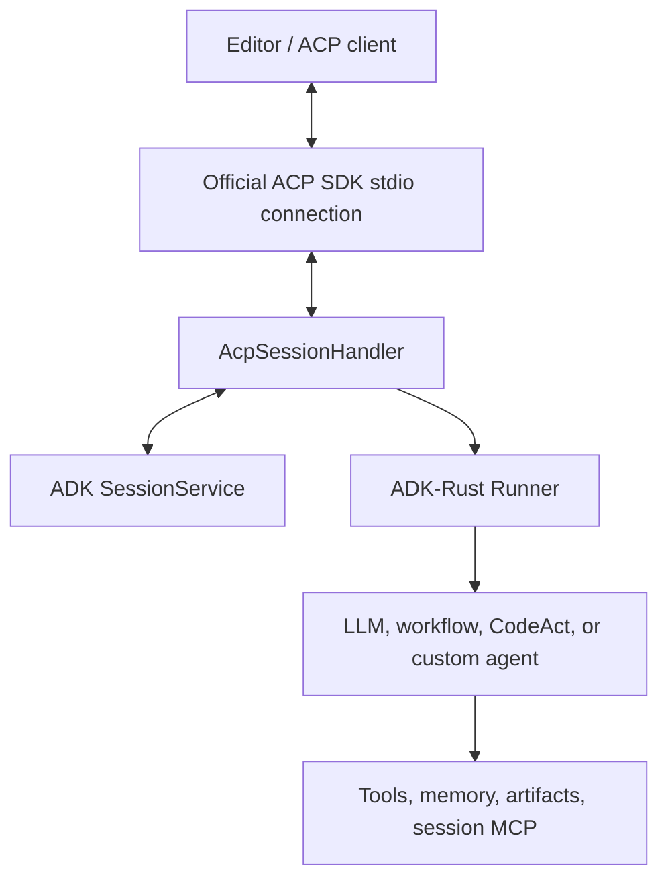

# Expose an ADK-Rust agent through ACP

Use the server direction when an editor or another ACP client should start your
ADK-Rust binary and use its agent inside a coding interface. Your Rust process
owns the agent, model, tools, workflows, sessions, memory, and operating policy.
The client sees only the capabilities and session lifecycle published through
ACP.

## Install the server feature

```toml
[dependencies]
adk-acp = { version = "3.0.0", features = ["server"] }
```

## Build and serve an agent

```rust,ignore
use adk_acp::server::{AcpServer, AcpServerConfigBuilder};
use adk_session::InMemorySessionService;
use std::sync::Arc;

let config = AcpServerConfigBuilder::new()
    .agent(Arc::new(repository_agent))
    .session_service(Arc::new(InMemorySessionService::new()))
    .agent_name("repository-guide")
    .agent_description("Explains and improves this Rust workspace")
    .max_sessions(16)
    .build()?;

let handle = AcpServer::run(config).await?;
handle.wait().await?;
```

`AcpServerHandle::shutdown()` stops new sessions and prompts at once. Prompts already
running keep the connection open and send their answers for up to `shutdown_timeout`;
those still running then are cancelled, and the connection closes once the answers
already given are written. `wait()` returns when the server has stopped.

The server uses the official SDK `Agent` builder and stdio transport. Protocol
traffic is the only data written to stdout; configure tracing and diagnostics
to use stderr.

| `AcpServerConfigBuilder` option | Default |
|---------------------------------|---------|
| `agent`, `session_service` | Required; `build()` fails without them |
| `agent_name` | `"adk-agent"`, reported in `initialize` with the `adk-acp` version |
| `agent_description` | Empty; reported as the implementation title when set |
| `user_id` | `"acp-client"`, the ADK user that owns every session |
| `max_sessions` | 16; `build()` fails on 0 |
| `shutdown_timeout` | 30 seconds; `build()` fails on 0. How long `AcpServerHandle::shutdown()` lets running prompts finish |
| `session_controls` | None; see [Session modes](#session-modes-configuration-options-and-fork) |
| `standing_permissions` | None; see [Always allow](#always-allow) |
| `transport` | `TransportConfig::Stdio`, the only transport |

## Runtime mapping



The handler validates an absolute `cwd`, reserves session capacity, creates or
resumes the ADK session, and runs the configured agent. Typed ADK events are
translated to ACP `session/update` notifications while the prompt is active.

## Implemented lifecycle

| ACP operation | ADK-Rust behavior |
|---|---|
| `initialize` | Negotiates protocol v1 and returns exact implementation and capability metadata |
| `session/new` | Validates workspace paths and creates one persisted ADK session |
| `session/prompt` | Converts supported content blocks (text, resource-link, embedded-resource, image, audio) and streams the Runner |
| `session/load` | Reactivates a persisted session (validating `cwd`) and replays its stored conversation as ordered `session/update` notifications before completing |
| `session/cancel` | Cancels the active Runner invocation and returns a cancelled stop reason |
| `$/cancel_request` | Cancels the matching JSON-RPC request without corrupting the session |
| `session/close` | Cancels active work and releases session-owned processes |
| `session/list` | Lists persisted ACP-visible sessions |
| `session/resume` | Reattaches to the original session and workspace |
| `session/fork` | Branches a persisted session into a new session id, copying its history and relevant state and leaving the source unchanged |
| `session/set_mode` | Validates and records a session mode declared by the agent's `SessionControls`, emitting a `CurrentModeUpdate` |
| `session/set_config_option` | Validates and records a configuration value declared by the agent's `SessionControls`, emitting a `ConfigOptionUpdate` |
| `session/delete` | Removes persisted history and releases active resources |

Only one prompt may run in a session at a time. Different sessions may run
concurrently up to `max_sessions`.

## Event mapping

- model text becomes `agent_message_chunk`;
- model thought content becomes `agent_thought_chunk`;
- embedded-resource content becomes an ACP embedded-resource `agent_message_chunk`;
- ADK function calls become ACP tool-start updates with an inferred tool `kind`;
- function responses become tool-completion updates enriched with the result
  content and any affected file locations, keyed to the originating tool call;
- events carrying usage metadata become `UsageUpdate` notifications (token
  counts, plus cost in USD when reported);
- agent-declared commands become an `AvailableCommandsUpdate` when a session
  becomes active, and a recorded session title becomes a `SessionInfoUpdate`;
- plan entries would become a `Plan` update — this mapping exists but stays
  dormant until an ADK plan primitive surfaces plan entries;
- cancellation becomes `StopReason::Cancelled`;
- normal completion becomes `StopReason::EndTurn`.

A shared content module owns the `ContentBlock` ↔ `adk_core::Part` mapping in
both directions. Embedded-resource prompt content maps to
`Part::EmbeddedResource`, preserving the source URI, optional MIME type, and
contents; text resources are preserved verbatim while binary resources are
base64-encoded on the wire and decoded to raw bytes internally. Image and audio
prompt content maps to `Part::InlineData`, preserving the MIME type, decoded
bytes, annotations, and an image's optional source URI. These fields remain in
session JSON and are restored by `session/load`. Because the prompt handler
accepts embedded-resource, image, and audio content, the server advertises the
`embedded_context`, `image`, and `audio` prompt capabilities. A prompt carrying
a content type the server has not advertised is rejected with a descriptive
error rather than partially handled.

## Load and history replay

`session/load` restores the visible history of a persisted session when a client
reconnects. The handler reactivates the session the same way `session/resume`
does — validating that the caller supplied the original `cwd` and returning a
session-not-found error for an unknown identifier — and then performs a replay
pass. It reads the persisted events through the session service and maps each
stored user, agent, thought, and tool event to its corresponding
`session/update` notification, in original chronological order, before the load
request completes. The server advertises the `load_session` capability so a
client knows it can reconnect and rebuild the conversation view.

## Session modes, configuration options, and fork

An agent opts into interactive session controls by supplying a `SessionControls`
provider through `AcpServerConfigBuilder::session_controls`. The provider declares
the available modes (a `SessionModeState`), configuration options (selects and
toggles), and ACP slash-commands. The server advertises exactly what the provider
declares — an agent without a provider advertises no modes and no options — and
surfaces them in the `session/new`, `session/load`, `session/resume`, and
`session/fork` responses.

`session/set_mode` validates the requested mode id against the advertised set,
records it, and emits a `CurrentModeUpdate`; an unknown id is rejected and the
current mode is left unchanged. `session/set_config_option` validates the value
against the option's declared choices, records it, and emits a
`ConfigOptionUpdate`; an unknown option or invalid value is rejected. Both
selections persist in ADK session state under `acp:mode` and `acp:config:<id>`,
so they survive load, resume, and fork.

`session/fork` branches a persisted session: it reads the source session, creates
a new session id, copies the stored events and relevant state (`cwd`, additional
directories, mode, and configuration) into it, and returns the new id. The source
session's persisted history is left byte-for-byte unchanged. A fork for an unknown
session identifier returns a session-not-found error. The server advertises the
`fork` session capability because the handler is registered.

On session activation the server also emits an `AvailableCommandsUpdate` for any
commands the provider declares (and none when it declares none), and a
`SessionInfoUpdate` carrying the session title when one is recorded under
`acp:title` (set via `set_session_title`). A `Plan` update mapping exists but
stays dormant until an ADK plan primitive surfaces plan entries.

## Client-supplied MCP servers

The client may include stdio MCP servers in `session/new`, `session/load`,
`session/resume`, or `session/fork`. Before starting a process the server
rejects the request when:

- more than 16 servers are attached;
- a server is not stdio (HTTP and SSE are not advertised);
- a name is empty or repeated, or an environment variable name is empty or
  repeated within one server; or
- a command is not an absolute path.

It then:

1. starts each child in the session workspace;
2. bounds each startup handshake to 15 seconds;
3. wraps the connection as an ADK `McpToolset` named `acp:{server name}`, so its
   tools' origin is `mcp:acp:{server name}`;
4. lists every server's tools and fails setup with `MalformedMessage` when two
   servers publish the same tool name, naming both servers and the tool;
5. injects the toolset into that Runner invocation;
6. cancels the MCP services on close, delete, failed startup, or server shutdown.

The tools of every attached server share the agent's namespace and are not
prefixed, so a shared name would otherwise fail every prompt turn. A server
whose tools cannot be listed at setup is left to the agent, which skips it for
the turn.

Invocation-scoped toolsets are currently resolved by `LlmAgent` and
`CodeActAgent`. Optional HTTP and SSE MCP transports are not advertised by the
server.

## Persistence decisions

`InMemorySessionService` is suitable for a local editor process and tests. Use
a durable service when sessions must survive process restarts. Resume validates
that the caller supplies the original `cwd`; a session cannot be silently
reattached to a different project.

## Tool approval boundary

The server bridges ADK tool confirmations to native ACP permission requests.
When the configured agent pauses on a `ToolConfirmationRequest` during a prompt
turn — surfaced on `event.actions.tool_confirmation` when an agent awaits human
approval of a tool call — the server sends a `session/request_permission`
request titled `Run tool '{name}'` with the tool's arguments, offering
**Allow once** (`acp-allow-once`) and **Deny** (`acp-reject-once`), awaits the
client's outcome, and resumes execution with the mapped decision.
`acp-allow-once` maps to allow; any other selection, and a cancellation, map to
deny, so a cancelled request never executes the tool.

Each outcome is recorded under the call's function-call identifier in
`RunConfig::tool_confirmation_decisions` and bound, through
`RunConfig::tool_confirmation_fingerprints`, to the call's fingerprint: the
acting agent, the tool's origin, the tool name, and the arguments. A reused call
ID on another agent's call, or on a tool another MCP server publishes, is
therefore not authorized. A confirmation without a call ID fails the prompt,
and one prompt resolves at most 64 rounds of confirmations. The resumed run
carries an empty user turn, and an `LlmAgent` dispatches the held call again
under its original ID before its next model call, so the decision applies
whether or not the model would issue the call again. A call the model issues
again under a new ID is a new call and produces a new permission request.

The nested `session/request_permission` is issued from the task that already
handles the outer `session/prompt`, spawned through `ConnectionTo::spawn`, so it
does not block the connection's dispatch loop and the outer prompt response
still completes. The in-memory interoperability tests cover this flow.

### Always allow

With `AcpServerConfigBuilder::standing_permissions`, an editor's answer can
outlive the call (spec 3.3 §10 A1). Before each permission request the server
asks the `StandingPermissions` implementation for an offer; a call it may
remember also gets two remembered options, worded with what they cover:

| Option id | Kind | Label | Effect |
|-----------|------|-------|--------|
| `acp-allow-once` | `allow_once` | Allow once | Runs this call |
| `acp-allow-always` | `allow_always` | Always allow for this command (bash: cargo test …, every session) — runs project scripts, so it allows whatever they do | Runs this call and remembers an allow rule |
| `acp-reject-once` | `reject_once` | Deny | Refuses this call |
| `acp-reject-always` | `reject_always` | Always deny for this command (bash: cargo test …, every session) | Refuses this call and remembers a deny rule |

A call the implementation may never remember is offered **Allow once** and
**Deny** only, and an "always" answer to a request that did not offer one is a
denial. When the rule cannot be stored, the answer applies to this call only
and the failure is logged.

Before each permission request the server also asks
`StandingPermissions::standing_decision` (default: none) whether its policy
already decides the call. A model turn can hold several calls; when the person
answers "Always allow" for the first, a later call of the same turn that the new
rule covers is decided by the rule and not asked about, so the person is never
shown a question whose answer the rule would override. An "always" answer that
differs from an answer the person gave an earlier call of the same turn — "Deny"
for `cargo test -p a`, then "Always allow" for `cargo test -p b` — is remembered
once that turn's calls have run, so `cargo test -p a` stays denied; until then
the turn's later calls are asked about. `HarnessAgent` answers it
by re-checking the call as its terminal prompt does: a rule answers only the
harness's own approval, so a call another policy layer also holds, or one the
harness holds without a waiver, is still asked about.

`adk-harness` implements `StandingPermissions` for `HarnessAgent` under its
`acp-server` feature: the answer becomes the narrowest standing rule the
harness suggests for the call (a command's two-token prefix, a site, or the
tool from its exact publisher), bound to the tool's declaration and the
session's person, and recorded as `harness.rule.created` with surface `acp`.
For a file write it is the folder rule, "for this folder (file writes: within
src/, this session)": every file write in the folder by `write_file`,
`edit_file` or an `apply_patch` that only adds or updates files, each bound to
its declaration ([Always allow for this folder](../harness/modes-and-approvals.md#always-allow-for-this-folder));
a delete or a move is never offered "always". The option says where the rule applies ("every session" for a rule over
the person's sessions) and, as at the terminal prompt, "Always allow" warns that a
rule over commands that run project scripts (`cargo test`, `npm test`, `make`)
allows whatever those scripts do (`StandingOffer::allow_warning`). Calls no standing rule may cover — a payment, leaving plan mode, a
memory write, a desktop action, a protected edit, an unsandboxed retry, a chained
shell command — are never offered "always", and neither is any call of a harness
built with `require_authenticated_identity`, whose standing rules apply only to
authenticated runs and so never to ACP runs. The next identical call is allowed
by the harness's policy without a permission request; a call the rule does not
cover, such as `cargo publish` after "Always allow" on `cargo test`, is still
asked about.

```toml
[dependencies]
adk-acp = { version = "3.0.0", features = ["server"] }
adk-harness = { version = "3.0.0", features = ["acp-server"] }
```

```rust,ignore
use adk_acp::server::{AcpServer, AcpServerConfigBuilder};
use adk_harness::HarnessAgent;
use adk_session::InMemorySessionService;
use std::sync::Arc;

let harness = Arc::new(
    HarnessAgent::builder("harness")
        .model(model)
        .workspace(adk_devtools::Workspace::new(".").allow_bash(true))
        .build()?,
);
let config = AcpServerConfigBuilder::new()
    .agent(harness.clone())
    .session_service(Arc::new(InMemorySessionService::new()))
    .agent_name("harness")
    .standing_permissions(harness)
    .build()?;
AcpServer::run(config).await?.wait().await?;
```

A standing rule answers only the harness's own approval: a call another policy
layer or the agent's confirmation policy holds is still asked about.

Server-owned tool authorization, read-only tools, RBAC, guardrails, and workflow
interrupts remain available where approval must happen entirely inside the
ADK-Rust process. Each prompt runs on a `Runner` the server builds with
only the decisions above: `AcpServerConfigBuilder` takes no `ToolPolicy` or run
budget, so in-process controls belong on the agent — tool confirmation,
callbacks, guardrails, and `adk-auth` wrappers.

## Deploy safely

- Start the binary with the intended project workspace.
- Treat `cwd` and additional roots as context, not OS isolation.
- Apply `adk-sandbox`, a container, or another process boundary for untrusted
  prompts and commands.
- Keep model and MCP credentials in a client secret store or process
  environment.
- Never write banners, debug objects, or logs to protocol stdout.
- Use a durable `SessionService` when resume must survive process restart.
- Set a finite session limit and close inactive sessions.

The runnable [`acp_server`](../../../examples/acp_server) crate includes a
Gemini-backed agent, workspace-bounded read tools, stderr tracing, and editor
process configuration.

## Next

- [Build an ACP client or host](client.md)
- [Testing and support matrix](testing.md)
