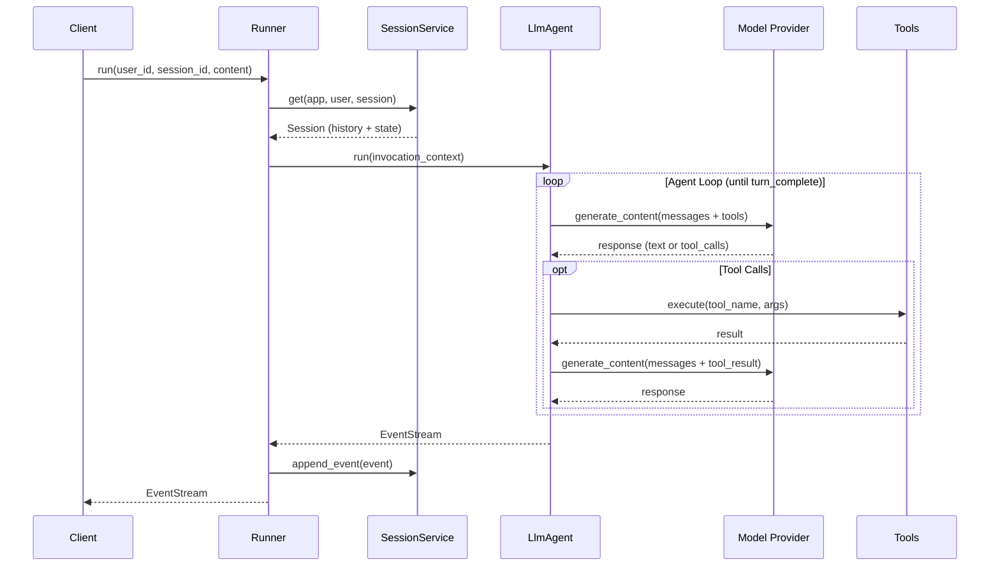

# Runner

The execution runtime from `adk-runner` that orchestrates agent execution.

## Overview

The `Runner` manages the lifecycle of agent execution:

- Loads the session and persists every event of the run
- Gives agents the configured memory and artifact services, scoped to the session
- Streams events to the caller
- Applies transfers between agents, and the run's identity, budget, spend, policy, and kill
  switch



## Installation

```toml
[dependencies]
adk-runner = "3.0.0"
```

## Building a Runner

`Runner::builder()` is a typestate builder: `app_name`, `agent`, and `session_service` are
required, and `build()` exists only once all three are set, so a missing one is a compile
error. Every other setting is optional.

```rust
use adk_artifact::InMemoryArtifactService;
use adk_runner::Runner;
use adk_session::InMemorySessionService;
use std::sync::Arc;

fn build(agent: Arc<dyn adk_core::Agent>) -> adk_core::Result<Runner> {
    Runner::builder()
        .app_name("my_app")
        .agent(agent)
        .session_service(Arc::new(InMemorySessionService::new()))
        // Optional settings: only set what you need.
        .artifact_service(Arc::new(InMemoryArtifactService::new()))
        .build()
}
```

`build_config()` returns the `RunnerConfig` instead, for `Runner::new`.

### Builder settings

| Builder method | Sets | Purpose |
|----------------|------|---------|
| `app_name`, `agent`, `session_service` | Required | The application, the root agent, and the session backend |
| `artifact_service` | `ArtifactService` | Artifact storage |
| `memory_service` | `Memory` | Long-term memory |
| `plugin_manager` | `PluginManager` | Runner plugins (see [Plugin hooks](#plugin-hooks)) |
| `run_config` | `RunConfig` | Default execution options for every run |
| `budget` | `RunBudget` | Per-run limits (see [Run Budgets](#run-budgets)) |
| `compaction_config`, `intra_compaction_config`, `intra_compaction_summarizer`, `context_compaction` | Compaction | Keep the model context bounded (see [Context Compaction](#context-compaction)) |
| `context_cache_config`, `cache_capable` | Gemini explicit caching | Experimental; see [Prompt caching](#prompt-caching) |
| `request_context` | `RequestContext` | The authenticated caller, from auth middleware |
| `cancellation_token` | `CancellationToken` | Cooperative cancellation |
| `tool_policy` | `ToolPolicy` | Allow, deny, or require approval per tool call; see [Tool Authorization](../security/tool-authorization.md#tool-policy) |
| `governance` | `GovernanceControl` | The kill switch; the runner creates its own when unset, reachable through `Runner::governance()` |
| `action_ledger` | `ActionLedger` | Records non-idempotent tool calls so a resumed run never repeats one |
| `approval_store` | `ApprovalStore` | Decisions for held tool calls |
| `spend_ledger` | `SpendLedger` | Spend caps across runs (see [Spend ledger](#spend-ledger)) |
| `durable_run_store` | `DurableRunStore` | Lets `interrupt` cancel the session's durable runs; see [Durable Runtime](durable-runtime.md) |
| `audit_log`, `audit_failure_mode` | `AuditRecorder` | The runtime audit trail; `AuditFailureMode::Block` (default) refuses an action that cannot be recorded |
| `agent_principal`, `identity_source`, `subject_delegation` | Agent identity | See [Agent identity](#agent-identity) |

### Plugin hooks

The runner runs a `PluginManager`'s callbacks at two levels:

| Callbacks | Run by | When |
|-----------|--------|------|
| `before_run`, `after_run`, `on_user_message`, `on_event` | Runner | Once per run, and once per event |
| `before_agent`, `after_agent`, `before_model`, `after_model`, `before_tool`, `after_tool`, `on_tool_error` | Each `LlmAgent` and `CodeActAgent` in the run | Around every agent, model call, and tool call |

The runner adds the manager to `RunConfig::invocation_hooks` at the start of each run, so
transfer targets and agents behind an `AgentTool` run the same callbacks. An agent runs
them ahead of its own callbacks of the same kind; a plugin callback that returns a value
short-circuits the agent's callbacks of that kind. `LlmAgent` also reports a failed model
call or response stream to `on_model_error`, and a response the plugin returns answers the
turn.

| Run callback | Guarantee |
|--------------|-----------|
| `on_event` | Sees every event the run yields: agent events, a `before_run` early exit, the answers a cancelled run gives its calls in flight, and a budget stop event |
| `after_run` | Runs once for every run whose `before_run` ran, however it ends: an answer, an error, a cancellation, or a consumer that drops the stream |

A consumer that drops the stream mid-run, such as a client that disconnects, does not leave
the run half-finished: the runner answers each tool call still in flight outcome-unknown,
persists and audits the answers, then runs `after_run`, on the current Tokio runtime. A
durable run's attempt (`RunConfig::durable_run_id`) is the exception: its worker drops it when
the lease is lost, and the dropped attempt writes nothing more — the worker that recovers the
run answers the calls from the action ledger and runs `after_run` when the run ends.

### Closing a Runner

`Runner::close` releases what the runner's agents and plugins hold: it calls `Agent::close`
on the root agent, which closes each agent's toolsets (`Toolset::close`) and its sub-agents,
then runs every plugin's close hook. Call it once the application stops running the agent.
An `McpToolset` ends its MCP session and waits for a stdio server process to exit; see
[Close the connection](../mcp/client.md#close-the-connection).

```rust
use adk_runner::Runner;
use adk_session::InMemorySessionService;
use std::sync::Arc;

async fn serve_then_close(agent: Arc<dyn adk_core::Agent>) -> adk_core::Result<()> {
    let runner = Runner::builder()
        .app_name("my_app")
        .agent(agent)
        .session_service(Arc::new(InMemorySessionService::new()))
        .build()?;
    // ... serve requests ...
    runner.close().await;
    Ok(())
}
```

A runner plugin that refuses one tool; see [Plugins](plugins.md) for every callback.

```rust
use adk_core::{CallbackContext, Content};
use adk_plugin::{PluginBuilder, PluginManager};
use adk_runner::Runner;
use adk_session::InMemorySessionService;
use std::sync::Arc;

fn build(agent: Arc<dyn adk_core::Agent>) -> adk_core::Result<Runner> {
    let deny_deletes = PluginBuilder::new("deny-deletes")
        .before_tool(Box::new(|ctx: Arc<dyn CallbackContext>| {
            Box::pin(async move {
                if ctx.tool_name() == Some("delete_file") {
                    return Ok(Some(Content::new("tool").with_text("delete_file is disabled")));
                }
                Ok(None)
            })
        }))
        .build();

    Runner::builder()
        .app_name("my_app")
        .agent(agent)
        .session_service(Arc::new(InMemorySessionService::new()))
        .plugin_manager(Arc::new(PluginManager::new(vec![deny_deletes])))
        .build()
}
```

### Prompt caching

**Caching is a provider-level concern and needs no Runner configuration.** Each
provider integration handles it where the request is assembled:

| Provider | Mechanism | Default |
|----------|-----------|---------|
| Anthropic / Bedrock | `cache_control` breakpoints | **on** (`AnthropicConfig::prompt_caching`, opt out with `with_prompt_caching(false)`) |
| OpenAI | server-side prompt caching, `PromptCacheRetention` for retention | automatic |
| Gemini | implicit caching — a shared prefix earns a discount with no code change | automatic |

Cache hits are observable without any extra wiring: providers report cached prompt tokens in
`UsageMetadata::cache_read_input_token_count`.

> **Note:** `context_cache_config` and `cache_capable` are experimental; leave them unset.
> They drive Gemini's explicit `cachedContents` API from the Runner. That API requires the
> cache to replace `system_instruction`, `tools`, and `tool_config`, and the Runner selects a
> cache before the agent resolves its tools, so these settings do not produce cache hits.

## Running Agents

`run` takes typed identifiers and the user's content, and returns the run's event stream:

```rust
use adk_core::{Content, SessionId, UserId};
use adk_runner::Runner;
use futures::StreamExt;

async fn ask(runner: &Runner) -> adk_core::Result<()> {
    let user_content = Content::new("user").with_text("Hello!");
    let mut stream =
        runner.run(UserId::new("user-123")?, SessionId::new("session-456")?, user_content).await?;

    while let Some(event) = stream.next().await {
        let event = event?;
        // Streamed deltas arrive as partial events; the final event carries the whole answer.
        if event.llm_response.partial {
            continue;
        }
        if let Some(content) = event.content() {
            for part in &content.parts {
                if let Some(text) = part.text() {
                    print!("{text}");
                }
            }
        }
    }
    Ok(())
}
```

The session must exist: a run for an unknown session fails with `session.not_found`. Create
it first with `SessionService::create`.

### String Convenience Method

For simple call sites, `run_str()` accepts plain `&str` arguments and handles the newtype conversion internally:

```rust
use adk_core::Content;
use adk_runner::Runner;

async fn ask(runner: &Runner) -> adk_core::Result<()> {
    let _stream =
        runner.run_str("user-123", "session-456", Content::new("user").with_text("Hello!")).await?;
    Ok(())
}
```

If a string fails validation (empty, contains null bytes, or exceeds 512 bytes), `run_str()`
returns an error before the agent starts. `run_with_config` takes a `RunConfig` for one run.

## Interruption and Run Isolation

A run is registered as soon as `run()` returns its stream, and deregistered when
that stream is dropped — including when it is dropped without ever being polled.

| Method | Scope |
|--------|-------|
| `interrupt(session_id)` | Cancels **every** in-flight run for that session ID, across apps and users |
| `interrupt_identity(app_name, user_id, session_id)` | Cancels runs for one exact identity |
| `steer(identity, content)` | Sends a message to the most recently started run of one exact identity; see [Steering a Running Agent](#steering-a-running-agent) |
| `active_runs()` | The identity of every in-flight run; a repeated identity means concurrent runs |
| `active_session_ids()` | Deduplicated session IDs of in-flight runs |

```rust
use adk_runner::Runner;

fn cancel(runner: &Runner) -> bool {
    // Cancel one tenant's run without touching another that shares the session ID.
    runner.interrupt_identity("my-app", "user-1", "session-1")
}
```

A session ID is only unique within an app and user, so `interrupt(session_id)` is
the broad form and `interrupt_identity` the precise one. Prefer
`interrupt_identity` when a single `Runner` serves more than one app or user.

Runs are tracked by a unique run ID rather than by session ID, so two runs for the
same identity are tracked separately and each deregisters only itself.

A cancelled run answers each tool call still in flight with an
[outcome-unknown response](../tools/tool-effects.md#unknown-outcomes) carrying the
`outcome_unknown` [tool result status](../tools/function-tools.md#tool-result-status), and
`Runner::recover_unanswered_calls` answers the calls a stopped process left from their
action-ledger records with the status each record shows.

### Persistence Is Identity-Bound

Every event the Runner persists — user turns, model responses, transfer events,
plugin events, and compaction events — is written through
`SessionService::append_event_for_identity` with the full
`(app_name, user_id, session_id)` triple. A `SessionService` whose natural key is
composite can therefore bind each event to its tenant, and can reject or ignore
the raw-session-ID `append_event` path entirely.

## Steering a Running Agent

`steer(identity, content)` sends a user message to the run in flight for one exact identity,
which takes it at its next safe point instead of after the turn ends. Each run owns its queue,
so a message never reaches another user's or another session's run.

1. **Validation.** The message has role `user` and carries only text and attachments (inline
   data, file data, embedded resources), with some non-blank text or an attachment. A `system`
   or `model` message, a function call or response, and a blank message are refused.
2. **Screening.** The plugins' `on_user_message` callbacks, then every agent's input guardrails
   (`Agent::screen_user_input`), screen it exactly as they screen the run's own message. A block
   returns the guardrail's error to the caller; a transform is what gets queued.
3. **Queueing.** The screened message joins the queue of the most recently started run of the
   identity, and `steer` returns a `SteerReceipt` with its `steer_id()` and `sequence()`.
4. **Delivery.** At a safe point — after a tool step's results are in the agent's history and
   before its next model request — `LlmAgent` and `CodeActAgent` yield each queued message as a
   user-authored event. The runner saves it like any other event, so the client stream, plugins'
   `on_event`, the session, later agents of the run and later turns all see it. See
   [LlmAgent: Steering a Running Agent](../agents/llm-agent.md#steering-a-running-agent) for
   where the agent takes it.

`SteerReceipt::outcome()` resolves once the message has a fate:

| Outcome | When | What to do |
|---------|------|------------|
| `SteerOutcome::Delivered { event_id }` | The runner saved the message's event as `event_id` | Nothing; the agent's next model request carries it |
| `SteerOutcome::Returned(content)` | The run ended before a safe point took it: it answered directly, failed, was frozen or interrupted, reached `max_iterations`, held a call for approval, or its stream was dropped | Send `content`, the message as sent, as the session's next message; the runner screens it then |

No message is dropped: one taken by an agent is saved before the next model call, and every
other is returned. A receipt whose run was dropped without closing its queue resolves to an
`agent.steer.outcome_lost` error instead of waiting forever.

| Error code | Category | When |
|------------|----------|------|
| `agent.steer.invalid_message` | `InvalidInput` | The message is not a user message with text or attachments |
| `agent.steer.no_active_run` | `NotFound` | No run is in flight for the identity, or it ended before the message was queued |
| `agent.steer.run_not_ready` | `Unavailable` | Plugins are configured and the run has not built its context yet, or has finished |
| `guardrail.input_blocked` | `InvalidInput` | An input guardrail blocks the message |

The saved event has `author` `"user"`, the screened content, `EventActions::input_screened` when
a guardrail screened it, and `EventActions::steering`:

```json
{ "steering": { "steerId": "steer-5c0e…", "sequence": 1, "sender": "alice" } }
```

`sequence` counts the run's steering messages from 1, and `sender` is the identity's user. The
event joins the run it reached: an agent never stands the run's message in for it, and
[context compaction](#context-compaction) does not count it as an invocation.

```rust
use adk_core::{AdkIdentity, AppName, Content, SessionId, SteerOutcome, UserId};
use adk_runner::Runner;

async fn redirect(runner: &Runner) -> adk_core::Result<Option<Content>> {
    let identity = AdkIdentity::new(
        AppName::try_from("my-app")?,
        UserId::try_from("user-1")?,
        SessionId::try_from("session-1")?,
    );
    let receipt = runner
        .steer(&identity, Content::new("user").with_text("use the staging database instead"))
        .await?;
    Ok(match receipt.outcome().await? {
        SteerOutcome::Delivered { .. } => None,
        // The caller sends it as the session's next message.
        SteerOutcome::Returned(message) => Some(message),
    })
}
```

## Execution Flow

```
┌─────────────────────────────────────────────────────────────┐
│                     Runner.run()                            │
└─────────────────────────────────────────────────────────────┘
                              │
                              ▼
┌─────────────────────────────────────────────────────────────┐
│                  1. Session Retrieval                       │
│                                                             │
│   SessionService.get(app_name, user_id, session_id)        │
│   → Fails with session.not_found when it does not exist     │
└─────────────────────────────────────────────────────────────┘
                              │
                              ▼
┌─────────────────────────────────────────────────────────────┐
│                  2. Agent Selection                         │
│                                                             │
│   Check session state for active agent                      │
│   → Use root agent or transferred agent                     │
└─────────────────────────────────────────────────────────────┘
                              │
                              ▼
┌─────────────────────────────────────────────────────────────┐
│                3. Context Creation                          │
│                                                             │
│   InvocationContext with:                                   │
│   - Session (mutable)                                       │
│   - Artifacts (scoped to session)                          │
│   - Memory (if configured)                                  │
│   - Run config                                              │
└─────────────────────────────────────────────────────────────┘
                              │
                              ▼
┌─────────────────────────────────────────────────────────────┐
│                  4. Agent Execution                         │
│                                                             │
│   agent.run(ctx) → EventStream                             │
└─────────────────────────────────────────────────────────────┘
                              │
                              ▼
┌─────────────────────────────────────────────────────────────┐
│                 5. Event Processing                         │
│                                                             │
│   For each event:                                           │
│   - Update session state                                    │
│   - Handle transfers                                        │
│   - Forward to caller                                       │
└─────────────────────────────────────────────────────────────┘
                              │
                              ▼
┌─────────────────────────────────────────────────────────────┐
│                  6. Session Save                            │
│                                                             │
│   SessionService.append_event(session, events)             │
└─────────────────────────────────────────────────────────────┘
```

## InvocationContext and RunConfig

Agents receive an `InvocationContext`; see [Context Traits](core.md#context-traits).
`RunConfig` holds one run's execution options. Commonly set fields:

| Field | Purpose |
|-------|---------|
| `streaming_mode` | `StreamingMode::SSE` (default), `None`, or `Bidi` (realtime) |
| `tool_policy`, `governance`, `tool_confirmation_handler`, `tool_confirmation_decisions`, `tool_approvals`, `approval_store`, `approval_service`, `tool_confirmation_timeout`, `deny_on_confirmation_timeout` | The governed tool path; see [Tool Authorization](../security/tool-authorization.md) |
| `budget`, `budget_tracker` | Run limits |
| `spend_ledger`, `llm_spend_estimate` | Spend caps |
| `action_ledger` | Non-idempotent call records |
| `invocation_hooks` | Run-wide hooks; the runner adds its `PluginManager` here |
| `audit` | The run's audit trail |
| `acting` | The acting agents' principals and the subject (`ActingConfig`) |
| `record_payloads`, `trace_payload_max_bytes` | Whether logs and traces may carry request content |
| `history_max_events` | A window over the session history sent to the model |

`RunConfig::builder()` builds one.

### Spend ledger

`RunConfig::spend_ledger` caps what a run spends. When it is set, the runner reserves an
estimate in the ledger before each model call and commits the call's reported
`UsageMetadata::cost` once the final chunk arrives; a reservation the ledger refuses fails
the call with `spend.limit_exceeded`. `Runner::with_llm_spend_estimate` sizes the hold. See
[Spend Ledger](../security/spend-ledger.md).

### ToolExecutionStrategy

Controls how multiple tool calls from a single LLM response are dispatched:

| Strategy | Behavior |
|----------|----------|
| `Sequential` (default) | Execute tools one at a time in LLM-returned order |
| `Parallel` | Execute all tools concurrently; the caller owns safety |
| `Auto` | In LLM order; overlap only adjacent safe read-only calls, every other call runs alone in its place |

Set per-agent via `LlmAgentBuilder`:

```rust
use adk_agent::{LlmAgent, LlmAgentBuilder};
use adk_core::{Llm, Tool, ToolExecutionStrategy};
use adk_tool::FunctionTool;
use std::sync::Arc;

fn build(model: Arc<dyn Llm>, search_tool: FunctionTool, save_tool: Arc<dyn Tool>) -> adk_core::Result<LlmAgent> {
    LlmAgentBuilder::new("fast_agent")
        .model(model)
        .tool_execution_strategy(ToolExecutionStrategy::Auto)
        .tool(Arc::new(search_tool.with_read_only(true).with_concurrency_safe(true)))
        .tool(save_tool) // runs alone, in the model's order
        .build()
}
```

In `Auto` mode, the dispatch loop queries both `is_read_only()` and `is_concurrency_safe()`. Adjacent calls whose selected tools return `true` for both methods run concurrently; every other call runs alone, in the LLM-returned order. `Parallel` bypasses these metadata checks as an explicit caller override. Results are always reassembled in the original LLM-returned order regardless of strategy. A tool that fails produces a JSON error response without aborting the batch; an error from the tool confirmation handler ends the run.

## Run Budgets

A `RunBudget` limits model calls, total tokens, cost, wall time and tool calls
for one run. The runner creates a fresh `BudgetTracker` for every run and stores
it in `RunConfig::budget_tracker`; transfer targets, workflow sub-agents and
agents behind an `AgentTool` inherit the run config, so they all count against
the same `Arc`.

```rust
use std::sync::Arc;
use std::time::Duration;

use adk_core::RunBudget;
use adk_runner::Runner;
use adk_session::InMemorySessionService;

fn build(agent: Arc<dyn adk_core::Agent>) -> adk_core::Result<Runner> {
    Runner::builder()
        .app_name("my_app")
        .agent(agent)
        .session_service(Arc::new(InMemorySessionService::new()))
        .budget(
            RunBudget::new()
                .max_cost_usd(50.0)
                .max_model_calls(200)
                .max_tool_calls(100)
                .max_wall_time(Duration::from_secs(600)),
        )
        .build()
}
```

| Checkpoint | Limits checked |
|------------|----------------|
| Before every model call, compaction summaries and MCP sampling included | model calls, total tokens, cost, wall time; tool calls already over the limit |
| Before every model request | built-in tools are withheld when no tool calls are left |
| Before every tool dispatch | tool calls, total tokens, cost, wall time |
| After every event | usage from agents that call models directly |

- **Reached, not exceeded**: a limit blocks new work once usage equals it. A
  single model call can take usage past a limit; no further call starts after it.
- **Tool batches**: the calls of one model turn are reserved together. A batch
  that does not fit is answered with `not run` function responses, so the
  session history keeps one response per call.
- **Built-in tools count as tool calls**: each use a provider reports in
  `UsageMetadata::builtin_tool_uses` (web search, file search, code execution, …)
  is added when the model call is metered. The provider runs them mid-response,
  so a turn can take the count past `max_tool_calls`; the next model call is then
  refused with `budget.tool_calls`. Once no tool calls are left, built-in tools
  are withheld from the next request — see
  [Built-in Tools](../security/tool-authorization.md#built-in-tools).
- **Partial chunks never count**: each model call is metered once, from its
  first non-partial response carrying usage.
- **Cost comes from the provider response**: `adk-model` fills
  `UsageMetadata::cost` from `adk_model::pricing::PricingCatalog`. With a cost
  cap set, a response whose cost is unknown stops the run with
  `cost unknown for model '…'`; `RunBudget::allow_unpriced_models()` counts such
  responses as zero cost instead.
- **Media calls count their cost, not a model call**: image generation,
  transcription and speech synthesis made inside a tool are metered in units
  (`BudgetTracker::units`) and count against the cost and token limits. A media
  call with no known price is refused before it is sent under a cost cap — see
  [Calls billed in units](../security/spend-ledger.md#calls-billed-in-units).

A run that reaches a limit yields a final event explaining why — persisted with
the session, with `llm_response.error_code` set to the `budget.*` code and the
limit named under the `adk.budget.limit` event metadata key — followed by an
`AdkError` with category `ResourceExhausted`.

Compaction summaries (post-run, intra-invocation and token-limit compaction),
`LlmConditionalAgent` routing and MCP sampling requests made during a tool call
are model calls too: they go through `adk_core::ModelCallScope`, which checks
the budget before the call is sent and counts its tokens and cost, and reserves
in the [spend ledger](../security/spend-ledger.md#what-is-metered) when the run
has one. A refused compaction is skipped and the run continues to the next
model call, which the budget then stops.

Agents that call models outside `LlmAgent`, `CodeActAgent` and
`LlmConditionalAgent` count against the budget through
`adk_core::generate_with_budget`, or against the budget and the spend ledger
through `ModelCallScope::for_run`. Pass a `BudgetTracker` in
`RunConfig::budget_tracker` to `run_with_config` to share one budget across
several runs.

## Agent Transfers

The Runner handles multi-agent transfers. Besides the model's `transfer_to_agent` call, a tool
can request one through its event actions:

```rust
use adk_core::{Result, ToolContext};
use serde_json::{Value, json};
use std::sync::Arc;

async fn escalate(ctx: Arc<dyn ToolContext>, _args: Value) -> Result<Value> {
    let mut actions = ctx.actions();
    actions.transfer_to_agent = Some("specialist_agent".to_string());
    ctx.set_actions(actions);
    Ok(json!({ "escalated": true }))
}
```

The Runner will:
1. Detect the transfer request in the event
2. Check the target against the agents the requesting agent may transfer to
3. Find the target agent in the agent tree
4. Continue execution with the new agent

Every transfer is checked, whether the model called `transfer_to_agent` or a tool set
`transfer_to_agent` on its actions. An agent may transfer to its sub-agents, to its parent
unless it sets `disallow_transfer_to_parent`, and to its parent's other sub-agents unless it
sets `disallow_transfer_to_peers` (`Agent::allows_transfer_to_parent` and
`Agent::allows_transfer_to_peers`). `Runner::allowed_transfer_targets` returns that list. A
refused transfer is logged and control stays with the requesting agent; a composite root
with `strict_transfer_policy` fails the run with `agent.transfer.target_forbidden` instead.

## Context Compaction

For long-running sessions, enable automatic context compaction to keep the LLM context window bounded:

```rust
use adk_agent::LlmEventSummarizer;
use adk_core::{EventsCompactionConfig, Llm};
use adk_runner::Runner;
use adk_session::InMemorySessionService;
use std::sync::Arc;

fn build(agent: Arc<dyn adk_core::Agent>, model: Arc<dyn Llm>) -> adk_core::Result<Runner> {
    Runner::builder()
        .app_name("my_app")
        .agent(agent)
        .session_service(Arc::new(InMemorySessionService::new()))
        .compaction_config(EventsCompactionConfig {
            compaction_interval: 3, // compact every 3 invocations
            overlap_size: 1,        // keep 1 event of overlap for continuity
            summarizer: Arc::new(LlmEventSummarizer::new(model)),
        })
        .build()
}
```

When compaction triggers, older events are replaced by a summary event, and
`conversation_history()` uses the summary instead of the original events. Compaction never
covers a tool call still held for confirmation, and never cuts between a call and its
response.

See [Context Compaction](../sessions/context-compaction.md) for full documentation.

## Agent identity

Every run has an acting agent (see [Agent identity](core.md#agent-identity)):

```rust
use adk_core::principal::{AgentId, AgentPrincipal};
use adk_runner::Runner;
use adk_session::InMemorySessionService;
use std::sync::Arc;

fn build(agent: Arc<dyn adk_core::Agent>) -> Result<Runner, Box<dyn std::error::Error>> {
    let principal = AgentPrincipal::new(AgentId::new("spiffe://example.org/agent/billing")?)
        .with_tenant("acme");
    Ok(Runner::builder()
        .app_name("billing")
        .agent(agent)
        .session_service(Arc::new(InMemorySessionService::new()))
        .agent_principal(principal) // the root agent's identity
        .build()?)
}
```

| Builder method | Effect |
|----------------|--------|
| `agent_principal(principal)` | The root agent acts as `principal` |
| `identity_source(source)` | An `IdentitySource` resolves principals: `current` for the root agent, `principal_for(name)` for any agent |
| `subject_delegation(policy)` | A `SubjectDelegationPolicy` that allows a run to act for a subject other than the session's user; without it such a run fails with `identity.subject_mismatch` |

`Runner::default_principal(agent_name).await` returns the principal an agent acts as when no
`RunConfig` names one. See [Agent Identity](../security/agent-identity.md).

## Kill switch

```rust
use adk_runner::Runner;

fn freeze(runner: &Runner) {
    // New runs fail at their start, and running ones stop before their next model or tool call.
    runner.governance().freeze("incident 4521");
}
```

A frozen run fails with `governance.frozen`. Pass one `GovernanceControl` to several runners
with `governance(...)` to freeze them together, or a mirrored one to freeze every replica; see
[Replicated kill switch](durable-runtime.md#replicated-kill-switch).

## Recovering unanswered calls

`Runner::recover_unanswered_calls` answers every tool call a session left without a response —
after a crash, for example — from the action ledger: `already_succeeded`, `already_failed`,
or `outcome_unknown`. The durable worker calls it when it resumes a run; see
[Crash resume](durable-runtime.md#crash-resume).

## Integration with Launcher

`Launcher` builds a `Runner` with an in-memory session service and runs a console loop:

```rust
use adk_runner::Launcher;
use std::sync::Arc;

async fn console(agent: Arc<dyn adk_core::Agent>) -> adk_core::Result<()> {
    Launcher::new(agent).app_name("my_app").run().await
}
```

---

**Previous**: [← Core Types](core.md) | **Next**: [Launcher →](../deployment/launcher.md)
