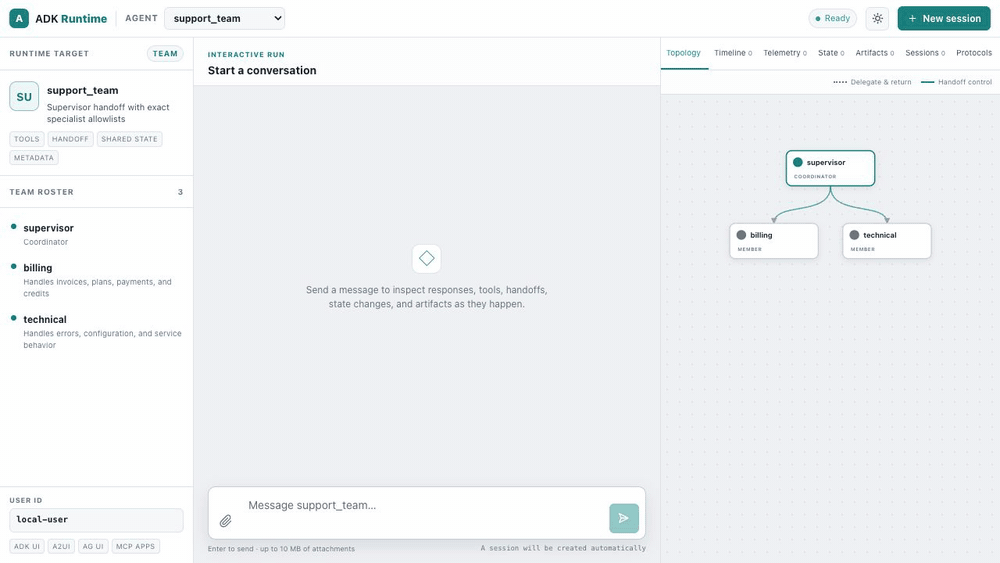

# Server API

The ADK-Rust server (`adk-server`) exposes an agent over HTTP: a REST API for running agents,
managing sessions, and reading artifacts, Server-Sent Events (SSE) streaming, an embedded web UI,
and optional A2A routes.

## Overview

The server is built on Axum and provides:

- **REST API**: HTTP endpoints for agent execution and session management
- **Server-Sent Events (SSE)**: Real-time streaming of agent responses
- **Web UI**: Interactive browser-based interface, embedded in the crate
- **Host and origin checks**: loopback names and IP addresses only, and no cross-origin
  browser access, until [configured](#host-origin-and-bind-defaults)
- **Kill switch**: optional admin endpoints that freeze every run the server starts

## Starting the Server

There are three ways to serve an agent.

| Approach | Needs | Use it when |
|----------|-------|-------------|
| `Launcher` in `serve` mode | the `adk-rust` `cli` feature | One agent, default services, a CLI that switches between console and server |
| `ServerConfig` + `create_app` or `ServerBuilder` | the `adk-rust` `server` feature | You own the listener, the services, and extra routes |
| `cargo adk new <name> --template api` | `cargo-adk` | A new project that starts from the `create_app` pattern |

### Launcher

The `Launcher` with server mode is `adk_cli::Launcher`, which `adk_rust::Launcher` names when the
`cli` feature is enabled. Without `cli`, `adk_rust::Launcher` is the console-only launcher from
`adk-runner`; see [Launcher](launcher.md).

```toml
[dependencies]
adk-rust = { version = "3.0.0", features = ["cli"] }
tokio = { version = "1", features = ["full"] }
```

```rust
use adk_rust::prelude::*;
use adk_rust::Launcher;
use std::sync::Arc;

#[tokio::main]
async fn main() -> Result<()> {
    let api_key = std::env::var("GOOGLE_API_KEY")
        .map_err(|_| AdkError::config("GOOGLE_API_KEY is not set"))?;
    let model = Arc::new(GeminiModel::new(&api_key, "gemini-3.7-flash")?);

    let agent = LlmAgentBuilder::new("my_agent")
        .description("A helpful assistant")
        .instruction("You are a helpful assistant.")
        .model(model)
        .build()?;

    Launcher::new(Arc::new(agent)).run().await
}
```

```bash
cargo run -- serve              # http://127.0.0.1:8080
cargo run -- serve --port 3000
```

### ServerConfig and create_app

`ServerConfig` takes an agent loader and a session service; `create_app` builds the Axum router.
The `api` template generates this pattern:

```rust
use adk_rust::prelude::*;
use adk_rust::server::{ServerConfig, create_app};
use adk_rust::session::InMemorySessionService;
use std::sync::Arc;

#[tokio::main]
async fn main() -> std::result::Result<(), Box<dyn std::error::Error>> {
    let api_key = std::env::var("GOOGLE_API_KEY")?;
    let model = GeminiModel::new(&api_key, "gemini-3.7-flash")?;
    let agent: Arc<dyn Agent> = Arc::new(
        LlmAgentBuilder::new("my_agent")
            .description("A helpful assistant")
            .instruction("You are a helpful assistant.")
            .model(Arc::new(model))
            .build()?,
    );

    let config = ServerConfig::new(
        Arc::new(adk_rust::SingleAgentLoader::new(agent)),
        Arc::new(InMemorySessionService::new()),
    );
    let app = create_app(config);

    let listener = tokio::net::TcpListener::bind("127.0.0.1:8080").await?;
    axum::serve(listener, app).await?;
    Ok(())
}
```

`ServerConfig` also passes runner-level settings through to every run the server starts:

```rust
let config = ServerConfig::new(agent_loader, session_service)
    .with_artifact_service(artifact_service)
    .with_memory_service(memory_service)
    .with_compaction(compaction_config)
    .with_context_cache(context_cache_config, cache_capable_model);
```

`ServerBuilder::new(config)` builds the same router and also mounts A2A routes (`with_a2a`),
custom routes (`add_api_routes`, `add_root_routes`), the [kill switch](#kill-switch) endpoints,
and a shutdown endpoint. `create_app(config)` is `ServerBuilder::new(config).build()`.

### Scaffold

```bash
cargo adk new my-api --template api
cd my-api
cp .env.example .env    # add GOOGLE_API_KEY
cargo run
```

The generated server listens on `127.0.0.1:$PORT` (default `8080`) and on `$BIND_HOST` when set.

## REST API Endpoints

Every route below is under `/api`. When the caller is authenticated, a session or artifact route
whose path names another user's `user_id` answers `403`, and the run routes run as the
authenticated user; see [Authentication](#authentication).

### Health Check

```
GET /api/health
```

**Response:** `200`, or `503` when the session service, or a configured memory or artifact
service, is unhealthy:

```json
{
  "status": "healthy",
  "components": {
    "session": { "status": "healthy" },
    "memory": { "status": "not_configured" },
    "artifact": { "status": "healthy" }
  }
}
```

### Run Agent with Streaming

Execute an agent and stream its events using Server-Sent Events:

```
POST /api/run_sse
```

**Request Body:**
```json
{
  "appName": "my_agent",
  "userId": "user123",
  "sessionId": "session456",
  "newMessage": {
    "role": "user",
    "parts": [
      {
        "text": "What is the capital of France?"
      }
    ]
  },
  "streaming": true
}
```

| Field | Meaning |
|-------|---------|
| `appName`, `userId`, `sessionId` | The agent and session to run. A session that does not exist is created. |
| `newMessage` | The user message: `role` and `parts`, each `{"text"}` or `{"inlineData": {"mimeType", "data"}}` with base64 `data`. |
| `streaming` | Default `true`: the model streams partial events. `false` produces one event per model response. |
| `stateDelta` | Optional object merged into the session state before the run; the initial state of a new session. |

**Response:** `Content-Type: text/event-stream`, one `data:` line per event:

```json
{
  "id": "inv-95a1bb47-fabd-442b-b41a-caf362950da2_llm_1792414022844863000",
  "timestamp": "2026-10-19T12:47:04.218345Z",
  "invocation_id": "inv-95a1bb47-fabd-442b-b41a-caf362950da2",
  "branch": "",
  "author": "my_agent",
  "content": {
    "role": "model",
    "parts": [{ "text": "The capital of France is Paris." }]
  },
  "partial": false,
  "turn_complete": true,
  "finish_reason": "Stop",
  "model": "gemini-3.7-flash",
  "provider": "gemini",
  "usage_metadata": {
    "prompt_token_count": 56,
    "candidates_token_count": 10,
    "total_token_count": 66
  },
  "provider_metadata": { "content_complete": true },
  "error_code": null,
  "error_message": null,
  "actions": {
    "state_delta": {},
    "artifact_delta": {},
    "skip_summarization": false,
    "transfer_to_agent": null,
    "escalate": false
  },
  "long_running_tool_ids": []
}
```

A tool call arrives as a part `{"name", "args", "id"}` in a model event, and its result as a part
`{"functionResponse": {"name", "response"}, "id"}` in an event whose content role is `function`. A run that fails after the
stream starts ends with an event that carries `error_code` and `error_message`.

> **Note:** A streamed response arrives as partial events (`"partial": true`) followed by a
> terminal event with the same `id`. When that terminal event carries
> `"provider_metadata": {"content_complete": true}`, its `content` is the complete response,
> including text the partial events already delivered. Replace the content rendered for that
> `id` instead of appending it. See
> [Complete response snapshots](../events/events.md#complete-response-snapshots).

### Run Agent (Non-Streaming)

Execute an agent to completion and receive its events in a single JSON response:

```
POST /api/run
```

**Request Body:** the same shape as `POST /api/run_sse`. The `streaming` field is ignored: the
run never streams partial events.

**Response:** `Content-Type: application/json`, a JSON array of the events the run produced, in
order, in the same format as `/api/run_sse`.

This endpoint mirrors Google ADK's `api_server` non-streaming `/run` route.

### Run by Path

```
POST /api/run/{app_name}/{user_id}/{session_id}
```

**Request Body:** `{"new_message": "What is the capital of France?"}`, with optional
`attachments` (`[{"name", "type", "base64"}]`). **Response:** an SSE stream, as for
`/api/run_sse`. The session must exist: a missing one answers `404` with code
`session.not_found`.

### Session Management

#### Create Session

```
POST /api/sessions
```

**Request Body:**
```json
{
  "appName": "my_agent",
  "userId": "user123",
  "sessionId": "session456"
}
```

`sessionId` is optional; the server generates a UUID when it is absent. A session that already
exists answers `409`.

**Response:**
```json
{
  "id": "session456",
  "appName": "my_agent",
  "userId": "user123",
  "lastUpdateTime": 1792414010,
  "events": [],
  "state": {}
}
```

`lastUpdateTime` is in Unix seconds.

#### Get Session

```
GET /api/sessions/{app_name}/{user_id}/{session_id}
```

**Response:** the session, in the same shape, with its events. A missing session answers `404`.

#### Delete Session

```
DELETE /api/sessions/{app_name}/{user_id}/{session_id}
```

**Response:** `204 No Content`.

#### List Sessions

```
GET /api/apps/{app_name}/users/{user_id}/sessions
```

**Response:** a JSON array of sessions in the same shape.

`/api/apps/{app_name}/users/{user_id}/sessions/{session_id}` answers `GET`, `POST` (create), and
`DELETE` as well, and `POST /api/apps/{app_name}/users/{user_id}/sessions` creates a session with
a generated ID.

### Artifact Management

#### List Artifacts

```
GET /api/sessions/{app_name}/{user_id}/{session_id}/artifacts
```

**Response:** the artifact names, or `[]` when no artifact service is configured:

```json
["image1.png", "document.pdf", "data.json"]
```

#### Get Artifact

```
GET /api/sessions/{app_name}/{user_id}/{session_id}/artifacts/{artifact_name}
```

**Response:** the latest version of the artifact, with `Content-Type` guessed from the file name.
A missing artifact, or a server without an artifact service, answers `404`.

### Application Management

```
GET /api/apps
GET /api/list-apps  (adk-go compatibility)
```

**Response:** the names of the agents the loader serves:

```json
["my_agent"]
```

`GET /api/ui/agents/{name}` returns the agent's description, kind, capabilities, configured
services, children, and topology for the web UI.

## Authentication

`ServerConfig::with_request_context(extractor)` installs a `RequestContextExtractor` that reads
the caller's identity from each request. With one configured:

- A request the extractor rejects answers `401` (`MissingAuth`, `InvalidToken`) or `500`
  (`ExtractionFailed`).
- Runs use the authenticated `user_id` in place of the request's `userId`, including the `user_id`
  in the path of `POST /api/run/{app_name}/{user_id}/{session_id}`.
- Background runs (`/api/runs`, feature `background`) belong to their caller: the list holds
  only the caller's runs, another owner's run answers `404` to `GET`, `DELETE`, and
  `POST .../wake`, and `idempotencyKey` and `concurrencyKey` are scoped to the caller.
- Session and artifact routes whose path names another user's `user_id` answer `403`.
  `POST /api/sessions` creates the session for the authenticated user.

`GET /api/health` and the web UI's static routes (`/`, `/ui/`, `/ui/assets/*`) are not
authenticated; `/api/apps` and `/api/ui/*` are. See
[Access control](../security/access-control.md) for extractors built on `adk-auth`.

## Web UI

The server includes a built-in web UI at `/ui/`:

```
http://localhost:8080/ui/
```



The [five-minute quickstart](../quickstart.md) scaffolds an OpenAI-backed server
and opens this interface. The recording uses a team to make
the active topology edge visible; leaf agents, tools, graphs, workflows,
realtime agents, and remote agents use the same interface.

### Features

- **Interactive Runs**: Send messages and attachments and inspect safely rendered Markdown, streaming text, tool calls, failures, and handoffs
- **Session Management**: Create, view, and switch between sessions
- **Team Topology**: Distinguish delegation-and-return edges from control handoffs, with animation for the active member and incoming edge
- **Runtime Inspector**: Inspect ordered events, telemetry spans, shared and session state, configured runtime services, A2A discovery, and UI/MCP Apps protocol support
- **Realtime Playback**: Recognize realtime agents, merge transcript deltas, and play completed PCM output as WAV audio
- **Artifact Viewer**: View and download session artifacts
- **Themes**: Keyboard-accessible system, light, and dark layouts with no external assets

### UI Routes

- `/` - Redirects to `/ui/`
- `/ui/` - Main chat interface
- `/ui/assets/*` - Static assets (CSS, JS, images)
- `/ui/assets/config/runtime-config.json` - Runtime configuration (`{"backendUrl": "/api"}` unless `ServerConfig::with_backend_url` sets it)
- `/api/ui/agents/{name}` - Agent capabilities, hierarchy, and portable topology metadata

The interface is maintained in `adk-server/webui` and its production build is
embedded in the server crate, so generated projects and deployments use the
same runtime UI without a separate frontend service.

The runnable [runtime UI showcase](../../../examples/runtime_ui_showcase/README.md)
includes separate OpenAI-backed walkthroughs and screenshots for a tool-calling
agent, a deterministic graph workflow, and a portable handoff team. The
[advanced agent gallery](../../../examples/advanced_agents/README.md) adds an
ambient schedule, OpenAI Realtime voice playback, A2A discovery, MCP
`2026-07-28` discovery with SEP-2663 tasks, and configured telemetry, artifact,
and memory services in one server.

## Client Examples

A browser page served from another origin cannot call the server until that origin is listed in
`SecurityConfig::allowed_origins`; see [Host, Origin, and Bind Defaults](#host-origin-and-bind-defaults).

### JavaScript/TypeScript

Using the Fetch API with SSE:

```javascript
async function runAgent(message) {
  const response = await fetch('http://localhost:8080/api/run_sse', {
    method: 'POST',
    headers: {
      'Content-Type': 'application/json',
    },
    body: JSON.stringify({
      appName: 'my_agent',
      userId: 'user123',
      sessionId: 'session456',
      newMessage: {
        role: 'user',
        parts: [{ text: message }]
      },
      streaming: true
    })
  });

  const reader = response.body.getReader();
  const decoder = new TextDecoder();
  let buffer = '';

  while (true) {
    const { done, value } = await reader.read();
    if (done) break;

    buffer += decoder.decode(value, { stream: true });
    const lines = buffer.split('\n');
    buffer = lines.pop();

    for (const line of lines) {
      if (line.startsWith('data: ')) {
        const event = JSON.parse(line.slice(6));
        console.log('Event:', event);
      }
    }
  }
}
```

### Python

Using the `requests` library:

```python
import requests
import json

def run_agent(message):
    url = 'http://localhost:8080/api/run_sse'
    payload = {
        'appName': 'my_agent',
        'userId': 'user123',
        'sessionId': 'session456',
        'newMessage': {
            'role': 'user',
            'parts': [{'text': message}]
        },
        'streaming': True
    }

    response = requests.post(url, json=payload, stream=True)

    for line in response.iter_lines():
        if line:
            line_str = line.decode('utf-8')
            if line_str.startswith('data: '):
                event = json.loads(line_str[6:])
                print('Event:', event)

run_agent('What is the capital of France?')
```

### cURL

```bash
# Create session
curl -X POST http://localhost:8080/api/sessions \
  -H "Content-Type: application/json" \
  -d '{
    "appName": "my_agent",
    "userId": "user123",
    "sessionId": "session456"
  }'

# Run agent with streaming
curl -N -X POST http://localhost:8080/api/run_sse \
  -H "Content-Type: application/json" \
  -d '{
    "appName": "my_agent",
    "userId": "user123",
    "sessionId": "session456",
    "newMessage": {
      "role": "user",
      "parts": [{"text": "What is the capital of France?"}]
    },
    "streaming": true
  }'
```

## Server Configuration

### Port

| Server | Set the port with |
|--------|-------------------|
| `Launcher` | `serve --port 3000`, or `run_serve_directly(3000)` |
| `cargo adk` `api` template | `PORT=3000 cargo run` |
| Your own `create_app` | the address you bind the listener to |

### Services

| Service | `Launcher` (`cli` feature) | `ServerConfig` |
|---------|----------------------------|----------------|
| Sessions (in-memory by default) | `with_session_service` | second argument of `ServerConfig::new` |
| Artifacts (none by default) | `with_artifact_service` | `with_artifact_service` |
| Memory (none by default) | `with_memory_service` | `with_memory_service` |

```rust
use adk_artifact::InMemoryArtifactService;
use adk_session::SqliteSessionService;

let sessions = Arc::new(SqliteSessionService::new("sqlite:sessions.db?mode=rwc").await?);
sessions.migrate().await?;

Launcher::new(Arc::new(agent))
    .with_session_service(sessions)
    .with_artifact_service(Arc::new(InMemoryArtifactService::new()))
    .run()
    .await
```

The example depends on `adk-artifact`, and on `adk-session` with the `sqlite` feature;
`PostgresSessionService` needs the `adk-rust` `postgres-session` feature.

### Kill Switch

`ServerConfig::governance` is a `GovernanceControl` shared by every runner the server builds.
Freezing it fails new runs and stops running ones before their next model or tool call. Mount
the admin endpoints to operate it over HTTP:

```rust
use adk_core::GovernanceControl;
use adk_server::{ServerBuilder, ServerConfig};

let control = GovernanceControl::new();
let config = ServerConfig::new(agent_loader, session_service)
    .with_request_context(extractor)
    .with_governance(control.clone());
let app = ServerBuilder::new(config).enable_governance_endpoints().build();
```

| Route | Effect |
|-------|--------|
| `POST /api/admin/freeze` | Body `{"reason": "..."}`. Freezes the control and answers `{"frozen", "reason", "mirrored", "stale", "cancelledRuns"}` |
| `POST /api/admin/unfreeze` | Lifts the freeze |
| `GET /api/admin/governance` | Returns `{"frozen", "reason", "mirrored", "stale"}`; `reason` only while frozen |

While the control is frozen:

- `POST /api/run` answers `403` with code `governance.frozen`, and `POST /api/run_sse` streams
  one event carrying that `error_code`.
- With the `background` feature, `POST /api/runs` answers `503`, workers claim no runs, a run
  whose claim returns after the freeze is handed back unstarted, schedules fire nothing, and the
  freeze asks every running background run to cancel (`cancelledRuns`).

A control built with `GovernanceControl::mirrored` shares the freeze across replicas through a
`GovernanceStateStore`; `mirrored` and `stale` report its state. See
[Durable runtime](../core/durable-runtime.md).

> **Important:** the endpoints sit behind the auth middleware. Without a
> `RequestContextExtractor` anyone who reaches the server can call them, so enable them only
> behind an authenticating layer.

## Error Handling

The run endpoints answer an error as Problem JSON, with the HTTP status derived from the error
category:

| Status Code | Category | Meaning |
|-------------|----------|---------|
| 400 | `invalid_input` | Bad Request — invalid parameters or config |
| 401 | `unauthorized` | Missing or invalid credentials |
| 403 | `forbidden` | Valid credentials, insufficient permissions, or a frozen kill switch |
| 404 | `not_found` | Resource not found |
| 408 | `timeout` | Operation timed out |
| 409 | `conflict` | The resource already exists or changed concurrently |
| 429 | `rate_limited`, `resource_exhausted` | Upstream rate limit, or a budget or quota exhausted |
| 499 | `cancelled` | The run was cancelled |
| 500 | `internal` | Internal server error |
| 501 | `unsupported` | Feature not supported |
| 503 | `unavailable` | Upstream service unavailable |

**Error Response Format (Problem JSON):**
```json
{
  "error": {
    "code": "model.openai.rate_limited",
    "message": "OpenAI rate limit exceeded",
    "component": "model",
    "category": "rate_limited",
    "requestId": "req-abc123",
    "retryAfter": 5000,
    "upstreamStatusCode": 429
  }
}
```

`requestId`, `retryAfter` (milliseconds), and `upstreamStatusCode` are `null` when not
available. Session and artifact routes answer with the status code and an empty body. The host
and origin checks answer `403` with `{"error": "...", "hint": "..."}`.

## Host, Origin, and Bind Defaults

The defaults expose the server to this machine only. Each one is changed explicitly.

| Setting | Default | Change it with |
|---------|---------|----------------|
| Listen address (`Launcher`, `adk_cli::serve::run_serve`, `serve` command, `api` template) | `127.0.0.1` | `Launcher::with_bind_address`, `serve --host 0.0.0.0`, `BIND_HOST=0.0.0.0` |
| `Host` names answered | `localhost`, `*.localhost`, any IP address | `SecurityConfig::allowed_hosts` / `SecurityConfig::with_allowed_hosts` / `ServerConfig::with_allowed_hosts` |
| Cross-origin browser access (CORS) | none | `SecurityConfig::allowed_origins` / `ServerConfig::with_allowed_origins` |

- **Host check**: a request whose `Host` names any other host is refused with `403`. A page on
  a DNS-rebinding domain reaches a loopback server as a same-origin request, so CORS never
  applies to it; the `Host` header still names the attacker's domain. The host of the A2A base
  URL and of `ServerConfig::backend_url` is answered automatically. Entries are exact names
  (`agents.example.com`), a domain with its subdomains (`.example.com` or `*.example.com`), or `*`.
- **Origin check**: a request whose `Origin` names another origin not in `allowed_origins` is
  refused with `403`, and preflights get no `Access-Control-Allow-Origin`. Entries are exact
  origins (`https://app.example.com`), an origin on any port (`http://localhost:*`), or `*`.
- **`SecurityConfig::development()`** admits loopback origins on any port, so a frontend dev
  server on `http://localhost:5173` can call the API. It also exposes error details and the
  admin debug endpoints.
- **Agent Engine routes** (`ServerBuilder::with_agent_engine`) skip the host check: the platform
  fronts the container and chooses the `Host` it forwards.

Both `with_allowed_hosts` setters, on `SecurityConfig` and on `ServerConfig`, replace the list set
before, so the last call names every host answered besides the loopback names and IP addresses.
`ServerConfig::with_allowed_origins` replaces the origin list the same way.

Expose a server beyond this machine by listening on every interface, naming its public hosts,
and configuring authentication:

```rust
use adk_rust::prelude::*;
use adk_rust::server::SecurityConfig;
use adk_rust::Launcher;
use std::net::{IpAddr, Ipv4Addr};
use std::sync::Arc;

#[tokio::main]
async fn main() -> Result<()> {
    let api_key = std::env::var("GOOGLE_API_KEY")
        .map_err(|_| AdkError::config("GOOGLE_API_KEY is not set"))?;
    let model = Arc::new(GeminiModel::new(&api_key, "gemini-3.7-flash")?);
    let agent = LlmAgentBuilder::new("my_agent").model(model).build()?;

    Launcher::new(Arc::new(agent))
        .with_bind_address(IpAddr::V4(Ipv4Addr::UNSPECIFIED))
        .with_security_config(SecurityConfig {
            allowed_hosts: vec!["agents.example.com".to_string()],
            allowed_origins: vec!["https://app.example.com".to_string()],
            ..SecurityConfig::default()
        })
        .run_serve_directly(8080)
        .await
}
```

> **Note:** Before 3.0 the server listened on `0.0.0.0`, answered every `Host`, and allowed every
> origin when `allowed_origins` was empty. To migrate, pass `serve --host 0.0.0.0` or call
> `with_bind_address` where the server must be reachable from other machines, list its public
> host names in `allowed_hosts`, and list the browser origins that call it in `allowed_origins`
> (`vec!["*".to_string()]` restores the previous CORS behaviour).

The [`server_exposure` example](../../../examples/server_exposure/README.md) drives these defaults
against live models.

## Telemetry

`Launcher` serve mode initializes telemetry: it logs to stdout and keeps runtime spans in an
in-memory exporter that the web UI's telemetry view reads. `Launcher::with_telemetry` selects an
OTLP exporter (`cli-telemetry-otlp` feature) or none. A server built with `create_app` or
`ServerBuilder` initializes nothing: install a `tracing` subscriber, or call an
[`adk-telemetry`](../observability/telemetry.md) initializer, and pass its exporter to
`ServerConfig::with_span_exporter`.

Set the log level with the `RUST_LOG` environment variable (default `info`):

```bash
RUST_LOG=debug cargo run -- serve
```

## Best Practices

1. **Sessions**: `/api/run` and `/api/run_sse` create a missing session, and the path-style
   run route requires one; create it first with `POST /api/sessions` to choose its ID or detect
   a conflict
2. **Error Handling**: Check HTTP status codes, and the `error_code` of the last SSE event
3. **Streaming**: Use SSE for real-time responses; parse events line by line
4. **Security**: Configure authentication, and list only the hosts and origins that reach the
   server in `SecurityConfig`
5. **Persistence**: Use a persistent session service such as `SqliteSessionService` or
   `PostgresSessionService` in production
6. **Monitoring**: Enable telemetry and monitor logs for issues

## Related

- [Launcher](launcher.md) - Starting the server
- [Sessions](../sessions/sessions.md) - Session management
- [Artifacts](../artifacts/artifacts.md) - Artifact storage
- [Observability](../observability/telemetry.md) - Telemetry and logging


---

**Previous**: [← Launcher](launcher.md) | **Next**: [A2A Protocol →](a2a.md)
