# Introduction to ADK-Rust

Agent Development Kit (ADK) is a flexible and modular framework for developing and deploying AI agents. ADK-Rust is model-agnostic and deployment-agnostic: Gemini is the default provider, and OpenAI, Anthropic, DeepSeek, Groq, Ollama and others are a feature flag away. ADK was designed to make agent development feel more like software development, making it easier for developers to create, deploy, and orchestrate agentic architectures that range from simple tasks to complex workflows.

> **Note:** ADK-Rust requires Rust 1.95.0 or higher. Upgrading from 2.x? See
> [Migrating 2.x → 3.0](migration/2.x-to-3.0.md).

## Installation

Add ADK-Rust to your project:

```bash
cargo add adk-rust
```

Or add it to your `Cargo.toml`:

```toml
[dependencies]
adk-rust = "3.0.0"
tokio = { version = "1.40", features = ["full"] }
```

## Quick Example

```rust
use adk_rust::prelude::*;
use std::sync::Arc;

#[tokio::main]
async fn main() -> std::result::Result<(), Box<dyn std::error::Error>> {
    let api_key = std::env::var("GOOGLE_API_KEY")?;
    let model = GeminiModel::new(&api_key, "gemini-3.7-flash")?;

    let agent = LlmAgentBuilder::new("assistant")
        .description("A helpful AI assistant")
        .model(Arc::new(model))
        .build()?;

    println!("Agent '{}' ready!", agent.name());
    Ok(())
}
```

This builds the agent without calling the model. The [Quickstart](quickstart.md) runs one.

## Architecture Overview

ADK-Rust uses a layered architecture designed for modularity and extensibility:

```mermaid
graph TB
    subgraph Application["Application Layer"]
        CLI["CLI (adk-cli)"]
        Server["REST + A2A (adk-server)"]
        Studio["Studio (separate repository)"]
    end

    subgraph Execution["Execution Layer"]
        Runner["Runner (adk-runner)"]
        Graph["Graph Orchestration (adk-graph)"]
        Eval["Evaluation (adk-eval)"]
        Bench["Benchmarking (adk-bench)"]
    end

    subgraph Agents["Agent Layer"]
        LLM["LlmAgent"]
        Workflow["Sequential / Parallel / Loop / Conditional"]
        Graph2["GraphAgent"]
        CodeAct["CodeActAgent"]
        Realtime["RealtimeAgent"]
        Custom["CustomAgent"]
    end

    subgraph Services["Service Layer"]
        Models["Models (adk-model)\nGemini • OpenAI • Anthropic\nDeepSeek • Groq • Ollama"]
        Tools["Tools (adk-tool)\nFunctionTool • MCP • Browser"]
        Sessions["Sessions (adk-session)\nSQLite • PostgreSQL • Redis"]
        Memory["Memory (adk-memory)\nSemantic Search • Knowledge Graph"]
    end

    subgraph Foundation["Foundation"]
        Core["Core Traits (adk-core)\nAgent • Tool • Llm • Session"]
        Auth["Auth (adk-auth)"]
        Telemetry["Telemetry (adk-telemetry)"]
        Plugin["Plugins (adk-plugin)"]
    end

    Application --> Execution
    Execution --> Agents
    Agents --> Services
    Services --> Foundation
```



## Core Concepts

ADK-Rust is built around several key primitives that work together to create powerful AI agents:

### Agents

The fundamental worker unit designed for specific tasks. ADK-Rust provides several agent types:

- **LlmAgent**: Uses a Large Language Model for reasoning and decision-making. This is the primary agent type for most use cases.
- **RealtimeAgent**: Voice-enabled agents using OpenAI Realtime API or Gemini Live API for bidirectional audio streaming.
- **GraphAgent**: LangGraph-style workflow orchestration with state management, checkpointing, and human-in-the-loop support.
- **CodeActAgent**: Acts by writing code that a `CodeRuntime` executes (the `codeact` feature).
- **CustomAgent**: Allows you to implement custom logic with full control over agent behavior.
- **Workflow Agents**: Deterministic agents that follow predefined execution paths:
  - `SequentialAgent`: Executes sub-agents in order
  - `ParallelAgent`: Executes sub-agents concurrently
  - `LoopAgent`: Executes sub-agents repeatedly until one escalates or the iteration limit is reached
  - `ConditionalAgent` and `LlmConditionalAgent`: Route to one sub-agent, by a rule or by a model's classification

### Tools

Tools give agents abilities beyond conversation, letting them interact with external APIs, search information, or perform custom operations:

- **FunctionTool**: Wrap any async Rust function as a tool
- **GoogleSearchTool**: Built-in web search capability
- **BrowserToolset**: 46 WebDriver tools for web automation (navigation, forms, screenshots, etc.)
- **ExitLoopTool**: Control loop termination in LoopAgent
- **McpToolset**: Connect one MCP server and expose reviewed tools, resources,
  prompts, completion, subscriptions, elicitation, and negotiated tasks
- **McpServerManager**: Add, update, monitor, restart, persist, and aggregate a
  changing registry of local MCP servers while the application is running

### Sessions

Sessions handle the context of a single conversation, including:

- **Session ID**: Unique identifier for the conversation
- **Events**: The conversation history (user messages, agent responses, tool calls)
- **State**: Working memory for the conversation with scoped prefixes (`app:`, `user:`, `temp:`)

### Callbacks

Custom code that runs at specific points in the agent's execution:

- `before_agent` / `after_agent`: Intercept agent invocations
- `before_model` / `after_model`: Intercept LLM calls
- `before_tool` / `after_tool` / `on_tool_error`: Intercept tool executions

Callbacks enable logging, guardrails, caching, and behavior modification. Runner plugins add the
same hooks for every agent in a run.

### Artifacts

Binary data storage for files, images, or other non-text content:

- Save and load artifacts with versioning
- Namespace scoping (session-level, or user-level with a `user:` name prefix)
- Pluggable storage backends

### Events

The basic unit of communication representing things that happen during a session:

- User messages
- Agent responses
- Tool calls and results
- State changes

Events form the conversation history and enable replay and debugging.

### Models

The underlying LLM that powers LlmAgents. Gemini is the default provider, and every provider implements the `Llm` trait:

- **Gemini**: `gemini-3.7-flash` (default), `gemini-3.6-flash`, `gemini-3.5-flash-lite`, `gemini-3.1-pro-preview`
- **OpenAI**: `gpt-5.6-terra` (default), `gpt-5.6-sol`, `gpt-5.6-luna`, Azure OpenAI deployments
- **Anthropic**: `claude-sonnet-5` (default), `claude-opus-5`, `claude-fable-5`, `claude-haiku-4-5`
- **DeepSeek**: `deepseek-flash` (default), `deepseek-v4-pro`
- **Groq**: `openai/gpt-oss-120b` (default), `openai/gpt-oss-20b`
- **Ollama**: Local inference, for example `qwen3.5` (default) or `llama3.2`
- **mistral.rs**: Local inference through the `adk-mistralrs` crate

All providers implement the same trait for interchangeable use (abridged):

```rust
use adk_rust::{LlmRequest, LlmResponseStream, Result, async_trait};

#[async_trait]
pub trait Llm: Send + Sync {
    /// The model identifier, such as "gemini-3.7-flash".
    fn name(&self) -> &str;

    /// Sends one request; `stream` asks for partial responses as they arrive.
    async fn generate_content(&self, request: LlmRequest, stream: bool) -> Result<LlmResponseStream>;
}
```

`Llm` also has provided methods with defaults, such as `schema_adapter` for provider-specific
tool-schema normalization and `max_cost_micro_usd` for budget reservations.

### Runner

The engine that manages execution flow, orchestrates agent interactions, and coordinates with backend services. The Runner handles:

- Agent invocation and response processing
- Agent transfers, checked against each agent's transfer restrictions
- Session and state management, persisting each complete event
- Event streaming
- Run-wide plugins, tool policy, budgets and the kill switch
- Releasing toolsets and plugins with `Runner::close`

## Feature Flags

ADK-Rust uses Cargo features for modularity. Four presets control which crates are compiled:

```toml
# Minimal (default) — Gemini, agents, runner, sessions
adk-rust = "3.0.0"

# Standard — adds OpenAI, Anthropic, tools, memory, telemetry, server, auth, graph, eval,
# guardrail, plugins, artifacts, skills, computer-use
adk-rust = { version = "3.0.0", features = ["standard"] }

# Enterprise — standard + realtime, browser, RAG, payments, AWP
adk-rust = { version = "3.0.0", features = ["enterprise"] }

# Full — enterprise + audio, code execution, sandbox, code tools, graph capabilities
adk-rust = { version = "3.0.0", features = ["full"] }

# Equivalent explicit minimal selection
adk-rust = { version = "3.0.0", default-features = false, features = ["minimal"] }

# Custom: Pick what you need
adk-rust = { version = "3.0.0", default-features = false, features = ["agents", "gemini", "tools"] }
```

Available features:
- `agents`: Agent implementations (LlmAgent, CustomAgent, workflow agents)
- `models`: The model facade; `gemini` adds the Gemini provider (both in `minimal`)
- `openai`: OpenAI models and OpenAI-compatible endpoints
- `anthropic`: Anthropic Claude models
- `deepseek`: DeepSeek models
- `groq`: Groq inference
- `ollama`: Local Ollama models
- `codeact`: The CodeActAgent
- `tools`: Tool system and built-in tools
- `sessions`: Session management
- `artifacts`: Artifact storage
- `memory`: Memory system with semantic search and a bi-temporal knowledge-graph backend (`GraphMemoryService`)
- `runner`: Agent execution runtime
- `server`: HTTP server (REST + A2A)
- `telemetry`: tracing helpers; add `telemetry-otlp` only when exporting OTLP
- `cli`: CLI launcher; add `cli-openai`, `cli-anthropic`, or another CLI provider feature only when needed
- `mcp`: Model Context Protocol integration for `adk-tool`
- `record-payloads`: opt in to full tracing payload capture
- `graph`: Graph-based workflows (standard preset)
- `realtime`: Voice + multimodal streaming — OpenAI Realtime & Gemini Live, bidirectional audio, video frames, affective dialogue, server-side tools (enterprise preset)
- `browser`: Browser automation (enterprise preset)
- `eval`: Agent evaluation (standard preset)
- `rag`: RAG pipeline (enterprise preset)
- `code`: Code execution (full preset)
- `sandbox`: Sandboxed execution (full preset)
- `audio`: Audio processing (full preset)

## Other Languages

ADK is available in multiple languages:

- **Python**: `pip install google-adk` - [Documentation](https://github.com/google/adk-python)
- **Go**: `go get google.golang.org/adk` - [Documentation](https://github.com/google/adk-go)
- **Java**: Maven/Gradle - [Documentation](https://github.com/google/adk-java)

---

**Next**: [Quickstart →](quickstart.md)
