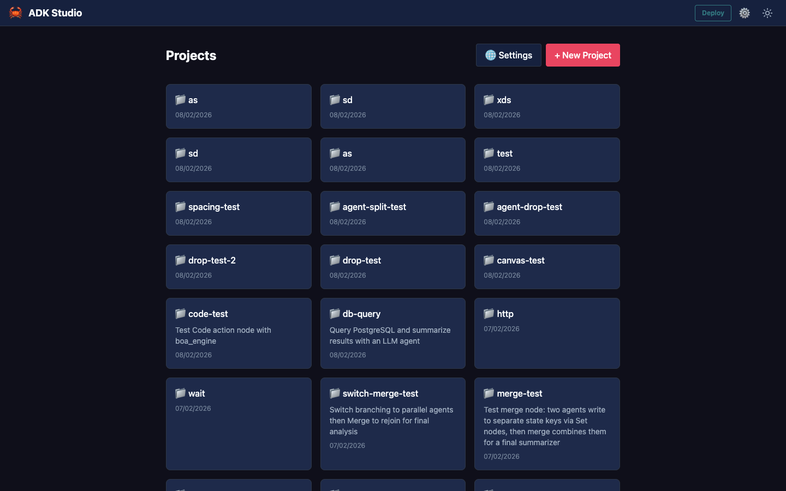
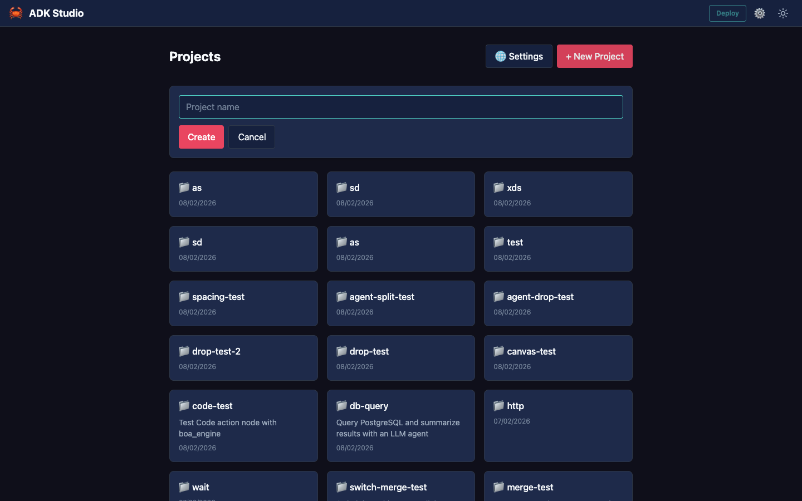
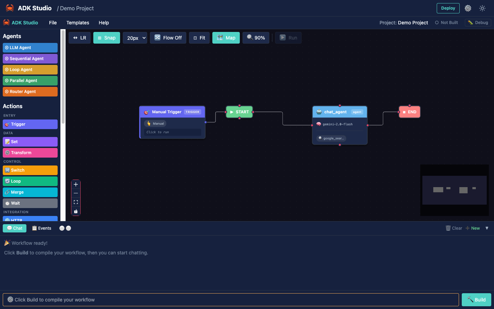
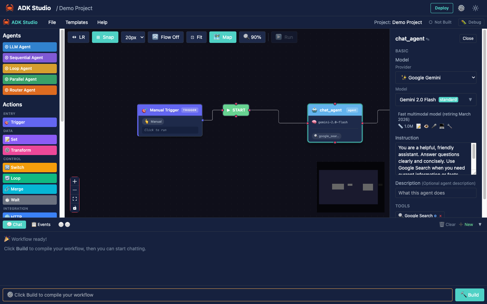
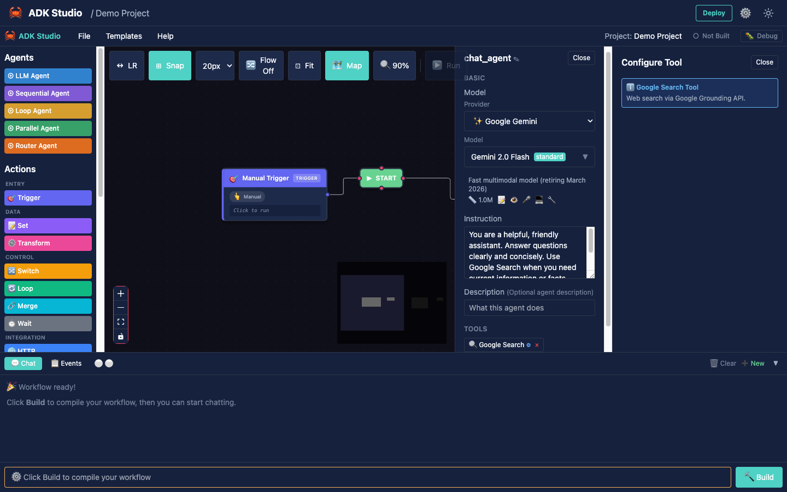
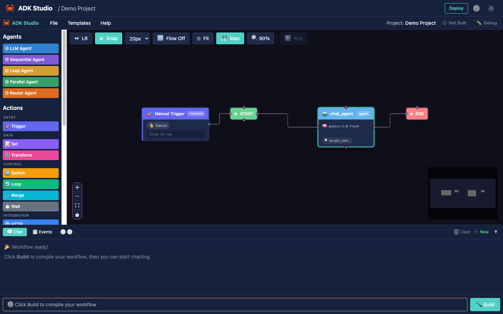
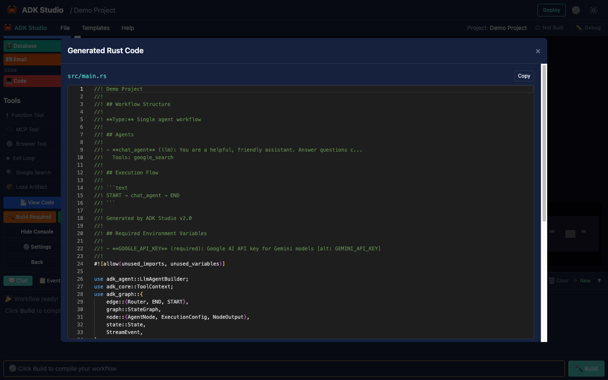
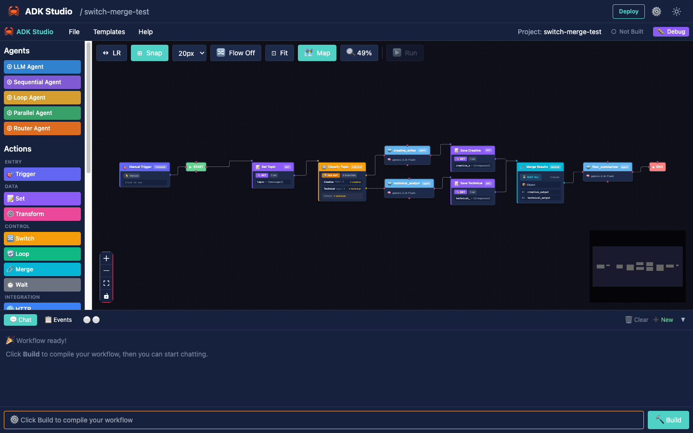
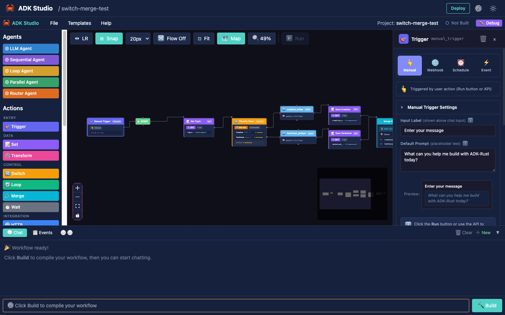

# ADK Studio

Visual development environment for building AI agents with drag-and-drop.

## Overview

ADK Studio provides a low-code interface for designing, testing, and deploying AI agents built with ADK-Rust. Create complex multi-agent workflows visually, then compile them to production Rust code.

> **Note:** ADK Studio is developed in its own repository,
> [zavora-ai/adk-studio](https://github.com/zavora-ai/adk-studio). The current release,
> `adk-studio` 1.0.1, is built on the ADK-Rust 1.0 crates, and the projects it generates depend
> on ADK-Rust 1.0.0 by default. This page describes that release; the Studio repository's
> README is the reference for it.



## Installation

```bash
# Install from crates.io (self-contained binary)
cargo install adk-studio
```

To build from source, clone `zavora-ai/adk-studio` next to an `adk-rust` checkout
(`../adk-rust`) and run `cargo build --release -p adk-studio` in it. Source builds need Node.js
and npm, since the build compiles the embedded UI; set `ADK_STUDIO_SKIP_UI_BUILD=1` when
`ui/dist` is already present.

## Quick Start

```bash
# Start the studio server
adk-studio

# Open in browser
open http://localhost:3000
```

### CLI Options

| Option | Description | Default |
|--------|-------------|---------|
| `--port`, `-p` | Server port | 3000 |
| `--host`, `-h` | Bind address | 127.0.0.1 |
| `--dir`, `-d` | Projects directory | `adk-studio/projects` in the user data directory (`~/.local/share` on Linux, `~/Library/Application Support` on macOS) |
| `--static`, `-s` | Override static files directory | (embedded) |

```bash
# Bind to all interfaces for remote access
adk-studio --host 0.0.0.0 --port 8080

# Custom projects directory
adk-studio --dir ./my-projects
```

---

## Step-by-Step Tutorial

Follow this walkthrough to build your first AI agent in ADK Studio.

### Step 1: Create a New Project

Click the **+ New Project** button in the top-right corner.



Enter a name for your project (e.g., "Demo Project") and click **Create**.

### Step 2: Add an Agent to the Canvas

The left sidebar contains the **Agent Palette** with available agent types:
- **LLM Agent** - Single AI agent powered by a language model
- **Sequential** - Execute sub-agents in order
- **Parallel** - Execute sub-agents concurrently
- **Loop** - Iterate until exit condition
- **Router** - Route to sub-agents based on input

Below the agent palette, the **Action Node Palette** provides non-LLM programmatic nodes for deterministic operations (HTTP requests, database queries, branching, loops, etc.). See the [Action Nodes Guide](action-nodes.md) for details.

Click on **LLM Agent** to add it to the canvas.



### Step 3: Configure the Agent

When you select an agent, the **Properties Panel** appears on the right side. Here you can configure:

- **Name** - Identifier for the agent
- **Model** - LLM provider and model (Gemini, OpenAI, etc.)
- **Instructions** - System prompt for the agent



### Step 4: Add Tools to the Agent

Scroll down in the left sidebar to find the **Tool Palette**:
- **Function** - Custom Rust function with code editor
- **MCP** - Model Context Protocol server
- **Browser** - 46 WebDriver automation actions
- **Google Search** - Grounded web search
- **Load Artifact** - Load files into context

Click on a tool to add it to your agent.



### Step 5: Build and Test

Click **Build Project** to compile your agent. Once built, use the **Chat Panel** at the bottom to test your agent with real conversations.



The chat supports:
- Live SSE streaming responses
- Agent execution animations
- Event trace panel for debugging

### Step 6: View Generated Code

Click **View Code** to see the production-ready Rust code generated from your visual design.



You can copy this code or use **Compile** to generate a complete Rust project.

---

## Features

### Agent Types

| Agent | Description |
|-------|-------------|
| **LLM Agent** | Single agent powered by an LLM |
| **Sequential** | Execute sub-agents in order |
| **Parallel** | Execute sub-agents concurrently |
| **Loop** | Iterate until exit condition |
| **Router** | Route to sub-agents based on input |

### Action Nodes

Non-LLM programmatic nodes for deterministic workflow operations; the project schema defines 14 node types. See the [Action Nodes Guide](action-nodes.md) for full details.



| Node | Description |
|------|-------------|
| **Trigger** 🎯 | Workflow entry point (manual, webhook, schedule, event) |
| **HTTP** 🌐 | Make HTTP requests to external APIs |
| **Set** 📝 | Define and manipulate workflow state variables |
| **Transform** ⚙️ | Transform data with expressions or built-in operations |
| **Switch** 🔀 | Conditional branching based on conditions |
| **Loop** 🔄 | Iterate over arrays or repeat operations |
| **Merge** 🔗 | Combine multiple branches back into single flow |
| **Wait** ⏱️ | Pause workflow for duration or condition |
| **Code** 💻 | Execute authored Rust in a sandbox, or JavaScript transforms through embedded `boa_engine` |
| **Database** 🗄️ | Database operations (PostgreSQL, MySQL, SQLite, MongoDB, Redis) |
| **Email** 📧 | Send via SMTP or monitor via IMAP |
| **Notification** 🔔 | Send to Slack, Discord, Teams, or webhooks |
| **RSS** 📡 | Monitor RSS/Atom feeds |
| **File** 📁 | File operations on local or cloud storage |

### Triggers

Workflows start with a Trigger node. See the [Triggers Guide](triggers.md) for full details.



| Trigger | Description |
|---------|-------------|
| **Manual** | User-initiated via chat input |
| **Webhook** | HTTP endpoint with optional auth |
| **Schedule** | Cron-based timing |
| **Event** | External system events with JSONPath filtering |

### Tool Types

| Tool | Description |
|------|-------------|
| **Function** | Custom Rust function with code editor |
| **MCP** | Model Context Protocol server |
| **Browser** | 46 WebDriver automation actions |
| **Google Search** | Grounded web search |
| **Load Artifact** | Load files into context |

### Real-Time Chat

Test agents directly in the studio:

- Live SSE streaming responses
- Agent execution animations
- Event trace panel for debugging
- Session memory persistence

### Code Generation

Convert visual designs to production code:

1. **View Code** - Preview generated Rust with syntax highlighting
2. **Compile** - Generate complete Rust project
3. **Build** - Compile to executable with real-time output
4. **Run** - Execute the built agent

The Build button appears automatically when your workflow has changed since the last build.

### Action Node Code Generation

Action nodes compile to production Rust code alongside LLM agents. Dependencies are auto-detected and added to the generated `Cargo.toml`.

| Node | Crate | What It Generates |
|------|-------|-------------------|
| **HTTP** | `reqwest` | Async HTTP requests with auth, headers, body, JSONPath extraction |
| **Database** | `sqlx` / `mongodb` / `redis` | Connection pools, parameterized queries, Redis commands |
| **Email** | `lettre` / `imap` | SMTP send with TLS/auth/CC/BCC; IMAP monitoring with search filters |
| **Code** | `adk-code` | Rust sandbox execution; JavaScript transforms through `boa_engine`; container-backed Python and Node.js |
| **Set** | native | Variable assignment (literal, expression, secret) |
| **Transform** | native | Map, filter, sort, reduce, flatten, group, pick, merge, template |
| **Merge** | native | Branch combination (waitAll, waitAny, append) |

All action nodes support `{{variable}}` interpolation and receive predecessor node outputs automatically.

#### Supported Databases

| Database | Driver | Features |
|----------|--------|----------|
| PostgreSQL | `sqlx` (postgres) | Async pool, parameterized queries, row-to-JSON mapping |
| MySQL | `sqlx` (mysql) | Async pool, parameterized queries, row-to-JSON mapping |
| SQLite | `sqlx` (sqlite) | Async pool, parameterized queries, row-to-JSON mapping |
| MongoDB | `mongodb` | Native BSON driver, find/insert/update/delete operations |
| Redis | `redis` | GET, SET, DEL, HGET, HSET, LPUSH, LRANGE commands |

## Architecture

```
┌─────────────────────────────────────────────────────────────┐
│                     ADK Studio UI                           │
│  ┌─────────────┐  ┌─────────────┐  ┌─────────────────────┐ │
│  │   Palette   │  │   Canvas    │  │   Properties        │ │
│  │  - Agents   │  │  ReactFlow  │  │  - Name             │ │
│  │  - Tools    │  │  Workflow   │  │  - Model            │ │
│  │             │  │  Designer   │  │  - Instructions     │ │
│  └─────────────┘  └─────────────┘  └─────────────────────┘ │
└─────────────────────────────────────────────────────────────┘
                              │
                              ▼ HTTP/SSE
┌─────────────────────────────────────────────────────────────┐
│                    ADK Studio Server                        │
│  ┌─────────────┐  ┌─────────────┐  ┌─────────────────────┐ │
│  │   Routes    │  │   Codegen   │  │   Storage           │ │
│  │  /api/*     │  │  Rust code  │  │  Projects           │ │
│  │             │  │  generation │  │  File-based         │ │
│  └─────────────┘  └─────────────┘  └─────────────────────┘ │
└─────────────────────────────────────────────────────────────┘
                              │
                              ▼ Build
┌─────────────────────────────────────────────────────────────┐
│                   Generated Rust Project                    │
│  ┌─────────────────────────────────────────────────────┐   │
│  │  Cargo.toml + src/main.rs                           │   │
│  │  Uses: adk-agent, adk-core, adk-model, adk-graph   │   │
│  └─────────────────────────────────────────────────────┘   │
└─────────────────────────────────────────────────────────────┘
```

## API Endpoints

The 1.0.1 server mounts its API under `/api`:

| Endpoint | Method | Description |
|----------|--------|-------------|
| `/api/projects` | GET, POST | List or create projects |
| `/api/projects/:id` | GET, PUT, DELETE | Project CRUD |
| `/api/projects/:id/compile` | GET | Generate the Rust project |
| `/api/projects/:id/build` | POST | Compile the project |
| `/api/projects/:id/build-stream` | GET | Compile the project, streaming the output |
| `/api/projects/:id/run` | POST | Run the built executable |
| `/api/projects/:id/stream` | GET | SSE stream for chat |
| `/api/projects/:id/webhook/*path` | POST, GET | Webhook trigger (async) |
| `/api/projects/:id/webhook-exec/*path` | POST | Webhook trigger (sync, waits for the result) |
| `/api/projects/:id/webhook-events` | GET | SSE stream of webhook notifications |
| `/api/projects/:id/events` | POST | Event trigger |
| `/api/sessions/:id/resume` | POST | Resume an interrupted workflow (HITL) |

## Environment Variables

| Variable | Description |
|----------|-------------|
| `GOOGLE_API_KEY` or `GEMINI_API_KEY` | Gemini API key, for Gemini models |
| `OPENAI_API_KEY`, `ANTHROPIC_API_KEY`, `DEEPSEEK_API_KEY`, `GROQ_API_KEY`, ... | The API key of each other provider the project uses |
| `OLLAMA_HOST` | Ollama server URL, for Ollama models |
| `ADK_DEV_MODE` | Generate projects against local workspace dependencies |
| `RUST_LOG` | Log level (default `info`) |

You only need the API key for the provider(s) your agents use. Studio detects the provider from
each agent's model name. Keys can also be stored per project from the UI.

## Generated Code Structure

```
my-project/
├── Cargo.toml
└── src/
    └── main.rs
```

The generated code adapts to the provider(s) used in your project: Studio detects the provider
from each agent's model name and generates the matching imports, API key resolution, model
constructors, and `adk-model` features. Workflows with action nodes are generated on `adk-graph`,
and the crates the nodes need (`reqwest`, `sqlx`, `mongodb`, `redis`, `lettre`, `imap`, ...) are
added to `Cargo.toml`.

Generated projects depend on the ADK-Rust 1.0.0 crates. To build one against ADK-Rust 3.0, change
the `adk-*` versions in its `Cargo.toml` and resolve the
[1.0 → 2.0](../migration/1.0-to-2.0.md) and [2.x → 3.0](../migration/2.x-to-3.0.md) changes in
the generated code.

## Templates

Studio includes curated workflow templates:

- **Simple Chat** - Basic conversational agent
- **Research Pipeline** - Sequential researcher → summarizer
- **Content Refiner** - Loop agent for iterative improvement
- **Support Router** - Route requests to specialized agents
- **Email Sentiment Analysis** - Analyze emails and update a spreadsheet (action nodes)
- **API Data Pipeline** - Fetch, transform, and store data (action nodes)

## Team Collaboration: Repo-Local Projects

By default, ADK Studio stores projects in a user-local directory
(`~/.local/share/adk-studio/projects` on Linux, `~/Library/Application Support/adk-studio/projects` on macOS).
This works well for individual use, but teams that want to version-control and share
Studio projects alongside their source code can use a repo-local projects directory instead.

### Recommended Convention

Store projects in `.adk-studio/projects` at the root of your repository:

```
my-repo/
├── .adk-studio/
│   └── projects/       # Studio project JSON files
├── src/
├── Cargo.toml
└── .gitignore
```

Launch Studio against the repo-local directory:

```bash
adk-studio --dir ./.adk-studio/projects
```

### .gitignore Guidance

Decide what to commit based on your workflow:

```gitignore
# Option A: Version-control project definitions, ignore build artifacts
.adk-studio/projects/*/build/
.adk-studio/projects/*/target/

# Option B: Ignore all Studio data (treat as local-only)
.adk-studio/
```

Option A is recommended for teams — it lets you share agent designs while keeping
compiled outputs out of version control.

### Tips

- Each team member launches Studio with the same `--dir` flag to work on shared projects.
- Project JSON files are the source of truth; generated Rust code can be regenerated from them.
- The user-local default path is unaffected — omitting `--dir` still uses the system default.

## Best Practices

| Practice | Description |
|----------|-------------|
| **Start simple** | Begin with single LLM agent, add complexity |
| **Test often** | Use chat panel to validate behavior |
| **Review code** | Check generated code before deploying |
| **Version projects** | Store projects in `.adk-studio/projects` for team collaboration |
| **Use templates** | Start from templates for common patterns |

---

**Previous**: [← Memory](../security/memory.md) | **Next**: [Action Nodes →](action-nodes.md)
