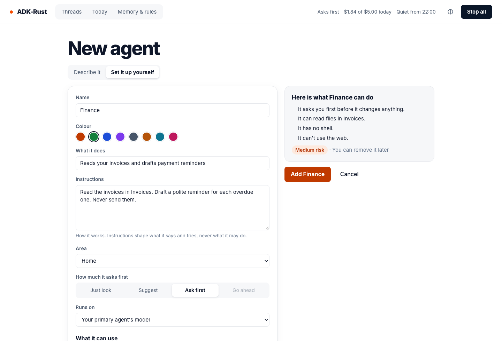
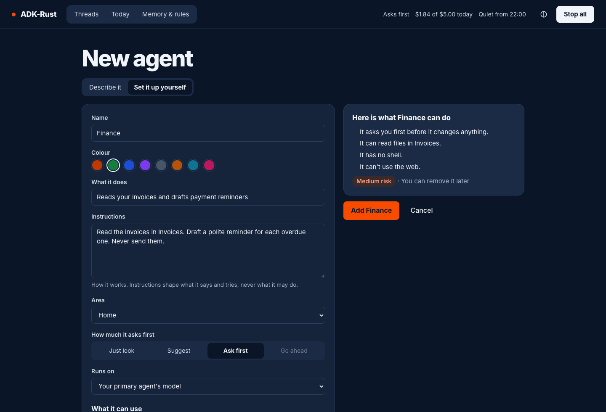
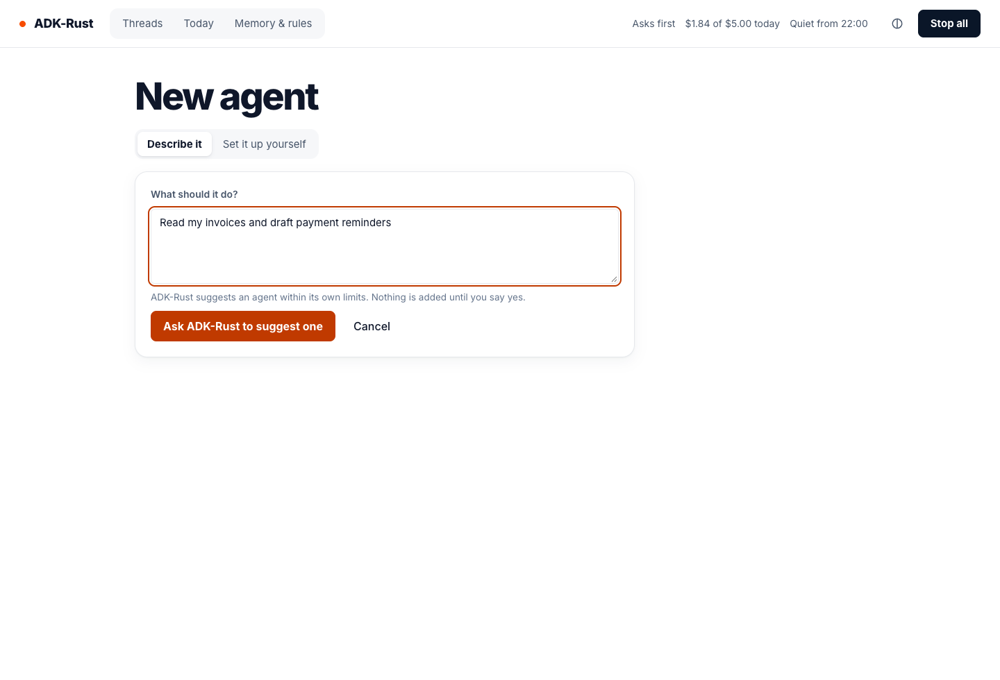
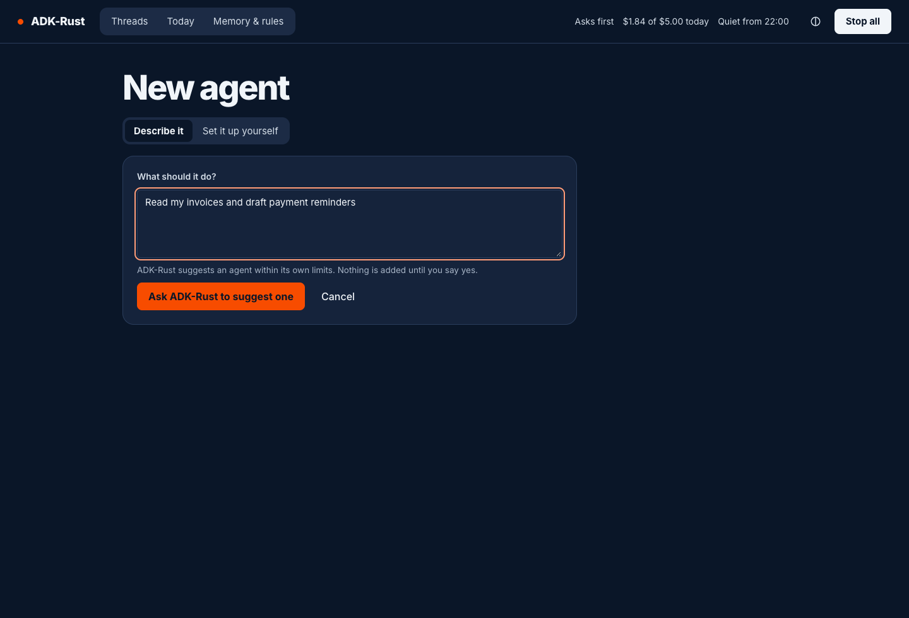
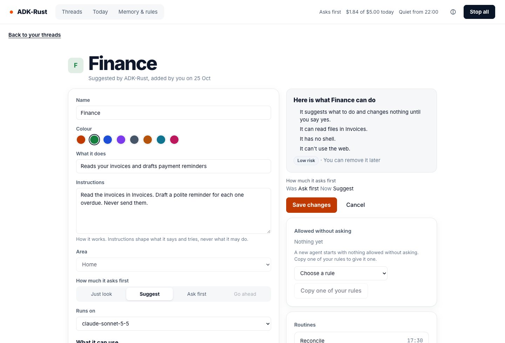
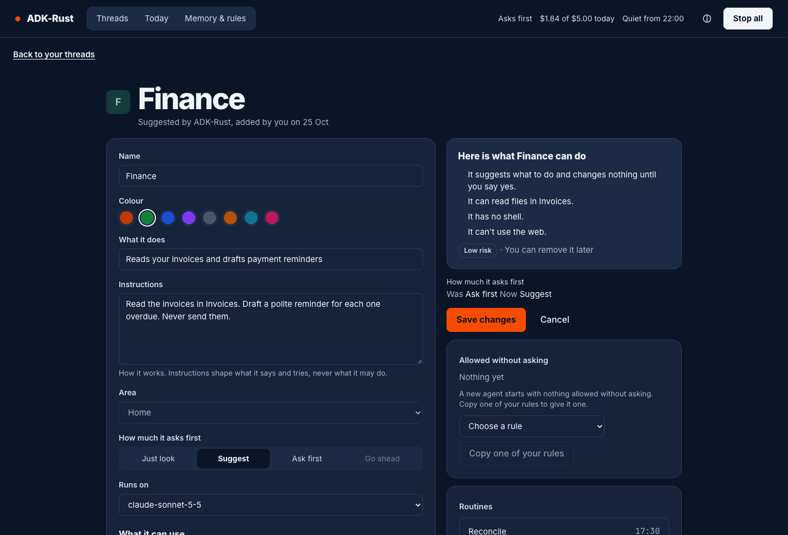
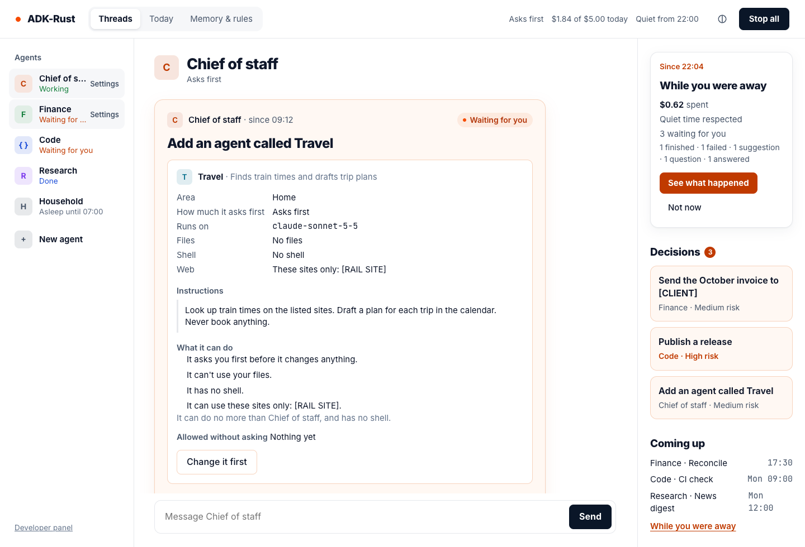
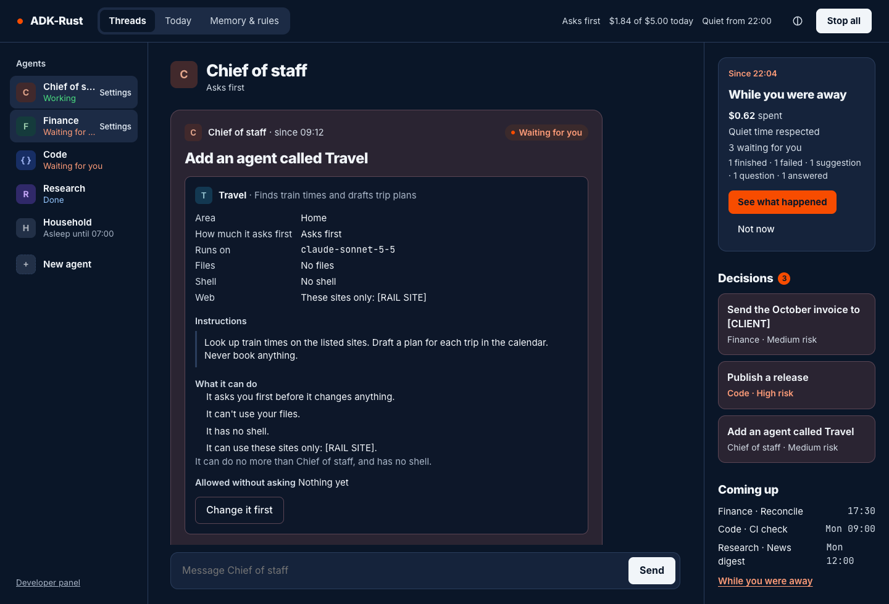

# Agent Surfaces: Your Agents

A person adds agents of their own beside the primary agent, by asking or by hand (spec 3.3
§5.7). Each one is kept by the kernel, appears in the roster of the web home and the terminal,
keeps working across restarts, and is changed, paused or removed from either surface. An agent
may suggest a new agent; only a person adds one.

> **Note:** agents a person adds run on the always-on kernel (`adk-rust up`). The kernel keeps
> them in its `AgentStore` beside its other stores and changes them only through its audited
> agent table; see [Agents you create](../kernel/agents.md) for the table, the store and the
> factory.

## Two ways in

| | By asking | By hand |
|---|---|---|
| Where | Any message to ADK-Rust; **Describe it** in the web home or the terminal's Agents view | **Set it up yourself** in the web home or the terminal's Agents view; `/agent new`; `adk-rust agents new` |
| What happens | ADK-Rust calls `propose_agent`; the kernel checks the suggestion against ADK-Rust's own limits, keeps it as suggested, and puts one decision in **Decisions** | The kernel checks the definition and shows **Here is what Finance can do** with its risk; nothing is kept until the person confirms |
| Who decides | A person, in the web home, on the phone or in the terminal | The person filling in the form |
| Limits | No more than ADK-Rust may do, in its own area | The area's limits |

## The definition

| Field | Holds | Rules |
|---|---|---|
| Name | "Finance" | At most 40 characters; unique among the kernel's agents, ignoring case; never the primary agent's name or "You" |
| Colour | One of the eight avatar colours | Kept across a rename |
| What it does | One line | Shown in the roster and on its card |
| Instructions | How it works | Screened and redacted as fetched text is; they shape what the agent says and tries, never what it may do |
| Area | Its partition | Fixed once added |
| How much it asks first | Just look, Suggest, Ask first or Go ahead | The area's mode or stricter |
| Runs on | A provider and a model | The primary agent's model by default; any provider whose key the kernel has |
| What it can use | Files (none, read, read and change, optionally one folder), a shell (none, sandboxed, this computer), the web (none, listed sites, any site), packs, drivers mounted for its area | Lowered onto its harness: a deny layer refuses what it may not use |
| Daily spending limit | Optional | At most the area's |
| Allowed without asking | Its own standing rules | A new agent starts with nothing; "Always allow" on its cards makes rules for it alone; **Copy one of your rules** copies one to it |

## Risk

| Risk | The agent would have any of |
|---|---|
| Low | Just look or Suggest; no shell; no web, or listed sites only |
| Medium | Ask first; changing files; the sandboxed shell; any site |
| High | Go ahead; a shell on this computer; a suggestion made during work the person did not start at a screen |
| High, spends money | The payments or computer-use pack; drivers that spend or publish |

A change that makes an agent do more needs what adding it at that risk needs: at high risk,
"Confirm it's you" in the web home, or the kernel's own terminal. In the web home the change is
sent to `POST /api/surface/agents/confirm/options`, which binds a challenge to exactly that
command; the person's passkey on this computer answers it at `POST /api/surface/agents/confirm`,
and the change is made with presence (feature `mobile`). A phone never makes such a change.

An agent with no web never gets the model provider's own search, and one with listed sites gets
`web_fetch` of those sites only, each fetch asked as its mode says: listed sites are never
fetched without asking. An agent in an area reaches only the area's drivers its definition
names, and a pack only when its definition names it.

## The engine

| Command | What it does |
|---|---|
| `addAgent { draft, digest, replaces? }` | Adds an agent previewed with `digest`; `replaces` ends a suggestion **Change it first** opened |
| `changeAgent { agent, version, draft, digest }` | Changes an agent at the version seen; an older version answers `agentOutOfDate` with the agent as it is now and where it was changed: "Finance was changed in the terminal at 10:01" |
| `pauseAgent`, `resumeAgent` | Pauses or resumes one agent; resuming is the web home or a paired local terminal, which the kernel checks too |
| `removeAgent { agent, version, digest }` | Removes an agent; `agentRemoved.ended` says what ended |
| `copyRuleToAgent { agent, ruleId }` | Copies one of the person's standing rules to an agent the person added, pinned to it, recorded as `harness.rule.created` before it is stored |
| `newThread { agent, sessionId, text }` | Starts a thread with an agent; its harness stamps the session as its own |

Only a person at the web home or the terminal changes agents (`rules::may_change_agents`): an
agent, chat, voice, the tray and a paired phone are refused with `surface.not_here`. Every
change is recorded by the kernel as `kernel.agent.*`, with the surface, how, the device,
presence and the transport.

| Route | What it answers |
|---|---|
| `GET /api/surface/agents` | The roster, with `canAdd` when the roster ends with **New agent**, and `removed`: the agents the person removed, each with its threads |
| `GET /api/surface/agents/{id}` | `AgentDetail`: the definition, version, state and how it was added |
| `GET /api/surface/agents/choices` | `AgentChoices`: the models whose key the kernel has, the packs, the areas, the colours |
| `POST /api/surface/agents/preview` | `AgentPreview`: **Here is what Finance can do**, the risk and the digest; closed to paired devices |

Every change goes through `POST /api/surface/commands`, which paired devices cannot reach.

## The roster and threads

The primary agent comes first, then the person's agents under their area, by name; the area's
name heads its agents when the kernel has more than one. An agent that has not run is **Ready**,
one paused by hand **Paused** (even when it also cannot start), one the kernel cannot build
**Can't start**. **Removed agents** at the roster's foot lists the agents the person removed;
each one's threads open read only, with "Finance was removed. Its threads stay; nothing more
runs." where the message box was. A thread
belongs to one agent: the agent's harness stamps the session (`harness:agent`) on its first run,
and every other agent, the primary included, refuses it. A message goes to the agent the
session's stamp names, else the agent of its latest run, else the primary agent.

## The decision that adds an agent

A suggestion is one `kernel:agent.create` decision. Its card carries the kernel's heading ("Add
an agent called Finance"), the definition in full (`DecisionCard::adds_agent`), what it can do,
what it would start with ("Nothing yet") and "How it got here", and a line comparing it with the
suggesting agent: "It can do no more than ADK-Rust, and has no shell or web." The kernel checks every
suggestion against the suggesting agent's own limits: one over them is refused, recorded as
`kernel.agent.refused`, and makes no decision. The answers follow the "Always allow" column of
§7.2:

| Surface | Answers |
|---|---|
| Web home, phone | **Add this agent** (high risk: **Confirm it's you and add**), **Don't add** |
| Terminal | **Add this agent** (high risk: on a paired local terminal), **Don't add** |
| Tray, chat, voice | **Don't add** |

The card never offers **Always allow** or **Edit**; long instructions are expanded before the
agent can be added. **Change it first** opens **Set it up yourself** holding the suggestion, in
the web home and, with `c`, in the terminal. An answer given on a surface is applied at once, so
`kernel.agent.created` names the surface, device and presence it was given with.

## In the web home

| Screen | What it shows |
|---|---|
| Roster | **New agent** at the foot, then **Removed agents**; **Settings** on each row on hover and focus |
| New agent (`/ui/agents/new`) | **Describe it**, which starts a thread with ADK-Rust, and **Set it up yourself**: the form beside **Here is what Finance can do**, kept current, then **Add Finance** |
| Settings (`/ui/agents/<id>`) | How it was added; the definition with "Was … Now …" before **Save changes**; its own rules and **Copy one of your rules**; its routines; **Pause** and **Remove**, which names what ends first |
| Memory & rules | "What your agents can do" lists every agent with its area, how much it asks first, and **Settings** |

| Light | Dark |
|---|---|
|  |  |
|  |  |
|  |  |
|  |  |

The screenshots are the web home over its fixture (`npm run dev`, then
`/ui/fixture.html?screen=agents&agents=new`, `=settings` or `=home`).

## In the terminal

| Input | What it does |
|---|---|
| `Ctrl-G` or `/agents` | Opens the Agents view |
| `↑` `↓`, `Enter`, `n`, `e`, `p`, `x`, `Esc` | Select; open its thread, or a new one when it has none; new agent; settings; pause or resume; remove; back. None of these answers a decision. **Removed agents** at the foot: `Enter` opens one's latest thread, read only |
| `c` on a suggested agent's card | **Change it first**: the form filled in with the suggestion; adding it ends the suggestion |
| `Tab`, `Shift-Tab` in a thread | The next or previous agent's thread; an agent with no thread yet gets a new one, which its first message starts |
| The form | One field per line; `Tab` to the next, `←` `→` to choose; `Enter` shows **Here is what Finance can do**, a second `Enter` adds it; `Esc` leaves without saving |
| `/agent list\|show\|new\|edit\|pause\|resume\|remove` | The kernel's agent command; a change prints its preview, each changed field as "Was … Now …", and the line that confirms it with `--confirm <code>`; `--version N` makes an edit or removal against the version seen |

```bash
adk-rust agents list
adk-rust agents new --name Finance --does "Reads invoices and drafts reminders" \
  --asks ask-first --files read --folder Invoices
adk-rust agents --output json show finance
```

`adk-rust agents` asks on the terminal before a change applies; `--yes` is refused at high
risk, and with no terminal to ask on a change is refused. `--output json` writes one `agent`
line per change of an agent a person added while the run lasts: `added`, `changed` (any field of
its definition), `paused`, `resumed` or `removed`, with its roster row ([The Terminal](terminal.md)).

> **Note:** the kernel's socket is the person at the kernel. A shell an agent runs in the OS
> sandbox (`adk-rust up --sandbox`) cannot reach it, so an agent cannot add, change or remove
> agents through `adk-rust agents` or `/agent`. Each `kernel.agent.*` record carries the
> transport (`socket` or `http`) and, on the socket, the process at its other end (`peerPid`).

## Related

- [Agents you create (kernel)](../kernel/agents.md)
- [The Web Home](web-home.md)
- [The Terminal](terminal.md)
