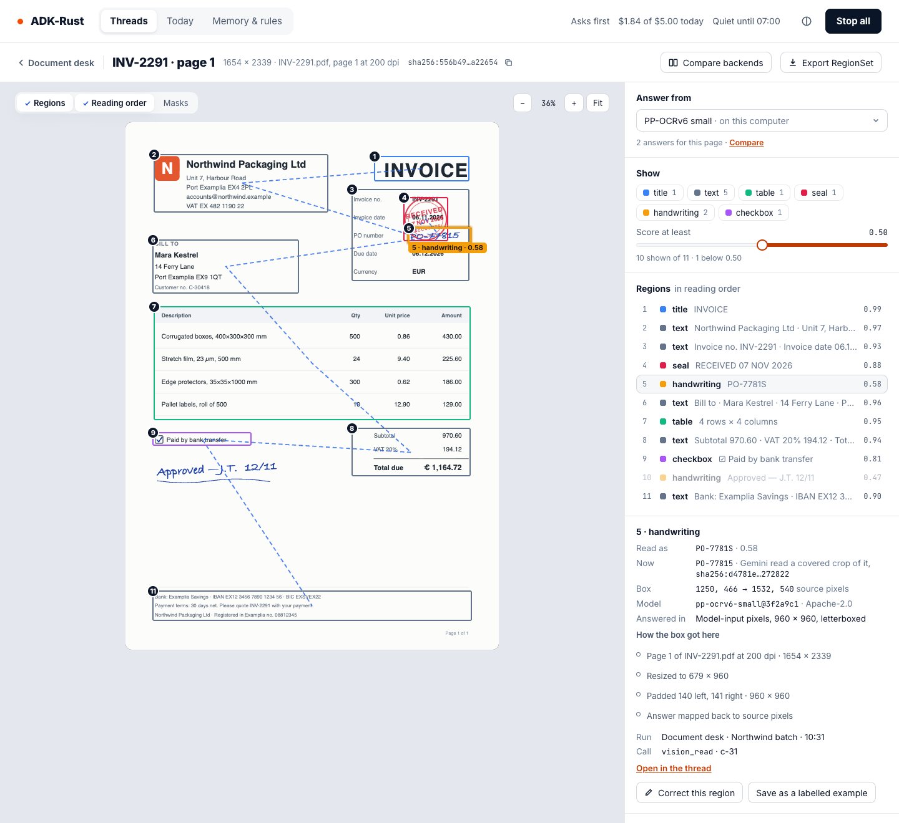
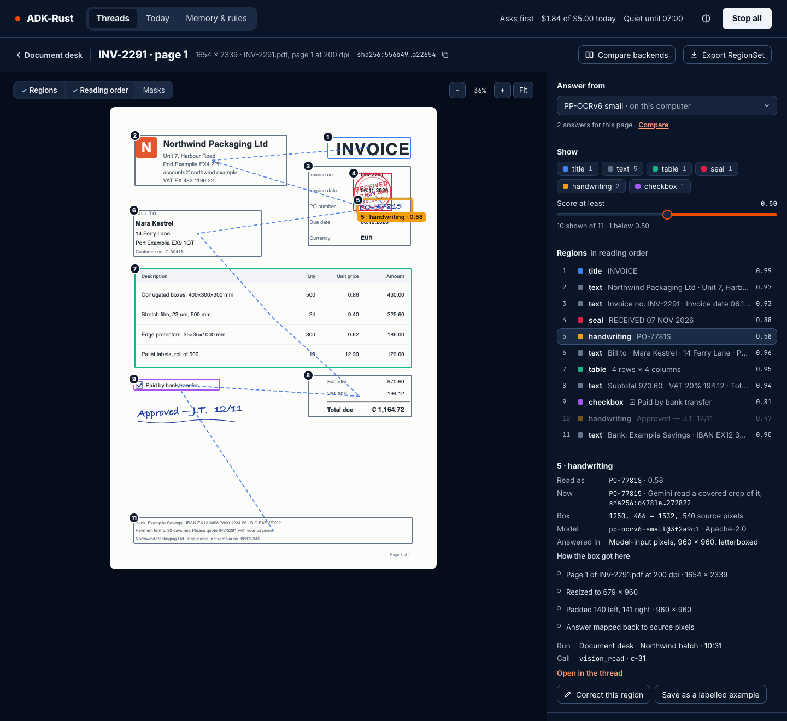

# The Annotated Viewer

The annotated viewer shows what an agent saw: the source image with every region a vision tool
found over it, which backend and model found each one, the coordinate frame it answered in, the
transform chain that maps it back to the image's pixels, measurements, and the run and call that
produced it (spec 3.7 §8.2, X12). A person compares two backends on one image, corrects a region
and saves it as a labelled example for their eval fixtures, and exports the answer as a
`RegionSet`. It is a web home view, read-only on the phone.

| A document page (light) | A document page (dark) |
|---|---|
|  |  |

## Where It Opens

| From | How |
|---|---|
| A tool line in the thread | A `vision_detect`, `vision_segment`, `vision_read` or `vision_describe` result carries its image's digest (`ThreadItem::Result::image`); the line links to **See what it found** |
| A card with images | **Open the source image** opens the viewer when the source keeps the session's answers and the feature named no other place (`Source::keeps_vision_answers`) |
| An address | `/ui/vision/<session>/<image>`, the image a `sha256:` digest or the name of an image the session holds; `?answer=` picks the answer — `<run>:<call>`, or a call id for its newest answer — and `&compare=` a second one |

The back link returns to the agent's thread in that session.

## Where the Answers Come From

Every perception call of the vision tools leaves an answer record beside its image in the
session: `vision-answer-<run>.<call id>.json`, next to the image the media store keeps as
`vision-<hex>.<ext>`. The tool's response stays compact for the model; the record holds what a
person needs to look at the answer, and never pixels (V-I15).

| Key | Holds |
|---|---|
| `tool`, `callId`, `invocationId`, `agent`, `at` | The call and the run that made it |
| `image` | The source image: digest, size, MIME type, artifact, the name it was called by, provenance |
| `args` | The call's arguments |
| `regionSet` | The answer as a `RegionSet` in source pixels, each region with its backend, manifest, frame and transform chain (`adk-vision/schema/region-set.json`) |
| `page` | `vision_read` only: each block's kind, text and confidence, and the reading order |
| `answer` | `vision_describe` only: the text and the structured value |
| `calls` | Each backend call: backend, locality, the released crops' digests, units, cost, duration, escalation |
| `models` | Each manifest the regions name: its revision and licence when it is built in |

The engine reads the records through the `Source` (`Source::vision_answers`) and projects them
into a `ViewerView`; `adk-surface` never depends on `adk-vision` for it, so the record's JSON is
the contract. A feature that knows more adds it to the record: an Inspector's `measurements`, a
video's `tracks` and `video`, and `display` words for the picture.

## What It Shows

| Part | Shows |
|---|---|
| **Answer from** | The backend that answered and where it ran ("PP-OCRv6 small · on this computer"); every answer for this image in the session |
| **Show** | Label chips with counts, a score slider and how many regions the filters hide; track chips for a video frame |
| **Regions** | Each region with its label, its text or shape and its score; a page's blocks in reading order |
| The selected region | **Read as** and **Now** for a value an escalation replaced, with the released crop's digest; the box in source pixels; the model at its revision and licence, or "your manifest"; **Answered in** the frame; **How the box got here**, the transform chain as steps; the run and the call |
| **Measurements** | Longest length and area with their uncertainty, and the calibration in one sentence |
| Layers | Regions, reading order (numbered badges and a dashed path), masks, measurements, trails |

Every box is drawn from the `RegionSet` in the image's source pixels: the coordinates the viewer
shows are the ones an eval case compares, whatever frame the backend answered in.

| State | Drawn |
|---|---|
| A photo | Boxes and masks; the measured region first, with a 150% inset around it |
| A document page | Blocks by kind with numbered reading order; the escalated or least certain block selected |
| A video frame | Tracks with trails, a timeline of when each track is seen, filters by track; people blurred, tracks anonymous |
| Two backends | Side by side or overlaid, with how many regions agree, read differently and only one found, the mean overlap, and each backend's duration and cost |
| No result | "Nothing found … That is an answer, not an error", with the call, the released copy and its cost; apart from "hidden by your filters" and "the call failed" |

## Correcting a Region

**Correct this region** zooms to 150% on the region: the box the model gave stays dashed and
tagged "was", and the person drags the corners, changes the label or the text, or draws a region
the answer missed. **Save as a labelled example** writes an `adk-eval` case to a `.test.json`
file under the eval fixtures folder:

```json
{
  "eval_id": "inv-2291-p1-po-number",
  "conversation": [{
    "invocation_id": "t0",
    "user_content": {
      "role": "user",
      "parts": [
        { "image": { "path": "images/556b49…a22654.png", "digest": "sha256:556b49…a22654" } },
        { "text": "Read the handwriting in the region [1252, 470, 1500, 536] of this page." }
      ]
    },
    "expected_vision": { "text": "PO-77815" }
  }],
  "tags": ["vision", "read", "annotated-viewer"]
}
```

The image is written beside the file and named by its digest, which `adk-eval` checks when it
loads the case. A region example expects that region; **Every region on the page** expects the
whole answer with the correction; an example with nothing in it expects `count: 0`. The run's
own answer never changes, and each example is recorded (`surface.vision.example`). The source
saves examples only when it has a folder for them:

```rust
use std::sync::Arc;

use adk_artifact::InMemoryArtifactService;
use adk_session::InMemorySessionService;
use adk_surface::LocalSource;

fn main() -> adk_surface::Result<()> {
    let source = LocalSource::builder("desk")
        .sessions(Arc::new(InMemorySessionService::new()))
        .artifacts(Arc::new(InMemoryArtifactService::new()))
        .eval_fixtures(std::env::temp_dir().join("evals"))
        .build()?;
    let _ = source;
    Ok(())
}
```

`cargo adk eval evals/vision/invoices.test.json --agent-cmd …` then scores an agent against it.

## The Web API

Every route is authorised as the inbox is: only the session's owner reads them (S-I8).

| Route (under `/api`) | Answer |
|---|---|
| `GET /surface/vision/{session}/images/{image}/view` | The `ViewerView` of one image: `?answer=` and `?compare=` pick the answers |
| `GET /surface/vision/{session}/images/{image}` | The image, served only when its bytes hash to its digest; `Cache-Control: private, no-store` |
| `GET /surface/vision/{session}/answers/{answer}/regions` | The answer's `RegionSet` as a file; `?with=` exports two in an array |
| `POST /surface/vision/{session}/examples` | Saves a `LabelledExample`; closed to paired devices |

## On the Phone

The phone shows the picture, the label chips and the regions; a tapped region opens a sheet with
its backend, frame, transform chain and measurement. Correcting, comparing and exporting stay on
a computer, and a paired device's token cannot save an example.

## Try It

`vision_viewer` serves the web home over a harness with the vision pack whose scripted model
reads an invoice page and detects parts on a conveyor still; open the thread's tool lines:

```bash
cargo run -p adk-surface --features web --example vision_viewer -- 8793 /tmp/evals
```

## Related

- [Approve with the Image](approve-with-image.md) — a held call's images on every surface
- [Governed Vision Tools](../vision/governed-tools.md) — the tools whose answers the viewer shows
- [Vision Evals](../vision/evals.md) — the `expected_vision` a saved example holds
