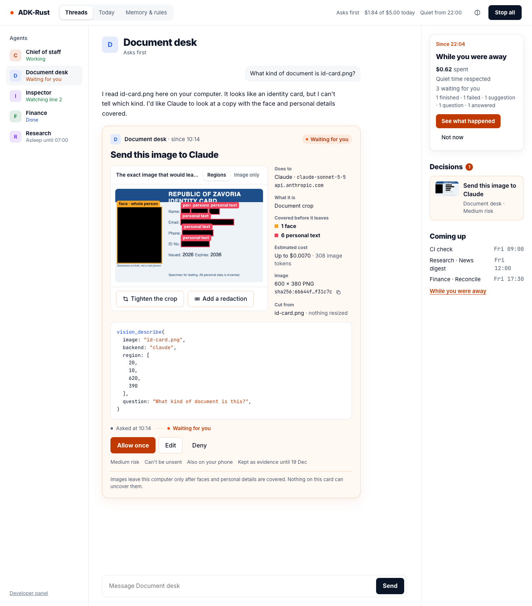
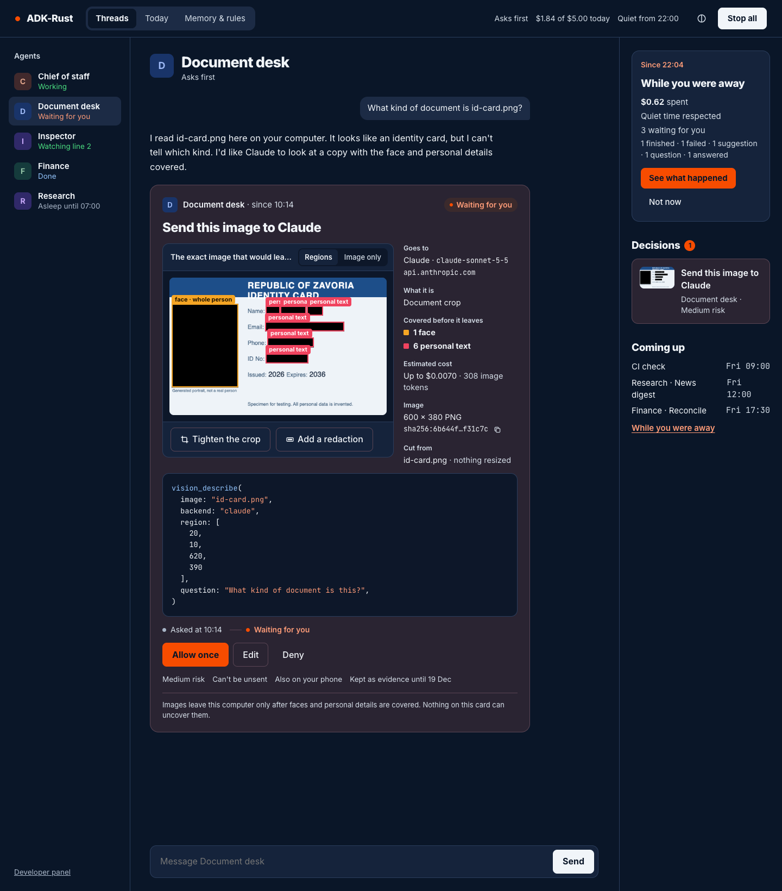

# Approve with the Image

A held call that would send, keep or act on an image shows that exact image on its card: the
copy that would leave after the egress gate covered faces and personal details, what was
covered by class, where it goes, what it would cost, its digest, and how long it is kept as
evidence (spec 3.7 §8.2, X11). The decision binds to that digest: an answer that lets the call
run names the image it saw, and a changed image holds the call again.

| Pending (light) | Pending (dark) |
|---|---|
|  |  |

## Where the Card Comes From

The card is drawn from the inbox entry, never from agent output. A held call carries its
images as `ApprovalRequest::evidence` — each image's digest, its artifact, its size and the
regions the gate filled ([Governed Vision Tools](../vision/governed-tools.md#approve-with-the-image)).
The engine projects them into `DecisionCard::media`:

| Part of the card | From |
|---|---|
| The image, its size and digest, its regions | The evidence |
| **Covered before it leaves**, by class, and **100% of the image** | The regions the gate filled |
| **Goes to**, **What it is**, **Estimated cost**, **Cut from** | A feature's `MediaFacts`, through a `CardHint` |
| **Kept as evidence until 18 Dec**, or the image deleted | The source and the retention (30 days unless a feature says otherwise) |

```rust
use std::sync::Arc;

use adk_core::ApprovalRequest;
use adk_surface::{CardHint, CardHints, MediaFacts};
use async_trait::async_trait;

/// What the vision pack knows of its own calls.
struct VisionCards;

#[async_trait]
impl CardHints for VisionCards {
    async fn hint(&self, request: &ApprovalRequest) -> Option<CardHint> {
        (request.tool_name == "vision_describe").then(|| {
            CardHint::new().with_heading("Send this image to Claude").with_media(
                MediaFacts::new()
                    .to("Claude", "claude-sonnet-5-5", ["api.anthropic.com"])
                    .with_data_class("document_crop")
                    .with_estimated_cost(4_400, Some("851 image tokens".into()))
                    .with_cut_from("id-card.png"),
            )
        })
    }
}

fn hints() -> Arc<dyn CardHints> {
    Arc::new(VisionCards)
}
```

## Showing the Image

The image never travels inside the card. A surface loads it from
`GET /api/surface/decisions/{id}/evidence/{index}` with the viewer's own authorisation, as the
inbox is read: a person who cannot see the decision gets `404`. `LocalSource` reads the
artifact at its exact version and serves it only when its bytes hash to the digest the card
names; the answer is `Cache-Control: private, no-store` and `X-Content-Type-Options: nosniff`.

```rust
use std::sync::Arc;

use adk_artifact::InMemoryArtifactService;
use adk_session::InMemorySessionService;
use adk_surface::LocalSource;

fn main() -> adk_surface::Result<()> {
    let source = LocalSource::builder("desk")
        .sessions(Arc::new(InMemorySessionService::new()))
        .artifacts(Arc::new(InMemoryArtifactService::new()))
        .build()?;
    let _ = source;
    Ok(())
}
```

## What Each Surface May Answer

| Situation | Answers |
|---|---|
| The web home, the phone, the terminal | **Allow once**, **Edit** and **Deny**. Never **Always allow**: the egress rules in `.adk/vision.toml` decide each host and data class, and a standing rule made from a card would not change them |
| The image is deleted, or every pixel is covered | **Deny** only, on every surface; **Allow once** shows off, with "Nothing to send." or "Everything is covered." |
| Voice | Reads the summary and says to look on a screen; it cannot say yes to sending an image, and **Deny** works |
| Chat | With an artifact service, Telegram attaches the exact image and offers **Allow once** and **Deny** beside it. A channel that cannot attach it names the digest, links to the home and offers **Deny** only |
| The desktop tray | **Deny** and **Open in home** |

An answer that lets the call run — **Allow once** or **Edit** — carries `evidence`, the digests
of the images the surface showed. The engine refuses an answer without them, and shows the
card again when they are not the call's:

```json
{
  "surface": "web",
  "origin": { "kind": "pointer" },
  "command": {
    "type": "decide",
    "decisionId": "dec-7c41e0",
    "version": 1,
    "answer": "allowOnce",
    "expanded": true,
    "evidence": ["sha256:6b644f480a4058281fbdb2f2e67821a69f702ea65f7c70552289a6add1f31c7c"]
  }
}
```

## Changing the Image Before It Leaves

**Tighten the crop** and **Add a redaction** open an editor in which the crop can only shrink
and covering can only grow. `changeImage` with `preview: true` makes the new image and answers
its digest; without `preview`, the engine records the change (`surface.image.change`), the
source saves the new image beside the original and holds the call again with it, and the old
decision closes as "You changed it at 10:15 · held again with the new image". Only the new
image can then be sent, after the egress gate covers it again; the new card names the digest
that would leave.

**Edit** on a call with images is held again the same way: a call never runs on arguments
whose images nobody saw. Holding again needs a `LocalSource` with an approval service, an
artifact service and a harness or kernel to hold the call (`Source::holds_again`); elsewhere
the tools show off and **Edit** is not offered.

## The Terminal and Chat

The terminal shows the full digest, what was covered, each region as text — its class and its
box in the image's pixels — where it goes, the cost and a link to the decision in the home;
`o` opens it (`TerminalSurface::home`). A Telegram adapter attaches the image when built with
`TelegramAdapterBuilder::artifacts`.

## Try It

`vision_home` serves the web home over a harness with the vision pack in Ask mode, whose
`vision_describe` call would send the identity-card fixture to Claude:

```bash
cargo run -p adk-surface --features web --example vision_home -- 8792 scripted
```

`live` in place of `scripted` runs the harness on `claude-haiku-5-5` and the describer on
`claude-sonnet-5-5` with `ANTHROPIC_API_KEY`. `GET /e2e/provider` lists the digest of every
image the describer received.

## Related

- [Governed Vision Tools](../vision/governed-tools.md)
- [The Web Home](web-home.md)
- [Tool Authorization](../security/tool-authorization.md)
