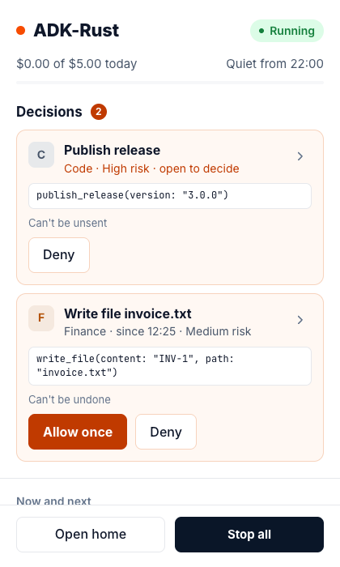
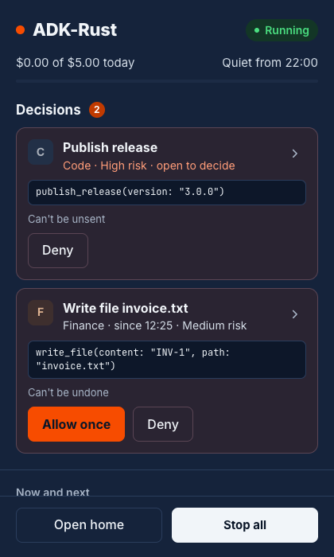

# Agent Surfaces: the Desktop Tray

The desktop tray is the web home in a desktop window plus a tray icon (spec 3.3 §5.5). The
icon carries the decisions badge; its panel shows whether your agents are running, what was
spent against the daily limit, the decisions waiting, what is working now and next, a quick
message box, **Open home** and **Stop all**.

> **Note:** the tray is **Experimental**. It is an unpublished app in its own Cargo workspace,
> `adk-surface/desktop/`, built from source; there is no `desktop` feature on `adk-surface` and
> no installer. It reaches a kernel on the same computer only.

| Light | Dark |
|---|---|
|  |  |

## What the tray may decide

The tray says yes once or no to everyday calls, and no to any call; approving anything else
opens the home at the decision (spec 3.3 §7.2).

| Allow once | Always allow | Edit | Deny | High risk |
|---|---|---|---|---|
| Yes | No (opens the home) | No | Yes | No (opens the home) |

| Card | What the tray shows | What it offers |
|---|---|---|
| Low or medium risk, shown in full | "Finance · since 18:00 · Medium risk", the exact call in mono, whether it can be taken back | **Allow once** and **Deny** |
| High risk, money, a call shown cut short, or an answer that needs you to confirm it is you | "Code · High risk · open to decide" | **Deny** when the engine offers it, since saying no is always safe; approving opens the home at `/ui/decisions/<id>` from the heading or the chevron |
| Answered here or elsewhere | One line: a check, the heading, then "You said yes from the tray at 07:40". A click, Enter or Space opens it to show the exact call again | Nothing: opening the line answers nothing |

Every card's heading opens the home at that decision, where **Always allow**, **Edit** and
**Confirm it's you and approve** are answered. Ids and versions are never shown. An answered
card's line leaves the panel five minutes after the answer, or as soon as a new decision
arrives; at most three stay.

The panel fills its window and never scrolls as a page: its header, **Open home** and
**Stop all** stay put, and the decisions and what comes next scroll between them. The home
window opened from **Open home** or a card's heading does the same at any size: the header
stays put and each pane scrolls inside itself.

| Rule | On the tray |
|---|---|
| Esc never decides (§7.4 rule 1) | Enter and Esc on a focused answer, hiding the panel by clicking away, and **Quit** decide nothing |
| Typing while a decision is open is queued (§7.4 rule 2) | A message to an agent whose card is open shows "Sent after this card is answered" and runs once the card is answered |
| Stopping is one action; resuming happens only in the home (S-I10) | **Stop all** in the panel and the icon's menu; no **Resume all** |
| Every answer is recorded with where it came from (§11) | The record and every other surface say "from the tray" |

## Running it

1. Start your agents on this computer:

   ```bash
   adk-rust up
   ```

2. Build the shell's bundled pages, then run the shell:

   ```bash
   npm ci --prefix adk-surface/desktop/probe
   npm run build --prefix adk-surface/desktop/probe
   cargo run --manifest-path adk-surface/desktop/app/Cargo.toml --bin adk-desktop -- \
       --server http://127.0.0.1:8080
   ```

| Flag | Environment | What it does |
|---|---|---|
| `--server` | `ADK_DESKTOP_SERVER` | The kernel. Without it, `[kernel] bind` in `<config dir>/adk-rust/harness.toml`, else `http://127.0.0.1:8080`. An unspecified bind (`0.0.0.0`, `::`) is reached on loopback; any other host is refused |
| `--token` | `ADK_SERVE_TOKEN` | The token of a kernel started with `--auth-token` |
| `--probe` | `ADK_DESKTOP_PROBE=1` | Opens the bundled WebKitGTK probe in place of the home |
| | `ADK_DESKTOP_LOG` | Also writes the shell's log to this file |

With a token, the shell puts it in each window's tab storage before the page's own scripts
run, on the kernel's origin only, so the home and the panel are signed in. It never writes the
token to disk or to its log. Without the token, the panel says "Start the tray with --token".

| Platform | Opening the panel |
|---|---|
| macOS, Windows | A click on the tray icon; the panel opens at the icon, inside the screen's work area |
| Linux | **Show decisions** in the icon's menu: Linux tray icons report no clicks. The panel opens at the top right of the screen |

The icon's menu has **Show decisions**, **Open home**, **Stop all** and **Quit**. Closing the
home window hides it; the tray keeps running until **Quit**.

## The badge

| State | Icon | Also |
|---|---|---|
| Running, nothing waits | The brand dot | |
| One to nine decisions | A filled badge with the count | The count beside the icon on macOS; the dock badge on macOS; the launcher badge on Linux; a taskbar overlay on Windows |
| More than nine | `9+` | As above |
| All agents stopped | A stop square | |
| The kernel cannot be reached | A dash | Both windows show "Can't reach your agents" and `adk-rust up`, and come back by themselves once the kernel answers |
| The kernel needs its token | A padlock | |

The shell reads `GET /api/surface/status?surface=tray` when it starts, on every frame of
`GET /api/kernel/events`, as soon as that stream ends and every 5 seconds, so the icon changes
within one kernel event. It logs each change as `badge.count`.

## Where links go

The windows show only the kernel's own pages and the shell's bundled ones. No page the kernel
serves can call into the shell: no capability names a remote page.

| Link | Goes to |
|---|---|
| The kernel's `/ui/tray` | The panel |
| The kernel's other `/ui/` pages | The home window, shown and focused |
| Any other `http` or `https` page | The system browser |
| Anything else (`file:`, `javascript:`, `data:`) | Nowhere |

`window.open` and `target="_blank"` never open a new window.

## Platform support

| | Linux (WebKitGTK) | macOS | Windows |
|---|---|---|---|
| Checked by | `desktop.yml`: the shell driven through `tauri-driver` under Xvfb — the home and a decision allowed once from it, the probe, the panel end to end, and the store gate on SQLite and PostgreSQL | Built and run against `scripted_tray` | Compiled by `desktop.yml` |
| Opening the panel | **Show decisions** in the menu | A click on the icon | A click on the icon |
| The count beside the icon | No | Yes (the icon's title) | No; the tooltip says it |
| Dock, launcher or taskbar badge | The launcher badge of `adk-desktop.desktop`, shown only where a desktop entry of that name is installed | The dock badge | A taskbar overlay icon |

Each `desktop.yml` run writes the WebKitGTK version and the probe's results — the terminal on
the DOM and WebGL renderers, the local echo, lines drawn per second, the 3,000-line diff
scrolling and selecting, fonts, `color-mix()` and `dvh` — to its summary.

### Linux graphics

Some GPU drivers draw WebKitGTK windows blank. Set these only when a window stays blank, never
by default:

| Variable | When |
|---|---|
| `WEBKIT_DISABLE_DMABUF_RENDERER=1` | Blank or flickering windows on some Mesa and NVIDIA setups |
| `__NV_DISABLE_EXPLICIT_SYNC=1` | Blank windows on NVIDIA drivers with explicit sync under Wayland |

## Testing

| Test | What it checks | Where |
|---|---|---|
| Component tests | Answers per card, keys and hiding never decide, the badge, Stop all without Resume all, the Ask box, the spend bar, theme and refresh | `adk-surface/web/tests/tray.test.tsx` |
| Playwright, Chromium | The panel end to end over `scripted_tray --code-turn`: the badge, yes once from the tray, the home at a high-risk decision, a queued message, Stop all | `adk-surface/web/e2e/tray.spec.ts` (`npx playwright test --project tray`) |
| `adk-desktop-core` | Which kernel, the badge, where links go, where the panel opens; property tests | `cargo test --manifest-path adk-surface/desktop/Cargo.toml -p adk-desktop-core` |
| WebKitGTK | The shell itself through `tauri-driver` | `adk-surface/desktop/app/tests/webkitgtk.rs`, run by `.github/workflows/desktop.yml` |

```bash
cargo run -p adk-surface --features web --example scripted_tray -- 8792 /tmp/adk-tray-ws --code-turn
```

## Limits

- **Loopback only.** Device tokens open no `/api/surface` route yet, so a tray for a kernel on
  another machine waits for tray-kind devices.
- **High risk.** A high-risk decision opened from the tray is answered in the home with
  **Confirm it's you and approve**, which needs the home's passkey confirmation.
- **No installer.** Unsigned builds from source until the tray leaves Experimental.
