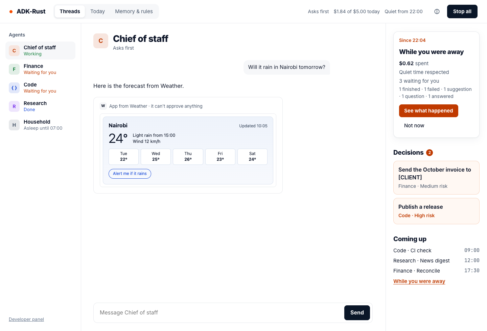
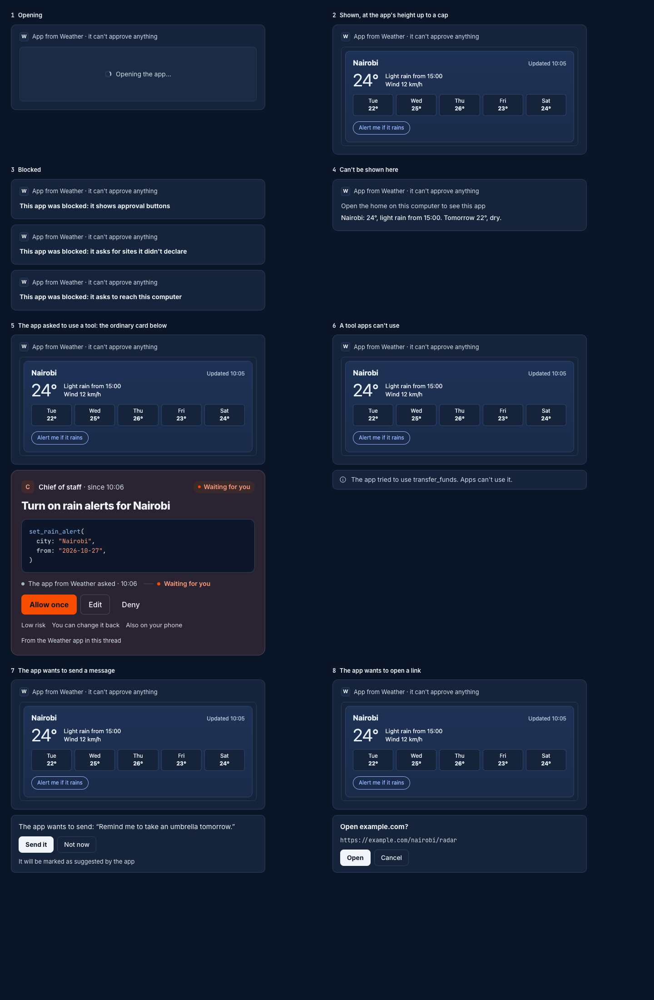

# Agent Surfaces: Agent-Drawn UI

An agent draws forms, cards, tables and screens in a person's thread with the `genui` feature
of `adk-surface` (spec 3.3 §6.1, §7.4 rule 5). A drawing never decides anything: it carries no
approval controls and none of a decision's words, and a form's **Send** never runs a tool. It
asks for the call, the drawing agent holds it for the person, and the person decides on the
home's own card, as for any held call.

| A form Finance drew (light) | Sent and allowed (dark) |
|---|---|
|  |  |

> **Note:** `genui` replaces the `adk-ui` crate, which is retired (spec 3.3 decision 11). See
> [Moving from adk-ui](#moving-from-adk-ui).

```toml
[dependencies]
adk-surface = { version = "3.0.0", features = ["web", "genui"] }
```

| Part | Feature | What it is |
|---|---|---|
| `DrawToolset` | `genui` | The render tools: `render_form`, `render_card`, `render_table`, `render_screen`, `patch_surface`, `delete_surface` |
| `Validator`, `Catalog::forms` | `genui` | Rule 5, and the `forms` 1.0 catalog the tools draw in |
| The A2UI v0.9.1 model (`A2uiMessage`, `encode_jsonl`, `decode_jsonl`) | `genui` | The wire format a drawing is stored in |
| The thread items `drawn`, `drawnRefused` and `drawnSent`, and the `submitDrawn` command | every `web` build | The page and the OpenAPI document are the same on every server; one built without `genui` never projects a drawing and answers `submitDrawn` with `surface.unsupported` |
| `GET /api/surface/genui/capabilities`, `GET /api/surface/genui/sessions/{session}/forms` | `web` and `genui` | What the home claims of A2UI, AG-UI and MCP Apps, and each sent form's state |
| The terminal's box and fill-in pane | `tui` and `genui` | See [In the terminal](#in-the-terminal) |
| `GenuiAgUi` | `genui` | Drawings as AG-UI `a2ui-surface` activities, and a form sent from an AG-UI client held as a requested call. See [Over AG-UI](#over-ag-ui) |
| `McpAppsHost`, `web::genui::apps_router`, `web::genui::refuse_apps_origin`, `web::home_with_apps_origin` | `genui-apps` | Apps from MCP servers in a thread, sandboxed on their own origin. See [Apps from MCP servers](#apps-from-mcp-servers) |
| The thread item `app` and the app routes' types | every `web` build | One built without `genui-apps` never projects an app |

`genui` pulls in no further `adk-*` crate. `genui-apps` adds `genui`, `web`, `adk-harness/mcp`
and `adk-tool/mcp-apps` (wave 4 decision 16):

```toml
[dependencies]
adk-surface = { version = "3.0.0", features = ["web", "genui-apps"] }
```

## In `adk-rust`

`adk-cli`'s `genui` feature turns it on for `adk-rust serve` and `adk-rust up`:

```bash
cargo install adk-cli --features genui
```

| Command | What `genui` adds |
|---|---|
| `adk-rust serve` | The render tools on the harness, the routes, and "Show forms and tables in your threads — sending asks you first" under what the agent can do |
| `adk-rust up` | The same for every harness the kernel hosts: the primary agent in every area and every agent a person adds (wave 4 decision 14) |

`adk-cli`'s `genui-apps` feature adds apps from the harness's MCP servers to both commands:

```bash
cargo install adk-cli --features genui-apps
```

| Flag or line | What it does |
|---|---|
| `apps from MCP servers: framed sandboxed at http://127.0.0.1:<port>` | Printed at start: the second loopback listener the apps are framed on |
| `--apps-origin https://apps.example.ts.net` | A remote home's apps origin, proxied by you to that listener; the home's page frames that origin alone, and only the page — at whatever address it was opened, `up --home-url` included — frames an app |

## Drawing

Give an agent the render tools as a toolset:

```rust,ignore
use std::sync::Arc;

use adk_harness::{HarnessAgent, HarnessMode};
use adk_surface::genui::DrawToolset;

let finance = HarnessAgent::builder("finance")
    .model(model)
    .mode(HarnessMode::Ask)
    .tool(Arc::new(send_invoice))
    .toolset(Arc::new(DrawToolset::forms()))
    .build()?;
```

`LlmAgentBuilder::toolset` takes the same toolset. The render tools are read-only and safe to
run side by side, so they need no approval in any mode.

| Tool | Draws |
|---|---|
| `render_form` | A title, fields (`text`, `longText`, `number`, `email`, `date`, `checkbox`, `choice`) and actions |
| `render_card` | A title and label and value rows |
| `render_table` | A title, column headings and rows of text or numbers |
| `render_screen` | A2UI v0.9.1 components of the `forms` catalog, one with id `root`, a data model and actions |
| `patch_surface` | The next version of a surface: data model changes, components added or replaced by id, components removed |
| `delete_surface` | Removes a surface from the thread |

A form's action names one of the agent's own tools and its arguments, each a constant or a
field's value. The render tools check the name against the tools the drawing agent's runtime
gives them (`ToolContext::agent_tool_names`, which `LlmAgent` fills), so a form bound to a tool
the agent lacks is refused when it is drawn, never after the person sends it:

```json
{
  "surfaceId": "invoice-10",
  "title": "Invoice INV-10",
  "fields": [
    { "name": "to", "label": "To", "type": "email", "required": true },
    { "name": "amount", "label": "Amount", "type": "number", "value": 4200 }
  ],
  "actions": [{
    "id": "send",
    "label": "Send",
    "tool": "send_invoice",
    "args": { "to": { "path": "/to" }, "amount": { "path": "/amount" }, "invoice": "INV-10" }
  }]
}
```

Drawing a surface again under its id makes its next version. The thread collapses an earlier
version to "Earlier version · 10:02" and says "Finance changed this form at 10:05" over the
new one.

### What a drawing may not contain

Every drawing is checked on the server before it is shown, on the strings a person reads: its
bindings, `formatString` and `pluralize` are resolved first, and a later `patch_surface` is
checked as a whole surface again.

| Refused | Code | The thread says |
|---|---|---|
| A decision's phrases anywhere — "Allow once", "Always allow", "Waiting for you", "You said yes", "You said no", "Confirm it's you", "Stop all", "Resume all", "Take over" — after folding case, look-alike and zero-width characters | `genui.refused.looks_like_decision` | "Finance tried to show something that looks like a decision. It wasn't shown." |
| A decision's single words — Edit, Deny, Done, Approve, Approved, Decided — as a whole label or heading; "Edit address" is shown (wave 4 decision 20) | `genui.refused.looks_like_decision` | The same |
| A password or other secret field | `genui.refused.asks_for_secret` | "Finance asked for a password in a form. Use Take over for passwords." |
| A component outside the catalog, a link, an undeclared action, an action naming a render tool or a kernel tool, more than the limits (`MAX_COMPONENTS`, `MAX_DEPTH`, `MAX_TEXT_CHARS`, `MAX_DRAWING_BYTES`, `MAX_ACTIONS`) | `genui.refused.cannot_show` | "Finance tried to show something this home can't show." |

A refused drawing is a tool error: the agent reads why and what to draw instead. The thread
shows the plain notice above, and the technical reason — "catalog forms 1.0 · component c7
Button · label matches reserved word "Allow once" after normalisation" — stays in the
developer panel's **Protocols** tab.

The `forms` 1.0 catalog is the A2UI v0.9.1 basic catalog without `Image`, `Icon`, `Modal`,
`Video` and `AudioPlayer`: `Text`, `Row`, `Column`, `List`, `Card`, `Tabs`, `Divider`, `Button`,
`TextField`, `CheckBox`, `ChoicePicker`, `Slider` and `DateTimeInput`.

### Only a render tool draws

A render tool records each drawing it makes in the event's state, under
`adk.surface.drawn` (`surfaceId`, `version` and the digest of the drawing). The thread shows
a drawing only when its event carries that record and the digest matches; a tool of the same
name without it, such as an MCP server's `render_form`, is shown as an ordinary tool result.
The web home and the full-screen terminal show a drawing in place of its render call, with no
"Render form" step.

## Sending a form

**Send** checks each field as the server will, then posts the version the person saw:

```json
{
  "surface": "web",
  "origin": { "kind": "pointer" },
  "command": {
    "type": "submitDrawn",
    "sessionId": "s1",
    "surfaceId": "invoice-10",
    "version": 1,
    "actionId": "send",
    "values": { "/to": "ana@example.com", "/amount": 4200 }
  }
}
```

The engine checks, in order:

1. The session is the caller's; another person's answers `404` (S-I8).
2. The caller is a person at a screen: origin `keyboard`, `pointer` or `touch`. An agent, chat
   or voice answers `403` with `surface.not_here`.
3. The version is the surface's latest: an older one answers `409` with
   `surface.drawn_changed`, and the form reads "Couldn't send: this form changed — check it and
   send again".
4. The action is declared on that version, and the form was not sent already (`surface.invalid`).
5. Each value fits its field's type and checks (`surface.invalid`).
6. No turn of the thread is running and no input waits for one: "Couldn't send: your agent is
   still working in this thread — send it when it's done" (`surface.invalid`), so the call's
   run never writes the session beside another.
7. No send of the same version is on its way to the agent: "Couldn't send: this form is being
   sent already" (`surface.invalid`).

The arguments come from the stored drawing: a constant such as `"invoice": "INV-10"` is
never read from the request. The engine writes a `surface.drawn.submitted` audit record —
`sessionId`, `surfaceId`, `version`, `actionId`, `tool`, `argsDigest` (the audit trail's
digest of the call's arguments, as the call's approval records carry it), `valuesDigest`,
`callId` and `drawnBy`, never the values — and then asks for the call
(`Source::request_call`). The answer is `formSent` with the call's ID; nothing has run.

### Held as the drawing agent

The call is an `adk_core::RequestedCall`, held for the person as the agent that drew the form,
inside that agent's own runtime:

| Source | Where the call is held |
|---|---|
| `LocalSource` over a kernel | A durable run in the target of the session's latest run — an area's or an added agent's — parked until the decision wakes it on any surface |
| `LocalSource` over a harness | `Harness::send_requested` |
| `ControlSource` | A run spawned over the kernel's control plane, so the terminal attached to `adk-rust up` sends forms too |

The agent authorizes the call under its own policy, standing rules, acting context and
approval store, as `GovernedCall::requested`, and the run ends without a model call. The
model reads the call through a runtime notice of what the person did, never as a call it made
itself and never as the person's own words: the arguments hold constants the agent drew, so
they and the call's answer arrive inside `<untrusted-content>` blocks, and nothing is written
in the person's name for long-term memory to quote. See
[Calls a Person Asks For](../security/tool-authorization.md#calls-a-person-asks-for).

| Situation | What happens |
|---|---|
| Go ahead, a standing rule allowing the tool, an earlier approval of the identical call, or a confirmation handler | It still waits for the person: pressing **Send** is never the approval (wave 4 decision 12) |
| The agent's policy denies the tool | Nothing is held and no inbox entry is made; the form reads "Finance can't use send_invoice here" and can be changed and sent again |
| A rule tightened before the person answers | Refused when it resumes: "Not run: Finance can't use send_invoice any more" |
| **Allow once** | The parked run wakes in its own target and the tool runs once, with the arguments the card showed |

The decision's card is the ordinary card, with "How it got here" starting "You pressed Send
on a form Finance drew · 10:03" and the line "From a form Finance drew". It offers **Allow
once**, **Edit** and **Deny**, never **Always allow**: a standing rule would let the model call
the tool unasked, which is not what the person decided on a form. A high-risk call still needs
"Confirm it's you".

| Waiting (light) | Waiting (dark) |
|---|---|
|  |  |

### The form after it is sent

The form turns read-only, its decision is drawn under it, and it says where the call is.
`GET /api/surface/genui/sessions/{session}/forms` returns the same, and
`adk_surface::genui::form_states` computes it from a thread.

| Sent call | The form says |
|---|---|
| Held, its decision open | "Sent at 10:03 · waiting for you" |
| Answered yes, still running | "Sent at 10:03" |
| Ran | "Sent · done at 10:04" |
| Ran and failed | "Sent · failed" |
| Answered no | "Sent · you said no" |
| Refused by the agent's rules before it was held | "Finance can't use send_invoice here" |
| Refused when it resumed | "Not run: Finance can't use send_invoice any more" |
| Ended without an answer | "Ended without an answer" |

## In the web home

A drawing sits on the card background with the agent and time over it — "Drawn by Finance ·
10:02" — and never in a decision's colours or pills. Its strings are text: no markup, no
control characters, and a link is never followed. A table shows ten rows and **Show all 42**.
Under a form's buttons, "Sending runs `send_invoice` and asks you first".

| Cards and tables (light) | Refused (dark) |
|---|---|
|  |  |

The developer panel's **Protocols** tab shows `GET /api/surface/genui/capabilities` — each
claim with its status and scope, the catalog and what it leaves out — and the session's refused
drawings with their technical reasons.


| Protocol | Claim | Status |
|---|---|---|
| A2UI (`a2ui`) | Version 0.9.1 | Supported |
| A2UI | Version 1.0 | Candidate |
| A2UI | Trusted component catalog; no approval controls in drawn UI | Supported (security) |
| AG-UI (`ag_ui`) | a2ui-surface activity; interrupts for a drawn submit | Supported (transport) where `GenuiAgUi` is set; planned, "Not set on this server", where not |
| MCP Apps (`mcp_apps`) | Version 2026-01-26; app tool calls governed | Supported with `genui-apps` where an apps host is mounted; planned without |
| MCP Apps | Sandbox and CSP | Host-owned with `genui-apps` where an apps host is mounted |
| MCP Apps | Fullscreen and picture-in-picture | Planned |

The phone app shows the decision a form asks for, as any decision; it has no thread view, so the drawing itself is shown in the web home and the terminal. Chat
cards and push notifications never carry a drawing.

## In the terminal

The full-screen terminal draws a drawing as a bordered box in the normal border colour, with
"drawn by Finance · forms · rev 1" and the fields as aligned pairs. **ctrl-f** opens the
thread's latest form in the right pane (wave 4 decision 19):

| Key | In the fill-in pane |
|---|---|
| Tab, ↑, ↓ | Move between fields |
| Any character, including `y`, `n`, `e` and `a` | Types into the field; no key answers a decision here |
| Space | Toggles a checkbox, moves to the next choice |
| Enter | Checks the fields and shows the call: `send_invoice(to: "ana@example.com", amount: 4200, invoice: "INV-10") · asks you first` |
| Enter again | Sends it |
| Esc | Back to the fields, then out of the pane |

`--ui inline` prints a drawing into the scrollback as a plain block. A refused drawing is its
notice, with the technical reason on a muted second line. `--output json` adds three line types:

| `type` | Fields |
|---|---|
| `drawn` | `session`, `surface`, `version`, `by`, `catalog`, `kind`, `title`, `deleted` |
| `drawn.submitted` | `session`, `surface`, `version`, `action`, `tool`, `held`, `decision` |
| `drawn.refused` | `session`, `by`, `reason`, `component`, `detail` |
| `app` | `session`, `call`, `server`, `tool`, `by`, `text` |
| `app.asked` | `session`, `call` (the app's), `tool`, `held`, `decision`: a call the app asked for |

An app from an MCP server is never framed in a terminal: it is "app from Weather · open it in
the home" and the tool's text result, in place of the call that showed it; a call the app
asked for is "The app asked · 10:06". Every string passes the terminal's escape filter.

## Mounting it on your own server

```rust,ignore
use std::sync::Arc;

use adk_server::ServerBuilder;
use adk_surface::{GrantedUse, SurfaceEngine, words};

let engine = SurfaceEngine::builder(Arc::new(source))
    .grant(GrantedUse::new("genui", words::SHOW_FORMS_AND_TABLES))
    .build();
let app = ServerBuilder::new(config)
    .add_api_routes(adk_kernel::control::router(kernel))
    .add_api_routes(adk_surface::web::router(engine.clone()))
    .add_api_routes(adk_surface::web::genui::router(engine))
    .add_root_routes(adk_surface::web::home())
    .build();
```

`genui::router` claims A2UI only: AG-UI and MCP Apps read "Not set on this server" on the
Protocols tab. A host that sets `GenuiAgUi` or mounts an apps host says so with
`genui::router_wired(engine, GenuiWiring { ag_ui: true, mcp_apps: true })`.

`examples/scripted_genui.rs` is a complete home over a kernel and a scripted model: Finance
draws the invoice form, then a screen with an "Allow once" button, which is refused.

```bash
cargo run -p adk-surface --features web,genui --example scripted_genui -- 8805 /tmp/genui-home
```

## Over AG-UI

`GenuiAgUi` plugs drawings into `adk-server`'s protocol-native AG-UI runs through the AG-UI
extension point (`ServerBuilder::with_ag_ui_extension`), so `adk-server` gains no
`adk-surface` dependency:

| On an `ag_ui` run | What happens |
|---|---|
| A render tool's result | An `ACTIVITY_SNAPSHOT` with `activityType: "a2ui-surface"` and `content.a2ui_operations`, for a drawing the event proves and the validator passes again |
| An `a2ui-surface` activity the client sends back | Kept only when it passes the validator again; dropped otherwise, from the stream, the session state and the messages snapshot |
| `forwardedProps.a2uiAction` (`surfaceId`, `version`, `actionId`, `values`) | The governed send: checked against the stored drawing as `submitDrawn` is, recorded as `surface.drawn.submitted`, and held by the run's agent as a requested call, so the run ends with the `tool_call` interrupt and nothing runs. A form another agent drew answers `403 surface.not_here`: its drawing agent holds it, in its own target |
| `GET /api/ui/capabilities` | `ag_ui` lists `a2ui_activity` |

```rust,ignore
use std::sync::Arc;

use adk_server::ServerBuilder;
use adk_surface::genui::GenuiAgUi;

let app = ServerBuilder::new(config)
    .with_ag_ui_extension(Arc::new(GenuiAgUi::new().with_audit(trail)))
    .build();
```

The activity's shape follows a community convention for A2UI over AG-UI, not a specification;
`adk-surface/tests/genui_ag_ui_activity.json` pins it.

## Apps from MCP servers

With `genui-apps`, an MCP server's tool that declares an app (`_meta.ui.resourceUri`, MCP Apps
2026-01-26) shows it in the thread, under "App from Weather · it can't approve anything", on
the card background. The app only ever asks; the person's own press does what it asked for
(wave 4 decision 15).

| An app in a thread (light) | Every state (dark) |
|---|---|
|  |  |

**Only the MCP tool's own call shows an app.** `McpToolset` writes the `adk.mcp.app` record
when a tool with an app succeeds; a same-named tool without it is an ordinary result. A tool
only an app may call (`visibility: ["app"]`) is left out of the model's tools.

**Before it is framed**, the host reads the `ui://` resource from the server that published the
tool and checks it. A failed check blocks the app, writes `surface.app.blocked`, and shows the
reason:

| Check | Blocked as |
|---|---|
| The MIME type is `text/html;profile=mcp-app` | "This app was blocked: it isn't an app this home can show" |
| No declared site is this computer, its network, the home's own origin or the origin of the page that opens it (`http://localhost`, `http://127.0.0.1`, private ranges, a bracketed host that is not an IPv6 address, `*.ts.net` tailnet names, and a wildcard over any of them included) | "This app was blocked: it asks to reach this computer" |
| The HTML loads and connects to declared sites only | "This app was blocked: it asks for sites it didn't declare" |
| A best-effort scan finds no decision's words ("Allow once", "Approved", …) | "This app was blocked: it shows approval buttons" |

**Framed on its own origin.** The app's page is served by a second listener, under a content
security policy built from what passed and `frame-ancestors` naming the home: its own origins
and the origin of the page that opened the app, from the request's `Host` with the apps
origin's scheme, so a remote home behind `--apps-origin` and a home listening on every
interface both frame it. A page whose policy cannot be sent is not served. The home's page
adds `frame-src` for that origin only. The frame is `sandbox="allow-scripts"`: no same-origin
access, forms, popups or navigation of the page. The surface API answers every request whose
`Origin` is the apps origin, or the opaque `null` a sandboxed frame sends, `403
surface.not_here`, whatever `SecurityConfig` admits (`refuse_apps_origin`);
`refuse_apps_origin_recorded` also records `surface.app.origin_refused`, at most once a minute
with the number refused since, so a page that keeps trying cannot fill the trail.

**What an app asks** reaches the home through the page, one request at a time:

| Request | Answer |
|---|---|
| `ui/initialize`, `ping` | Answered; display mode inline |
| `tools/call` for a tool its own server publishes for both the model and the app, a tool that declares no `_meta.ui` included | Asked of the agent whose call showed the app as a requested call, by the name the agent knows that server's tool by (`surface.app.call_asked`), and answered once the agent holds it — the ordinary card follows the app, its first step "The app from Weather asked · 10:06", its detail "From the Weather app in this thread", never **Always allow**; `surface.app.call_held` — or refuses it (`surface.app.call_refused`, by the agent). The same call again is the decision already waiting; an app with three calls waiting is told "The app already asked for 3 things. Answer those first." |
| `tools/call` for a model-only tool, another server's tool, or one the agent is not given | Refused: "The app tried to use transfer_funds. Apps can't use it."; `surface.app.call_refused` |
| `tools/call` whose name is not a tool's name | A malformed request: nothing it sent is shown or recorded |
| `tools/call` when the app's server does not list its tools | "The app's server didn't answer. Try again in a moment.": not a refusal |
| `tools/call` for an app-only tool | Refused: "This app needs a tool this home can't run yet" |
| `ui/message` | "The app wants to send: “…”" with **Send it** and **Not now**; **Send it** sends it as the person's message inside an untrusted-content block labelled "Suggested by the Weather app", which the model reads and every surface shows as the message with "Suggested by the Weather app" under it; `surface.app.message_sent` |
| `ui/open-link` | "Open example.com?" with **Open** and **Cancel**; only **Open** opens it. A link to this computer or its network (loopback, `0.0.0.0`, private and link-local addresses, IPv4 inside IPv6, `.local` and single-label names) is refused, on the server and again on the page |
| `ui/update-model-context` | Logged, never forwarded to the model |
| Anything else | "not supported here" |

**Where it is not framed** — the phone, the terminal, a home without an apps origin, or a page
opened on another device when the apps origin is this computer — the app is "Open the home on
this computer to see this app" and the tool's text result.

Mount the host on your own server:

```rust,ignore
use std::sync::Arc;

use adk_surface::genui::{GenuiWiring, McpAppsHost};

let host = McpAppsHost::builder()
    .servers(manager) // Arc<adk_tool::mcp::McpServerManager>
    .apps_origin("http://127.0.0.1:41234")
    .home_origin("http://127.0.0.1:8080")
    .build();
let sandbox = host.sandbox_router(); // serve on the apps origin's own listener
let wiring = GenuiWiring { ag_ui: false, mcp_apps: true };
let app = ServerBuilder::new(config)
    .add_api_routes(adk_surface::web::router(engine.clone()))
    .add_api_routes(adk_surface::web::genui::router_wired(engine.clone(), wiring))
    .add_api_routes(adk_surface::web::genui::apps_router(engine, host))
    .add_root_routes(adk_surface::web::home_with_apps_origin("http://127.0.0.1:41234"))
    .build();
let app = adk_surface::web::genui::refuse_apps_origin_recorded(app, "http://127.0.0.1:41234", trail);
```

The renderer is also a React package, `@zavora-ai/adk-surface-react` (`adk-surface/react`),
which exports `DrawnView`, `RefusedNotice`, `AppFrame` and the A2UI parser.

## Moving from adk-ui

`adk-ui` 2.2.0 is built on `adk-core` 2, so an ADK-Rust 3 agent cannot register its tools.
The render tools of `genui` take their place:

| `adk-ui` | `genui` |
|---|---|
| `render_form` | `render_form`; an action names one of the agent's tools and asks the person before it runs |
| `render_card` | `render_card` |
| `render_table` | `render_table` |
| `render_screen`, `render_page`, `render_layout` | `render_screen`, with the `forms` catalog's components |
| `render_confirm` | None: a drawing never asks for a yes. A call that needs one is held by the agent's policy or `require_tool_confirmation`, and decided on the home's card |
| `render_alert`, `render_toast` | The agent's reply, or `render_card` with a note |
| `render_progress` | `render_card`, then `patch_surface` as the work moves |
| `render_chart` | `render_table`; charts are not in the catalog |
| `render_modal` | None: `Modal` is not in the catalog |
| `render_kit` | None: the home's catalog and tokens are fixed |
| `render_app` | Apps from MCP servers (`genui-apps`): the server's tool declares the app, and the home frames it sandboxed |
| `save_surface`, `load_surface`, `list_surfaces` | None needed: every drawing is an event of the session, versioned by its surface id |
| `patch_surface`, `delete_surface` | `patch_surface`, `delete_surface` |
| `@zavora-ai/adk-ui-react` | `@zavora-ai/adk-surface-react`, the web home's renderer; the terminal draws drawings as boxes |
| The `adk_ui` profile of `adk-server` | Still served for existing clients, deprecated, with a sunset target of 2026-12-31 (`GET /api/ui/capabilities`) |

The catalog id is `https://adk-rust.com/a2ui/catalogs/forms/1.0/catalog.json`, in place of
`zavora.ai:adk-ui/extended@0.2.0`.

## Related

- [The Engine](index.md) — the `submitDrawn` command, its error codes and its audit record
- [The Web Home](web-home.md) — threads, cards and the developer panel
- [The Terminal](terminal.md) — full screen, inline and JSON lines
- [Tool Authorization](../security/tool-authorization.md#calls-a-person-asks-for) — requested calls and how they are held
- [Scenarios](scenarios.md#governed-form) — the governed form and the hostile app, end to end
- [MCP Tools](../tools/mcp-tools.md#mcp-apps) — `mcp-apps` on the client
- [UI Tools](../tools/ui-tools.md) — the render tools and the server's UI protocol profiles
