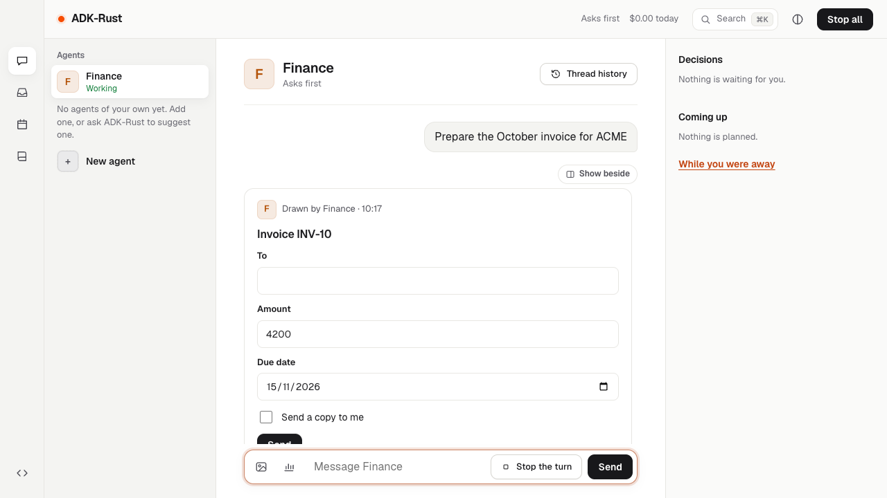
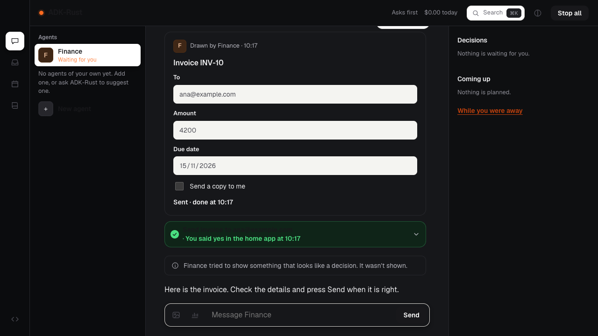
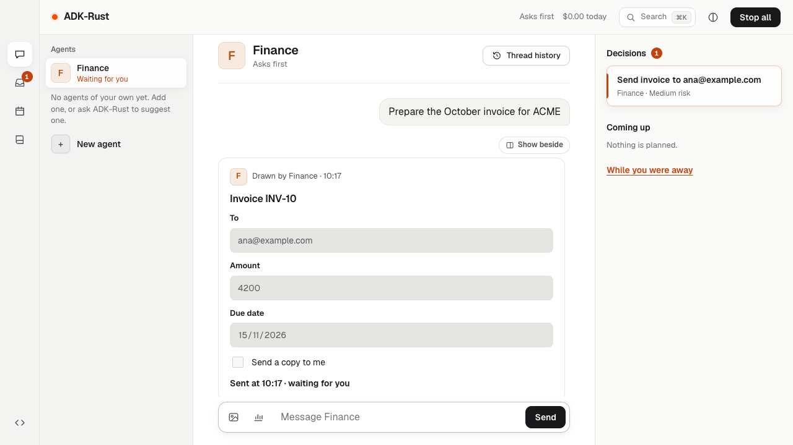
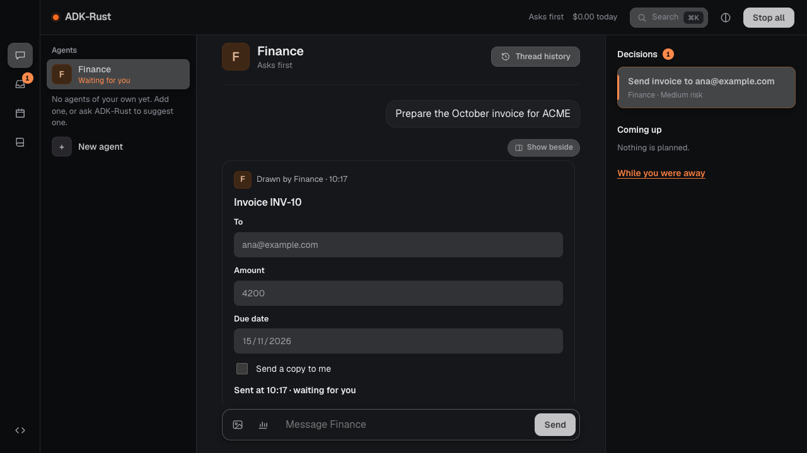
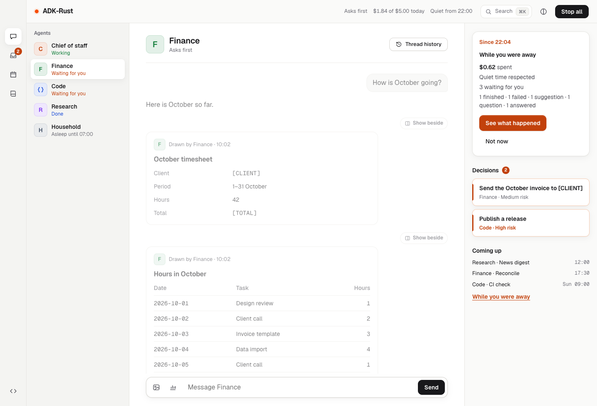
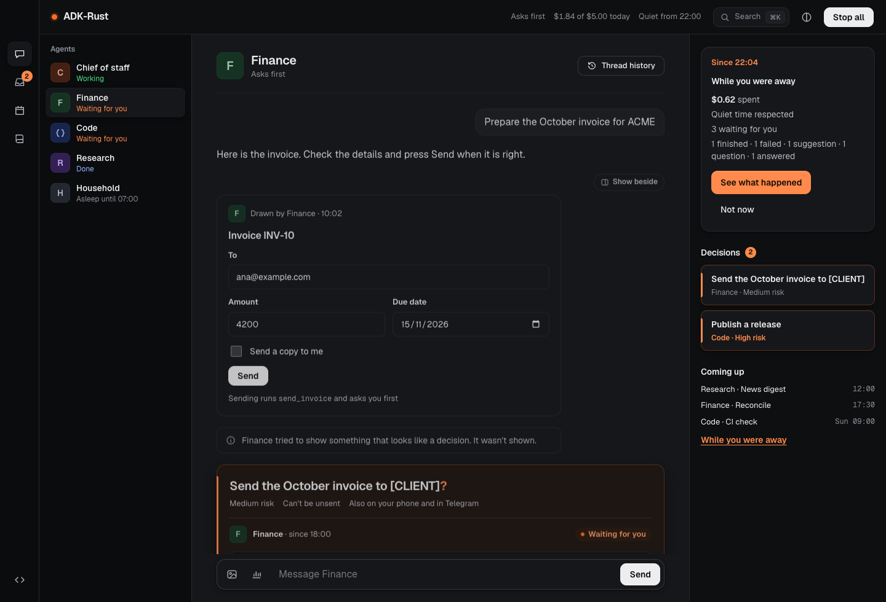
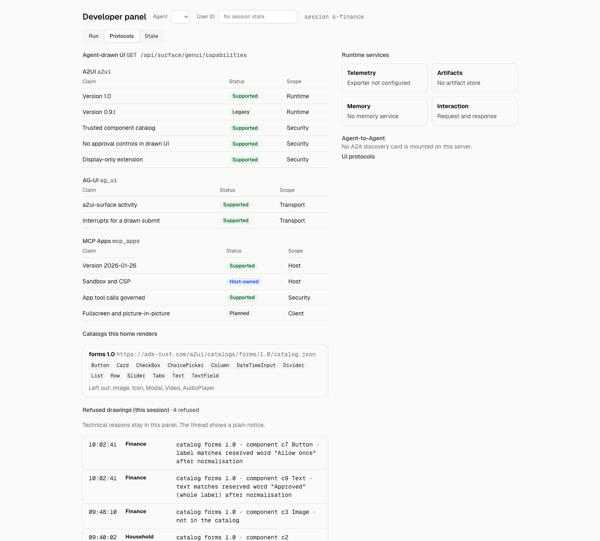
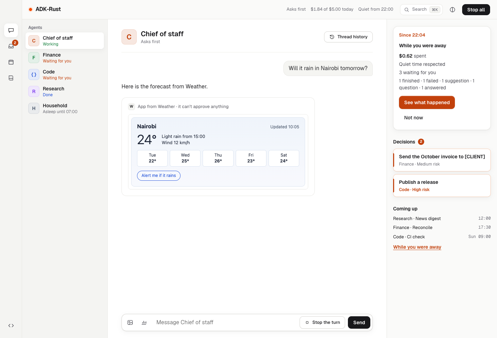
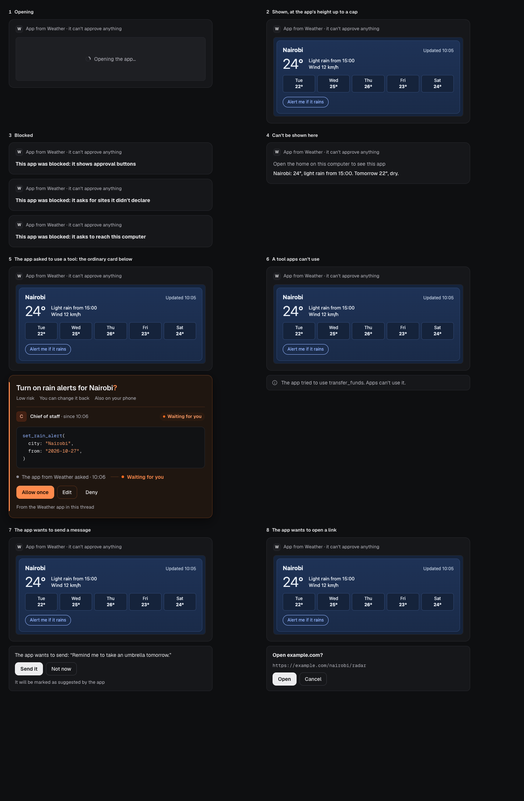

# Agent Surfaces: Agent-Drawn UI

An agent draws forms, cards, tables and screens in a person's thread with the `genui` feature
of `adk-surface` (spec 3.3 §6.1, §7.4 rule 5). A drawing never decides anything: it carries no
approval controls and none of a decision's words, and a form's **Send** never runs a tool. It
asks for the call, the drawing agent holds it for the person, and the person decides on the
home's own card, as for any held call.

| A form Finance drew (light) | Sent and allowed (dark) |
|---|---|
|  |  |

> **Note:** `genui` replaces `adk-ui` 2's render tools and protocol adapters (spec 3.3 decision
> 11). `adk-ui` 3 builds on `genui` instead: it adds charts, metrics, pages and scenes as
> [extension catalogs](#extension-catalogs). See [Moving from adk-ui 2](#moving-from-adk-ui-2).

```toml
[dependencies]
adk-surface = { version = "3.0.0", features = ["web", "genui"] }
```

| Part | Feature | What it is |
|---|---|---|
| `DrawToolset` | `genui` | The render tools: `render_form`, `render_card`, `render_table`, `render_screen`, `patch_surface`, `delete_surface` |
| `DrawnEnvelope::delta_from`, `MAX_PATCHES_PER_MINUTE` | `genui` | Incremental A2UI messages between two versions; the patch budget. See [Drawing](#drawing) |
| `Validator`, `Catalog::forms` | `genui` | Rule 5, and the `forms` 1.0 catalog the tools draw in |
| The A2UI v0.9.1 model (`A2uiMessage`, `encode_jsonl`, `decode_jsonl`) | `genui` | The internal form a drawing is stored and checked in |
| `A2uiVersion`, `to_wire`, `from_wire`, `components_in` | `genui` | A2UI 1.0 (the default) and v0.9.1 on the wire. See [A2UI versions](#a2ui-versions) |
| `drawn_tree` | `genui` | What a renderer draws of a validated drawing: its `DrawnNode` tree, resolved and checked, as the home projects it |
| `slack_blocks`, `adaptive_card`, `submit_from_slack`, `submit_from_teams` | `genui` | Drawings as Slack Block Kit and Teams Adaptive Cards, and their presses as `SubmitDrawn`. See [In Slack and Teams](#in-slack-and-teams) |
| `read_function_message`, `FunctionInvocation`, `FunctionResponse`, `INVALID_FUNCTION_CALL` | `genui` | A2UI 1.0 function calls read, and answered `INVALID_FUNCTION_CALL`. See [A2UI versions](#a2ui-versions) |
| `ValidationResult`, `Severity` | `genui` | A refusal, or a warning, in A2UI 1.0's `ValidationResult` shape |
| The thread items `drawn`, `drawnRefused` and `drawnSent`, and the `submitDrawn` command | every `web` build | The page and the OpenAPI document are the same on every server; one built without `genui` never projects a drawing and answers `submitDrawn` with `surface.unsupported` |
| `GET /api/surface/genui/capabilities`, `GET /api/surface/genui/sessions/{session}/forms` | `web` and `genui` | What the home claims of A2UI, AG-UI and MCP Apps, and each sent form's state |
| The terminal's box and fill-in pane | `tui` and `genui` | See [In the terminal](#in-the-terminal) |
| `GenuiAgUi` | `genui` | Drawings as AG-UI `a2ui-surface` activities, and a form sent from an AG-UI client held as a requested call. See [Over AG-UI](#over-ag-ui) |
| `McpAppsHost`, `web::genui::apps_router`, `web::genui::refuse_apps_origin`, `web::home_with_apps_origin` | `genui-apps` | Apps from MCP servers in a thread, sandboxed on their own origin. See [Apps from MCP servers](#apps-from-mcp-servers) |
| The thread item `app` and the app routes' types | every `web` build | One built without `genui-apps` never projects an app |
| `Catalog::extend`, `ExtensionComponent`, `Catalogs` | `genui` | Extension catalogs: `forms` plus another crate's components. See [Extension catalogs](#extension-catalogs) |
| `DrawnChart`, `DrawnExtension` and the `chart` and `extension` fields of a drawn node | every `web` build | What the home draws for a component of an extension catalog |
| `HomeNode::Scene`, `HomeNode::Depth`, `DrawnScene`, `DrawnDepth` and the `scene` and `depth` fields of a drawn node | `genui`; the drawn types in every `web` build | A 3D scene or a depth effect an extension component shows. See [Scenes and depth](#scenes-and-depth) |

`genui` pulls in no further `adk-*` crate. `genui-apps` adds `genui`, `web`, `adk-harness/mcp`
and `adk-tool/mcp-apps` (wave 4 decision 16):

```toml
[dependencies]
adk-surface = { version = "3.0.0", features = ["web", "genui-apps"] }
```

## In `adk-rust`

`adk-cli`'s `genui` feature turns it on for `adk-rust serve` and `adk-rust up`:

```bash
cargo install adk-cli --features genui
```

| Command | What `genui` adds |
|---|---|
| `adk-rust serve` | The render tools on the harness, the routes, and "Show forms and tables in your threads — sending asks you first" under what the agent can do |
| `adk-rust up` | The same for every harness the kernel hosts: the primary agent in every area and every agent a person adds (wave 4 decision 14) |

`adk-cli`'s `genui-apps` feature adds apps from the harness's MCP servers to both commands:

```bash
cargo install adk-cli --features genui-apps
```

| Flag or line | What it does |
|---|---|
| `apps from MCP servers: framed sandboxed at http://127.0.0.1:<port>` | Printed at start: the second loopback listener the apps are framed on |
| `--apps-origin https://apps.example.ts.net` | A remote home's apps origin, proxied by you to that listener; the home's page frames that origin alone, and only the page — at whatever address it was opened, `up --home-url` included — frames an app |

## Drawing

Give an agent the render tools as a toolset:

```rust,ignore
use std::sync::Arc;

use adk_harness::{HarnessAgent, HarnessMode};
use adk_surface::genui::DrawToolset;

let finance = HarnessAgent::builder("finance")
    .model(model)
    .mode(HarnessMode::Ask)
    .tool(Arc::new(send_invoice))
    .toolset(Arc::new(DrawToolset::forms()))
    .build()?;
```

`LlmAgentBuilder::toolset` takes the same toolset. The render tools are read-only and safe to
run side by side, so they need no approval in any mode.

| Tool | Draws |
|---|---|
| `render_form` | A title, fields (`text`, `longText`, `number`, `email`, `date`, `checkbox`, `choice`) and actions |
| `render_card` | A title and label and value rows |
| `render_table` | A title, column headings and rows of text or numbers |
| `render_screen` | A2UI components of the `forms` catalog, in 1.0's syntax or v0.9.1's, one with id `root`, a data model and actions |
| `patch_surface` | The next version of a surface: data model changes, components added or replaced by id, components removed |
| `delete_surface` | Removes a surface from the thread |

A form's action names one of the agent's own tools and its arguments, each a constant or a
field's value. The render tools check the name against the tools the drawing agent's runtime
gives them (`ToolContext::agent_tool_names`, which `LlmAgent` fills), so a form bound to a tool
the agent lacks is refused when it is drawn, never after the person sends it:

```json
{
  "surfaceId": "invoice-10",
  "title": "Invoice INV-10",
  "fields": [
    { "name": "to", "label": "To", "type": "email", "required": true },
    { "name": "amount", "label": "Amount", "type": "number", "value": 4200 }
  ],
  "actions": [{
    "id": "send",
    "label": "Send",
    "tool": "send_invoice",
    "args": { "to": { "path": "/to" }, "amount": { "path": "/amount" }, "invoice": "INV-10" }
  }]
}
```

Drawing a surface again under its id makes its next version. The thread collapses an earlier
version to "Earlier version · 10:02" and says "Finance changed this form at 10:05" over the
new one.

**Live updates.** `patch_surface`'s result says what changed (`"changed": {"components": [...],
"data": ["/total"]}`), so the agent can tell a real change from an empty one. A surface takes at
most `MAX_PATCHES_PER_MINUTE` (30) patches a minute; past that the patch is refused and the
agent is told to put its changes in one patch, so a view refreshed every two seconds fits and a
model patching in a loop does not redraw the person's thread faster than it can be read.

Each version's envelope keeps the whole drawing, so its digest and what a person approves stay
whole. A transport that knows which version a renderer holds (a socket, an A2A task) can send
`DrawnEnvelope::delta_from(&previous)` instead: one `updateComponents` with the new or changed
components and an `updateDataModel` per changed data path, written in 1.0 or v0.9.1 by
`to_wire` like any drawing. `None` means there is no sound base (a removal, another surface or
catalog, or an older version), and the whole drawing is sent. AG-UI activities stay whole
snapshots, because an extension cannot know which version a client holds.

### A2UI versions

A drawing is stored and checked in one internal form, and written in the version a renderer
speaks: A2UI 1.0 by default, v0.9.1 for a renderer that offers nothing newer.

| | A2UI 1.0 | v0.9.1 |
|---|---|---|
| A binding | `{"@path": "/to"}` | `{"path": "/to"}` |
| A function call | `{"@call": "formatNumber", "args": {…}}` | `{"call": "formatNumber", "args": {…}}` |
| Accessibility and checks | `@accessibility`, `@checks` | `accessibility`, `checks` |
| A new surface | one `createSurface` carrying `components` and `dataModel` | `createSurface`, `updateComponents`, `updateDataModel` |
| An extension component | `@catalogId` names its catalog; the surface's default is `forms` | the drawing's one catalog |
| Removing a data path | `updateDataModel` with `value: null` | no `value` |
| The display-only claim | `createSurface.metadata.extensions.adkrust_display_only: {"version": "1.0"}` | none |

Every 1.0 surface claims the `adkrust_display_only` extension (`DISPLAY_ONLY_EXTENSION`): the
surface only shows, no string in it reads as a decision, a secret or a link, and a send only
asks the home for a call the person decides on a card the home draws. The rules, the approval
card's minimum content and a watch list are in
[the extension's design note](https://github.com/zavora-ai/adk-rust/blob/main/docs/design/a2ui-extension-display-only.md).
A renderer that does not know the key ignores it, as A2UI 1.0 requires.

`render_screen` and `patch_surface` read components in either syntax. `GenuiAgUi` writes
drawings in 1.0 (`with_a2ui_version(A2uiVersion::V0_9_1)` for an older client) and reads
activities a client sends back in either. Reading 1.0 refuses what would change meaning in the
internal form: an unknown `@` key, a literal object whose only key is `path` or that has a
`call` key, `@metadata`, `@index`, `theme`, and surface metadata other than the display-only
claim. A refusal comes with A2UI 1.0's
`ValidationResult` (`{"valid": false, "severity": "error", "code": …, "message": …}`) after its
plain-words message.

**Function calls.** A2UI 1.0 lets an agent ask a renderer to run a catalog function
(`callRendererFunction`) and a renderer ask the agent (`callAgentFunction`). `genui` offers
neither: every `forms` function is `rendererOnly` (checks and formatting the renderer evaluates
while it draws), and the agent offers no functions. `read_function_message` reads a call or an
answer, and `FunctionInvocation::refusal` writes the answer 1.0 requires, an
`INVALID_FUNCTION_CALL` error with the reason, to send back with the same `functionCallId`.
`from_wire` refuses a function message in a drawing and points to `read_function_message`.

### Accessibility

What assistive technology reads is part of the drawing (A2UI 1.0 `@accessibility`): a label
and a description, checked by rule 5 like any shown text; `live` (`polite` or `assertive`)
for values that change; `hidden` for decoration, never on a field or a button. Every surface
gets them resolved on `DrawnNode.accessibility` (`DrawnAccessibility`); the web home puts them
on the element (a labelled container is a named group), says each drawing once to a screen
reader as it arrives ("Drawn by Finance: Invoice INV-10"), and gives every chart a **Show the
data** table beside the sentence the server wrote for it. A label that names nothing
("button", "icon", empty) is a `genui.warned.accessibility` warning.

### What a drawing may not contain

Every drawing is checked on the server before it is shown, on the strings a person reads: its
bindings, `formatString` and `pluralize` are resolved first, and a later `patch_surface` is
checked as a whole surface again.

| Refused | Code | The thread says |
|---|---|---|
| A decision's phrases anywhere — "Allow once", "Always allow", "Waiting for you", "You said yes", "You said no", "Confirm it's you", "Stop all", "Resume all", "Take over" — after folding case, look-alike and zero-width characters | `genui.refused.looks_like_decision` | "Finance tried to show something that looks like a decision. It wasn't shown." |
| A decision's single words — Edit, Deny, Done, Approve, Approved, Decided — as a whole label or heading; "Edit address" is shown (wave 4 decision 20) | `genui.refused.looks_like_decision` | The same |
| A password or other secret field | `genui.refused.asks_for_secret` | "Finance asked for a password in a form. Use Take over for passwords." |
| A component outside the catalog, a link, an undeclared action, an action naming a render tool or a kernel tool, more than the limits (`MAX_COMPONENTS`, `MAX_DEPTH`, `MAX_TEXT_CHARS`, `MAX_DRAWING_BYTES`, `MAX_ACTIONS`) | `genui.refused.cannot_show` | "Finance tried to show something this home can't show." |
| A button that speaks as the person (A2UI 1.0 `userMessage`), a field or button hidden from screen readers (`accessibility.hidden`), an echoed surface that asks for the whole data model on every message (`sendDataModel`) | `genui.refused.cannot_show` | The same |

A refused drawing is a tool error: the agent reads why and what to draw instead. The thread
shows the plain notice above, and the technical reason — "catalog forms 1.0 · component c7
Button · label matches reserved word "Allow once" after normalisation" — stays in the
developer panel's **Protocols** tab.

**Shown, with warnings.** Wording that pressures a person instead of informing them is
shown, and the drawing agent is told what to change: the render tool's result carries A2UI 1.0
`ValidationResult` warnings (`"severity": "warning"`) and its message ends "Change it: …".

| Warned | Code |
|---|---|
| False urgency: "act now", "hurry", "last chance", "ends tonight" | `genui.warned.urgency` |
| Scarcity: "left in stock", "almost gone", "selling fast" | `genui.warned.scarcity` |
| Fake social proof: "12 people are viewing", "others bought", "trending now" | `genui.warned.social_proof` |
| Confirmshaming: "No thanks, I don't want to save money" | `genui.warned.confirmshaming` |
| A countdown: "ends in 04:59", "expires in 10 minutes" | `genui.warned.countdown` |
| Text that passes for the home's own controls: "system message", "session expired", "verify your identity" | `genui.warned.host_imitation` |

The phrases are matched on folded words, as rule 5 matches; `dark_patterns` runs them over a
drawing's resolved texts. They warn rather than refuse until their false positives are known:
none of `adk-ui`'s eleven sample drawings raises one.

The `forms` 1.0 catalog is the A2UI v0.9.1 basic catalog without `Image`, `Icon`, `Modal`,
`Video` and `AudioPlayer`: `Text`, `Row`, `Column`, `List`, `Card`, `Tabs`, `Divider`, `Button`,
`TextField`, `CheckBox`, `ChoicePicker`, `Slider` and `DateTimeInput`.

### Only a render tool draws

A render tool records each drawing it makes in the event's state, under
`adk.surface.drawn` (`surfaceId`, `version` and the digest of the drawing). The thread shows
a drawing only when its event carries that record and the digest matches; a tool of the same
name without it, such as an MCP server's `render_form`, is shown as an ordinary tool result.
The web home and the full-screen terminal show a drawing in place of its render call, with no
"Render form" step.

## Sending a form

**Send** checks each field as the server will, then posts the version the person saw:

```json
{
  "surface": "web",
  "origin": { "kind": "pointer" },
  "command": {
    "type": "submitDrawn",
    "sessionId": "s1",
    "surfaceId": "invoice-10",
    "version": 1,
    "actionId": "send",
    "values": { "/to": "ana@example.com", "/amount": 4200 }
  }
}
```

The engine checks, in order:

1. The session is the caller's; another person's answers `404` (S-I8).
2. The caller is a person at a screen: origin `keyboard`, `pointer` or `touch`. An agent, chat
   or voice answers `403` with `surface.not_here`.
3. The version is the surface's latest: an older one answers `409` with
   `surface.drawn_changed`, and the form reads "Couldn't send: this form changed — check it and
   send again".
4. The action is declared on that version, and the form was not sent already (`surface.invalid`).
5. Each value fits its field's type and checks (`surface.invalid`).
6. No turn of the thread is running and no input waits for one: "Couldn't send: your agent is
   still working in this thread — send it when it's done" (`surface.invalid`), so the call's
   run never writes the session beside another.
7. No send of the same version is on its way to the agent: "Couldn't send: this form is being
   sent already" (`surface.invalid`).

The arguments come from the stored drawing: a constant such as `"invoice": "INV-10"` is
never read from the request. The engine writes a `surface.drawn.submitted` audit record —
`sessionId`, `surfaceId`, `version`, `actionId`, `tool`, `argsDigest` (the audit trail's
digest of the call's arguments, as the call's approval records carry it), `valuesDigest`,
`callId` and `drawnBy`, never the values — and then asks for the call
(`Source::request_call`). The answer is `formSent` with the call's ID; nothing has run.

### Held as the drawing agent

The call is an `adk_core::RequestedCall`, held for the person as the agent that drew the form,
inside that agent's own runtime:

| Source | Where the call is held |
|---|---|
| `LocalSource` over a kernel | A durable run in the target of the session's latest run — an area's or an added agent's — parked until the decision wakes it on any surface |
| `LocalSource` over a harness | `Harness::send_requested` |
| `ControlSource` | A run spawned over the kernel's control plane, so the terminal attached to `adk-rust up` sends forms too |

The agent authorizes the call under its own policy, standing rules, acting context and
approval store, as `GovernedCall::requested`, and the run ends without a model call. The
model reads the call through a runtime notice of what the person did, never as a call it made
itself and never as the person's own words: the arguments hold constants the agent drew, so
they and the call's answer arrive inside `<untrusted-content>` blocks, and nothing is written
in the person's name for long-term memory to quote. See
[Calls a Person Asks For](../security/tool-authorization.md#calls-a-person-asks-for).

| Situation | What happens |
|---|---|
| Go ahead, a standing rule allowing the tool, an earlier approval of the identical call, or a confirmation handler | It still waits for the person: pressing **Send** is never the approval (wave 4 decision 12) |
| The agent's policy denies the tool | Nothing is held and no inbox entry is made; the form reads "Finance can't use send_invoice here" and can be changed and sent again |
| A rule tightened before the person answers | Refused when it resumes: "Not run: Finance can't use send_invoice any more" |
| **Allow once** | The parked run wakes in its own target and the tool runs once, with the arguments the card showed |

The decision's card is the ordinary card, with "How it got here" starting "You pressed Send
on a form Finance drew · 10:03" and the line "From a form Finance drew". It offers **Allow
once**, **Edit** and **Deny**, never **Always allow**: a standing rule would let the model call
the tool unasked, which is not what the person decided on a form. A high-risk call still needs
"Confirm it's you".

| Waiting (light) | Waiting (dark) |
|---|---|
|  |  |

### Sealed to the drawing

With `ApprovalSeals`, a person's yes to a form's call is sealed to the drawing they pressed
Send on: an HMAC, under a key only the home holds, over the tool, a hash of the arguments as
approved (after any edit), a hash of what the card showed, the drawing's digest and version,
its surface, the approver and an expiry (`SEAL_LIFETIME`). It is recorded as
`surface.drawn.sealed`, and the form's send record carries the same `drawingDigest`. Right
before the call runs, the run checks it (`adk_core::RequestedCallSeal`, checked where the
approved arguments are final): a call whose tool or arguments changed since, or whose seal
was forged, spent or expired, is refused, and each seal runs one call.

```rust,ignore
let seals = ApprovalSeals::new();
let agent = HarnessAgent::builder("finance").requested_call_seal(Arc::new(seals.clone()))/* … */;
let engine = SurfaceEngine::builder(source).approval_seals(seals).build();
```

A decision made elsewhere (the terminal over the control plane) makes no seal, and the call
runs as the approval alone allows; `ApprovalSeals::strict` refuses it instead. Every line of a
decision card fits: agent names, headings, summaries, steps and details are cut with an
ellipsis (`CARD_NAME_LIMIT`, `CARD_HEADING_LIMIT`, `CARD_LINE_LIMIT`), and nothing on the card
renders markdown.

### The form after it is sent

The form turns read-only, its decision is drawn under it, and it says where the call is.
`GET /api/surface/genui/sessions/{session}/forms` returns the same, and
`adk_surface::genui::form_states` computes it from a thread.

| Sent call | The form says |
|---|---|
| Held, its decision open | "Sent at 10:03 · waiting for you" |
| Answered yes, still running | "Sent at 10:03" |
| Ran | "Sent · done at 10:04" |
| Ran and failed | "Sent · failed" |
| Answered no | "Sent · you said no" |
| Refused by the agent's rules before it was held | "Finance can't use send_invoice here" |
| Refused when it resumed | "Not run: Finance can't use send_invoice any more" |
| Ended without an answer | "Ended without an answer" |

## In the web home

A drawing sits on the card background with the agent and time over it — "Drawn by Finance ·
10:02" — and never in a decision's colours or pills. Its strings are text: no markup, no
control characters, and a link is never followed. A table shows ten rows and **Show all 42**.
Under a form's buttons, "Sending runs `send_invoice` and asks you first".

| Cards and tables (light) | Refused (dark) |
|---|---|
|  |  |

The developer panel's **Protocols** tab shows `GET /api/surface/genui/capabilities` — each
claim with its status and scope, the catalog and what it leaves out — and the session's refused
drawings with their technical reasons.



| Protocol | Claim | Status |
|---|---|---|
| A2UI (`a2ui`) | Version 1.0 | Supported |
| A2UI | Version 0.9.1 | Legacy (written for renderers that offer nothing newer) |
| A2UI | Trusted component catalog; no approval controls in drawn UI | Supported (security) |
| AG-UI (`ag_ui`) | a2ui-surface activity; interrupts for a drawn submit | Supported (transport) where `GenuiAgUi` is set; planned, "Not set on this server", where not |
| MCP Apps (`mcp_apps`) | Version 2026-01-26; app tool calls governed | Supported with `genui-apps` where an apps host is mounted; planned without |
| MCP Apps | Sandbox and CSP | Host-owned with `genui-apps` where an apps host is mounted |
| MCP Apps | Fullscreen and picture-in-picture | Planned |

The phone app shows the decision a form asks for, as any decision; it has no thread view, so the drawing itself is shown in the web home and the terminal. Chat
cards and push notifications never carry a drawing (a host can post one with
[`slack_blocks` or `adaptive_card`](#in-slack-and-teams)).

### A native renderer

An iOS, Android or desktop app draws agent UI from the same contract the web home does, and
needs no A2UI parser of its own:

| Step | What to use |
|---|---|
| What it may draw | `GET /api/surface/genui/catalogs?version=1.0`: the `forms` catalog and every extension catalog the home registers, as A2UI 1.0 catalog documents (with `homeDrawn` naming the components the home draws as charts, scenes or depth) |
| What to draw | `ThreadItem::Drawn` in `GET /api/surface/sessions/{session}/thread` and its feed: a `DrawnSurface`, already checked by rule 5, every binding and text function resolved, templates expanded. The OpenAPI document (`adk-surface/web/src/generated/openapi.json`) types it |
| Charts and scenes | `DrawnNode.chart` and `DrawnNode.scene` carry the series and objects; a renderer without charts or 3D shows `summary`, which the server wrote |
| A send | `POST /api/surface/commands` with `submitDrawn` (surface, the version shown, the action, the fields' values by data path); the call is held, and the decision comes back as a `DecisionCard` like any other |

A native renderer keeps the rules the home keeps: it draws the engine's line under each
button (`DrawnActionView.note`), never a decision's controls; it opens nothing a drawing names;
it shows a newer version over an older one and sends the version it showed; and it draws a
`DecisionCard` in its own controls, never from the drawing.

## In the terminal

The full-screen terminal draws a drawing as a bordered box in the normal border colour, with
"drawn by Finance · forms · rev 1" and the fields as aligned pairs. **ctrl-f** opens the
thread's latest form in the right pane (wave 4 decision 19):

| Key | In the fill-in pane |
|---|---|
| Tab, ↑, ↓ | Move between fields |
| Any character, including `y`, `n`, `e` and `a` | Types into the field; no key answers a decision here |
| Space | Toggles a checkbox, moves to the next choice |
| Enter | Checks the fields and shows the call: `send_invoice(to: "ana@example.com", amount: 4200, invoice: "INV-10") · asks you first` |
| Enter again | Sends it |
| Esc | Back to the fields, then out of the pane |

`--ui inline` prints a drawing into the scrollback as a plain block. A refused drawing is its
notice, with the technical reason on a muted second line. `--output json` adds three line types:

| `type` | Fields |
|---|---|
| `drawn` | `session`, `surface`, `version`, `by`, `catalog`, `kind`, `title`, `deleted` |
| `drawn.submitted` | `session`, `surface`, `version`, `action`, `tool`, `held`, `decision` |
| `drawn.refused` | `session`, `by`, `reason`, `component`, `detail` |
| `app` | `session`, `call`, `server`, `tool`, `by`, `text` |
| `app.asked` | `session`, `call` (the app's), `tool`, `held`, `decision`: a call the app asked for |

An app from an MCP server is never framed in a terminal: it is "app from Weather · open it in
the home" and the tool's text result, in place of the call that showed it; a call the app
asked for is "The app asked · 10:06". Every string passes the terminal's escape filter.

## Mounting it on your own server

```rust,ignore
use std::sync::Arc;

use adk_server::ServerBuilder;
use adk_surface::{GrantedUse, SurfaceEngine, words};

let engine = SurfaceEngine::builder(Arc::new(source))
    .grant(GrantedUse::new("genui", words::SHOW_FORMS_AND_TABLES))
    .build();
let app = ServerBuilder::new(config)
    .add_api_routes(adk_kernel::control::router(kernel))
    .add_api_routes(adk_surface::web::router(engine.clone()))
    .add_api_routes(adk_surface::web::genui::router(engine))
    .add_root_routes(adk_surface::web::home())
    .build();
```

`genui::router` claims A2UI only: AG-UI and MCP Apps read "Not set on this server" on the
Protocols tab. A host that sets `GenuiAgUi` or mounts an apps host says so with
`genui::router_wired(engine, GenuiWiring { ag_ui: true, mcp_apps: true })`.

`examples/scripted_genui.rs` is a complete home over a kernel and a scripted model: Finance
draws the invoice form, then a screen with an "Allow once" button, which is refused.

```bash
cargo run -p adk-surface --features web,genui --example scripted_genui -- 8805 /tmp/genui-home
```

## In Slack and Teams

`slack_blocks(&surface)` writes a projected drawing (`DrawnSurface`) as a Slack message and
`adaptive_card(&surface)` as a Microsoft Teams Adaptive Card 1.5. They draw what the terminal
draws: text and headings, the home's summary of a chart or scene with "Open the home to see it
drawn.", fields as Slack input blocks or Adaptive Card inputs, and each drawn button with the
engine's line under it. Nothing is markdown (Slack `plain_text`; Adaptive Card text has its
markdown characters escaped), and buttons carry no style, so none looks like a decision's. A
Slack message keeps to 50 blocks and ends with "Open the home to see the rest." when cut.

A press comes back as the command the home sends: `slack_pressed(payload)` or
`teams_pressed(value)` names the surface and version, and `submit_from_slack(session, &surface,
payload)` or `submit_from_teams(session, &surface, value)` reads the fields into
`Command::SubmitDrawn`, which the engine checks against the stored drawing and holds for the
person's decision as from the home. A press of an older version reads as nothing. The chat
adapters do not post drawings yet; a host that does calls these functions.

## Over AG-UI

`GenuiAgUi` plugs drawings into `adk-server`'s protocol-native AG-UI runs through the AG-UI
extension point (`ServerBuilder::with_ag_ui_extension`), so `adk-server` gains no
`adk-surface` dependency:

| On an `ag_ui` run | What happens |
|---|---|
| A render tool's result | An `ACTIVITY_SNAPSHOT` with `activityType: "a2ui-surface"` and `content.a2ui_operations`, for a drawing the event proves and the validator passes again |
| An `a2ui-surface` activity the client sends back | Kept only when it passes the validator again; dropped otherwise, from the stream, the session state and the messages snapshot |
| `forwardedProps.a2uiAction` (`surfaceId`, `version`, `actionId`, `values`) | The governed send: checked against the stored drawing as `submitDrawn` is, recorded as `surface.drawn.submitted`, and held by the run's agent as a requested call, so the run ends with the `tool_call` interrupt and nothing runs. A form another agent drew answers `403 surface.not_here`: its drawing agent holds it, in its own target |
| `GET /api/ui/capabilities` | `ag_ui` lists `a2ui_activity` |

```rust,ignore
use std::sync::Arc;

use adk_server::ServerBuilder;
use adk_surface::genui::GenuiAgUi;

let app = ServerBuilder::new(config)
    .with_ag_ui_extension(Arc::new(GenuiAgUi::new().with_audit(trail)))
    .build();
```

The activity's shape follows a community convention for A2UI over AG-UI, not a specification;
`adk-surface/tests/genui_ag_ui_activity.json` pins it.

## Apps from MCP servers

With `genui-apps`, an MCP server's tool that declares an app (`_meta.ui.resourceUri`, MCP Apps
2026-01-26) shows it in the thread, under "App from Weather · it can't approve anything", on
the card background. The app only ever asks; the person's own press does what it asked for
(wave 4 decision 15).

| An app in a thread (light) | Every state (dark) |
|---|---|
|  |  |

**Only the MCP tool's own call shows an app.** `McpToolset` writes the `adk.mcp.app` record
when a tool with an app succeeds; a same-named tool without it is an ordinary result. A tool
only an app may call (`visibility: ["app"]`) is left out of the model's tools.

**Before it is framed**, the host reads the `ui://` resource from the server that published the
tool and checks it. A failed check blocks the app, writes `surface.app.blocked`, and shows the
reason:

| Check | Blocked as |
|---|---|
| The MIME type is `text/html;profile=mcp-app` | "This app was blocked: it isn't an app this home can show" |
| No declared site is this computer, its network, the home's own origin or the origin of the page that opens it (`http://localhost`, `http://127.0.0.1`, private ranges, a bracketed host that is not an IPv6 address, `*.ts.net` tailnet names, and a wildcard over any of them included) | "This app was blocked: it asks to reach this computer" |
| The HTML loads and connects to declared sites only | "This app was blocked: it asks for sites it didn't declare" |
| A best-effort scan finds no decision's words ("Allow once", "Approved", …) | "This app was blocked: it shows approval buttons" |

**Framed on its own origin.** The app's page is served by a second listener, under a content
security policy built from what passed and `frame-ancestors` naming the home: its own origins
and the origin of the page that opened the app, from the request's `Host` with the apps
origin's scheme, so a remote home behind `--apps-origin` and a home listening on every
interface both frame it. A page whose policy cannot be sent is not served. The home's page
adds `frame-src` for that origin only. The frame is `sandbox="allow-scripts"`: no same-origin
access, forms, popups or navigation of the page.

**An origin per server.** With a `localhost` apps origin, each server's apps are framed on an
origin of their own under it, `http://<sha256(server)[..16]>.localhost:<port>` (browsers
resolve every `*.localhost` name to this computer), so two servers' apps never share one; a
frame is served only on its own server's origin, and the home's page names
`http://*.localhost:<port>` in its `frame-src`. A remote apps origin needs wildcard DNS and
certificates first: `McpAppsHostBuilder::origin_per_server(true)`, with the page's `frame-src`
naming `https://*.<apps host>`. An IP address has no subdomains, so every app shares it. The
surface API refuses requests from every server's origin as it does from the apps origin. The surface API answers every request whose
`Origin` is the apps origin, or the opaque `null` a sandboxed frame sends, `403
surface.not_here`, whatever `SecurityConfig` admits (`refuse_apps_origin`);
`refuse_apps_origin_recorded` also records `surface.app.origin_refused`, at most once a minute
with the number refused since, so a page that keeps trying cannot fill the trail.

**What an app asks** reaches the home through the page, one request at a time:

| Request | Answer |
|---|---|
| `ui/initialize`, `ping` | Answered; display mode inline, with the page's scheme, its style variables (`hostContext.styles.variables`: surface, text, border, accent, fonts, radius, never a decision's colours), the frame's width and maximum height, and the view state the app last asked the host to keep. `hostCapabilities.sandbox` reports what the frame was granted: the sites that passed (`connectDomains`, `resourceDomains`, `frameDomains`, `baseUriDomains`) and no permission at all |
| `tools/call` for a tool its own server publishes for both the model and the app, a tool that declares no `_meta.ui` included | Asked of the agent whose call showed the app as a requested call, by the name the agent knows that server's tool by (`surface.app.call_asked`), and answered once the agent holds it — the ordinary card follows the app, its first step "The app from Weather asked · 10:06", its detail "From the Weather app in this thread", never **Always allow**; `surface.app.call_held` — or refuses it (`surface.app.call_refused`, by the agent). The same call again is the decision already waiting; an app with three calls waiting is told "The app already asked for 3 things. Answer those first." |
| `tools/call` for a model-only tool, another server's tool, or one the agent is not given | Refused: "The app tried to use transfer_funds. Apps can't use it."; `surface.app.call_refused` |
| `tools/call` whose name is not a tool's name | A malformed request: nothing it sent is shown or recorded |
| `tools/call` when the app's server does not list its tools | "The app's server didn't answer. Try again in a moment.": not a refusal |
| `tools/call` for an app-only tool | Refused: "This app needs a tool this home can't run yet" |
| `ui/message` | "The app wants to send: “…”" with **Send it** and **Not now**; **Send it** sends it as the person's message inside an untrusted-content block labelled "Suggested by the Weather app", which the model reads and every surface shows as the message with "Suggested by the Weather app" under it; `surface.app.message_sent` |
| `ui/open-link` | "Open example.com?" with **Open** and **Cancel**; only **Open** opens it. A link to this computer or its network (loopback, `0.0.0.0`, private and link-local addresses, IPv4 inside IPv6, `.local` and single-label names) is refused, on the server and again on the page |
| `ui/download-file` | "The Weather app wants to save forecast.csv (2 KB)" with **Save** and **Cancel**; only **Save** saves it. Only an embedded resource (the home fetches no link), up to 5 MB, its name cut to its last part; a file that runs or that a browser opens as a page (`.exe`, `.sh`, `.html`, `.svg`, …) is refused |
| `ui/request-display-mode` | `{ "mode": "inline" }`: the home frames apps inline only |
| `ui/set-view-state` | Kept by the host, up to 64 KB, and given back at the next `ui/initialize` of the same app |
| `ui/update-model-context` | Logged, never forwarded to the model |
| Anything else | "not supported here" |

The page tells an open app when the person switches between light and dark
(`ui/notifications/host-context-changed`) and before its frame goes (`ui/resource-teardown`).
An app is framed only after its tool call returned, so `tool-input-partial` and
`tool-cancelled` never arise.

**Tiered consent, off by default.** Every call an app asks for waits for the person unless a
deployment opts in with `McpAppsHostBuilder::app_consent`: `AppConsent { read_only: true }`
approves calls to tools whose definition says `readOnlyHint` (and not `destructiveHint`), and
`AppConsent::standing` approves a tool the person allowed while its definition — name,
description, input schema, annotations — hashes the same (a changed definition asks again).
Such a call is decided as the person, recorded as `surface.app.call_auto_approved` with the
rule and `initiator: "app"`. A drawn form's Send is never approved this way. A set of servers
gives each tool's definition with `AppServers::tool_definition` (an MCP toolset from its
annotations).

**3D in an app.** An app may draw with WebGL: three.js from a site it declares, through an
import map, in the same sandbox. Its policy has `worker-src 'none'` and no
`'wasm-unsafe-eval'`, so it gets no workers and no WebAssembly. Its frame grows to at most 640
pixels tall. `adk-ui`'s `show_3d_app` tool shows model-written scenes this way.

**Where it is not framed** — the phone, the terminal, a home without an apps origin, or a page
opened on another device when the apps origin is this computer — the app is "Open the home on
this computer to see this app" and the tool's text result.

Mount the host on your own server:

```rust,ignore
use std::sync::Arc;

use adk_surface::genui::{GenuiWiring, McpAppsHost};

let host = McpAppsHost::builder()
    .servers(manager) // Arc<adk_tool::mcp::McpServerManager>
    .apps_origin("http://127.0.0.1:41234")
    .home_origin("http://127.0.0.1:8080")
    .build();
let sandbox = host.sandbox_router(); // serve on the apps origin's own listener
let wiring = GenuiWiring { ag_ui: false, mcp_apps: true };
let app = ServerBuilder::new(config)
    .add_api_routes(adk_surface::web::router(engine.clone()))
    .add_api_routes(adk_surface::web::genui::router_wired(engine.clone(), wiring))
    .add_api_routes(adk_surface::web::genui::apps_router(engine, host))
    .add_root_routes(adk_surface::web::home_with_apps_origin("http://127.0.0.1:41234"))
    .build();
let app = adk_surface::web::genui::refuse_apps_origin_recorded(app, "http://127.0.0.1:41234", trail);
```

The renderer is also a React package, `@zavora-ai/adk-surface-react` (`adk-surface/react`),
which exports `DrawnView`, `RefusedNotice`, `AppFrame` and the A2UI parser.

## Extension catalogs

An agent draws more than forms, cards and tables in an **extension catalog**: `forms` 1.0 plus
components another crate defines, under the catalog's own id (A2UI gives a surface one
catalog). `adk-ui` 3 ships three: `insight` (charts, sparklines, metrics, key-value lists,
progress, badges), `studio` (insight, plus apps of pages, regions and primitive 3D scenes) and
`spatial` (studio, plus 3D charts, networks, globes, scenes and cards with depth; see
[Scenes and depth](#scenes-and-depth)).

```rust,ignore
use std::sync::LazyLock;

use adk_surface::genui::{Catalog, DrawToolset, ExtensionSpec, Validator};

static INSIGHT: LazyLock<Catalog> = LazyLock::new(|| {
    Catalog::extend(ExtensionSpec {
        id: "https://example.com/a2ui/catalogs/insight/1.0/catalog.json",
        name: "insight",
        version: "1.0",
        components: my_components(), // Vec<Arc<dyn ExtensionComponent>>
    })
    .expect("the catalog compiles")
});

// The agent draws in it with the usual render tools...
let tools = DrawToolset::new(Validator::new(&INSIGHT));
// ...and the home shows what it draws.
let engine = SurfaceEngine::builder(source).with_catalog(&INSIGHT).build();
let ag_ui = GenuiAgUi::new().with_catalog(&INSIGHT);
```

Register the catalog wherever its drawings are shown, sent or carried: the toolset, the engine
and, where set, `GenuiAgUi`. A drawing in a catalog that is not registered is refused ("this
home does not render the catalog …"), and AG-UI drops it. The render tools keep their names in
every catalog, and `render_screen` tells the model about the catalog's components.

An extension can never loosen rule 5:

| Rule | How it holds |
|---|---|
| A component only shows | `Catalog::extend` refuses a schema that declares `action`, `event`, `checks`, `$defs`, `functions` or a URI format, and a name of `forms` or of what `forms` leaves out (`Image`, `Icon`, `Modal`, `Video`, `AudioPlayer`); a drawn component that carries an action, an event or a check function is refused. Fields and buttons stay `forms` components, so every send is still a held call |
| Every string is checked | Every string and every key of a component's properties, and of the data they bind, however it nests, is checked for a decision's words, length and links; so is every `formatString` and `pluralize` result |
| The home shows what was checked | Each component says what the home and the terminal show for it (`ExtensionComponent::home`) in `forms` components, charts, scenes and depth effects only; that view is checked again, shows every component it holds exactly once, and is capped in size and depth |
| Charts stay small | At most eight series; a pie has at most eight slices, none negative; the sentence the server writes for a chart is checked too |
| Scenes only show | Palette colours only, labels checked like any string, no textures, models, fonts, shaders or links; a pick fills a choice field shown in the same drawing and never sends; capped as [Scenes and depth](#scenes-and-depth) lists |
| Data is bounded | The resolved properties of a drawing's extension components are capped at `MAX_RESOLVED_BYTES` (256 KiB) |

**In the web home** a chart draws natively, an SVG in the home's chart colours (`--chart-1` …
`--chart-8`), named by the sentence the server wrote for it; the rest of a component's home view
draws as `forms` components. A scene draws in WebGL and a depth effect with CSS 3D
([Scenes and depth](#scenes-and-depth)). **In the terminal** a chart is that sentence, then a
line of blocks per series or a table of its categories; a scene is its summary and the objects
it labels.

**As A2UI 1.0 catalogs.** `Catalog::document_for(A2uiVersion::V1_0)` writes a catalog as an
A2UI 1.0 catalog document (`protocolVersion: "1.0"`): `forms` derived from the 1.0 basic
catalog, and an extension catalog as only the components it adds, which a 1.0 surface mixes
with `forms` (each extension component names its catalog with `@catalogId`). Each component's
`usage` line and the catalog's `with_instructions` text become the document's `instructions`;
`ExtensionComponent::allowed_parents` and `allowed_children` become `allowedParents` and
`allowedChildren`. `GET /api/surface/genui/catalogs?version=1.0` serves every catalog the home
renders that way (`version=v0.9.1` for the internal superset documents).

**In a host of your own**, `DrawnView` takes `renderers`, by catalog id and component type. A
renderer gets the component's properties as the server resolved and checked them, the nodes it
holds and `renderChild` to draw one as the home does; it gets no way to send or change a value.
Charts, scenes and depth effects need no renderer: `DrawnView` draws them itself.
`adk-ui-react` 3 ships renderers for the rest of its catalogs:

```tsx
import { DrawnView } from "@zavora-ai/adk-surface-react";
import { adkUiRenderers } from "@zavora-ai/adk-ui-react";

<DrawnView surface={surface} onSend={send} renderers={adkUiRenderers} />;
```

## Scenes and depth

`forms` itself draws no 3D. An [extension catalog](#extension-catalogs) can: a component's home view may be a
`HomeNode::Scene` or a `HomeNode::Depth`. It reaches every surface as `DrawnNode.scene` (a
`DrawnScene`) or `DrawnNode.depth` (a `DrawnDepth`). `adk-ui` 3's spatial catalog uses them for
3D bar, scatter and surface charts, networks, globes, physical layouts, and cards with depth.

**A scene only shows.** What the server checks:

- Shapes, lines, instanced bars and points, a height grid, a globe and labels. They come with
  groups, a camera, up to three lights, axes with ticks, motion (spin, bob, pulse, orbit, path),
  panels beside objects, and a text view of what it shows.
- No textures, models, fonts, shaders or links.
- Colours are names from the home's palette (`chart1`–`chart8`, `ink`, `neutral`, `muted`) and
  states (`ok`, `warning`, `critical`, `info`). A state always comes with a label.
- Every label, tick, axis name and panel is checked by the rules above, like any drawn string.
- The server writes the scene's summary ("3D bar chart of Revenue, 15 bars, from 2.4 to 6.3")
  and its pick note.
- A drawing holds at most `MAX_SCENES`. A scene holds at most `MAX_SCENE_OBJECTS` objects,
  `MAX_SCENE_INSTANCES` bars or points, `MAX_SCENE_PANELS` panels, `MAX_SCENE_MOTIONS` moving
  objects and `MAX_SCENE_BYTES` bytes.

**Picking fills a field; it never sends.** A scene may name the path of a `ChoicePicker` shown
in the same drawing. Clicking an object with a value among the picker's options fills it:
"Picking one fills Dock. Nothing is sent." The picker stays the way to choose by keyboard and
screen reader. The form's **Send** still asks the person before any tool runs.

A scene's panels, and the children of a wall or a stage, hold no button or field.

**Depth** presents components the drawing shows: a card that tilts, a card that flips to its
back, stacked layers, a carousel, a curved wall, or a stage of cards.

**In the web home**, a scene is drawn with WebGL in the home's own colours, light and dark.
three.js loads in its own chunk, only for a drawing that has a scene, once it is on screen.

- Labels, ticks and panels are page text over the canvas.
- The person orbits and zooms by pointer, or with the arrow keys, + and −; Home resets.
- A pick is outlined and announced ("Picked: Dock 3").
- Motion has **Pause motion**. It stops off screen, and reduced motion keeps the view still.
- The next version of a drawing moves objects that keep their ids, and leaves the camera where
  the person left it.
- At most six scenes draw at once. Where WebGL is missing or fails, and on **Show as text**,
  the scene is its words.

Depth is CSS 3D. A flip card turns with its own **Show back** button, and its hidden face can't
be reached. A carousel turns with **Previous** and **Next**. A face holding a field with a
problem turns to the front. Under reduced motion and on narrow screens, depth lays out flat.

**In the terminal**, a scene is its summary, its text view or its labelled objects with their
states, and its panels; a flip card is its front and its back. `@zavora-ai/adk-surface-react`'s
`DrawnView` draws scenes and depth as the web home does, in a host of your own.

## Moving from adk-ui 2

`adk-ui` 2.2 is built on `adk-core` 2, so an ADK-Rust 3 agent cannot register its tools. The
render tools of `genui` take their place, and `adk-ui` 3's extension catalogs bring back what
the `forms` catalog leaves out:

| `adk-ui` 2 | ADK-Rust 3 |
|---|---|
| `render_form` | `render_form`; an action names one of the agent's tools and asks the person before it runs |
| `render_card` | `render_card` |
| `render_table` | `render_table` |
| `render_screen`, `render_layout` | `render_screen`, with the `forms` catalog's components or an `adk-ui` 3 catalog's |
| `render_page`, `render_app` | `render_screen` in `adk-ui` 3's `studio` catalog (`App`, `Page`, `Region`); apps from MCP servers (`genui-apps`) for apps a server ships |
| `render_chart` | `render_screen` with `adk-ui` 3's `Chart` or `Sparkline` (`insight` catalog) |
| `render_progress` | `adk-ui` 3's `Progress`, then `patch_surface` as the work moves |
| `render_confirm` | None: a drawing never asks for a yes. A call that needs one is held by the agent's policy or `require_tool_confirmation`, and decided on the home's card |
| `render_alert`, `render_toast` | The agent's reply, or `render_card` with a note |
| `render_modal` | None: `Modal` is not in any catalog |
| `render_kit` | None in a drawing: the home's tokens are fixed. A host of your own applies an approved kit with `adk-ui` 3's `ApprovedKit` |
| `save_surface`, `load_surface`, `list_surfaces` | None needed: every drawing is an event of the session, versioned by its surface id |
| `patch_surface`, `delete_surface` | `patch_surface`, `delete_surface` |
| `@zavora-ai/adk-ui-react` | `@zavora-ai/adk-surface-react`, the web home's renderer, with `adk-ui-react` 3's `adkUiRenderers` in a host of your own; the terminal draws drawings as boxes |
| The `adk_ui` profile of `adk-server` | Still served for existing clients, deprecated, with a sunset target of 2026-12-31 (`GET /api/ui/capabilities`) |

The catalog ids are `https://adk-rust.com/a2ui/catalogs/forms/1.0/catalog.json` and `adk-ui`
3's `https://zavora.ai/a2ui/catalogs/adk-ui-insight/1.0/catalog.json` and
`https://zavora.ai/a2ui/catalogs/adk-ui-studio/1.0/catalog.json`, in place of
`zavora.ai:adk-ui/extended@0.2.0`.

## Related

- [The Engine](index.md) — the `submitDrawn` command, its error codes and its audit record
- [The Web Home](web-home.md) — threads, cards and the developer panel
- [The Terminal](terminal.md) — full screen, inline and JSON lines
- [Tool Authorization](../security/tool-authorization.md#calls-a-person-asks-for) — requested calls and how they are held
- [Scenarios](scenarios.md#governed-form) — the governed form and the hostile app, end to end
- [MCP Tools](../tools/mcp-tools.md#mcp-apps) — `mcp-apps` on the client
- [UI Tools](../tools/ui-tools.md) — the render tools and the server's UI protocol profiles
