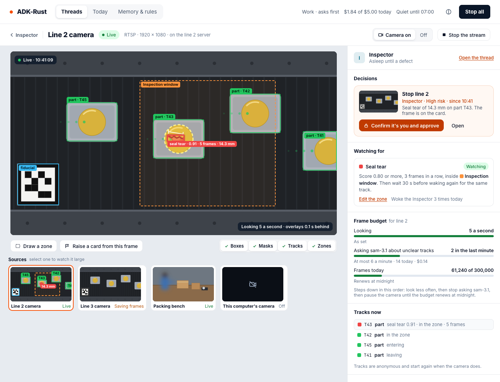
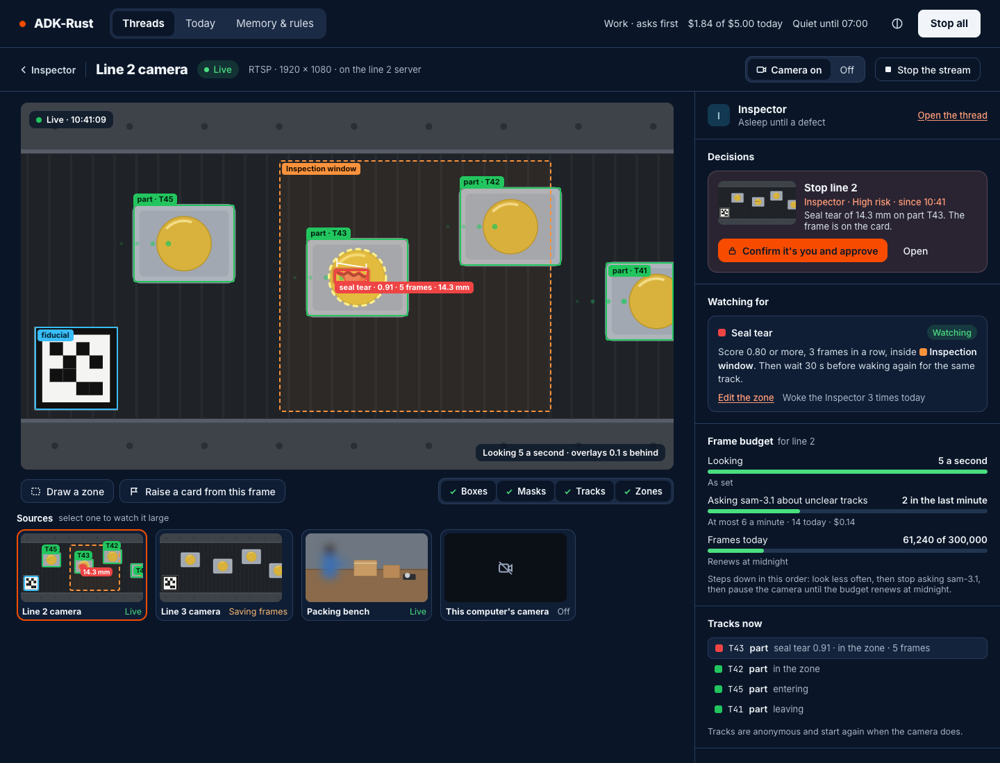

# The Live Camera Surface

The live camera surface is where a person watches a camera an agent watches and acts on it
(spec 3.7 §8.2): live frames with what was found drawn over them, the anonymous tracks, the
watch conditions and their zones, the frame governor's state — how often it looks, whether it
asks a cloud model about unclear tracks, today's frames against the limit — and the source
switch. A person switches a camera off, draws or edits a zone, stops the stream and raises a card
from the current frame. It is a web home view under the agent, and a phone screen.

| Live (light) | Live (dark) |
|---|---|
|  |  |

## Where It Opens

| From | How |
|---|---|
| The agent's thread | The thread of an agent that watches a camera links to it from its header: the camera's name, or "Cameras · 4 sources · 3 on" when it has several |
| An address | `/ui/cameras/<camera>` watches one camera large; `/ui/cameras` shows every camera as a grid |
| The phone | The same addresses open the phone's camera screens; **Edit the zone** opens `/ui/cameras/<camera>?zone=edit` in the web home |

The back link, **‹ Inspector**, returns to the agent's thread.

## What It Shows

| Part | Shows |
|---|---|
| The bar | The camera's name, its state as a pill, how frames arrive ("RTSP · 1920 × 1080 · on the line 2 server"), **Camera on / Off** and **Stop the stream** |
| The picture | The newest frame the server holds, with boxes and tags, masks, each track's trail over the last second, the zones and a measured length; "Live · 10:41:09" and "Looking 5 a second · overlays 0.1 s behind" over it |
| Layers | **Boxes**, **Masks**, **Tracks** and **Zones**, each switched on or off |
| **Decisions** | The agent's open decisions on the camera's session, such as a held line stop with its frame on the card ([Approve with the Image](approve-with-image.md)) |
| **Watching for** | Each watch condition: the label, the score, the frames in a row, the zone, the wait before waking again, and how often it woke the agent today |
| **Frame budget** | **Looking** (the rate), **Asking sam-3.1 about unclear tracks** (escalations a minute, today's count and cost), **Frames today** (against the daily limit); the order the governor steps down in; once it has, each step with its time and the next |
| **Tracks now** | Each anonymous track, what it is and where; a track with a finding a watch looks for first. Tracks start again with the camera |
| **Sources** | Every camera, the one shown large marked; each tile follows its camera's state |

| State | Drawn |
|---|---|
| Live | The frame with its overlays |
| Saving frames | An amber banner — "Looking 2 times a second instead of 5, and no longer asking sam-3.1 about unclear tracks. Today's frames are 96% used." — amber meters, each step with its time, the next step named |
| Paused until midnight | The last frame frozen and dimmed under "Paused until midnight"; "Parts on line 2 are passing without inspection"; every step on record; **Change the daily frame limit** |
| Can't reach the camera | The last frame grey under "Can't reach the line 2 camera", the retry countdown and attempt, the error with credentials hidden, **Try again now** |
| Camera off | A black panel: "Nothing is captured or sent. You switched line 2 off at 11:05"; the watch paused, tracks cleared |
| Several sources | A grid of every camera with its state, a switch list with each camera's rate and share of its frames, a budget per camera; people blurred |

People appear blurred in the picture when the pipeline covers them before a frame reaches the
surface (spec 3.7 §7.13); a kept frame is covered by its source before it is written, whatever
the picture showed.

## Acting on a Camera

| Act | What happens |
|---|---|
| **Off** | The server closes the camera's gate first: every frame that arrives from then on is dropped, and the frames it held are forgotten. Then the act is recorded (`surface.camera.switch`) and the source is told to stop capturing. A source switched off sends nothing, as on the voice screen |
| **Camera on** | Recorded first, then the gate opens |
| **Stop the stream** | The gate closes for good and the stream ends (`surface.camera.stop`); the agent's pipeline starts it again |
| **Try again now** | The source is tried again (`surface.camera.retry`) |
| **Draw a zone** / **Edit the zone** | Corner handles over the picture, the old outline dashed, the watch that uses the zone, its corners in the camera's pixels. Saving changes the watch from its next frame and is recorded (`surface.camera.zone`, with the old and new corners). A zone changed since the person started is refused, never overwritten |
| **Raise a card from this frame** | The frame on screen is frozen: the server holds it in memory while the person writes what the agent should look at. **Raise the card** keeps that one frame as evidence for 30 days, everyone in it covered first, and sends the card to the agent as the person's message naming the frame by digest and artifact, with the regions on it. It is recorded (`surface.camera.card`) before the frame is kept |

**No frame is stored unless it is evidence on a card.** The hub holds the latest frames of each
camera in memory, about two seconds' worth, and a frozen frame for up to 15 minutes; nothing is
written. A raised card's frame is kept as `vision-<hex>.png` in the agent's session, so the
annotated viewer and an approval card open it by its digest.

## Cameras on the Engine

A camera belongs to its agent's session: only that session's owner sees or acts on it (S-I8).
The engine reads cameras through a `CameraSource` and passes every frame through the `Cameras`
hub:

```rust
use std::sync::Arc;

use adk_session::InMemorySessionService;
use adk_surface::camera::{CameraFacts, CameraSource, Cameras, HeldFrame};
use adk_surface::{LocalSource, SurfaceEngine};

/// A pipeline's cameras: their facts, and a card's frame kept the way the pipeline keeps evidence.
struct Pipeline;

#[async_trait::async_trait]
impl CameraSource for Pipeline {
    async fn cameras(&self) -> adk_surface::Result<Vec<CameraFacts>> {
        Ok(vec![CameraFacts::new("line-2", "Line 2 camera", "inspector", "s-line")])
    }

    async fn keep_frame(
        &self,
        camera: &CameraFacts,
        frame: &HeldFrame,
    ) -> adk_surface::Result<adk_core::ImageEvidence> {
        let _ = (camera, frame);
        Err(adk_surface::SurfaceError::unsupported("keeping frames"))
    }
}

fn main() -> adk_surface::Result<()> {
    let cameras = Cameras::new(Arc::new(Pipeline));
    let source = LocalSource::builder("inspector")
        .sessions(Arc::new(InMemorySessionService::new()))
        .build()?;
    let engine = SurfaceEngine::builder(Arc::new(source)).cameras(cameras).build();
    let _ = engine;
    Ok(())
}
```

| Part | What |
|---|---|
| `CameraFacts` | What a source reports: the stream's state (`Live`, `Paused`, `Lost`), the governor's numbers (`GovernorFacts`, its steps and escalation), tracks, watches and zones. Numbers and times, never sentences: the surface says them |
| `Cameras::offer` | Every frame, with what was found on it (`Overlay`): dropped when the camera is off or stopped (`Offered::Dropped`), else held in memory and shown |
| `CameraSource::keep_frame` | Keeps a card's frame: everyone in it covered first, written once, returned as the `ImageEvidence` a card and a held call carry |
| `ScriptedCameras` (`web`) | A source over the boards' fixture content, every board state reachable, for examples and tests |
| `camera::bridge` (`voice`) | `feed_realtime` sends a camera's frames to a realtime session under the voice screen's `FramePolicy`: one a second for Gemini Live, changed frames at most every five seconds for the OpenAI Realtime API; `with_camera` turns on Gemini Live's context window compression |

## The Web API

| Route (under `/api`) | Answer |
|---|---|
| `GET /surface/cameras` | `CamerasView`: every camera of the caller's sessions |
| `GET /surface/cameras/{camera}` | `CameraView`: one camera with its picture, decisions, watches, budget, tracks and sources |
| `GET /surface/cameras/{camera}/frames/{frame}` | A frame the hub holds, served only when its bytes hash to the digest; `Cache-Control: private, no-store`; nothing while the camera is off |
| `GET /surface/cameras/{camera}/feed` | Server-sent events: `frame` (a `StageView`) after each frame that passes the gate, `changed` when anything else changed |
| `POST /surface/cameras/{camera}/on`, `/off`, `/stop`, `/retry` | The act, recorded; answers the `CameraView` |
| `PUT /surface/cameras/{camera}/zones/{zone}` | `ZoneChange` → `ZoneSaved`; closed to paired devices |
| `POST /surface/cameras/{camera}/freeze` | `FreezeFrame` → the frozen frame's `StageView`, held in memory for its card |
| `POST /surface/cameras/{camera}/cards` | `RaiseCard` → `CardRaised`: the kept frame's digest, its regions, until when it is kept, and what sending the card did |

A paired phone switches a camera off and stops its stream with the stop scope, and switches it
on, freezes a frame and raises a card with the decide scope; it edits no zone.

## On the Phone

The stream on top; **On / Off** and **Raise a card**; the agent's decision, what it watches for,
the budget as rows and the first three tracks; **Edit the zone**, which opens the zone in the web
home, and **Stop the stream** below. `/ui/cameras` lists every camera with its switch.

## Try It

`scripted_camera_home` serves the web home over the boards' four cameras, line 2 live with a
seal tear and the Inspector's line stop held with the frame:

```bash
cargo run -p adk-surface --features web --example scripted_camera_home -- 8794
```

Open `http://127.0.0.1:8794/ui/cameras/line-2`.

## Related

- [Approve with the Image](approve-with-image.md) — the held line stop's card, with its frame
- [The Annotated Viewer](annotated-viewer.md) — a kept frame opened by its digest
- [Voice and Video](voice.md) — the camera on the voice screen, under the same switch rule
