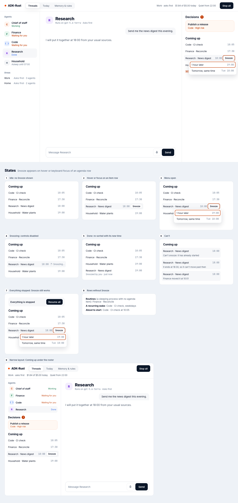
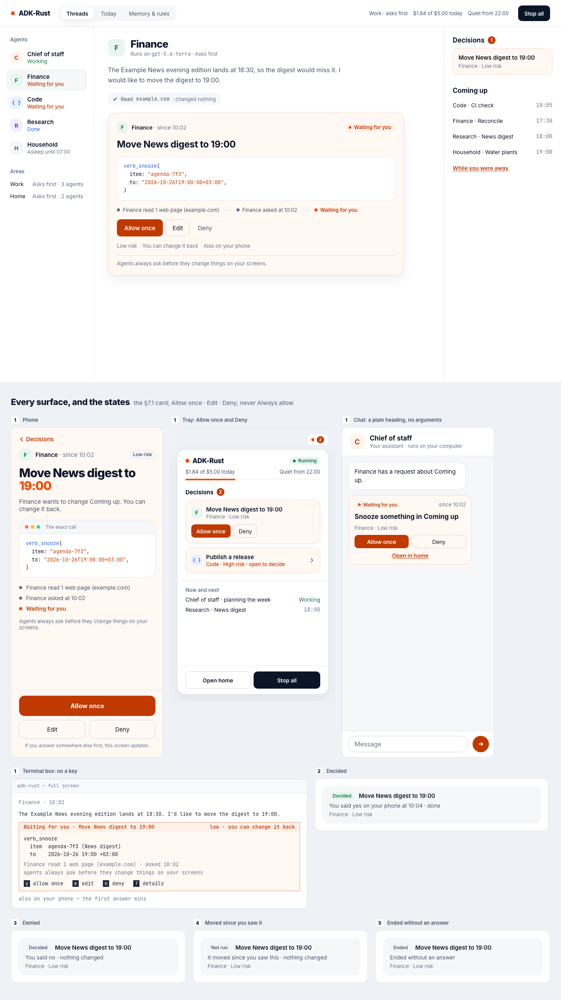
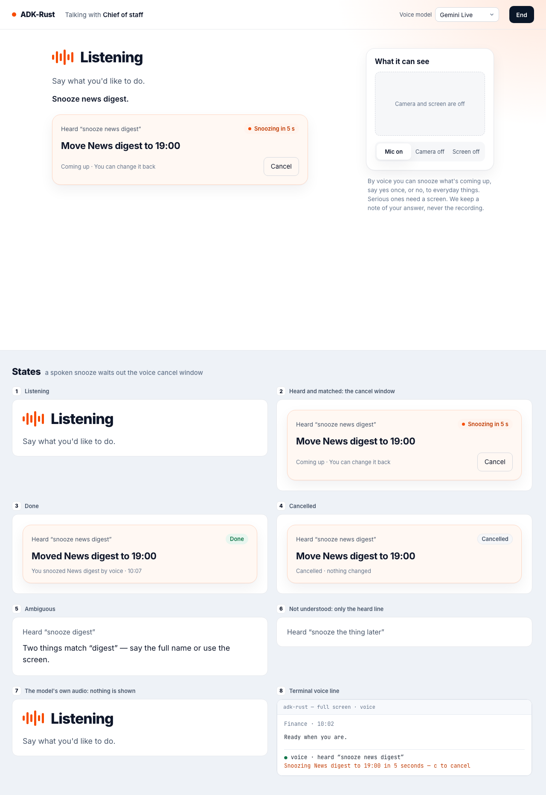

# Screen Actions

`adk-surface`'s `verb-ui` feature lets people and agents change something a surface shows, the
same way from every surface: the first action is **Snooze** on an item in Coming up, which
moves it an hour later or to the same time tomorrow (spec 3.3 §2 item 7). A person snoozes from
the web home, the phone, the terminal or by voice; an agent asks to, and the request waits for
the person every time. Every call goes through the governed path and is on record.

> **Note:** `verb-ui` is **Experimental** (see `STABILITY.md`). It adds no dependency; its web,
> terminal and voice parts compile with `web`, `tui` and `voice`. `adk-cli` turns it on with
> its own `verb-ui` feature, for `adk-rust up`.



## Who takes an action, and how

| Caller | How | Governed as | Waits for a person |
|---|---|---|---|
| A person on the web home, the phone, a terminal or by voice | `VerbGate::call` with the server-authenticated `Caller` | `urn:adk:agent:<app>/surface.verbs`, acting for the person, through `authorize_tool_call` | No: the person is the one asking |
| An agent | Its `verb_<name>` tool from `VerbToolset`, published as `verbs:<app>` | The agent itself, with `VerbPolicy` in the operator layer | Yes, every call that changes something |
| A chat channel or the tray | — | — | Refused: "/snooze" typed in Telegram reaches the agent as text |

**Stop all** applies to a person's actions too, except those that only delay work: snooze
still runs while everything is stopped. An agent's call is refused by the kill switch before
any card.

## The catalogue

| Action | Effect | What it does |
|---|---|---|
| `coming_up` | `read` | Lists the caller's Coming up: each item's id, title, when it wakes and the two times it may move to. An agent sees only its own area's items, and never asks to read |
| `snooze` | `write_local`, only delays, can be changed back | Moves one item to `to`, which must be its wake plus one hour or plus one day |

Snooze refuses an item that is not scheduled, waits on something other than one time, has
already started, or ends before `to`. A `to` that is not one of the item's two times is refused,
so an approval never applies more than its card showed: with "It moved since you saw this" when
the item already wakes at `to` or later — someone moved it since the request was made — and
otherwise with the two times it may move to, "It can only move to 19:00 or Tue 18:00", as for a
time an **Edit** chose. Two snoozes of one item through one registry check and move its wake
one after the other, so the later one finds it moved.

A host declares more with `VerbRegistryBuilder::verb`. A name must match
`^[a-z][a-z0-9_]{0,58}$` and never be one of `RESERVED` (`approve`, `deny`, `decide`,
`always_allow`, `add_agent`, `resume_all`, `unfreeze`, …); the only object kind is Coming up. A
handler gets a `VerbScope` and nothing else — the caller's own items and moving one's wake
later — so no action can answer a decision, change an agent, a standing rule, a mode or Stop
all, or resume work.

## An agent's request

`VerbPolicy` holds every changing call from any agent, whatever its mode or standing rules: it
is added to the operator layer, where the strictest decision wins. An agent may have at most
three requests waiting for the same person ("Finance already has 3 changes waiting for you");
a call the person already answered — a held call resuming with its decision, or one an **Edit**
changed — is never refused for the count. A call that would be refused — another area's item, a
stale time — is refused before any card. Just look and Suggest refuse every changing call an
agent makes, so it never asks.

`VerbRouter` and `VerbHints` give the card its words:

| Part | Value |
|---|---|
| Heading | The kernel's words: "Move News digest to 19:00" |
| Chat heading | "Snooze something in Coming up", never the arguments |
| Risk | Low, for a change on the person's own screens |
| Answers | Allow once · Edit · Deny on the web home, the phone and the terminal; Allow once · Deny in chat and the tray; never **Always allow** |
| How it got here | What the agent read in the turn that asked, from that turn's tool results: "Finance read 1 web page (example.com)". A fetch that was refused or failed is not counted, only the host name of a page is shown, and the agent is named as the card names it |
| Details | "You can change it back", and the line "Agents always ask before they change things on your screens." |



## Wire it up

```rust,ignore
use std::sync::Arc;

use adk_core::{ApprovalPolicy, ApproverSelector, StoreApprovalService};
use adk_harness::HarnessAgent;
use adk_kernel::{AgendaHandle, PartitionId, ProcessTable};
use adk_surface::verbs::{KernelAgenda, VerbGate, VerbRegistry};
use adk_surface::SurfaceEngine;

// The kernel's agenda through a handle bound when the kernel is built.
let handle = AgendaHandle::new();
let agenda = KernelAgenda::new(handle.clone(), ProcessTable::new(runs.clone(), processes.clone()));
let registry = VerbRegistry::builder("adk-rust", Arc::new(agenda))
    .approval_store(approval_store.clone())
    .audit(trail.clone())
    .sessions(sessions.clone())
    .build()?;

// Cards of an agent's request: the kernel's words, low risk, Allow once · Edit · Deny.
let operator = ApprovalPolicy::new([ApproverSelector::group("operator")]).allow_self_approval();
let approvals = StoreApprovalService::new(approval_store).with_router(registry.router(operator));

// Every agent the kernel hosts gets the tools, their classes and the policy.
let area = PartitionId::default();
let agent = HarnessAgent::builder("finance")
    .toolset(Arc::new(registry.toolset(area.clone())))
    .tool_classes(Arc::new(registry.classes()))
    .add_operator_policy(Arc::new(registry.policy(area)))
    // ...
    .build()?;

// The kernel binds the handle; the engine draws the cards and lists the grant.
let kernel = harness.kernel().agenda_handle(handle) /* ... */ .build()?;
let engine = SurfaceEngine::builder(source)
    .card_hints(Arc::new(registry.hints()))
    .grant(registry.grant())
    .build();

// A person's actions, and their routes on the web home.
let gate = VerbGate::new(registry, engine.clone());
let builder = server.add_api_routes(adk_surface::web::verbs::router(gate.clone()));
```

`adk-rust up`, built with `adk-cli`'s `verb-ui` feature, does all of this: every agent it hosts —
the primary agent in each area and every agent a person adds — gets the tools for its own area,
listed in its settings as "Ask to change things on your screens — always asks you first" while
its mode is Ask first or Go ahead (`GrantedUse::only_in`). The terminal attached to `up` draws
the same cards: `VerbRegistry::catalogue` gives a process without the agenda the actions' hints
and grant, and `VerbHints::reading` reads the asking turn and the agents' names through the
engine's source.

## On each surface

| Surface | How |
|---|---|
| Web home | Coming up: on hover or keyboard focus of an item that may move, **Snooze** opens "1 hour later" and "Tomorrow, same time". It acts only on the person's own input and says "Snoozed by you · just now" once the server answered. Memory & rules lists **On your screens** with "Agents always ask you first". The home shows none of it where the server has no screen actions |
| Terminal | `/snooze <title> [tomorrow]`, by exact title, ignoring case; several matches are listed. The terminal attached to `adk-rust up` runs it in up's process; a terminal paired from another machine says "Snooze isn't available from a remote terminal — use the home." `/help` lists it under **On your screens**; `--output json` ends with `{"type":"verb","verb":"snooze","outcome":"done","how":"keyboard"}` |
| Voice | "Snooze news digest": at most eight words, never "always", and exactly one title. It waits out the engine's cancel window ("Snoozing in 5 s"), where "cancel" or **Cancel** withdraws it; once the window has ended it is being taken, and a late cancel changes nothing. An ordinary sentence reads nothing of Coming up. The model's own audio played back never takes one |
| Chat, the tray | None |



## Routes

| Route (under `/api`) | Answer |
|---|---|
| `GET /surface/verbs` | `VerbsResponse`: the catalogue and the caller's Coming up |
| `POST /surface/verbs/call` | `VerbCallRequest` → `VerbDone`, once it ran. A declared voice or agent origin, or the voice or chat surface, answers `400`; someone else's item `404`; a terminal paired from another machine `403` |
| `GET /surface/verbs/openapi.json` | The routes' OpenAPI document; the web home's types are generated from it into `web/src/generated/verbs.ts` |

## On record

Every action taken writes a `surface.verb` record of kind `Other("surface")`, which the kernel's
surface-records route accepts:

| Field | Value |
|---|---|
| `verb`, `effect`, `outcome` | `snooze`, `write_local`, `done` or `refused` |
| `target`, `title` | `agenda:<id>`, the item's title; a record line names the item only by its title |
| `argsDigest`, `functionCallId` | The arguments' digest, never the arguments; the call |
| `surface`, `origin`, `device`, `presence` | Where and how a person gave it |
| `transcriptDigest` | For voice: the SHA-256 of what was said, never the words |
| `origin`, `approvalId`, `answered` | For an agent's: the agent, the decision that let this call run — by its fingerprint, or the arguments an **Edit** gave it — and where the person said yes |

A person's action also has a `tool_call` record under `urn:adk:agent:<app>/surface.verbs`. "What
your agents did" reads them as "You snoozed News digest by voice." and "Finance asked to snooze
News digest; you said yes on your phone."

**Deny** runs nothing, so it writes no `surface.verb` record. The answer's own `surface.decide`
record — from the home, the phone, the terminal, voice or chat — carries the item's `title` and
the card's `summary` ("Move News digest to 19:00"), which `VerbHints` name through
`CardHints::names`, and "What your agents did" reads it as "Finance asked to snooze News digest;
you said no. Nothing changed." A terminal attached to a kernel reads no agenda, so there the
title comes from the card's summary.

"What your agents did" never shows a screen action's tool name. It tells the governed path's
`tool_call` records of a screen action by their publisher (`toolSource: "verbs:<app>"`) and
leaves them out, since the action's own records say what happened; the one it words is an
agent's request refused before anyone answered it (`policyRef` other than `confirmation`): "Finance
asked to snooze something in Coming up; it couldn't be done, so nothing changed."

## Try it

```bash
cargo run -p adk-surface --features web,verb-ui --example scripted_verbs -- 8812 /tmp/verbs
```

Open `http://127.0.0.1:8812/ui/`, ask Finance to tidy the evening, and answer its card; then
snooze News digest from Coming up.

## Related

- [The engine](index.md), card hints and the decision card
- [Scenarios](scenarios.md): "One verb, three origins"
- [Voice and video](voice.md), [the terminal](terminal.md), [the web home](web-home.md)
- [Tool authorization](../security/tool-authorization.md)
