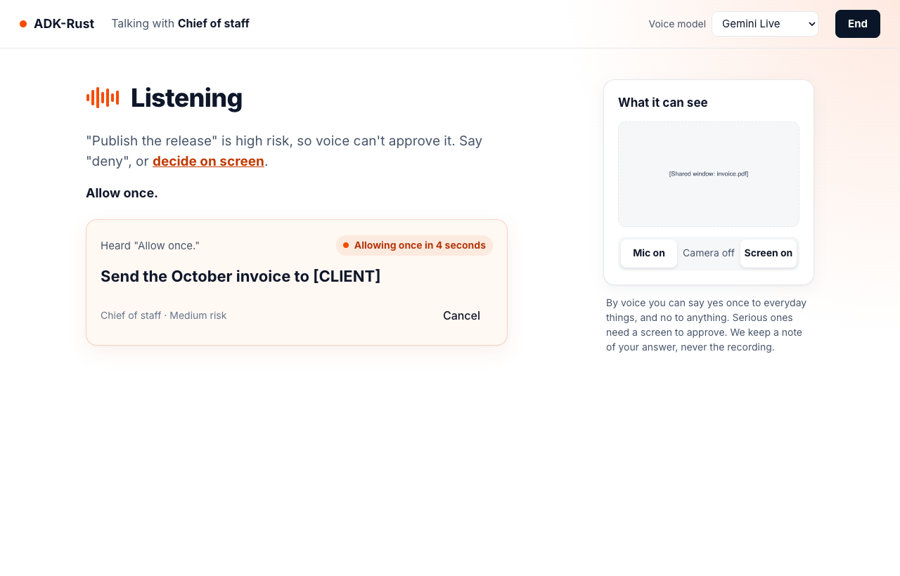
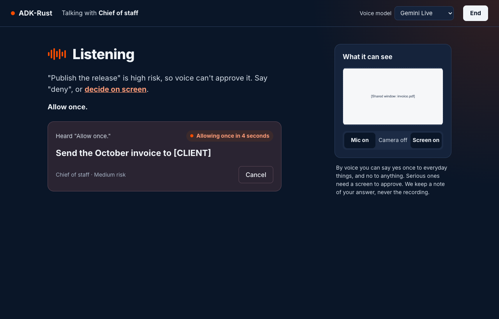

# Agent Surfaces: Voice and Video

Voice is hands-free turns with your agents, in the browser and in the terminal (spec 3.3 §5.6).
A spoken answer is one more way to give the answer a click or a key gives, under the same
rules: you say the label of the engine's action, the engine decides it, and every other
surface shows "You said yes by voice". The camera and a shared screen reach the model only
while their switches are on. The record keeps a note of the answer, never the recording.

> **Note:** voice is Beta. The `voice` feature of `adk-surface` runs the conversation; with
> `web` it also serves the voice view's routes and socket, and with `tui` the terminal's voice
> line. The application supplies the realtime models (Gemini Live, the OpenAI Realtime API),
> so no provider is compiled into `adk-surface`.

```toml
[dependencies]
adk-surface = { version = "3.0.0", features = ["web", "voice"] }
```

| Light | Dark |
|---|---|
|  |  |

## What voice may decide

Voice follows the voice row of spec 3.3 §7.2, whichever surface the words reach:

| Decision | By voice |
|---|---|
| Low or medium risk | **Allow once**, after a cancel window; **Deny** |
| High risk, or a call that spends money | **Deny**; approving needs you to confirm it is you, which voice cannot do, so the view says "Decide on screen" |
| A call shown truncated | Nothing: it is decided on screen, where it is shown in full |
| Always allow, Edit | Never: they are standing permissions or need the call in front of you |

No agent's words decide anything (§7.4 rule 6): only your own completed transcript counts,
never what the model says or shows.

## The words

A spoken answer is the label of the engine's action, and nothing else:

| Say | Does | When |
|---|---|---|
| "allow once" | **Allow once**, after the cancel window | A decision is prompted |
| "deny", "deny it" | **Deny** | A decision is prompted |
| "cancel" | **Cancel** on the spoken "allow once" counting down | A spoken answer is pending |
| "stop all" | **Stop all** | Always |

"please" may come anywhere. Case and punctuation never matter. An utterance of more than four
words, one that contains "always", one that names two answers, and anything else — "yes",
"sure", "ok", "go ahead", an echo of the prompt — decides nothing. "stop" and "cancel" are
never a denial. A caller without the operator group is told that stopping every agent needs
the operator; resuming happens in the home.

## How a spoken answer finds its decision

One decision is prompted at a time, on screen: the conversation's own call just held, else
the oldest open decision voice may answer. The prompt names the agent, what will happen and
the words: "Finance wants to send the October invoice to [CLIENT]. Say "allow once" or
"deny"." A call voice cannot approve says so instead: ""Publish the release" is high risk, so
voice can't approve it. Say "deny", or decide on screen."

| Rule | Why |
|---|---|
| A spoken answer applies to the decision prompted when you started speaking | The prompt cannot change under your words |
| The prompt is on screen for a second before speech counts | You see what you answer |
| If the decision or its version changed before your words were transcribed, nothing is decided, and the view says so | A decision answered elsewhere is never answered twice (S-I2) |
| Speech that starts while the model's audio plays, or within 300 ms of its end, decides nothing | The model's own voice in your microphone is not your answer |
| Another agent's decision is shown with a chime and never told to the model | The provider sees only your conversation |
| While every agent is stopped, nothing is prompted | The view says "All agents stopped" |

The model is told never to approve or deny anything and that the app applies your own words.

## The cancel window

A spoken "allow once" waits out a cancel window — five seconds by default,
`SurfaceEngineBuilder::voice_cancel_window` — on the view as "Allowing once in 5 seconds"
with **Cancel**. Nothing runs before it ends. It is cancelled by **Cancel** on the view, by
saying "cancel", by **End**, by closing the view, and by **Stop all** from any surface; a stop
made anywhere else, such as a kernel frozen from another process, is caught when the window
ends, and the answer is not recorded.

## The record

Every `surface.decide` record of a spoken answer carries `transcriptDigest`, the SHA-256 of
what you said, with `surface` `voice` and `origin` `voice`; none holds audio, frames or the
words themselves.

| `outcome` | When |
|---|---|
| `pending` | A spoken "allow once" started its cancel window |
| `decided` | The answer was recorded |
| `cancelled` | Cancelled in its window; a **Stop all** names the answers it withdrew in its own `surface.stop_all` record, as `cancelledAnswers` |
| `refused` | Voice may not give this answer, or the call is truncated |
| `changed`, `already_decided` | The decision changed, or was answered first elsewhere |

The conversation itself is a session, as typed text is: your words stay in it as your
messages, listed in Threads under the agent. Each conversation has its own session.

`SurfaceEngine::decide_spoken` is the one way a spoken answer is recorded; `execute` refuses a
`decide` whose surface or origin is voice with `surface.invalid`, and so does
`POST /api/surface/commands`.

## The camera and the screen

| Switch | On | Off |
|---|---|---|
| Mic | Your microphone, with echo cancellation, streams to the model | The microphone's track stops at once; nothing is sent |
| Camera | One frame at a time reaches the model | The track stops at once (`track.stop()`, not muted), its preview clears, and the server is told before anything else |
| Screen | A window or screen you pick; one frame at a time | As the camera; ending the share in the browser's own controls turns the switch off |

The server drops every frame of a source that is off, whatever arrives, and forwards no
faster than the model takes them: one frame a second on Gemini Live
(`FramePolicy::GEMINI`), and on the OpenAI Realtime API a frame that changed, at most one
every five seconds (`FramePolicy::OPENAI`). Frames are never stored or logged.

> **Note:** a Gemini Live session that receives video ends after about two minutes unless
> context window compression is on. `VoiceHubBuilder::context_window_compression` turns it on
> for a model, through `adk_harness::VoiceConfig::with_context_window_compression`.

Browsers give the microphone and the camera only to a secure context: open the home on
`localhost` or over HTTPS. The message box shows the microphone only there, and only when the
server offers voice.

## Serving voice

A voice conversation is a realtime session of a harness marked `Pack::Voice`: its calls are
governed by the harness as typed ones are, and a call it holds is a decision in the inbox
like any other, answered by voice or on any other surface. `VoiceSource` wraps the engine's
source, so a decision on a call a live conversation holds resumes it in that conversation,
never on the text runner too; a decision made outside the engine, in Telegram or with
`adk-rust approvals`, is picked up on the next change.

```rust,no_run
use std::sync::Arc;

use adk_harness::Harness;
use adk_realtime::BoxedModel;
use adk_server::ServerBuilder;
use adk_surface::voice::{FramePolicy, VoiceHub, VoiceModel, VoiceSource};
use adk_surface::{LocalSource, SurfaceEngine};

fn mount(
    builder: ServerBuilder,
    harness: Arc<Harness>,
    local: LocalSource,
    gemini_live: BoxedModel,
) -> ServerBuilder {
    let source = VoiceSource::new(Arc::new(local));
    let live = source.live();
    let engine = SurfaceEngine::builder(Arc::new(source)).stops_need("operator").build();
    let gemini = VoiceModel {
        id: "gemini".into(),
        name: "Gemini Live".into(),
        input_rate: 16_000,
        output_rate: 24_000,
    };
    let hub = VoiceHub::builder(engine.clone(), harness, live)
        .model(gemini, gemini_live, FramePolicy::GEMINI)
        .context_window_compression("gemini")
        .build();
    builder
        .add_api_routes(adk_surface::web::router(engine))
        .add_api_routes(adk_surface::voice::router(hub.clone()))
        .add_root_routes(adk_surface::web::home())
        .add_root_routes(adk_surface::voice::socket_routes(hub))
}
```

The example `voice_home` serves the view on Gemini Live or the OpenAI Realtime API, with the
keys from the environment:

```sh
cargo run -p adk-surface --features web,voice-live --example voice_home -- 8794 /tmp/voice-workspace
```

### With `adk-rust serve` and `adk-rust up`

`adk-rust serve` and `adk-rust up` (adk-cli features `voice` and `surface`) serve the voice
view for a harness marked `--pack voice`, on every realtime model whose key resolves. The
resolved model's provider is listed first and is the default:

| Model | Key | Audio |
|---|---|---|
| Gemini Live (`gemini-3.1-flash-live-preview`), with context window compression | The Gemini model's own key, else `GOOGLE_API_KEY` or `GEMINI_API_KEY` | 16 kHz up, 24 kHz down |
| OpenAI Realtime | The OpenAI model's own key, else `OPENAI_API_KEY` | 24 kHz up and down |

```sh
GOOGLE_API_KEY=… adk-rust up --pack voice
# open http://127.0.0.1:8080/ui/ and press the microphone in the message box
```

The start lines name the models offered, or say `voice off` when no key resolves. A spoken
answer decides the call in the server's approval inbox, so its card reads "You said yes by
voice" on every surface.

### Routes and socket

| Route | Answer |
|---|---|
| `GET /api/surface/voice` | `VoiceModels`: the agent and the models, the default first |
| `POST /api/surface/voice/sessions` | `VoiceTicket`: a single-use ticket, good for 30 seconds, for the caller it was issued to; `sessionId` continues one of the caller's own voice conversations, and anyone else's is `403 surface.voice.not_your_session` |
| `GET /voice/socket` | The voice socket: the first text message is `{"type":"hello","ticket":…}` within five seconds, otherwise it closes with code 4401 |

A ticket is never part of a URL or a log line. The page's content security policy names the
socket on the host that served it (`connect-src 'self' ws://{host} wss://{host}`).

| Socket message | Direction | Carries |
|---|---|---|
| Binary, tag `0x01` | Up and down | PCM16 mono: up at the model's input rate (16 kHz on Gemini Live, 24 kHz on OpenAI), down at 24 kHz |
| Binary, tag `0x02`, `0x03` | Up | One camera or screen JPEG |
| `VoiceClientMessage` | Up | `switch`, `playbackEnded`, `end` |
| `VoiceUpdate` | Down | `ready`, `listening`, `speaking`, `heard`, `prompted`, `pending`, `outcome`, `needsScreen`, `bargeIn`, `ended`, `error` |

Decision cards never travel on the socket: the view reads them from
`GET /api/surface/decisions?surface=voice` and the session feed.

## In the terminal

`TerminalSurface::voice` (features `tui` and `voice`) holds a conversation beside the thread,
in the same process as the harness. The application records the microphone and plays the
speaker, as channels of PCM16 mono. In the full-screen terminal one line above the message
box says "Listening", `Heard "…"`, "Allowing once in 5 seconds — c to cancel", or that a call
is high risk and is answered there; the inline terminal prints what was heard, each
countdown, a call voice cannot approve and the end into the scrollback, once each. `c`
cancels a spoken answer only while the message box is empty, and Esc never decides.

`adk-rust --voice` (adk-cli features `tui`, `voice` and `voice-desktop`) opens the terminal
this way on a terminal, talking on the first realtime model whose key resolves, through the
default microphone and speaker. A first turn (`--voice "…"`), `--voice-input` or
`--voice-output` keep the [harness's console voice](../harness/voice.md#the-cli).

## Related

- [The Engine](index.md) — what each surface may decide, and the records of every answer
- [The Web Home](web-home.md) — where a decision voice cannot approve is decided
- [The Terminal](terminal.md) — answering by key on a paired local terminal
