# The Web Home

The web home is the system of record for your agents (spec 3.3 §5.1): the place to decide with
full detail, review what happened, change what agents may do, and stop everything. It is a
React app that `adk-surface`'s `web` feature embeds and serves at `/ui/`, and it reads and acts
only through the engine's HTTP API under `/api/surface` and the kernel and harness routes
beside it. Nothing lives in the page that a reload cannot rebuild.

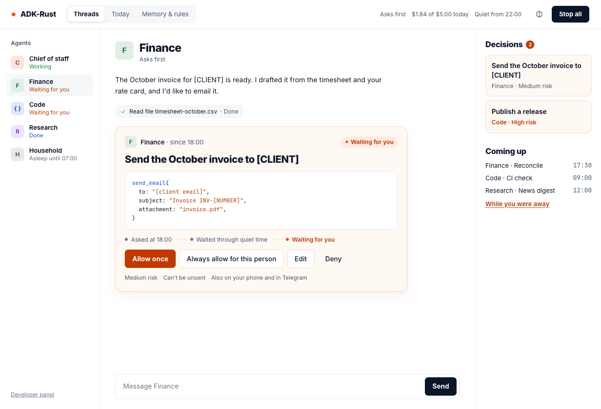

> **Note:** the web home replaces the runtime UI that `adk-server` bundled at `/ui/` (spec 3.3
> §10 S1). `adk-server` keeps its APIs and serves no page of its own; see
> [Moving from the bundled runtime UI](#moving-from-the-bundled-runtime-ui). The UI-protocol
> code (`adk_server::ui_protocol`, `adk_server::ui_types`) stays in `adk-server`, a deviation
> from S1: the server's own `/api/run_sse` profiles and `/api/ui/...` routes use it, and
> `adk-surface` depends on `adk-server` through `adk-kernel`, so the move would make the two
> crates depend on each other.

## Open it

| Command | What it serves |
|---|---|
| `adk-rust serve` | The harness with the approval inbox and the web home at `http://127.0.0.1:8080/ui/`; loopback callers are the operator |
| `adk-rust up` | The resident kernel: turns run as processes, and the home shows the process table, the agenda and the `/proc` ledger |
| `adk-rust serve --auth-token <token>` | The same behind a bearer token, required on any non-loopback `--host`; the page asks for the token once and sends it as `Authorization: Bearer` |
| `adk-rust serve --agent chat` | The plain chat agent's REST API under `/api`, without the home |

`adk-rust up --mode ask` on `gemini-3.5-flash-lite`, asked to create `note.txt`: the harness
holds the write, the home shows it as a decision, and **Allow once** runs it once.

| Held (light) | Allowed once (dark) |
|---|---|
| 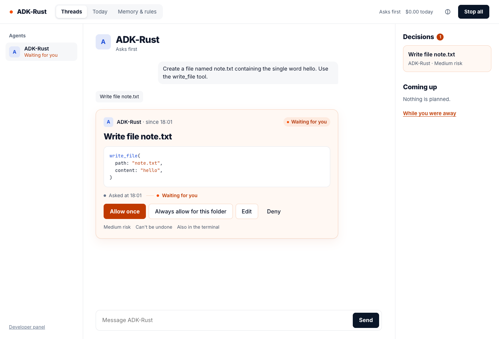 | 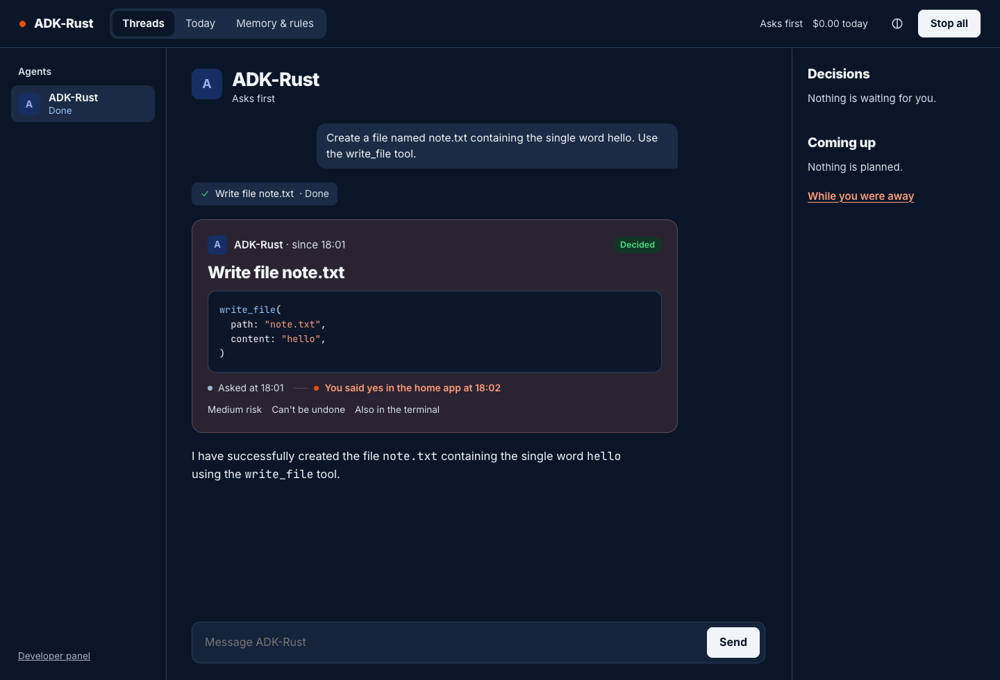 |

The `adk-rust` binary turns the home on with its `surface` feature, which is on by default.
The home serves the harness: a message typed in it runs as the caller the server admitted,
with the session's mode and standing rules. **Stop all** freezes the one kill switch the
server's runs, the background runs and the home's turns share, on every replica of
`adk-rust serve --store`; it and **Resume all** need the `operator` scope, and any other caller
gets `403`. `adk_cli::Launcher` serving a chat agent
serves its REST API only; to put the home on your own server, mount it as below.

## Mount it on your own server

`adk_surface::web::router(engine)` serves the engine's API; `adk_surface::web::home()` serves
the page as root routes. Both go on `ServerBuilder`, behind the extractor that identifies the
caller: every route of the API checks its caller against the session owner (spec 3.3 §11 S-I8)
and answers `401` without one.

> **Important:** **Stop all** and **Resume all** are the exception to S-I8: they freeze and
> unfreeze every run of the source, whoever started it, and with a shared `GovernanceControl`
> every run of the server. Build the engine with `.stops_need("operator")`, and give that scope
> to the operator only in your extractor; any other caller gets `403 surface.operator_only`
> (§11 S-I10). Without `stops_need`, every caller the server admits may stop and resume.

```rust
use std::sync::Arc;

use adk_core::{AgentLoader, ApprovalService, GovernanceControl, RequestContext, RunConfig};
use adk_runner::Runner;
use adk_server::{RequestContextError, RequestContextExtractor, ServerBuilder, ServerConfig};
use adk_session::SessionService;
use adk_surface::{LocalSource, SurfaceEngine};
use async_trait::async_trait;

/// Admits every request as `ana`, who runs this server; a deployment uses its own
/// authentication and gives the `operator` scope to its operator only.
struct Owner;

#[async_trait]
impl RequestContextExtractor for Owner {
    async fn extract(
        &self,
        _parts: &axum::http::request::Parts,
    ) -> Result<RequestContext, RequestContextError> {
        Ok(RequestContext {
            user_id: "ana".into(),
            scopes: vec!["operator".into()],
            metadata: Default::default(),
        })
    }
}

fn app(
    agent: Arc<dyn adk_core::Agent>,
    loader: Arc<dyn AgentLoader>,
    sessions: Arc<dyn SessionService>,
    approvals: Arc<dyn ApprovalService>,
) -> adk_core::Result<axum::Router> {
    // One kill switch for the server's runs and the home's turns, so Stop all stops both.
    let control = GovernanceControl::new();
    let runner = Runner::builder()
        .app_name("home")
        .agent(agent)
        .session_service(sessions.clone())
        // Held calls reach the inbox the home draws its cards from.
        .run_config(RunConfig::builder().approval_service(approvals.clone()).build())
        .governance(control.clone())
        .build()?;
    let source = LocalSource::builder("home")
        .sessions(sessions.clone())
        .approvals(approvals)
        .runner(Arc::new(runner))
        .build()?;
    // Stop all and Resume all reach every run of the server: the operator's only.
    let engine = SurfaceEngine::builder(Arc::new(source)).stops_need("operator").build();
    let config = ServerConfig::new(loader, sessions)
        .with_request_context(Arc::new(Owner))
        .with_governance(control);
    Ok(ServerBuilder::new(config)
        .add_api_routes(adk_surface::web::router(engine))
        .add_root_routes(adk_surface::web::home())
        .build())
}
```

Give the source `.harness(harness)` for modes and "Always allow", and `.kernel(kernel, app)`
for processes, quiet time, spend and the `/proc` ledger; mount
`adk_kernel::control::router(kernel)` beside the engine so the home can read the process table
and the agenda. [The Engine](index.md#sources) lists what each source adds.

The page is public like any static asset; its content security policy allows scripts, styles
and fonts from the server only and no framing. `/` and `/ui` redirect to `/ui/`, and each
section (`/ui/today`, `/ui/memory`, `/ui/developer`) serves the same page.

## The three sections

One header carries the brand, **Threads**, **Today** and **Memory & rules**, the status line
(the mode — on **Threads**, the one the conversation shown runs in — what was spent of the
daily limit, quiet time) and **Stop all**. After a stop, **Resume all** appears; resuming
happens only here or on a paired local terminal (§11 S-I10).

| Section | What it shows | Where it reads it |
|---|---|---|
| **Threads** | The roster (avatar, name, status word), the selected agent's thread with its decisions inline on their own background, **Decisions** with a filled count badge, **Coming up** (today's times, and the day for what comes later in the week, so a weekday routine seen on a Saturday reads "Mon 09:00"; numbered weekdays are read as the kernel runs them: in five fields 0 and 7 are Sunday, so `1-5` is Monday to Friday, and in six 1 is Sunday, so `1-5` is Sunday to Thursday; `MON-FRI` is Monday to Friday in both). A thread follows one conversation: the session the agent's row names when it is first shown, or a new one, kept for the tab. A decision of another session, opened from **Decisions** or **Today**, shows in that session's thread with "A decision from another conversation" and **Back to your conversation**, and no message box; the thread still follows its own conversation | `GET /surface/agents`, the session feed, `GET /surface/decisions`, the kernel's processes and agenda |
| **Today** | "While you were away": spent, quiet time, how many things wait, one line per event since you last marked it seen with a status pill, its actions and its record, **Mark as seen**, and today's routines with **Add a routine** | `GET /kernel/away`, `GET /kernel/away/lines/{seq}`, `POST /kernel/away/seen`, `GET /kernel/settings`, the kernel's agenda; **Do it** and **Not now** answer a suggestion through `POST /kernel/agenda/{id}/approve` or `reject`. Without a kernel ledger, `GET /surface/briefing` |
| **Memory & rules** | "Agent Memory and Rules": **What your agents remember**, **What your agents can do** and **What your agents did**, as bordered lists | `GET /kernel/memory` and its corrections; `GET /rules` with **Extend** (`POST /rules/{id}/extend`) and **Stop allowing**; `GET /kernel/settings` and its changes; each agent's spend from `GET /kernel/processes`; `GET /kernel/record` and `GET /kernel/record/check`, or `GET /surface/briefing` without a signed record; **Where you can say yes from** from `GET /kernel/devices` and `GET /kernel/channels`, with **Remove**, **Add a phone or app** (a pairing code from `POST /kernel/pairing`) and **Pair a chat account** (`POST /kernel/channels/pair`) when the kernel pairs devices |

| Light | Dark |
|---|---|
|  | 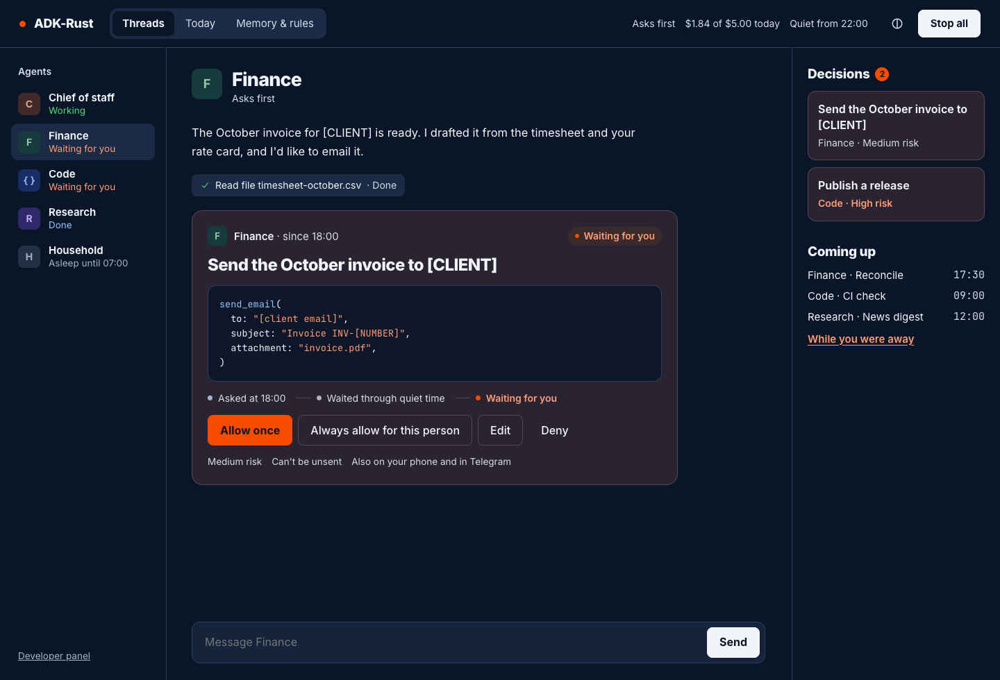 |
| 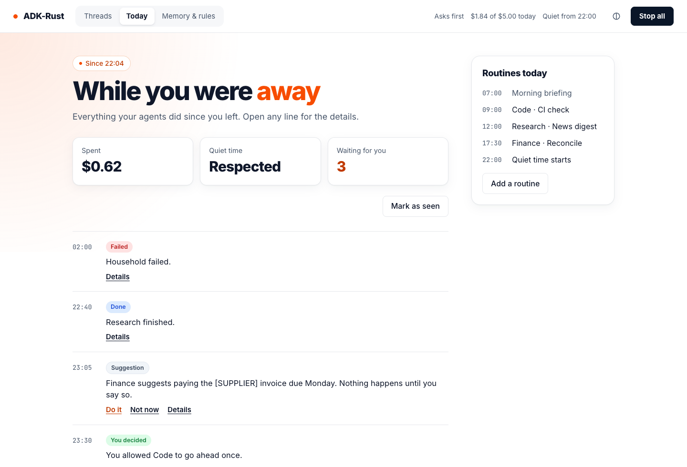 | 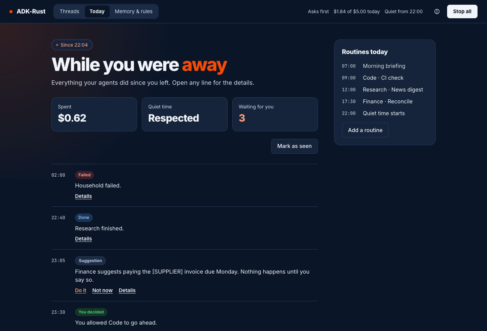 |
| 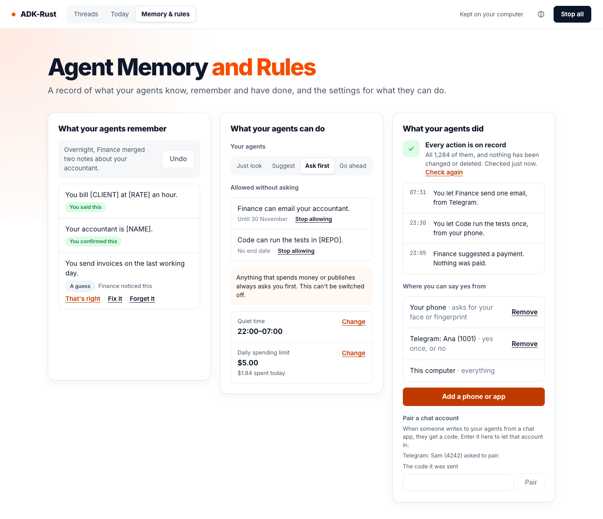 | 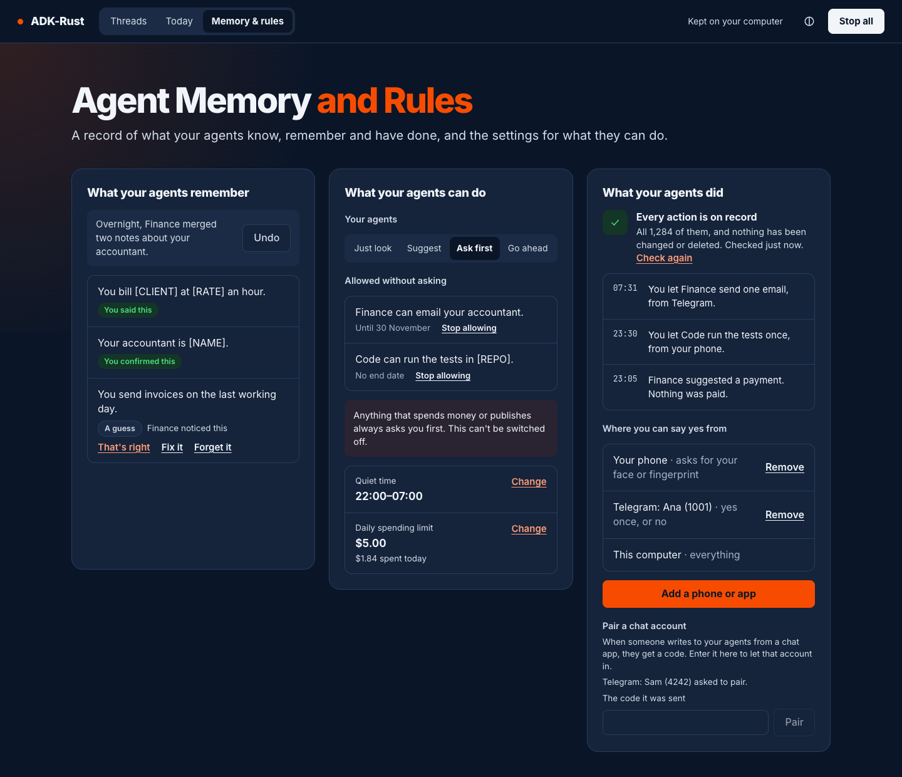 |

### Today and the morning briefing

Today reads the kernel's "While you were away" (spec 3.3 §10 K4,
[Settings, While You Were Away, Memory and Record](../kernel/today-and-memory.md)) as the
viewer `home`; a paired phone reads as itself, so each keeps its own place.

| Part | Behaviour |
|---|---|
| The counts | **Spent** (the page's spend rows), **Quiet time** **Respected** or **Not kept** (or **Not set** without quiet time), **Waiting for you** |
| The lines | One per event the kernel lists — finished, failed, stopped, a suggestion, a question, a decision, stopped or resumed all — failures first, then as they happened, each agent by the name the roster gives it. A suggestion or question shows its agenda item's words and is answered here |
| **Details** | Opens the line's record (`GET /kernel/away/lines/{seq}`, read with the page's sign-in): its entry on the record, when it was recorded, the area, what it cost and how long it took. Nothing links the tab away to the raw route, which needs the token the page sends and shows internal identifiers |
| **Mark as seen** | The only thing that moves the home's place (`POST /kernel/away/seen` with the page's `through`); opening or reloading Today reads and moves nothing |
| The morning briefing | Once quiet time ends, Threads shows the start of the same page — spent, quiet time, what waits, how many things happened — with **See what happened** (to Today) and **Not now**. It shows once for each end of quiet time, and not again after the page was marked seen; putting it away marks nothing seen |
| Routines today | Each routine's time today, the **Morning briefing** at the end of quiet time, and **Quiet time starts** |

A kernel without a `/proc` ledger, and `adk-rust serve` without a kernel, show the engine's
briefing of the last day instead, read-only. Without a ledger the briefing can list nothing,
so Today says what your agents do is not recorded on that server rather than that nothing
happened (`Briefing::recorded` is `false`).

`adk-rust up --mode ask` on `claude-sonnet-5-5`, its quiet time set to have ended an hour
before, after one held write allowed from the home:

| The briefing on Threads (light) | Today (dark) |
|---|---|
| 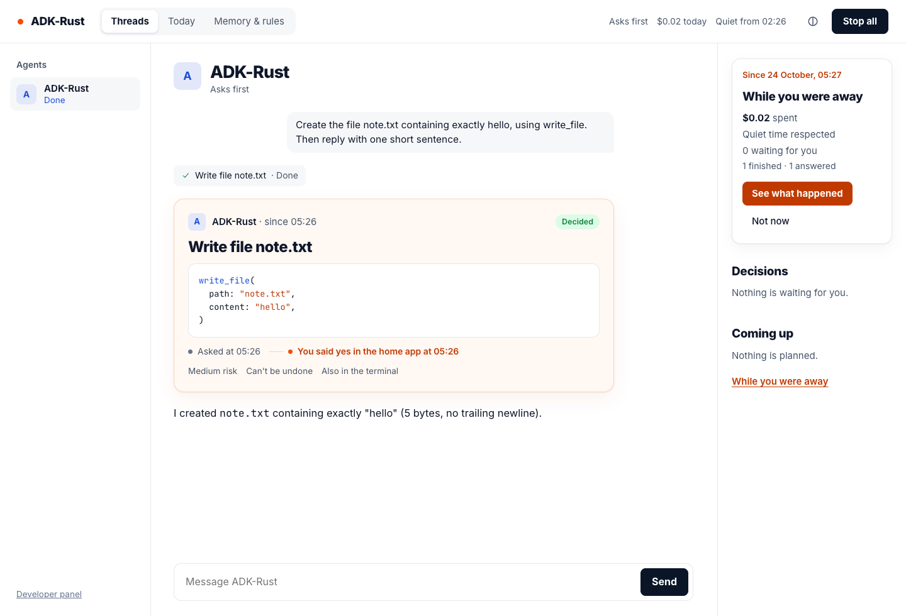 | 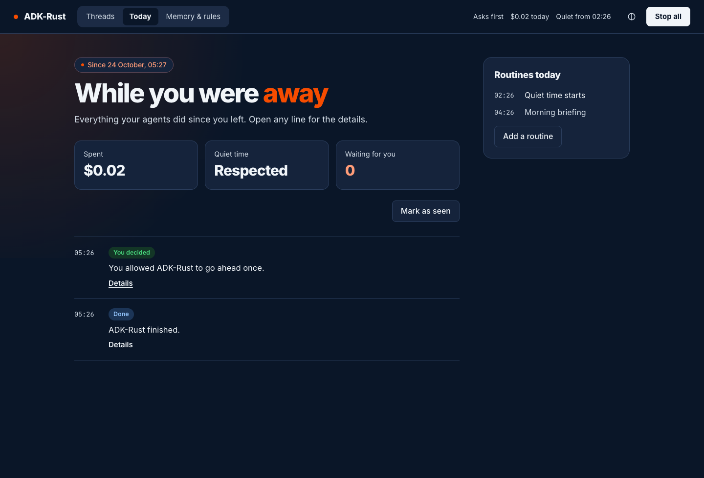 |

| Light | Dark |
|---|---|
| 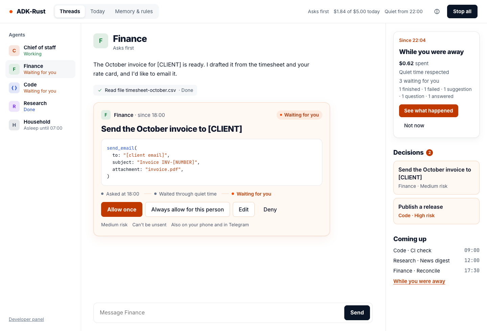 | 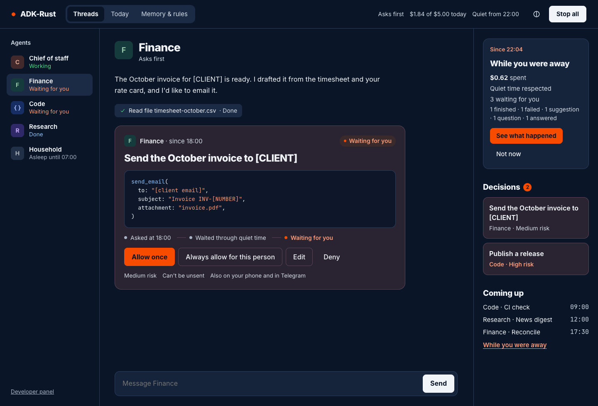 |

### What your agents remember

Each fact the agents remember is read from `GET /kernel/memory` (spec 3.3 §10 K5,
[Settings, While You Were Away, Memory and Record](../kernel/today-and-memory.md#what-your-agents-remember))
with where it came from: **You said this** — the person's own words, or a guess they confirmed
or corrected (spec 3.3 §8.1) — or **A guess** with what noticed it. Every fact offers **Fix it**
(the person's words replace it, in place, and it reads **You said this**; Esc closes it) and
**Forget it**; a guess also offers
**That's right**. Each goes through the kernel's route for it, which takes the person's answer
only, never a paired device's. The page says what became of each:
"Forgotten. Your agents won't use it from their next step." The latest overnight tidy-up
that changed something and was not undone shows above the list in words — "Overnight, your
agents merged two notes into one." — with **Undo**, which restores the notes it merged and
says how many came back; a note the person changed since stays as they left it. The kernel
records each correction with the fact's or the tidy-up's id, never its text. Where the agents
keep no long-term memory (`adk-rust up --no-memory`), the list says so.

### What your agents can do

Quiet time, the daily spending limit and the mode are read per area from
`GET /kernel/settings` and changed with its `POST` routes (spec 3.3 §10 K3). With more than
one area, a switch picks the area. **Change** opens the setting in place (Esc closes it);
quiet time can be turned off and the limit removed. The page reads the area again just before
a change, so "Was 22:00–07:00. Now 23:00–06:00." shows the values the kernel records as the
change's `from` and `to`. Only the person changes them: the kernel refuses a caller without the
`operator` scope and every paired device's token, and the page shows its answer. With one
area, the header's status line follows its settings in force; with several, its spend today and
daily spending limit are those of the area the primary agent works in, which
`GET /kernel/settings` marks `primary` (spec 3.3 §13 Q7).

Quiet time reads and saves on the clock of the device the page is open on. A window saved
from the home carries that device's IANA time zone (`timeZone`) and its offset now
(`utcOffsetMinutes`), so the kernel keeps the hours the person typed, across daylight saving
time where it reads zones. A window in a zone is read at that zone's offset; one with only an
offset at it; one with neither — from `--quiet-hours` or `harness.toml` — is kept in the
server's time zone, which `GET /surface/status` names as `hostUtcOffsetMinutes`. The page moves
its times to the device's clock, so 22:00–07:00 on a server in UTC reads 01:00–10:00 in
Nairobi.

| Light | Dark |
|---|---|
| 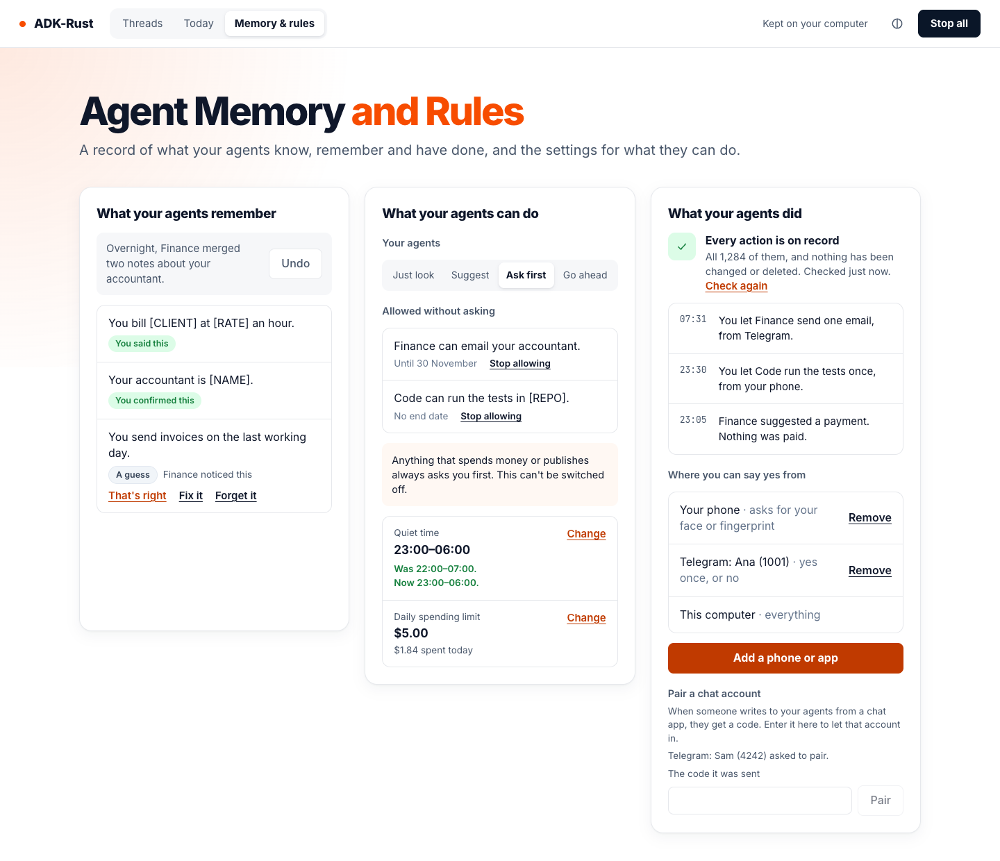 | 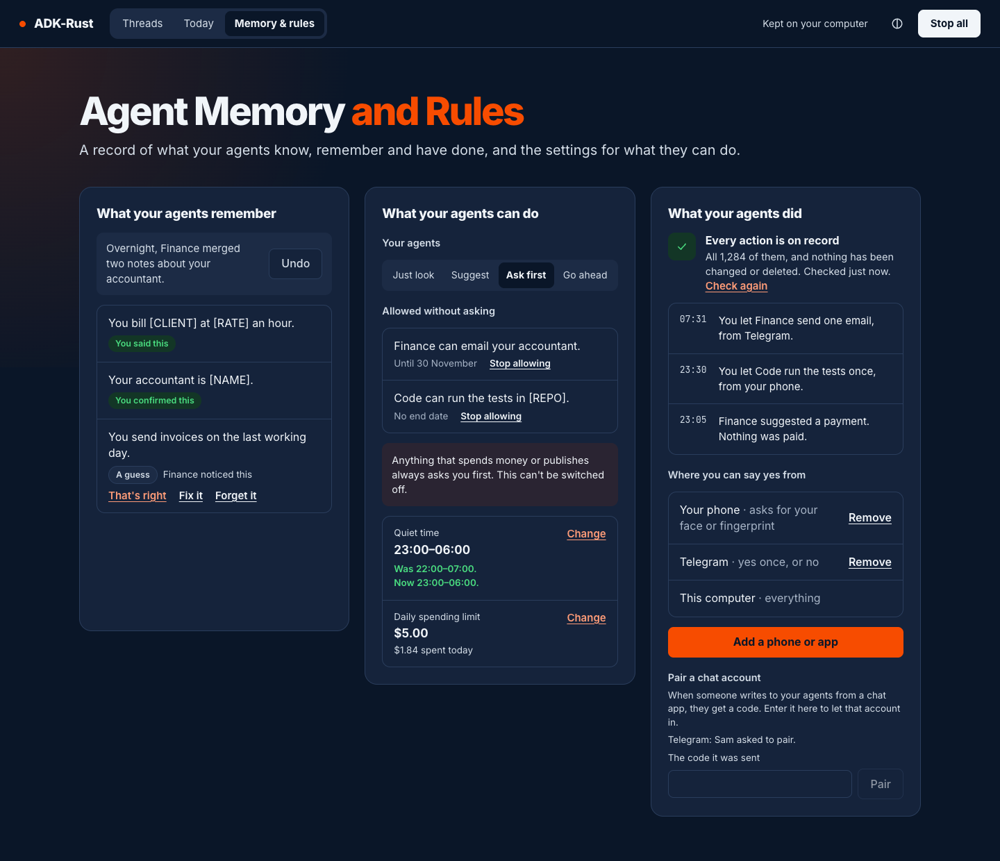 |

**Allowed without asking** lists the person's standing rules that allow a call, each as a
sentence — "Your agents can write files within notes/, in one conversation." — with its end
date, **Ended** once it has passed, or **No end date**. A rule with an end date offers **Extend**, a date in place
(the day it lasts through; thirty days on by default; Esc closes it) that moves its end later
through `POST /rules/{id}/extend` and shows "Was until 30 November. Now until 30 December.";
**Stop allowing** revokes it, so the next call it covered waits for the person again (spec 3.3
§12 phase 3). A rule without an end date applies until it is stopped, so it has nothing to
extend.

Below the settings, each area lists its agents, with their avatar, status word and what each
spent today, from the same daily totals as the area's "spent today", so they add up to it
(spec 3.3 §12 phase 4). The kernel's own upkeep — tidying notes, checking what agents do — is
one line, shown when it spent something. What was spent in an area the kernel does not list —
its own upkeep runs in `default`, which a partition table without it leaves out — is listed
under **Spent outside your areas today**, so nothing the kernel spent goes unshown.

### What your agents did

**Every action is on record** is the check `adk-rust audit verify` makes, run by the kernel on
its signed record (`GET /kernel/record/check`): with every action signed, "All 1,284 of them,
and nothing has been changed or deleted." The log signs a checkpoint after 256 actions, or on
its next action a minute after the last, so the newest actions can wait for their signature:
the page then says how many are not signed yet, and that the check can't vouch for them until
they are, never that anything was changed. These are the records `adk-rust audit verify`
reports as its unsigned tail, after its last verified checkpoint; before the log's first
checkpoint it also fails them as `unanchored`. Any other failure reads "Something on record was
changed or deleted.", with the check's words under **Details**. **Check again** runs it again.

The latest actions are sentences from the record's lines (`GET /kernel/record`): an answer,
whose call it was and where it was given ("You let Finance use send_email, from Telegram.",
"You said no to write_file, from the tray."), a rule that allows or refuses a call made,
extended or stopped, a stop or resume, an agent's tool call ("ADK-Rust used write_file."), and
the person's corrections and settings, which the kernel's records name. A paired device is
named by its name, never its id. Each answer is listed once: a chat thread's tap is recorded
before and after it decides, and an answer that came after the decision was made, which changed
nothing, is left out. Housekeeping and messages are left out of the list, though the check
counts them. A server without a signed record shows the latest lines of the activity ledger
instead.

`adk-rust up --mode ask` on `claude-sonnet-5-5`, after a session that left three facts, a
rule for `write_file` within `notes/` extended from the home, one write it covered, **Stop
allowing**, and the next identical write held and denied; the record signed and checked, as
`adk-rust audit verify` reports it VALID:

| Memory and rules (light) | Memory and rules (dark) |
|---|---|
| 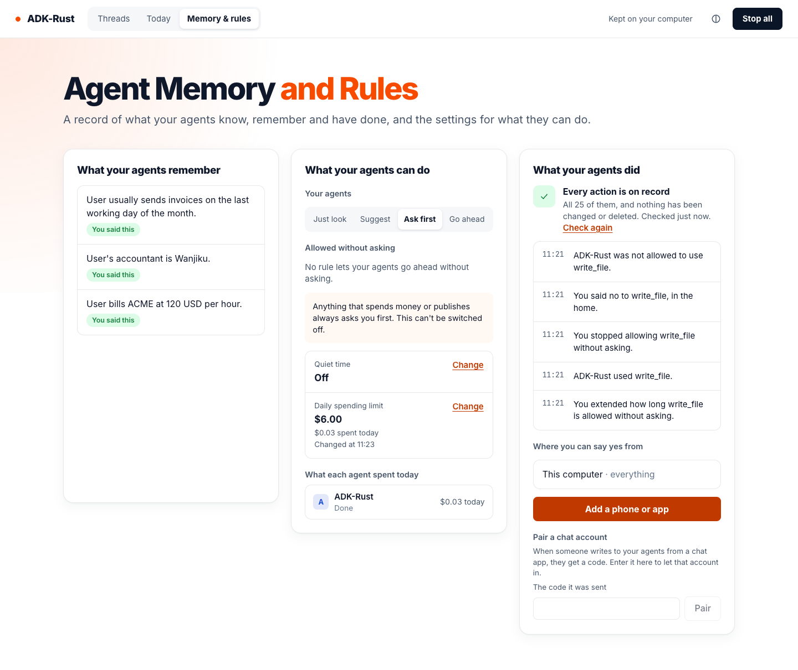 | 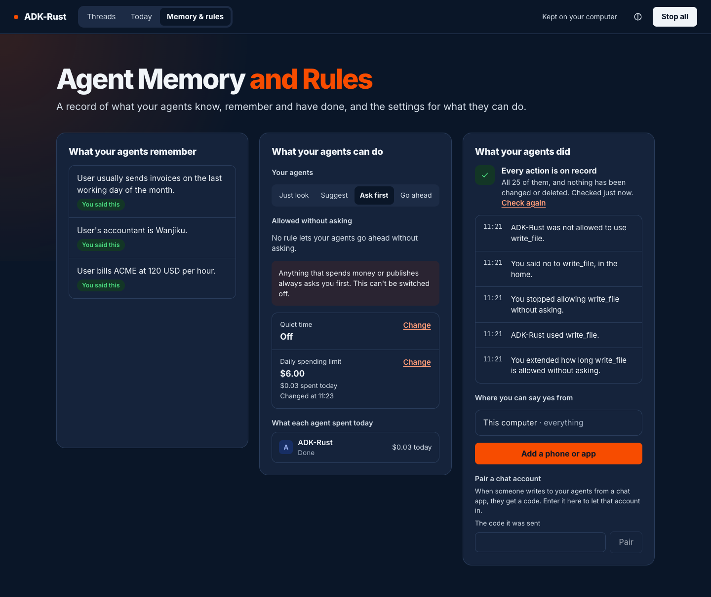 |

| The next identical call waits once the rule is stopped |
|---|
| 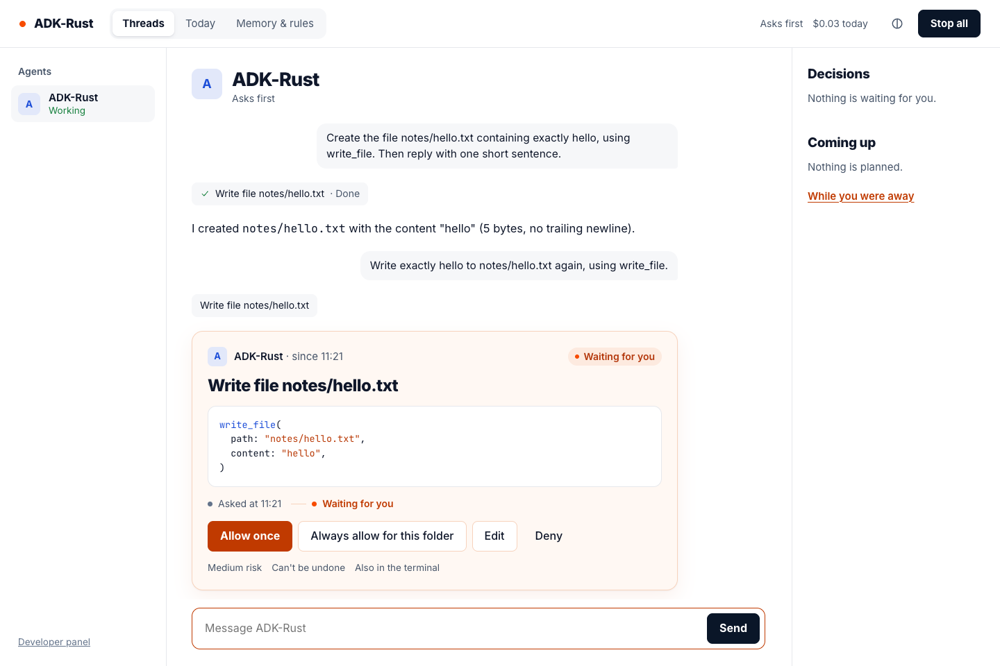 |

Two areas, `work` (Go ahead, a quiet window of its own, a $5 limit) and `home` (Ask first, a
$2 limit), from `[[kernel.partitions]]`:

| Work (light) | Home (dark) |
|---|---|
| 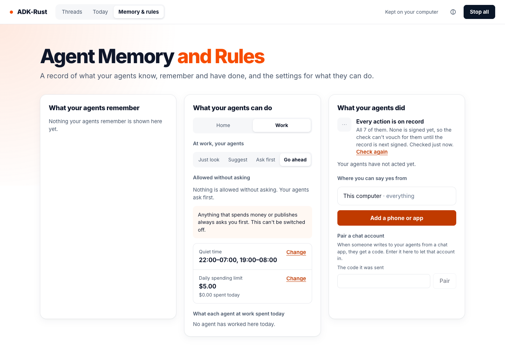 | 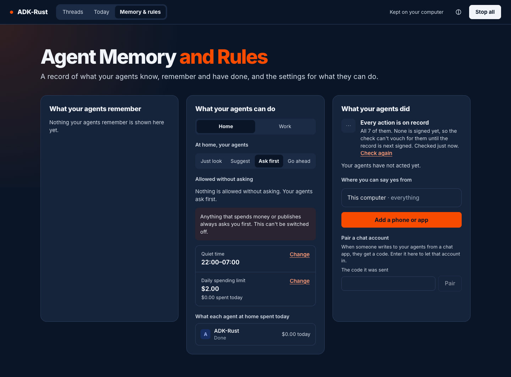 |

### Pairing a chat account

A stranger who writes to the agents from a chat app gets a code and starts nothing (spec 3.3
§5.3). **Where you can say yes from** lists who asked and has a field for that code: **Pair**
claims it as `adk-rust pair accept <code>` does (`POST /kernel/channels/pair`, `operator`
scope), and the account is listed with **Remove** from then on. Every account, waiting or
paired, reads as its name and its account on the channel — "Telegram: Ana (4242)" — since the
name is the account's own choice, and **Pair** confirms the account the kernel answers it
paired, never the one that asked when the section opened.

### What is read-only until the kernel serves it

Some controls need kernel routes the home does not read yet (spec 3.3 §10). The home shows
what exists, read-only, and renders each control through a typed seam
(`adk-surface/web/src/seams.ts`) that a client implementing the route fills, with no change to
the screens.

| Control | Needs | Shown today |
|---|---|---|
| **Confirm it's you and approve** | The passkey route of the phone package | The answer, refused until the server confirms presence |

## Decisions

Every card is drawn from its inbox entry (spec 3.3 §7.1, §11 S-I1) and answers through
`POST /surface/commands` with the version it showed (S-I2).

| Rule | Behaviour |
|---|---|
| One write path | **Allow once**, **Always allow for this person** (or this folder, this command), **Edit** and **Deny** send `decide` with the card's `version` |
| The version you saw | A card keeps the version it showed when a newer one arrives; an answer to it comes back as changed, and the card shows the new one with "This decision changed since you saw it." |
| Answered elsewhere | A conflict collapses the card to its line with "You said yes in Telegram at 07:31"; the answer is never retried |
| Answered here | The card keeps its place in the thread as one line: a check, its heading, then who decided and where — "Send the October invoice to [CLIENT] · You said yes in the home app at 07:40". The line takes the focus the answer had |
| Opening a decided card | A click, Enter or Space on the line shows the exact call, how it got here and the details again, and hides them; opening it answers nothing |
| **Edit** | Offered only where the card shows the call's own arguments: never over a redacted view or an MCP server's form, which would be submitted as written |
| **Take over**, then **Done** | A tool that asks for a password or a one-time code shows what asks and what for; what the person types goes through `POST /surface/decisions/{id}/take-over` to that one call, never the inbox, the model or a log line (§8.2, §10 H2) |
| The exact call | A truncated call cannot be approved until **Show the whole call** expands it |
| Enter and Esc | Neither ever decides; Esc closes **Edit** without deciding (§7.4) |
| Typing while a decision is open | Queued as the next message and shown as "Sent after this card is answered", never an answer (S-I4); the page reads the queue back from `GET /surface/sessions/{session}/queued`, so a reload or a switch of threads still shows it |
| High risk | Offered as **Confirm it's you and approve**; the server, not the page, says the person confirmed it is them |

| Take over (light) | Take over (dark) |
|---|---|
| 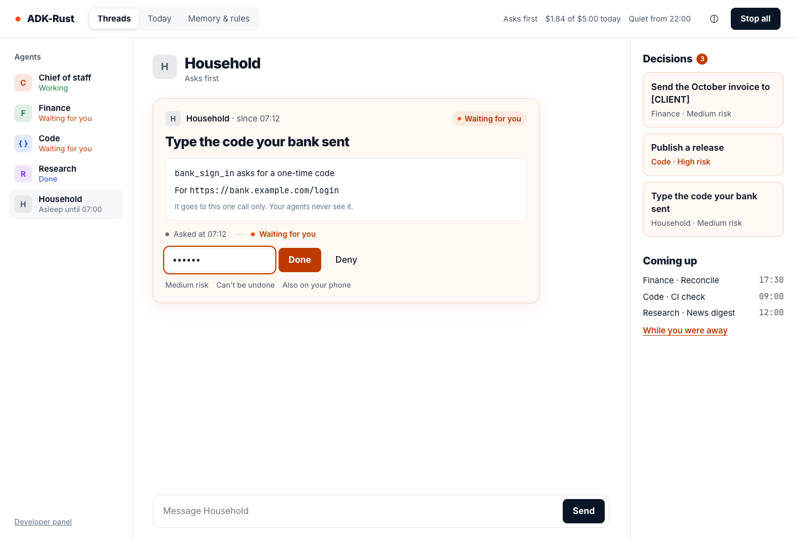 | 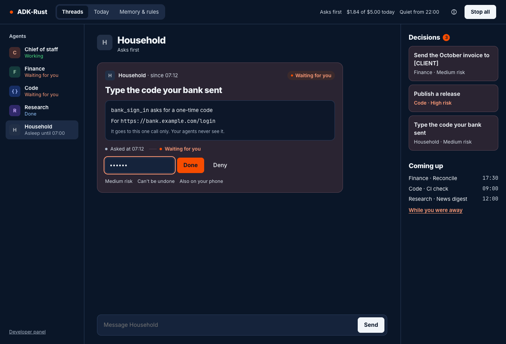 |

Every command carries how it was given — keyboard, pointer or touch — and the engine writes it
to the audit record with the surface and, for an answer, the agent whose call it was
(`actingAgent`), so **What your agents did** can say "You let Finance use send_email".

## Light, dark, keyboard and phone

- **Themes**: light and dark come from one set of tokens (spec 3.3 §9). The page follows the
  device's setting; the switch in the header cycles device, light and dark and remembers the
  choice in this browser only.
- **Keyboard**: every control is reachable, focus is always visible, and **Skip to the content**
  is the first stop.
- **Layout**: the page fills the window and never scrolls or bounces as a page. The header
  stays put; on **Threads** the roster, the thread and the right panel each scroll inside
  themselves, with the message box at the foot of the thread; **Today** and **Memory & rules**
  scroll under the header.
- **Phone**: under 640 px the page is one column — Decisions first, then the roster as a row,
  then the thread. The column scrolls under the header, and the message box stays at the foot
  of the screen while the thread is in view.

| Light | Dark |
|---|---|
| 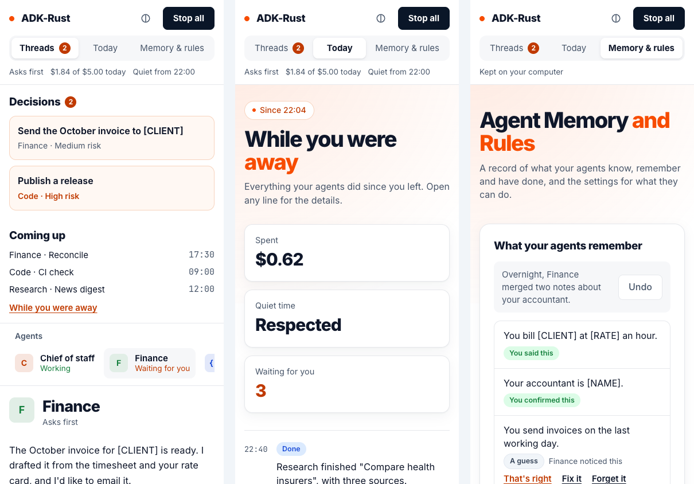 | 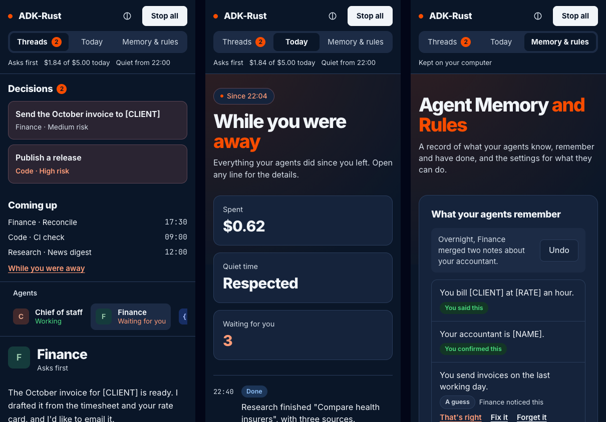 |

The screenshots on this page render the example of spec 3.3 §5.1 (`/ui/fixture.html`), with
the kernel's routes filled by the example's seams.

## The developer panel

`/ui/developer` keeps what was worth keeping of the bundled runtime UI: the agent's topology,
the runtime services and UI protocols the server advertises, a session's telemetry and its
state, read from `adk-server`'s own APIs (`/api/apps`, `/api/ui/agents/{name}`,
`/api/debug/trace/session/{id}`). Developer panels may use technical words (§8).

## Building the front end

The app lives in `adk-surface/web` (React, Vite and TypeScript, pinned dependencies, nothing run
at install time). Its build is committed under `adk-surface/assets/web`, and CI fails when the
build drifts from the source.

```bash
cd adk-surface/web
npm ci
npm run verify     # type check, component tests, build into ../assets/web
npm run dev        # against `adk-rust serve` on 127.0.0.1:8080
npm run e2e        # Playwright against the scripted kernel of examples/scripted_home.rs
```

`npm run dev` also serves `/ui/fixture.html`, the screens over the example of spec 3.3 §5.1.
The end-to-end tests start `cargo run -p adk-surface --features web --example scripted_home`
in a new, empty workspace each run (`HOME_E2E_BIN` names an example already built). The
example's kernel keeps a `/proc` ledger, and its quiet time ended an hour before it started.
The first test opens the home, sees the call the scripted agent's harness holds, allows it
once and checks that it ran once; the second runs a turn with one decision, sees the morning
briefing on Threads, checks every line of Today opens its record, that a reload moves
nothing and **Mark as seen** does, and changes quiet time. Against a home already running, set
`HOME_E2E_URL` and `HOME_E2E_WORKSPACE` to its address and its workspace.

## Moving from the bundled runtime UI

| Before | Now |
|---|---|
| `adk-server` served a runtime UI at `/`, `/ui/` and `/ui/assets/config/runtime-config.json` | `adk-server` serves its APIs only; those paths answer `404` |
| The UI ran agents through `/api/run_sse` with `x-adk-ui-protocol: adk_ui` | The web home reads the engine's feed and sends `send` commands; it never uses the `adk_ui` profile (§10 S3) |
| `adk_cli::Launcher` serve mode always had a page | It serves the REST API; `adk-rust serve` and `adk-rust up` serve the web home, and your own server mounts it as shown below |

To keep a page on a server you build with `adk-server`, mount the web home as shown in
[Mount it on your own server](#mount-it-on-your-own-server).

## Related

- [The Engine](index.md) — the feed, projection, commands and the web API the home reads
- [The Website's Views](website.md) — the **Website** section, where the server serves a website
- [The Control Plane](../kernel/control-plane.md) — the kernel routes beside the engine
- [Serving the Harness](../harness/serving.md) — `adk-rust serve`, its authentication and the inbox
