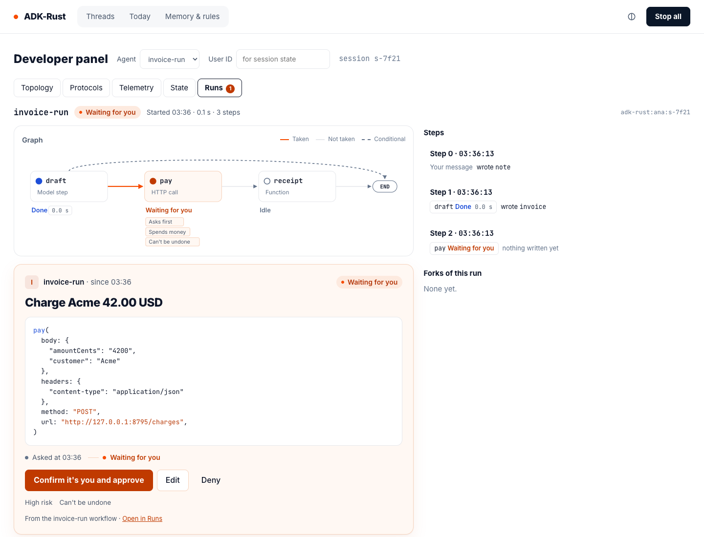
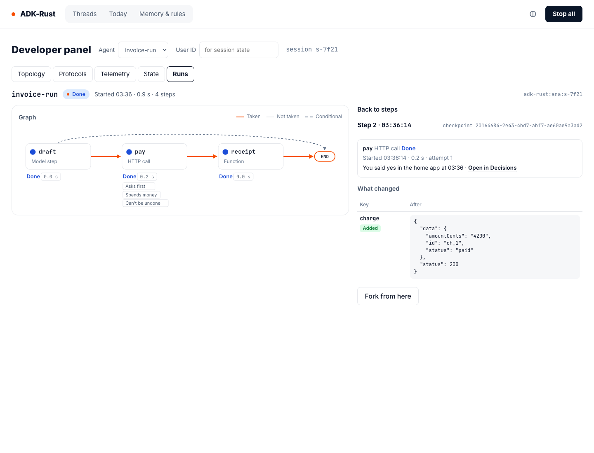
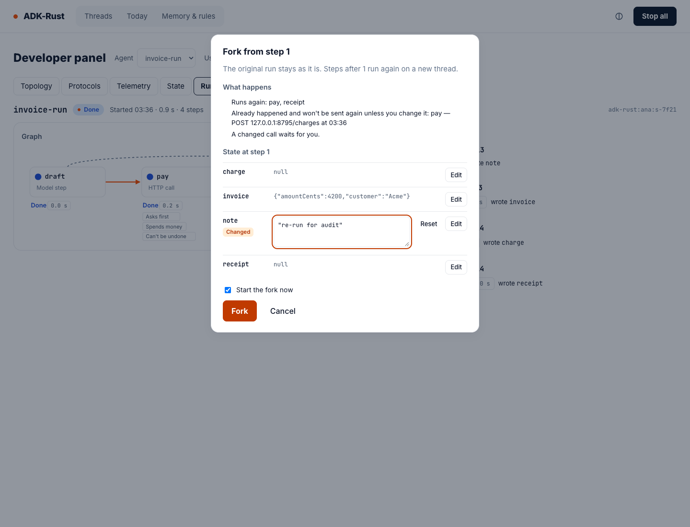
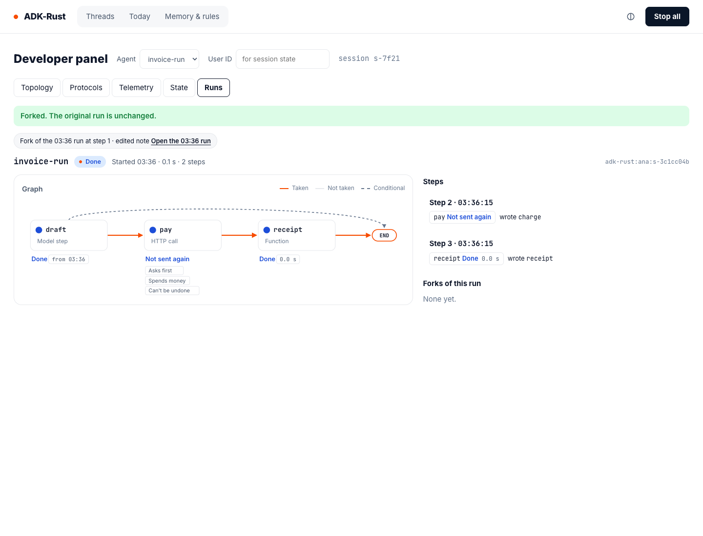
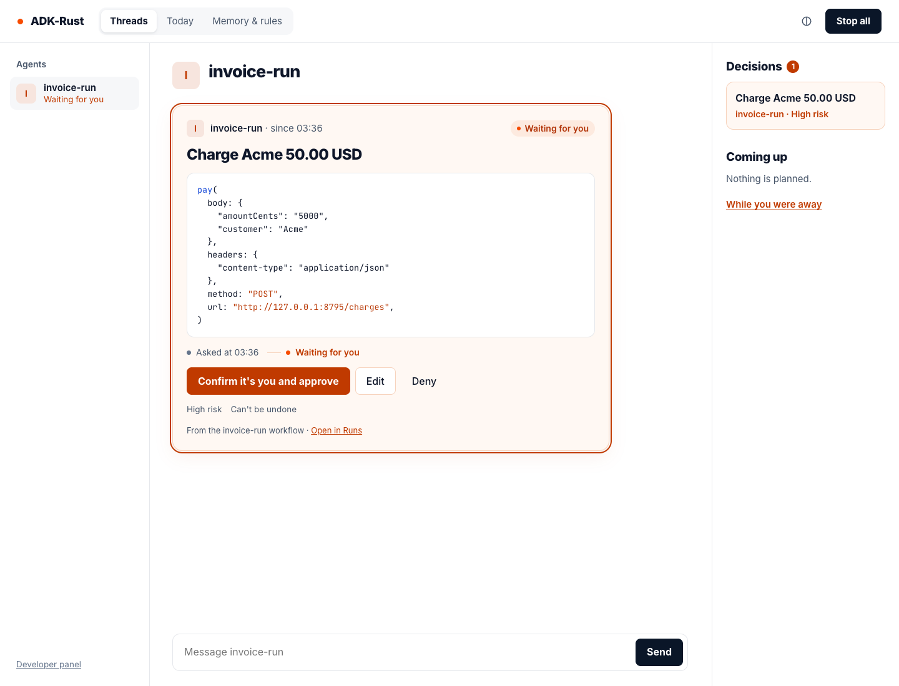

# The Workflow Observer

`adk-surface`'s `workflow` feature watches and debugs graph agents (spec 3.3 §12, developer
track): the developer panel's **Runs** tab draws a session's run — each node's status, the
steps, what each step changed — and forks a run from an earlier step with edits, on a new
thread, without touching the original. A decision a graph waits on is an ordinary inbox entry,
answered on any surface; the observer links to it and never draws an answer of its own.

> **Note:** the `workflow` feature is **Beta**. It pulls in adk-graph with `time-travel`, which
> `adk-harness`'s default `graph` feature already compiles, and `adk-harness`'s `web` feature
> for secret redaction. It has no adk-rust umbrella feature and no adk-cli feature: a host
> mounts it as a library.



## Try it

The `scripted_workflow` example runs the graph agent `invoice-run` — `draft` (a model step on a
scripted model), `pay` (a governed HTTP POST of the invoice that asks first and spends money)
and `receipt` — with a stand-in payment provider on the same server that counts every charge.
Sessions, checkpoints, the action ledger and the approval inbox are SQLite files in the
workspace, so a restart keeps every run.

```bash
cargo run -p adk-surface --features web,workflow --example scripted_workflow -- 8795 /tmp/workflow
# The draft step on a live model, with whichever key the repository's .env sets
# (claude-sonnet-5-5, gpt-5.6-terra or gemini-3.5-flash-lite):
cargo run -p adk-surface --features web,workflow --example scripted_workflow -- 8795 /tmp/workflow --live
```

Send a message to `invoice-run` from the web home, then open
`http://127.0.0.1:8795/ui/developer` and the **Runs** tab. `GET /hits` reads how many charges
the provider received.

## What the Runs tab shows

| Part | What it shows |
|---|---|
| Header | The graph, the run's status (Working, Waiting for you, Paused, Stopped, Done, Failed, Not started, No run yet), "Started 09:14 · 4.2 s · 3 steps" and the session's checkpoint thread |
| Run graph | Each node with a status dot and word, its kind (Model step, HTTP call, Function, …), its duration and its badges — "Asks first", "Spends money", "Can't be undone". Taken edges are solid, others muted, conditional ones dashed |
| The open decision | The inbox's card for the node that waits, drawn by the home's decision card and answered with the engine's `decide` command |
| Steps | One row per step: "Step 1 · 09:14:01", each node's status and duration, and the keys it wrote; "Your message" for the input that started the run. **Fork from here** on a completed step with work after it. Steps saved in one checkpoint, under `Durability::Exit`, open and fork only from the last of them, the one whose state the checkpoint holds |
| Step detail | Each node's kind, status, start, duration and attempt; for a model step, a link to its activity in the thread; for a replayed call, "Not sent again — the record from 09:14 answered it"; for a governed node, the decision it waited on. Then "What changed": each key Added, Changed or Removed, before and after |
| Forks of this run | The forks made from this thread: when, from which step, which keys they edited |



Every value shown passes secret redaction ("Hidden: looks like a secret"), the keys the host
hides with `Workflows::hide_keys` ("Hidden: this home hides this key") and a size cap; long
values collapse after 12 lines. Values are never logged.

> **Note:** the Runs tab is a developer panel, so it uses technical words such as "checkpoint";
> the decision card stays the plain card every surface shows (spec 3.3 §8).

## Forks

A fork starts a new session of the same person at the completed checkpoint of an earlier step,
with the channels you edit overwritten whole. The original thread is never written.



| Rule | Behaviour |
|---|---|
| Who | The session's owner, from the web home. Another person's session answers `404`; a paired device or another surface answers `403 surface.not_here` |
| When | Not while a decision of the session waits: `409 workflow.decision_waiting`, "Answer the waiting decision first" |
| From where | A completed step with work after it; a pause or the last step is refused ("Nothing runs after the last step") |
| Edits | Declared channels only ("Not a channel of this graph: amount"), at most 64 KiB a key. An editor starts from the value as shown: a part shown `[hidden]` or `[redacted]` keeps the value it stands for, and a value too large to show in full is not edited here |
| Calls that already happened | A governed call the fork makes unchanged is answered from its record: "Not sent again", with the original's writes. A changed call is a new call: it waits for a person when its node asks first ("A changed call waits for you."), and the host's rules decide it otherwise |
| What runs again | The rest of the step's run; a later run of the session is not part of the fork |
| Stop all | The fork is made and not started: "Forked. Everything is stopped — start it after Resume all." **Start the fork** starts it later, once; a second start while its run is under way is refused (`workflow.started`) |
| Record | `surface.workflow.fork` with `sessionId`, `from`, `forkSessionId`, `edited`, and the caller's `surface` and `origin`; `surface.workflow.start` with `sessionId` and `from` when its run starts. A fork the audit cannot record is removed and the request fails |
| No runner | A fork asked to start where `Workflows` has no runner is refused before anything is made |



## A graph's decision on every surface

A governed node's card is the inbox entry: it shows the exact call, offers **Confirm it's you
and approve · Edit · Deny** for a node that spends money, never **Always allow**, and says
where it came from — "From the invoice-run workflow · Open in Runs". A governed node inside a
`SubgraphNode` is carded and routed the same way, and the run view shows its subgraph's node
waiting for it.



## Mount it on your own server

```rust
use std::sync::Arc;

use adk_core::{
    ApprovalPolicy, ApproverSelector, GovernanceControl, InMemoryActionLedger,
    InMemoryApprovalStore, RunConfig, StoreApprovalService,
};
use adk_graph::agent::GraphAgent;
use adk_runner::Runner;
use adk_server::ServerBuilder;
use adk_session::SessionService;
use adk_surface::workflow::Workflows;
use adk_surface::{LocalSource, SurfaceEngine};

fn mount(
    graph: Arc<GraphAgent>,
    sessions: Arc<dyn SessionService>,
    builder: ServerBuilder,
) -> Result<ServerBuilder, Box<dyn std::error::Error>> {
    let workflows = Workflows::new("adk-rust").graph(graph.clone()).sessions(sessions.clone());
    // A node that spends money is high risk on every surface, chat and voice included.
    let approvals = Arc::new(StoreApprovalService::new(Arc::new(InMemoryApprovalStore::new())).with_router(
        workflows.approval_router(ApprovalPolicy::new([ApproverSelector::group("owner")])),
    ));
    // Stop all freezes this control, and a governed node is refused while it is frozen.
    let governance = GovernanceControl::new();
    let runner = Arc::new(
        Runner::builder()
            .app_name("adk-rust")
            .agent(graph)
            .session_service(sessions.clone())
            .governance(governance.clone())
            .run_config(
                RunConfig::builder()
                    .approval_service(approvals.clone())
                    // Keeps each governed call to once, so a fork's unchanged call is
                    // answered from its record; without a ledger a governed node is not run.
                    // Use a durable ledger, such as adk-session's SqliteActionLedger.
                    .action_ledger(Arc::new(InMemoryActionLedger::new()))
                    .build(),
            )
            .build()?,
    );
    let workflows = workflows.runner(runner.clone());
    let source = LocalSource::builder("adk-rust")
        .sessions(sessions)
        .approvals(approvals)
        .runner(runner)
        .governance(governance)
        .build()?;
    let engine = SurfaceEngine::builder(Arc::new(source)).card_hints(Arc::new(workflows.clone())).build();
    Ok(builder
        .add_api_routes(adk_surface::web::router(engine.clone()))
        .add_api_routes(adk_surface::web::workflow::router(workflows, engine))
        .add_root_routes(adk_surface::web::home()))
}
```

| Route (under `/api`) | Answer |
|---|---|
| `GET /surface/workflow/graphs` | `GraphsResponse`: every graph observed, with its nodes, edges and channels |
| `GET /surface/workflow/sessions/{session}/run` | `WorkflowRun`: the latest run, with each waiting node's decision id from the inbox |
| `GET /surface/workflow/sessions/{session}/runs` | `RunsResponse`: every run kept, from the records only |
| `GET /surface/workflow/sessions/{session}/checkpoints/{id}` | `StepDetail`: one step, read from one checkpoint |
| `GET /surface/workflow/sessions/{session}/feed` | Server-sent events: `changed` with `id` = the newest checkpoint version; resumes after `Last-Event-ID` |
| `POST /surface/workflow/sessions/{session}/fork` | `ForkRequest` → `ForkOutcome` |
| `POST /surface/workflow/sessions/{session}/start` | Starts a fork made and not started |
| `GET /surface/workflow/openapi.json` | This API's OpenAPI document |

A server that pairs devices mounts `adk_surface::web::workflow::router_with_devices(workflows,
engine, pairing)` beside `web::router_with_devices`, so a paired device's Runs feed ends when
the device is removed or its pairing ends.

Every route needs an authenticated caller (`401` without one). The Runs tab appears only when
`GET /surface/workflow/graphs` answers; a server built without the feature answers `404` and the
tab stays hidden.

## From the terminal

`adk-rust graph steps` prints a thread's runs, each step's node records and a fork's lineage;
`adk-rust graph fork --set key=<json>` forks at a step. The CLI has the checkpoints and not the
graph, so its edits overwrite only keys the checkpoint holds and are not checked against the
graph's channels; its forks are not started and not recorded. Every printed value has its
control characters escaped.

```text
$ adk-rust graph steps adk-rust:ana:s-7f21 --db /tmp/workflow/checkpoints.db
run 09:14:00 (inv-0cda141d-9902-439e-af0e-72ec1ede7210)
Step  Time      Node     Status   Duration  Wrote
0     09:14:00  -        input    -         note
1     09:14:01  draft    done     1.2 s     invoice
2     09:14:03  pay      waiting  -         -
2     09:15:02  pay      done     0.3 s     charge
3     09:15:03  receipt  done     0.1 s     receipt

$ adk-rust graph fork adk-rust:ana:s-7f21 --at 1 --new-thread adk-rust:ana:s-b3e8 --set note='"re-run"' --db /tmp/workflow/checkpoints.db
Forked adk-rust:ana:s-7f21 at step 1 → adk-rust:ana:s-b3e8; edited: note (not checked against the graph's channels); already happened (answered from the record if unchanged): pay
```

## Related

- [Graph Checkpointing](../agents/graph-checkpointing.md) — the run and step records, lineage and the effect log the observer reads
- [Graph Agents](../agents/graph-agents.md) — governed nodes
- [Tool Authorization](../security/tool-authorization.md) — governed graph nodes on the governed path
- [The Engine](index.md) — decision cards, card hints and the web API
- [Scenarios](scenarios.md) — "Approve, rewind, fork"
