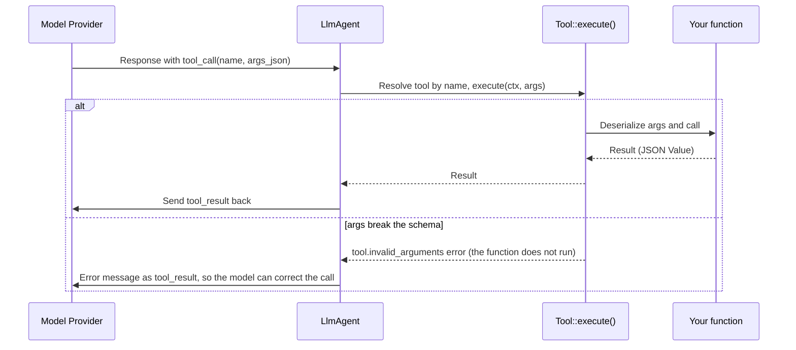

# Function Tools

Extend agent capabilities with custom Rust functions.

---

## What are Function Tools?

Function tools let you give agents abilities beyond conversation - calling APIs, performing calculations, accessing databases, or any custom logic. The LLM decides when to use a tool based on the user's request.

| Way to define a tool | Use it when |
|----------------------|-------------|
| `#[tool]` macro (recommended) | A tool is one async function with a typed argument struct |
| `FunctionTool::new()` | The tool is built at runtime, or you prefer an explicit closure |
| `StatefulTool<S>` | Calls share state, such as a cache or a connection pool |
| A `Tool` implementation | You need full control over the declaration or execution |

Argument types derive their JSON Schema with `schemars`, and every tool receives an
`Arc<dyn ToolContext>` with the session, artifacts, and memory of the call.

---

## Install

```toml
[dependencies]
adk-rust = { version = "3.0.0", features = ["tools"] }
adk-tool = "3.0.0"
schemars = "1"
serde = { version = "1", features = ["derive"] }
serde_json = "1"
tokio = { version = "1", features = ["full"] }
```

The code `#[tool]` generates names `adk_tool`, `schemars`, and `serde_json`, so those crates are
direct dependencies even when you use the `adk-rust` umbrella crate.

---

### Tool Execution Pipeline



A `#[tool]` tool, and a `FunctionTool` or `StatefulTool` given a schema with
`with_parameters_schema`, checks its arguments itself; a hand-written `Tool` can check them
with [`ToolArgumentValidator`](#argument-validation).

---

## Recommended: `#[tool]` Macro

The fastest way to create tools. The macro reads your doc comment as the description and derives the JSON schema from your args type:

```rust
use adk_tool::tool;
use adk_core::AdkError;
use schemars::JsonSchema;
use serde::Deserialize;
use serde_json::{json, Value};

#[derive(Deserialize, JsonSchema)]
struct WeatherArgs {
    /// The city to look up
    city: String,
    /// Temperature unit (celsius or fahrenheit)
    unit: Option<String>,
}

/// Get the current weather for a city.
#[tool]
async fn get_weather(args: WeatherArgs) -> Result<Value, AdkError> {
    Ok(json!({ "temp": 22, "city": args.city }))
}

// Generated: pub struct GetWeather; — implements adk_core::Tool
// Use it: agent_builder.tool(Arc::new(GetWeather))
```

The tool is named after the function (`get_weather`), and the generated struct is its
PascalCase form (`GetWeather`). If your tool needs session context, add
`Arc<dyn ToolContext>` as the first parameter:

```rust
use adk_core::{AdkError, ToolContext};
use adk_tool::tool;
use schemars::JsonSchema;
use serde::Deserialize;
use serde_json::{Value, json};
use std::sync::Arc;

#[derive(Deserialize, JsonSchema)]
struct SearchArgs {
    /// Words to look for
    query: String,
}

/// Search the user's saved documents.
#[tool]
async fn search_docs(ctx: Arc<dyn ToolContext>, args: SearchArgs) -> Result<Value, AdkError> {
    // Scope the search to the calling user.
    let user_id = ctx.user_id();
    Ok(json!({ "user": user_id, "query": args.query, "hits": [] }))
}
```

### Tool Metadata Attributes

Mark tools as read-only, idempotent, concurrency-safe, or long-running directly in the macro:

```rust
use adk_core::AdkError;
use adk_tool::tool;
use schemars::JsonSchema;
use serde::Deserialize;
use serde_json::{Value, json};

#[derive(Deserialize, JsonSchema)]
struct LookupArgs {
    key: String,
}

#[derive(Deserialize, JsonSchema)]
struct ReportArgs {
    topic: String,
}

/// Look up cached data — no side effects, safe for parallel dispatch.
#[tool(read_only, concurrency_safe)]
async fn cache_lookup(args: LookupArgs) -> Result<Value, AdkError> {
    Ok(json!({ "key": args.key, "result": "cached" }))
}

/// Start a long-running background report.
#[tool(long_running)]
async fn generate_report(args: ReportArgs) -> Result<Value, AdkError> {
    Ok(json!({ "task_id": "abc123", "topic": args.topic, "status": "processing" }))
}
```

Available attributes (all optional, combine freely):

| Attribute | Effect |
|-----------|--------|
| `read_only` | `is_read_only() → true` and `effect() → ToolEffect::ReadOnly` — one of two signals required for concurrent `Auto` dispatch |
| `idempotent` | `effect() → ToolEffect::Idempotent` — a retry budget may retry the tool after a retryable error; ignored alongside `read_only` |
| `concurrency_safe` | `is_concurrency_safe() → true` — one of two signals required for concurrent `Auto` dispatch |
| `long_running` | `is_long_running() → true` — `LlmAgent` lists the tool in the call event's `long_running_tool_ids`. Unlike [`FunctionTool::with_long_running`](#long-running-tools), the description gains no note |
| `lenient_args` | Turns off [argument validation](#argument-validation): arguments are deserialized with serde alone, unknown keys are dropped, and schema bounds are advisory |

Plain `#[tool]` without attributes keeps the defaults (all `false`, effect `NonIdempotent`). See [Tool Effects](tool-effects.md) for how the effect governs retries.

### Argument Validation

A `#[tool]` tool checks each call's arguments against its schema before your function runs.
The check uses the schema schemars derives from the args type, with
`additionalProperties: false` set on every object that declares all of its fields.
`parameters_schema()` — what the model is shown — is the same schema without `$schema` and
`title`, with nullable types reduced (`adk_tool::model_facing_schema`) and without the
closure: Gemini's function declarations reject `additionalProperties`.

| The model sends | Result |
|-----------------|--------|
| A key the schema does not name, at any depth | Rejected, except in an object whose fields come partly from a flattened enum, which stays open |
| A value outside a `#[schemars(range(...))]`, `length(...)` or `pattern(...)` bound | Rejected |
| A missing required field, or a value of the wrong type | Rejected |
| `null` for an `Option` field | Accepted |
| An integral float such as `3.0` for an integer field | Accepted, and read as `3` (also with `lenient_args`) |

A rejected call fails with an `ErrorCategory::InvalidInput` error with code
`TOOL_INVALID_ARGUMENTS_CODE` (`tool.invalid_arguments`) that lists each violation by JSON
pointer. `LlmAgent` always shows that message to the model, so it can fix the arguments and
call again; the function does not run.

```rust
use adk_core::AdkError;
use adk_tool::tool;
use schemars::JsonSchema;
use serde::Deserialize;
use serde_json::{Value, json};

#[derive(Deserialize, JsonSchema)]
struct BookArgs {
    /// Room code such as `A1`.
    #[schemars(length(min = 2, max = 4), pattern(r"^[A-Z][0-9]{1,3}$"))]
    room: String,
    /// Slots to book, from 1 to 10.
    #[schemars(range(min = 1, max = 10))]
    count: u32,
}

/// Book meeting-room slots.
#[tool]
async fn book_slots(args: BookArgs) -> Result<Value, AdkError> {
    Ok(json!({ "booked": args.count, "room": args.room }))
}

// {"room": "A1", "count": 50, "dry_run": true} reaches the model as:
// tool.invalid_input: invalid arguments for 'book_slots': /count: 50 is greater than the
// maximum of 10; arguments: Additional properties are not allowed ('dry_run' was unexpected).
// Correct the arguments to match the tool's parameters schema and call it again.
```

A schema narrower than what the type deserializes from rejects calls serde would accept, such
as a `#[serde(alias = "...")]` key or a field with a custom `deserialize_with`. Keep one
struct's keys open with `#[schemars(extend("additionalProperties" = true))]`, or opt the whole
tool out with `#[tool(lenient_args)]`.

`FunctionTool` and `StatefulTool` apply the same check from the type given to
`with_parameters_schema::<T>()`; `.with_lenient_args(true)` turns it off. Hand-written tools
use the check through `adk_tool::ToolArgumentValidator`, with
`adk_tool::close_object_schemas` to reject undeclared keys and
`adk_tool::coerce_integral_floats` to read `3.0` as `3`:

```rust
use adk_core::AdkError;
use adk_tool::{ToolArgumentValidator, close_object_schemas};
use serde_json::json;

fn weather_validator() -> Result<ToolArgumentValidator, AdkError> {
    let mut schema = json!({
        "type": "object",
        "properties": { "city": { "type": "string", "maxLength": 40 } },
        "required": ["city"]
    });
    close_object_schemas(&mut schema);
    ToolArgumentValidator::new(&schema)
}

// In `Tool::execute`, before acting on `args`:
// weather_validator()?.validate(self.name(), &args)?;
```

`ToolArgumentValidator::new` fails with code `tool.invalid_parameters_schema`
(`adk_tool::TOOL_INVALID_PARAMETERS_SCHEMA_CODE`) when the schema itself does not compile.

---

## Alternative: `FunctionTool::new()`

For dynamic tools or when you prefer explicit registration:

Create a tool with `FunctionTool::new()` and **always add a schema** so the LLM knows what parameters to pass:

```rust
use adk_rust::prelude::*;
use adk_rust::Launcher;
use schemars::JsonSchema;
use serde::{Deserialize, Serialize};
use serde_json::json;
use std::sync::Arc;

#[derive(JsonSchema, Serialize, Deserialize)]
struct WeatherParams {
    /// The city or location to get weather for
    location: String,
}

#[tokio::main]
async fn main() -> anyhow::Result<()> {
    dotenvy::dotenv().ok();
    let api_key = std::env::var("GOOGLE_API_KEY")?;
    let model = GeminiModel::new(&api_key, "gemini-3.7-flash")?;

    // Weather tool with proper schema
    let weather_tool = FunctionTool::new(
        "get_weather",
        "Get current weather for a location",
        |_ctx, args| async move {
            let location = args.get("location")
                .and_then(|v| v.as_str())
                .unwrap_or("unknown");
            Ok(json!({
                "location": location,
                "temperature": "22°C",
                "conditions": "sunny"
            }))
        },
    )
    .with_parameters_schema::<WeatherParams>(); // Required for LLM to call correctly!

    let agent = LlmAgentBuilder::new("weather_agent")
        .instruction("You help users check the weather. Always use the get_weather tool.")
        .model(Arc::new(model))
        .tool(Arc::new(weather_tool))
        .build()?;

    Launcher::new(Arc::new(agent)).run().await?;
    Ok(())
}
```

> **Important:** Always call `.with_parameters_schema::<T>()`. Without it the declaration has
> no parameters, so the LLM does not know what to pass and may not call the tool. With it, each
> call's arguments are [validated](#argument-validation) against the schema before the handler
> runs. `T` needs `JsonSchema` and `Serialize`.

**How it works**:
1. User asks: "What's the weather in Tokyo?"
2. LLM decides to call `get_weather` with `{"location": "Tokyo"}`
3. Tool returns `{"location": "Tokyo", "temperature": "22°C", "conditions": "sunny"}`
4. LLM formats response: "The weather in Tokyo is sunny at 22°C."

---

## Parameter Handling

Extract parameters from the JSON `args`:

```rust
let order_tool = FunctionTool::new(
    "process_order",
    "Process an order. Parameters: product_id (required), quantity (required), priority (optional)",
    |_ctx, args| async move {
        // Required parameters - return error if missing
        let product_id = args.get("product_id")
            .and_then(|v| v.as_str())
            .ok_or_else(|| adk_core::AdkError::tool("product_id is required"))?;

        let quantity = args.get("quantity")
            .and_then(|v| v.as_i64())
            .ok_or_else(|| adk_core::AdkError::tool("quantity is required"))?;

        // Optional parameter with default
        let priority = args.get("priority")
            .and_then(|v| v.as_str())
            .unwrap_or("normal");

        Ok(json!({
            "order_id": "ORD-12345",
            "product_id": product_id,
            "quantity": quantity,
            "priority": priority,
            "status": "confirmed"
        }))
    },
);
```

A tool without a schema gets no argument check, and the model sees only the code of an
`AdkError::tool` failure (`tool.legacy`), not its message — see
[Error Handling](#error-handling). Prefer a schema, which enforces required fields before the
handler runs.

---

## Typed Parameters with Schema

For complex tools, use typed structs with JSON Schema:

```rust
use adk_core::AdkError;
use schemars::JsonSchema;
use serde::{Deserialize, Serialize};

#[derive(JsonSchema, Serialize, Deserialize)]
struct CalculatorParams {
    /// The arithmetic operation to perform
    operation: Operation,
    /// First operand
    a: f64,
    /// Second operand
    b: f64,
}

#[derive(JsonSchema, Serialize, Deserialize)]
#[serde(rename_all = "lowercase")]
enum Operation {
    Add,
    Subtract,
    Multiply,
    Divide,
}

let calculator = FunctionTool::new(
    "calculator",
    "Perform arithmetic operations",
    |_ctx, args| async move {
        // The schema check has already run, so this matches the declared type.
        let params: CalculatorParams = serde_json::from_value(args)
            .map_err(|e| AdkError::tool(format!("invalid calculator arguments: {e}")))?;
        let result = match params.operation {
            Operation::Add => params.a + params.b,
            Operation::Subtract => params.a - params.b,
            Operation::Multiply => params.a * params.b,
            Operation::Divide if params.b != 0.0 => params.a / params.b,
            // A result the model can read and act on.
            Operation::Divide => return Ok(json!({ "error": "Cannot divide by zero" })),
        };
        Ok(json!({ "result": result }))
    },
)
.with_parameters_schema::<CalculatorParams>();
```

The schema is auto-generated from Rust types using `schemars`.

---

## Several Tools on One Agent

Add multiple tools to one agent:

```rust
let agent = LlmAgentBuilder::new("assistant")
    .instruction("Help with calculations, conversions, and weather.")
    .model(Arc::new(model))
    .tool(Arc::new(calc_tool))
    .tool(Arc::new(convert_tool))
    .tool(Arc::new(weather_tool))
    .build()?;
```

The LLM automatically chooses the right tool based on the user's request. Tool names are
unique per agent: when two tools registered with `.tool()` share a name, `build()` fails with
an `agent.duplicate_tool_name` error (`adk_core::DUPLICATE_TOOL_NAME_CODE`).

---

## Error Handling

Return errors with the `Tool` component for tool-specific failures:

```rust
use adk_core::{AdkError, ErrorComponent, ErrorCategory};

let divide_tool = FunctionTool::new(
    "divide",
    "Divide two numbers",
    |_ctx, args| async move {
        let a = args.get("a").and_then(|v| v.as_f64())
            .ok_or_else(|| AdkError::new(
                ErrorComponent::Tool,
                ErrorCategory::InvalidInput,
                "tool.divide.missing_param",
                "Parameter 'a' is required",
            ))?;
        let b = args.get("b").and_then(|v| v.as_f64())
            .ok_or_else(|| AdkError::new(
                ErrorComponent::Tool,
                ErrorCategory::InvalidInput,
                "tool.divide.missing_param",
                "Parameter 'b' is required",
            ))?;

        if b == 0.0 {
            return Err(AdkError::new(
                ErrorComponent::Tool,
                ErrorCategory::InvalidInput,
                "tool.divide.division_by_zero",
                "Cannot divide by zero",
            ));
        }

        Ok(json!({ "result": a / b }))
    },
);
```

The backward-compatible shorthand `AdkError::tool("...")` builds an `Internal` error with code
`tool.legacy`.

An error's message can quote credentials, internal hosts, or upstream response bodies, and
the function response is sent to the model provider and stored in the session. `LlmAgent`
therefore answers a failed call with the error's component, category, and code, not its
message — unless the category is a rejection (`ErrorCategory::is_rejection`: the tool refused
the call or could not use it as made), whose message is the guidance the model needs and is
sent, cut at `TOOL_ERROR_MESSAGE_LIMIT` (500) characters:

| The tool | The model receives |
|----------|--------------------|
| Returns `Ok(value)` | `value`, including an `Ok(json!({"error": "..."}))` written for the model to read |
| Fails with code `tool.invalid_arguments` | `{"error": "<the full message>"}`, so the model can correct the call |
| Fails with any other `AdkError` | `{"error": "tool 'divide' failed: tool.invalid_input (tool.divide.division_by_zero)"}` |
| Fails, and an `on_tool_error` callback returns `Ok(Some(value))` | `value` |
| Fails, and the agent was built with `.expose_tool_error_messages(true)` | `{"error": "tool.invalid_input: Cannot divide by zero"}` |
| Runs, but an after-tool callback or plugin fails | `{"status": "result_withheld", "error": "..."}`, telling the model the tool ran and must not be called again for this request |

The full message still reaches `on_tool_error` callbacks, `ToolOutcome::error`, and traces when
`RunConfig::record_payloads` is set. Choose codes that describe the failure, since the code is
what the model reads. Timeouts, panics, and the agent's own refusals keep their text; a
`NonIdempotent` call that timed out or panicked is answered with an
[outcome-unknown response](tool-effects.md#unknown-outcomes).

### Tool Result Status

An answer the agent writes in place of a tool's result carries an `adk_core::ToolResultStatus`
in the function response's annotations, so a client, an eval, or an audit reads what happened to
the call without parsing the payload. The payload the model reads does not change. A response
without a status is the tool's own result, an answer a callback or plugin supplied, or one stored
before the status existed.

| Status | The call | Set on |
|--------|----------|--------|
| `refused` | Did not run: an authorization check refused it | `ToolPolicy` denial, tool guardrail denial, an approver's or handler's decline, a held call resumed by another agent or for another tool, an access guard's denial (`tool.permission_denied`), a person's requested call the agent does not take |
| `not_run` | Did not run, for another reason | Kill switch, run budget, transfer to another agent, undecodable arguments, unknown tool, open circuit breaker, concurrency limit, a before-tool callback or plugin that failed or answered with text, an action ledger that could not be used |
| `held` | Waits for a confirmation decision | A call held for confirmation, or an agent tool whose delegate holds one |
| `failed` | Ran and failed with a known outcome | A tool error; a timeout or panic of a `ReadOnly` or `Idempotent` tool |
| `outcome_unknown` | Began and may have taken effect | A `NonIdempotent` call that timed out or panicked, a call in flight when the run was cancelled or its process stopped, a ledger record begun without an outcome |
| `withheld` | Ran; its result is withheld | An after-tool callback or plugin failed, or the result screen withheld the result |
| `succeeded` | Ran in an earlier attempt | An action-ledger replay or durable recovery of a call that succeeded |

When an error is behind the status, its code and category are annotated beside it:

```json
{
  "functionResponse": { "name": "pay", "response": { "error": "not run: execution is frozen" } },
  "id": "call-1",
  "annotations": {
    "adk.tool_result.status": "not_run",
    "adk.tool_result.error_code": "governance.frozen",
    "adk.tool_result.error_category": "forbidden"
  }
}
```

Read it with `Part::tool_result_status()`, `Part::tool_result_error_code()` and
`Part::tool_result_error_category()`:

```rust
use adk_core::{FunctionResponseData, Part, ToolResultStatus};
use serde_json::json;

fn main() {
    let mut answer = Part::FunctionResponse {
        function_response: FunctionResponseData::new("pay", json!({ "error": "denied" })),
        id: Some("call-1".to_string()),
        annotations: None,
    };
    answer.set_tool_result_status(ToolResultStatus::Refused, None);

    assert_eq!(answer.tool_result_status(), Some(ToolResultStatus::Refused));
    assert!(ToolResultStatus::Refused.is_error());
}
```

- **Hooks own their answers.** An `on_tool_error` fallback, an after-tool callback's or plugin's
  replacement, and a before-tool callback's function response are the answer the model reads, so
  they carry the annotations the hook gives them. `outcome_unknown` is kept over any replacement,
  since no hook can settle whether the call took effect.
- **Withholding keeps what is known.** A result screened out after the answer was written
  becomes `withheld` when the call ran — now, or in the earlier attempt an action-ledger replay
  reports — and keeps `refused`, `not_run` or `outcome_unknown` otherwise.
- **Providers.** Anthropic and Gemini Interactions receive `is_error: true` on `refused`,
  `not_run` and `failed` answers (`ToolResultStatus::is_error`). The other statuses are not
  flagged, since an error flag invites the model to repeat a call that ran, may have run, or
  waits for a decision. Providers without a tool-error field receive the payload only, and the
  annotations themselves never reach a provider.

`LlmAgent`, `CodeActAgent` (on the answer to a held call it resumes), the realtime agent and
integrated runner, the runner's answers to cancelled and recovered calls, and the harness all set
it. See [Tool Authorization](../security/tool-authorization.md#answer-status) for the status of
each governance answer.

---

## Tool Context

Access session info via `ToolContext`:

```rust
#[derive(JsonSchema, Serialize, Deserialize)]
struct GreetParams {
    #[serde(default)]
    message: Option<String>,
}

let greet_tool = FunctionTool::new(
    "greet",
    "Greet the user with session info",
    |ctx, _args| async move {
        let user_id = ctx.user_id();
        let session_id = ctx.session_id();
        let agent_name = ctx.agent_name();
        Ok(json!({
            "greeting": format!("Hello, user {user_id}!"),
            "session": session_id,
            "served_by": agent_name
        }))
    },
)
.with_parameters_schema::<GreetParams>();
```

**Available context**:
- `ctx.user_id()` - Current user ID
- `ctx.session_id()` - Current session ID
- `ctx.agent_name()` - Name of the agent
- `ctx.function_call_id()` - ID of this tool call
- `ctx.idempotency_key()` - Key shared by every attempt of this call (see [Tool Effects](tool-effects.md#idempotency-keys))
- `ctx.artifacts()` - Artifact storage, when the runner has an artifact service (`Option`)
- `ctx.search_memory(query)` - Search memory service

---

## Long-Running Tools

For operations that take significant time (data processing, external APIs), use the non-blocking pattern:

1. **Start tool** returns immediately with a task_id
2. **Background work** runs asynchronously
3. **Status tool** lets users check progress

```rust
use std::collections::HashMap;
use std::sync::Arc;
use tokio::sync::RwLock;

#[derive(JsonSchema, Serialize, Deserialize)]
struct ReportParams {
    topic: String,
}

#[derive(JsonSchema, Serialize, Deserialize)]
struct StatusParams {
    task_id: String,
}

struct TaskState {
    status: String,
    result: Option<String>,
}

// Shared task store
let tasks: Arc<RwLock<HashMap<String, TaskState>>> = Arc::new(RwLock::new(HashMap::new()));
let tasks1 = tasks.clone();
let tasks2 = tasks.clone();

// Tool 1: Start (returns immediately)
let start_tool = FunctionTool::new(
    "generate_report",
    "Start generating a report. Returns task_id immediately.",
    move |ctx, args| {
        let tasks = tasks1.clone();
        async move {
            let topic = args.get("topic").and_then(|v| v.as_str()).unwrap_or("general").to_string();
            let task_id = format!("task_{}", ctx.function_call_id());

            // Store initial state
            tasks.write().await.insert(task_id.clone(), TaskState {
                status: "processing".to_string(),
                result: None,
            });

            // Spawn background work (non-blocking!)
            let tasks_bg = tasks.clone();
            let tid = task_id.clone();
            tokio::spawn(async move {
                // Simulate work...
                tokio::time::sleep(tokio::time::Duration::from_secs(10)).await;
                if let Some(t) = tasks_bg.write().await.get_mut(&tid) {
                    t.status = "completed".to_string();
                    t.result = Some(format!("Report on {topic} complete"));
                }
            });

            // Return immediately with task_id
            Ok(json!({"task_id": task_id, "status": "processing"}))
        }
    },
)
.with_parameters_schema::<ReportParams>()
.with_long_running(true);  // Mark as long-running

// Tool 2: Check status
let status_tool = FunctionTool::new(
    "check_report_status",
    "Check report generation status",
    move |_ctx, args| {
        let tasks = tasks2.clone();
        async move {
            let task_id = args.get("task_id").and_then(|v| v.as_str()).unwrap_or("");
            if let Some(t) = tasks.read().await.get(task_id) {
                Ok(json!({"status": t.status, "result": t.result}))
            } else {
                Ok(json!({"error": "Task not found"}))
            }
        }
    },
)
.with_parameters_schema::<StatusParams>();
```

**Key points**:
- `.with_long_running(true)` makes `is_long_running()` return `true` and appends a note to the
  tool's description: "NOTE: This is a long-running operation. Do not call this tool again if
  it has already returned some intermediate or pending status."
- The tool spawns work with `tokio::spawn()` and returns immediately
- Provide a status check tool so users can poll progress

---

## Streaming Progress from a Tool

Long-running tools can push intermediate output to the UI *while still
executing*, so the user sees a shell command's stdout, a build's logs, or a
download's bytes live instead of waiting for the final result. Call
`ToolContext::emit_progress` as output arrives:

```rust
use adk_core::{Result, Tool, ToolContext};
use serde_json::{Value, json};
use std::sync::Arc;

struct BuildTool;

#[async_trait::async_trait]
impl Tool for BuildTool {
    fn name(&self) -> &str {
        "build_project"
    }

    fn description(&self) -> &str {
        "Builds the project and streams its log"
    }

    async fn execute(&self, ctx: Arc<dyn ToolContext>, _args: Value) -> Result<Value> {
        // Emit chunks as they arrive — each becomes a partial Event on the
        // agent's EventStream, the SAME stream the model's reply travels on.
        ctx.emit_progress("stdout", "Compiling project...\n").await;
        ctx.emit_progress("stdout", "Build finished in 4.2s\n").await;
        ctx.emit_progress("stderr", "warning: unused variable `x`\n").await;

        // The final return value is still the complete result the model consumes.
        Ok(json!({ "status": "ok", "warnings": 1 }))
    }
}
```

**The signature:**

```rust
async fn emit_progress(&self, stream: &str, chunk: &str)
```

- `stream` — a label for the chunk: `"stdout"`, `"stderr"`, or any custom channel.
- `chunk` — the text to emit (emit per line for terminal-style output).

**How it reaches the UI.** The framework forwards each chunk as a partial
[`Event`](../events/events.md#streaming-tool-progress) on the agent's
`EventStream`. A consumer detects it with `event.tool_progress_stream()` and
renders it live. There is no second channel and no log scraping — progress,
model text, and the final tool result all arrive on one ordered stream.

**Backward compatible.** The default `emit_progress` is a no-op, so existing
tools and runners that don't stream are unaffected. Only tools that opt in emit
progress, and only consumers that check `tool_progress_stream()` observe it.

**Progress is bounded and lossy.** A tool can produce output faster than a client
consumes it — a compiler log, a shell command, a runaway loop — so `LlmAgent`
caps what it will hold and forward rather than growing without limit:

| Limit | Value | On exceeding it |
|-------|-------|-----------------|
| Queue depth per tool batch | 256 events | The tool waits up to 100 ms for space; if none frees up, the chunk is dropped and the call forwards no more progress |
| Bytes per chunk | 8 KiB | The chunk is cut at a character boundary |
| Bytes per tool call | 1 MiB | The call forwards no more progress |

When a call stops forwarding progress, the agent sends one progress event on the same stream
with the text `[adk: tool progress truncated]`. When the queue is full, the marker is held and
delivered after the queued progress events, before the tool's result. A slow consumer
therefore slows the tool briefly but can never stall it indefinitely or exhaust memory.

These limits apply only to *progress*. A tool's final result is not affected, so
truncate large results inside the tool if that matters to you.

> See the `streaming_bash` example for a complete web UI that renders live
> `bash` output and one-shot tool results (`read_file`, `grep`, `glob`) from a
> single event feed. The streaming `bash` tool itself lives in `adk-devtools`.

---

## Run Examples

Scaffold a project with a `#[tool]` agent (`cargo install cargo-adk` first):

```bash
cargo adk new tool_agent --template tools
cd tool_agent
cargo run
```

| Example | What it shows |
|---------|---------------|
| `examples/tool_schemas` | Argument validation with `LlmAgent` and `Runner`: unknown and out-of-range arguments rejected and corrected, the schema Gemini receives, duplicate tool names failing the build |
| `examples/streaming_bash` | Live tool progress in a web UI |
| `examples/multimodal_function_response` | A tool that returns an image to the model |

Each example is a standalone crate:

```bash
cargo run --manifest-path examples/tool_schemas/Cargo.toml
```

---

## Best Practices

1. **Clear descriptions** - Help the LLM understand when to use the tool
2. **Declare a schema** - Bounds, required fields, and undeclared keys are enforced before your code runs
3. **Return structured JSON** - Use clear field names
4. **Keep tools focused** - Each tool should do one thing well
5. **Write errors for the model as results** - Return `Ok(json!({"error": "..."}))` for text the model should read; an `Err`'s message stays out of the model request
6. **Mark safe read-only tools** - Set both `.with_read_only(true)` and `.with_concurrency_safe(true)` so `Auto` dispatch can overlap adjacent calls to them

---

## Tool Metadata: Read-Only and Concurrency

Mark tools as read-only or concurrency-safe to enable smarter dispatch:

```rust
// A lookup tool that performs no side effects
let lookup = FunctionTool::new("lookup", "Look up data", |_ctx, _args| async move {
    Ok(json!({"result": "cached data"}))
})
.with_read_only(true)
.with_concurrency_safe(true); // Auto mode requires both signals

// A mutation tool (defaults: read_only=false, concurrency_safe=false)
let update = FunctionTool::new("update", "Update record", |_ctx, _args| async move {
    Ok(json!({"updated": true}))
});
```

When `ToolExecutionStrategy::Auto` is active, the dispatch loop keeps the LLM-returned order. A run of adjacent calls whose selected tools return `true` from both `is_read_only()` and `is_concurrency_safe()` runs concurrently; every other call runs alone, in its place: it starts after the calls listed before it finish, and the calls listed after it wait for it. The guarantee is ordering only — a write that is held for confirmation, refused by policy, answered by a before-tool callback or failed has changed nothing when the next call runs. `ToolExecutionStrategy::Parallel` is an explicit override that bypasses these signals, so its caller owns concurrency safety.

`.with_effect(ToolEffect::Idempotent)` declares a mutation tool safe to repeat, so a retry budget may retry it. Without it, a read-only tool is `ReadOnly` and every other tool is `NonIdempotent` and never retried. See [Tool Effects](tool-effects.md).

### Tool Identity in Approvals

A call held for approval is fingerprinted by the acting agent, the tool's `ToolOrigin`, the
tool name, and the canonical arguments, so an approval authorizes only that agent's call to
that tool. The origin is `Tool::origin()` — `"static"` (`adk_core::STATIC_TOOL_ORIGIN`) for a
tool compiled into the agent, `mcp:{toolset name}` for an MCP tool — plus a SHA-256 digest of
the tool's declaration and `annotations()`. A held call that resumes against a tool with
another origin or a changed declaration is answered as not run. A `Tool` that wraps another
tool should forward `origin()` and `annotations()`; `adk-auth`'s `ProtectedTool` and
`ScopeGuard` forward `origin()` only. See
[Tool Authorization](../security/tool-authorization.md#decisions-authorize-one-exact-call).

---

## SimpleToolContext: Using Tools Outside the Agent Loop

When you need to call a tool outside the agent loop (testing, MCP server mode, sub-agent delegation), use `SimpleToolContext` instead of implementing the full `ToolContext` trait hierarchy:

```rust
use adk_tool::SimpleToolContext;
use adk_core::ToolContext;
use std::sync::Arc;

// Construct with just a caller name — all other fields get sensible defaults
let ctx = SimpleToolContext::new("my-test-harness");

// Optionally override the function call ID
let ctx = SimpleToolContext::new("my-mcp-server")
    .with_function_call_id("custom-call-id");

// Bind a session ID so session-aware tools (and MCP servers that key state by
// session) see a stable identifier instead of the empty default.
let ctx = SimpleToolContext::new("my-mcp-server")
    .with_session_id("session-42");

// Use it to execute any tool
let tool_ctx: Arc<dyn ToolContext> = Arc::new(ctx);
let result = my_tool.execute(tool_ctx, json!({"key": "value"})).await?;
```

Defaults: `agent_name()` and `app_name()` → the caller name, `user_id()` → `"anonymous"`, `session_id()` / `branch()` → `""`, `artifacts()` → `None`, `search_memory()` → empty vec. Both `invocation_id` and `function_call_id` are auto-generated UUIDs. Set a real session with `with_session_id(...)` when a tool routes or persists state per session, and the acting identity a tool sees with `with_acting_context(...)`.

---

## StatefulTool: Shared State Across Invocations

For tools that need to maintain state between calls (counters, caches, connection pools), use `StatefulTool<S>`:

```rust
use adk_tool::StatefulTool;
use serde_json::json;
use std::collections::HashMap;
use std::sync::Arc;
use tokio::sync::RwLock;

struct AppCache {
    entries: RwLock<HashMap<String, String>>,
}

let cache = Arc::new(AppCache {
    entries: RwLock::new(HashMap::new()),
});

let cache_tool = StatefulTool::new(
    "cache_lookup",
    "Look up a value in the application cache",
    cache.clone(),
    |state, _ctx, args| async move {
        let key = args["key"].as_str().unwrap_or("");
        let entries = state.entries.read().await;
        let value = entries.get(key).cloned().unwrap_or_default();
        Ok(json!({"key": key, "value": value}))
    },
)
.with_read_only(true)
.with_concurrency_safe(true);
```

`StatefulTool` clones the `Arc<S>` on each invocation (cheap reference count bump), so all executions share the same underlying state. It supports the same builder methods as `FunctionTool` except `with_effect`: `with_long_running`, `with_parameters_schema` (which also [validates arguments](#argument-validation)), `with_lenient_args`, `with_response_schema`, `with_scopes`, `with_read_only`, and `with_concurrency_safe`.

---

## Related

- [Built-in Tools](built-in-tools.md) - Pre-built tools (GoogleSearch, ExitLoop)
- [MCP Tools](mcp-tools.md) - Model Context Protocol integration
- [Tool Effects](tool-effects.md) - Retries, idempotency keys, and the action ledger
- [LlmAgent](../agents/llm-agent.md) - Adding tools to agents

---

## Multimodal Function Responses

Tools can return images, audio, PDFs, and file references to the model, not just JSON, by
including `inline_data` and/or `file_data` arrays in their JSON return value:

```rust
use adk_core::{Result, ToolContext};
use serde_json::json;
use std::sync::Arc;

/// Tool that returns a chart image alongside JSON metadata.
async fn generate_chart(
    _ctx: Arc<dyn ToolContext>,
    args: serde_json::Value,
) -> Result<serde_json::Value> {
    let png_bytes: Vec<u8> = render_chart(&args);

    // Include inline_data in the return value — the framework extracts it automatically
    Ok(json!({
        "response": {
            "title": "Q4 Sales",
            "chart_type": "bar"
        },
        "inline_data": [{
            "mime_type": "image/png",
            "data": png_bytes
        }]
    }))
}
```

`LlmAgent` reads the parts with `FunctionResponseData::from_tool_result()`: `response` becomes
the JSON payload, or, without a `response` key, every field other than `inline_data`,
`file_data`, and `name` does. How the parts reach the model depends on the provider:

| Provider client | Where the parts go |
|-----------------|--------------------|
| Gemini | Nested inside the `functionResponse`, inline data base64-encoded |
| Anthropic | Images inside the `tool_result` block; other types as a text description |
| Bedrock | Images and documents inside the `toolResult` |
| OpenAI (Chat and Responses), Ollama, DeepSeek, Groq, Azure AI | Tool results are text-only, so image parts move into a user message after the tool results, labelled as untrusted |

### File References

For large files stored externally, use `file_data` with a URI instead of embedding bytes:

```rust
Ok(json!({
    "response": { "document_id": "report-2024", "pages": 12 },
    "file_data": [{
        "mime_type": "application/pdf",
        "file_uri": "gs://my-bucket/reports/report-2024.pdf"
    }]
}))
```

### Direct Construction

For framework-level code (custom agents, conversion layers), construct `FunctionResponseData` directly:

```rust
use adk_core::{FileDataPart, FunctionResponseData, InlineDataPart};
use serde_json::json;

// JSON + inline image
let frd = FunctionResponseData::with_inline_data(
    "chart_tool",
    json!({"title": "Q4 Chart"}),
    vec![InlineDataPart {
        mime_type: "image/png".into(),
        data: png_bytes,
        uri: None,
        annotations: None,
    }],
);

// JSON + file reference
let frd = FunctionResponseData::with_file_data(
    "doc_tool",
    json!({"status": "ok"}),
    vec![FileDataPart {
        mime_type: "application/pdf".into(),
        file_uri: "gs://bucket/file.pdf".into(),
        annotations: None,
    }],
);

// JSON + both
let inline_parts = vec![InlineDataPart {
    mime_type: "image/png".into(),
    data: vec![0x89, 0x50, 0x4E, 0x47],
    uri: None,
    annotations: None,
}];
let file_parts = vec![FileDataPart {
    mime_type: "application/pdf".into(),
    file_uri: "gs://bucket/file.pdf".into(),
    annotations: None,
}];
let frd = FunctionResponseData::with_multimodal(
    "tool",
    json!({"status": "ok"}),
    inline_parts,
    file_parts,
);
```

`with_inline_data` and `with_multimodal` panic when an inline part exceeds
`adk_core::MAX_INLINE_DATA_SIZE` (10 MB).

See `examples/multimodal_function_response/` for a complete working example.

---

**Previous**: [← mistral.rs](../models/mistralrs.md) | **Next**: [Built-in Tools →](built-in-tools.md)
