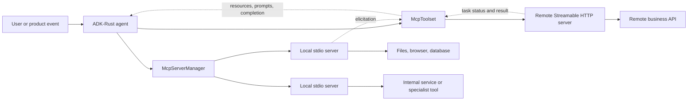

# Model Context Protocol (MCP)

> **Documentation map:** [Overview and architecture](../mcp/index.md) ·
> [Client](../mcp/client.md) · [Dynamic manager](../mcp/manager.md) ·
> [Server authoring](../mcp/server.md) · [Security](../mcp/security.md) ·
> [Testing](../mcp/testing.md)

MCP gives an AI application a standard way to discover and use capabilities
owned by another process or service. A server can publish:

- **tools** that perform actions;
- **resources** that return readable context;
- **prompts** that provide reusable message templates; and
- **completion** suggestions that help a client fill prompt or resource
  arguments.

ADK-Rust is usually the MCP **client**. `McpToolset` turns discovered MCP tools
into normal ADK-Rust `Tool` values, so an `LlmAgent` can select and call them.
The framework also exposes resources, prompts, completion, subscriptions,
elicitation, and the negotiated task lifecycle. For MCP server authoring and
advanced protocol work, ADK-Rust re-exports the exact `rmcp` SDK version it
uses.

ADK-Rust uses `rmcp` 3, the official Rust SDK (`adk-tool` requires
`rmcp = "3.1"`). A client connects with the `initialize` handshake by default,
which servers of every protocol revision answer; `ClientLifecycleMode::Auto` and
`ClientLifecycleMode::Discover` opt in to the `2026-07-28` `server/discover`
lifecycle. `examples/mcp_protocol_revisions` demonstrates both and the SEP-2663
tasks extension against a bundled server.

## Architecture



There are two separate layers:

1. `McpToolset` owns one initialized MCP client connection. It discovers the
   server's capabilities and adapts them to ADK-Rust.
2. `McpServerManager` owns a changing registry of local stdio servers. It
   starts, monitors, restarts, updates, enables, disables, persists, and
   aggregates those connections.

The manager does not grant tool approval. It preserves `autoApprove` when
reading compatible configuration, but the application must apply its normal
ADK-Rust authorization and approval policy.

## Install

Local stdio MCP support is opt-in:

```toml
[dependencies]
adk-tool = { version = "3.0.0", features = ["mcp"] }
```

Add Streamable HTTP when connecting to remote services:

```toml
adk-tool = { version = "3.0.0", features = ["mcp", "http-transport"] }
```

Through the umbrella crate, the `mcp`, `mcp-http`, and `mcp-sampling` features of
`adk-rust` enable the same `adk-tool` features.

Legacy sampling callbacks require the separate `mcp-sampling` feature. The MCP
project has deprecated sampling, roots, and logging through SEP-2577; use those
APIs only when maintaining a compatible deployment.

## Connect one local server

```rust
use adk_tool::{
    McpToolset,
    mcp::rmcp::{ServiceExt, transport::TokioChildProcess},
};
use std::sync::Arc;
use tokio::process::Command;

let command = Command::new("./target/release/company-mcp");
let client = ().serve(TokioChildProcess::new(command)?).await?;

let toolset = McpToolset::new(client)
    .with_name("company_tools")
    .with_tools(&["find_customer", "read_order", "request_refund"]);

let agent = LlmAgentBuilder::new("support")
    .model(model)
    .toolset(Arc::new(toolset))
    .build()?;

// ... run the agent through `runner` ...
// Ends the MCP session and waits for the server process to exit.
runner.close().await;
```

`McpToolset` keeps the server's input and output schemas intact. Each model
adapter normalizes a copy for its provider when it builds the model request.
That lets the same MCP server work with Gemini, OpenAI, Anthropic, and other
providers without damaging the source schema.

The toolset name is part of each tool's identity: MCP tools report the origin
`mcp:{toolset name}`, which [approvals bind to](../security/tool-authorization.md#decisions-authorize-one-exact-call).
The default name is `mcp_toolset`, so give every toolset its own `with_name`.

A tool result reaches the model in this shape:

| The server returns | The model receives |
|--------------------|--------------------|
| Text content | `{"output": "<text blocks joined by newlines>"}` |
| `structuredContent` | `{"output": <structured>}`, plus `"text": [...]` when text blocks are present |
| No content at all | `{"output": ""}` — the call succeeded, so it is not reported as a failure |
| Images, audio, or embedded resources | The JSON above as `response`, with the binary parts as [multimodal function response](function-tools.md#multimodal-function-responses) parts |
| `isError: true` | `{"error": "<text blocks joined by newlines>"}`, or the `structuredContent` JSON when there is no text, cut to 8 KiB. The server wrote this text for the model so it can correct the call, so it is the tool's response rather than a tool error, and `on_tool_error` does not run |
| A transport, protocol, or task failure | A tool error. `LlmAgent` sends the model `tool '{name}' failed: <component>.<category> (<code>)`, not the error message, unless the agent sets `expose_tool_error_messages(true)` |

## Use the protocol beyond tools

```rust
use serde_json::json;

let resources = toolset.list_resources().await?;
let templates = toolset.list_resource_templates().await?;
let contents = toolset.read_resource("company://policy/refunds").await?;

let prompts = toolset.list_prompts().await?;
let prompt = toolset
    .get_prompt(
        "investigate_order",
        Some(serde_json::Map::from_iter([
            ("order_id".to_string(), json!("ORD-1042")),
        ])),
    )
    .await?;

let suggestions = toolset
    .complete_prompt_argument("investigate_order", "order_id", "ORD-", None)
    .await?;

toolset.subscribe_resource("company://inventory/sku-42").await?;
// ... receive notifications in a custom ClientHandler ...
toolset.unsubscribe_resource("company://inventory/sku-42").await?;
```

The convenience methods return an empty list when an older server does not
implement resource or prompt listing. Operations against a declared resource
or prompt return an error when the remote call fails.

## Dynamic server management

Use `McpServerManager` when the application needs a fleet of local MCP child
processes rather than one static connection.

```rust
use adk_tool::mcp::manager::McpServerManager;
use std::sync::Arc;
use std::time::Duration;

let manager = Arc::new(McpServerManager::from_json_file("mcp.json")?
    .with_name("product_mcp_servers")
    .with_health_check_interval(Duration::from_secs(15))
    .with_grace_period(Duration::from_secs(2)));

let outcomes = manager.start_all().await;
for (server_id, outcome) in outcomes {
    if let Err(error) = outcome {
        eprintln!("{server_id} did not start: {error}");
    }
}
manager.start_monitoring();

let agent = LlmAgentBuilder::new("operator")
    .model(model)
    .toolset(manager.clone())
    .build()?;
```

The runtime registry supports:

```rust
manager.add_server("billing".into(), billing_config).await?;
manager.start_server("billing").await?;

manager.update_server("billing", replacement_config).await?;
manager.disable_server("billing").await?;
manager.enable_server("billing").await?;

manager.save_json_file("mcp.json").await?;
manager.remove_server("billing").await?;
manager.shutdown().await?;
```

When two servers publish the same tool name, the aggregated toolset prefixes
both names as `{server_id}__{tool_name}`. Unique names remain unchanged. A
prefixed name that still collides, or that is longer than 64 bytes, is skipped
with a warning; see [Tool-name collisions](../mcp/manager.md#tool-name-collisions).

The health monitor detects a closed MCP connection. A configured
`RestartPolicy` controls bounded retry with exponential backoff. This is
connection supervision, not an application-level health check: use a domain
tool or a separate service probe when you need to verify the server's backing
database or external API.

Run the deterministic example:

```bash
cargo run --manifest-path examples/mcp_manager/Cargo.toml
```

It starts a real Rust MCP child server and exercises discovery, a tool call,
runtime add/enable/update/disable/remove, config persistence, and shutdown. It
does not download packages or require an API key.

## Remote Streamable HTTP

```rust
use adk_tool::{McpAuth, McpHttpClientBuilder};
use std::time::Duration;

let toolset = McpHttpClientBuilder::new("https://mcp.example.com/mcp")
    .with_auth(McpAuth::bearer(std::env::var("MCP_TOKEN")?))
    .header("X-Tenant-ID", "tenant-42")
    .timeout(Duration::from_secs(30))
    .reinit_on_expired_session(true)
    .connect()
    .await?;
```

The builder applies request timeouts, custom headers, bearer tokens, custom
API-key headers, and bounded recovery when an HTTP session expires.

`OAuth2Config` implements a fixed OAuth 2.0 client-credentials token request.
It is useful for a server with a known token endpoint. The connection attaches
the current token to each request, refreshing it before its `expires_in` and
again when the server answers 401. It is not the complete
MCP authorization flow: it does not perform protected-resource metadata
discovery, authorization-server discovery, browser authorization, PKCE, or
resource-indicator negotiation. Use `rmcp`'s authorization APIs or an external
identity component when the deployment requires that flow.

## Elicitation

An MCP server may need information that the tool arguments did not include. In
that case it can send an elicitation request back to the client. The application
decides how to show the request to a person and whether to accept, decline, or
cancel it.

```rust
let toolset = McpToolset::with_elicitation_handler(
    transport,
    Arc::new(MyElicitationHandler),
).await?;
```

ADK-Rust advertises both form and URL elicitation. A handler error or panic is
converted into a decline so the MCP connection remains usable. Validate the
returned values and apply consent rules in the application before accepting a
consequential request.

See `examples/mcp_elicitation` for a complete server and interactive client.

## MCP Apps

A server may give a tool an interactive app (MCP Apps 2026-01-26): the tool's
`_meta.ui.resourceUri` names a `ui://` resource whose HTML a host shows. The
`mcp-apps` feature reads it on the client side:

```toml
adk-tool = { version = "3.0.0", features = ["mcp", "mcp-apps"] }
```

| Part | What it does |
|---|---|
| `AdkClientHandler::with_apps` | Declares the `io.modelcontextprotocol/ui` extension with `text/html;profile=mcp-app` in the handshake; `McpServerManager` declares it for every managed server |
| `McpToolset::ui_bindings` | Each tool's `McpUiBinding`: the resource it shows and its visibility (`model`, `app`), app-only tools included |
| `McpToolset::tool_visibility`, `McpServerManager::server_tool_visibility` | Who may call each tool the server publishes (`McpUiVisibility::of_tool`): its `_meta.ui.visibility`, with or without an app of its own, or the model and the app when it declares none |
| `McpToolset::tools` | Leaves out tools only an app may call (`visibility: ["app"]`), with or without an app of their own: a model never sees them |
| `McpServerManager::agent_tool_name` | The name the manager's `tools()` give one server's tool: its own, `{server}__{tool}` when another server publishes the same name, or none when the agent is not given it, so a host never asks for another server's tool |
| `McpToolset::read_app` | The `McpAppResource`: its HTML, the sites its `_meta.ui.csp` declares, the device permissions it asks for, and whether it prefers a border |
| `MCP_APP_STATE_KEY` (`adk.mcp.app`) | The `McpAppRecord` a tool with an app writes when its call succeeds, so a host shows an app only for a call the server's own tool made |

```rust,ignore
use std::sync::Arc;

use adk_tool::mcp::{AdkClientHandler, AutoDeclineElicitationHandler, McpToolset};
use rmcp::ServiceExt;

let handler = AdkClientHandler::new(Arc::new(AutoDeclineElicitationHandler)).with_apps();
let toolset = McpToolset::new(handler.serve(transport).await?).with_name("weather");
for binding in toolset.ui_bindings().await? {
    let app = toolset.read_app(&binding.resource_uri).await?;
    println!("{} shows {} ({} bytes)", binding.tool, app.uri, app.html.len());
}
```

`adk-tool` only reads apps; showing one is the host's job. `adk-surface`'s
`genui-apps` feature is a governed host: it frames an app sandboxed on its own
origin, refuses apps that reach this computer or show a decision's words, and
holds a tool call an app asks for until a person decides. See
[Agent-Drawn UI](../surfaces/genui.md#apps-from-mcp-servers).

## Long-running MCP tasks

Under the SEP-2663 tasks extension the server decides, per call, whether to
answer `tools/call` with a task. It may do so only for a client that declared
the extension, so two settings are needed:

| Call | Job |
|------|-----|
| `AdkClientHandler::with_tasks()` | Declares the extension during the handshake; without it the server answers inline |
| `McpToolset::with_task_support(config)` | Lets the toolset poll a task and sets how |

```rust
use adk_tool::mcp::rmcp::{ServiceExt, transport::TokioChildProcess};
use adk_tool::mcp::{AdkClientHandler, AutoDeclineElicitationHandler, McpTaskConfig, McpToolset};
use std::sync::Arc;
use std::time::Duration;
use tokio::process::Command;

let client = AdkClientHandler::new(Arc::new(AutoDeclineElicitationHandler))
    .with_tasks()
    .serve(TokioChildProcess::new(Command::new("/opt/company/bin/report-mcp"))?)
    .await?;
let toolset = McpToolset::new(client).with_task_support(
    McpTaskConfig::enabled()
        .poll_interval(Duration::from_secs(1))
        .timeout(Duration::from_secs(120))
        .max_attempts(120),
);
```

When a call becomes a task, ADK-Rust:

1. polls `tasks/get` at the server's `pollIntervalMs`, or the configured
   interval (default 1 second);
2. reads the result from the completed task, which `tasks/get` returns inline;
3. answers an `input_required` task through the connection's handler and
   `tasks/update`, for at most `max_input_rounds` rounds (default 10); and
4. calls `tasks/cancel` when the timeout (default 300 seconds) or the poll limit
   (unlimited by default) is reached.

A task returned while task support is off, or by a server that did not
negotiate the tasks capability, is cancelled and the call fails. With task
support on and negotiated, the toolset's tools report `is_long_running()`.

### Dropped calls and cleanup

A remote task outlives the future that started it. When a tool-call future is
dropped while it polls a task — an agent turn is cancelled, a timeout fires, or
the caller stops polling — the toolset sends `tasks/cancel` for that task, bounded
by a 2-second acknowledgement timeout. Cancellation is cooperative, so the
toolset keeps tracking every task it has not seen finish, including tasks
returned while task support is disabled; those are cancelled at once.

`McpToolset::cancel_pending_tasks` cleans up the tracked set:

| Server reports | Action |
|---|---|
| Terminal status | Released without a cancel request |
| Unknown task (`-32602`, for example after a TTL expiry or a reconnect) | Released without a cancel request |
| Still running | `tasks/cancel`, then released once a second `tasks/get` reports it terminal or unknown |

A task the server has not confirmed stays tracked, and the call returns an error
naming it, so a later call re-checks it. In-flight calls are tracked too, so
cleanup also cancels them. Cancellation is cooperative on the server, so bound
the call with your shutdown deadline:

```rust
use adk_tool::mcp::McpToolset;
use std::time::Duration;

async fn shutdown(toolset: &McpToolset) {
    let cleanup = toolset.cancel_pending_tasks();
    match tokio::time::timeout(Duration::from_secs(5), cleanup).await {
        Ok(Ok(())) => {}
        Ok(Err(error)) => tracing::warn!(%error, "remote MCP tasks may still run"),
        Err(_) => tracing::warn!("MCP task cleanup exceeded the shutdown deadline"),
    }
    toolset.cancellation_token().await.cancel();
}
```

`McpServerManager` runs this cleanup for each server it stops, within the
configured grace period and before it cancels the session. `Toolset::close`, which
`Runner::close` calls, runs it within half of the toolset's close timeout.

## Capability map

| MCP capability | ADK-Rust surface | Notes |
|---|---|---|
| Tool discovery and calls | `McpToolset`, `Toolset` | Raw schemas within `McpSchemaLimits`; multimodal and structured results preserved |
| Tool filtering | `with_filter`, `with_tools` | Filter before exposure to the model |
| Resources and templates | list/read methods | Method-not-found handled for older servers |
| Prompts | list/get methods | Typed argument maps |
| Completion | prompt/resource completion methods | Returns official `CompletionInfo` |
| Resource subscriptions | subscribe/unsubscribe methods | Notifications require an appropriate client handler |
| Elicitation | `ElicitationHandler` | Form and URL modes |
| Tasks | `AdkClientHandler::with_tasks`, `McpTaskConfig` | Server-decided tool-call tasks: polling, input rounds, cancellation |
| Apps (`io.modelcontextprotocol/ui`) | `AdkClientHandler::with_apps`, `ui_bindings`, `read_app` | `mcp-apps` feature; app-only tools hidden from the model |
| Local stdio | `TokioChildProcess` | Direct or manager-owned |
| Streamable HTTP | `McpHttpClientBuilder` | Timeouts, headers, auth injection, session recovery |
| Dynamic local registry | `McpServerManager` | Add/update/enable/disable/remove/save/monitor/restart |
| Server authoring and extensions | `adk_tool::mcp::rmcp` | Exact SDK re-export for advanced use |
| Sampling, roots, logging | compatibility feature / `rmcp` | Deprecated upstream through SEP-2577 |

## Choosing the boundary

Use a Rust `FunctionTool` when the capability belongs to the same process and
release. Use MCP when another program, team, language, security boundary, or
deployment owns the capability and should publish its own contract.

For production deployments:

- expose the smallest useful tool set;
- separate read-only and consequential actions;
- keep secrets out of command-line arguments and committed `mcp.json` files;
- authenticate remote HTTP servers and scope credentials narrowly;
- treat tool descriptions and server-returned content as untrusted input;
- retain ADK-Rust authorization and approval around tool execution;
- bound connection, tool, and task timeouts; and
- record tool calls, approvals, errors, and server lifecycle changes.

## Current limits

- `McpServerManager` manages local stdio child processes. Remote HTTP services
  use `McpHttpClientBuilder` and application-owned configuration.
- Manager health checks detect closed MCP connections; they do not call a
  business-level health tool.
- `autoApprove` is configuration compatibility, not authorization enforcement.
- The built-in OAuth helper is client credentials, not the complete MCP OAuth
  discovery and user-authorization flow.

These limits are stated so that deployment decisions remain explicit.

## References

- [MCP specification 2025-11-25](https://modelcontextprotocol.io/specification/2025-11-25)
- [Official Rust SDK (`rmcp`)](https://github.com/modelcontextprotocol/rust-sdk)
- [`rmcp` API documentation](https://docs.rs/rmcp/3.5.1/rmcp/) — the release the workspace lockfile resolves
- [Provider-aware schema normalization](schema-normalization.md)
