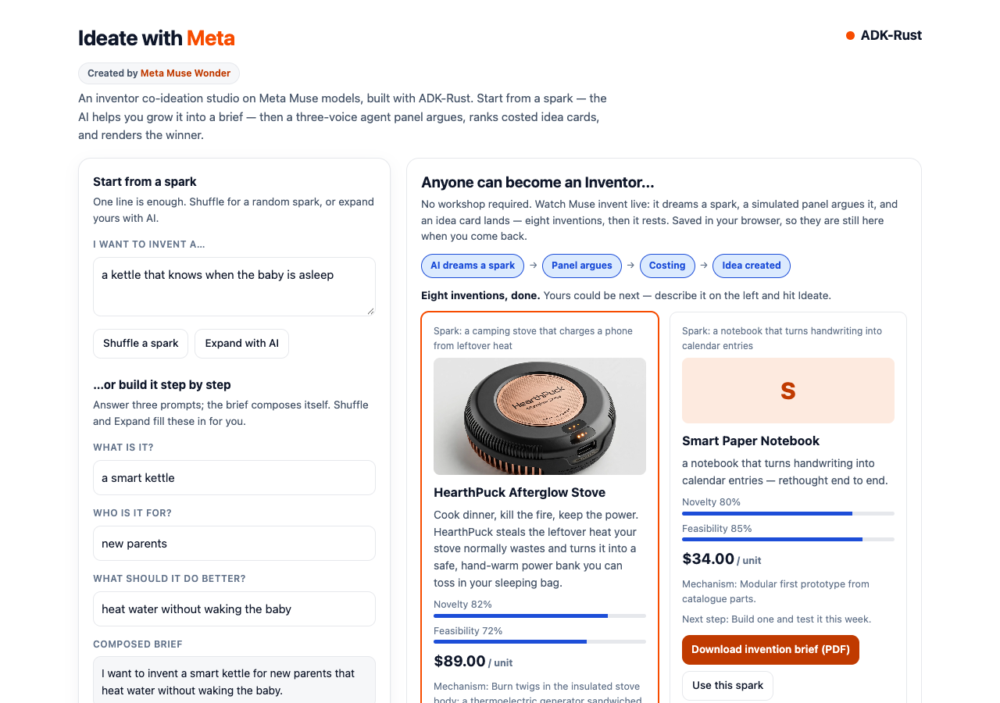
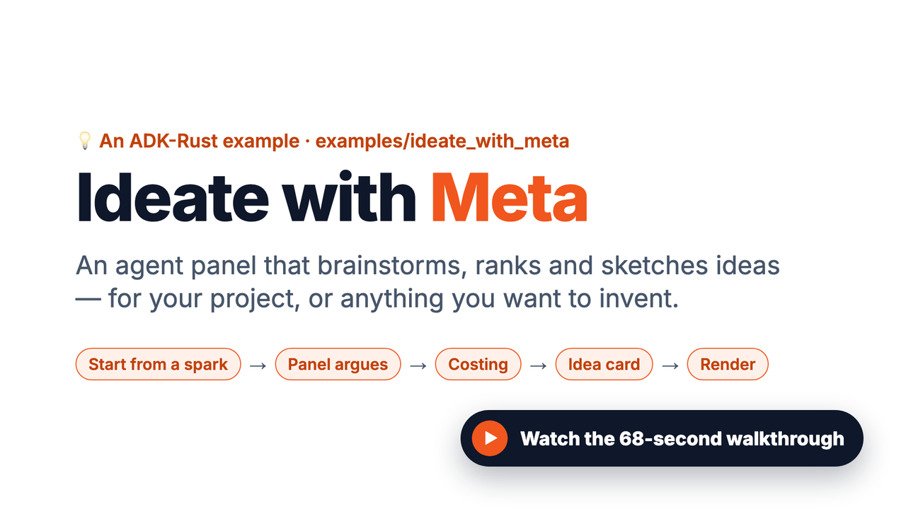
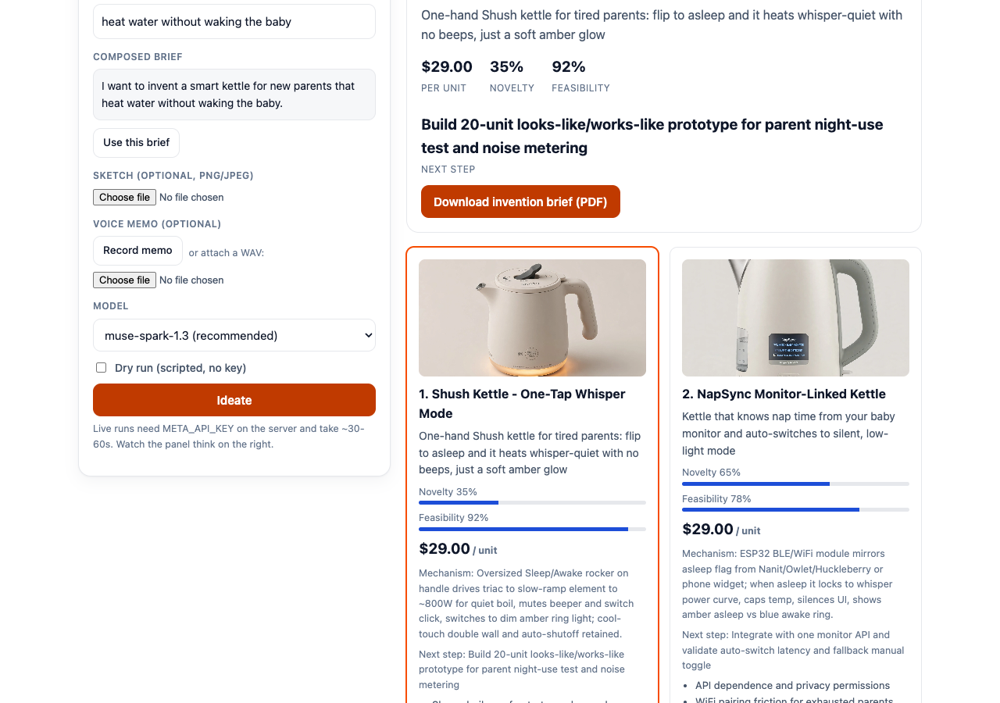
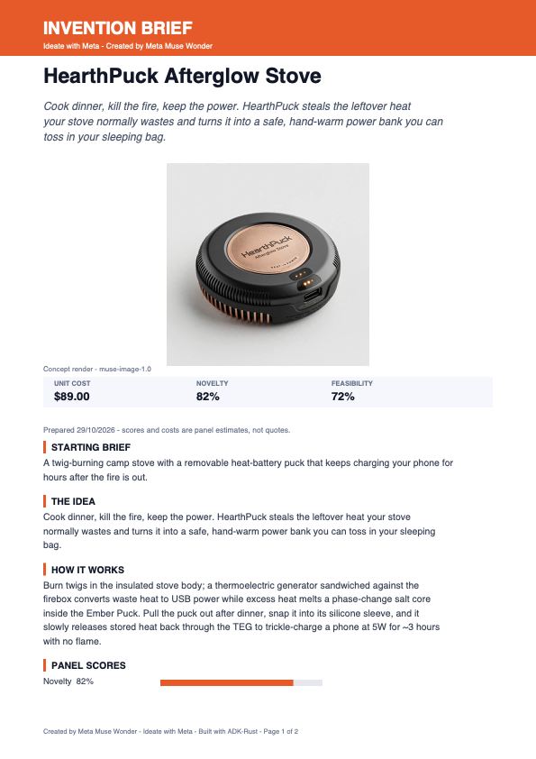
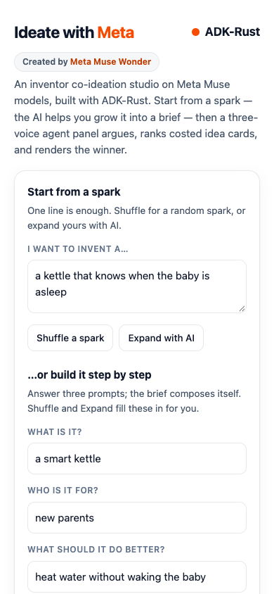

# Ideate with Meta

An inventor co-ideation studio built on Meta's Muse models and ADK-Rust.
Describe an invention — in text, with a sketch, or in a voice memo — and a
panel of Muse agents argues about it from three angles, ranks the survivors
into costed, structured idea cards, renders every concept, and turns any
card into a print-ready invention brief.

Created by **Meta Muse Wonder**.



## Watch the walkthrough

[](media/ideate-with-meta-walkthrough.mp4)

A 68-second walkthrough (MP4, 2.2 MB, no audio): Meta Muse in ADK-Rust — agents,
multimodal input with strict JSON, Responses, images, and voice transcription —
then this example end to end.

## Try it in 60 seconds

```bash
# Web UI (recommended): open http://127.0.0.1:8470 in a browser
META_API_KEY=... cargo run --manifest-path examples/ideate_with_meta/Cargo.toml -- --web

# Offline: same graph, scripted model, no key, no spend
cargo run --manifest-path examples/ideate_with_meta/Cargo.toml -- --dry-run --brief "solar backpack"

# CLI, text brief
META_API_KEY=... cargo run --manifest-path examples/ideate_with_meta/Cargo.toml -- --brief "solar backpack"

# CLI, with a sketch and a voice memo
META_API_KEY=... cargo run --manifest-path examples/ideate_with_meta/Cargo.toml -- --brief "solar backpack" --sketch sketch.png --audio memo.wav
```

`META_API_KEY` or `MODEL_API_KEY` works. The UI binds loopback by default;
`--addr 0.0.0.0:8470` opts into the LAN explicitly. Live runs need the key
on the server; the **Dry run** toggle in the UI exercises the same pipeline
with a scripted model and no spend.

## What it looks like

| View | What you see |
|---|---|
| Inventor wall (right, on load) | Muse invents on its own — see below |
| Ideation results | Hero winner plus ranked cards, one render each |
| Invention brief (PDF) | Any card becomes a formatted, downloadable brief |
| Mobile | The studio collapses to one column |







## The use case

Early-stage invention is a divergence problem: many candidate concepts
fast, then a disciplined convergence pass that prices and ranks them.
Ideate with Meta mirrors how a good product team works:

1. **Divergence.** Three panel voices ideate independently and in parallel —
   a wild inventor, a pragmatic engineer, and a market scout — so cost,
   novelty, and demand get argued before anyone commits.
2. **Convergence.** A second pass deduplicates the pool, calls a costing
   tool for its top picks, and emits machine-checkable idea cards (strict
   JSON Schema), not prose.
3. **Visualization.** Every surviving card gets its own concept render, and
   the winner also leads as a hero — the output is something you can show,
   pitch, and print, not just read.

Inputs are multimodal from the start: a napkin sketch is seen natively by
the model, and a voice memo is transcribed and folded into the brief.

## Using the studio

### Grow a brief, do not write one

1. **Start from a spark.** Type one line after *I want to invent a…*, hit
   **Shuffle a spark** for a random starter, or dictate with **Record memo**
   (the page records, downsamples to 16kHz mono WAV in-browser, and the
   memo is transcribed on Ideate; WAV attach remains as a fallback).
2. **Expand with AI.** One low-effort Muse call polishes the fragment into
   a full brief sentence, then a second call splits it into the composer.
3. **Or build it step by step.** *What is it? / Who is it for? / What should
   it do better?* compose the brief live as you type. Shuffle and Expand
   fill these three fields for you; **Use this brief** promotes the
   composed text back into the spark.
4. **Add evidence.** Attach a sketch (previewed inline; the intake agent
   sees it natively) and pick a model — Spark 1.3 by default, Wonder for
   the flagship.
5. **Hit Ideate.** The panel streams stage-by-stage on the right as
   server-sent events: intake bullets, each voice arguing, costing calls,
   then renders. Nothing blocks; the transcript stays readable throughout.
6. **Take it away.** Each card carries its own render, novelty and
   feasibility bars, unit cost, mechanism, risks, and next step.
   **Download invention brief (PDF)** turns that card into a formatted
   two-page brief (see *Invention briefs* below).

### The inventor wall

Until your first real run, the right pane runs an auto-demo under
**Anyone can become an Inventor…**:

- Muse dreams a spark; the flow lights up **AI dreams a spark → Panel
  argues → Costing → Idea created** at reading pace while
  `POST /api/demo-idea` creates one real idea card with its own 512px
  render.
- It invents **eight** concepts, then stops. Cards persist in
  `localStorage`, so a refresh keeps the wall (if image data overflows
  storage, cards persist without thumbnails).
- **Replay 8 inventions** clears and re-runs; **Clear saved** empties the
  wall; **Use this spark** loads any demo brief into the studio.
- Hitting **Ideate** dismisses the wall and the real results take its
  place; **Show inventor examples** brings it back.

### Invention briefs (PDF)

Every card — demo or real — has a **Download invention brief (PDF)**
button. The page generates a dependency-free PDF in the browser (no
library, no server round-trip) containing:

- an orange **INVENTION BRIEF** header with title, pitch, the card's
  concept render, and a score strip (unit cost, novelty, feasibility);
- the starting brief, the idea, and how it works;
- panel score bars, unit economics, and risks to retire first;
- the panel's next step plus a **Your first 7 days** prototype plan;
- a *Created by Meta Muse Wonder* footer on every page.

## Capability map

Every Meta surface the example exercises, and where it shows up:

| Muse capability | Model | ADK-Rust client | Where it shows |
|---|---|---|---|
| Chat + reasoning effort | `muse-spark-1.3` (default), `1.2`, `1.1` | `MuseClient` (Chat Completions) | Intake, panel, converger, Expand, Decompose, demo ideas |
| Flagship reasoning | `muse-wonder-1.0` | `MuseConfig::wonder` preset | Model picker for hard briefs |
| Strict structured output | Spark / Wonder | `response_schema` on `GenerateContentConfig` | `IdeaCard[]`, decompose, demo payloads — schema-valid or the run fails |
| Native vision | Spark / Wonder | `image_url` content parts | Sketch attached to the brief |
| Tool calling | Spark / Wonder | `estimate_cost` `FunctionTool` | Converger must cost its top 3 before ranking |
| Image generation | `muse-image-1.0` | `MuseImagesClient::generate` | Hero render, one 512px render per card, demo thumbnails |
| Speech-to-text | `muse-voice-transcribe-1.0` | `MuseAsrClient::transcribe` | Recorded or attached voice memos |
| Streaming | Spark / Wonder | SSE from `/api/ideate/stream` | Live stage transcript while the panel works |

Muse details that shaped the design:

- **Reasoning effort per stage.** Intake runs `low` (cheap normalization),
  the panel `medium`, the converger `high`. Spark reasoning counts toward
  `max_tokens`, so the client floors small output caps at 1,024 instead of
  returning empty `length` responses.
- **Strict means strict.** The schemas go out as `response_format` JSON
  Schema (strict). Strict mode requires `additionalProperties: false` on
  every nested object and every property in `required`; the client closes
  nested objects automatically.
- **Scores are normalized, never trusted.** Models occasionally answer
  novelty on a 0–5 scale despite the schema. The server rescales scores
  into 0.0–1.0 and the page clamps again, so a card can never render
  `400%`.
- **Media is bounded.** Renders are one hero plus one small image per card
  (three cards per run), and demo thumbnails are eight one-time images
  that then persist locally — image generation ($0.01/image) and ASR
  ($0.18/hour) never run inside the ideation loop.

## Architecture

```
       sketch (vision) ──┐
     voice memo (ASR) ───┤
              brief ─────┴──▶ intake ──▶ panel ×3 ──▶ converger ──▶ idea cards ──▶ renders (hero + per-card)
                            (Spark,      (Spark,       (Spark,        (IdeaCard[]   (muse-image-1.0)
                             low)         medium)       high+tools)    JSON)
```

### One real Ideate run

1. The browser posts the brief (plus optional sketch/audio as base64) to
   `POST /api/ideate/stream`.
2. The server transcribes any memo (ASR), attaches any sketch as a native
   vision part, and runs the governed ADK pipeline: `SequentialAgent`
   intake → `ParallelAgent` panel → converger with `estimate_cost`.
3. Stage lines stream back as SSE while the graph runs; one final
   `result` event carries the cards.
4. The server renders the hero and one small image per remaining card,
   then the page paints hero, cards, and transcript. Scores are
   normalized server-side (`score01`) before they travel.

### One demo invention

1. The page picks an unused spark and lights the simulated panel flow.
2. `POST /api/demo-idea` makes one low-effort strict-schema Muse call
   (spark, brief, one card) and one 512px image call.
3. The card lands on the wall and is saved to `localStorage`; after eight,
   the loop stops. Without a key, a deterministic dry fallback keeps the
   demo working offline.

### Where the code lives

| Piece | Location | What it does |
|---|---|---|
| Pipeline + CLI | [`src/main.rs`](src/main.rs) | Agents, costing tool, scripted dry model, one-shot runs |
| Web server + page | [`src/web.rs`](src/web.rs) | Tokio HTTP server, the single-page UI, SSE, demo, PDF generator |
| Chat / Images / ASR | `adk-model` (`muse` feature) | `MuseClient`, `MuseImagesClient`, `MuseAsrClient` |
| Agent graph | `adk-agent`, `adk-core` | `SequentialAgent`, `ParallelAgent`, `LlmAgent` + `output_schema` |
| Governed tools | `adk-tool`, `adk-core` | `estimate_cost` through ADK's authorized, ledgered tool path |
| Execution | `adk-runner`, `adk-session` | Event streaming; in-memory sessions |

The example is a standalone crate (own `Cargo.toml`/`Cargo.lock`, outside
the workspace) depending on workspace crates by path. Every model call is
priced through the `adk-model` catalog (Spark $1.25/$4.25 per 1M tokens,
cached input $0.15).

### HTTP routes

| Route | Purpose |
|---|---|
| `GET /` | The studio page |
| `GET /health` | `{"ok":true}` |
| `POST /api/ideate/stream` | One ideation as SSE (`stage`, then `result`/`error`) |
| `POST /api/ideate` | The same run as a single JSON response |
| `POST /api/expand` | One-line spark → polished brief |
| `POST /api/decompose` | Brief → what / who / better for the composer |
| `POST /api/demo-idea` | One demo invention (card + thumbnail) |

### CLI flags

| Flag | Meaning |
|---|---|
| `--brief <text>` | The invention brief (required unless `--web`) |
| `--sketch <png\|jpg>` | Sketch image the intake agent sees natively |
| `--audio <wav>` | Voice memo transcribed into the brief (16/24kHz mono WAV) |
| `--web` | Serve the UI instead of a one-shot run |
| `--addr <host:port>` | Listen address (default `127.0.0.1:8470`) |
| `--dry-run` | Scripted model; no API calls |

## Outputs

- **Idea cards**: title, pitch, mechanism, novelty and feasibility scores,
  unit cost, risks, and a concrete next step — as validated JSON.
- **Concept renders**: one per card plus the hero (the API returns WebP by
  default; the CLI writes `out/concept.<ext>` by magic bytes, the UI
  inlines data URLs).
- **Invention briefs**: a formatted PDF per card, generated in-page.
- **Stage transcript**: every agent line and tool call, printed (CLI) or
  streamed (UI) — useful for seeing the panel actually disagree.

## Troubleshooting

| Symptom | Cause and fix |
|---|---|
| “server started without META_API_KEY” | Start `--web` with `META_API_KEY` set, or tick **Dry run** |
| Demo wall shows letters, not renders | Dry mode, an image call failed, or thumbnails were slimmed to fit storage — cards still persist |
| Scores look like 35% on a great idea | Scores are panel estimates on a strict 0–1 scale; re-run or switch to Wonder for a second opinion |
| PDF button does nothing | Allow downloads/popups for the page; the file is generated locally as `<idea>-invention-brief.pdf` |
| Live run feels slow | Panel + converger + up to three renders run sequentially by stage; watch the transcript, or use Dry run |

## Going further

- **Workshop loop**: swap the chat pipeline for `MuseResponsesClient`
  (`previous_response_id` chaining) so each ideation turn carries reasoning
  state across a long session — the pattern behind Meta's legal-agent
  workshop, including save/resume of the notebook between turns.
- **Prior art**: ground the market scout in `adk-rag` over patent abstracts
  instead of model memory alone.
- **Voice-first**: replace file memos with the ASR realtime WebSocket for
  push-to-talk ideation.
- **Human gate**: park the converger's top card behind ADK's tool
  confirmation flow so an inventor approves before anything renders.
