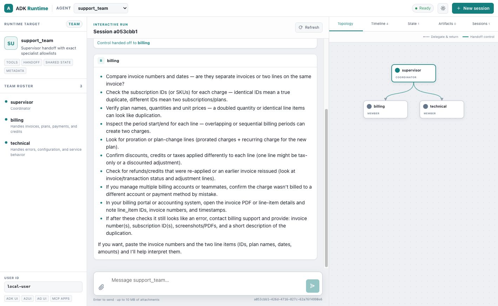

# Portable team



This example compiles a serializable `TeamSpec` into one executable root. Its
allowlist contains exactly two handoff edges:

```text
supervisor → billing
supervisor → technical
```

Neither specialist may hand off to the other or back to the supervisor.

## Run

```bash
cargo run --manifest-path examples/runtime_ui_showcase/Cargo.toml \
  --bin runtime-ui-team
```

`/ui/` answers `404`: `adk-server` no longer bundles a runtime UI (spec 3.3 §10 S1), and the
screenshot shows it as it was. Send the prompt through the REST API the binary serves under
`http://127.0.0.1:8088/api/` (`POST /api/run_sse` or `POST /api/run`; see
[Server API](../../../docs/official_docs/deployment/server.md)):

> My invoice includes the same subscription charge twice. What should I verify?

Expected behavior:

1. The supervisor calls `transfer_to_agent` with the exact `billing` target.
2. The run's events show billing taking over from the supervisor.
3. Billing retains control and produces the final Markdown response.
4. The session's events and `__adk_team_execution_v1` state record the completed handoff.
