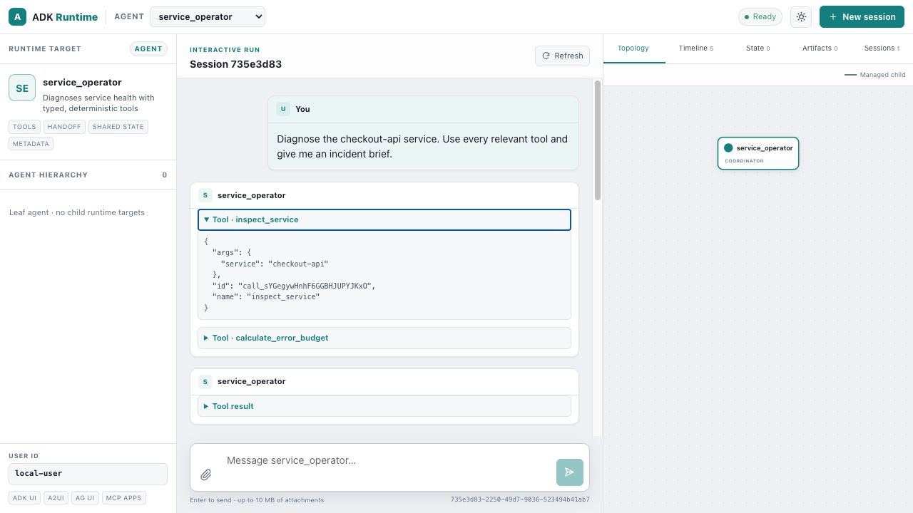

# Agent with tools



This example builds one `LlmAgent` with two typed, deterministic tools:
`inspect_service` and `calculate_error_budget`. The tools make no external
network calls; only the OpenAI model request is live.

## Run

```bash
cargo run --manifest-path examples/runtime_ui_showcase/Cargo.toml \
  --bin runtime-ui-tools
```

`/ui/` answers `404`: `adk-server` no longer bundles a runtime UI (spec 3.3 §10 S1), and the
screenshot shows it as it was. Send the prompt through the REST API the binary serves under
`http://127.0.0.1:8088/api/` (`POST /api/run_sse` or `POST /api/run`; see
[Server API](../../../docs/official_docs/deployment/server.md)):

> Diagnose the checkout-api service. Use every relevant tool and give me an incident brief.

Expected behavior:

1. The model calls both tools with `service = "checkout-api"`.
2. The run's events carry each tool call and its result.
3. The final response is Markdown with a status table and actions.
4. Session state and telemetry remain available through the session API and
   `/api/debug/trace/session/{id}`.
